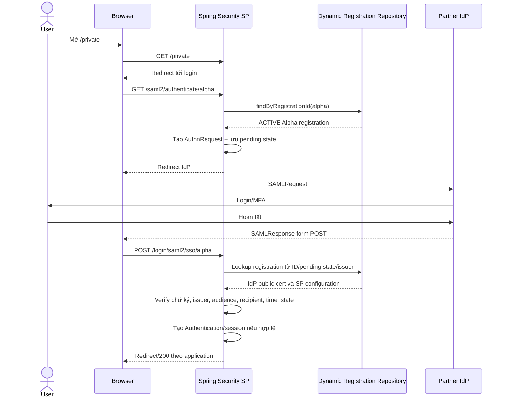
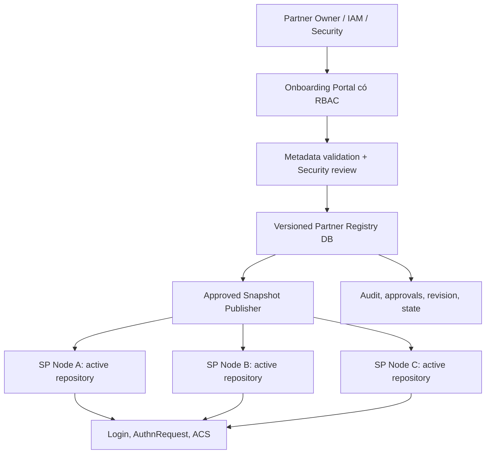
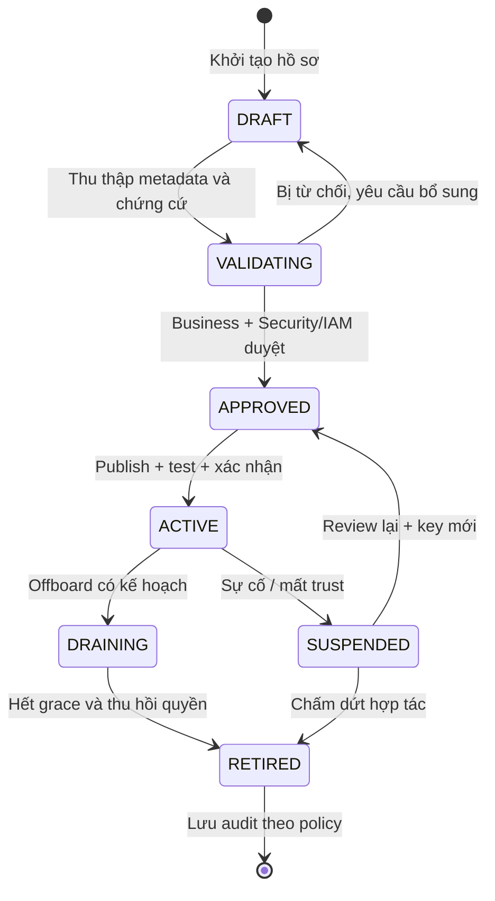

# Kho đăng ký động và quy trình thêm hoặc ngừng một đối tác

## Mục tiêu học tập

Sau bài học, bạn có thể:

1. Trình bày vai trò của `RelyingPartyRegistration`, `RelyingPartyRegistrationRepository` và `IterableRelyingPartyRegistrationRepository` trong Spring Security SAML2 nhiều IdP/tenant.
2. Phân biệt danh sách khai báo tĩnh `application.yml` với **kho đăng ký động** có database, workflow kiểm duyệt, cache và snapshot runtime.
3. Thiết kế quy trình thêm đối tác an toàn từ DRAFT đến ACTIVE: xác minh tổ chức, metadata, issuer, certificate, endpoint, tenant, danh tính và quyền.
4. Thiết kế quy trình ngừng đối tác có kế hoạch và ngừng khẩn: khóa login mới, xử lý AuthnRequest còn bay, ngừng trust, thu hồi phiên/quyền và bảo toàn audit.
5. Viết ví dụ Spring Security 6.4+/Java 17+ cho repository cập nhật **atomic immutable snapshot**; giải thích giới hạn trong môi trường nhiều node.
6. Thực hành một chương trình Java 17+ độc lập cho thấy thay đổi trạng thái đối tác ảnh hưởng tới danh sách ACTIVE mà không làm dữ liệu bị sửa nửa chừng.
7. Kiểm thử các trường hợp issuer trùng, chứng thư rollover, SSRF ở metadata URL, identity/tenant mix-up và phiên còn hoạt động sau offboarding.

## 1. Bối cảnh: nhiều IdP và tenant trong một ứng dụng

Một ứng dụng B2B `https://portal.example.org` có thể phục vụ nhiều doanh nghiệp. Mỗi doanh nghiệp quản lý danh tính qua IdP riêng; ứng dụng là **Service Provider (SP) / Relying Party (RP)** và chấp nhận SAMLResponse sau khi xác minh đầy đủ.

| Đối tác | Tenant nội bộ | IdP issuer | Registration ID |
| --- | --- | --- | --- |
| Alpha | `tenant-alpha` | `https://idp.alpha.example/saml` | `alpha` |
| Beta | `tenant-beta` | `https://idp.beta.example/saml` | `beta` |
| Gamma đang thẩm định | `tenant-gamma` | `https://idp.gamma.example/saml` | `gamma` chưa ACTIVE |

Với vài đối tác cố định, có thể dùng YAML cấu hình `spring.security.saml2.relyingparty.registration`. Khi thường xuyên phải **thêm, ngừng, khóa khẩn cấp, thay metadata hoặc luân chuyển cert**, cần quy trình thay đổi cấu hình trong runtime mà không nhất thiết rebuild ứng dụng. Đây là bài toán **dynamic registration store**.

Động **không có nghĩa** một người dùng có thể tự đăng ký bất kỳ issuer/metadata URL rồi yêu cầu ứng dụng tin IdP đó. Cơ chế động là cách **phân phối cấu hình đã được phê duyệt**, không phải cách bỏ kiểm soát trust.

### 1.1. Các định danh dễ nhầm

| Khái niệm | Ai xác lập? | Chức năng |
| --- | --- | --- |
| `registrationId` | SP, ví dụ `alpha` | Tra một cấu hình RP–IdP nội bộ; thường nằm trong URL khởi tạo login và ACS |
| IdP `entityId` / `Issuer` | IdP, được SP phê duyệt | Xác định **bên phát Assertion** được tin |
| SP `entityId` | SP, được đối tác đăng ký | Xác định **audience** mà SAML Assertion được phát cho |
| ACS URL | SP, đăng ký tại IdP | Nơi browser POST `SAMLResponse` để SP kiểm chứng |
| Tenant ID | Hệ thống ứng dụng | Phạm vi dữ liệu, user và authorization cục bộ |
| IdP signing certificate | IdP phát public cert, SP thẩm định | Dùng SP verify chữ ký SAMLResponse/Assertion |
| SP signing/decryption private key | SP sở hữu, cất trong KMS/secret manager | Ký AuthnRequest khi cần / giải mã EncryptedAssertion |
| Subject/NameID | IdP khẳng định sau authentication | Định danh user, phải namespaced theo issuer/registration |

**Registration ID không đồng nghĩa tenant ID.** Một IdP có thể phục vụ nhiều tenant; một tenant cũng có thể có nhiều IdP. Mapping phải được khai báo, duyệt và kiểm trong ứng dụng. Không gộp tài khoản hay chuyển quyền chỉ vì email/group name của hai IdP trùng nhau.

## 2. API của Spring Security SAML2

Spring Security sử dụng `RelyingPartyRegistration` để mô tả một liên kết giữa SP và IdP, gồm SP entity ID, ACS, signing/decryption credentials, IdP issuer, SSO URL, bindings và IdP public verification certificates.

**Những API chính:**

- `RelyingPartyRegistrationRepository.findByRegistrationId(id)`: trả cấu hình theo ID cục bộ hoặc `null` nếu không tồn tại.
- `RelyingPartyRegistrationRepository.findUniqueByAssertingPartyEntityId(entityId)`: tìm theo IdP issuer **nếu duy nhất**. Nếu một IdP issuer phục vụ nhiều registrations, không tự lấy bản ghi đầu tiên.
- `IterableRelyingPartyRegistrationRepository`: có thêm `iterator()`; từ Spring Security 6.4, giúp các thành phần như trang login mặc định hoặc metadata endpoints duyệt các registrations.
- `InMemoryRelyingPartyRegistrationRepository`: danh sách trong RAM, đơn giản nhưng thường chỉ phù hợp với cấu hình ít thay đổi nếu không xây lớp publish.
- `CachingRelyingPartyRegistrationRepository`: cache một delegate/rebuild từ nguồn theo cache eviction; hữu ích cho refresh metadata nhưng **không phải** một hệ thống phê duyệt hay ngừng trust tức thời.
- `RelyingPartyRegistrations.fromMetadata(InputStream)`: dựng registration builder từ IdP metadata XML đã có. **Nó không xác minh thay bạn rằng nguồn metadata là đối tác được phép**.

URL thông dụng:

```text
GET  /saml2/authenticate/alpha
POST /login/saml2/sso/alpha
GET  /saml2/metadata/alpha
GET  /saml2/service-provider-metadata/alpha
```

Endpoint đầu tạo AuthnRequest. Endpoint thứ hai là ACS nhận SAMLResponse. Metadata endpoints dùng cho việc chia sẻ thông tin SP; có thể bật bằng `saml2Metadata()`. Thứ tự, URL và support cụ thể phụ thuộc version/custom configuration.

### 2.1. Cách một SAMLResponse được xử lý



**Không tự chọn certificate từ XML SAMLResponse làm nguồn trust.** Thông tin issuer trong response có thể được dùng để tra **trong danh sách được phê duyệt**, nhưng không được tự thêm IdP lạ vào repository.

## 3. Tách control plane khỏi data plane

Một kho động an toàn có **hai phần**:

**Control plane** quản trị quan hệ với đối tác. Nó lưu hồ sơ, metadata bản đã xác minh, cert fingerprints, phê duyệt, lịch sử sửa, trạng thái lifecycle và revision. Nó có thể giao tiếp với IAM, KMS và đội hợp tác.

**Data plane** là các Spring Boot instances phục vụ request, sử dụng snapshot `RelyingPartyRegistration` **đã ACTIVE**. Data plane không được nhận endpoint tự do từ browser để tải metadata và mở trust ngay trong login request.



**Lợi ích:** một lỗi metadata chưa duyệt không được tự chạm runtime; cấu hình mới có thể được xét duyệt và kiểm thử trước khi publish. **Hạn chế:** phải có cơ chế đồng bộ snapshot ở tất cả node và thu hồi phiên/token độc lập khi ngừng đối tác.

### 3.1. Mô hình dữ liệu nên có

| Trường | Ý nghĩa | Điều kiện bảo mật |
| --- | --- | --- |
| `partnerId` | Identity nghiệp vụ nội bộ | Không thay đổi tùy ý hoặc tái sử dụng bừa bãi |
| `tenantId` | Tenant ứng dụng được phục vụ | Xác minh ownership và mapping |
| `registrationId` | Khóa local cho Spring Security | Unique, ổn định, không tái tạo bằng UUID sau mỗi refresh |
| `protocol` | `SAML2`, có thể có OIDC ở subsystem khác | Không lấy OIDC registration thay SAML registration |
| `idpEntityId` | Issuer SAML của IdP | Đúng hợp đồng và metadata đã xác minh |
| `idpSsoLocation` | IdP SSO endpoint | HTTPS/trust/host allowlist |
| `metadataSource` | URL hoặc XML đã tải an toàn | Provenance, metadata digest, không SSRF |
| `verificationCerts` | Public signing certificates IdP | Fingerprints, usages và key rotation policy |
| `spEntityId` / `acsLocation` | Identity và callback public SP | Khớp cấu hình đối tác |
| `spSigningKeyRef` / `spDecryptionKeyRef` | Tham chiếu khóa private của SP | KMS/secret manager, không lưu PEM public |
| `status` | DRAFT, APPROVED, ACTIVE, ... | State transitions có authorization và audit |
| `revision` | Phiên bản cấu hình đơn điệu | Không cho sự kiện cũ ghi đè revision mới |
| `approvedBy` / `approvedAt` | Nguồn phê duyệt | Separation of duties |
| `activatedAt` / `disabledAt` | Mốc hiệu lực | Lưu UTC, phục vụ xử lý in-flight và incident |
| `partnerContact` | Đầu mối phối hợp | Kênh xác nhận thay cert/outage |

Không cần serialize nguyên đối tượng Java `RelyingPartyRegistration` vào DB. Có thể lưu metadata/approved fields/secret references và build Java object khi publish, có version và hash để đối chiếu.

## 4. State machine của đối tác



| Trạng thái | Có cho login mới? | Có trong repository phục vụ SAML? | Hành vi ACS |
| --- | --- | --- | --- |
| **DRAFT** | Không | Không | Không chấp nhận |
| **VALIDATING** | Không | Không | Không chấp nhận |
| **APPROVED** | Không cho production trước khi publish | Chưa | Không chấp nhận |
| **ACTIVE** | Có, theo tenant policy | Có | Verify đầy đủ |
| **DRAINING** | **Không** | Tùy cơ chế gating được review | Có thể chỉ xử lý pending flow đã phát trước cutoff |
| **SUSPENDED** | Không | Bỏ trust/chặn khẩn | Không chấp nhận |
| **RETIRED** | Không | Không | Không chấp nhận |

**Phân biệt DRAINING và SUSPENDED:**

- DRAINING có kế hoạch có thể cho **một số AuthnRequest đã phát** hoàn tất trong khoảng grace ngắn, nhưng cần chặn start-login mới, kiểm pending state/browser session và không chấp nhận unsolicited response. **Repository đơn giản không tự hỗ trợ hai chính sách khác nhau cho outbound và inbound**; cần một enforcement layer riêng được review.
- SUSPENDED do key compromise hoặc IdP mất trust phải **ngừng chấp nhận chữ ký/callback ngay**, kể cả response đang bay. Ưu tiên an toàn hơn khả năng hoàn tất login.

Không để một đối tác chuyển DRAFT → ACTIVE chỉ vì có XML metadata hợp lệ. Mọi state change cần identity của người thao tác, phê duyệt, revision và audit.

## 5. Quy trình onboarding đối tác an toàn

### 5.1. Bước 1 – Xác lập hợp đồng và ranh giới quyền

Đội nghiệp vụ, IAM và Security làm rõ:

1. Tên tổ chức pháp lý, người sở hữu quan hệ, contact kỹ thuật/an ninh và quy trình incident.
2. Tenant(s) được phục vụ; IdP nào có quyền đưa identity vào tenant nào.
3. Chương trình provisioning/deprovisioning, subject ổn định, account linking, chính sách user bị khóa.
4. Vai trò `viewer`/`editor`/`admin` trong ứng dụng, mapping groups/claims được duyệt. Không tự cấp admin từ group display name.
5. Yêu cầu MFA, `AuthnContext`, session timeout, logout/SLO nếu triển khai, incident stop-trust.
6. Thời gian/lịch key rotation, thông báo thay endpoint/certificate, hỗ trợ đối tác khi certificate hết hạn.
7. Môi trường sandbox/staging, test identities, tiêu chí chính thức go-live.

Đầu ra là record **DRAFT**, chưa xuất hiện trong danh sách runtime hoặc login picker.

### 5.2. Bước 2 – Thu thập IdP metadata và chứng thư

SAML IdP metadata thường có `entityID`, `IDPSSODescriptor`, `SingleSignOnService`, `KeyDescriptor` với public verification certificate, có thể có `SingleLogoutService` và metadata validity hints. Đây là **dữ liệu đầu vào cần thẩm định**, không tự là lời bảo đảm an toàn.

Kiểm ít nhất:

- IdP issuer/entity ID đúng tài liệu thỏa thuận và môi trường.
- SSO endpoint HTTPS, binding được hỗ trợ (thường Redirect hoặc POST).
- X.509 cert signing và fingerprints đã trao đổi qua kênh đã xác minh.
- Validity/signature của metadata theo profile/hợp đồng; certificate rollover plan.
- Các metadata có **nhiều IDPSSODescriptor** không được tự động thêm hết.
- Các endpoint IdP khác (SLO, Artifact, SOAP) chỉ bật nếu thực sự sử dụng và đã kiểm an ninh.

**Không đưa private key SP hoặc IdP vào metadata công khai.** Public certificate có thể được trao đổi; private signing/decryption keys phải ở chủ sở hữu, lưu an toàn.

### 5.3. Bước 3 – Chống SSRF khi tải metadata

Một API admin nhận `metadataUrl` có thể gây Server-Side Request Forgery nếu hệ thống tự fetch URL. Không được gọi:

```java
// Anti-pattern: URL/registrationId do browser điều khiển.
String url = request.getParameter("metadataUrl");
RelyingPartyRegistration r = RelyingPartyRegistrations
    .fromMetadataLocation(url)
    .registrationId(request.getParameter("registrationId"))
    .build();
```

Quy trình an toàn:

1. URL metadata nằm trong allowlist host/scheme **đã liên hệ và xác minh với đối tác**.
2. Bắt buộc HTTPS, xác minh TLS hostname, quản lý redirect; không cho redirect tới host/IP bị chặn.
3. Chặn localhost/loopback/link-local/private subnet, cloud metadata IP, các URL `file:`, `jar:`, `ftp:`; kiểm cả DNS resolution, IPv6 và DNS rebinding.
4. Giới hạn response size, timeout, số redirect, không cho infinite XML/entity expansion.
5. Nếu nhận XML upload, lưu immutable revision và hash, thẩm định XML/namespace/metadata signature/trust trước khi build.
6. Kiểm IdP issuer trùng nguồn hợp đồng; **không lấy issuer từ XML rồi tự coi là IdP đã được duyệt**.
7. Xuất bản cert fingerprints/metadata digest để security owner xác minh qua kênh ngoài luồng.

**Dùng `RelyingPartyRegistrations.fromMetadata(InputStream)` với metadata đã tải/thẩm định từ kho nội bộ** là cách tách network fetch khỏi callback runtime. Nhưng phương thức này **không tự thay thế các bước xác minh provenance/issuer/trust**.

### 5.4. Bước 4 – Đăng ký SP metadata với IdP

| Giá trị SP | Ví dụ |
| --- | --- |
| SP entity ID | `https://portal.example.org/saml2/service-provider-metadata/alpha` |
| ACS | `https://portal.example.org/login/saml2/sso/alpha` |
| ACS binding | Thông thường HTTP-POST |
| AuthnRequest signing | Có/không theo IdP policy; nếu có, chỉ gửi public signing certificate |
| Assertion encryption | Nếu có, gửi SP public encryption certificate |
| NameID / Attributes | Hợp đồng profile và stable identifier |
| SLO endpoint | Chỉ khi hai bên hỗ trợ và đã test |

Reverse proxy phải không làm thay external HTTPS host, port, scheme hoặc path. Đối tác cần đăng ký **public ACS URL**, không dùng địa chỉ nội bộ của container hoặc cổng local.

### 5.5. Bước 5 – Interoperability tests

Kiểm trước khi production:

- SP-initiated redirect, IdP login/MFA và ACS POST.
- SAMLResponse/Assertion signature từ đúng IdP cert, issuer đúng.
- `AudienceRestriction`, `Recipient`, `Destination`, time và `InResponseTo`/session binding.
- Assertion encryption/decryption nếu cấu hình.
- Session cookie `SameSite`/HTTPS, flow nhiều tab và load balancing.
- User disabled, unknown subject, account linking và tenant isolation.
- IdP Beta cố đăng nhập vào ACS Alpha → phải fail; issuer lạ → fail.
- Group/role claim không tự biến thành quyền admin tenant khác.
- Failure UX, retry, logout/SLO nếu đã thỏa thuận.
- Key rollover và offboarding test với cert cũ bị loại.

Đạt kỹ thuật **không đồng nghĩa** business owner đã phê duyệt. Hai chữ ký trách nhiệm có thể gồm partner/tenant owner và security/IAM owner.

### 5.6. Bước 6 – Publish và ACTIVE

Sau approval, publisher:

1. Đọc toàn bộ tập cấu hình ACTIVE ở **một revision nhất quán**.
2. Revalidate metadata/issuer, cert fingerprints, ACS, tenant mapping, key references.
3. Build `RelyingPartyRegistration` cho từng record đã duyệt.
4. Build immutable snapshot; kiểm ID duy nhất, issuer ambiguity và dependencies.
5. Publish atomic vào từng node; gửi revision/digest và chờ ACK/readiness.
6. Test `/saml2/authenticate/alpha`, metadata và ACS theo nguyên tắc positive/negative.
7. Chỉ khi các nodes cần thiết đã cập nhật và policy cho phép mới hiển thị đăng nhập mới.

Nếu một node còn snapshot cũ, người dùng có thể bị 404, redirect sai IdP hoặc trong trường hợp nặng tiếp tục tin cert đã bị thu hồi.

## 6. Hai kiến trúc cho kho registration động

### 6.1. Atomic immutable snapshot

Control plane duyệt toàn bộ dataset rồi data plane thay nguyên map:

```text
DB state revision 52
  -> validate all effective registrations
  -> create Map<registrationId, RelyingPartyRegistration>
  -> verify uniqueness, issuer/ACS/cert/tenant
  -> make immutable copy
  -> AtomicReference.set(newSnapshot) on each instance
  -> check revision and readiness
```

**Ưu điểm:** lookup nhanh, không query DB ở mỗi request, readers không thấy map đang sửa nửa chừng, dễ giữ last-known-good. **Hạn chế:** `AtomicReference` chỉ đồng bộ **trong một JVM**, không đồng bộ tất cả replicas. Cần pub/sub, reconcile và kiểm version monotonic.

### 6.2. Cached repository

Spring Security có `CachingRelyingPartyRegistrationRepository`, sử dụng delegate, cache và eviction để refresh cấu hình. Hợp cho một số tình huống metadata refresh theo lịch.

**Điểm phải giải quyết thêm:**

- Kiểm nguồn metadata, approval, tenant mapping; cache không làm các bước đó.
- Cache TTL/invalidation; chờ TTL có thể không đủ cho **emergency suspend**.
- Hệ nhiều node cần đồng bộ invalidation/version, không để một node tin signing key đã compromise.
- Nếu cache miss làm runtime fetch metadata từ network, tránh độ trễ/SSRF/IdP outage làm login hỏng bất ngờ.
- Không tự dùng “last known good” của **compromised issuer** trong emergency; phải có deny/kill switch.

| Khía cạnh | Snapshot | Cached delegate |
| --- | --- | --- |
| Lookup | RAM immutable map | Cache lookup |
| Publish | Explicit replace | Cache expiry/invalidation |
| Audit | Revision/digest rõ ràng | Cần ghi revision/eviction |
| Emergency stop | Chặn/publish và xác nhận nodes | Có nguy cơ stale cho tới eviction |
| Nhiều node | Cần distribution/ACK | Cần cache consistency/invalidation |
| Approval workflow | Cần xây riêng | Cũng cần xây riêng |

## 7. Spring Security 6: custom repository dùng immutable snapshot

Ví dụ sau áp dụng cho **Spring Security 6.4+**, Java 17+ và project Spring Boot 3 tương thích. **Không phải chương trình Java độc lập**: cần `spring-security-saml2-service-provider`, Servlet web app, IdP thật và metadata/cert hợp lệ.

### 7.1. Dependencies

Trong `build.gradle` của dự án có Spring Boot plugin và dependency management:

```groovy
dependencies {
    implementation 'org.springframework.boot:spring-boot-starter-web'
    implementation 'org.springframework.boot:spring-boot-starter-security'
    implementation 'org.springframework.security:spring-security-saml2-service-provider'

    testImplementation 'org.springframework.boot:spring-boot-starter-test'
    testImplementation 'org.springframework.security:spring-security-test'
}
```

Không tự ép OpenSAML/Spring Security version không đồng bộ BOM để tránh lỗi API/runtime.

### 7.2. `DynamicPartnerRegistrations.java`

```java
package com.example.federation;

import java.util.Collection;
import java.util.HashMap;
import java.util.Iterator;
import java.util.Map;
import java.util.concurrent.atomic.AtomicReference;
import org.springframework.security.saml2.provider.service.registration.IterableRelyingPartyRegistrationRepository;
import org.springframework.security.saml2.provider.service.registration.RelyingPartyRegistration;

public final class DynamicPartnerRegistrations
        implements IterableRelyingPartyRegistrationRepository {

    private final AtomicReference<Map<String, RelyingPartyRegistration>>
            current = new AtomicReference<>(Map.of());

    @Override
    public RelyingPartyRegistration findByRegistrationId(String id) {
        return id == null ? null : current.get().get(id);
    }

    @Override
    public RelyingPartyRegistration findUniqueByAssertingPartyEntityId(
            String entityId) {
        if (entityId == null) return null;
        RelyingPartyRegistration unique = null;
        for (RelyingPartyRegistration r : current.get().values()) {
            if (entityId.equals(
                    r.getAssertingPartyMetadata().getEntityId())) {
                // Nhiều registration cùng issuer => không đoán.
                if (unique != null) return null;
                unique = r;
            }
        }
        return unique;
    }

    @Override
    public Iterator<RelyingPartyRegistration> iterator() {
        return current.get().values().iterator();
    }

    // Chỉ publisher nội bộ đã có approval được gọi phương thức này.
    public void publishApproved(
            Collection<RelyingPartyRegistration> approved) {
        Map<String, RelyingPartyRegistration> next = new HashMap<>();

        for (RelyingPartyRegistration r : approved) {
            if (r == null || r.getRegistrationId() == null
                    || r.getRegistrationId().isBlank()
                    || r.getAssertingPartyMetadata() == null
                    || r.getAssertingPartyMetadata().getEntityId() == null
                    || r.getAssertingPartyMetadata()
                        .getVerificationX509Credentials().isEmpty()) {
                throw new IllegalArgumentException(
                        "Unvalidated registration");
            }
            if (next.putIfAbsent(r.getRegistrationId(), r) != null) {
                throw new IllegalArgumentException(
                        "Duplicate registration ID: " + r.getRegistrationId());
            }
        }

        // Chỉ thay khi toàn bộ collection hợp lệ và build xong.
        current.set(Map.copyOf(next));
    }

    public int size() {
        return current.get().size();
    }
}
```

**Giải thích:**

- `findByRegistrationId` chỉ tra ACTIVE registrations; không gọi IdP hoặc fetch metadata bằng input do browser đưa lên.
- `findUniqueByAssertingPartyEntityId` trả `null` nếu có nhiều registrations cho cùng issuer. Khi đó ứng dụng cần secure resolver/pending request state khác; không chọn tùy ý.
- `iterator()` cho phép metadata/login-page code duyệt danh sách snapshot.
- `Map.copyOf` đảm bảo immutable map; `AtomicReference` giúp request thấy nguyên snapshot old hoặc new.
- `publishApproved` kiểm cấu trúc tối thiểu **không phải quy trình duyệt đủ**: ownership issuer, fingerprint, ACS, secret source, tenant và metadata validity phải được kiểm **trước đó**.
- Nếu build collection có bản ghi lỗi, chưa gọi `current.set`; snapshot cũ giữ nguyên. Không để một partner lỗi khiến publisher âm thầm publish nửa tập.
- Bản demo không có kiểm revision và không đồng bộ các JVM; production phải thêm publisher version/consistency gate.

### 7.3. `FederationSecurityConfiguration.java`

```java
package com.example.federation;

import org.springframework.context.annotation.Bean;
import org.springframework.context.annotation.Configuration;
import org.springframework.security.config.Customizer;
import org.springframework.security.config.annotation.web.builders.HttpSecurity;
import org.springframework.security.web.SecurityFilterChain;

@Configuration
public class FederationSecurityConfiguration {

    @Bean
    DynamicPartnerRegistrations relyingPartyRegistrationRepository() {
        return new DynamicPartnerRegistrations();
    }

    @Bean
    SecurityFilterChain securityFilterChain(HttpSecurity http)
            throws Exception {
        return http
                .authorizeHttpRequests(auth -> auth
                        .requestMatchers("/", "/error").permitAll()
                        .anyRequest().authenticated()
                )
                .saml2Login(Customizer.withDefaults())
                .saml2Metadata(Customizer.withDefaults())
                .build();
    }
}
```

Bean trả `DynamicPartnerRegistrations`, triển khai interface repository nên Spring Security có thể sử dụng trong SAML filter chain. `saml2Metadata()` hỗ trợ xuất SP metadata khi cần.

**Điều kiện trước khi nhận traffic:** repo mới tạo **trống**. Một bootstrap/publisher phải đọc **snapshot ACTIVE được duyệt** từ DB hoặc kho nội bộ, build registration và `publishApproved` trước khi readiness pass. Không có record/IdP thật, app không thể tự đăng nhập SAML nhờ mỗi cấu hình Java.

### 7.4. Build từ metadata XML đã thẩm định

Ví dụ nội bộ `ApprovedMetadataBuilder.java`:

```java
package com.example.federation;

import java.io.ByteArrayInputStream;
import java.nio.charset.StandardCharsets;
import org.springframework.security.saml2.provider.service.registration.RelyingPartyRegistration;
import org.springframework.security.saml2.provider.service.registration.RelyingPartyRegistrations;

public final class ApprovedMetadataBuilder {
    private ApprovedMetadataBuilder() {}

    public static RelyingPartyRegistration build(
            String registrationId, String approvedMetadataXml) throws Exception {
        byte[] bytes =
                approvedMetadataXml.getBytes(StandardCharsets.UTF_8);
        try (ByteArrayInputStream source = new ByteArrayInputStream(bytes)) {
            return RelyingPartyRegistrations.fromMetadata(source)
                    .registrationId(registrationId)
                    .entityId(
                        "https://portal.example.org/saml2/service-provider-metadata/"
                        + registrationId)
                    .assertionConsumerServiceLocation(
                        "https://portal.example.org/login/saml2/sso/"
                        + registrationId)
                    .build();
        }
    }
}
```

**Không gọi từ public request với raw XML chưa duyệt.** Đối tượng `approvedMetadataXml` phải đến từ một **approved version** trong kho tin cậy. Nếu metadata có nhiều IdP descriptors, cần dùng phương thức collection và chọn đúng issuer theo hợp đồng, không lấy tùy ý. Nếu đối tác cần signed AuthnRequest/EncryptedAssertion, builder phải được gắn thêm **SP signing/decryption credentials** từ secret manager. Ví dụ domain cố định chỉ minh họa format; URL thật cần đúng production ACS/entity ID.

### 7.5. Pseudocode publisher an toàn

```text
onApprovedRevision(r):
    if r <= currentPublishedRevision: ignore stale event
    records = db.readConsistentSnapshot(revision=r)
    verify every record is APPROVED and effectively ACTIVE
    validate unique registration IDs
    for each partner:
        read approved metadata XML by immutable digest
        validate issuer, cert fingerprints, tenant, SP ACS
        build registration with SP credentials from secret manager
    atomic publish full map
    record node ID, revision, digest and ACK to control plane
    mark ready only when required revision reached
```

Đây là **pseudocode kiến trúc**, không phải API có sẵn của Spring Security. Trong code mẫu `publishApproved` chỉ thay map, chưa tự cài version gating. Bên vận hành phải thêm **optimistic locking/revision monotonic**, đồng bộ nút và xác nhận sau publish.

## 8. Trang chọn IdP và việc phân giải registration

Khi repository implements `Iterable`, Spring Security có thể sử dụng registrations để dựng **generated login page** trong các điều kiện hỗ trợ phù hợp. Với nhiều tenant, trang login tự xây có thể kiểm server-side tenant và chỉ hiển thị **ACTIVE, allowed IdPs**:

```text
GET /login?tenant=tenant-alpha
  "Đăng nhập qua Alpha" -> /saml2/authenticate/alpha

GET /login?tenant=tenant-beta
  "Đăng nhập qua Beta"  -> /saml2/authenticate/beta
```

Đây chỉ là ví dụ URL. `tenant` trong query **không tự tạo quyền**; ứng dụng phải dùng mapping tenant→registration trong DB được phê duyệt và kiểm lại tenant sau authentication. Không cho browser tự đặt `issuer`, `verificationCertificate` hoặc `metadataUrl` để mở trust.

Nếu đối tác Beta bị suspend, cần **cả ba**: ẩn link, làm `/saml2/authenticate/beta` không thể tạo login mới, và ngừng nhận SAMLResponse/issuer Beta theo trust policy. Chỉ ẩn link không chặn người dùng gõ trực tiếp URL.

### 8.1. Issuer ambiguity

Khi hai registrations cùng sử dụng một IdP issuer, code `findUniqueByAssertingPartyEntityId` trong demo trả `null` để tránh chọn nhầm tenant. Đối với SP-initiated, thông tin pending `AuthnRequest`/session và registrationId URL có thể giúp phân giải. Nếu vẫn ambiguous, ứng dụng **fail closed**, không dựa vào iteration order.

Một đối tác đổi issuer là **identity migration**, không phải sửa string nhỏ: có thể ảnh hưởng subject namespaces và tài khoản/quyền đã liên kết. Cần thủ tục migration và audit riêng.

### 8.2. Phạm vi metadata công khai

SP metadata endpoint có thể bao gồm entity ID, ACS, public certificates và danh sách registrations. Nếu tenant listing là thông tin nhạy cảm, cần thiết kế access/discovery phù hợp. Public certificate không phải private key. **Không xuất private key, client secret hoặc raw SAMLResponse** qua metadata/log.

## 9. Cập nhật chứng thư, endpoint và metadata

### 9.1. Planned IdP signing key rollover

Có thể triển khai:

1. Nhận cert mới từ đối tác qua kênh đã xác minh.
2. Đối chiếu issuer, metadata signature/trust, fingerprint, key usage và thuật toán.
3. Build revision mới với cert mới (và cert cũ nếu nằm trong **overlap window đã được phê duyệt**).
4. Publish atomically, test login ký bằng cert mới và kiểm cả signing policy.
5. Sau thời hạn, remove cert cũ khỏi mọi node và kiểm negative test.

**Khác biệt quan trọng:** nếu private key **đã lộ/compromised**, không mặc nhiên giữ cert cũ trong trust trong giai đoạn overlap. Đó là emergency stop-trust; cần chặn ngay, cấp key mới từ môi trường sạch và kiểm phiên liên quan.

### 9.2. Thay SSO URL hoặc ACS

Thay IdP SSO URL phải kiểm hostname HTTPS, metadata và đối tác. Thay ACS/SP entity ID đòi IdP cập nhật đăng ký tương ứng; response đang bay có thể đến URL cũ và bị từ chối do `Destination`/`Recipient` mismatch. Khi thay issuer, đánh giá account linking và stable subject, không tự chuyển permissions.

### 9.3. Refresh không đồng nghĩa cho phép mọi metadata mới

Nếu partner metadata endpoint tự cập nhật cert/URL, việc pull định kỳ cần chính sách:

- Metadata fetch/provenance hợp lệ, certificate trust vẫn đúng issuer.
- Thay signing certificate đáng ngờ hoặc thay host bất ngờ phải chờ approval, đặc biệt với high-risk partners.
- Metadata đã ký và certificate fingerprint được theo dõi; giám sát expiry và rotation.
- Cache eviction theo lịch không tự thay kiểm soát **emergency suspend**.

## 10. Quy trình ngừng đối tác có kế hoạch (offboarding)

Lập kế hoạch với đối tác: cutoff, data retention, SLO expectations, provisioning/deprovisioning, API keys, user sessions và tenant ownership.

### 10.1. Trình tự vận hành

1. Business owner xác nhận kết thúc hợp tác và mức độ truy cập cần chặn.
2. Đặt `DRAINING` nếu có lý do phải xử lý AuthnRequests đang bay; **chặn login mới**.
3. Nếu dùng grace, chỉ nhận callback của **request đã phát trước cutoff** với `InResponseTo`/session binding, signature/issuer/audience/time hợp lệ và trong cửa sổ rất ngắn; không bật unsolicited responses để “cho qua”.
4. Đặt `RETIRED`, loại registration/cert khỏi runtime trust, remove khỏi login picker và metadata theo policy.
5. Thu hồi phiên SP/RP của user liên quan, API tokens/refresh tokens/grants và local privileged entitlements.
6. Tắt hoặc điều chỉnh account links, SCIM provisioning và tenant data permissions theo hợp đồng.
7. Xác nhận toàn bộ replicas, caches và đối tác đã ngừng tin/route.
8. Audit thời điểm, owner, revision, kết quả negative tests, dữ liệu cần giữ hoặc xóa theo chính sách.

**Không coi việc xóa registration khỏi repository là logout tự động.** Phiên ứng dụng có thể đã lưu `Saml2Authentication` trong `HttpSession` và không reverify SAMLResponse trên mỗi request.

### 10.2. Không có cơ chế draining tự động chỉ bằng một repository

Repository mặc định không biết “chặn outbound AuthnRequest mới nhưng vẫn verify duy nhất response đang bay trước cutoff”. Để làm DRAINING phải có **gate riêng cho khởi tạo**, giữ request correlation và chính sách callback; cần test IdP-initiated response và replay. Nếu không cần hỗ trợ pending response, đơn giản hơn là từ chối luôn sau cutoff.

### 10.3. Ngừng khẩn cấp khi mất trust

Nếu IdP bị xâm nhập hoặc private signing key bị lộ:

- Đặt `SUSPENDED`, ngừng tin certificate/registration ngay trên tất cả SP nodes.
- Dừng inbound ACS authentication và outbound AuthnRequest cho partner.
- Thu hồi sessions/tokens/grants theo phạm vi và bật tenant-level deny/kill switch.
- Phối hợp đối tác dùng kênh ngoài luồng để thay cert/key, kiểm old signature **FAIL** và new signature **PASS** sau phê duyệt.
- Không rollback về snapshot chứa compromised key để giảm downtime.
- Ghi mọi điểm còn stale hoặc chưa xác minh, không báo hoàn tất khi chỉ một node đã cập nhật.

## 11. Phiên cũ và phân quyền khi partner đã bị ngừng

| Thành phần | Sau khi xóa registration | Cần hành động thêm |
| --- | --- | --- |
| SAML login mới | Thường không tìm thấy registration để tạo/verify | Kiểm mọi filter/flow/replica thật sự từ chối |
| Pending AuthnRequest | Có thể còn trong HttpSession hoặc repository | Quyết định reject/draining có kiểm soát |
| SP HttpSession đã authenticated | **Có thể vẫn hợp lệ** | Session invalidation, tenant deny, authorization recheck |
| IdP SSO session | Không tự bị xóa | Phối hợp IdP logout theo hợp đồng |
| JWT/API access token | Không tự bị revoke | Kiểm từng resource server/token type |
| Local group/role/privileged grant | Vẫn có trong DB/cache | Thu hồi/disable theo tenant và account |
| SCIM/provisioned user | Vẫn có tài khoản cục bộ | Deprovision/disable theo business/legal policy |
| Audit/contract data | Có thể vẫn cần lưu | Retention và xóa đúng quy định |

**Enforcement ở ứng dụng:** với hành động nhạy cảm, kiểm `isAuthenticated`, registration ID thuộc tenant được phê duyệt, partner ACTIVE, local account ACTIVE, quyền còn hiệu lực cho action/resource, session không bị revoke. Đừng dựa vào UI hoặc email match.

Nếu cần thu hồi theo issuer/tenant, nên có **session index** liên kết `(registrationId, stable subject, tenantId, createdAt)` với session IDs trong store được bảo vệ. Với Spring Session, phải kiểm cả cluster; xóa một cookie ở browser admin không thu hồi tất cả user sessions. Nếu không có index đầy đủ, có thể cần revoke rộng hơn hoặc centralized deny flag.

## 12. Nhiều node và tính nhất quán snapshot

Một `AtomicReference` chỉ thay map trong **một tiến trình JVM**. Với 4 pods, có thể xảy ra:

```text
Control plane revision 44: Beta suspended
  node-A: rev 44 -> Beta denied
  node-B: rev 44 -> Beta denied
  node-C: rev 43 -> Beta still trusted  [STALE]
  node-D: rev 44 -> Beta denied
```

Trong **onboarding**, node C có thể trả lỗi chưa có registration. Trong **emergency offboarding**, node C có thể tiếp tục tin IdP bị mất trust: phải đưa node đó khỏi traffic hoặc có **deny control** chung.

Biện pháp:

- Revision monotonic và optimistic locking: event cũ không ghi đè version mới.
- Atomic publish từ immutable snapshot; validate toàn tập trước swap.
- Pub/sub update + periodic reconcile + ACK của từng node.
- Readiness gating theo revision/digest, nhất là sau suspend/key compromise.
- Shared session store nếu browser có thể quay về node khác; nhưng session distribution **không thay** snapshot distribution.
- Cache invalidation xác nhận, không chỉ chờ TTL.
- Last-known-good chỉ được dùng nếu vẫn **được phép trust**; compromised key không thể lấy từ old snapshot để rollback.
- Audit người sửa, nguồn metadata, revision, cert fingerprints và mốc activation.
- Metrics tổng số ACTIVE, stale nodes, lookup miss, signature failures, publish failures; không log token, SAMLResponse, session ID hoặc private keys.

## 13. Java 17+ độc lập: mô phỏng vòng đời và snapshot

Chương trình dưới đây **không dùng Spring và không verify SAML**. Nó giúp kiểm logic trạng thái ACTIVE khi thêm/ngừng partner. Không dùng dữ liệu demo làm backend xác thực thật.

**Tệp `PartnerLifecycleDemo.java`:**

```java
import java.util.HashMap;
import java.util.Map;
import java.util.concurrent.atomic.AtomicReference;

public final class PartnerLifecycleDemo {
    enum State {
        DRAFT, VALIDATING, APPROVED, ACTIVE, SUSPENDED, RETIRED
    }

    record Partner(String id, String tenant, State state) {}

    static final class Registry {
        private final AtomicReference<Map<String, Partner>>
                active = new AtomicReference<>(Map.of());

        void publish(Map<String, Partner> approvedRecords) {
            Map<String, Partner> next = new HashMap<>();
            for (Partner p : approvedRecords.values()) {
                if (p.state() == State.ACTIVE) {
                    next.put(p.id(), p);
                }
            }
            active.set(Map.copyOf(next));
        }

        boolean canStartLogin(String id) {
            return active.get().containsKey(id);
        }

        int count() {
            return active.get().size();
        }
    }

    public static void main(String[] args) {
        Registry registry = new Registry();
        Map<String, Partner> partners = new HashMap<>();

        partners.put("alpha",
                new Partner("alpha", "tenant-alpha", State.ACTIVE));
        partners.put("beta",
                new Partner("beta", "tenant-beta", State.DRAFT));
        registry.publish(partners);

        System.out.println("Initially active: " + registry.count());
        System.out.println("Alpha login: "
                + registry.canStartLogin("alpha"));
        System.out.println("Beta login: "
                + registry.canStartLogin("beta"));

        // Giả sử Beta đã qua kiểm chứng, approval và testing.
        partners.put("beta",
                new Partner("beta", "tenant-beta", State.ACTIVE));
        registry.publish(partners);
        System.out.println("After approval: " + registry.count());

        // Ngừng ngay Beta; bản mới phải loại Beta khỏi ACTIVE view.
        partners.put("beta",
                new Partner("beta", "tenant-beta", State.SUSPENDED));
        registry.publish(partners);
        System.out.println("Beta after suspend: "
                + registry.canStartLogin("beta"));
        System.out.println("Alpha still active: "
                + registry.canStartLogin("alpha"));
    }
}
```

Biên dịch/chạy bằng JDK 17 trở lên:

```bash
javac PartnerLifecycleDemo.java
java PartnerLifecycleDemo
```

**Stdout chính xác:**

```text
Initially active: 1
Alpha login: true
Beta login: false
After approval: 2
Beta after suspend: false
Alpha still active: true
```

**Giới hạn:** `State.ACTIVE` trong demo là fixture do chương trình tự đặt, không kiểm metadata/issuer/cert và không yêu cầu approval thật. `Registry` không thu hồi sessions, grants hay bearer tokens, cũng không đồng bộ nhiều nodes. Trong sản phẩm thực, control plane phải kiểm quyền publish, revision và provenance; data plane phải dùng Spring Security/OpenSAML để xác minh SAML cryptography.

## 14. Ma trận kiểm thử production

| Tình huống | Kết quả mong đợi |
| --- | --- |
| Repository rỗng lúc khởi động | Không tự kết nối IdP từ browser input; readiness giữ trạng thái phù hợp |
| Thêm Alpha đã duyệt | Lookup ID đúng; login chỉ tới IdP Alpha |
| Beta ở DRAFT | Không hiện picker, direct URL không phát AuthnRequest |
| Beta ACTIVE sau approval | Có thể login với metadata/cert/tenant đã duyệt |
| Hai registrations cùng ID | Publisher từ chối, không ghi đè |
| Hai registrations cùng IdP issuer | Unique issuer lookup không chọn ngẫu nhiên; dùng request state/registration |
| Metadata URL trỏ localhost/private IP | Fetch bị từ chối, không SSRF |
| Metadata XML/issuer/cert lạ | Không publish trust |
| IdP Beta gửi SAMLResponse tới ACS Alpha | Từ chối mismatch |
| SAMLResponse đúng signature, sai audience | Từ chối |
| SAMLResponse hết hạn/sai InResponseTo | Từ chối |
| Alpha/Beta cùng email | Không merge account/role tự động |
| Beta group tên `Admins` | Không tự cấp ROLE_ADMIN tenant Alpha |
| Planned cert rollover | Old/new chỉ overlap theo cửa sổ approved, sau đó old bị từ chối |
| Compromised signing key | Old cert bị loại ngay, old signatures FAIL trên mọi replica |
| Beta SUSPENDED nhưng user còn SP session | Session revoked/authorization deny |
| Stale replica sau suspend | Không phục vụ login; readiness/kill switch fail closed |
| Revision cũ đến muộn | Không rollback về config cũ ngoài ý muốn |
| Retire có pending AuthnRequest | Reject hoặc kiểm theo draining policy được duyệt |
| Re-onboard Beta | Không tự khôi phục grants/identity links trái phép |

### 14.1. Phân biệt ba bài test

1. **Repository test:** `findByRegistrationId`, iterator và issuer uniqueness trả đúng snapshot.
2. **SAML integration test:** chữ ký, issuer, audience, recipient, time, ACS, RelayState/`InResponseTo` được verify bởi Spring Security/OpenSAML.
3. **Lifecycle/authorization test:** suspend/retire chặn login **và** sessions/grants/tenant data access cũ.

Chỉ test “link Beta đã biến mất” không chứng minh offboarding an toàn.

### 14.2. Build

Trong dự án Spring Boot đã có Gradle wrapper:

```bash
./gradlew dependencyInsight --configuration runtimeClasspath --dependency spring-security-saml2-service-provider
./gradlew compileJava
./gradlew test
```

Windows dùng `.\gradlew.bat`. Những lệnh này kiểm compilation/tests đã cấu hình, không thay thế test IdP thật, certificate, ACS và browser end-to-end.

## 15. Những sai lầm cần tránh

| Sai lầm | Nguy cơ | Cách đúng |
| --- | --- | --- |
| Tự fetch metadata URL từ query login | SSRF, trust injection | Approved metadata store + allowlist |
| Parse XML thành công nghĩa là đối tác ACTIVE | Bỏ qua tổ chức/certificate/tenant approval | Business + IAM/Security approval |
| Tự register issuer từ SAMLResponse | Attacker tự thêm IdP | Lookup chỉ từ repository được duyệt |
| Sinh random registrationId mỗi refresh | URL/ACS và pending login bất ổn | Stable ID + controlled migration |
| Mutable HashMap thay đổi trực tiếp trong runtime | Reads thấy config nửa cũ/nửa mới | Immutable snapshot + atomic publication |
| Cache stale sau suspend | Một node còn trust compromised key | ACK/readiness/kill switch/invalidation |
| Chỉ ẩn link login | Direct endpoint/ACS có thể còn dùng | Ngừng trust + chặn filters và phiên |
| Xóa registration là logout mọi user | HttpSession cũ còn authenticated | Session revocation + authorization gate |
| Dùng email làm khóa liên tenant | Account/role mix-up | Issuer/registration + stable subject |
| Group display name “Admin” thành ROLE_ADMIN | Privilege escalation | Explicit mapping + local grants |
| Giữ cert lộ trong overlap | Tiếp tục chấp nhận chữ ký giả | Emergency stop-trust |
| Không kiểm in-flight login | Callback có thể được nhận sau cutoff | Reject/draining policy được review |
| Partner tự thay metadata endpoint | IdP impersonation | Owner verified source + change control |
| Rollback cả snapshot chưa kiểm | Hồi sinh partner đã retired | Revision monotonic và security gate |

## 16. Checklist vận hành

### Onboarding

- [ ] Xác minh tổ chức, tenant, contact, business owner.
- [ ] Xác minh IdP issuer, metadata source, SSO endpoint, certificate fingerprints.
- [ ] Hạn chế SSRF, XML size/DTD/entity, HTTP redirects và network destinations.
- [ ] Đăng ký đúng SP entity ID/ACS, signing/encryption certificates khi cần.
- [ ] Định nghĩa stable subject/account linking, group provenance, MFA, SLO và session policy.
- [ ] Chạy positive/negative SAML/tenant tests.
- [ ] Nhận business + security approvals, lưu revision/audit.
- [ ] Publish atomic snapshot, ACK tất cả nodes, chỉ sau đó ACTIVE và hiện login.

### Planned offboarding

- [ ] Xác định cutoff, pending requests và có dùng DRAINING hay không.
- [ ] Chặn outbound login, kiểm inbound ACS theo policy.
- [ ] Loại registration/trust khi RETIRED, đồng bộ metadata/caches/replicas.
- [ ] Thu hồi SP sessions, tokens, local grants, provisioned accounts theo phạm vi.
- [ ] Kiểm direct URL, callback cũ và quyền tenant sau thu hồi.
- [ ] Ghi audit và thực hiện data retention/deletion theo hợp đồng.

### Emergency suspension

- [ ] Kích hoạt kill switch và loại compromised trust ngay.
- [ ] Không đợi cache TTL hoặc chấp nhận rollover overlap mặc định.
- [ ] Thu hồi sessions/tokens/grants liên quan, chặn tenant authorization.
- [ ] Negative test cert cũ trên **mọi node**.
- [ ] Phối hợp đối tác qua kênh ngoài luồng và khôi phục chỉ sau duyệt lại.

## 17. Câu hỏi tự kiểm tra

**1. Kho đăng ký động khác YAML tĩnh ở đâu?**

Kho động cho phép **phân phối cấu hình runtime đã được duyệt** thông qua DB/config service/snapshot; không tự làm IdP mới trở nên đáng tin.

**2. Có thể nhận URL metadata bất kỳ từ browser rồi gọi `fromMetadataLocation` không?**

Không. Phải chống SSRF và trust injection; chỉ metadata từ đối tác được thẩm định qua control plane có thể được xét duyệt.

**3. Vì sao `IterableRelyingPartyRegistrationRepository` hữu ích?**

Nó cho phép duyệt registrations cho metadata và login-page use cases; bản thân iterable không bảo đảm approval/caching consistency.

**4. Một issuer dùng cho hai registrations. Có nên trả registration đầu tiên trong `findUniqueByAssertingPartyEntityId` không?**

Không. Phải trả `null`/fail closed nếu không duy nhất, hoặc phân giải qua request/session state và registration ID an toàn.

**5. Vì sao dùng `AtomicReference<Map<...>>` thay mutable global map?**

Để mỗi request đọc snapshot hoàn chỉnh old/new trong một JVM. Vẫn phải phân phối revision tới các nodes khác.

**6. Một partner được chuyển SUSPENDED nhưng user đã login hôm qua. Họ có thể tiếp tục truy cập không?**

Có thể, nếu chỉ xóa registration: SP session đã giữ `Authentication`. Cần session revocation hoặc authorization check partner status.

**7. DRAINING có được Spring Security cung cấp tự động bởi repository không?**

Không. Muốn chặn login mới mà cho một số pending callbacks hoàn tất cần thiết kế gate và security policy riêng; nếu mất trust phải dừng ngay.

**8. Planned certificate rollover khác compromised key thế nào?**

Theo lịch có thể có overlap đã duyệt; compromised key phải được loại khỏi trust khẩn cấp, không giữ old cert để tránh downtime.

**9. Đã thấy login bằng cert mới chạy trên một pod, có thể coi offboarding khẩn hoàn tất chưa?**

Chưa. Phải chắc chắn old key bị từ chối ở toàn bộ replicas, caches và phiên/grants liên quan đã bị xử lý.

**10. Vì sao group `Administrators` của IdP Beta không tự cấp admin tenant Alpha?**

IdP authentication claim không phải application privilege; cần mapping issuer/tenant, approved group identity và local permission policy.

## Ghi nhớ

**Kho đăng ký động là một control plane quản lý quan hệ tin cậy.** Một đăng ký chỉ được ACTIVE khi metadata/issuer/cert/ACS/tenant đã được xác minh, có approval và đã triển khai đồng bộ. Data plane chỉ lookup registrations **đã được phê duyệt**, không tự trust issuer mới trong callback.

**Thêm đối tác:** DRAFT → VALIDATING → APPROVED → dựng và test `RelyingPartyRegistration` → publish atomic snapshot đến mọi node → ACTIVE.

**Ngừng đối tác:** khóa login mới → kiểm pending requests/cutoff → bỏ trust theo chính sách → thu hồi SP sessions/tokens/grants và quyền tenant → kiểm tất cả nodes/cache → RETIRED hoặc SUSPENDED.

**Bốn nguyên tắc:** deny by default, stable tenant/subject mapping, atomic/versioned rollout và offboarding **cả trust lẫn sessions/authorization**.

### Tài liệu tham khảo

- [Spring Security – SAML 2.0 Login Overview](https://docs.spring.io/spring-security/reference/servlet/saml2/login/overview.html)
- [Spring Security 6.5 – RelyingPartyRegistration API](https://www.springframework.org/spring-security/reference/6.5/api/java/org/springframework/security/saml2/provider/service/registration/RelyingPartyRegistration.html)
- [Spring Security 6.5 – RelyingPartyRegistrationRepository API](https://docs.spring.io/spring-security/site/docs/6.5.x/api/org/springframework/security/saml2/provider/service/registration/RelyingPartyRegistrationRepository.html)
- [Spring Security – SAML 2.0 Metadata](https://docs.spring.io/spring-security/reference/servlet/saml2/metadata.html)
- [Spring Security – Authenticating SAML Responses](https://docs.spring.io/spring-security/reference/servlet/saml2/login/authentication.html)
- [OWASP – SSRF Prevention Cheat Sheet](https://cheatsheetseries.owasp.org/cheatsheets/Server_Side_Request_Forgery_Prevention_Cheat_Sheet.html)
- [OWASP – Authorization Cheat Sheet](https://cheatsheetseries.owasp.org/cheatsheets/Authorization_Cheat_Sheet.html)
