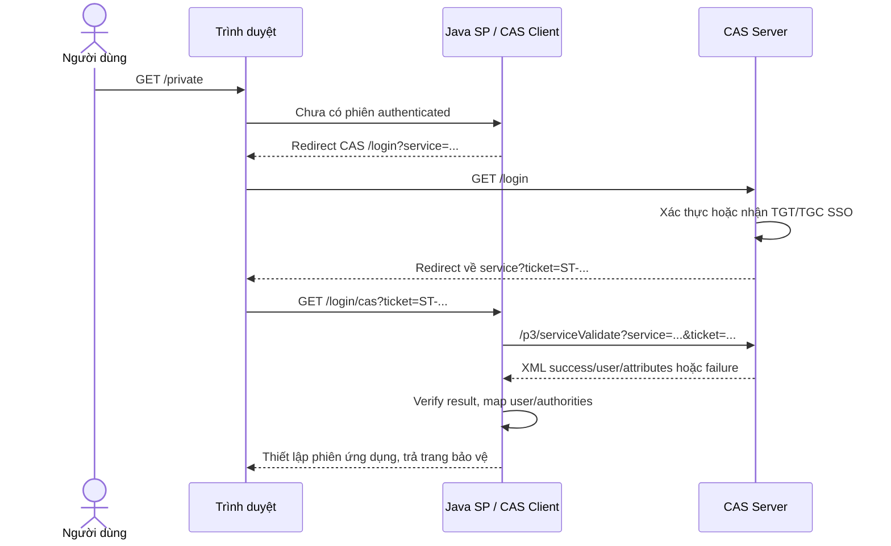

# Lựa chọn phiên bản giao thức CAS và thư viện client tương thích

**Học phần:** Spring Security – federation → Nền tảng CAS.

**Mục tiêu:** phân biệt phiên bản **CAS Protocol** với phiên bản **CAS Server** và **Java CAS Client**, chọn đúng validator/endpoint theo nhu cầu service ticket, thuộc tính người dùng, proxy ticket, rồi kiểm tra tương thích với Java, Spring Security, Spring Boot và Servlet API. Bài gồm ma trận ra quyết định, sơ đồ SSO, mẫu Spring Security/Apereo client, chương trình Java 17 chạy độc lập, kế hoạch nâng cấp và checklist bảo mật.

**Nguyên tắc then chốt:** **CAS 1.0, CAS 2.0 và CAS 3.0 là phiên bản giao thức, không phải số major của sản phẩm CAS Server**. CAS Server 8.x không đòi ứng dụng phải có “CAS Protocol 8”; Apereo Java CAS Client 4.1.1 cũng không có nghĩa client chỉ nói chuyện với “CAS Protocol 4.1”. Version giao thức xác định **endpoint, message format, proxy/attribute capability**; version client/runtime xác định **implementation API, security fixes và binary compatibility**.

Đối với một ứng dụng Java mới dùng native CAS và cần user attributes, CAS **Protocol 3.0.3** qua `/p3/serviceValidate` là lựa chọn đáng cân nhắc, nếu CAS Server/service registration cho phép. Nếu chỉ cần principal, `/serviceValidate` của CAS 2.0 có thể đáp ứng. CAS 1.0 `/validate` chủ yếu giữ tương thích legacy. Với OIDC/SAML2, cần OIDC/SAML client riêng, không thể dùng CAS3 XML validator để đọc ID Token hay SAML Assertion.

## 1. Bốn lớp phiên bản cần quản lý độc lập

| Lớp | Ví dụ | Cần kiểm chứng |
| --- | --- | --- |
| **CAS Protocol** | 1.0/2.0/3.0, đặc tả CAS 3.0.3 | Path validation, XML/plain text, attributes/proxy |
| **CAS Server** | Apereo CAS Server 7.x/8.x | Module được bật, service registry, authentication policy, TLS, SSO/SLO |
| **Java CAS Client** | `org.apereo.cas.client:cas-client-core:4.1.1` | Filter, TicketValidator, dependencies, security patch |
| **Spring + JVM + Servlet** | Java 17+, Boot 4.1.x, Spring Security 7.1.x, Jakarta Servlet | ABI/API compatibility, classpath, session/filter chain |

Với hệ thống thật còn có: identity source, service URL/public ingress, certificate trust, reverse proxy, CAS ticket registry, logout integration và quyền ứng dụng. **Một tổ hợp thư viện biên dịch được chưa chứng minh có thể đăng nhập CAS thành công**, vì lỗi có thể nằm ở CAS Server protocol policy hoặc URL đăng ký dịch vụ.

### Các câu hỏi phải trả lời trước khi thêm dependency

1. CAS Server đang hỗ trợ các endpoint nào: `/validate`, `/serviceValidate`, `/p3/serviceValidate`, `/proxyValidate`, `/p3/proxyValidate`?
2. Registered service đã khai báo `supportedProtocols` chưa? Nó cho CAS10, CAS20, CAS30 hay chỉ một loại?
3. App chỉ cần username hay cần `cas:attributes` như employee ID, department, group, affiliation?
4. Có proxy authentication cần PGT/proxy ticket không?
5. App dùng Spring Security CAS integration hay Apereo CAS Servlet filters làm điểm xác thực chính?
6. Runtime đang dùng `javax.servlet` hay `jakarta.servlet`? Boot 2.x, 3.x, 4.x? JDK nào?
7. CAS ticket là opaque ST thông thường hay JWT ticket do CAS Server phát?
8. Có cần CAS `renew`, `gateway`, SLO và MFA assurance không?
9. CAS Server tin service URL nào, được gửi qua HTTPS và proxy như thế nào?
10. Có môi trường sandbox cho end-to-end, negative tests và rollback không?

## 2. CAS SSO hoạt động ra sao?

Các thuật ngữ quan trọng:

- **TGT** – Ticket Granting Ticket: đối tượng CAS Server quản lý cho phiên SSO.
- **TGC** – Ticket Granting Cookie: cookie browser tham chiếu tới phiên CAS, giúp dùng lại SSO.
- **ST** – Service Ticket: artifact được cấp cho một registered service; thường dùng một lần và có hạn.
- **PT** – Proxy Ticket: ticket cho downstream service khi có mô hình proxy hợp lệ.
- **PGT** – Proxy Granting Ticket: credential phía service proxy để xin PT qua CAS Server.
- **PGTIOU** – định danh dùng tương quan việc cấp PGT ở response/callback.
- **Service URL** – URL của service nhận ticket và phải khớp ở bước validate.



**Đừng tin ticket chỉ vì nó xuất hiện trong URL.** CAS client phải gọi validation endpoint qua kênh HTTPS tin cậy, xác minh ticket được phát cho chính service của mình và nhận response thành công trước khi tạo `Authentication`/`SecurityContext`.

### 2.1. Service URL phải nhất quán

Ví dụ:

```text
CAS base URL  : https://sso.example.com/cas
CAS login     : https://sso.example.com/cas/login
App callback  : https://portal.example.com/login/cas
CAS3 validate : https://sso.example.com/cas/p3/serviceValidate
```

Chặng browser:

```http
GET /cas/login?service=https%3A%2F%2Fportal.example.com%2Flogin%2Fcas HTTP/1.1
Host: sso.example.com
```

CAS redirect:

```http
GET /login/cas?ticket=ST-example-one-time HTTP/1.1
Host: portal.example.com
```

Client validation:

```http
GET /cas/p3/serviceValidate?service=https%3A%2F%2Fportal.example.com%2Flogin%2Fcas&ticket=ST-example-one-time HTTP/1.1
Host: sso.example.com
```

Các giá trị trên **chỉ minh họa**. Nếu callback là `https://portal.example.com/login/cas` nhưng validator gửi `http://localhost:8080/login/cas`, CAS có thể từ chối vì ticket không dành cho service đó. Bên sau reverse proxy cần dùng public scheme/host/port/context path thống nhất và chỉ tin forwarded headers từ ingress đã được kiểm soát.

## 3. So sánh CAS Protocol 1.0, 2.0 và 3.0

| Đặc điểm | CAS 1.0 | CAS 2.0 | CAS 3.0 |
| --- | --- | --- | --- |
| **Service ticket validation** | `/validate` | `/serviceValidate` | `/p3/serviceValidate` |
| **Response** | Plain text `yes/no` + username khi thành công | XML `cas:serviceResponse` | XML CAS response có `cas:attributes` theo đặc tả |
| **Principal** | Có | Có | Có |
| **Thuộc tính user** | Không theo schema CAS1 | Có thể có extension/vendor, không mặc định CAS3 | **Có `cas:attributes` chuẩn theo CAS3** |
| **Proxy validation** | Không | `/proxyValidate` | `/p3/proxyValidate` |
| **PGT/proxy tickets** | Không | Có `/proxy` và PGT callbacks | Kế thừa và hỗ trợ attributes |
| **Tình huống** | Ứng dụng rất cũ | Login cơ bản, SSO CAS2 | Login có attributes hoặc proxy/contract CAS3 |
| **Điều kiện** | Client/server cho CAS1 | Service registry cho CAS20 | Service registry cho CAS30 và module tương ứng |

Theo tài liệu Apereo, đặc tả CAS hiện hành là **3.0.3**. CAS Server 8.x là phiên bản sản phẩm; không nên suy nó đã bỏ CAS2 hoặc thêm “CAS Protocol 8” khi chưa xem service registration.

### 3.1. CAS1 trả plain text

Phản hồi khi ticket hợp lệ:

```text
yes
alice
```

Khi thất bại:

```text
no

```

CAS1 parser không đọc XML, không có cơ chế proxy theo đặc tả. Dùng CAS2/3 validator để gọi `/validate` có thể gặp parser error; không sửa bằng string replace đầu ra rồi bỏ qua semantics.

### 3.2. CAS2 trả XML

```xml
<cas:serviceResponse xmlns:cas="http://www.yale.edu/tp/cas">
  <cas:authenticationSuccess>
    <cas:user>alice</cas:user>
  </cas:authenticationSuccess>
</cas:serviceResponse>
```

Trường hợp ticket không hợp lệ:

```xml
<cas:serviceResponse xmlns:cas="http://www.yale.edu/tp/cas">
  <cas:authenticationFailure code="INVALID_TICKET">
    Ticket invalid or already consumed
  </cas:authenticationFailure>
</cas:serviceResponse>
```

CAS 2.0 còn có `/proxyValidate` và `/proxy`. `/serviceValidate` **không được xác nhận proxy ticket như ST** theo đặc tả. ST one-time không được dùng làm vé truy cập API dài hạn.

### 3.3. CAS3 XML thêm attributes

```xml
<cas:serviceResponse xmlns:cas="http://www.yale.edu/tp/cas">
  <cas:authenticationSuccess>
    <cas:user>alice</cas:user>
    <cas:attributes>
      <cas:employeeId>opaque-1001</cas:employeeId>
      <cas:department>finance</cas:department>
      <cas:affiliation>staff</cas:affiliation>
      <cas:affiliation>approver</cas:affiliation>
    </cas:attributes>
  </cas:authenticationSuccess>
</cas:serviceResponse>
```

CAS3 `/p3/serviceValidate` giúp giao kết attribute release có cấu trúc. Một số CAS Server có thể trả attributes như extension ở `/serviceValidate` nhưng **đó không thay thế yêu cầu kiểm chứng chuẩn phiên bản giao thức**; client nào nhận field nào vẫn cần test với server thật. Một attribute có thể có nhiều giá trị, giá trị thiếu hoặc type khác; không biến tất cả attributes thành `ROLE_*`.

### 3.4. Proxy authentication khác service login

Nếu app A phải gọi backend B thay mặt user qua CAS:
1. App A validate ST tại CAS và cung cấp `pgtUrl` HTTPS trong flow được phép.
2. CAS kiểm tra callback URL/TLS và gửi PGT qua callback, gắn PGTIOU.
3. App A dùng PGT xin PT cho targetService B qua `/proxy`.
4. B validate PT bằng `/proxyValidate` (CAS2) hoặc `/p3/proxyValidate` (CAS3).
5. B kiểm tra **proxy chain** được phép, không chỉ username.

Nếu app không cần delegation, đừng bật proxy. Không cấu hình `acceptAnyProxy=true` trong production mà không có trust/allowlist; hạn chế `pgtUrl`, targetService và chain. CAS1 không có proxy validation.

## 4. Chọn protocol theo yêu cầu thực tế

| Nhu cầu | Lựa chọn | Java validator/filter tham khảo |
| --- | --- | --- |
| Legacy chỉ hỗ trợ `/validate` | CAS1, có kế hoạch migration | `Cas10TicketValidationFilter` |
| Trang web chỉ cần username, CAS2 service | CAS2 | `Cas20ServiceTicketValidator` hoặc CAS20 validation filter |
| Trang web cần attributes | **CAS3** | `Cas30ServiceTicketValidator` hoặc `Cas30ProxyReceivingTicketValidationFilter` |
| Ứng dụng cần PT/PGT nhưng không cần attrs | CAS2 proxy | `Cas20ProxyTicketValidator` |
| PT/PGT kèm attributes | CAS3 proxy | `Cas30ProxyTicketValidator` và `/p3/proxyValidate` |
| OAuth2 access tokens/OIDC ID Tokens | **OIDC/OAuth2 module CAS**, không dùng CAS ticket validator | `oauth2Login`/resource server theo OAuth2 |
| SAML2 AuthnRequest/Assertion | **SAML2 module CAS** | Spring Security `saml2Login`, SP metadata và Assertion validation |
| SAML1.1 flow từ CAS | SAML1.1 riêng | `Saml11TicketValidationFilter` và dependencies phù hợp |

**CAS3 không phải SAML3.** CAS Server có thể cung cấp native CAS, SAML1, SAML2, OAuth2, OIDC như các module/giao thức khác nhau. Không lấy JSON OAuth2 hay SAML Assertion gửi vào CAS3 XML parser.

### 4.1. Service registry có thể giới hạn CAS protocol

Apereo CAS cho phép một registered service khai báo `supportedProtocols`, gồm các giá trị `CAS10`, `CAS20`, `CAS30` và `SAML1`. Nếu service chỉ chấp nhận CAS20 thì một request tới `/p3/serviceValidate` có thể bị từ chối dù CAS Server có hỗ trợ CAS3.

Ý tưởng cấu hình service registry (mảnh JSON cần kiểm tra đúng schema server):

```json
{
  "@class": "org.apereo.cas.services.CasRegisteredService",
  "serviceId": "^https://portal\\.example\\.com/login/cas$",
  "name": "Portal CAS3",
  "id": 120,
  "supportedProtocols": [
    "java.util.HashSet",
    ["CAS30"]
  ]
}
```

Không copy thẳng vào production mà bỏ kiểm chứng service registry. Regex service phải chính xác, tránh `^https://.*` cho phép host không mong muốn. Khi migration CAS2→CAS3, thay đổi `supportedProtocols` sau khi đã kiểm tra các clients; không vô hiệu CAS20 trước khi các ứng dụng chưa nâng đã chuyển.

## 5. Ma trận Java client, Spring Security và Servlet namespace

Tại thời điểm **07/11/2026**:
- Spring Security **7.1.2** là stable 7.1 được công bố 23/10/2026; module `spring-security-cas` vẫn tồn tại.
- Apereo Java CAS Client **4.1.1** đã xuất bản lên Maven Central (tháng 5/2026), có module `cas-client-core`.
- Java CAS Client 4.x sử dụng **Jakarta Servlet**; client 3.x cũ thường gắn với `javax.servlet`.
- Apereo phát advisory ngày **27/05/2026** cho deployment dùng **JWT CAS ticket validation** và khuyến nghị client **4.1.1**.

### 5.1. Chọn dòng dependency theo runtime

| Ứng dụng | API Servlet | Java CAS Client nên khảo sát | Spring Security CAS module | Chú ý |
| --- | --- | --- | --- | --- |
| Legacy Java EE/Boot 2.x | `javax.servlet` | Client 3.x tương ứng | Security major cùng Boot 2.x | Migrate có kế hoạch; không dùng Jakarta JAR trực tiếp |
| Boot 3.x/Security 6.x | `jakarta.servlet` | Client 4.x đã kiểm thử | `spring-security-cas` **6.x** | Kiểm tra JDK17, Servlet6, transitive deps |
| Boot 4.x/Security 7.x | `jakarta.servlet` | Client 4.1.1 hoặc bản vá an toàn đã duyệt | `spring-security-cas` **7.x** | Không copy cấu hình Security3, cần xem token/provider hiện hành |
| Servlet app không dùng Spring Security CAS | Theo container (`javax` hoặc `jakarta`) | Apereo CAS client phù hợp | Có thể không dùng `spring-security-cas` | Chỉ một lớp filter validation; session/logout do app quản lý |

**Đây là hướng chọn phiên bản, không phải giấy chứng nhận tương thích cho mọi patch**. Bắt buộc dùng dependency tree, compile và browser SSO test với CAS Server thật. Đừng nâng đồng thời server major, framework major, client major và đổi protocol nếu chưa có kế hoạch tách rollback.

### 5.2. Vì sao không trộn `javax.servlet` và `jakarta.servlet`?

```java
// Java EE / một số thư viện cũ:
javax.servlet.http.HttpServletRequest

// Spring Boot 3/4 - Jakarta Servlet:
jakarta.servlet.http.HttpServletRequest
```

Hai type ở **hai package khác nhau**, không tương thích nhị phân. Khi dùng Java CAS Client 3.x `javax` trên Boot 4 Jakarta, có thể gặp `ClassNotFoundException`, `NoClassDefFoundError`, cast/filter registration lỗi. Đưa thêm cả hai Servlet API vào runtime không giải quyết gốc ABI conflict; cần dùng version client đã migrate hoặc thay runtime/framework phù hợp.

### 5.3. Maven artifact cần chọn chính xác

`org.apereo.cas.client:cas-client` là project parent/aggregator **POM**, không nhất thiết là JAR filter runtime. Module triển khai validation và Servlet filters là:

```xml
<dependency>
  <groupId>org.apereo.cas.client</groupId>
  <artifactId>cas-client-core</artifactId>
  <version>4.1.1</version>
</dependency>
```

Spring Security CAS integration:

```xml
<dependency>
  <groupId>org.springframework.security</groupId>
  <artifactId>spring-security-cas</artifactId>
</dependency>
```

Khi dùng Spring Boot BOM, không pin `spring-security-cas` khác major với `spring-security-web` hoặc `spring-security-core`. Client Apereo có thể bị kéo transitively; kiểm tra bản hiệu lực, dependency convergence và CVE qua SBOM.

**Không thêm `cas-client-support-saml` chỉ vì CAS3 trả XML.** CAS3 XML response là CAS native, không phải SAML1.1; chỉ thêm module SAML nếu chọn đúng protocol SAML riêng.

## 6. Spring Security CAS và Apereo CAS Client: hai mô hình khác nhau

### 6.1. Hướng A – Spring Security nhận Authentication

```text
SecurityFilterChain
  ├─ ExceptionTranslationFilter
  ├─ CasAuthenticationEntryPoint → CAS /login?service=...
  ├─ CasAuthenticationFilter nhận ?ticket=ST-...
  ├─ AuthenticationManager → CasAuthenticationProvider
  ├─ Apereo Cas20/Cas30ServiceTicketValidator
  ├─ HTTPS CAS /serviceValidate hoặc /p3/serviceValidate
  └─ UserDetails/GrantedAuthorities → SecurityContext/HttpSession
```

Các lớp Spring Security 7:
- `org.springframework.security.cas.ServiceProperties`
- `org.springframework.security.cas.web.CasAuthenticationEntryPoint`
- `org.springframework.security.cas.web.CasAuthenticationFilter`
- `org.springframework.security.cas.authentication.CasAuthenticationProvider`
- `org.springframework.security.cas.authentication.CasServiceTicketAuthenticationToken`

**Cảnh báo về code cũ:** trang CAS của Spring Security vẫn có phần lịch sử nói Spring Security 3.x, CAS Server 3.4, XML namespace config, `UsernamePasswordAuthenticationToken`. Trong Security 7, `CasAuthenticationProvider` Javadoc mô tả `CasServiceTicketAuthenticationToken`; vì vậy không copy code mẫu từ nhánh cũ sang Boot4 mà thiếu compile/integration test.

#### 6.1.1. Beans chọn CAS3 validator

Mảnh Java trong dự án Spring Boot 4/Security 7 (chỉ cấu hình thành phần, **chưa là ứng dụng runnable độc lập**):

```java
import org.apereo.cas.client.validation.Cas30ServiceTicketValidator;
import org.apereo.cas.client.validation.TicketValidator;
import org.springframework.context.annotation.Bean;
import org.springframework.context.annotation.Configuration;
import org.springframework.security.cas.ServiceProperties;
import org.springframework.security.cas.authentication.CasAuthenticationProvider;
import org.springframework.security.core.userdetails.UserDetailsService;

@Configuration
public class CasBeans {
    @Bean
    ServiceProperties serviceProperties() {
        ServiceProperties p = new ServiceProperties();
        p.setService("https://portal.example.com/login/cas");
        p.setSendRenew(false);
        return p;
    }

    @Bean
    TicketValidator ticketValidator() {
        // Constructor nhận CAS server base URL, không phải full /p3 URL.
        return new Cas30ServiceTicketValidator(
                "https://sso.example.com/cas");
    }

    @Bean
    CasAuthenticationProvider casAuthenticationProvider(
            ServiceProperties properties,
            TicketValidator validator,
            UserDetailsService users) {

        CasAuthenticationProvider p = new CasAuthenticationProvider();
        p.setServiceProperties(properties);
        p.setTicketValidator(validator);
        p.setUserDetailsService(users);
        p.setKey("portal-cas-provider");
        return p;
    }
}
```

**Lý do phân biệt:** `Cas30ServiceTicketValidator` tự chọn endpoint CAS3 phù hợp dựa trên base URL; không đặt base URL thành `https://sso.example.com/cas/p3/serviceValidate` trừ khi API yêu cầu rõ (mẫu trên không yêu cầu). Nếu chỉ cần CAS2:

```java
TicketValidator validator =
    new org.apereo.cas.client.validation.Cas20ServiceTicketValidator(
        "https://sso.example.com/cas");
```

Để có login hoàn chỉnh, phải nối `CasAuthenticationEntryPoint` với `loginUrl`/`ServiceProperties`, `CasAuthenticationFilter` với `AuthenticationManager` và callback, đặt đúng filter chain, session management/SLO, user mapping và policies. Các bean ở trên **không tự thiết lập filter chain**. Đối chiếu Javadoc API của phiên bản 7.1.x đang deploy, đặc biệt token input của provider.

### 6.2. Hướng B – Apereo Servlet filters

Nếu ứng dụng Servlet không dùng Spring Security CAS, thư viện `cas-client-core` có các lớp:
- `org.apereo.cas.client.authentication.AuthenticationFilter` để redirect CAS login.
- `org.apereo.cas.client.validation.Cas10TicketValidationFilter` cho CAS1.
- `org.apereo.cas.client.validation.Cas20ProxyReceivingTicketValidationFilter` cho CAS2, có thể chọn service/proxy validator.
- `org.apereo.cas.client.validation.Cas30ProxyReceivingTicketValidationFilter` cho CAS3.
- `org.apereo.cas.client.validation.Cas30JsonProxyReceivingTicketValidationFilter` nếu server/client hỗ trợ JSON CAS3 response.
- `org.apereo.cas.client.util.HttpServletRequestWrapperFilter` giúp expose principal/attributes cho servlet layer.
- Các filter/listener SLO tương ứng nếu triển khai logout liên ứng dụng.

Mảnh `web.xml` minh họa một app Servlet sử dụng CAS3:

```xml
<filter>
  <filter-name>CAS Validation</filter-name>
  <filter-class>
    org.apereo.cas.client.validation.Cas30ProxyReceivingTicketValidationFilter
  </filter-class>
  <init-param>
    <param-name>casServerUrlPrefix</param-name>
    <param-value>https://sso.example.com/cas</param-value>
  </init-param>
  <init-param>
    <param-name>serverName</param-name>
    <param-value>https://portal.example.com</param-value>
  </init-param>
</filter>
<filter>
  <filter-name>CAS Authentication</filter-name>
  <filter-class>
    org.apereo.cas.client.authentication.AuthenticationFilter
  </filter-class>
  <init-param>
    <param-name>casServerUrlPrefix</param-name>
    <param-value>https://sso.example.com/cas</param-value>
  </init-param>
  <init-param>
    <param-name>serverName</param-name>
    <param-value>https://portal.example.com</param-value>
  </init-param>
</filter>
<filter-mapping>
  <filter-name>CAS Validation</filter-name>
  <url-pattern>/*</url-pattern>
</filter-mapping>
<filter-mapping>
  <filter-name>CAS Authentication</filter-name>
  <url-pattern>/*</url-pattern>
</filter-mapping>
```

**Đây chỉ là mảnh cấu hình**, không phải `web.xml` hoàn chỉnh: cần bao ngoài `web-app` namespace Jakarta Servlet đúng container, cấu hình public routes, wrapper, logout, session, roles, thứ tự filters và test tránh redirect loops. Theo Apereo README, với proxy validation filter cần chú ý thứ tự validation trước authentication.

**Không dùng đồng thời Apereo CAS validation filter và Spring Security `CasAuthenticationFilter` để xác minh một ST** trừ khi thiết kế đã xử lý rõ việc token dùng một lần. Filter đầu tiên có thể consume ST, filter thứ hai nhận `INVALID_TICKET`.

### 6.3. Spring Boot support module của Apereo

Apereo có module `cas-client-support-springboot` cung cấp auto-configuration/filters và các thuộc tính như `cas.validation-type=CAS3`, `CAS` hoặc `SAML` tùy version. Đây không phải `spring-security-cas`; đừng đưa hai starter vào một project mà chưa quyết định ai tạo `Authentication` và ai xử lý SLO/roles.

Cần xác minh module Apereo springboot support đang sử dụng hỗ trợ **Spring Boot 4.x**, Spring Framework 7.x và Jakarta Servlet của container cụ thể. Việc core client hỗ trợ Jakarta **không tự bảo đảm** mọi auto-config hoặc bean của module phụ cũng tương thích.

## 7. POM tham khảo cho Boot 4.1.x + Security 7.x

`pom.xml` (Maven dependencies để tiếp tục hoàn thiện app, không có full CAS app main/security filter chain):

```xml
<?xml version="1.0" encoding="UTF-8"?>
<project xmlns="http://maven.apache.org/POM/4.0.0"
         xmlns:xsi="http://www.w3.org/2001/XMLSchema-instance"
         xsi:schemaLocation="http://maven.apache.org/POM/4.0.0
             https://maven.apache.org/xsd/maven-4.0.0.xsd">
  <modelVersion>4.0.0</modelVersion>
  <parent>
    <groupId>org.springframework.boot</groupId>
    <artifactId>spring-boot-starter-parent</artifactId>
    <version>4.1.2</version>
    <relativePath/>
  </parent>
  <groupId>com.example</groupId>
  <artifactId>portal-cas-client</artifactId>
  <version>1.0.0</version>
  <properties><java.version>17</java.version></properties>
  <dependencies>
    <dependency>
      <groupId>org.springframework.boot</groupId>
      <artifactId>spring-boot-starter-webmvc</artifactId>
    </dependency>
    <dependency>
      <groupId>org.springframework.boot</groupId>
      <artifactId>spring-boot-starter-security</artifactId>
    </dependency>
    <dependency>
      <groupId>org.springframework.security</groupId>
      <artifactId>spring-security-cas</artifactId>
    </dependency>
    <dependency>
      <groupId>org.apereo.cas.client</groupId>
      <artifactId>cas-client-core</artifactId>
      <version>4.1.1</version>
    </dependency>
    <dependency>
      <groupId>org.springframework.boot</groupId>
      <artifactId>spring-boot-starter-test</artifactId>
      <scope>test</scope>
    </dependency>
  </dependencies>
</project>
```

Spring Boot BOM quản lý Spring Security modules; **đừng pin riêng `spring-security-cas` về 6.x nếu các module còn lại là 7.x**. Client Apereo 4.1.1 là version ví dụ đã công bố; quản lý patch, SBOM và transitive dependencies theo quy trình bảo mật. Domain CAS URL/registered service phải được cấu hình riêng. Sau khi hoàn thành main/filter chain:

```bash
mvn dependency:tree
mvn -DskipTests compile
mvn test
```

Nếu muốn lọc nhóm dependency:

```bash
mvn dependency:tree -Dincludes=org.springframework.security,org.apereo.cas.client
```

Kiểm tra không còn JAR `javax.servlet` legacy trong ứng dụng Jakarta, không có hai CAS clients khác major; lỗi `NoSuchMethodError`/`NoClassDefFoundError` thường biểu hiện các conflict này. Chạy integration SSO mới xác nhận CAS protocol thật.

## 8. Java 17 chạy độc lập: ra quyết định phiên bản giao thức

Ví dụ này không tạo session hay xác thực CAS ticket. Nó chỉ minh họa chọn endpoint theo **năng lực CAS Server đã được quản trị viên xác nhận**, và từ chối yêu cầu vượt năng lực thay vì silently downgrade.

Tệp `CasProtocolDecisionDemo.java`:

```java
public class CasProtocolDecisionDemo {
    enum Protocol {
        CAS10("/validate", "/validate"),
        CAS20("/serviceValidate", "/proxyValidate"),
        CAS30("/p3/serviceValidate", "/p3/proxyValidate");

        private final String serviceEndpoint;
        private final String proxyEndpoint;

        Protocol(String serviceEndpoint, String proxyEndpoint) {
            this.serviceEndpoint = serviceEndpoint;
            this.proxyEndpoint = proxyEndpoint;
        }

        String endpoint(boolean proxy) {
            if (proxy && this == CAS10) {
                throw new IllegalArgumentException(
                        "CAS1 does not support proxy tickets");
            }
            return proxy ? proxyEndpoint : serviceEndpoint;
        }
    }

    record Capability(boolean cas10, boolean cas20, boolean cas30) {}
    record Need(boolean attributes, boolean proxy) {}

    static Protocol choose(Capability server, Need need) {
        if (need.attributes()) {
            if (!server.cas30()) {
                throw new IllegalStateException(
                        "Attributes require CAS3");
            }
            return Protocol.CAS30;
        }
        if (server.cas20()) {
            return Protocol.CAS20;
        }
        if (server.cas30()) {
            return Protocol.CAS30;
        }
        if (server.cas10() && !need.proxy()) {
            return Protocol.CAS10;
        }
        throw new IllegalStateException(
                "No compatible CAS protocol");
    }

    public static void main(String[] args) {
        Capability modern = new Capability(true, true, true);
        Capability legacy = new Capability(true, false, false);

        Protocol basic = choose(
                modern, new Need(false, false));
        Protocol attrs = choose(
                modern, new Need(true, false));
        Protocol proxy = choose(
                modern, new Need(true, true));
        Protocol old = choose(
                legacy, new Need(false, false));

        System.out.println("Basic: " + basic + " "
                + basic.endpoint(false));
        System.out.println("Attributes: " + attrs + " "
                + attrs.endpoint(false));
        System.out.println("Proxy with attributes: " + proxy + " "
                + proxy.endpoint(true));
        System.out.println("Legacy: " + old + " "
                + old.endpoint(false));

        try {
            choose(legacy, new Need(true, false));
        }
        catch (IllegalStateException ex) {
            System.out.println("Unsupported: " + ex.getMessage());
        }
    }
}
```

Lệnh chạy:

```bash
javac CasProtocolDecisionDemo.java
java CasProtocolDecisionDemo
```

**Stdout chính xác với JDK 17+:**

```text
Basic: CAS20 /serviceValidate
Attributes: CAS30 /p3/serviceValidate
Proxy with attributes: CAS30 /p3/proxyValidate
Legacy: CAS10 /validate
Unsupported: Attributes require CAS3
```

Giải thích: app cần attributes sẽ chọn CAS3; cần proxy cùng attrs chọn `/p3/proxyValidate`; legacy chỉ CAS1 có thể validate principal nhưng không đáp ứng attributes. Nếu không có phiên bản phù hợp, kết quả là lỗi có kiểm soát — **không hạ giao thức rồi tự tạo thông tin quyền giả**.

Demo chỉ kiểm tra chính sách chọn protocol; nó **không** gửi HTTP request, kiểm tra SSL, consume ST, parse XML, cấp quyền hoặc triển khai CAS. Không dùng `choose` như một CAS validator thực.

## 9. Security contract quan trọng hơn con số version

### 9.1. Ticket phải được xác minh với service URL

CAS Server phát ST dành cho một URL. Khi client validate, `service` phải được encoding chính xác và tương ứng service đã đăng ký. Không “sửa nhanh” `INVALID_SERVICE` bằng regex `.*` ở CAS registry. Các trường hợp gây lệch:
- Browser nhận callback `https://portal.example.com/login/cas` nhưng backend gửi `http://localhost:8080/login/cas`.
- Proxy đổi scheme/port/host, context path `/portal` hoặc trailing slash.
- Service URL có query parameters được sort/encode khác lúc phát ST.
- Load balancer cho nhiều domain nhưng CAS service registry chỉ cho phép một domain.
- CAS client bị cấu hình `serverName` hoặc `service` không khớp environment.

Cách sửa đúng: chốt **public canonical service URL**, cấu hình reverse proxy hợp lệ, đăng ký service ở CAS Server và test cả redirect/validation theo cùng URL.

### 9.2. One-time ticket và duplicate filters

Một ST là **opaque artifact dùng một lần**; không dùng `ST-...` làm bearer credential trong database hay session dài hạn. Nếu hệ thống vừa bật Apereo `Cas30ProxyReceivingTicketValidationFilter` vừa bật Spring `CasAuthenticationFilter` cho một callback, filter đầu có thể consume ST và filter sau sẽ gặp `INVALID_TICKET`. Hãy để **một thành phần chịu trách nhiệm ticket validation**. Sau thành công, ứng dụng thiết lập local authenticated session/SecurityContext an toàn.

CAS Server TGC/TGT và HttpSession của app là **hai phiên khác nhau**. Có TGC SSO không có nghĩa app đã validate ticket; invalidate local session không tự logout CAS Server.

### 9.3. TLS và parser

- Dùng HTTPS ở CAS login và back-channel validation, kiểm tra hostname và certificate chain.
- Không dùng trust-all `TrustManager` hoặc tắt TLS verification để “fix dev”.
- XML parser phải namespace-aware, chống XXE/DTD, hạn chế response size/timeout.
- Không tin URL endpoint/callback/`service` do user tự nhập.
- Không ghi ST, TGT/TGC, PGT, session cookies hoặc raw attributes chứa PII vào log.
- Proxy callback `pgtUrl` cần xác thực TLS/trust và allowedProxyChains.
- Fail closed khi CAS Server timeout/502 hoặc ticket không được validate.
- CSRF protection cho POST nghiệp vụ, session fixation protection khi login, cookie `Secure`/`HttpOnly` và SameSite phù hợp browser SSO.

### 9.4. Authentication không tự là authorization

CAS response có `<cas:user>alice</cas:user>` chỉ chứng minh một principal theo authority của CAS Server được cấu hình, **không tự cấp quyền admin**. Khi có `cas:attributes`, cần mapping allowlist đúng namespace, service/tenant và UserDetails:
- Username/email có thể đổi/trùng giữa nhiều identity sources.
- Nhóm `approver` của tenant A không phải role admin tenant B.
- External identity phải được liên kết với internal user ID và status `ACTIVE`.
- Attribute thay đổi/thu hồi có thể cần synchronization, token/session timeout và permission re-check.
- Không tự tạo account hay roles chỉ vì CAS Server trả XML success.

## 10. CAS renew, gateway, SLO và proxy

### 10.1. `renew=true` không đồng nghĩa MFA

CAS spec cho phép `renew=true` yêu cầu xác thực trực tiếp thay vì dùng lại SSO security context. Trong Spring Security `ServiceProperties.setSendRenew(true)` có thể bật hành vi này cho dịch vụ nhạy cảm. Nhưng nó **không tự yêu cầu đa yếu tố**: MFA/assurance cần chính sách CAS authentication và bằng chứng thực tế. Không bật renew toàn ứng dụng nếu chỉ một số giao dịch cần reauth.

### 10.2. `gateway=true` là thử SSO thụ động

Khi `gateway=true`, CAS cố gắng SSO không tương tác. Nếu không có phiên phù hợp, CAS có thể quay lại `service` không kèm `ticket`. Ứng dụng phải xử lý trạng thái “không có ticket” như chưa authenticated, tránh redirect loop. CAS spec nêu `renew` và `gateway` không tương thích, đừng bật cả hai tùy tiện.

### 10.3. Single Logout

CAS `/logout` có thể hủy TGT/TGC phía CAS; SLO messages cần client nhận và invalidate các HttpSession đúng theo mappings. Logout local trong Spring không bảo đảm CAS và các ứng dụng khác đều logout. Tùy CAS Server/client, SLO có thể đi qua back-channel hoặc browser flow; triển khai filter/listener/session store đúng. Luôn test browser nhiều tab, cluster, session expiration và callback sau logout.

### 10.4. Proxy tickets: chỉ khi có ủy nhiệm thật

Nếu app A gọi backend B thay mặt user, cần PGT, `/proxy`, PT, `/proxyValidate`, callback URL TLS và allowlisted proxy chains. Nếu chỉ hiển thị trang web cho user, đây là phức tạp không cần thiết. Đừng bật `acceptAnyProxy=true` trong môi trường production nếu không có security review.

## 11. JWT CAS ticket và advisory năm 2026

Một số CAS Server có tính năng **JWT-formatted tickets**, khác với opaque ST mặc định. Apereo công bố ngày **27/05/2026** lỗ hổng Java CAS Client liên quan đến **xác minh CAS tickets dạng JWT**, và khuyến nghị dùng **Java CAS Client 4.1.1**. Phạm vi được Apereo mô tả là các deployment có bật chế độ JWT ticket validation; không nên suy mọi ứng dụng CAS1/2/3 opaque ST đều chịu cùng lỗi đó.

Nếu triển khai JWT CAS tickets:
1. Xác định rõ `CasJWTTicketValidationFilter` hoặc validator JWT đang dùng.
2. Xác minh `iss`/`aud`/`exp`/`jti` và signature/encryption/algorithms theo library/advisory.
3. Dùng bản client đã vá và rà soát transitives/SBOM.
4. Test token tamper, sai audience/issuer, hết hạn, key không tin, replay và path downgrade.
5. Không tự `Base64.decode` payload rồi coi user authenticated.
6. Bảo vệ secret encryption/signing trong HSM/secret manager và key rotation có kế hoạch.

**JWT CAS ticket không phải OIDC ID Token.** Nếu ứng dụng cần login OIDC hoặc API OAuth2, dùng CAS OIDC module với `oauth2Login`/resource server đúng chuẩn; không dùng CAS JWT ticket validator làm thay thế toàn bộ OIDC.

## 12. Kế hoạch migration không gián đoạn

### Tình huống A – CAS2 → CAS3 để lấy attributes

1. Kiểm tra CAS Server có `/p3/serviceValidate` và registered service cho `CAS30`.
2. Xác định danh sách attributes cần, type/multi-values, chính sách release, authority source.
3. Trên staging, đổi `Cas20ServiceTicketValidator` sang `Cas30ServiceTicketValidator` hoặc đổi validation filter tương ứng.
4. Đăng nhập và decode/test response XML theo CAS3; không tự parse response ở controller.
5. Kiểm tra user mapping, tenant authorization và negative tests khi thiếu attributes.
6. Canary một tenant/app, theo dõi authentication success/error.
7. Khi tất cả clients đã nâng, mới cân nhắc hạn chế `CAS20` trong service registry.
8. Có rollback endpoint/validator nếu phát hiện CAS3 response chưa đúng contract.

### Tình huống B – CAS Server 7.x → 8.x

1. Xem module native CAS protocol và endpoint có giữ nguyên không.
2. So service registry, serviceId regex, supportedProtocols và SSL.
3. Kiểm tra CAS tickets, TGC, renew/gateway, SLO/proxy nếu dùng.
4. Chạy client hiện tại qua sandbox với CAS Server mới.
5. Chỉ đổi Java client nếu cần do security patch/compatibility hoặc plan riêng.
6. Không gộp thay server major với thay Spring Boot/Servlet namespace một lần nếu có thể tránh.

### Tình huống C – Java CAS Client 3.x → 4.x

1. Xác nhận runtime đã chuyển `javax.servlet` sang `jakarta.servlet`.
2. Nâng đúng `cas-client-core` và module support đã kiểm thử; loại bỏ classpath conflict.
3. Kiểm tra filters/params, handler/wrapper và SLO registration.
4. Rà soát `CasAuthenticationProvider` Spring Security version, tokens, user mapping.
5. Test ST one-time, XML attributes, proxy, SLO và session.
6. Quản lý CVE advisory, pin bản client an toàn.
7. Chuẩn bị rollback theo *cả ứng dụng và runtime*, không ném lại JAR javax vào Jakarta container.

### Tình huống D – Từ native CAS sang OIDC

Nếu dự án cần federation hiện đại giữa nhiều apps/API, scopes/audience và JWT/JWKS, có thể chọn CAS OIDC Provider thay native CAS. Đây là **migration giao thức**, không chỉ thay `Cas30ServiceTicketValidator` thành một parser khác. Cần:
- Đăng ký OIDC clients, redirect URIs, PKCE, discovery/JWKS.
- Ánh xạ `CAS principal` sang stable OIDC `sub` và internal user ID.
- Thiết kế token validity/scopes/audience/revocation.
- Test issuer/audience/nonce, session/logout và account linking.
- Canaries và rollback; không chấp nhận CAS ST như OAuth2 access token.

## 13. Bảng lỗi phổ biến

| Triệu chứng | Nguyên nhân | Cách giải quyết |
| --- | --- | --- |
| `INVALID_SERVICE` | CAS `service` khác callback URL | So HTTPS host/path/encoding, ingress và registered service |
| `INVALID_TICKET` ngay sau callback | ST dùng lại, hai filters, hết hạn | Chỉ một owner validation, xem lifecycle one-time |
| CAS1 response parser XML fail | CAS1 `/validate` trả plain text | Chọn CAS1 validator hoặc migrate protocol |
| CAS3 không có attributes | Gọi `/serviceValidate`, server không release attrs | Dùng `/p3/serviceValidate` và CAS30 policy |
| `/p3/serviceValidate` bị chặn | Service registry chỉ cho CAS20 | Cập nhật `supportedProtocols` có kiểm soát |
| Một attribute nhiều giá trị bị mất | Mapper chỉ nhận String | Map list đúng, test multi-valued |
| Proxy ticket bị từ chối | Dùng `serviceValidate` thay vì `proxyValidate` | Chọn validator và allowed proxy chain đúng |
| PGT callback thất bại | URL/TLS/trust/return status sai | Dùng HTTPS, kiểm tra reachable và PGTIOU |
| `ClassNotFoundException javax.servlet` | Client Java EE cũ trên Jakarta runtime | Nâng client 4.x và lọc JAR cũ |
| `ClassNotFoundException jakarta.servlet` | Client Jakarta trên container Java EE cũ | Đổi runtime hoặc client version phù hợp |
| `NoSuchMethodError` Spring Security CAS | Module major/transitive mismatch | Align BOM, dependency tree, compile/test |
| Filter redirect loop | Matcher/public route/cookie sai | Rà filter chain, service URL, session |
| CAS login PASS nhưng role thiếu | Attribute release/mapping chưa đúng | Kiểm tra CAS3 response, authority mapping |
| User sai tenant dù username đúng | Không namespace external identity | Map issuer/subject + tenant membership |
| SLO không hết session | Thiếu listener/filter/session mapping | Test local vs CAS logout riêng |
| TLS validation lỗi | Truststore/hostname mismatch | Cài CA trust đúng, không disable SSL |
| JWT ticket bị từ chối | Claims/key/patch lệch | Kiểm tra advisory/client 4.1.1+ và trust |
| Browser nhận ST nhưng app vẫn 401 | Ticket chưa được consume hợp lệ/SecurityContext chưa lưu | Kiểm tra provider, validation, session persistence |
| Gateway về không ticket | Không có CAS SSO hợp lệ | Xử lý anonymous đúng, tránh vòng lặp |
| `renew=true` không có MFA | Renew chỉ yêu cầu reauthentication | Thêm MFA/assurance policy theo CAS |

**Log an toàn:** ghi timestamp, service registration, protocol/validator, mã lỗi và correlation đã che. Không log nguyên ST/PT/PGT/TGC, password, private key hay attributes nhạy cảm.

## 14. Test matrix trước release

| Ca kiểm thử | Kỳ vọng |
| --- | --- |
| CAS1 `/validate` success | CAS1 client parse plain text user |
| CAS2 `/serviceValidate` success | CAS2 client parse XML username |
| CAS3 `/p3/serviceValidate` success | CAS3 client nhận username và attributes |
| CAS3 multi-valued attrs | Không mất giá trị/trộn quyền |
| CAS3 không được allowed | Failure theo service policy |
| CAS2 client nhầm CAS1 endpoint | Parser không silently accept |
| ST với service URL mismatch | Fail, không tạo SecurityContext |
| ST dùng lại | Lần validate thứ hai fail |
| Ticket hết hạn/giả | Fail closed |
| ST từ CAS Server khác | Không chấp nhận tùy tiện |
| PT vào service validator | Fail theo spec |
| PT vào proxy validator | Chỉ accept nếu proxy chain allowed |
| PGT callback TLS invalid | Fail; không cấp PGT tùy tiện |
| Renew | Có reauthentication theo CAS policy |
| Gateway không TGC | Trở về không ticket, vẫn anonymous |
| Session fixation | Sau login đổi session ID theo framework policy |
| SLO | Session app bị invalidated đúng |
| Jakarta Boot4 + CAS client 4.x | Không có classpath namespace errors |
| Security CAS/core/web cùng major | Không có ABI mismatch |
| Two validation filters | Test phát hiện double-consume |
| CAS3 attrs map admin sai | Deny nếu mapping không được phép |
| Username trùng nhiều tenants | Không tự gộp account |
| CAS Server outage | Không chấp nhận ticket chưa validate |
| Broken TLS trust | Fail closed |
| Reverse proxy public callback | Service URL chính xác |
| JWT CAS ticket invalid claims | Reject, client đã vá |
| Dependency scan | Không có version cũ dễ bị ảnh hưởng |
| Logger | Không lộ ticket, session cookie, PII |
| CAS2→CAS3 canary | Login ổn, rollback khả thi |

Unit test của bộ chọn protocol giúp kiểm tra policy; integration test phải gọi CAS Server sandbox thật với service registry đúng; browser e2e phải kiểm tra TGC/local session/SLO/proxy. **`@WithMockUser` chỉ tạo Authentication test**, không chứng minh CAS ticket validation.

## 15. Checklist lựa chọn thư viện client

**Nhu cầu và contract**
- [ ] Đã phân biệt CAS Server version với CAS Protocol version.
- [ ] Đã xác nhận endpoints và `supportedProtocols` cho service cụ thể.
- [ ] Đã xác định username-only hay attributes/proxy/JWT tickets.
- [ ] Đã chọn validator/filter tương ứng CAS1/2/3.
- [ ] Service URL và CAS registered service khớp HTTPS public path.
- [ ] CAS Server attributes release/multi-value schema được xác định rõ.

**Runtime**
- [ ] JDK/Boot/Framework/Security major đã nhất quán.
- [ ] Dùng đúng `javax.servlet` hoặc `jakarta.servlet`, không trộn.
- [ ] `spring-security-cas` đi cùng BOM Spring Security.
- [ ] `cas-client-core` là JAR runtime, version được duyệt.
- [ ] Có dependency tree/SBOM và security advisory review.
- [ ] Chỉ một stack filter/provider tiêu thụ ST.
- [ ] Không dùng tài liệu Security 3.x như API compile-ready cho 7.x.

**Bảo mật và vận hành**
- [ ] HTTPS CAS login/validation, TLS trust/hostname đúng.
- [ ] Không accept arbitrary service URL, proxy chains hoặc JWT issuer.
- [ ] XML parse hardened, ticket one-time, timeout/replay/fail closed.
- [ ] Map principal/attributes vào internal user/roles/tenant một cách đáng tin.
- [ ] Secure/HttpOnly cookies, session fixation và SLO được test.
- [ ] Đã thử protocol migration, rollback và CAS Server outage.
- [ ] Không log ticket, cookie, secret hoặc raw attributes nhạy cảm.

## 16. Câu hỏi tự kiểm tra

**CAS Server 8.x có bắt buộc CAS Protocol 8 không?**  
Không. CAS Server là bản phần mềm; CAS Protocol 1/2/3 xác định wire contract. Apereo công bố CAS3.0.3 là đặc tả hiện hành.

**Tại sao validator CAS3 không nên trỏ vào `/validate`?**  
CAS1 trả plain text, CAS3 parser mong XML response theo CAS schema. Cần chọn đúng endpoint/validator và service policy.

**Nếu chỉ cần username có bắt buộc CAS3 không?**  
Không. CAS2 vẫn phù hợp với service login cơ bản nếu được server hỗ trợ và không cần attributes. CAS3 cũng được, nhưng phải có hợp đồng tương ứng.

**CAS3 có phải SAML3 hoặc OIDC không?**  
Không. CAS3 là native CAS. OIDC/SAML là modules/giao thức khác của CAS Server.

**Thêm `cas-client-core` là Spring Security tự có SSO CAS?**  
Không. Phải cấu hình filter, entrypoint, authentication provider/manager, service properties, session/authorities hoặc dùng Apereo Servlet integration phù hợp.

**Vì sao cần chú ý 4.1.1 trong năm 2026?**  
Apereo khuyến nghị bản này để vá security issue với **JWT service ticket validation**; cần xem advisory đúng phạm vi, không quy chụp mọi opaque CAS ticket đều bị ảnh hưởng.

## 17. Nguồn chính thức

1. [Apereo CAS – CAS Protocol](https://apereo.github.io/cas/8.0.x/protocol/CAS-Protocol.html): CAS3.0.3, TGT/TGC/ST và các giao thức khác.
2. [Apereo – CAS Protocol Specification](https://apereo.github.io/cas/development/protocol/CAS-Protocol-Specification.html): CAS1/2/3 endpoints, service, renew/gateway và proxy.
3. [Apereo – Configuring Service Protocols](https://apereo.github.io/cas/development/services/Configuring-Service-Supported-Protocols.html): `supportedProtocols`, `CAS10`/`CAS20`/`CAS30`.
4. [Apereo Java CAS Client README](https://github.com/apereo/java-cas-client): CAS filters, CAS3 validators, SAML, Spring Boot support và Jakarta.
5. [Maven Central – cas-client-core 4.1.1](https://central.sonatype.com/artifact/org.apereo.cas.client/cas-client-core/4.1.1): artifact GA và POM.
6. [Spring Security – CAS Authentication](https://docs.spring.io/spring-security/reference/servlet/authentication/cas.html): CAS filter/provider/entrypoint (một số snippets mang tính lịch sử).
7. [Spring Security 7.1 JavaDoc – CasAuthenticationProvider](https://docs.spring.io/spring-security/reference/api/java/org/springframework/security/cas/authentication/CasAuthenticationProvider.html): token types và setters hiện hành.
8. [Spring Security 7.1 JavaDoc – ServiceProperties](https://docs.spring.io/spring-security/reference/api/java/org/springframework/security/cas/ServiceProperties.html): service URL và sendRenew.
9. [Spring Security release 7.1.2, 23/10/2026](https://spring.io/blog/2026/10/23/spring-security-maintenance-releases/): stable release reference.
10. [Apereo – Java CAS Client JWT Vulnerability Disclosure 27/05/2026](https://www.apereo.org/news/2026/java-cas-client-jwt-vulnerability-disclosure): bản vá 4.1.1 và phạm vi JWT.
11. [Jakarta Servlet Specifications](https://jakarta.ee/specifications/servlet/): Servlet API và Jakarta EE versions.

**Kết luận:** hãy chốt **CAS protocol contract** (CAS1/2/3, XML/plain text, user attributes, PT/PGT, registered service), rồi mới chọn **validator và Java client tương ứng**, sau đó xác minh **Spring Security major, Servlet namespace, JDK, BOM, security patch và CAS Server capability**. Một phiên bản library mới không thay thế được việc kiểm tra ticket one-time, exact service URL, TLS, user mapping, session và authorization.