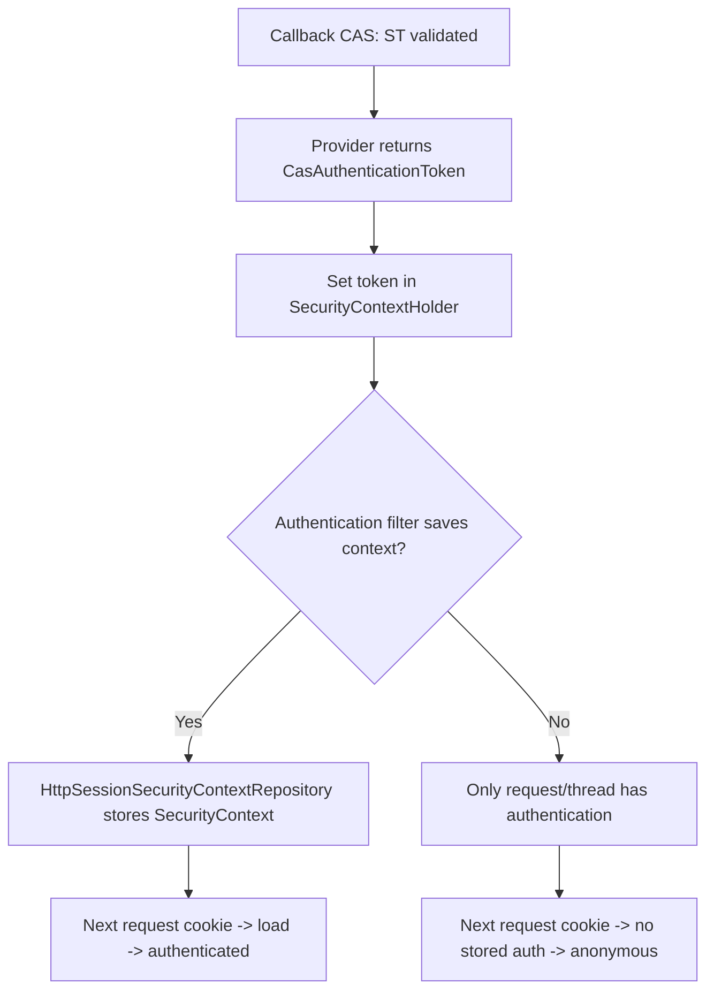

# CasAuthenticationToken và lưu ngữ cảnh trong phiên ứng dụng

## Mục tiêu học tập

Sau bài học này, bạn có thể:

1. Giải thích đường đi của **CAS Service Ticket** từ trình duyệt qua `CasAuthenticationFilter`, `AuthenticationManager`, `CasAuthenticationProvider` đến **`CasAuthenticationToken` đã được xác thực**.
2. Phân biệt **token đầu vào chưa xác thực**, **CasAuthenticationToken sau CAS validation**, **SecurityContext**, **SecurityContextHolder**, **SecurityContextRepository**, **HttpSession** của ứng dụng và phiên SSO/TGT trên CAS Server.
3. Hiểu các dữ liệu mà `CasAuthenticationToken` nắm giữ: principal, authorities, credentials/ticket, `UserDetails`, CAS `Assertion`, trạng thái authenticated và provider key hash; tránh log hoặc tiết lộ dữ liệu nhạy cảm.
4. Diễn giải tại sao chỉ đặt `Authentication` vào `SecurityContextHolder` **không đủ** để duy trì đăng nhập qua nhiều HTTP requests. Trong Spring Security 6, cơ chế lưu `SecurityContextRepository.saveContext(...)` và chính filter authentication cần được cấu hình đúng.
5. Cấu hình **Spring Boot 3 / Spring Security 6 / Java 17+** cho CAS browser SSO có trạng thái, bảo vệ session fixation, persist/restore SecurityContext và kiểm authorities ở service method.
6. Chẩn đoán lỗi **đăng nhập CAS thành công nhưng request tiếp theo vẫn anonymous**, session mất sau restart/LB, cookie không quay lại, không lưu context, logout không thu hồi phiên và user authorities lỗi.
7. Kiểm thử giữa hai request, logout, session expiry, CSRF, quyền tenant, nhiều node, truy cập đồng thời và sự khác biệt giữa stateful browser SSO với proxy ticket/stateless ticket cache.
8. Chạy một **demo Java 17+ độc lập** mô phỏng vòng đời request-scoped context và session persistence, có stdout xác định, đồng thời biết rõ demo **không phải CAS ticket validator**.

## 1. CAS xác thực tập trung, ứng dụng giữ phiên riêng

CAS (Central Authentication Service) có **CAS Server** chịu trách nhiệm xác thực người dùng và phát **Service Ticket (ST)** cho các ứng dụng được phép dùng SSO. Ứng dụng Spring Security là **CAS Client/Service**: nó nhận ticket, xác minh ticket qua CAS Server rồi tạo một `Authentication` cục bộ.

Ví dụ:

- CAS Server: `https://sso.example.org/cas`.
- Ứng dụng: `https://portal.example.org`.
- CAS service URL/callback: `https://portal.example.org/login/cas`.
- Browser mở trang `/reports` khi chưa được xác thực.
- CAS phát ST cho đúng service đã đăng ký; browser quay về `/login/cas?ticket=ST-...`.
- Spring CAS integration **không tin chuỗi ST chỉ vì nó bắt đầu bằng `ST-`**. Provider dùng ticket validator gọi `https://sso.example.org/cas/serviceValidate` qua HTTPS, với service phù hợp.
- Chỉ khi CAS xác thực ST hợp lệ, provider mới tạo một `CasAuthenticationToken` đã authenticated và Spring Security mới cho phép ứng dụng dùng nó.

**Một ST thường chỉ dùng một lần và gắn với một service URL cụ thể.** Đừng “lưu ST vào cookie để đăng nhập các request sau”. Ở browser app có trạng thái, lần đăng nhập CAS đầu tiên tạo **SecurityContext/HttpSession** của chính ứng dụng; các request sau dùng **cookie session** chứ không validate lại ST cũ.

### 1.1. Các loại trạng thái không được nhầm

| Thành phần | Nơi quản lý | Có tác dụng gì? | Điều KHÔNG nên suy ra |
| --- | --- | --- | --- |
| **CAS Service Ticket** | CAS Server phát, browser chuyển tới client | Chứng minh đăng nhập cho một service khi đã validate, ngắn hạn và dùng một lần | Không phải app session ID; không reuse mỗi HTTP request |
| **CAS TGT / TGC** | CAS Server/session/cookie domain CAS | CAS SSO để phát ST mới theo policy | Không tự tạo `SecurityContext` trong app |
| **`CasAuthenticationToken`** | Spring Security app sau ticket validation | Đại diện user đã xác thực, kèm authorities/assertion | Không mặc nhiên được persist qua request hoặc cấp quyền admin |
| **`SecurityContext`** | Trong request, rồi có thể trong session repository | Chứa `Authentication` đang dùng | Không đồng nghĩa một CAS ticket hay TGT |
| **`SecurityContextHolder`** | Mặc định ThreadLocal theo request/thread | Cho code server truy cập context hiện tại | Không phải kho session toàn cục, không tự qua request |
| **`SecurityContextRepository`** | Spring Security, có thể dựa trên HttpSession | Nạp/lưu context giữa các requests | Không xác minh chữ ký/ticket CAS |
| **`HttpSession` + cookie** | App server/session store; cookie chỉ ID | Liên kết browser với context đã lưu | Không chứng minh IdP/CAS còn phiên hoặc user có mọi quyền |
| **`StatelessTicketCache`** | CAS integration cho proxy/stateless flow cụ thể | Cache kết quả ticket cho một mô hình khác | Không giống app HttpSession, không nên bật mặc định cho browser SSO |

Trong vận hành, lỗi ở bất kỳ lớp nào có thể hiển thị cùng một triệu chứng: “CAS đã đăng nhập nhưng ứng dụng lại đưa về CAS”. Vì vậy phải chẩn đoán **ST validation**, **token creation**, **context saving**, **session cookie** và **authorization** như những bước khác nhau.

## 2. Luồng xác thực và lưu context đầy đủ

```mermaid
sequenceDiagram
    actor U as Người dùng
    participant B as Browser
    participant APP as Spring Security App
    participant CAS as CAS Server
    participant S as App Session Store
    U->>B: Truy cập GET /reports
    B->>APP: GET /reports (chưa authenticated)
    APP-->>B: 302 đến CAS /login?service=...
    B->>CAS: GET /cas/login?service=...
    CAS->>U: Login hoặc dùng TGT/SSO session
    U->>CAS: Xác thực thành công
    CAS-->>B: Redirect /login/cas?ticket=ST-...
    B->>APP: GET /login/cas?ticket=ST-...
    APP->>APP: CasAuthenticationFilter tạo ticket auth request
    APP->>CAS: /serviceValidate?ticket=ST-...&service=...
    CAS-->>APP: CAS authenticationSuccess(user)
    APP->>APP: CasAuthenticationProvider tải UserDetails/authorities
    APP->>APP: Trả CasAuthenticationToken (authenticated)
    APP->>APP: SessionAuthenticationStrategy chống fixation
    APP->>APP: Tạo SecurityContext và set Authentication
    APP->>S: SecurityContextRepository.saveContext(...)
    APP-->>B: Set-Cookie app session; 302 /reports
    B->>APP: GET /reports + session cookie
    APP->>S: SecurityContextRepository.loadDeferredContext(...)
    S-->>APP: SecurityContext chứa CasAuthenticationToken
    APP->>APP: SecurityContextHolder dùng trong request
    APP-->>B: 200 /reports nếu quyền hợp lệ
```

Đây là **luồng mục tiêu của cấu hình stateful**. Chi tiết tên token request và cách filter lưu context tùy Spring Security release và custom configuration. Đặc biệt trong **Spring Security 6**, một `CasAuthenticationFilter` do ứng dụng tự tạo có thể **không tự lưu context** nếu không được gắn `SecurityContextRepository` phù hợp.

### 2.1. Hai lần xử lý khác nhau

**Request A — Callback nhận ST:**

1. CAS `CasAuthenticationFilter` bắt `/login/cas`.
2. Filter lấy `ticket` và tạo **authentication request token** chưa xác thực (trong Spring Security CAS 6.5 API là `CasServiceTicketAuthenticationToken`), dùng principal marker cho stateful CAS.
3. `AuthenticationManager`/`CasAuthenticationProvider` xác nhận ticket với CAS server qua một `TicketValidator` phù hợp service URL; ticket có thể bị CAS từ chối vì sai service, hết hạn hoặc đã sử dụng.
4. Provider gọi `AuthenticationUserDetailsService` để lấy user details/roles do ứng dụng cho phép.
5. Provider tạo **`CasAuthenticationToken` thành công**, chứa principal và authorities sau xác thực.
6. Filter chạy `SessionAuthenticationStrategy`, tạo context và lưu qua `SecurityContextRepository`.
7. Browser nhận redirect và session cookie đúng.

**Request B — Truy cập tài nguyên sau login:**

1. Browser gửi session cookie tới app, không gửi ST cũ.
2. `SecurityContextHolderFilter` dùng repository nạp security context từ session (nếu có).
3. `SecurityContextHolder.getContext().getAuthentication()` phản ánh một authentication hợp lệ trong **request/thread hiện tại**.
4. `AuthorizationFilter`/method security kiểm authorities, tenant và resource permissions.
5. Sau request, thread-local context được dọn theo filter chain; **session store**, không phải thread-local, mới là nơi giữ state cho request kế.

**Điểm cần nhớ:** token sau xác thực và hoạt động persistence là **hai khâu**. Có thể CAS validation thành công, token hợp lệ trong request A, nhưng request B anonymous vì app chưa từng lưu context.

## 3. CasAuthenticationToken là gì?

Trong Spring Security CAS (API 6.5), `org.springframework.security.cas.authentication.CasAuthenticationToken` là một implementation của Spring `Authentication`, kế thừa `AbstractAuthenticationToken`. Nó không phải nguyên chuỗi Service Ticket và cũng không phải định dạng JWT.

Các thông tin quan trọng:

| API/khái niệm | Ý nghĩa | Lưu ý bảo mật |
| --- | --- | --- |
| `isAuthenticated()` | Token đã được provider xác thực | Không tự set true cho token từ request chưa validate |
| `getName()` | Tên principal dưới góc nhìn Spring Security | Có thể không phải stable user ID của mọi tenant |
| `getPrincipal()` | Thường là `UserDetails` của user sau mapping | Không tự tin email/display name để merge users |
| `getUserDetails()` | Thông tin user từ `UserDetailsService` | Tùy logic app: disabled, expired, locked và authorities |
| `getAuthorities()` | Các `GrantedAuthority` trong ứng dụng | Không tự suy admin từ SSO CAS hay attribute bất kỳ |
| `getCredentials()` | Credential liên quan ticket (có thể là ST/PT hoặc dữ liệu đã được xóa tùy lifecycle) | **Không log/serialize vào JSON response**, có nguy cơ lộ ticket |
| `getAssertion()` | CAS client `Assertion` được server trả khi validate ticket | Có thể chứa attributes/identity/proxy-related details; dữ liệu nhạy cảm |
| `getKeyHash()` | Giá trị băm của provider key dùng kiểm nhất quán nguồn tạo token | **Không phải chữ ký mật mã**, không dùng làm auth proof |
| `getDetails()` | Web/request details tùy filter | Không mặc nhiên là bằng chứng địa chỉ IP đáng tin |
| `eraseCredentials()` | Cơ chế chung để xóa credentials khi có thể | Không giả định mọi nested object/Assertion đã được xóa sạch |

### 3.1. Authentication request token khác token đã xác thực

```text
Browser:
  ?ticket=ST-opaque-value
       |
       v
CasAuthenticationFilter
  CasServiceTicketAuthenticationToken (chưa xác thực)
       |
       v
AuthenticationManager / CasAuthenticationProvider
  TicketValidator + CAS /serviceValidate
  Load UserDetails/approved authorities
       |
       v
CasAuthenticationToken (authenticated)
       |
       v
SecurityContextHolder + SecurityContextRepository
```

Đừng lấy tên lớp của một bản tài liệu **cũ** rồi kết luận mọi version đều tạo `UsernamePasswordAuthenticationToken` ở callback. Một số mô tả lịch sử của Spring Security nhắc lớp cũ, trong khi **API 6.5 của `CasAuthenticationFilter` ghi rõ `CasServiceTicketAuthenticationToken`**. Khi học và triển khai, hãy đối chiếu chính version thư viện thực tế.

### 3.2. Token không tự cấp vai trò ứng dụng

CAS Server có thể xác thực principal `alice`, nhưng quyền đọc báo cáo hoặc quản trị user thuộc ứng dụng. Ví dụ:

```text
CAS validation:
  username = alice
  status   = SUCCESS

Portal UserDetailsService:
  user     = alice
  active   = true
  roles    = [REPORT_READ]

Spring CasAuthenticationToken:
  authenticated = true
  authorities   = [REPORT_READ, ...possible framework details]

GET /reports    -> 200 nếu REPORT_READ được cho phép
GET /admin      -> 403 nếu không có admin permission
```

Phần `...possible framework details` chỉ nhắc có thể có authorities bổ sung theo thư viện/version; **không phải stdout cố định**. Tách identity (ai đăng nhập) khỏi authorization (được làm gì). Không mapping CAS attributes như `group=Administrators` thành `ROLE_ADMIN` bằng `contains("admin")`.

### 3.3. Không tự tạo CasAuthenticationToken để “login nhanh”

Constructor của token có thể công khai vì framework cần cấu tạo object, nhưng **đối tượng do code tự new không phải bằng chứng CAS đã xác thực user**. Một filter chỉ nên nhận kết quả từ `AuthenticationManager`/`CasAuthenticationProvider`, được hỗ trợ bởi ticket validation và trust configuration đã duyệt.

Nếu viết test, có thể tạo mock `Authentication` để test **repository** nhưng phải mô tả rõ đó là fixture, không phải xác thực CAS. Trong production, đừng cấp session khi controller nhận `{"username":"alice","authenticated":true}` và tự dựng `CasAuthenticationToken`.

## 4. SecurityContextHolder không phải session store

`SecurityContextHolder` là cách truy cập `SecurityContext` hiện tại trong Spring Security. Với Servlet request thông thường, Spring Security dùng chiến lược `MODE_THREADLOCAL`: mỗi request có thread riêng hoặc thread tái sử dụng, nhưng context được thiết lập và dọn đúng filter lifecycle.

**Các thao tác khác nhau:**

```java
// Trích đoạn giải thích: chạy trong code đã có Authentication
// hợp lệ từ AuthenticationManager, không phải login bằng user input.
SecurityContext context = SecurityContextHolder.createEmptyContext();
context.setAuthentication(authentication);
SecurityContextHolder.setContext(context);

// CÁC DÒNG TRÊN CHƯA ĐẢM BẢO LƯU CHO REQUEST SAU!
// Với cơ chế tự viết, cần SecurityContextRepository.saveContext(...).
```

`SecurityContextHolder.getContext()` có thể trả một context rỗng. Sau khi request kết thúc, filter chain sẽ dọn thread-local. Nếu không lưu context vào `SecurityContextRepository` và browser không có session cookie ứng với nó, lần GET sau không có bằng chứng đã xác thực.

### 4.1. SecurityContextRepository là cầu nối sang phiên ứng dụng

Các implementation quan trọng:

- `HttpSessionSecurityContextRepository`: lưu/đọc context trong `HttpSession`. Mặc định key session là `SPRING_SECURITY_CONTEXT`.
- `RequestAttributeSecurityContextRepository`: giữ context trong request attributes, có thể hỗ trợ across dispatch trong cùng request; **không thay thế session** giữa các HTTP requests.
- `DelegatingSecurityContextRepository`: ủy quyền nhiều repositories, thường kết hợp request attributes và HttpSession.
- `NullSecurityContextRepository`: không lưu context; phù hợp stateless flows nhưng **không** cho browser CAS SSO stateful có session trừ khi kiến trúc chủ động xác thực lại cách khác.

**Session ID là cookie phía browser; SecurityContext được lưu server-side.** Đừng đưa nguyên `CasAuthenticationToken` hoặc CAS Assertion vào cookie/JWT tự chế để né quản lý session mà không có thiết kế bảo mật đầy đủ.

### 4.2. Spring Security 6 và quy tắc explicit save

Trong Spring Security 6, `SecurityContextHolderFilter` là cơ chế mặc định đọc context; nó **không tự động lưu mọi thay đổi** vào repository ở cuối request. Đối với authentication mechanism tùy biến, filter hoặc controller cần gọi `SecurityContextRepository.saveContext(context, request, response)` hoặc sử dụng filter authentication đã được cấu hình repository.

`AbstractAuthenticationProcessingFilter` (lớp cha của `CasAuthenticationFilter`) có phương thức:

```java
filter.setSecurityContextRepository(securityContextRepository);
filter.setSessionAuthenticationStrategy(sessionAuthenticationStrategy);
```

Theo API Spring Security 6.5, nếu không đặt repository cho `AbstractAuthenticationProcessingFilter` do ứng dụng tự tạo, mặc định **không lưu SecurityContext khi authentication success**. Đây là nguyên nhân có thể gây lỗi “CAS login success ở callback nhưng request kế lại anonymous”.

Đặt `http.securityContext(context -> context.securityContextRepository(repo))` chỉ cấu hình cơ chế nạp context của filter chain; trong thiết kế CAS filter tự dựng, **cần bảo đảm filter cũng dùng repository thích hợp**. Bài bên dưới cấu hình **cùng một repository ở cả hai vị trí**.

### 4.3. SecurityContextPersistenceFilter và requireExplicitSave

Một số hệ cũ dựa vào `SecurityContextPersistenceFilter`: nó có thể tự save context cuối request. Ở Spring Security 6, `requireExplicitSave(true)` là mô hình khuyến nghị; đặt `false` chủ yếu để chuyển đổi code cũ. **Không đặt cả `SecurityContextPersistenceFilter` và `SecurityContextHolderFilter` cùng chain.**

Đừng dùng “tắt explicit save” như giải pháp đầu tiên khi CAS filter không persist. Cách rõ ràng là cấu hình `SecurityContextRepository` đúng trên authentication filter và test session giữa hai requests.

## 5. Phân biệt stateful CAS browser login với stateless proxy ticket

Một ứng dụng web có session thường cần:

- Browser dùng CAS Service Ticket đúng một lần để tạo `CasAuthenticationToken`.
- Token được lưu trong `SecurityContext` của app session.
- Browser request tiếp theo gửi session cookie; **không tái gửi ST**.

Trong hệ stateless API/proxy ticket, Spring Security CAS có các thành phần khác:

- `CasServiceTicketAuthenticationToken.CAS_STATEFUL_IDENTIFIER` thường đại diện ticket đến **service callback**.
- `CAS_STATELESS_IDENTIFIER` áp dụng một số flow proxy/remoting.
- `StatelessTicketCache` có thể cache kết quả cho một proxy ticket trong những cấu hình nhất định, vì CAS Ticket Validator không thể validate lại cùng ST mãi.
- `ServiceProperties.authenticateAllArtifacts` và `ServiceAuthenticationDetailsSource` phục vụ các flow nhận artifact trên URLs khác callback.

**Không dùng `StatelessTicketCache` như một bản thay `HttpSessionSecurityContextRepository` cho browser SSO.** Cache theo ticket và session theo browser là hai cơ chế riêng, có semantics, TTL, revocation và attack surface khác nhau. Đặc biệt không bật `authenticateAllArtifacts=true` và accept-any-proxy nếu ứng dụng không có nhu cầu proxy ticket được thẩm định.

## 6. Ví dụ Spring Boot 3 / Spring Security 6: lưu CasAuthenticationToken vào session

Ví dụ dùng **Java 17+, Spring Boot 3, Spring Security 6.5 Servlet**. Các file Java dưới đây đặt trong **một dự án Spring Boot**, không biên dịch độc lập bằng `javac`. Để chạy end-to-end cần **CAS Server thật**, CAS service được đăng ký tại server, HTTPS certificate hợp lệ, library CAS Client Jakarta-compatible và người dùng có trong nguồn dữ liệu ứng dụng.

Các địa chỉ `example.org` và tài khoản `alice` chỉ để minh họa; không đại diện một hệ thống production sẵn có.

### 6.1. Dependencies Gradle

Trong dự án đã có Spring Boot plugin và dependency management/BOM:

```groovy
dependencies {
    implementation 'org.springframework.boot:spring-boot-starter-web'
    implementation 'org.springframework.boot:spring-boot-starter-security'
    implementation 'org.springframework.security:spring-security-cas'
    implementation 'org.apereo.cas.client:cas-client-core'

    testImplementation 'org.springframework.boot:spring-boot-starter-test'
    testImplementation 'org.springframework.security:spring-security-test'
}
```

Version phải do BOM/dependency management phù hợp quyết định hoặc được pin đã kiểm, đặc biệt với CAS Client `jakarta.servlet` ở Spring Boot 3. Một số phiên bản CAS Client cũ dùng `javax.servlet`, gây lỗi runtime khi tích hợp Servlet/Jakarta. Tránh đăng ký đồng thời hai bộ CAS authentication filters (Spring Security filter và CAS Client servlet filter) để không double-authenticate.

### 6.2. application.yml: HTTPS và session cookie

Tệp `src/main/resources/application.yml`:

```yaml
server:
  servlet:
    session:
      timeout: 20m
      cookie:
        http-only: true
        secure: true
        same-site: lax
```

**Giải thích:**

- `timeout: 20m` là **giá trị demo**, cần cân đối với security policy, khối lượng sessions và thời gian login/MFA.
- `secure: true` đòi public HTTPS, không truyền session cookie qua HTTP.
- `http-only: true` giảm khả năng JavaScript đọc session cookie.
- `same-site: lax` thường phù hợp với CAS native protocol callback kiểu **top-level GET redirect** từ CAS Server về app; với iframe, cross-site POST hoặc trình duyệt/policy khác, phải kiểm thực tế. Không giả định Lax luôn đủ cho mọi CAS custom flow.
- Giữ CSRF protection cho form/actions của ứng dụng; CAS callback dùng GET với ticket không đồng nghĩa mọi state-changing GET đều an toàn.
- Tại reverse proxy, cấu hình external URL/forwarded headers theo trusted ingress, không tin `X-Forwarded-*` tùy ý từ client.

### 6.3. ServiceProperties và CasAuthenticationEntryPoint

Tệp `src/main/java/com/example/cas/ServiceCasConfig.java`:

```java
package com.example.cas;

import org.springframework.context.annotation.Bean;
import org.springframework.context.annotation.Configuration;
import org.springframework.security.cas.ServiceProperties;
import org.springframework.security.cas.web.CasAuthenticationEntryPoint;

@Configuration
public class ServiceCasConfig {
    static final String CAS_BASE = "https://sso.example.org/cas";
    static final String SERVICE_URL =
            "https://portal.example.org/login/cas";

    @Bean
    ServiceProperties serviceProperties() {
        ServiceProperties props = new ServiceProperties();
        props.setService(SERVICE_URL);
        props.setSendRenew(false);
        return props;
    }

    @Bean
    CasAuthenticationEntryPoint casAuthenticationEntryPoint(
            ServiceProperties props) {
        CasAuthenticationEntryPoint entry =
                new CasAuthenticationEntryPoint();
        entry.setLoginUrl(CAS_BASE + "/login");
        entry.setServiceProperties(props);
        return entry;
    }
}
```

`ServiceProperties.service` phải là **canonical public callback URL** và trùng với URL dùng khi CAS cấp/validate ST. CAS Server phải cho phép URL này ở **Service Registry**. `sendRenew(false)` cho phép dùng CAS SSO session theo policy, không yêu cầu primary login mỗi lần; với vùng nhạy cảm có thể cần `renew=true` và cơ chế step-up đã duyệt.

### 6.4. UserDetailsService: quyền cục bộ sau CAS validation

Tệp `src/main/java/com/example/cas/PortalUsers.java`:

```java
package com.example.cas;

import org.springframework.context.annotation.Bean;
import org.springframework.context.annotation.Configuration;
import org.springframework.security.core.userdetails.User;
import org.springframework.security.core.userdetails.UserDetailsService;
import org.springframework.security.core.userdetails.UsernameNotFoundException;

@Configuration
public class PortalUsers {

    @Bean
    UserDetailsService userDetailsService() {
        // DEMO ONLY. Production phải lấy user, trạng thái và quyền
        // từ nguồn IAM/DB nội bộ đã được phê duyệt.
        return username -> {
            if (!"alice".equals(username)) {
                throw new UsernameNotFoundException("Unknown CAS user");
            }
            return User.withUsername(username)
                    // Không dùng trường password này cho CAS ticket auth.
                    .password("{noop}unused-in-cas-demo")
                    .authorities("REPORT_READ")
                    .build();
        };
    }
}
```

Ở đây `alice` chỉ là fixture. Trong production cần ánh xạ stable CAS principal tới account nội bộ đúng realm/tenant, kiểm locked/disabled/expired, roles từ entitlement store, không chuyển tự động mọi group claim thành `ROLE_ADMIN`. `{noop}` ở ví dụ chỉ giúp type `UserDetails` được xây hợp lệ; **không dùng password trần hay NoOpPasswordEncoder để xác thực mật khẩu thật**. CAS password authentication diễn ra tại CAS Server.

### 6.5. Bảo đảm cùng một SecurityContextRepository cho chain và CAS filter

Tệp `src/main/java/com/example/cas/CasSecurityConfiguration.java`:

```java
package com.example.cas;

import org.apereo.cas.client.validation.Cas20ServiceTicketValidator;

import org.springframework.context.annotation.Bean;
import org.springframework.context.annotation.Configuration;
import org.springframework.security.authentication.AuthenticationManager;
import org.springframework.security.authentication.ProviderManager;
import org.springframework.security.cas.ServiceProperties;
import org.springframework.security.cas.authentication.CasAuthenticationProvider;
import org.springframework.security.cas.web.CasAuthenticationEntryPoint;
import org.springframework.security.cas.web.CasAuthenticationFilter;
import org.springframework.security.config.annotation.method.configuration.EnableMethodSecurity;
import org.springframework.security.config.annotation.web.builders.HttpSecurity;
import org.springframework.security.config.http.SessionCreationPolicy;
import org.springframework.security.core.userdetails.UserDetailsByNameServiceWrapper;
import org.springframework.security.core.userdetails.UserDetailsService;
import org.springframework.security.web.SecurityFilterChain;
import org.springframework.security.web.authentication.session.ChangeSessionIdAuthenticationStrategy;
import org.springframework.security.web.context.DelegatingSecurityContextRepository;
import org.springframework.security.web.context.HttpSessionSecurityContextRepository;
import org.springframework.security.web.context.RequestAttributeSecurityContextRepository;
import org.springframework.security.web.context.SecurityContextRepository;

@Configuration
@EnableMethodSecurity
public class CasSecurityConfiguration {

    @Bean
    SecurityContextRepository securityContextRepository() {
        return new DelegatingSecurityContextRepository(
                new RequestAttributeSecurityContextRepository(),
                new HttpSessionSecurityContextRepository());
    }

    @Bean
    CasAuthenticationProvider casAuthenticationProvider(
            ServiceProperties props,
            UserDetailsService users) {
        CasAuthenticationProvider provider = new CasAuthenticationProvider();
        provider.setKey("portal-cas-provider");
        provider.setServiceProperties(props);
        provider.setTicketValidator(
                new Cas20ServiceTicketValidator(ServiceCasConfig.CAS_BASE));
        provider.setAuthenticationUserDetailsService(
                new UserDetailsByNameServiceWrapper<>(users));
        return provider;
    }

    @Bean
    AuthenticationManager casAuthenticationManager(
            CasAuthenticationProvider provider) {
        return new ProviderManager(provider);
    }

    @Bean
    SecurityFilterChain casWebChain(
            HttpSecurity http,
            CasAuthenticationEntryPoint entry,
            AuthenticationManager casAuthenticationManager,
            ServiceProperties props,
            SecurityContextRepository contextRepo) throws Exception {

        CasAuthenticationFilter casFilter = new CasAuthenticationFilter();
        casFilter.setFilterProcessesUrl("/login/cas");
        casFilter.setServiceProperties(props);
        casFilter.setAuthenticationManager(casAuthenticationManager);

        // QUAN TRỌNG cho Spring Security 6 với filter tự tạo:
        // Persist SecurityContext chứa CasAuthenticationToken.
        casFilter.setSecurityContextRepository(contextRepo);

        // Custom authentication filter phải tự có session strategy.
        // Chống session fixation sau khi ticket đã validate.
        casFilter.setSessionAuthenticationStrategy(
                new ChangeSessionIdAuthenticationStrategy());

        http.authorizeHttpRequests(auth -> auth
                    .requestMatchers("/", "/error").permitAll()
                    .anyRequest().authenticated())
                .exceptionHandling(errors ->
                    errors.authenticationEntryPoint(entry))
                .sessionManagement(session ->
                    session.sessionCreationPolicy(SessionCreationPolicy.IF_REQUIRED))
                .securityContext(context ->
                    context.securityContextRepository(contextRepo))
                .addFilterAt(casFilter, CasAuthenticationFilter.class)
                .logout(logout -> logout
                    .invalidateHttpSession(true)
                    .clearAuthentication(true)
                    .deleteCookies("JSESSIONID"));

        return http.build();
    }
}
```

**Cách các phần phối hợp:**

1. `CasAuthenticationProvider` chỉ tạo `CasAuthenticationToken` sau khi `Cas20ServiceTicketValidator` đã gọi CAS Server validate ST và local `UserDetailsService` chấp nhận user.
2. `CasAuthenticationFilter` lấy ticket từ callback `/login/cas`; `setServiceProperties` bảo đảm service URL dùng ở validation nhất quán với CAS.
3. `setSecurityContextRepository(contextRepo)` khiến CAS filter lưu context khi success. Nếu bỏ nó, **filter tự tạo** có thể chỉ set holder cho callback mà không persist.
4. `http.securityContext(...contextRepo)` khiến filter chain ở **request kế** đọc đúng repository đó.
5. `ChangeSessionIdAuthenticationStrategy` rotate session ID khi authentication thành công, phòng session fixation. Đây là cấu hình explicit cho custom CAS filter; không suy rằng mọi custom filter tự lấy session strategy từ DSL.
6. `SessionCreationPolicy.IF_REQUIRED` cho phép session khi cần. Đặt `STATELESS` trong luồng browser stateful sẽ làm các request sau không nạp được authentication từ session.
7. `logout()` dọn local app context/session theo framework; **không tự xóa CAS TGT/TGC trên CAS Server** và không bảo đảm mọi ứng dụng SSO đã logout.
8. Filter được tạo **cục bộ bên trong SecurityFilterChain**, tránh để Spring Boot đồng thời auto-register nó như Servlet Filter độc lập. Nếu thêm CAS Client SLO filter, phải đăng ký riêng theo hướng dẫn Jakarta/phiên bản thực tế.
9. `CSRF` không bị disable toàn cục. Những request thay đổi trạng thái vẫn phải có CSRF protection.
10. `AuthenticationManager` chỉ gồm CAS provider cho flow này. Nếu ứng dụng có nhiều authentication schemes, bố trí providers/filter chains với thứ tự và paths chính xác.

**Giới hạn ví dụ:** code chỉ mô tả phần chính của app. Để chạy end-to-end cần Spring Boot main class, HTTPS public endpoint, CAS Server thật, CAS registered service, TLS trust, JDK/Gradle dependency resolution, user provision và môi trường Servlet. Không thể chỉ copy một file rồi chạy `javac CasSecurityConfiguration.java`.

### 6.6. Spring Boot main class

Tệp `src/main/java/com/example/cas/CasApplication.java`:

```java
package com.example.cas;

import org.springframework.boot.SpringApplication;
import org.springframework.boot.autoconfigure.SpringBootApplication;

@SpringBootApplication
public class CasApplication {
    public static void main(String[] args) {
        SpringApplication.run(CasApplication.class, args);
    }
}
```

Vì `CasApplication` nằm ở `com.example.cas`, nó component-scan các class cùng package. Chạy ứng dụng với server HTTPS (trực tiếp hoặc trusted ingress), ServiceProperties public URL đúng và CAS Server hỗ trợ ticket validation trước khi kiểm browser flow.

## 7. Đọc CasAuthenticationToken tại controller và bảo vệ quyền

### 7.1. Controller chỉ xuất thông tin không nhạy cảm

Tệp `src/main/java/com/example/cas/WhoAmIController.java`:

```java
package com.example.cas;

import java.util.Map;
import org.springframework.security.cas.authentication.CasAuthenticationToken;
import org.springframework.security.core.Authentication;
import org.springframework.web.bind.annotation.GetMapping;
import org.springframework.web.bind.annotation.RestController;

@RestController
public class WhoAmIController {

    @GetMapping("/")
    public String home() {
        return "Public home";
    }

    @GetMapping("/me")
    public Map<String, Object> me(Authentication authentication) {
        boolean cas = authentication instanceof CasAuthenticationToken;
        return Map.of(
                "principalName", authentication.getName(),
                "authenticated", authentication.isAuthenticated(),
                "casToken", cas);
    }
}
```

Giả sử CAS đã validate thành công `alice`, Spring Security persist `SecurityContext` và browser gửi app session cookie, một kết quả **minh họa có điều kiện** là:

```json
{
  "principalName": "alice",
  "authenticated": true,
  "casToken": true
}
```

**Không trả** `authentication.toString()`, `getCredentials()`, `getAssertion()`, raw ST/TGT, user password hash hoặc toàn bộ authorities/PII trong API public. `/me` phải bảo vệ như một endpoint dành cho user đã authenticated. Nếu có nhiều cơ chế đăng nhập, `casToken=false` có thể là hợp lệ cho flow khác — không coi điều đó tự động là lỗi xác thực.

### 7.2. Service method kiểm quyền thật

Tệp `src/main/java/com/example/cas/ReportService.java`:

```java
package com.example.cas;

import org.springframework.security.access.prepost.PreAuthorize;
import org.springframework.stereotype.Service;

@Service
public class ReportService {

    @PreAuthorize("hasAuthority('REPORT_READ')")
    public String readReport(String tenantId) {
        return "Report access for " + tenantId;
    }
}
```

Tệp `src/main/java/com/example/cas/ReportController.java`:

```java
package com.example.cas;

import org.springframework.web.bind.annotation.GetMapping;
import org.springframework.web.bind.annotation.PathVariable;
import org.springframework.web.bind.annotation.RestController;

@RestController
public class ReportController {
    private final ReportService reports;

    public ReportController(ReportService reports) {
        this.reports = reports;
    }

    @GetMapping("/tenants/{tenantId}/reports")
    public String report(@PathVariable String tenantId) {
        return reports.readReport(tenantId);
    }
}
```

**Cảnh báo về tenant:** `@PreAuthorize("hasAuthority('REPORT_READ')")` mới kiểm quyền đọc báo cáo ở mức **chung**. Trong sản phẩm nhiều tenant, đoạn này **chưa đủ** vì user `alice` có thể đổi `tenantId` trong URL. Hãy bổ sung policy server-side kiểm `(authenticated subject, tenantId, action)` trên dữ liệu quyền cục bộ, ví dụ `@PreAuthorize("@reportPolicy.canRead(authentication, #p0)")` với bean đã kiểm chứng. **Không copy đoạn demo này nguyên vẹn vào sản phẩm đa tenant mà bỏ object/tenant authorization.**

### 7.3. Cách một request sau login đọc token

Trong controller, tham số `Authentication authentication` do Spring Security cung cấp từ context hiện tại. Một cách khác trong code server:

```java
// Code tại lớp service/filter đang chạy trong request đã được bảo vệ.
Authentication authentication =
        SecurityContextHolder.getContext().getAuthentication();

if (authentication instanceof CasAuthenticationToken cas
        && cas.isAuthenticated()) {
    String name = cas.getName();
    // Dùng name sau khi đã ánh xạ đúng account/tenant policy.
}
```

Trong đoạn trên cần import `org.springframework.security.core.Authentication`, `org.springframework.security.core.context.SecurityContextHolder` và `org.springframework.security.cas.authentication.CasAuthenticationToken`. Đây là trích đoạn, không phải file độc lập.

**Không dùng static/global variable lưu CasAuthenticationToken của user gần nhất**. Mọi request phải nhận context riêng và authorization không được phụ thuộc token còn lại ở thread do không dọn đúng lifecycle.

## 8. HTTP session được tạo và phục hồi như thế nào?

### 8.1. Sau callback

Ví dụ:

```http
GET /login/cas?ticket=ST-EXAMPLE HTTP/1.1
Host: portal.example.org
```

Sau CAS validation và lưu SecurityContext, một phản hồi hợp lệ có thể là:

```http
HTTP/1.1 302 Found
Set-Cookie: JSESSIONID=opaque-session-id; Path=/; Secure; HttpOnly; SameSite=Lax
Location: /reports
```

Những giá trị `ST-EXAMPLE` và `opaque-session-id` là **fixture**, không phải ST/cookie thật. Nếu đã có session trước login, Spring Security có thể **rotate session ID** thay vì tạo session hoàn toàn mới.

Ở request sau:

```http
GET /reports HTTP/1.1
Host: portal.example.org
Cookie: JSESSIONID=opaque-session-id
```

Server lấy `HttpSession` ứng với cookie và `SecurityContextRepository` đọc entry `SPRING_SECURITY_CONTEXT`. Nếu context có `CasAuthenticationToken` và quyền hợp lệ, request qua authorization checks.

### 8.2. Ai quyết định authenticated ở request kế?

Không phải CAS Server — nó thường **không được gọi lại** mỗi request web. Đó là Spring Security app sử dụng persisted context. CAS TGT có thể đã logout nhưng app session vẫn tồn tại nếu chưa có **Single Logout callback** hoặc cơ chế thu hồi.

**Đây là thiết kế stateful bình thường**, đồng thời là một vấn đề revocation cần quản lý. Khi business yêu cầu “user bị disable trên CAS phải mất quyền ngay”, phải thiết kế session invalidation/entitlement recheck/short TTL phù hợp; đừng chỉ giả định CAS tự push trạng thái tới mọi SP.

### 8.3. Session fixation và đổi JSESSIONID

Trước login user có `JSESSIONID=A`. Sau CAS validation, `ChangeSessionIdAuthenticationStrategy` có thể đổi thành `JSESSIONID=B` để chống attacker ấn định session ID trước. **A ≠ B không phải lỗi mất session** nếu context và required session attributes được bảo toàn theo strategy.

Nếu đặt custom filter nhưng quên session strategy, app có thể bỏ lỡ phòng vệ fixation. Ngược lại, không nên tự disable chiến lược bảo mật này chỉ vì debugger thấy cookie thay đổi.

## 9. Cookie, TTL và hạ tầng khiến token “biến mất”

| Triệu chứng | Nguyên nhân khả dĩ | Cách kiểm |
| --- | --- | --- |
| Callback có `CasAuthenticationToken` nhưng GET sau anonymous | Chưa `saveContext` hoặc CAS filter dùng `NullSecurityContextRepository` | Log trạng thái save/load không lộ token, kiểm filter/repo |
| Browser không gửi app session cookie | Cookie `Secure`/`Domain`/`Path`/`SameSite`/expiry sai, HTTP/HTTPS khác | DevTools Cookies/Network và excluded reason |
| Có cookie nhưng server không tìm session | Session timeout, restart, local-memory node khác, Redis/JDBC lỗi | Kiểm session store hit/miss, LB node, TTL |
| Authenticated ở node A nhưng node B anonymous | Hai node dùng local HttpSession khác nhau | Spring Session shared Redis/JDBC, sticky tạm thời hoặc central session store |
| Session ID đổi sau CAS | Session fixation protection | Kiểm context tồn tại sau rotate, không coi thay ID là lỗi |
| Mất login khi reload trang sau vài giây | Session store persistence, cookie path, wrong success redirect host | So Set-Cookie và Cookie ở request tiếp |
| Login thành công nhưng `/admin` 403 | Không có quyền admin | Kiểm authorities/tenant policy; **không mở CAS trust vô điều kiện** |
| Session hết hạn, CAS login tự quay lại rất nhanh | CAS SSO/TGT còn hiệu lực | Đây có thể là SSO bình thường, không phải app tự tái dùng ST |
| Logout app rồi quay lại `/reports` và vào nhanh | CAS TGT chưa logout | Cấu hình CAS Single Logout/reauth khi cần |
| CAS Server logout rồi app vẫn dùng được | App session chưa bị invalidated | SLO propagation, session revoke và server-side authorization checks |
| Token bị mất trong async task | ThreadLocal không được tự truyền sang executor thread | Dùng `DelegatingSecurityContextExecutor`/TaskDecorator phù hợp và cleanup |
| Nhiều user lẫn context | Static/global ThreadLocal quản lý sai | Không tự chia sẻ context; để Spring filters tạo/dọn theo request |

### 9.1. CAS callback là GET: SameSite khác SAML POST

Với CAS native protocol, ticket thường được trả bằng **top-level redirect GET** về `/login/cas`. `SameSite=Lax` thường cho phép cookie cho top-level cross-site GET theo chính sách browser hiện đại. Với SAML2 HTTP-POST callback cross-site, Lax có thể chặn cookie khác hoàn toàn.

Tuy nhiên cần kiểm:
- CAS có sử dụng iframe/embedded login hay custom POST callback không?
- Browser có chặn cookie theo enterprise/privacy policy không?
- Cookie host/path có khớp external callback và các protected endpoints không?
- Có SSL termination/reverse proxy thay public scheme/host hoặc redirect chéo domain không?

Không sửa lỗi app session bằng cách đặt `SameSite=None` cho mọi cookie nếu không cần; tăng bề mặt cross-site request và cần review CSRF.

### 9.2. Spring Session khi nhiều node

Nếu ứng dụng scale nhiều Spring Boot pods, dùng shared session store để `JSESSIONID` có thể được xử lý ở mọi node:

```groovy
dependencies {
    implementation 'org.springframework.session:spring-session-data-redis'
    implementation 'org.springframework.boot:spring-boot-starter-data-redis'
}
```

Bổ sung cấu hình Redis TLS/auth/ACL và TTL theo hạ tầng. **Spring Session thay nơi lưu `HttpSession`, không thay CAS ticket validator**. Một node ghi context sau callback phải được node khác đọc đúng dữ liệu đã serialize. Tránh thay version serialization/Class của CasAuthenticationToken/Assertion trong rolling deploy mà không có compatibility plan.

**Bảo mật session store:** bất kỳ bản sao `SecurityContext` nào cũng có thể chứa principal, attributes hoặc credentials nhạy cảm. Hạn chế quyền Redis/JDBC/KMS, mã hóa transport/storage theo policy, không để log/backup chứa raw contexts. Thay session store không tự giải quyết session cookie bị browser chặn.

## 10. Manual SecurityContext: vì sao phải save, không chỉ set?

Một số ứng dụng có custom filter/controller phục vụ một cơ chế authentication khác. Quy tắc chung Spring Security 6:

```java
// Trích đoạn CHỈ hợp lệ SAU khi AuthenticationManager đã thực sự
// xác thực credentials/ticket. Không dùng user input làm Authentication.
Authentication authenticated = authenticationManager.authenticate(input);

SecurityContext context = SecurityContextHolder.createEmptyContext();
context.setAuthentication(authenticated);
SecurityContextHolder.setContext(context);

// Cần request/response của Servlet:
securityContextRepository.saveContext(context, request, response);
```

Trong code trích đoạn, `input`, `request`, `response` và repository là các biến đã được chuẩn bị trong một filter/controller; **không** phải file Java độc lập. Khi đã dùng `CasAuthenticationFilter` cấu hình `setSecurityContextRepository`, **không viết lại toàn bộ luồng bằng controller `/login/cas` tự parse ticket/XML**: để filter/library xử lý xác thực, anti-replay và persistence.

### 10.1. Dòng thời gian khi quên save



Một thành công ở callback không đủ chứng minh session persistence. Test sau redirect cần **một HTTP request mới** cùng cookie và kiểm backend có đọc lại context.

### 10.2. Vì sao không save context trong local variable/static map?

Giữ `SecurityContext context` trong biến của controller hoặc biến static chỉ ảnh hưởng vòng đời object/instance; nó không biết browser nào đang gọi. Dùng `ThreadLocal` trực tiếp mà không dọn đúng có thể lộ context xuyên request trên thread pool. **Cần repository/session index được thiết kế** và Spring-managed lifecycle.

### 10.3. Repository dùng RequestAttribute + HttpSession

`DelegatingSecurityContextRepository` trong ví dụ mục 6 đảm nhiệm hai lớp:

- `RequestAttributeSecurityContextRepository` giúp giữ context trong cùng request ngay cả khi có dispatch đặc biệt.
- `HttpSessionSecurityContextRepository` cho request **khác** có cùng app session cookie.

Nếu thay bằng `RequestAttributeSecurityContextRepository` đơn độc, authentication không tự tồn tại ở HTTP request mới. Nếu dùng `NullSecurityContextRepository`, kết quả tương tự dù CAS validation ở callback thành công.

## 11. Java 17+ độc lập: mô phỏng request-scoped context và session persistence

Ví dụ này **không dùng Spring/CAS**, chỉ mô phỏng ngữ nghĩa quan trọng: authentication trong một request cần được **lưu có chủ đích vào session store** để request tiếp theo đọc lại. Không tạo Service Ticket, không kiểm CAS server, không mô phỏng cryptographic security hay toàn bộ lifecycle Spring.

Tệp `CasSessionContextDemo.java`:

```java
import java.util.HashMap;
import java.util.Map;
import java.util.Set;

public final class CasSessionContextDemo {
    record Identity(String name, Set<String> authorities) {}

    // Mô phỏng SecurityContextHolder mặc định theo thread.
    private static final ThreadLocal<Identity> REQUEST_CONTEXT =
            new ThreadLocal<>();

    // Mô phỏng HttpSessionSecurityContextRepository:
    // Key là một session ID giả, KHÔNG phải mã hóa/chứng minh an toàn.
    private static final Map<String, Identity> SESSIONS =
            new HashMap<>();

    static void startRequest(String sessionId) {
        REQUEST_CONTEXT.remove();
        Identity persisted = SESSIONS.get(sessionId);
        if (persisted != null) {
            REQUEST_CONTEXT.set(persisted);
        }
    }

    static void setAuthenticatedForCurrentRequest(Identity validated) {
        // Trong CAS thật, validated phải đến từ CasAuthenticationProvider
        // sau TicketValidator; không tạo từ query/header của browser.
        REQUEST_CONTEXT.set(validated);
    }

    static void saveCurrentRequestToSession(String sessionId) {
        Identity current = REQUEST_CONTEXT.get();
        if (current == null) {
            throw new IllegalStateException("No authenticated identity");
        }
        SESSIONS.put(sessionId, current);
    }

    static String currentName() {
        Identity current = REQUEST_CONTEXT.get();
        return current == null ? "anonymous" : current.name();
    }

    static void endRequest() {
        REQUEST_CONTEXT.remove();
    }

    public static void main(String[] args) {
        String browserA = "sid-A";
        Identity alice = new Identity("alice", Set.of("REPORT_READ"));

        startRequest(browserA);
        System.out.println("Before login: " + currentName());
        setAuthenticatedForCurrentRequest(alice);
        System.out.println("Callback authenticated: " + currentName());
        endRequest();

        // Không save: request mới không có authentication.
        startRequest(browserA);
        System.out.println("Next request without save: " + currentName());
        endRequest();

        startRequest(browserA);
        setAuthenticatedForCurrentRequest(alice);
        saveCurrentRequestToSession(browserA);
        endRequest();

        startRequest(browserA);
        System.out.println("Next request after save: " + currentName());
        endRequest();

        startRequest("sid-B");
        System.out.println("Other session: " + currentName());
        endRequest();

        SESSIONS.remove(browserA);
        startRequest(browserA);
        System.out.println("After revocation: " + currentName());
        endRequest();
    }
}
```

Biên dịch và chạy trên JDK 17+:

```bash
javac CasSessionContextDemo.java
java CasSessionContextDemo
```

**Stdout chính xác:**

```text
Before login: anonymous
Callback authenticated: alice
Next request without save: anonymous
Next request after save: alice
Other session: anonymous
After revocation: anonymous
```

Giải thích:

- `Callback authenticated: alice` chỉ cho thấy identity trong **request callback**, chưa đảm bảo dữ liệu persisted.
- `Next request without save: anonymous` cho thấy `ThreadLocal` bị dọn và không có entry trong session store.
- `Next request after save: alice` cho thấy repository có thể nạp lại state ở request kế.
- `Other session: anonymous` minh họa session isolation: `sid-B` không được tự thừa hưởng context từ `sid-A`.
- `After revocation: anonymous` mô phỏng xóa entry cục bộ rồi request tiếp bị mất quyền.
- `ThreadLocal` và `HashMap` **không dùng trong production** để thay Spring Security; đây chỉ là mô hình học tập, không thread-safe và không có expiry/CSRF/ticket validation.
- Trong app thật, không log hoặc công bố session ID và không cho browser chọn session ID như chuỗi demo. CAS `CasAuthenticationToken` thực chỉ được tạo sau validation ST.

## 12. Logout: xóa app SecurityContext khác logout CAS Server

### 12.1. Ba hành động khác nhau

| Hành động | Kết quả trực tiếp | Không đảm bảo |
| --- | --- | --- |
| **Local logout** ở Portal | Clear `Authentication`, invalidate app `HttpSession` và cookie theo config | CAS TGT/TGC đã bị hủy |
| **CAS Server logout** | Kết thúc CAS SSO session/TGT theo chính sách Server | Mọi Spring app session đã bị invalidated |
| **CAS Single Logout (SLO)** | CAS gửi thông điệp logout tới các services đã tham gia và mỗi service xử lý theo integration | Mọi đối tác/instance/session store đều đã xử lý thành công |
| **Account disable/permission revoke** | Thay trạng thái user hoặc entitlement | Session cũ đã bị xóa nếu không có trigger/index |

**Local logout** trong `HttpSecurity.logout(...)` của ví dụ thường invalidates session khi browser gọi endpoint logout của app. Nếu user sau đó truy cập `/reports`, CAS Server có thể vẫn giữ TGT và **cấp ST mới không hỏi mật khẩu**. Đây là SSO behavior, không phải app session chưa được xóa.

**CAS SLO** có thể dùng Apereo CAS client `SingleSignOutFilter` và listener được cấu hình đúng để tìm và invalidate app sessions, nhưng hỗ trợ Jakarta Servlet/version, shared store và callback paths phải được kiểm thực tế. Đừng tự thêm filter SLO vào bài mẫu mà không kiểm ordering và server topology.

### 12.2. Thu hồi khẩn cấp khi tài khoản bị khóa

Với một nhân viên bị disable hoặc partner hết hợp đồng:

1. Cấm phát CAS ST mới cho account/service theo CAS policy nếu phù hợp.
2. Thu hồi app sessions liên quan bằng session store/index, không đợi user tự logout.
3. Kiểm API access tokens/refresh tokens/remember-me cookies ngoài CAS khi có.
4. Cưỡng chế authorization dựa trên local account/tenant state tại thời điểm thao tác nhạy cảm.
5. Nếu CAS SLO có hỗ trợ, xác minh từng service đã nhận và xử lý logout; theo dõi failures.
6. Kiểm active WebSockets/background operations/long-running transactions nếu quyền cần thu hồi tức thời.

**Không bảo đảm “logout everywhere” chỉ từ một dòng code clear SecurityContextHolder.** Nó chỉ tác động holder của thread/request hiện tại nếu không có repository/session revocation tương ứng.

### 12.3. Chỉ clear holder không phải revoke session

`SecurityContextHolder.clearContext()` chủ yếu dọn context trong thread hiện tại. Nếu `HttpSession` vẫn chứa context đã save, request tiếp theo có thể load lại authentication. Dùng Spring Security LogoutHandler đúng cách hoặc xóa/deny session ở store. Với custom logout phải clear **và persist trạng thái rỗng/xóa session** đúng repository.

## 13. Session security và phạm vi dữ liệu trong CasAuthenticationToken

### 13.1. Không nhầm authenticated với authorized

`CasAuthenticationToken.isAuthenticated() == true` cho biết Spring Security đã xác thực principal theo CAS flow. Quyền truy cập vẫn phụ thuộc:

- `GrantedAuthority` từ `UserDetailsService` đã thẩm định;
- account active/locked/expired;
- permission/action cụ thể, ví dụ `REPORT_READ`, `USER_MANAGE`;
- tenant và resource ownership;
- MFA/reauth freshness khi cần;
- tình trạng session bị thu hồi, không chỉ CAS SSO còn hoạt động.

Nếu `getAssertion().getPrincipal().getAttributes()` có `groups=["Administrators"]`, đừng tự cộng `ROLE_ADMIN`. CAS Server xác nhận claim không thay thế policy phân quyền của ứng dụng.

### 13.2. Không coi Session là bí mật vô hạn hoặc nơi lưu mọi attributes

`SecurityContext` có thể giữ principal và nested CAS Assertion. Khi nhiều node dùng Redis/JDBC replication, các dữ liệu này có thể được serialize vào store/backup. Vì vậy:

- Hạn chế authorities/attributes được đưa vào context; chỉ mang theo dữ liệu cần cho authn/authz.
- Tránh lưu raw ST, password, TGT hoặc full directory record trong session.
- Dùng TLS/ACL/secret management/retention phù hợp cho session store.
- Không gọi `authentication.toString()` trên production logs nếu chưa bảo đảm redaction; nhiều implementation có thể phản ánh principal/attributes.
- Cân nhắc việc tickets/credentials được giữ đến khi nào; cơ chế `eraseCredentials` của Spring không đảm bảo mọi nested assertion đã an toàn khi serialized.
- Nếu cần đọc group/entitlement thay đổi thường xuyên, recheck tại authorization service thay vì chỉ dựa trên session snapshot cũ.

### 13.3. Session fixation, CSRF và cookie

Với browser SSO, cần:

- Session ID rotate sau authentication như cấu hình.
- `Secure`, `HttpOnly` và `SameSite` phù hợp browser flow; public HTTPS.
- Không gửi `JSESSIONID` trong URL hoặc chia sẻ sang third-party domains.
- CSRF protection với state-changing operations, không dùng GET để chỉnh dữ liệu nhạy cảm.
- Kiểm session inactivity timeout và maximum concurrency theo business/security policy.
- Không tự mở `SessionCreationPolicy.STATELESS` cho một app cần lưu context, trừ khi thay đổi kiến trúc xác thực một cách có chủ đích.
- Với high-risk actions, có thể yêu cầu CAS `renew`/step-up và policy cục bộ thay vì chỉ dựa trên login cách đây nhiều giờ.

## 14. SecurityContext trong async, thread pool và background jobs

`SecurityContextHolder` mặc định gắn với **thread**, không phải “mọi công việc thuộc về user”. Khi servlet thread giao tác vụ cho `@Async` hoặc executor, một thread khác có thể không mang context hoặc context không đúng nếu tự copy và không dọn.

Spring Security có `DelegatingSecurityContextRunnable`, `DelegatingSecurityContextExecutor` và các helper tích hợp phù hợp để bọc job có ngữ cảnh. Nhưng hãy cân nhắc:

1. Job nào thực sự cần **identity caller** để authorization? Không phải job nào cũng cần mang full CasAuthenticationToken.
2. Nếu request kết thúc trước job, tài khoản có thể bị thu hồi quyền sau đó; cần đánh giá authorization tại thời điểm thực thi.
3. Không dùng `MODE_INHERITABLETHREADLOCAL` cho thread pool một cách vô tội vạ; thread tái sử dụng có thể giữ context sai người nếu không dọn đúng.
4. Không tự copy `CasAuthenticationToken` hoặc raw CAS Assertion vào message queue/log; nên chuyển ID correlation/tenant/approved task grant tối thiểu khi có thể.
5. Khi dùng reactive stack hoặc WebFlux, context propagation khác Servlet ThreadLocal; bài này tập trung **Servlet Spring Security CAS**.

## 15. Kiểm thử tích hợp và kiểm chứng persistence

### 15.1. Ma trận chức năng

| Kịch bản | Kết quả mong đợi |
| --- | --- |
| Anonymous vào `/reports` | Redirect CAS login với canonical `service` được đăng ký |
| CAS trả ST hợp lệ đúng service | Provider trả `CasAuthenticationToken` authenticated |
| ST giả/hết hạn/đã validate | Authentication FAIL, không persist security context |
| ST phát cho service A nhưng validate bằng service B | FAIL do ticket–service binding |
| User CAS hợp lệ nhưng local account disabled | Deny theo `UserDetailsService`/local policy |
| User chưa có `REPORT_READ` | `/reports` trả 403 sau authentication |
| Callback success rồi GET mới cùng cookie | Session repository load authenticated principal |
| Callback success nhưng filter không save context | GET mới anonymous; test phải phát hiện |
| Chỉ set `SecurityContextHolder` trong custom controller | Không tồn tại request sau nếu không save |
| Cookie không được browser gửi trên GET mới | Không lấy được session/context |
| App restart với in-memory sessions | Context có thể mất; cần shared store hoặc login lại |
| Callback ở node A, GET ở node B với local memory | Có thể anonymous nếu không có shared session |
| CAS Server logout nhưng app session không bị revoke | App có thể vẫn authenticated; cần SLO/session policy |
| Local logout app còn CAS TGT | App session bị xóa, lần sau có thể SSO lại nhanh |
| Session fixation strategy hoạt động | Session ID đổi sau CAS authentication |
| User A session cookie không thể đọc user B context | Isolation được giữ; không dùng global/static token |
| Tenant A user gọi tenant B report | 403 nếu không có entitlement tenant B |
| CasAuthenticationToken credentials được log | Fail security review; không log ST/Assertion/PII |
| Stateless ticket cache bật ngoài ý muốn | Kiểm vì không phải session repository và tăng attack surface |
| App dùng `STATELESS` nhưng kỳ vọng session login | Test fail; kiến trúc/config mâu thuẫn |

### 15.2. Test quan trọng nhất: hai HTTP requests tách biệt

Một integration test browser hợp lệ phải:

1. Khởi tạo CAS login tới `/login/cas?ticket=ST-NEW` với một CAS test server/fixture trả ticket validation response tin cậy.
2. Để CAS authentication filter chạy hết tới success/redirect.
3. Lưu cookie `JSESSIONID` mà app trả về, bao gồm nếu session fixation đổi ID.
4. Gửi **một HTTP request mới** đến `/me` hoặc protected endpoint với cookie đó.
5. Assert authentication vẫn hợp lệ và principal phù hợp, authorities không tăng vô cớ.
6. Gửi request tương tự **không có cookie** → không được có principal của user cũ.
7. Logout và gửi lại request với cookie đã thu hồi → không còn authenticated access.
8. Test cùng cookie được route đến node khác (nếu thiết kế multi-node) và session store có thể đọc.
9. Test CAS ticket một lần: callback cùng ST lần hai không được tạo authentication mới khi không có session hợp lệ.
10. Kiểm authorization tenant/action riêng sau authentication.

**Không chỉ dùng mock `with(user("alice"))` để kết luận CasAuthenticationToken persistence đã đúng.** Mock user helper có thể bypass CAS filter/provider và không kiểm `/serviceValidate` hoặc session save của custom filter. Nó phù hợp unit tests cho authorization nhưng không thay end-to-end CAS flow.

### 15.3. Kiểm CAS token type đúng cách

Ở test được phép với CAS Server mock/fake thật sự validate ST:

- Trong callback success, xác nhận `Authentication` là `CasAuthenticationToken` từ `CasAuthenticationProvider`.
- Ở request tiếp theo, xác nhận context load lại cùng identity và permission.
- Không assert raw ST được lưu/log; không echo `getCredentials()` ra response.
- Khi upgrade Spring Security/CAS Client, test serialization/session restore và phiên bản `jakarta.servlet`/OpenSAML (nếu ứng dụng còn dùng SAML) độc lập.

### 15.4. Build

Với Gradle wrapper của dự án Spring Boot:

```bash
./gradlew dependencyInsight --configuration runtimeClasspath --dependency spring-security-cas
./gradlew dependencyInsight --configuration runtimeClasspath --dependency cas-client-core
./gradlew compileJava
./gradlew test
```

Windows có thể dùng `.\gradlew.bat`. Build pass kiểm API/compile của project, **không tự chứng minh CAS Server service registration, public HTTPS callback và ticket validation** đều đúng nếu thiếu môi trường tích hợp thật.

## 16. Chẩn đoán từng lớp thay vì đoán nguyên nhân

### 16.1. Khi CAS đã login nhưng app vẫn redirect CAS

**Checklist theo thứ tự:**

1. Trên CAS Server, có ST được phát cho **đúng Service URL** đã đăng ký không?
2. Browser có GET `/login/cas?ticket=...` vào đúng `CasAuthenticationFilter` không?
3. `TicketValidator` có gọi CAS `/serviceValidate` và nhận `authenticationSuccess` không? Không log ticket.
4. `CasAuthenticationProvider` có load được `UserDetails` và tạo `CasAuthenticationToken` không?
5. Trên callback, `SecurityContextHolder` có authenticated token không?
6. **CAS filter có `setSecurityContextRepository(...)` không?** Có cùng repository với filter chain không?
7. `SessionAuthenticationStrategy` có chạy và cookie/session được tạo/rotate thế nào?
8. Sau redirect, browser có gửi cookie đúng domain/path/secure không?
9. Server/session store có `SPRING_SECURITY_CONTEXT` và loader đọc được không?
10. Nếu user vẫn 403, đó có thể là **authorization** chứ không phải mất authentication.

### 16.2. Bảng lỗi và cách sửa

| Lỗi | Triệu chứng | Hướng xử lý |
| --- | --- | --- |
| `CasAuthenticationFilter` thiếu repository | Callback thành công, sau redirect anonymous | Set same `SecurityContextRepository` trên CAS filter và `HttpSecurity` |
| `NullSecurityContextRepository` / `STATELESS` | Không persist app login | Chọn session policy stateful hoặc thiết kế stateless riêng |
| `SecurityContextHolderFilter` chỉ read | Manual set token nhưng request sau mất | Explicit `saveContext` với request/response |
| Quên session strategy của custom filter | Session ID không rotate như policy | Set `ChangeSessionIdAuthenticationStrategy`/session strategy phù hợp |
| CAS validation fail | Không có `CasAuthenticationToken` thành công | Sửa ticket/service/HTTPS/trust; không forge token |
| `UserDetailsService` fail | CAS user hợp lệ nhưng app từ chối | Provision/mapping/local account state đúng |
| Cookie host/path khác callback | Session mất ở request mới | Canonical URL và cookie path/Domain |
| LB không có shared store | Node A authenticated, node B anonymous | Spring Session Redis/JDBC hoặc routing có giới hạn |
| `@PreAuthorize` không bật | Endpoint nhạy cảm không thực thi guard mong đợi | `@EnableMethodSecurity`, gọi qua Spring bean/proxy |
| Role thiếu | Authenticated nhưng 403 | Kiểm local entitlement, không tự thêm admin role |
| CAS logout chưa propagate | App session sống sau CAS logout | CAS SLO + app session revoke/expiry |
| Session timeout ngắn | Sau idle user phải login lại | TTL theo policy, hiểu CAS TGT SSO riêng |
| Incomplete proxy ticket setup | API stateless authentication fail | Kiểm CAS proxy config; không bật accept-any-proxy |
| Raw token logging | ST/assertion/PII lộ | Redact/mask log; audit only metadata không nhạy cảm |

### 16.3. Log và metrics an toàn

Nên ghi:

- `cas_ticket_validation_success_total` / `cas_ticket_validation_failure_total` (phân loại reason chung).
- `security_context_save_total` / `security_context_load_miss_total` (không ghi session ID).
- Số app sessions active theo tenant khi đã được phép thống kê.
- HTTP status, request correlation ID do server tự tạo, node ID và store health.
- Session fixation rotation event (không log old/new `JSESSIONID`).
- User activation/revocation events và authority mapping audit ở hệ thống bảo vệ.

**Không ghi** ST, CAS Assertion XML/attributes đầy đủ, TGT/TGC, `JSESSIONID`, username/email trong metric labels, hoặc `CasAuthenticationToken.toString()` toàn vẹn. Authentication logs nhạy cảm cần có retention và ACL riêng.

## 17. Những sai lầm thường gặp

| Anti-pattern | Vì sao sai? | Cách đúng |
| --- | --- | --- |
| “Có `CasAuthenticationToken` ở callback nghĩa là đã lưu phiên” | Token chỉ có thể nằm trong ThreadLocal hiện tại | Explicit session persistence và two-request test |
| “`SecurityContextHolder.setContext` tự lưu qua HTTP requests” | Holder không phải repository | `SecurityContextRepository.saveContext` hoặc filter gắn repository |
| “Spring Security 6 tự save context của mọi custom filter” | `AbstractAuthenticationProcessingFilter` mặc định không save nếu chưa gắn repo | `setSecurityContextRepository` và test |
| “Dùng ST cũ trong mỗi request API” | ST one-time, service-bound | Browser app session hoặc cơ chế API token riêng |
| “CAS TGT là app HttpSession” | Hai domain/server khác nhau | Quản lý CAS SSO và app sessions riêng |
| “Tắt CAS service là mọi session app biến mất” | Existing Spring sessions còn token | Session revoke/deny và authorization policy |
| “`CasAuthenticationToken.getKeyHash` chứng minh chữ ký CAS” | Chỉ là hash provider key local | Trust dựa trên CAS ticket validation HTTPS |
| “Dùng static map lưu user gần nhất” | Lộ dữ liệu giữa users/threads | Spring `SecurityContextRepository` và HttpSession |
| “Đưa `getAssertion` nguyên vào JSON” | Có thể lộ identity attributes/credentials | Trả dữ liệu tối thiểu, che PII |
| “Đặt `STATELESS` để khắc phục session mất” | Trái yêu cầu stateful browser login | Chọn session policy phù hợp hoặc chuyển kiến trúc |
| “Disable session fixation để giữ cookie cũ” | Giảm bảo vệ trước fixation | Rotate session ID đúng; kiểm app state |
| “CAS user ‘admin’ thì quyền app cũng admin” | Authentication không phải authorization | Local approved entitlement/least privilege |
| “Chỉ test MockMvc user mock là xong CAS integration” | Không test CAS filter, ticket validator, save | Test callback + actual session across requests |
| “Có Redis là mọi vấn đề cookie tự hết” | Không thể load session nếu browser không gửi cookie | Kiểm cookie/proxy và store độc lập |

## 18. Checklist production

### CAS authentication

- [ ] `ServiceProperties.service` là public HTTPS callback được CAS Service Registry cho phép.
- [ ] `CasAuthenticationFilter` monitor đúng `/login/cas` và nhận ST từ query.
- [ ] `CasAuthenticationProvider` sử dụng `TicketValidator` qua HTTPS với CAS Server đã trust, không chấp nhận ST giả/hết hạn/reused.
- [ ] User được ánh xạ sang `UserDetailsService`/approved local account, không nâng role từ group/name lạ.
- [ ] CAS Client/Spring Security versions tương thích Jakarta Servlet, không double-register filters.

### Session persistence

- [ ] `CasAuthenticationFilter.setSecurityContextRepository(...)` được cấu hình rõ.
- [ ] `HttpSecurity.securityContext(...)` dùng cùng repository theo kiến trúc.
- [ ] Custom CAS filter có `SessionAuthenticationStrategy` chống fixation, ví dụ `ChangeSessionIdAuthenticationStrategy`.
- [ ] `SessionCreationPolicy.IF_REQUIRED` hoặc policy stateful phù hợp; không đặt `STATELESS` nếu cần app session.
- [ ] Session cookie `Secure`, `HttpOnly`, `SameSite`/`Path`/`Domain` đúng public endpoint.
- [ ] Two-request test sau callback xác nhận `CasAuthenticationToken` được load lại.
- [ ] Session store shared/TTL/serialization được kiểm trên mọi node nếu scale.
- [ ] Request mới không cookie không thể dùng identity của browser đã login trước.

### Authorization, logout và vận hành

- [ ] Kiểm permissions/tenant/action ở server-side, bật method security khi dùng `@PreAuthorize`.
- [ ] Session expiry, CAS Single Logout, local logout và emergency revocation được mô tả/diễn tập riêng.
- [ ] Không log CAS ST, Assertion, TGT, session cookie hoặc principal attributes nhạy cảm.
- [ ] Kiểm session fixation, CSRF, async context propagation và concurrency.
- [ ] Có test cho local user disabled, stale authorization, SLO không đến, partner suspend và multi-node failover.

## 19. Câu hỏi tự kiểm tra

**1. `CasAuthenticationToken` được tạo ở đâu?**

Sau khi CAS ticket validation thành công và Spring `CasAuthenticationProvider` nạp user details/authorities. Nó không phải một ST string do browser gửi và không nên tự dựng từ query để bỏ CAS validation.

**2. `CasServiceTicketAuthenticationToken` khác `CasAuthenticationToken` ra sao?**

Trong Spring Security CAS 6.5, token thứ nhất là yêu cầu xác thực dựa trên ST do filter dựng; token thứ hai là `Authentication` thành công do provider trả sau CAS validation.

**3. Vì sao callback in ra `authenticated=true` nhưng `GET /me` tiếp theo lại anonymous?**

Vì token có thể chỉ ở `SecurityContextHolder` trong callback; chưa được `SecurityContextRepository` lưu vào HttpSession hoặc cookie/session không trở lại.

**4. Trong Spring Security 6, tại sao nên cấu hình `setSecurityContextRepository` trên CAS filter tự tạo?**

`AbstractAuthenticationProcessingFilter` không mặc định save context khi success nếu repository không được đặt. Filter cần repository phù hợp để persist token cho các HTTP requests sau.

**5. Nếu app đã gọi `SecurityContextHolder.setContext`, còn cần gì để giữ login?**

Với cơ chế tự viết, gọi `securityContextRepository.saveContext(context, request, response)`. Với CAS filter, cấu hình filter dùng đúng repository và test.

**6. `HttpSessionSecurityContextRepository` khác `SecurityContextHolder` thế nào?**

Repository lưu context qua nhiều HTTP requests bằng app session; holder cung cấp context hiện tại theo request/thread và được dọn khi request xong.

**7. CAS Server logout có tự thu hồi Portal HttpSession không?**

Không bảo đảm. Phải cấu hình và xác minh CAS Single Logout và/hoặc chủ động thu hồi app sessions theo chính sách.

**8. Vì sao ST không được validate lại ở mọi request bằng cùng một giá trị?**

ST là ticket ngắn hạn, service-bound và one-time. App stateful sử dụng app session sau lần validate đầu, không phát lại ST.

**9. `CasAuthenticationToken.getKeyHash` có phải bằng chứng chữ ký cryptographic không?**

Không. Nó là provider-local key hash; trust thật đến từ CAS ticket validation và hệ thống cấu hình.

**10. Tại sao `getAssertion()` và `getCredentials()` không nên gửi vào logs/API?**

Chúng có thể chứa CAS attributes và ticket/credential nhạy cảm; gây lộ thông tin và tăng rủi ro replay/misuse.

**11. Vì sao phải dùng `ChangeSessionIdAuthenticationStrategy` cho custom CAS filter?**

Để rotate session ID khi xác thực thành công, chống session fixation. Với Spring Security 6, custom filter cần có session strategy phù hợp, không tự suy từ tất cả DSL defaults.

**12. Hai pods không dùng chung session store gây gì?**

Node A lưu context, node B nhận request với cùng cookie nhưng không có dữ liệu → anonymous/login loop. Cần shared session store hoặc routing đã kiểm soát.

**13. `hasAuthority('REPORT_READ')` có đủ cho endpoint chứa tenantId không?**

Chưa chắc. Nó mới kiểm permission chung; phải kiểm user có quyền đối với **tenant/resource cụ thể**.

**14. Mock test `with(user("alice"))` có đủ chứng minh CAS flow đúng không?**

Không. Nó có thể bypass CAS filter/provider, ticket validation và save context. Cần test callback thật với CAS test server/fixture và hai requests dùng chung app session.

**15. Vì sao `STATELESS` không thích hợp với browser app yêu cầu lưu login CAS trong session?**

Vì policy đó thường dùng `NullSecurityContextRepository`, không persist user giữa requests. Chỉ dùng khi đã thiết kế kiến trúc xác thực stateless riêng.

## Ghi nhớ

**CAS Server xác minh user và Service Ticket; Spring Security tạo `CasAuthenticationToken` đại diện user đã đăng nhập trong ứng dụng; `SecurityContextRepository` mới giữ token qua các HTTP requests.**

Chuỗi trách nhiệm:

**CAS ST → `CasAuthenticationFilter` → `CasAuthenticationProvider` + `TicketValidator` → `CasAuthenticationToken` → `SecurityContextHolder` → `SecurityContextRepository.saveContext` → app `HttpSession` → request sau nạp `SecurityContext`.**

Ba quy tắc quan trọng:

1. **Authentication ≠ persistence:** token hợp lệ trong callback không đồng nghĩa session đã lưu.
2. **Persistence ≠ authorization:** token được nạp lại vẫn phải kiểm quyền local/tenant/action.
3. **CAS SSO ≠ app session:** CAS TGT/TGC, ST, `SecurityContext` và `HttpSession` có lifecycle/thu hồi khác nhau.

Với **Spring Security 6 custom CAS filter**, hãy cấu hình **cùng SecurityContextRepository ở filter và chain**, có session fixation strategy, cookie bảo mật và integration test gồm **hai HTTP requests tách biệt**. Không sửa lỗi bằng cách tái sử dụng ST, bỏ ticket validation, tắt session fixation hoặc tự tạo token từ dữ liệu browser.

### Tài liệu tham khảo

- [Spring Security 6.5 – CAS Authentication](https://docs.spring.io/spring-security/reference/6.5/servlet/authentication/cas.html)
- [Spring Security 6.5 – CasAuthenticationToken API](https://docs.spring.io/spring-security/reference/6.5/api/java/org/springframework/security/cas/authentication/CasAuthenticationToken.html)
- [Spring Security 6.5 – CasAuthenticationFilter API](https://docs.spring.io/spring-security/reference/6.5/api/java/org/springframework/security/cas/web/CasAuthenticationFilter.html)
- [Spring Security 6.5 – AbstractAuthenticationProcessingFilter API](https://docs.spring.io/spring-security/reference/6.5/api/java/org/springframework/security/web/authentication/AbstractAuthenticationProcessingFilter.html)
- [Spring Security 6.5 – Authentication Persistence and Session Management](https://docs.spring.io/spring-security/reference/6.5/servlet/authentication/session-management.html)
- [Spring Security – Session Management and Logout](https://docs.spring.io/spring-security/reference/6.5/servlet/authentication/logout.html)
- [Spring Session – Reference](https://docs.spring.io/spring-session/reference/)
- [Apereo CAS – Protocol Specification](https://apereo.github.io/cas/development/protocol/CAS-Protocol-Specification.html)
