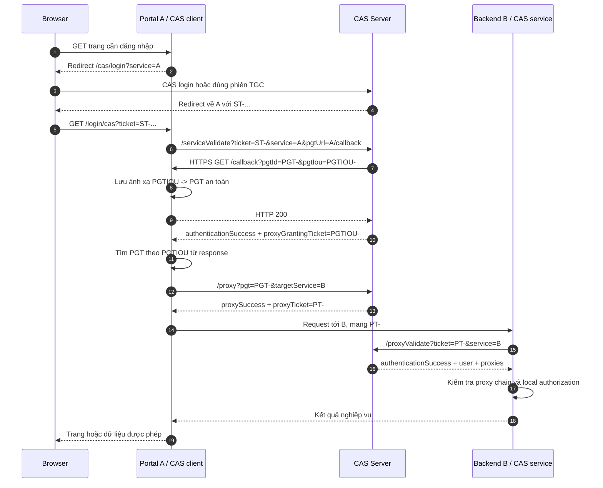

# Proxy Granting Ticket, Proxy Granting Ticket IOU và Proxy Ticket trong CAS

## 1. Bài toán: ứng dụng A cần gọi backend B thay mặt người dùng

Trong hệ thống **Central Authentication Service (CAS)**, trình duyệt có thể đăng nhập một web application bằng **Service Ticket (ST)**. Nhưng khi web application A cần **gọi một backend B bằng kết nối server-to-server**, backend không nhìn thấy cookie SSO của browser tại CAS. A cần một cơ chế để chứng minh với B rằng mình đang thực hiện yêu cầu trong ngữ cảnh một người dùng CAS đã xác thực.

**CAS Proxy Authentication** giải quyết tình huống này bằng ba thực thể cốt lõi:

- **Proxy Granting Ticket (PGT):** credential bí mật do CAS cấp cho một dịch vụ A, cho phép A xin các **Proxy Ticket (PT)** để gọi những backend được phép.
- **Proxy Granting Ticket IOU (PGTIOU):** mã tương quan (*I Owe You*) xuất hiện trong **kết quả xác minh ticket**; nó giúp A tìm đúng **PGT được gửi riêng qua callback**, **không phải PGT**.
- **Proxy Ticket (PT):** credential ngắn hạn, thường **chỉ xác minh một lần**, được cấp riêng cho một **targetService** để A gọi B.

Mục tiêu quan trọng nhất là hiểu **PGT → PT**, còn **PGTIOU chỉ dùng nối hai thông điệp** của quá trình nhận PGT. Không thể sử dụng PGTIOU để gọi `/proxy`, không gửi PGT bí mật cho B, không gọi PT là session cookie hoặc OAuth access token.

Bài học thuộc chủ đề **CAS Proxy** của module Spring Security – federation. Bài trình bày protocol CAS 2.0, cách Spring Security CAS client tích hợp, ví dụ Java 17 tự chạy, nguyên tắc bảo vệ bí mật, proxy chain, kiểm thử và các tình huống lỗi. Các hostname `example.test` và ticket IDs trong bài đều là **dữ liệu giả**. Cần CAS Server cùng dịch vụ được đăng ký thật để thực hiện end-to-end.

## 2. Một bảng phân biệt sáu loại ticket và cookie

| Thực thể | Ai giữ hoặc nhận? | Dùng để làm gì? | Gửi tới đâu? | Tính chất |
| --- | --- | --- | --- | --- |
| **TGT – Ticket Granting Ticket** | CAS server giữ trạng thái | Phiên SSO của người dùng ở CAS | Không đưa TGT gốc cho app | Phiên CAS, không đồng nghĩa PGT |
| **TGC – Ticket Granting Cookie** | Browser giữ cookie của CAS | Liên hệ browser với TGT ở CAS | Browser → CAS domain | Cookie SSO, không phải PT/PGT |
| **ST – Service Ticket** | Browser chuyển cho một service A | Đăng nhập A một lần | A xác minh với CAS `/serviceValidate` | Gắn một `service`; dùng một lần |
| **PGTIOU – Proxy Granting Ticket IOU** | A nhận trong XML validation và qua callback | **Đối chiếu PGT thực với response** | Không dùng để gọi backend hoặc xin PT | Opaque correlation handle, không suy ra PGT |
| **PGT – Proxy Granting Ticket** | A nhận qua HTTPS callback, giữ kín phía server | **Xin một hoặc nhiều PT** | A → CAS `/proxy` | Credential tái sử dụng trong thời hạn/chính sách |
| **PT – Proxy Ticket** | A nhận từ CAS, chuyển tới backend B | Chứng minh proxy authentication cho một target service | A → B, B → CAS `/proxyValidate` | Target-bound, một lần xác minh tại CAS |

Các prefix `ST-`, `PGTIOU-`, `PGT-` và `PT-` thường xuất hiện trong ví dụ CAS. **Prefix không phải bằng chứng ticket hợp lệ**; tính hợp lệ phải do CAS server xác minh. Không mã hóa business authorization hoặc tenant ID vào ticket string theo suy đoán.

### Câu hỏi dễ nhầm

**PGT có phải TGT không?** Không. TGT gắn với phiên SSO ở CAS, còn PGT được cấp cho một **proxying service** sau khi xác minh ST/PT và callback. PGT trao cho dịch vụ quyền xin PT trong phạm vi mà CAS cho phép, không phải cookie browser.

**PGTIOU có phải refresh token?** Không. Nó chỉ nối kết hai kênh truyền PGT và validation response. Không dùng nó để refresh session hoặc lấy PT.

**PT có phải OAuth2 access token không?** Không. Dù cùng được dùng trong một request backend, PT tuân CAS protocol, xác minh tại `/proxyValidate` và gắn `targetService`. OAuth access token dùng OAuth2 Resource Server, issuer/scope/audience hoặc introspection theo một trust contract khác.

## 3. Luồng tổng thể: browser → A → CAS → backend B



Đây là **một giao dịch điển hình**; code thực tế dùng SSL/TLS, HTTP client, CAS library và Spring Security filters. Không thực hiện những bước này bằng cách để browser giữ PGT.

**Hai kênh xuất hiện ở thời điểm cấp PGT:**

1. **CAS → A callback qua HTTPS GET:** mang cả `pgtId=PGT-...` và `pgtIou=PGTIOU-...`.
2. **CAS → A validation response:** mang `<cas:proxyGrantingTicket>PGTIOU-...</cas:proxyGrantingTicket>`, **không chứa PGT thật** trong luồng CAS 2.0 callback chuẩn.

Hai kênh giao nhau ở `PGTIOU`. Không có cả hai đầu đối chiếu thì A chưa có căn cứ để gắn PGT với việc xác minh ticket vừa hoàn tất.

## 4. Bước 1: browser dùng Service Ticket để đăng nhập A

A đã được CAS server đăng ký với một định danh `service`, ví dụ:

```text
https://portal.example.test/login/cas
```

Khi user cần trang protected, CAS client redirect browser đến:

```http
GET /cas/login?service=https%3A%2F%2Fportal.example.test%2Flogin%2Fcas
Host: cas.example.test
```

CAS kiểm tra đăng nhập/phiên SSO rồi redirect browser về A:

```http
HTTP/1.1 302 Found
Location: https://portal.example.test/login/cas?ticket=ST-EXAMPLE-ONCE
```

`ST-EXAMPLE-ONCE` là giá trị minh họa. ST được cấp cho **service URL đã yêu cầu** và phải được CAS xác minh. Trong CAS 2.0, **ST chỉ có hiệu lực cho một lần xác minh**, CAS sẽ tiêu thụ nó khi validate. Nó khác PGT – PGT có thể được sử dụng nhiều lần để lấy PT theo policy.

Tại A, Spring Security CAS client thường dùng `CasAuthenticationFilter` và `CasAuthenticationProvider` để xác minh ST. Không tạo `Authentication` chỉ vì URL có query `?ticket=ST-...` hoặc prefix có vẻ hợp lệ.

### Vì sao A cần xin PGT ngay khi validate ST?

A không thể lấy PGT chỉ bằng cách lưu username hoặc ST đã tiêu thụ. Trong luồng chuẩn, A **yêu cầu CAS cấp PGT bằng cách khai báo `pgtUrl` lúc xác minh ST**. CAS sử dụng callback để xác định dịch vụ A sẽ nhận PGT và chỉ trả **PGTIOU** trong response validation.

## 5. Bước 2: /serviceValidate có pgtUrl

A gửi request HTTPS tới CAS:

```http
GET /cas/serviceValidate?service=https%3A%2F%2Fportal.example.test%2Flogin%2Fcas&ticket=ST-EXAMPLE-ONCE&pgtUrl=https%3A%2F%2Fportal.example.test%2Flogin%2Fcas%2Fproxyreceptor
Host: cas.example.test
```

Ba tham số cần phân biệt:

- `service`: định danh URL dịch vụ mà ST đã được phát cho, **không phải URL backend B**.
- `ticket`: ST do browser đưa về và A trình CAS để xác minh.
- `pgtUrl`: **public HTTPS callback URL** của A, nơi A có thể nhận `pgtId` và `pgtIou`.

Đường `/cas/serviceValidate` ở **CAS server**, không phải endpoint trên portal A. `/login/cas/proxyreceptor` là endpoint A nhận callback, **không phải login handler** hay endpoint `/proxy` của CAS.

Theo CAS 2.0 protocol, `/serviceValidate` chỉ xác minh **ST**; nếu muốn xác minh **PT** phải dùng `/proxyValidate`. Trong hai trường hợp, nếu backend/service cũng muốn có PGT để tiếp tục proxy cho hệ thống sau, cơ chế `pgtUrl` có thể được dùng tại bước xác minh phù hợp.

### HTTPS callback là yêu cầu bắt buộc

`pgtUrl` phải dùng **HTTPS**, CAS kiểm tra chứng chỉ TLS callback, chain trust và hostname theo đặc tả/cấu hình CAS. CAS có thể yêu cầu callback URL được phép trong **service registry** và có khả năng kết nối. Không vô hiệu hóa certificate validation hoặc hostname verification chỉ để nhận PGT.

**Lưu ý giao thức:** theo CAS Protocol 2.0 gốc, lỗi ở callback có thể khiến **không cấp PGT** trong khi validation ST vẫn cho biết user hợp lệ. Một số triển khai/chính sách CAS có thể báo lỗi cả giao dịch khi callback thất bại. Vì vậy cần phân biệt **login ST success** với **PGT successfully acquired**, và kiểm tra hành vi của server release đang dùng.

## 6. Bước 3: CAS callback trao PGT thật và PGTIOU

Khi validation request có `pgtUrl` hợp lệ, CAS server **chủ động tạo HTTP GET** tới callback của A, ví dụ:

```http
GET /login/cas/proxyreceptor?pgtId=PGT-SECRET-EXAMPLE&pgtIou=PGTIOU-ABC-EXAMPLE HTTP/1.1
Host: portal.example.test
```

Điểm quan trọng:

- `pgtId` chứa **PGT thật**; xem nó như credential bí mật có khả năng dùng để xin PT.
- `pgtIou` chứa **mã IOU** dùng đối chiếu với validation response.
- CAS sử dụng HTTPS tới callback và kiểm tra TLS trust/hostname để bảo vệ PGT trong quá trình cấp.
- A phải **nhận và giữ PGT phía server**, không trả `pgtId` về browser, không ghi vào application logs hoặc analytics.
- Với CAS callback chuẩn, phản hồi **HTTP 200 OK** từ A là tín hiệu callback đã được nhận. CAS có thể xử lý HTTP 3xx redirect theo profile; nên cấu hình endpoint cố định không redirect để giảm rủi ro lộ ticket.

**Cẩn thận:** HTTPS tới A chứng minh CAS đã gửi secret đến một endpoint có TLS identity đúng, nhưng **A nhận được một GET request không tự chứng minh caller là CAS**. Không nhận bất kỳ `pgtId`/`pgtIou` do Internet gửi rồi coi đã hoàn tất đăng nhập. A phải đối chiếu IOU với validation response **đã được nhận qua kênh CAS đáng tin**, áp chính sách callback inbound (IP/mTLS/network protection khi khả thi), TTL và bảo vệ chống lạm dụng.

Nếu callback của A có nhiều replica, mapping `PGTIOU → PGT` phải được lưu đủ lâu và có thể truy cập ở nơi xử lý validation response; in-memory Map trên pod A không đủ khi phản hồi được xử lý bởi pod B.

## 7. Bước 4: CAS trả PGTIOU trong validation response

Sau callback được CAS chấp nhận, A nhận response từ `/serviceValidate`, ví dụ XML:

```xml
<cas:serviceResponse xmlns:cas="http://www.yale.edu/tp/cas">
  <cas:authenticationSuccess>
    <cas:user>user-123</cas:user>
    <cas:proxyGrantingTicket>PGTIOU-ABC-EXAMPLE</cas:proxyGrantingTicket>
  </cas:authenticationSuccess>
</cas:serviceResponse>
```

Đây là dữ liệu **minh họa**, không chứa PGT thật. Trong protocol CAS 2.0 chuẩn:

- `<cas:authenticationSuccess>` cho biết CAS đã xác minh ticket thành công và cung cấp danh tính người dùng.
- `<cas:proxyGrantingTicket>` chứa **IOU**, chứ không phải `PGT-...`.
- A dùng giá trị `PGTIOU-ABC-EXAMPLE` để tra ánh xạ đã lưu tại callback.
- **Chỉ khi tìm thấy PGT tương ứng**, A mới có credential để xin PT.
- Nếu validation response **không có PGTIOU**, A có thể đã đăng nhập bình thường nhưng **không có khả năng proxy**; cần kiểm tra nguyên nhân.

Ví dụ **sai**:

```text
pgt = xml.authenticationSuccess.proxyGrantingTicket
call /proxy?pgt=pgt
```

Biến `pgt` ở đây thực tế là **PGTIOU**, nên không phải credential hợp lệ cho `/proxy`. Cách đúng:

```text
iou = xml.authenticationSuccess.proxyGrantingTicket
pgt = proxyGrantingTicketStorage.retrieveAndVerify(iou)
call /proxy?pgt=pgt&targetService=B
```

Đây là pseudocode. `retrieveAndVerify` chỉ là tên mô tả; Spring CAS Client có storage API riêng và xử lý qua ticket validator/filter.

## 8. Vì sao CAS dùng hai kênh và IOU?

Nếu CAS trả PGT thật trực tiếp ngay trong response từ `/serviceValidate`, mọi dịch vụ có khả năng gọi validation endpoint và nhận response có thể nhận một credential có thể dùng tiếp để proxy. CAS 2.0 dùng **secure callback** để xác nhận **proxying service sở hữu endpoint HTTPS được khai báo** trước khi chuyển PGT.

PGTIOU nối hai giao dịch:

```text
Kênh callback:                 (PGTIOU-X, PGT-X)
                                 |
                                 | correlation key
                                 v
Kênh validation:               PGTIOU-X
                                 |
                                 v
A tra storage:                 PGT-X
```

PGTIOU là một opaque string có entropy cao, được tạo độc lập để **không thể suy ra PGT** bằng thuật toán trong thời gian hợp lý. Nó không phải hash có thể đảo ngược của PGT, không phải account ID, không phải cryptographic proof để tự xác thực CAS response.

### Vấn đề thứ tự và đồng thời

Theo flow CAS 2.0, CAS callback tới A trước khi trả IOU trong validation response. Nhưng trên hệ thống phân tán, việc đọc/ghi storage, xử lý thread, Redis replication, proxy network hoặc thời điểm app dùng PGT có thể tạo race:

- Callback chưa lưu thành công, validation response đã tới application thread.
- Callback lưu ở một node nhưng validation response được xử lý ở node khác.
- Hai browser logins diễn ra đồng thời, IOUs bị liên hệ nhầm nếu code lưu một biến PGT toàn cục.
- IOU cũ/replayed cố chỉ tới PGT đã bị hủy.

Giải pháp: storage thread-safe và phân tán khi cần, khóa IOU chính xác, TTL, one-time consumption/atomic lookup, namespace theo CAS issuer/tenant, và không return 200 nếu callback chưa được lưu bền vững theo chính sách.

## 9. PGT: credential dài hơn PT và quyền xin nhiều Proxy Tickets

Khi A có **PGT thật**, nó gọi CAS `/proxy` để xin PT. PGT là một opaque capability:

- **Có thể sử dụng nhiều lần** để xin PT cho các target services được CAS cho phép; không phải ticket một lần.
- Theo CAS 2.0 specification, PGT phải hết hiệu lực khi phiên CAS người dùng liên quan logout; các quy tắc TTL, invalidation và notification thực tế cần kiểm tra theo CAS deployment.
- PGT phải được giữ **server-side và bảo mật** tương tự credential nhạy cảm.
- Không dùng PGT như một HTTP session ID, ID Token, API key hoặc nguồn xác thực danh tính độc lập với CAS.
- Không copy PGT sang local storage của browser, log, `RelayState` hay URL redirect.

**PGT không mặc định cho phép gọi mọi targetService.** CAS service registry/proxy authentication policy có thể giới hạn dịch vụ nào được phép lấy PGT và target services nào được proxy đến. Backend B cũng nên kiểm tra **proxy chain** thay vì chỉ tin ticket đã được CAS xác minh.

### PGT và logout

Khi user logout khỏi CAS, PGT liên quan phải bị vô hiệu theo đặc tả CAS 2.0. Tuy nhiên ứng dụng A có thể vẫn giữ một bản PGT trong cache. **Có chuỗi PGT ở cache không chứng minh credential còn hiệu lực**: `/proxy` phải xác minh với CAS, và khi CAS từ chối thì A cần xóa bản lưu.

Không được nhầm cơ chế CAS logout với việc xóa session HTTP của A; đồng bộ session/PGT/logout ở nhiều app còn phụ thuộc Spring Security CAS Single Logout và vận hành backend.

## 10. Bước 5: A gọi /proxy để xin PT dành cho B

Ví dụ B được đăng ký với CAS dưới service identifier:

```text
https://backend.example.test/api/report
```

A gọi CAS `/proxy`:

```http
GET /cas/proxy?pgt=PGT-SECRET-EXAMPLE&targetService=https%3A%2F%2Fbackend.example.test%2Fapi%2Freport HTTP/1.1
Host: cas.example.test
```

Đây là **protocol call giữa server A và CAS**, không phải link để người dùng click. Hai tham số của `/proxy` là bắt buộc:

- `pgt`: **PGT bí mật** do A nhận qua callback và đã correlate bằng IOU.
- `targetService`: định danh của backend B mà PT sẽ được cấp cho; phải khớp tham số `service` khi B xác minh PT.

Khi thành công, CAS trả:

```xml
<cas:serviceResponse xmlns:cas="http://www.yale.edu/tp/cas">
  <cas:proxySuccess>
    <cas:proxyTicket>PT-BACKEND-ONE-TIME-EXAMPLE</cas:proxyTicket>
  </cas:proxySuccess>
</cas:serviceResponse>
```

PGT không hợp lệ hoặc bị thu hồi có thể dẫn đến `<cas:proxyFailure code="BAD_PGT">`. Thiếu `pgt` hoặc `targetService` có thể dẫn đến `INVALID_REQUEST`. Cần parse XML response với XML parser an toàn và xử lý **proxySuccess/proxyFailure** khác nhau, không chỉ nhìn HTTP 200.

### Quy tắc targetService

Một PT được cấp cho **một targetService cụ thể**. Nếu A đã xin PT cho `https://backend.example.test/api/report`, không được cố dùng PT đó ở `https://payments.example.test/api/pay`. B cần xác minh PT với **đúng service identifier**; mismatch phải bị CAS từ chối.

Các deployment có thể dùng service identifiers không phải URLs, nhưng phải có **quy ước ổn định** được cả A, B và CAS đăng ký thống nhất. Không tạo targetService từ một URL do user tùy ý đưa vào để tránh nhầm trust domain và SSRF.

## 11. Bước 6: A gửi PT tới B

A gọi backend B, mang PT trong cách thức mà B CAS client hỗ trợ, thường là query parameter `ticket`:

```http
GET /api/report?ticket=PT-BACKEND-ONE-TIME-EXAMPLE HTTP/1.1
Host: backend.example.test
```

B **không** nhận PGT; chỉ nhận PT. Đây là request server-to-server, có thể hoàn toàn không có browser session. Vì thế:

- B dùng CAS client/`CasAuthenticationFilter` hoặc một ticket interceptor phù hợp để lấy `ticket`.
- B xác minh PT với CAS `/proxyValidate`, cung cấp `service` đúng định danh B.
- B nhận danh tính người dùng và danh sách proxies từ **CAS validation response**.
- B kiểm tra proxy chain được chấp nhận và **quyền nghiệp vụ của user** trước khi trả dữ liệu.

**PT là bearer credential có nguy cơ bị lộ.** Query parameter có thể xuất hiện trong access logs, reverse proxy, APM/traces và URLs. Dùng HTTPS, ẩn ticket trong logs, hạn chế lưu/truyền, giảm TTL, không forward trong redirects hoặc copy vào browser. Đường truyền trong CAS 2.0 có thể dùng query ticket vì protocol legacy; không vì vậy mà cho phép log raw PT.

**Không chuyển PGT đến B** hoặc nhét `pgtId` vào query B. Nếu B cần proxy tiếp C, B có thể tự yêu cầu **PGT riêng** lúc validate PT, không dùng PGT của A.

## 12. Bước 7: backend B xác minh PT bằng /proxyValidate

B gọi CAS:

```http
GET /cas/proxyValidate?service=https%3A%2F%2Fbackend.example.test%2Fapi%2Freport&ticket=PT-BACKEND-ONE-TIME-EXAMPLE HTTP/1.1
Host: cas.example.test
```

CAS `/proxyValidate` hỗ trợ cả ST và PT theo đặc tả CAS 2.0, còn `/serviceValidate` chỉ hỗ trợ ST. Khi B nhận PT hợp lệ, response có thể như sau:

```xml
<cas:serviceResponse xmlns:cas="http://www.yale.edu/tp/cas">
  <cas:authenticationSuccess>
    <cas:user>user-123</cas:user>
    <cas:proxies>
      <cas:proxy>https://portal.example.test/login/cas/proxyreceptor</cas:proxy>
    </cas:proxies>
  </cas:authenticationSuccess>
</cas:serviceResponse>
```

Đoạn XML minh họa:

- `cas:user` mô tả principal mà CAS đã xác minh.
- `cas:proxies` liệt kê những **dịch vụ trung gian** đã tham gia proxy authentication.
- `cas:proxy` thường chứa **pgtUrl** của proxying service A, **không phải targetService B**.
- B cần so sánh chain với **allowlist proxies** của B, không tin mọi trung gian chỉ vì CAS server biết họ.
- Trước khi thực thi nghiệp vụ, B còn phải kiểm tra local user/tenant/ACL.

**Single-use ở CAS:** theo CAS 2.0, PT chỉ hợp lệ cho **một lần validation attempt**, thành công hoặc thất bại đều bị tiêu thụ. Một PT không thể được dùng để xác minh nhiều lần với CAS. Nếu client muốn thực hiện nhiều backend calls, A nên xin **PT mới cho mỗi lượt cần authentication** hoặc sử dụng một thiết kế đã được phê duyệt như session/cache tại backend, với TTL và revocation policy riêng.

## 13. Proxy chain và chính sách bên backend

Một PT có thể đi qua nhiều proxying services:

```text
Browser → A → B → C

A validates ST, obtains PGT-A, issues PT-for-B.
B validates PT-for-B and requests PGT-B via its pgtUrl.
B issues PT-for-C.
C validates PT-for-C.
```

Đặc tả CAS 2.0 quy định danh sách `<cas:proxies>` có **proxy gần backend nhất ở đầu danh sách**. Ví dụ C thấy:

```xml
<cas:proxies xmlns:cas="http://www.yale.edu/tp/cas">
  <cas:proxy>https://b.example.test/login/cas/proxyreceptor</cas:proxy>
  <cas:proxy>https://a.example.test/login/cas/proxyreceptor</cas:proxy>
</cas:proxies>
```

Ở đây **A được đi qua trước, B sau**; list hiển thị **B trước A**. Không đảo ý nghĩa chuỗi khi viết policy.

### Vì sao B/C phải kiểm tra chain?

Một CAS server có thể chấp nhận nhiều registered services cùng proxy. Nhưng backend C có thể chỉ cho phép proxying chain từ A và B, **không** chấp nhận bất kỳ portal thử nghiệm nào có quyền proxy. Chỉ xác minh CAS ticket mà **không kiểm tra đường đi** sẽ khiến quyền gọi backend phụ thuộc quá nhiều vào một ticket từ bất kỳ proxy hợp lệ.

Trong Spring Security CAS:

- `CasAuthenticationProvider` có cơ chế `CasProxyDecider`.
- `RejectProxyTickets` từ chối ticket đi qua proxy khi không cần tính năng này.
- `NamedCasProxyDecider` cho phép khai báo tập proxies được chấp nhận.
- `AcceptAnyCasProxy` có thể dùng cho thử nghiệm nhưng **không khuyến nghị** ở dịch vụ nhạy cảm.

Ngoài proxy chain, phải kiểm tra **business authorization**. Một user được xác thực bởi CAS không tự được xem mọi record hoặc gọi thao tác admin của backend B.

## 14. Cấu hình Spring Security CAS client để nhận PGT

Tài liệu Spring Security CAS mô tả các thành phần chính:

| Thành phần | Nhiệm vụ |
| --- | --- |
| `CasAuthenticationEntryPoint` | Redirect browser tới CAS login với `service` |
| `CasAuthenticationFilter` | Nhận ST tại login processing URL và callback PGT tại proxy receptor |
| `CasAuthenticationProvider` | Xác minh ST/PT với `TicketValidator` và map `GrantedAuthority` |
| `Cas20ServiceTicketValidator` | Xác minh ST, không phục vụ toàn bộ proxy validation |
| **`Cas20ProxyTicketValidator`** | Hỗ trợ cấu hình `proxyCallbackUrl` và verify ticket liên quan CAS Proxy |
| **`ProxyGrantingTicketStorage`** | Lưu mapping `PGTIOU → PGT` từ callback |
| `CasAuthenticationToken` | Spring Security Authentication chứa CAS assertion sau xác thực |
| `ServiceProperties` | Định danh `service` của CAS client và các tùy chọn validation |

Một cấu hình **bean XML trích đoạn**, phù hợp ví dụ trong tài liệu Spring Security CAS, có thể là:

```xml
<!-- Chỉ là phần khai báo các thành phần proxy, không phải
     toàn bộ Spring Security XML configuration. -->
<bean id="pgtStorage"
      class="org.apereo.cas.client.proxy.ProxyGrantingTicketStorageImpl"/>

<bean id="casProxyTicketValidator"
      class="org.apereo.cas.client.validation.Cas20ProxyTicketValidator">
  <constructor-arg value="https://cas.example.test/cas"/>
  <property name="proxyCallbackUrl"
            value="https://portal.example.test/login/cas/proxyreceptor"/>
  <property name="proxyGrantingTicketStorage" ref="pgtStorage"/>
</bean>

<bean id="casFilter"
      class="org.springframework.security.cas.web.CasAuthenticationFilter">
  <property name="authenticationManager" ref="authenticationManager"/>
  <property name="proxyGrantingTicketStorage" ref="pgtStorage"/>
  <property name="proxyReceptorUrl" value="/login/cas/proxyreceptor"/>
</bean>
```

**Cần bổ sung** `CasAuthenticationProvider` tham chiếu ticket validator, `ServiceProperties`, entry point, authentication manager, user details service, filter chain, CAS service registry và dependencies đúng release. Đoạn XML trên **không phải một ứng dụng Spring Boot chạy độc lập**.

### Hai URL cần đồng bộ

- `Cas20ProxyTicketValidator.proxyCallbackUrl` = **full public HTTPS URL** mà CAS server gọi tới, ví dụ `https://portal.example.test/login/cas/proxyreceptor`.
- `CasAuthenticationFilter.proxyReceptorUrl` = **path nội bộ** mà filter nhận callback, ví dụ `/login/cas/proxyreceptor`.

Đường proxy receptor không thay `/login/cas` login processing route và không phải CAS server `/cas/proxy`. Nếu public HTTPS URL bị reverse proxy rewrite sai, CAS có thể callback 404 hoặc certificate mismatch.

### Bảo vệ PGT storage

`ProxyGrantingTicketStorageImpl` dạng in-memory trong ví dụ là **không phù hợp cho production nhiều replica**. Tài liệu Spring Security lưu ý cần cleanup expired ticket storage. Production cần storage có TTL/cleanup, mã hóa/thay thế key khi cần, chống race, giảm log exposure và chia sẻ state nếu nhiều pods.

## 15. Java API: xin Proxy Ticket trong Spring Security

Sau khi CAS authentication thành công và PGT được liên kết đúng với principal, Spring Security CAS docs minh họa:

```java
CasAuthenticationToken token =
        (CasAuthenticationToken) request.getUserPrincipal();

String targetService =
        "https://backend.example.test/api/report";

String proxyTicket =
        token.getAssertion().getPrincipal()
                .getProxyTicketFor(targetService);
```

Đoạn trên là **mảnh code Java trong servlet/service đã CAS-authenticated**, cần imports và `HttpServletRequest`. Nó không biên dịch độc lập nếu chưa có Spring Security CAS/Apereo CAS Java Client và context đúng.

`getProxyTicketFor(targetService)` sử dụng capability được cung cấp qua CAS assertion/client infrastructure để **xin một PT dành cho targetService**. Trường hợp không có PGT/PGT đã hết hiệu lực/callback thất bại, việc xin PT sẽ thất bại hoặc không có kết quả như mong đợi.

**Các nguyên tắc bắt buộc khi gọi:**

1. `targetService` phải lấy từ **allowlist service B** của A; không nhận arbitrary URL từ request.
2. Dùng HTTPS đến CAS/B, cấu hình truststore đúng.
3. Không log ticket hoặc để ticket xuất hiện trong URL của redirect về browser.
4. Nếu B cần nhiều request độc lập, cấp PT mới hoặc dùng một session mechanism đã thẩm định, không giả định PT có thể validate lại nhiều lần.
5. Backend B vẫn validate PT và proxy chain; A không thể tự đánh dấu user đã xác thực ở B.

### Backend B xác minh PT

B sử dụng `Cas20ProxyTicketValidator` thay `Cas20ServiceTicketValidator` khi muốn chấp nhận proxy ticket, đồng thời đặt policy allowed proxy chain. Một số cấu hình cũ dùng `acceptAnyProxy=true` cho demo; đây là lựa chọn **không an toàn cho backend nhạy cảm**.

`ServiceProperties.service` của B phải khớp `targetService` được dùng lúc A xin PT. Với API stateless, Spring Security docs còn có `ServiceAuthenticationDetailsSource` để xác định service URL thực tế khi verify ticket.

## 16. Stateful vs stateless CAS service và giới hạn PT một lần

Ứng dụng browser A thường có `HttpSession` và một `CasAuthenticationToken` lưu trong SecurityContext. Backend B có thể là **stateless API**, nơi mỗi HTTP request cần authenticate độc lập.

CAS protocol yêu cầu **mỗi ST/PT chỉ được validate một lần tại CAS**. Tuy nhiên Spring Security CAS docs mô tả `StatelessTicketCache`/`SpringCacheBasedTicketCache` có thể **cache kết quả xác thực** keyed by PT trên backend, giúp một stateless client gửi lại cùng PT mà backend không gọi CAS thêm lần nữa.

Cần phân biệt rõ:

- **CAS-level:** PT đã được tiêu thụ sau validation đầu tiên, không thể verify lại ở CAS.
- **Application-level cache:** backend tự **tái sử dụng kết quả xác thực đã cache**, không phải CAS tái cấp hay “PT vốn có thể dùng nhiều lần”.
- **Security trade-off:** backend cache làm rộng cửa sổ chấp nhận credential đã dùng và có thể kéo dài trạng thái quyền sau khi CAS logout/revocation. Phải có TTL ngắn, gắn đúng service và proxy chain, namespace/cache isolation, invalidation và đánh giá replay.
- **Mô hình an toàn dễ lý giải:** A xin PT mới cho từng request cần xác minh, hoặc backend tạo session riêng theo chính sách, thay vì mặc định cache PT dài hạn.

Không copy cấu hình `acceptAnyProxy=true` hoặc cache TTL 3600 giây từ mẫu minh họa cũ vào production mà không đánh giá rủi ro. Chỉ dùng `StatelessTicketCache` khi kiến trúc/threat model yêu cầu và đã quyết định vòng đời authorization.

## 17. Java 17 độc lập: đối chiếu PGTIOU với PGT callback

Ví dụ dưới đây là **chương trình Java 17+ chạy độc lập** để minh họa chính xác chức năng của PGTIOU trong bộ nhớ: CAS callback giao PGT thật cùng IOU, còn response xác minh ticket chỉ cho biết IOU; ứng dụng **consume** entry theo IOU rồi mới có PGT.

**Đây là mô hình học thuật**, không phải server CAS client: nó không mở HTTPS endpoint, không verify ticket, không xử lý certificate/truststore và không xin PT thật. Các chuỗi `PGT-...` dưới đây chỉ là giá trị test.

Lưu `PgtIouCorrelationDemo.java`:

```java
import java.util.Map;
import java.util.Optional;
import java.util.concurrent.ConcurrentHashMap;

public final class PgtIouCorrelationDemo {

    private final Map<String, String> callbackStore =
            new ConcurrentHashMap<>();

    // Mô phỏng HTTPS callback do CAS thực hiện:
    // CAS gửi pgtId (PGT secret) và pgtIou (correlation key).
    void receiveCallback(String pgtIou, String pgtId) {
        if (pgtIou == null || pgtIou.isBlank()
                || pgtId == null || pgtId.isBlank()) {
            throw new IllegalArgumentException("Missing CAS callback data");
        }
        callbackStore.putIfAbsent(pgtIou, pgtId);
    }

    // Mô phỏng validation response đã được CAS client xác minh.
    // Nếu ticket validation thất bại, không dùng callback PGT.
    Optional<String> consumeAfterValidation(
            String pgtIouFromVerifiedResponse, boolean ticketIsValid) {
        if (pgtIouFromVerifiedResponse == null) {
            return Optional.empty();
        }
        String pgt = callbackStore.remove(pgtIouFromVerifiedResponse);
        return ticketIsValid ? Optional.ofNullable(pgt) : Optional.empty();
    }

    public static void main(String[] args) {
        PgtIouCorrelationDemo demo = new PgtIouCorrelationDemo();

        // Callback đến trước validation response.
        demo.receiveCallback("PGTIOU-A", "PGT-SECRET-A");

        System.out.println("correlated=" +
                demo.consumeAfterValidation("PGTIOU-A", true).isPresent());
        System.out.println("replayedIou=" +
                demo.consumeAfterValidation("PGTIOU-A", true).isPresent());

        demo.receiveCallback("PGTIOU-B", "PGT-SECRET-B");
        System.out.println("wrongIou=" +
                demo.consumeAfterValidation("PGTIOU-C", true).isPresent());
        System.out.println("failedValidation=" +
                demo.consumeAfterValidation("PGTIOU-B", false).isPresent());

        System.out.println("remaining=" + demo.callbackStore.size());
    }
}
```

Chạy:

```bash
javac PgtIouCorrelationDemo.java
java PgtIouCorrelationDemo
```

**Stdout chính xác:**

```text
correlated=true
replayedIou=false
wrongIou=false
failedValidation=false
remaining=0
```

Giải thích:

- `correlated=true`: IOU trong response đã xác minh khớp IOU của callback; A lấy PGT.
- `replayedIou=false`: entry đã được consume, không thể lấy PGT thêm bằng cùng IOU.
- `wrongIou=false`: IOU không khớp không thể lấy một PGT khác.
- `failedValidation=false`: ticket invalid thì không sử dụng credential callback.
- `remaining=0`: dữ liệu mapping đã được lấy/xóa phù hợp với flow test.

**Không copy trực tiếp ConcurrentHashMap này vào production.** Nó chưa có TTL, không share giữa nhiều pods, chưa bảo vệ callback inbound, chưa liên kết issuer/tenant/session, chưa kiểm tra PGT bị thu hồi và chưa zeroize/encrypt memory. Ngoài ra callback phải đến từ flow CAS đã được phê duyệt; chương trình này không thể tự chứng minh điều đó.

## 18. Tại sao PGTIOU không được lộ và không là ticket quyền truy cập?

PGTIOU không tự phát hành PT; nhưng vẫn là **correlation handle nhạy cảm**. Nếu một attacker biết IOU và có khả năng gửi callback giả với `pgtId` riêng, họ có thể cố làm nhiễu correlation hoặc tạo denial-of-service. Do đó:

- Không đưa PGTIOU vào URLs không cần thiết, browser local storage hoặc frontend logs.
- Không dùng IOU làm public user ID, API key hoặc session credential.
- Không để app trả PGT theo bất kỳ IOU nào qua một API công khai.
- Xử lý callback hợp lệ trước, rồi liên kết IOU với một validation response **đã được xác minh với CAS tin cậy**.
- TTL mapping và xóa sau khi đã dùng; theo dõi duplicate/conflicting IOUs.
- Với nhiều CAS servers/tenants, namespace mapping bằng **CAS server identity**, không chỉ chuỗi IOU nếu kiến trúc có nhiều trust domains.

PGTIOU cũng **không phải hash của PGT** có thể giải mã. Đặc tả CAS yêu cầu không thể suy ra PGT từ IOU bằng thuật toán trong thời gian hợp lý, và cả hai cần dữ liệu ngẫu nhiên đủ mạnh.

## 19. HTTPS callback và ranh giới tin cậy

### 19.1. CAS xác minh A khi gửi callback

CAS phải gọi `pgtUrl` qua HTTPS và xác minh certificate, hostname, chain và expiration. Ở môi trường có private PKI, CAS truststore cần chứa đúng CA/root/intermediate đã được doanh nghiệp phê duyệt. Không bật “trust all certificates”.

- `pgtUrl` phải thuộc **allowlist registered service** theo CAS deployment.
- Callback phải được CAS truy cập từ mạng thực tế.
- Reverse proxy phải forward query parameters `pgtId`/`pgtIou` đúng tới A, nhưng **không log chúng**.
- Certificate public hostname và SAN phải trùng URL CAS gọi; không dùng hostname pod nội bộ trừ khi được thiết kế đăng ký rõ.
- Callback handler nên trả 200 chỉ khi lưu dữ liệu thành công; tránh redirect/404/500.

### 19.2. A kiểm tra correlation sau callback

Một HTTP GET tới A có thể được gửi bởi Internet, không nhất thiết CAS. Vì vậy A:

- Không lập `Authentication` dựa vào callback GET.
- Không chấp nhận IOU do browser tự cung cấp làm credential.
- Chỉ sử dụng PGT được liên hệ qua IOU có trong **validation response từ CAS đã xác minh**.
- Giới hạn nguồn gọi callback bằng network policy, mTLS hoặc cơ chế hạ tầng khi CAS deployment hỗ trợ; đây là lớp bổ sung ngoài callback protocol.
- Dùng size limits, rate limiting, input validation và storage TTL để chống memory exhaustion.
- Không phản hồi chứa PGT/PGTIOU trong response body, không log query string.

Lưu ý: TLS **server authentication** từ CAS tới A giúp CAS kiểm tra identity của A; nó **không tự là mutual TLS authentication** cho A biết chắc caller. Nếu muốn nhận diện client ở tầng TLS, cần thiết kế mTLS hoặc kênh được bảo vệ riêng, không giả định chỉ có HTTPS đã đủ hai chiều.

## 20. Chính sách CAS service registry và target service

Proxy authentication mở rộng một quyền đặc biệt: A có thể gọi B bằng danh tính user. CAS service registry phải xét:

1. **Service A có được phép login?** `service` của A có nằm trong registered services?
2. **A có được phép xin PGT?** Nhiều CAS deployments yêu cầu bật proxy authorization trong registered service policy.
3. **Callback `pgtUrl` có được phép?** Địa chỉ HTTPS đã được phê duyệt hay không; có thể cần match với policy/service registry.
4. **Backend B có được phép nhận PT?** `targetService` là service identifier hợp lệ được CAS cho phép.
5. **B có chấp nhận A là proxy không?** B kiểm tra `cas:proxies` bằng proxy decider/allowlist.
6. **Người dùng có quyền làm việc B yêu cầu không?** Ở B phải kiểm tra business ACL/tenant/resource, không coi PGT/PT là “admin”.

**Không tạo `targetService` bằng cách lấy query param `url` từ người dùng rồi gửi trực tiếp vào `/proxy`**. Điều đó có thể làm A thành confused deputy: người dùng thao túng A để lấy PT cho hệ thống khác, hoặc request đi đến nơi không kiểm soát.

Một service B chỉ chấp nhận ST dùng `/serviceValidate` có thể **không hỗ trợ PT**. Phải cấu hình client để dùng `/proxyValidate` và proxy chain policy, rồi kiểm tra CAS server endpoint thực tế theo version.

## 21. Những lỗi thường gặp và cách chẩn đoán

| Triệu chứng | Nguyên nhân khả dĩ | Hướng xử lý |
| --- | --- | --- |
| User login A thành công nhưng không gọi được B | A xác minh ST nhưng không nhận PGT | Kiểm tra `pgtUrl`, callback và PGTIOU |
| Validation XML không có `proxyGrantingTicket` | Callback TLS/HTTP thất bại hoặc A không được phép proxy | Kiểm tra CAS logs đã redact, registered service, HTTPS callback |
| CAS callback báo certificate invalid | Chain/SAN/CA/expiry không hợp lệ | Sửa cert/truststore, không trust-all |
| CAS callback 404/405 | Proxy receptor path khác `proxyCallbackUrl` | Đồng bộ public URL và filter route |
| Callback 200 nhưng không thấy PGT | Storage map/TTL/race/multi-pod | Kiểm tra persistence/cluster/atomic IOU lookup |
| A gửi PGTIOU vào `/proxy` | Nhầm IOU với PGT | Tra PGT thật qua callback mapping |
| `/proxy` trả `BAD_PGT` | PGT sai, hết hạn, đã logout hoặc không được cấp | Không retry bằng IOU; xin login/PGT mới theo policy |
| `/proxy` trả `INVALID_REQUEST` | Thiếu pgt/targetService | Kiểm tra param và URL encoding |
| B validate PT bằng `/serviceValidate` | Sai endpoint | Dùng `/proxyValidate` |
| PT bị `INVALID_TICKET` lần thứ hai | PT đã bị CAS tiêu thụ | Xin PT mới hoặc chính sách session/cache phù hợp |
| PT bị `INVALID_SERVICE` | `targetService` không khớp `service` khi validate | Đồng bộ exact service identifier/encoding |
| B nhận PT hợp lệ nhưng từ chối | Proxy chain chưa được allowlist | Kiểm tra `cas:proxies`, policy `NamedCasProxyDecider` |
| B chấp nhận mọi proxies | Cấu hình `acceptAnyProxy=true` quá rộng | Thiết lập allowlist proxy đã phê duyệt |
| Nhiều replica mất PGT | In-memory storage nằm ở pod khác | Shared storage với TTL/audit |
| User logout nhưng A vẫn giữ PGT | Cache chưa invalidated | Xóa local cache; CAS phải từ chối credential hết hiệu lực |
| PT xuất hiện trong access logs | Truyền ticket qua URL theo legacy CAS | Redact query ticket và `pgtId`, HTTPS everywhere |
| A muốn gọi B nhưng B không CAS-enabled | Backend không hỗ trợ PT | Dùng cơ chế B chấp nhận hoặc gateway/credential exchange có chính sách |
| B có đúng user nhưng sai tenant | Thiếu local authorization | Map CAS principal sang local identity và ACL |

**Không xem HTTP 200 của `/serviceValidate` hoặc `/proxy` tự nó là thành công.** CAS protocol phản hồi XML chứa `authenticationSuccess`/`authenticationFailure` hay `proxySuccess`/`proxyFailure`. Phải parse đúng element và error code.

## 22. Ma trận kiểm thử bảo mật

### A. Happy path

1. CAS login xác thực người dùng và cấp ST dành riêng A.
2. A gửi ST tới `/serviceValidate` cùng `pgtUrl` HTTPS hợp lệ.
3. CAS callback mang PGT + PGTIOU tới A, A lưu mapping.
4. Validation response trả `authenticationSuccess` và cùng PGTIOU.
5. A đối chiếu IOU, lấy **PGT thật**.
6. A gọi `/proxy` với targetService B, nhận PT.
7. A gửi PT tới B; B dùng `/proxyValidate` và đọc proxy chain.
8. B kiểm tra local ACL/tenant rồi trả dữ liệu.

### B. Negative tests

| Test | Kỳ vọng |
| --- | --- |
| ST được gửi lại sau một lần validate | CAS từ chối replay |
| `service` A không khớp ST | `INVALID_SERVICE` và ticket bị tiêu thụ theo spec |
| Callback `pgtUrl` là HTTP không TLS | CAS không cấp PGT |
| Callback certificate sai hostname/hết hạn | CAS từ chối cấp PGT |
| Callback không reachable/HTTP 500 | Không có PGTIOU/PGT; xử lý theo server release |
| Callback nhận PGTIOU-X, validation trả IOU-Y | Không lấy PGT, fail-closed |
| Callback giả chứa IOU chưa được xác minh từ CAS | Không tạo authentication/quyền |
| Thử suy ra PGT từ IOU | Không thể dựa vào định dạng/thuật toán |
| Dùng IOU làm `/proxy?pgt=...` | CAS từ chối PGT |
| PGT từ user session đã logout | CAS từ chối theo lifecycle policy |
| A xin PT cho targetService B rồi gọi C | CAS B/C validation không khớp |
| Một PT validate hai lần | Lần sau bị từ chối ở CAS |
| B gọi `/serviceValidate` với PT | Không phải endpoint hợp lệ cho PT |
| Proxy chain có service lạ | B từ chối dù CAS báo authenticationSuccess |
| A và B có cùng user name nhưng tenant khác | Local tenant policy vẫn từ chối |
| PGT storage mất sau restart/pod failover | Không cấp PT sai người; báo mất capability |
| PGT/PT trong HTTP logs | Test redaction phải phát hiện và loại bỏ |
| CAS server ticket endpoint timeout | Fail-closed, không tự tạo ticket |
| Backend chỉ có Spring web session mà không validate PT | Không coi username tự khai là authentication |
| User gửi arbitrary targetService từ query | Không thể xin PT ngoài allowlist |

Các test nên chạy với **CAS server sandbox, registered services/certificates riêng**, không dùng ST/PGT/PT thật của production trong request capture, issue tracker hoặc commit. Nếu ghi HAR/network logs, phải redact ticket IDs và cookies.

## 23. Thực hành chống replay và quản lý vòng đời

Một thiết kế CAS proxy có ba vòng đời khác nhau:

**ST/PT:** một lần validation tại CAS, giới hạn `service`/`targetService`, TTL ngắn. Trong CAS 2.0, độ dài và format của ticket là opaque; không kiểm tra “PT-” rồi cho phép truy cập. Nếu retry request do network timeout, ST/PT có thể đã bị tiêu thụ, nên cần **xin ticket mới** hoặc thiết kế idempotency ở nghiệp vụ chứ không giả định validate lần nữa sẽ thành công.

**PGT:** có thể xin nhiều PT cho nhiều lời gọi, vì thế blast radius lớn hơn PT. Lưu ở secret store/PGT storage dành cho server-side, có thời gian sống và liên kết CAS user/session, xóa khi logout hoặc bị từ chối. Không truyền giữa services ngoại trừ cơ chế chính thức của CAS.

**PGTIOU:** chỉ dùng tương quan callback và validation response, TTL rất ngắn, consume/remove để ngăn replay. Không tự dùng IOU làm local session key hoặc token ủy quyền. Multi-tenant deployments cần namespacing theo CAS server/registration/trust domain để tránh liên kết nhầm người dùng.

Nếu cache kết quả xác minh PT ở B, phải xem cache như **cơ chế authentication của chính B** có TTL, scope, revocation, service-bound identity và audit độc lập; không còn đúng “PT một lần” ở phía app dù CAS đã tiêu thụ nó.

## 24. CAS Proxy khác OAuth2 Token Exchange và SAML delegation

Ba họ giao thức đều có thể phục vụ yêu cầu “A gọi B thay mặt user”, nhưng không hoán đổi credential:

| Giao thức | Credential A có trước | Credential cho B | B xác minh với |
| --- | --- | --- | --- |
| **CAS Proxy** | PGT sau ST/PT validation và HTTPS callback | PT gắn targetService B | CAS `/proxyValidate` |
| **OAuth2 Token Exchange** | Subject token/actor token theo AS profile | Access token mới với `aud`/scope cho B | OAuth2 Resource Server/AS issuer/JWKS/introspection |
| **SAML delegation/SSO** | SAML Assertion/Session theo SP/IdP protocol | Assertion hoặc profile khác tùy thiết kế | SAML SP validators/IdP trust |
| **Simple session/BFF** | Web session cookie và server-side state | Backend token/session được B chấp nhận | Chính sách riêng của B |

**PGT không phải OAuth refresh token**, **PT không phải JWT access token**, và `PGTIOU` không phải SAML `InResponseTo` dù đều liên quan correlation. Nếu backend B chỉ hỗ trợ OAuth Bearer, phải triển khai OAuth AS/token exchange hoặc gateway có policy chính thức, không gửi `PT-...` vào header Bearer rồi kỳ vọng B hiểu.

## 25. Checklist triển khai production

- [ ] Đã xác định CAS server phiên bản nào và endpoint `/serviceValidate`, `/proxyValidate`, `/proxy` được hỗ trợ.
- [ ] A và B là registered services, có service identifiers chính xác và HTTPS.
- [ ] A được phép xin PGT theo CAS service registry/proxy policy.
- [ ] `pgtUrl` là HTTPS public callback thuộc allowlist và CAS verify TLS hostname/certificate.
- [ ] `Cas20ProxyTicketValidator.proxyCallbackUrl` trùng public callback của A.
- [ ] `CasAuthenticationFilter.proxyReceptorUrl` khớp đường dẫn nội bộ của callback.
- [ ] A dùng `ProxyGrantingTicketStorage` có TTL/cleanup, tránh plain in-memory ở multi-replica.
- [ ] Bảo vệ `pgtId`/`pgtIou` khỏi URL/access/proxy/APM logs.
- [ ] A lấy PGT **qua IOU mapping**, không dùng IOU làm PGT.
- [ ] Callback giả không tự tạo Authentication; A correlate IOU với verified CAS validation response.
- [ ] PGT được lưu server-side, giới hạn TTL, thu hồi khi logout hoặc CAS báo invalid.
- [ ] A gọi `/proxy` với `pgt` thật và `targetService` thuộc allowlist.
- [ ] A cấp PT mới cho mỗi validation request cần thiết hoặc đã có policy cache/phiên phù hợp.
- [ ] B dùng `/proxyValidate` và `service` trùng targetService khi xin PT.
- [ ] B xác minh proxy chain; không `acceptAnyProxy=true` cho backend nhạy cảm.
- [ ] B map CAS user sang local user/tenant và thực thi business ACL/least privilege.
- [ ] Các lỗi `INVALID_TICKET`, `INVALID_SERVICE`, `BAD_PGT` và network timeouts có handling fail-closed.
- [ ] Có test replay ST/PT, IOU mismatch, callback TLS fail, logout, cross-tenant và multi-pod.
- [ ] Không nhầm CAS PT/PGT với OAuth2 access/refresh token hoặc SAML Assertions.
- [ ] Ghi logs đã redact và audit không chứa ticket secrets.

## 26. Câu hỏi tự đánh giá

**1. PGTIOU có thể dùng để gọi CAS `/proxy` không?**  
Không. `/proxy` yêu cầu PGT thật. PGTIOU chỉ dùng đối chiếu callback và validation response.

**2. PGT thật được truyền qua kênh nào trong CAS 2.0 chuẩn?**  
CAS tạo HTTPS GET tới `pgtUrl` của A, gửi `pgtId` cùng `pgtIou`.

**3. Vì sao response `/serviceValidate` chỉ trả PGTIOU?**  
Để A đối chiếu với PGT đã nhận qua callback HTTPS có identity/TLS verification, tách secret PGT khỏi kênh validation response.

**4. PGT có thể xin nhiều PT không?**  
Có theo CAS 2.0; nó không phải ticket một lần và bị ràng buộc bởi lifetime/proxy policy.

**5. PT có dùng cho mọi backend không?**  
Không. PT được cấp riêng cho `targetService` và B phải xác minh đúng `service`.

**6. Backend B dùng `/serviceValidate` để xác minh PT được không?**  
Không theo CAS 2.0; dùng `/proxyValidate`.

**7. PT có thể được CAS xác minh hai lần không?**  
Không. CAS 2.0 PT chỉ hợp lệ cho một validation attempt. Một backend cache kết quả đã xác minh là **cơ chế riêng**, không đổi quy tắc CAS.

**8. Nếu callback trả 500 nhưng ST vẫn valid thì sao?**  
Theo CAS 2.0 gốc có thể login ST thành công **không có PGT**; hãy kiểm tra đặc tả/triển khai CAS release hiện tại.

**9. Vì sao B phải kiểm tra `cas:proxies`?**  
Để chỉ chấp nhận proxying services đã được ủy quyền, ngoài việc ticket do CAS xác minh hợp lệ.

**10. Khi A/B chạy nhiều replica, lỗi gì dễ xảy ra?**  
Callback lưu PGT ở một node, validation response được xử lý ở node khác; cần shared storage/thread-safe TTL.

**11. `pgtUrl` có thể là HTTP thuần không?**  
Không trong CAS 2.0; callback URL phải HTTPS với certificate/hostname verification.

**12. CAS Proxy và OAuth2 Token Exchange có cùng token không?**  
Không. CAS dùng PGT/PT và `/proxyValidate`; OAuth2 dùng access tokens và authorization/resource server policy.

## 27. Tài liệu tham khảo

- [Apereo CAS 8.x — CAS Protocol V2 Specification](https://apereo.github.io/cas/8.0.x/protocol/CAS-Protocol-V2-Specification.html): nguồn gốc quy tắc `/serviceValidate`, `/proxyValidate`, `/proxy`, `pgtUrl`, PGTIOU và PT single-use.
- [Apereo CAS — CAS Protocol Specification](https://apereo.github.io/cas/development/protocol/CAS-Protocol-Specification.html): bản phát triển và các cập nhật mô tả proxy callback; đối chiếu với release đang triển khai.
- [Apereo CAS — Proxy Authentication](https://apereo.github.io/cas/development/authentication/Configuring-Proxy-Authentication.html): proxy registration, PGT, callback TLS và backend use case.
- [Spring Security — CAS Authentication](https://docs.spring.io/spring-security/reference/servlet/authentication/cas.html): `CasAuthenticationFilter`, `CasAuthenticationProvider`, `Cas20ProxyTicketValidator`, `ProxyGrantingTicketStorage`, `getProxyTicketFor`, `CasProxyDecider` và stateless ticket cache.
- [Spring Security — CAS Authentication (6.5)](https://docs.spring.io/spring-security/reference/6.5/servlet/authentication/cas.html): tham chiếu cho dự án Spring Security 6.x.
- [CAS Java Client — GitHub](https://github.com/apereo/java-cas-client): client/validator/storage Java và ví dụ tích hợp; kiểm tra version/package theo CAS/Spring BOM.
- [OWASP — Session Management Cheat Sheet](https://cheatsheetseries.owasp.org/cheatsheets/Session_Management_Cheat_Sheet.html): session credentials, cookie protection, timeout và logout.
- [OWASP — TLS Cheat Sheet](https://cheatsheetseries.owasp.org/cheatsheets/Transport_Layer_Security_Cheat_Sheet.html): TLS certificate trust, hostname verification và tránh trust-all.
- [OWASP API Security — Broken Object Level Authorization](https://owasp.org/API-Security/editions/2023/en/0xa1-broken-object-level-authorization/): backend vẫn cần tenant/owner/ACL sau CAS authentication.
