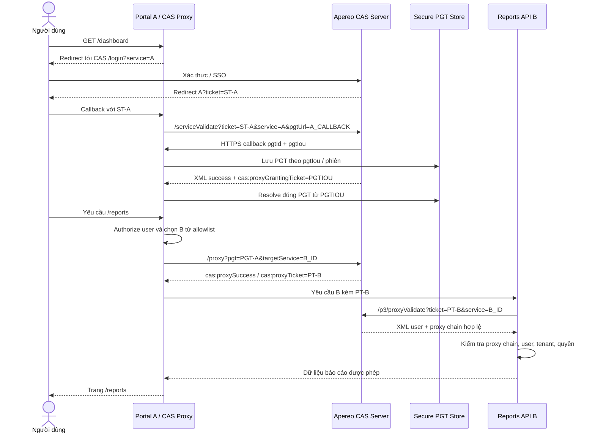

# Lấy Proxy Ticket cho đúng dịch vụ đích trong CAS Proxy

**Học phần:** Spring Security – federation → CAS Proxy.

**Mục tiêu:** hiểu cách một ứng dụng CAS Service A, sau khi người dùng đăng nhập, **xin Proxy Ticket (PT) cho đúng target service B** bằng Proxy Granting Ticket (PGT); sử dụng PT cho lời gọi server-to-server; đảm bảo dịch vụ B xác minh PT bằng đúng định danh đã dùng khi cấp; đồng thời kiểm soát proxy policy, TLS, proxy chain và thời hạn ticket.

**Quy tắc quan trọng nhất của CAS Protocol:** tham số **`targetService`** khi A gọi CAS `/proxy` phải **khớp định danh `service`** mà B gửi khi xác minh PT qua CAS `/proxyValidate` (CAS 2.0) hoặc `/p3/proxyValidate` (CAS 3.0). **PT được ràng buộc với dịch vụ đích lúc cấp**, không phải một access token dùng tùy ý cho mọi URL/API. Cũng không thể xin PT nếu chưa có PGT hợp lệ, và không được xem sự thành công của đăng nhập thông thường là bằng chứng đã nhận được PGT.

Bài dùng các domain `example.com` giả định, Java 17+, Apereo CAS và Spring Security Servlet/Jakarta. Những đoạn Spring là **mảnh cấu hình tích hợp**, cần CAS Server và registered services thực. Chương trình Java ở phần thực hành chỉ mô phỏng tính ràng buộc target và one-time ticket, không thay thế CAS client/validator.

## 1. Kịch bản: Portal A gọi API B thay mặt người dùng

Giả sử:
- **CAS Server:** `https://sso.example.com/cas`.
- **Ứng dụng A (portal):** `https://portal.example.com/login/cas` – browser login với CAS.
- **Dịch vụ B (reports API):** có **CAS service identifier** được đăng ký là `https://reports.example.com/cas-entry`.
- **Hành động nghiệp vụ:** portal A cần đọc báo cáo tại B thay mặt user đã đăng nhập.
- B không có cookie TGC/TGT của browser và không được tin một header `X-User` do A tự gửi.

Lúc này A cần **ủy nhiệm danh tính bằng CAS PT**: CAS phát một ticket ngắn hạn, service-scoped để B xác minh. Các bước:

1. User được CAS xác thực và A nhận **Service Ticket (ST)** dành cho A.
2. A xác minh ST với CAS và, **nếu được phép proxy**, yêu cầu CAS cấp **PGT**.
3. CAS xác minh `pgtUrl` HTTPS callback của A, gửi `pgtId`/`pgtIou`, và A lưu PGT an toàn.
4. A quyết định **target service B hợp lệ** dựa vào server-side allowlist/chính sách nghiệp vụ.
5. A gọi CAS `/proxy?pgt=...&targetService=...` để **xin một PT cho B**.
6. A gửi PT tới B trong giao thức/tuyến tích hợp được cấu hình; **không gửi PGT** cho B.
7. B gọi CAS `/proxyValidate?ticket=PT-...&service=B_ID` để xác minh PT và proxy chain.
8. B thực thi authorization riêng cho resource/tenant; kết quả được trả về A.

### Sơ đồ tổng thể



Trong sơ đồ, thứ tự gửi **callback PGT** và phản hồi XML liên quan đến một lượt xác minh ST; A phải hỗ trợ correlation đúng `pgtIou` kể cả khi callback và response được xử lý trên các thread/node khác nhau. Không dựa vào thứ tự arrival để gắn PGT của user A cho user B.

**Không phải mọi CAS service đều có quyền nhận PGT.** Apereo CAS có service-level proxy policy; tính năng endpoint có thể hiện diện ở server nhưng **proxy mặc định bị từ chối cho service chưa được cấp phép**. Cần phê duyệt cả A là proxying service và B là target được phép.

## 2. Năm thuật ngữ dễ nhầm

| Thành phần | Phát sinh ở đâu? | Dùng làm gì? | Có được đưa sang B không? |
| --- | --- | --- | --- |
| **TGT/TGC** | CAS và browser | CAS SSO session của user | **Không** |
| **ST** | CAS cấp cho A qua browser | A xác minh login của user với CAS | **Không dùng lại cho B** |
| **PGT** | CAS cấp cho A sau khi xác minh ST/PT và callback | A xin nhiều PT cho backend được phép | **Không**; phải giữ bí mật tại A |
| **PGTIOU** | CAS gửi trong XML response và callback | Liên kết **đúng PGT** với đúng lượt validation | **Không**; không dùng thay PGT |
| **PT** | CAS `/proxy` cấp theo `pgt+targetService` | A gọi B và B validate với CAS | **Có**, chỉ dành cho B, ngắn hạn, một lần |

**Phân biệt PT và PGT về vòng đời:** theo CAS 2.0 specification, **PGT có thể dùng để xin nhiều PT**, còn **PT chỉ có hiệu lực cho một lần ticket validation** (kể cả validation thất bại thì ticket thường bị tiêu thụ). Đừng cache cùng PT để gọi B hai mươi lần; nếu thiết kế yêu cầu nhiều lần ủy nhiệm, dùng PGT an toàn để **xin PT mới** theo mỗi validation flow phù hợp.

**PT không phải OAuth2 access token hoặc OIDC ID Token.** Nó không chứa `aud`/`scope` JWT để ứng dụng tự verify bằng JWKS; B xác minh PT qua CAS Proxy Validation endpoint theo CAS contract. Nếu API B chỉ hỗ trợ OAuth2, cần triển khai token exchange/authorization phù hợp hoặc một cơ chế khác đã được phê duyệt, không đổi tên `PT-...` thành bearer JWT.

## 3. Ba URL/service identifier có ba vai trò khác nhau

Một lỗi phổ biến là dùng một URL cho mọi biến chỉ vì chúng đều chứa chữ “service”.

| Khái niệm | Ví dụ | Dùng ở thao tác nào? |
| --- | --- | --- |
| **A service URL** | `https://portal.example.com/login/cas` | A nhận ST và validate ST bằng `service=A_ID` |
| **PGT callback URL (pgtUrl)** | `https://portal.example.com/login/cas/proxyreceptor` | CAS gọi A để truyền `pgtId`/`pgtIou` sau khi A yêu cầu proxy |
| **B target service ID** | `https://reports.example.com/cas-entry` | A xin PT với `targetService=B_ID` và B validate PT với `service=B_ID` |

**Không nhầm `pgtUrl` với `targetService`.** `pgtUrl` chứng minh endpoint của **A nhận PGT**, còn `targetService` nêu **B mà PT được phép truy cập**. Không đặt target service là `/proxy` của CAS Server, cũng không dùng callback A thay cho service B.

### 3.1. Target service không nhất thiết trùng mọi URL API

Theo CAS 2.0 specification, targetService là **service identifier** và không phải backend nào cũng là website; vì vậy nó **không bắt buộc** là URL HTTP. Nhưng khi backend B triển khai theo kiểu URL-based CAS ticket validation, nó **phải gửi chính xác identifier đã thỏa thuận** trong `service`. Ví dụ:

```text
A (đúng):
  CAS /proxy?targetService=https://reports.example.com/cas-entry
B (đúng):
  CAS /p3/proxyValidate?service=https://reports.example.com/cas-entry

B nghiệp vụ thật:
  GET https://reports.example.com/api/reports/42
```

Ở đây `/api/reports/42` là resource path, còn `https://reports.example.com/cas-entry` là **service identifier xác thực của B theo hợp đồng**. B có thể validate PT bằng identifier cố định khi nhận lời gọi tại resource endpoint, **nếu cách triển khai CAS client/filter của B hỗ trợ và xác định service như vậy**. Không mặc định framework nào cũng tự dùng ID cố định: một số CAS filters lấy service URL trực tiếp từ request, và khi đó phải cấu hình target service bằng URL thực mà B dùng validate.

**Quy tắc chung:** đầu tiên chốt một **contract** giữa A, B và CAS Server: canonical targetService ID, protocol validator và mapping endpoint. Sau đó sử dụng **cùng chuỗi đó** ở cả hai phía cấp/validate ticket.

### 3.2. Sai do URL được nhìn theo hai cách

```text
A xin PT:    https://reports.example.com/cas-entry
B validate:  http://reports:8080/cas-entry
Kết quả:     INVALID_SERVICE (thường gặp)
```

Khác scheme, host, port, slash, context path hoặc query có thể khiến CAS xem là hai service khác nhau. Sau reverse proxy, B phải dùng public canonical identifier hoặc custom service resolver đã được kiểm thử. Đừng “sửa” bằng cách thêm wildcard `https?://.*` vào service registry.

### 3.3. Nhầm encode với thay đổi giá trị

Khi đặt targetService trong HTTP query, cần **URL-encode đúng một lần**. Ví dụ giá trị thực:

```text
https://reports.example.com/cas-entry
```

Giá trị query:

```text
targetService=https%3A%2F%2Freports.example.com%2Fcas-entry
```

Khi CAS Server URL-decode tham số, chuỗi phải trở về đúng canonical ID. Một số lỗi:
- Encode lần hai: CAS nhận literal `https%3A...` thay vì `https://...`.
- Tự sửa chữ hoa/chữ thường ở path, thay trailing slash.
- Chèn query `?ticket=PT` hoặc business query vào **targetService** dù B không dùng chúng khi validate.
- Dùng Unicode normalization/space rewriting khác nhau giữa A và B.
- Ghép chuỗi raw `&`/`?` trong targetService mà không encode; tham số bị chia sai.

Với Java, dùng `URLEncoder.encode(targetService, StandardCharsets.UTF_8)` khi **mã hóa giá trị query parameter**, không dùng nó để encode nguyên URL của endpoint hay đổi nội dung canonical ID.

## 4. Điều kiện tiên quyết: A phải có PGT hợp lệ

A **không thể xin PT** chỉ bằng ST hoặc session cookie. Để nhận PGT, A phải được CAS cho phép proxy khi validate một ST/PT.

### 4.1. A gửi `pgtUrl` lúc validate ST

Request ví dụ (query được tách dòng ở đây để dễ đọc):

```text
GET https://sso.example.com/cas/serviceValidate
    ?service=https%3A%2F%2Fportal.example.com%2Flogin%2Fcas
    &ticket=ST-example-one-time
    &pgtUrl=https%3A%2F%2Fportal.example.com%2Flogin%2Fcas%2Fproxyreceptor
```

Lưu ý:
- `service` ở request này là **A**, vì A đang validate ST để nhận login.
- `pgtUrl` cũng là endpoint của **A**.
- **Chưa có `targetService=B` trong request xác minh ST này.** Nó chỉ xuất hiện sau, khi A đã có PGT và muốn xin PT cho B.

CAS kiểm tra certificate và hostname HTTPS callback theo CAS proxy trust rules; callback phải reachable từ CAS Server (chứ không chỉ từ browser). CAS gửi:

```http
GET /login/cas/proxyreceptor?pgtId=PGT-example-secret&pgtIou=PGTIOU-example-map HTTP/1.1
Host: portal.example.com
```

Đây là **chuỗi giả định**, không được gửi làm request thật. `pgtId` là credential bí mật; thực tế sẽ có độ entropy dài, không được viết log/browser.

A lưu **PGT theo PGTIOU**, với TTL/revocation, ràng buộc với lượt validation/user/session tương ứng. CAS sau đó có thể trả:

```xml
<cas:serviceResponse xmlns:cas="http://www.yale.edu/tp/cas">
  <cas:authenticationSuccess>
    <cas:user>alice</cas:user>
    <cas:proxyGrantingTicket>PGTIOU-example-map</cas:proxyGrantingTicket>
  </cas:authenticationSuccess>
</cas:serviceResponse>
```

A dùng PGTIOU trong response để tìm **PGT thật** đã được nhận bằng callback. **Không gửi PGTIOU thay `pgt` trong yêu cầu `/proxy`.** Không nên dựa vào cùng user ID để match callback nếu một user có nhiều session hoặc flow song song.

### 4.2. Khi callback không thành công

Nếu `pgtUrl` sai DNS, certificate hết hạn, hostname mismatch, mTLS/trust policy không đạt hoặc endpoint trả HTTP lỗi, CAS có thể **không cấp PGT**. Theo CAS 2.0 specification, xác minh ST/login có thể vẫn thành công nhưng **không có `cas:proxyGrantingTicket`**; việc xin PT tiếp theo sẽ thất bại.

Kiểm tra phân biệt:
- `ST validation PASS`: user đã đăng nhập A.
- `PGT acquisition PASS`: A có PGT, được phép xin PT.
- `PT acquisition PASS`: CAS phát PT cho **một B cụ thể**.
- `PT validation PASS`: B đã validate PT đúng ID và proxy chain.
- `Business authorization PASS`: B cho phép user và proxy thực hiện resource action.

Các mốc này không tự kéo theo nhau.

### 4.3. Proxy policy trên CAS Server

Tài liệu Apereo CAS nhấn mạnh service-level proxy policy **mặc định từ chối**, và quản trị viên phải cấp quyền rõ ràng cho service A nhận PGT. Đừng chỉ bật một flag client rồi mong server luôn phát PGT.

Một policy chỉ nên cho A có quyền proxy nếu:
- A là ứng dụng được tin cậy, có nhu cầu nghiệp vụ.
- PGT callback URL đã được kiểm chứng và riêng cho A.
- CAS Server/registry cho phép behavior tương ứng, theo đúng release/version.
- Danh sách target backend được kiểm soát.
- B cũng kiểm tra proxy chain, không chấp nhận proxy bất kỳ.

Apereo có loại policy permit/regex trên registered service tùy CAS version. **Không chép mẫu `. *` để cho phép tất cả callback/targetService**; cần xem schema/version cụ thể và chọn allowlist hẹp nhất. Việc A đã được phép proxy không tự có nghĩa B chấp nhận mọi proxy chain.

## 5. Xin PT cho B bằng CAS `/proxy`

Đây là **bước chính của đề bài** sau khi A đã có PGT.

### 5.1. Hai tham số bắt buộc

CAS 2.0 specification định nghĩa endpoint `/proxy` với các tham số **case-sensitive**:

| Parameter | Vai trò | Có thể lấy từ đâu? |
| --- | --- | --- |
| `pgt` | **PGT thật**, dùng bởi A để xin proxy ticket | PGT secure store của A, được map từ PGTIOU của một lượt ST/PT validation |
| `targetService` | **Định danh của B**, nơi PT sẽ hợp lệ | Server-side service catalog / allowlist, không lấy trực tiếp từ URL client |

Lệnh minh họa **chỉ dùng placeholder**:

```text
GET https://sso.example.com/cas/proxy
    ?pgt=PGT-example-secret
    &targetService=https%3A%2F%2Freports.example.com%2Fcas-entry
```

Dùng `GET` với query parameter theo CAS protocol; điều đó có nghĩa PGT có thể đi qua request URL tại server-to-server hop. Vì vậy phải dùng HTTPS, ngăn reverse proxy/access log ghi query nhạy cảm, không chụp URL vào ticket và không redirect request đến host bên ngoài. Không in PGT thật khi debug bằng `curl -v` hoặc trace HTTP.

### 5.2. Response khi CAS phát PT thành công

```xml
<cas:serviceResponse xmlns:cas="http://www.yale.edu/tp/cas">
  <cas:proxySuccess>
    <cas:proxyTicket>PT-example-one-time-for-reports</cas:proxyTicket>
  </cas:proxySuccess>
</cas:serviceResponse>
```

A phải:
1. Kiểm tra HTTPS CAS response/HTTP status, parse XML theo namespace có hardening.
2. Chỉ chấp nhận `cas:proxySuccess/cas:proxyTicket` hợp lệ, không “thành công” chỉ vì HTTP 200.
3. Gắn PT nhận được với request nội bộ **đúng targetService B**, không cấp phát cho bất kỳ target nào từ input chưa tin cậy.
4. Dùng PT theo thời hạn/one-time semantics; nếu B validate một lần rồi client retry, cần **xin PT mới** từ PGT nếu còn hợp lệ.
5. Không lưu PT trong cookie browser, localStorage, analytics, user-facing URL, cache công khai hoặc exception message.

### 5.3. Response lỗi `/proxy`

```xml
<cas:serviceResponse xmlns:cas="http://www.yale.edu/tp/cas">
  <cas:proxyFailure code="BAD_PGT">
    Provided proxy-granting ticket was not valid
  </cas:proxyFailure>
</cas:serviceResponse>
```

CAS spec nêu các mã tối thiểu như `INVALID_REQUEST`, `BAD_PGT` và `INTERNAL_ERROR`; phiên bản CAS Server có thể bổ sung mã liên quan service authorization. Không chỉ dùng một `catch (Exception) {return PT; }` hoặc dùng lại PT từ lần trước khi CAS từ chối. Phải trả lỗi an toàn và tìm nguyên nhân PGT/target/service policy.

### 5.4. B xác minh PT thế nào?

Ví dụ B có một service identifier đã đăng ký:

```text
B_ID = https://reports.example.com/cas-entry
```

B dùng endpoint CAS3:

```text
GET https://sso.example.com/cas/p3/proxyValidate
    ?service=https%3A%2F%2Freports.example.com%2Fcas-entry
    &ticket=PT-example-one-time-for-reports
```

Hoặc CAS2:

```text
GET https://sso.example.com/cas/proxyValidate
    ?service=https%3A%2F%2Freports.example.com%2Fcas-entry
    &ticket=PT-example-one-time-for-reports
```

**Không** dùng `/serviceValidate` cho PT; CAS 2.0 `/serviceValidate` được thiết kế để validate ST và **không chấp nhận PT như ST**. CAS3 `/p3/proxyValidate` là phù hợp nếu cần thuộc tính CAS3; CAS1 `/validate` không hỗ trợ proxy authentication.

Response có thể chứa:

```xml
<cas:serviceResponse xmlns:cas="http://www.yale.edu/tp/cas">
  <cas:authenticationSuccess>
    <cas:user>alice</cas:user>
    <cas:attributes>
      <cas:department>finance</cas:department>
    </cas:attributes>
    <cas:proxies>
      <cas:proxy>https://portal.example.com/login/cas/proxyreceptor</cas:proxy>
    </cas:proxies>
  </cas:authenticationSuccess>
</cas:serviceResponse>
```

XML này là **mẫu rút gọn**, thuộc tính và proxy chain thực phụ thuộc CAS Server và release policy. B phải kiểm tra **CAS issuer/trust thông qua validation response từ đúng server** và áp policy proxy chain: chỉ chấp nhận A hoặc các proxy đã được phê duyệt, không chỉ nhìn `cas:user`.

## 6. TargetService nào là “đúng” khi B có nhiều endpoint?

Một service backend có thể công bố nhiều URL, trong khi CAS application registration của B dùng một canonical ID hoặc nhiều service ID khác nhau. Ví dụ:

```text
Report API:
  GET /api/reports/42
  GET /api/reports/43
  GET /api/export/42

CAS target service:
  https://reports.example.com/cas-entry
```

Nếu B luôn validate PT với `https://reports.example.com/cas-entry` theo hợp đồng, A xin PT cho **identifier đó**, không thay đổi theo mỗi report ID. Nếu B validate với URL resource cụ thể, A phải xin PT cho **đúng URL** (và CAS service registry phải cho phép), nhưng số lượng target khác nhau sẽ lớn hơn và nguy cơ sai/mở rộng quyền cao hơn.

### 6.1. Bảng trước/sau cho các trường hợp hay nhầm

| A đưa vào `targetService` | B đưa vào `service` khi validate | Kết quả kỳ vọng |
| --- | --- | --- |
| `https://reports.example.com/cas-entry` | Cùng chính xác | **Đúng target**, tiếp tục kiểm tra PT/chain/policy |
| `https://reports.example.com/cas-entry` | `http://reports:8080/cas-entry` | Sai public/internal scheme+host → **FAIL** |
| `https://reports.example.com/cas-entry` | `https://reports.example.com/cas-entry/` | Có thêm slash → dễ **FAIL** |
| `https://reports.example.com/cas-entry` | `https://billing.example.com/cas-entry` | Khác B → **FAIL** |
| `https://reports.example.com/api/reports/42` | `https://reports.example.com/cas-entry` | Khác identifier → **FAIL** |
| Canonical `B_ID` không phải URL | B dùng cùng canonical `B_ID` và backend hỗ trợ identifier này | Có thể hợp lệ **theo hợp đồng** |
| URL target do browser nhập | B dùng đúng URL đó | Vẫn **không đủ an toàn** vì A chưa giới hạn nơi được proxy |

Không nên “chuẩn hóa” tự ý ở thời điểm validation như cắt query string hoặc lowercase cả path. Hãy chuẩn hóa một lần **trong cấu hình của hai bên** theo policy rồi test giá trị đúng, thay vì chấp nhận “gần giống”.

### 6.2. Vì sao không cho người dùng truyền target URL?

Ví dụ API của A:

```text
GET /proxy-report?url=https://some-host.example/path
```

Nếu A lấy raw `url` đặt thành `targetService` rồi gọi `/proxy`, người dùng có thể cố:
- Chỉ định một service không thuộc business flow.
- Lạm dụng proxy permission A để xin PT cho backend khác.
- Kích hoạt **SSRF** nếu A tiếp tục gọi URL không được phép.
- Gửi PT vào hostname của attacker, khiến ticket xuất hiện trong access logs/bên nhận.
- Nhầm target ID hợp lệ với endpoint attacker-redirect.

**Thiết kế đúng:** user chọn **một action hoặc resource ID** (ví dụ `reportId=42`), còn A map action đó sang một **`TargetService` enum/registry server-side** đã được quản trị viên chấp nhận. A vẫn phải xác minh user/tenant/resource rights, không chỉ target allowlist.

## 7. Java/Spring Security: gọi thư viện client để xin PT

### 7.1. Dòng thư viện và API liên quan

Theo tài liệu Spring Security CAS và Apereo Java CAS Client, sau khi CAS authentication thành công và PGT được xử lý, một `CasAuthenticationToken` có thể chứa assertion/principal CAS. Principal cung cấp:

```java
String proxyTicket =
    casToken.getAssertion()
            .getPrincipal()
            .getProxyTicketFor(targetService);
```

Method `getProxyTicketFor(String service)` của `AttributePrincipal` yêu cầu CAS Proxy Retriever xin một PT cho **service được truyền vào**. Trong implementation client, `ProxyRetriever.getProxyTicketIdFor(pgt, targetService)` thực hiện bước này. Tùy cấu hình và CAS Server, method có thể trả null hoặc báo lỗi khi thiếu PGT/target không được phép; **phải xử lý fail closed**.

**Lưu ý tương thích:** tài liệu Spring Security CAS có những đoạn code lịch sử (Spring Security 3.x). API `CasAuthenticationToken`, filter/provider, package và generic type cần đối chiếu Javadoc/version thực tế (Spring Security 6/7, Apereo CAS Client 4.x). Đoạn trên là mảnh usage, **không phải full controller Spring có thể chạy độc lập**.

### 7.2. Mảnh service class tập trung vào target cố định

`ReportsProxyTicketService.java`, trong ứng dụng Spring đã đăng nhập CAS:

```java
package com.example.portal;

import org.springframework.security.cas.authentication.CasAuthenticationToken;

public final class ReportsProxyTicketService {
    public static final String REPORTS_CAS_SERVICE =
            "https://reports.example.com/cas-entry";

    public String issueForReports(CasAuthenticationToken casToken) {
        if (casToken == null || !casToken.isAuthenticated()) {
            throw new IllegalStateException(
                    "A validated CAS session is required");
        }

        String pt = casToken.getAssertion()
                .getPrincipal()
                .getProxyTicketFor(REPORTS_CAS_SERVICE);

        if (pt == null || pt.isBlank()) {
            throw new IllegalStateException(
                    "CAS did not grant a proxy ticket");
        }
        // Không log hoặc đưa PT vào HTTP response của browser.
        return pt;
    }
}
```

**Giới hạn ví dụ:** service này chỉ nhận **canonical B target ID** cố định và hỏi CAS PT. Nó **chưa** kiểm tra business authorization, user/tenant membership, hết hạn/revocation của PGT, HTTP call B, correlation tracing, error mapping hoặc circuit breaker. Gọi từ một service/controller **đã** kiểm tra user có quyền xem report. Không inject `targetService` từ query/body.

### 7.3. Cấu hình nhận PGT cần làm trước

Bước nhận PGT trong mô hình Spring CAS thường có các thành phần:
- `CasAuthenticationEntryPoint` và `ServiceProperties` cho A login bằng CAS.
- `CasAuthenticationFilter` xử lý ST callback.
- `CasAuthenticationProvider` dùng CAS proxy-capable `TicketValidator` (ví dụ `Cas20ProxyTicketValidator` hoặc `Cas30ProxyTicketValidator` theo protocol).
- `ProxyGrantingTicketStorage` để lưu PGT/PGTIOU.
- `proxyCallbackUrl` của validator trùng public HTTPS URL mà CAS gọi.
- `proxyReceptorUrl` của filter khớp path nhận callback.
- `ProxyRetriever` trong assertion có đủ thông tin để xin PT.
- CAS service registry proxy policy cho A.

Ví dụ **mảnh khai báo bean** cho client CAS2 proxy (không phải full app/config runnable):

```java
import org.apereo.cas.client.proxy.ProxyGrantingTicketStorage;
import org.apereo.cas.client.proxy.ProxyGrantingTicketStorageImpl;
import org.apereo.cas.client.validation.Cas20ProxyTicketValidator;
import org.springframework.context.annotation.Bean;
import org.springframework.context.annotation.Configuration;

@Configuration
public class CasProxyBeans {
    @Bean
    ProxyGrantingTicketStorage pgtStorage() {
        // Demo: in-memory. Production cần shared secure storage.
        return new ProxyGrantingTicketStorageImpl();
    }

    @Bean
    Cas20ProxyTicketValidator ticketValidator(
            ProxyGrantingTicketStorage pgtStorage) {
        Cas20ProxyTicketValidator validator =
                new Cas20ProxyTicketValidator("https://sso.example.com/cas");
        validator.setProxyCallbackUrl(
                "https://portal.example.com/login/cas/proxyreceptor");
        validator.setProxyGrantingTicketStorage(pgtStorage);
        return validator;
    }
}
```

Phải nối cùng `pgtStorage` vào `CasAuthenticationFilter` qua API phù hợp, cấu hình `proxyReceptorUrl` và CAS authentication flow hoàn chỉnh. Trên cluster, **in-memory storage không đủ**, vì callback CAS và response ST validation có thể đến pod khác nhau; cần shared backing store có TTL, bảo vệ quyền truy cập và correlation chính xác. Không đưa PGT store vào browser.

### 7.4. Spring Boot dependency định hướng

Nếu ứng dụng sử dụng Spring Security CAS integration, có thể bắt đầu từ modules (với BOM của Spring Boot phù hợp) như:

```xml
<dependencies>
  <dependency>
    <groupId>org.springframework.boot</groupId>
    <artifactId>spring-boot-starter-webmvc</artifactId>
  </dependency>
  <dependency>
    <groupId>org.springframework.boot</groupId>
    <artifactId>spring-boot-starter-security</artifactId>
  </dependency>
  <dependency>
    <groupId>org.springframework.security</groupId>
    <artifactId>spring-security-cas</artifactId>
  </dependency>
  <dependency>
    <groupId>org.apereo.cas.client</groupId>
    <artifactId>cas-client-core</artifactId>
    <version>4.1.1</version>
  </dependency>
</dependencies>
```

**Đây là dependency fragment chứ không phải POM đầy đủ.** Java CAS client 4.x gắn với namespace Jakarta Servlet, trong khi client 3.x cũ có thể là `javax.servlet`. Nếu Boot 4/Security 7 đang dùng Jakarta, phải kiểm tra tương thích classpath, loại JAR legacy và cân chỉnh `spring-security-cas` cùng Spring Security BOM. Nên dùng client bản vá an toàn được tổ chức duyệt; version trên chỉ là ví dụ từ dòng Apereo Client 4.x đã xuất bản. Chạy `mvn dependency:tree`, compile, test và integration CAS sandbox trước production.

**Không dùng đồng thời Apereo CAS validation Servlet filter và Spring `CasAuthenticationFilter` cho cùng một ST** nếu không có một kiến trúc tích hợp rõ: hai validators có thể làm ticket bị tiêu thụ hai lần và gây `INVALID_TICKET`.

## 8. B dùng CAS Proxy Ticket Validator

B là backend CAS service được phép nhận PT. B phải xác minh PT với **CAS Server**, không tin chuỗi `PT-...` tự nó.

### 8.1. Chọn đúng endpoint theo protocol

| CAS Protocol | Backend B nên gọi | Vì sao |
| --- | --- | --- |
| CAS 1.0 | `/validate` không hỗ trợ PT | **Không phù hợp** cho CAS Proxy |
| CAS 2.0 | `/proxyValidate` | Chấp nhận ST/PT theo spec |
| CAS 3.0 | `/p3/proxyValidate` | Chấp nhận ST/PT và CAS3 attributes theo policy |
| CAS 2.0 `/serviceValidate` | Không dùng để xác minh PT | Được thiết kế cho ST, thường reject PT |
| CAS 3.0 `/p3/serviceValidate` | Dành cho service validation | Dùng proxy endpoint nếu nhận PT |

B có thể cấu hình `Cas20ProxyTicketValidator` hoặc `Cas30ProxyTicketValidator` trong Apereo Java CAS Client; validator phải có proxy policy phù hợp và **canonical service identifier** trùng `targetService` tại A.

### 8.2. Proxy chain là dữ liệu bảo mật

Response CAS khi PT validation thành công có thể có `cas:proxies`. Nếu đi qua A1 → A2 → B, CAS spec nêu **proxy gần nhất trước B xuất hiện đầu tiên**, tiếp theo các proxy đã đi qua trước đó.

```xml
<cas:proxies>
  <cas:proxy>https://proxy2.example.com/pgtCallback</cas:proxy>
  <cas:proxy>https://proxy1.example.com/pgtCallback</cas:proxy>
</cas:proxies>
```

B phải có allowlist/policy dựa trên callback identifiers/proxy chain; không bật `acceptAnyProxy=true` chỉ để loại lỗi trong production. Một PT hợp lệ có thể đã đi qua **một proxy trung gian không được tin**, và B có quyền từ chối.

**Thứ tự chain có nghĩa**: không flatten thành một Set bỏ thứ tự nếu yêu cầu policy phân biệt A1/A2. Nếu app không cho phép multi-hop, yêu cầu chính xác một proxy được phê duyệt.

### 8.3. Authorization tại B vẫn bắt buộc

CAS validation chứng minh một danh tính được CAS xác thực và một đường ủy nhiệm, **không tự cấp quyền nghiệp vụ**. B phải xác minh:
- User được map sang internal user ID/tenant đúng, tài khoản active.
- A hoặc proxy chain được phép gọi tài nguyên này.
- User có quyền đọc report ID 42 trong tenant của mình.
- Phương thức HTTP/endpoint và business parameter không vượt policy.
- Dữ liệu được truy cập theo resource ID server-side, không chỉ `username`.
- Nếu cần MFA/step-up, authentication context/assurance policy phải được xác định qua CAS contract; PT tự nó không phải MFA.

Dịch vụ B không được dùng một PT đã validate để cấp token bất tử. Nếu B thiết lập một phiên/cached Authentication cho remote client, phải có TTL/revocation và threat model riêng: **không biến cache thành đường bỏ qua one-time ticket/service scope**.

## 9. Khi A cần gọi nhiều backend

Giả sử A gọi:
- Reports B: `https://reports.example.com/cas-entry`.
- Payroll C: `https://payroll.example.com/cas-entry`.

A có thể có PGT hợp lệ sau user login. Nhưng nó phải xin **hai PT riêng**:

```text
A → CAS /proxy?pgt=PGT_A&targetService=REPORTS_B
CAS → A : PT_B
A → B  : PT_B
B → CAS /p3/proxyValidate?ticket=PT_B&service=REPORTS_B

A → CAS /proxy?pgt=PGT_A&targetService=PAYROLL_C
CAS → A : PT_C
A → C  : PT_C
C → CAS /p3/proxyValidate?ticket=PT_C&service=PAYROLL_C
```

**Không chuyển `PT_B` sang C** chỉ vì cùng user, cùng PGT hay cùng CAS Server. CAS phải reject mismatch. Nếu C cần thêm quyền/mức assurance, A phải kiểm tra user được phép gọi C; C tiếp tục check policy của chính mình.

### 9.1. Data model catalog phía A

```java
enum BackendTarget {
    REPORTS("https://reports.example.com/cas-entry"),
    PAYROLL("https://payroll.example.com/cas-entry");

    private final String casServiceId;

    BackendTarget(String casServiceId) {
        this.casServiceId = casServiceId;
    }

    String casServiceId() {
        return casServiceId;
    }
}
```

Đây là **mảnh lớp Java** giúp lưu canonical IDs. Không cho user gửi `BackendTarget` tùy ý rồi bỏ qua authorization. A phải map action của user → business policy → allowed backend → fixed targetService.

### 9.2. PT one-time và retries

Một PT chỉ hợp lệ cho **một lần validation attempt** theo CAS 2.0 spec; nếu B đã gửi nó đến CAS và CAS reject vì service ID sai, PT có thể đã bị tiêu thụ, **không thể sửa service rồi validate lại bằng PT cũ**.

Đúng:
1. Phát hiện lỗi và không reuse PT.
2. Chẩn đoán canonical targetService B và CAS registered service.
3. Nếu PGT còn an toàn/hợp lệ và policy cho phép, xin **PT mới** với đúng target.
4. Retry HTTP business call chỉ khi request là **idempotent** hoặc có idempotency key; đừng làm payment/approve lần hai chỉ vì lần trước timeout.

Không tự động retry vô hạn gây phát hành lượng lớn PT. Giới hạn rate và có circuit breaker/telemetry.

### 9.3. PGT có thể hết hạn khác PT

PGT và PT có lifecycle khác nhau:
- PGT có thể tồn tại đủ để A xin nhiều PT theo policy CAS.
- PT ngắn hạn, ràng buộc service và one-time validation.
- CAS Server có thể revoke/expire PGT khi user logout, PGT parent hết hạn, proxy policy đổi hoặc CAS ticket registry dọn dẹp; cách cụ thể phụ thuộc CAS release/config.
- Nếu PGT hết hạn, A cần một **CAS authentication/PGT acquisition flow mới**; không thể tự phát PT từ giá trị cache.

Không ghi PGT vào `HttpSession` dưới tên dễ đoán rồi chấp nhận session replication/plain serialization không mã hóa. Shared PGT storage cần ACL, encryption, TTL, invalidation và audit; connection giữa PGT và authenticated user/session phải rõ ràng.

## 10. Java 17 độc lập: mô phỏng cấp PT cho đúng B

Ví dụ hoàn chỉnh dưới đây chỉ dùng JDK 17, **không kết nối CAS Server**, không gọi mạng và không xử lý credentials thật. Nó minh họa ba tính chất nền tảng:
- Chỉ nhận target thuộc allowlist server-side.
- PT mang scope **một target service ID**.
- PT chỉ dùng **một lần validation**; validation sai target cũng làm ticket không dùng lại được.

Tệp `CasProxyTargetDemo.java`:

```java
import java.util.HashMap;
import java.util.Map;
import java.util.Set;

public class CasProxyTargetDemo {
    static final String REPORTS =
            "https://reports.example.com/cas-entry";
    static final String PAYROLL =
            "https://payroll.example.com/cas-entry";

    record Ticket(String targetService) {}

    static final class MiniCas {
        private final Map<String, Ticket> issued = new HashMap<>();
        private final Set<String> allowedTargets =
                Set.of(REPORTS, PAYROLL);
        private int nextId = 1;

        String proxy(String pgt, String targetService) {
            if (!"PGT_VALID_DEMO".equals(pgt)) {
                throw new SecurityException("Invalid PGT");
            }
            if (!allowedTargets.contains(targetService)) {
                throw new SecurityException("Unknown target");
            }
            String pt = "PT-" + nextId++;
            issued.put(pt, new Ticket(targetService));
            return pt;
        }

        boolean proxyValidate(String pt, String service) {
            Ticket ticket = issued.remove(pt);
            return ticket != null
                    && ticket.targetService().equals(service);
        }
    }

    public static void main(String[] args) {
        MiniCas cas = new MiniCas();

        String first = cas.proxy("PGT_VALID_DEMO", REPORTS);
        System.out.println("Right target accepted: "
                + cas.proxyValidate(first, REPORTS));
        System.out.println("Replay rejected: "
                + !cas.proxyValidate(first, REPORTS));

        String second = cas.proxy("PGT_VALID_DEMO", REPORTS);
        System.out.println("Wrong target rejected: "
                + !cas.proxyValidate(second, PAYROLL));
        System.out.println("Wrong attempt consumed ticket: "
                + !cas.proxyValidate(second, REPORTS));

        String third = cas.proxy("PGT_VALID_DEMO", PAYROLL);
        System.out.println("Other service needs new PT: "
                + cas.proxyValidate(third, PAYROLL));

        boolean denied;
        try {
            cas.proxy("PGT_VALID_DEMO", "https://evil.example/any");
            denied = false;
        }
        catch (SecurityException ex) {
            denied = true;
        }
        System.out.println("Unknown target denied: " + denied);
    }
}
```

Chạy:

```bash
javac CasProxyTargetDemo.java
java CasProxyTargetDemo
```

**Stdout chính xác:**

```text
Right target accepted: true
Replay rejected: true
Wrong target rejected: true
Wrong attempt consumed ticket: true
Other service needs new PT: true
Unknown target denied: true
```

**Giới hạn bảo mật của bài tập:** `MiniCas` là mô hình trong bộ nhớ, không có CAS ticket registry, TLS/PKIX, service registry proxy policy, PGT callback/PGTIOU, concurrent requests, signed assertion, logout, TTL hay users/tenants. `"PGT_VALID_DEMO"` là chuỗi cố định dùng cho học tập, **không phải cách tạo/bảo vệ PGT thật**. Mục đích duy nhất là kiểm tra quan hệ targetService ↔ service và one-time behavior. Không triển khai class này vào production.

## 11. Spring Security CAS: cấu hình PGT callback và server-side call

### 11.1. Chuỗi cấu hình logic

Để `CasAuthenticationToken.getAssertion().getPrincipal().getProxyTicketFor(...)` trả PT, pipeline phải hoàn thiện:

```text
CAS entry point và serviceProperties (A)
  ↓
CAS login -> ST cho A
  ↓
TicketValidator có proxyCallbackUrl và PGT storage
  ↓
CAS /serviceValidate hoặc /proxyValidate (nếu proxy hop)
  ↓
CAS callback pgtId/pgtIou đến A proxyReceptorUrl
  ↓
A map PGTIOU -> PGT đúng user/session
  ↓
CasAuthenticationToken chứa CAS Assertion/AttributePrincipal
  ↓
AttributePrincipal.getProxyTicketFor(B_ID)
  ↓
CAS /proxy?pgt=PGT_A&targetService=B_ID
  ↓
A gửi PT_B cho backend B
  ↓
B /proxyValidate?ticket=PT_B&service=B_ID
```

Nếu một mắt xích thiếu, không “tạo PT” bằng `"PT-" + randomUUID()` ở ứng dụng. Chỉ CAS Server được quyền phát PT mà các CAS services chấp nhận.

### 11.2. Spring Security 6/7 compatibility

- Spring Security `spring-security-cas` chứa `CasAuthenticationProvider`, `CasAuthenticationFilter`, `CasAuthenticationToken` và `ServiceProperties`.
- Apereo `cas-client-core` chứa CAS ticket validators, `AttributePrincipal` và proxy storage/retriever.
- Java CAS Client 4.x dùng Jakarta Servlet; với Spring Boot 3/4 cần tương thích Jakarta namespace và version do Spring Security BOM quản lý.
- Các trang Spring CAS vẫn có một số ví dụ cũ từ Spring 3.x; không copy XML bean/token types mà bỏ qua Javadoc major đang chạy.
- B có thể là Servlet service hoặc non-web service; nếu B không dùng Servlet filter, backend still phải validate PT với CAS và kiểm tra proxy chain/service identifier.
- CAS Server cho phép proxy policy ở registered service, không thể chỉ bật client-side `acceptAnyProxy`.

**Không phải mọi app dùng `oauth2Login`/`saml2Login` đều có thể xin CAS PT**: nó cần một CAS login/validation path đã nhận PGT hoặc một dịch vụ CAS-issued credential được thiết kế riêng. Không lấy OIDC ID Token hoặc SAML Assertion đưa trực tiếp vào `pgt` để gọi CAS `/proxy`.

### 11.3. Một đường gọi B an toàn

Mô hình Java/Spring thường:
1. Map report ID/action sang B target cố định.
2. Check user quyền, tenant và resource.
3. Lấy `CasAuthenticationToken`/CAS principal từ authenticated session, đảm bảo current user.
4. Gọi `getProxyTicketFor(B_ID)` để xin **PT mới**.
5. Thêm PT vào request theo integration contract của B, qua HTTPS private/server-to-server.
6. B validate PT bằng **`service=B_ID`**, kiểm tra proxy chain và quyền.
7. Xóa/che ticket khỏi logs; không trả PT qua response browser.

Nếu B chấp nhận `ticket` query param, ví dụ mã hóa **giá trị** trước khi tạo URL:

```java
String encodedPt = java.net.URLEncoder.encode(
        proxyTicket, java.nio.charset.StandardCharsets.UTF_8);

// Chỉ minh họa nếu endpoint không có query string sẵn:
// String requestUrl = REPORTS_CAS_SERVICE + "?ticket=" + encodedPt;
// Dùng URI builder ở ứng dụng thực để tránh nối chuỗi query sai.
```

Đừng log `requestUrl` có PT. Bất kỳ HTTP client có redirects đều cần policy không chuyển ticket sang host khác. Thực thi call tới **fixed allowlisted host** và vô hiệu hóa/giới hạn redirects có thể làm lộ `ticket`; dùng TLS trust và timeout phù hợp.

## 12. Bảo mật PGT callback và PGT storage

### 12.1. HTTPS callback đáng tin

CAS protocol yêu cầu `pgtUrl` là HTTPS, CAS kiểm tra certificate chain/hostname (PKIX trust). Trong một triển khai:
- URL được công bố như `https://portal.example.com/login/cas/proxyreceptor`, không phải `http://localhost:8080/proxyreceptor`.
- CAS Server có thể truy cập endpoint qua network, DNS và ingress.
- Chứng thư server phù hợp hostname, chưa hết hạn, CA trust hợp lệ.
- Endpoint không redirect vô hạn, đáp ứng HTTP 200 theo contract.
- Không hiển thị/trả về `pgtId` hoặc `pgtIou` trong response body/log.
- Chỉ dùng callback để map đúng PGTIOU, không tự coi request callback là một authenticated user login.
- Có bảo vệ chống request giả/misrouting và lộ PGT trong logs/observability.

Nếu dùng reverse proxy, chỉ tin forwarded headers của ingress được xác thực. Không nhận `pgtUrl` tùy ý từ query của browser vì có thể mở SSRF thông qua CAS Server.

### 12.2. PGT storage trong cluster

Trong một deployment nhiều pod:

```text
CAS callback pgtId/pgtIou → Pod A
CAS ST XML response      → Pod B
Pod B cần tìm pgtIou → PGT
```

Nếu storage chỉ là in-memory của Pod A, Pod B có thể không tìm được PGT dù CAS callback thành công. Chọn shared/secure PGT store (database/Redis/implementation phù hợp), bảo vệ:
- Encryption at rest và ACL/TLS.
- TTL theo CAS PGT lifetime; cleanup expired tickets.
- Atomic association `PGTIOU → PGT` và đúng original session/principal.
- Không lưu PGT trong cache phản hồi public hoặc client-side cookie.
- Audit key/correlation hash thay vì raw PGT.
- Revoke/delete khi logout, user disable hoặc policy change theo CAS contract.
- Nếu service đã bị compromise, rotate secrets/tickets và điều tra phạm vi ủy nhiệm.

**Không lưu PGT theo mỗi username** nếu user có nhiều browser sessions hoặc tenant. Có thể cùng username ở IdP/realms khác, hoặc nhiều callbacks đồng thời; phải có unique correlation và trusted namespace.

### 12.3. Phương án PGT được mã hóa trong validation response

Apereo CAS có tùy chọn mở rộng: thay vì callback, CAS mã hóa PGT bằng public key đã đăng ký của service A rồi trả credential dưới thuộc tính được bảo vệ trong response `/p3/serviceValidate`/`/p3/proxyValidate`. Đây là tính năng **vendor-specific**, không phải đường đi callback mặc định của đặc tả CAS 2.0. Muốn dùng phải cấu hình public/private key, authorized attribute release và policy đúng; trong chế độ này có thể không xuất hiện PGTIOU/callback.

Không tự viết workaround “trả PGT thẳng XML plain text” khi CAS callback lỗi. Nếu PGT bị lộ, attacker có thể xin PT cho các targets mà PGT được phép.

## 13. Proxy chain và multi-hop A → B → C

Một app A đã có PGT có thể xin PT cho B. Nếu B cũng được phép proxy đến C, nó phải có **PGT riêng được cấp trong luồng validate PT**, callback HTTPS của B, rồi B gọi CAS `/proxy?pgt=PGT_B&targetService=C_ID` để xin **PT_C**. Không chuyển PT_B nguyên vẹn sang C.

```text
User -> A (ST_A)
A validates ST_A with CAS and obtains PGT_A
A asks CAS for PT_B using (PGT_A, B_ID)
B validates PT_B using service=B_ID; obtains PGT_B if authorized
B asks CAS for PT_C using (PGT_B, C_ID)
C validates PT_C using service=C_ID and checks proxy chain
```

Theo CAS spec, danh sách `cas:proxies` chứa các callback URLs của proxy chain với **proxy gần đích nhất xuất hiện trước**. Ví dụ C có thể thấy `B_CALLBACK, A_CALLBACK`; nếu C chỉ tin A trực tiếp mà không cho phép B, chain này phải bị từ chối.

**Service ID khác proxy callback URL**. B dùng `B_ID` để xác minh PT_B; C kiểm tra proxy chain dựa trên `B_CALLBACK/A_CALLBACK` theo policy. Nếu trộn hai loại ID, có thể cho phép nhầm một proxy hoặc từ chối login hợp lệ.

## 14. Xử lý thất bại và chẩn đoán theo chặng

| Bước | Dấu hiệu | Nguyên nhân thường gặp | Cách xử lý |
| --- | --- | --- | --- |
| A validate ST | CAS `INVALID_SERVICE` | `service=A_ID` không khớp ST | So service URL, public scheme/host/path và registry |
| A xin PGT | ST success nhưng thiếu PGTIOU | Proxy policy deny, pgtUrl TLS/callback fail | Kiểm proxy policy, callback HTTPS 200, hostname trust |
| A map PGTIOU | Không tìm thấy PGT | Race callback/XML, storage khác pod, TTL | Shared store, correlation, timeout/backoff nhỏ không lộ ticket |
| A gọi `/proxy` | `INVALID_REQUEST` | Thiếu `pgt` hoặc `targetService` | Kiểm encode, names case-sensitive, runtime config |
| A gọi `/proxy` | `BAD_PGT` | PGT sai, hết hạn, bị thu hồi | Xin lại PGT theo login flow, không làm giả PGT |
| A gọi `/proxy` | Proxy authorization error | CAS service A chưa được cho proxy hoặc target bị chặn | Sửa service registration/policy theo duyệt, không mở wildcard |
| A gọi `/proxy` | HTTP 200 nhưng XML failure | Không parse `cas:proxyFailure` | Parse/deny theo XML, không tin HTTP 200 |
| A gọi B | PT đến B nhưng B nhận lỗi | Ticket URL/query encode sai, TLS, B filter matcher | Kiểm call thực, allowlist, redirects, endpoint |
| B validate PT | `INVALID_SERVICE` | B gửi `service≠targetService` lúc cấp PT | Chốt canonical B_ID, kiểm reverse proxy/service resolver |
| B validate PT | `INVALID_TICKET` | PT dùng lại/hết hạn/bị consume | Xin PT mới, xử lý retry có kiểm soát |
| B validate PT | PT gửi tới `/serviceValidate` | Sai endpoint, không hỗ trợ PT | Dùng `/proxyValidate` hoặc `/p3/proxyValidate` |
| B validate PT | CAS login success nhưng B deny | Proxy chain không được phép | Kiểm allowlist chain, không bật acceptAnyProxy tùy tiện |
| B business authorization | CAS valid nhưng HTTP 403 | User/tenant/role/resource không đủ | Kiểm business policy, không bypass authorization |
| B qua CAS behind proxy | Service URL thành `http://internal` | Ingress forwarded host/scheme sai | Canonical public B_ID, trusted forwarded headers |
| Multi-hop | C không nhận PT_B | Mỗi hop phải xin ticket riêng từ PGT phù hợp | Cấp PGT_B rồi PT_C qua CAS, kiểm chain |
| SSO logout | A còn PGT cũ | Storage/revocation không đồng bộ | Xóa/revoke PGT theo policy CAS, TTL và logout listeners |
| PGT secret xuất hiện trong access log | Log full CAS `/proxy?pgt=...` | Proxy/client access logging chưa redacted | Ngừng log query, điều tra lộ credential, xử lý incident |

**Đừng dùng lỗi “thỉnh thoảng thành công” để kết luận CAS policy không ổn định** khi hệ thống có nhiều pod. Kiểm tra callback routing/PGT storage, target selection và ID mismatch theo từng request.

## 15. Security acceptance: mọi lớp phải fail closed

1. **Target allowlist:** A có danh sách backend IDs được phê duyệt; browser không gửi raw target URL để A xin PT.
2. **CAS proxy policy:** CAS Server chỉ cho các registered services đủ tin cậy được nhận PGT, không phát PGT tùy tiện.
3. **PGT callback:** HTTPS/PKIX/hostname verification, correct URL, authentication of CAS callback theo contract, correlation PGTIOU.
4. **PGT storage:** bí mật, TTL/revocation, no logs, shared cluster store, không chứa credentials của user khác.
5. **PT request:** `targetService` là canonical B_ID, `pgt` là PGT thật, query encoded một lần, HTTPS.
6. **Response:** chỉ chấp nhận `cas:proxySuccess/cas:proxyTicket`; failure XML phải xử lý rõ.
7. **PT transport:** chỉ A → B qua kênh tin cậy, không cho redirect sang untrusted domain, không đưa cho browser.
8. **Validation:** B dùng `service=B_ID` qua `/proxyValidate`/`/p3/proxyValidate`, không parse PT thành user.
9. **Proxy chain:** B kiểm tra proxy callback identifiers đúng thứ tự và giới hạn allowed proxies.
10. **One-time:** PT chỉ dùng một lần, không reuse sau success/failure. Retry cần PT mới và idempotency.
11. **Authorization:** CAS validation không thay user/tenant/resource authorization; nhất là B có dữ liệu nhạy cảm.
12. **Audit:** log status, target ID từ allowlist, proxy chain đã che, duration, error code; **không log PGT/PT/ST/cookie**.

### 15.1. Mô hình Zero Trust giữa A và B

Đừng coi toàn bộ mạng nội bộ là trusted:
- A/B/C có service identity/TLS certificate phù hợp, network ACL/mTLS khi cần.
- B chấp nhận CAS PT chỉ khi đúng target, đúng proxy chain và business permission.
- PT không làm chứng cho quyền ghi dữ liệu ngoài phạm vi user.
- Service B phải tự kiểm tra ownership/tenant chứ không tin thông tin `tenant=admin` trong query của A.
- Nếu A đã bị compromise, policy CAS Server có thể thu hẹp target permissions; B có thể giới hạn proxies và tài nguyên riêng để giảm phạm vi ảnh hưởng.

## 16. Test matrix đầy đủ cho việc xin PT

| Test case | Thiết lập | Kết quả kỳ vọng |
| --- | --- | --- |
| A có ST hợp lệ, proxy policy off | A xin PGT | ST login có thể thành công nhưng **không có PGT** |
| A proxy policy on, callback HTTPS OK | CAS gửi pgtId/pgtIou | A map được PGT đúng validation |
| PGT callback HTTP thay HTTPS | CAS từ chối/cannot trust | Không cấp PGT theo CAS policy |
| PGT callback cert sai hostname | PKIX/hostname check fail | Không cấp PGT |
| Callback tới Pod A, XML tới Pod B | Shared store | PGTIOU correlation đúng |
| PGT bị lộ/hết hạn/giả | A gọi `/proxy` | Fail, không phát PT |
| Thiếu `pgt` | A gọi `/proxy` | `INVALID_REQUEST` |
| Thiếu `targetService` | A gọi `/proxy` | `INVALID_REQUEST` |
| PGT hợp lệ, B_ID allowlisted | A xin PT_B | `cas:proxySuccess` |
| Browser tự chỉ target evil | App A check allowlist | A từ chối trước khi gọi CAS |
| A xin PT_B, B validate B_ID | Đúng service | CAS accept PT và B tiếp tục authz |
| A xin PT_B, B validate C_ID | Sai service | **FAIL**, không xác thực user |
| A xin PT_B, B validate B_ID/ với trailing slash | Sai canonical value | FAIL theo contract |
| A xin PT_B, B nhận qua proxy internal host | Service resolver sai | FAIL; sửa canonical public B_ID |
| A xin PT_B, B dùng `/serviceValidate` | Sai endpoint | FAIL, dùng proxy validator |
| A xin PT_B, B dùng `/p3/proxyValidate` | CAS3 configured | PASS sau ticket validation |
| B dùng PT_B hai lần | Ticket one-time | Lần thứ hai FAIL |
| B validate sai target rồi thử đúng | Ticket đã consumed | FAIL, cần PT mới |
| A gọi B và C | Hai target IDs | A xin PT_B và PT_C riêng |
| Proxy chain có A không trusted | B policy | DENY dù CAS ticket hợp lệ |
| Proxy chain A→X→B, X không trusted | B policy | DENY |
| PT valid, user không thuộc tenant | B authorization | HTTP 403, không lộ tài nguyên |
| PT valid, report chưa được cấp | B business rights | HTTP 403 |
| B service registry thiếu target | CAS authorization | Không nhận proxy/validate thành công |
| CAS Server unavailable | /proxy hoặc /proxyValidate timeout | Fail closed, không tự cấp PT |
| PT lộ trong redirect | HTTP client follows cross-host redirects | Negative test: không gửi ticket ra host lạ |
| User logout A/CAS | PGT cached | Revoke/cleanup theo policy, không tiếp tục ủy nhiệm |
| Multi-tab/browser khác user | Parallel callbacks | Không trộn PGT/PGTIOU giữa users |
| Multiple API calls đồng thời | Multiple PTs | Mỗi PT độc lập, không share/duplicate |
| Observability | Debug and error logs | Không có raw pgt/pt/st/cookie |
| Security review | SSRF/malformed URL input | Target list hardcoded/managed server-side |

**Không dùng `@WithMockUser` để chứng minh CAS Proxy chạy thật.** Unit test có thể mô phỏng target matching; integration cần CAS sandbox thực để kiểm tra PGT callback/PGTIOU, `/proxy` và `/proxyValidate`; e2e cần browser login ST → PGT → PT → B authorization. Đo latency, failure modes, cluster routing và no-secret logging.

## 17. Runbook vận hành một proxy flow

**Chuẩn bị**
1. Chốt A login service ID, A HTTPS proxy callback URL và B target service ID **theo đúng identifier B sẽ validate**.
2. CAS registry đã đăng ký A/B và chỉ cho phép proxy service A khi policy yêu cầu.
3. B được cấu hình proxy validator (CAS2/CAS3), allowed proxy chain và authorization theo user/tenant.
4. A có shared/secure PGT storage, TLS trust tới CAS và callback accessible từ CAS Server.
5. CAS Client/Spring Security versions tương thích, không có hai filters tiêu thụ cùng ST.
6. Chạy negative tests: mismatch B_ID, wrong PGT, missing PGT, replay, chain deny.

**Lúc xử lý user**
1. A validate ST và nhận đúng PGT qua PGTIOU.
2. User yêu cầu report; A kiểm tra quyền và chọn REPORTS_B từ server catalog.
3. A gọi CAS `/proxy` với `pgt=PGT_A` và `targetService=REPORTS_B`.
4. A chỉ lấy `cas:proxyTicket` trên `cas:proxySuccess`; xử lý mọi failure.
5. A gửi PT_B qua HTTPS tới B. B validate với `service=REPORTS_B`, check proxy chain và quyền.
6. A không lưu/ghi log PT_B, và không dùng lại PT_B cho các service/call khác.

**Khi thất bại**
1. Xác định lỗi thuộc ST validation, PGT acquisition, PT issuance, PT validation hay business authz.
2. Đối chiếu *exact canonical string* ở `targetService` và `service` (mask secrets).
3. Kiểm tra CAS registered service/proxy policy và TLS/callback/PGTIOU correlation.
4. Không mở wildcard registry, tắt TLS hoặc đặt `acceptAnyProxy=true` để giải quyết lỗi.
5. Nếu PT đã dùng, xin PT mới sau khi sửa nguyên nhân; business retry phải có idempotency.

## 18. Câu hỏi tự kiểm tra

**Q1. Phải đưa giá trị nào vào `targetService` khi xin PT?**  
Định danh của **dịch vụ backend B**, đúng với giá trị `service` mà B sẽ gửi khi gọi `/proxyValidate`. Có thể là URL canonical hoặc service identifier khác theo CAS contract, không phải bất kỳ URL request từ browser.

**Q2. PGTIOU có thể đưa thẳng vào `/proxy?pgt=...` không?**  
Không. PGTIOU chỉ để correlation. A phải lấy **PGT thật** từ callback/secure store.

**Q3. CAS login thành công tại A mà không có PGT thì có thể xin PT không?**  
Không. A cần PGT hợp lệ và proxy policy. Login ST success có thể tách biệt với lỗi PGT callback.

**Q4. Vì sao B không dùng `/serviceValidate` để xác minh PT?**  
CAS 2.0 `/serviceValidate` dành cho ST; proxy tickets phải được xác minh bằng `/proxyValidate` (hoặc `/p3/proxyValidate` khi dùng CAS3).

**Q5. Một PT cho B có thể dùng lại ở C không?**  
Không. PT chỉ được cấp cho một targetService và phải validate đúng identifier; thêm nữa PT one-time. Muốn gọi C, A xin PT_C mới bằng PGT theo policy.

**Q6. CAS trả PT đúng có nghĩa B phải cấp quyền cho mọi resource?**  
Không. B vẫn phải check allowed proxy chain, authenticated user, tenant, role, resource permission và policy MFA khi cần.

**Q7. Vì sao phải hạn chế targetService từ client?**  
Vì A có quyền proxy đặc biệt; cho client chỉ định đích tùy ý có thể dẫn đến SSRF, ticket leakage và ủy nhiệm vượt phạm vi.

## 19. Tài liệu chính thức

1. [Apereo CAS – CAS Protocol 2.0 Specification](https://apereo.github.io/cas/8.0.x/protocol/CAS-Protocol-V2-Specification.html): `/serviceValidate`, `pgtUrl`/`pgtIou`, `/proxy`, `targetService` và `/proxyValidate`, proxy chain, vòng đời PT.
2. [Apereo CAS – CAS Protocol 3 Specification](https://apereo.github.io/cas/development/protocol/CAS-Protocol-Specification.html): endpoint `/p3/serviceValidate`/`/p3/proxyValidate` và CAS3 attributes.
3. [Apereo CAS – Proxy Authentication](https://apereo.github.io/cas/8.0.x/authentication/Configuring-Proxy-Authentication.html): ví dụ A→B nhận PGT/PT và tùy chọn PGT mã hóa trong CAS3 response.
4. [Apereo CAS – Service Proxy Policy](https://apereo.github.io/cas/8.0.x/services/Configuring-Service-Proxy-Policy.html): registered service proxy permission, mặc định từ chối và ràng buộc callback/target.
5. [Spring Security – CAS Authentication](https://docs.spring.io/spring-security/reference/servlet/authentication/cas.html): proxy-capable ticket validator, `ProxyGrantingTicketStorage`, `proxyReceptorUrl` và `getProxyTicketFor(targetService)`.
6. [Apereo Java CAS Client](https://github.com/apereo/java-cas-client): `AttributePrincipal`, `ProxyRetriever`, CAS2/3 proxy validators và Servlet filters.
7. [CAS Client – ProxyRetriever API](https://javadoc.io/static/org.jasig.cas.client/cas-client-core/3.6.4/org/jasig/cas/client/proxy/ProxyRetriever.html): `getProxyTicketIdFor(pgt, targetService)`; kiểm tra Javadoc đúng version Apereo khi tích hợp.
8. [CAS Client – AttributePrincipal API](https://javadoc.io/static/org.jasig.cas.client/cas-client-core/3.6.4/org/jasig/cas/client/authentication/AttributePrincipal.html): `getProxyTicketFor(service)`.
9. [OWASP – SSRF Prevention Cheat Sheet](https://cheatsheetseries.owasp.org/cheatsheets/Server_Side_Request_Forgery_Prevention_Cheat_Sheet.html): allowlist endpoints và chống client-controlled target URL.
10. [OWASP – Session Management Cheat Sheet](https://cheatsheetseries.owasp.org/cheatsheets/Session_Management_Cheat_Sheet/): session, timeout, cookie và bảo vệ credentials.

**Tóm tắt:** để lấy Proxy Ticket cho **đúng dịch vụ đích**, A cần một **PGT đã được CAS cấp và liên kết đúng phiên/user**, lựa chọn **B_ID từ allowlist server-side**, gọi CAS `/proxy?pgt=PGT&targetService=B_ID`, chỉ tin `cas:proxySuccess`, rồi gửi PT_B cho B. B phải gọi `/proxyValidate`/`/p3/proxyValidate` với `service=B_ID` và kiểm tra proxy chain/authorization. **Một PT không dùng lại được cho dịch vụ khác hoặc lần validation khác**, còn PGT phải được bảo vệ như credential nhạy cảm.