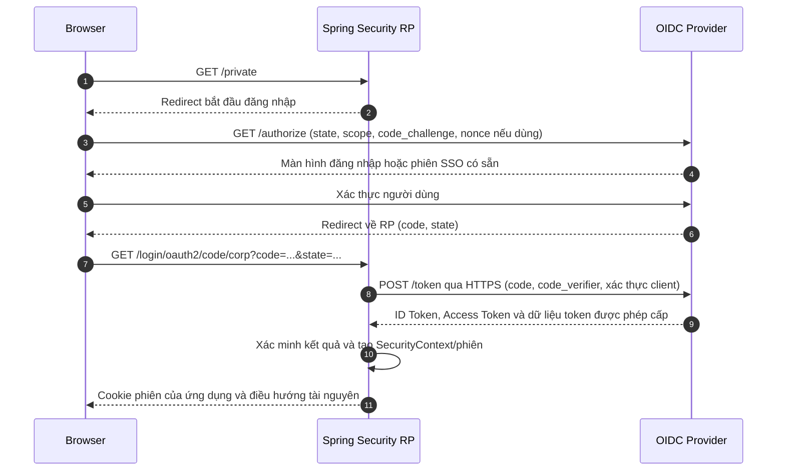
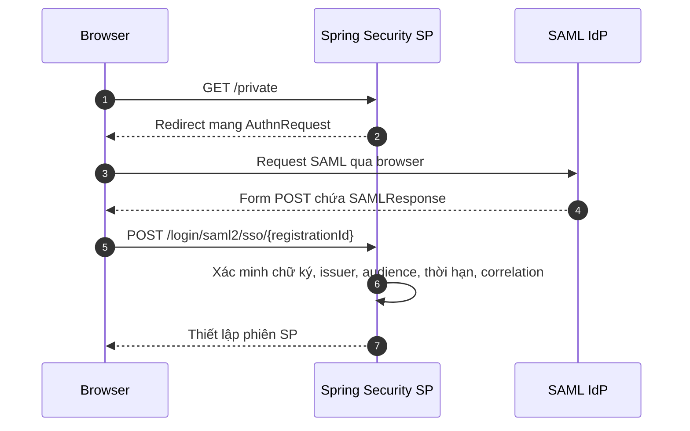

# Trao đổi qua trình duyệt và trao đổi trực tiếp giữa các máy chủ trong SSO

## 1. Bối cảnh và mục tiêu học tập

Trong Single Sign-On (SSO), người dùng đăng nhập tại một hệ thống định danh rồi truy cập ứng dụng khác dựa trên quan hệ tin cậy giữa hai bên. Để thực hiện điều này, giao thức federation thường kết hợp hai đường trao đổi:

- **Front-channel (qua trình duyệt):** thông điệp được chuyển thông qua user-agent của người dùng, thường bằng HTTP redirect hoặc HTML form POST. Trình duyệt chuyển thông điệp giữa các miền, nhưng không phải bên được tin cậy để xác nhận nội dung.
- **Back-channel (trực tiếp giữa các máy chủ):** backend của ứng dụng gọi endpoint của máy chủ định danh qua kết nối mạng riêng của tiến trình, thông thường là HTTPS; trình duyệt không vận chuyển thông điệp của bước này.

Bài học tập trung phân biệt hai kênh theo **đường đi của thông điệp**, giải thích vì sao OIDC/OAuth 2.0 và SAML 2.0 sử dụng chúng khác nhau, rồi liên hệ đến Spring Security. Sau bài này, người học cần đọc được sơ đồ đăng nhập SSO, chỉ ra nơi xử lý dữ liệu nhạy cảm và chẩn đoán lỗi xảy ra ở từng kênh.

## 2. Các vai trò trong một phiên SSO

- **User / Browser:** người dùng và trình duyệt. Browser gửi request, theo redirect, submit form và giữ cookie phiên của từng miền theo quy tắc của trình duyệt.
- **Ứng dụng tiêu thụ danh tính:** gọi là **Relying Party (RP)** trong OpenID Connect (OIDC), hoặc **Service Provider (SP)** trong SAML. Với Spring Security Servlet, đây thường là ứng dụng dùng `oauth2Login` hoặc `saml2Login`.
- **Máy chủ định danh:** gọi là **OpenID Provider (OP)** trong OIDC, hoặc **Identity Provider (IdP) / Asserting Party** trong SAML. Bên này xác thực người dùng và phát hành kết quả xác thực.
- **Authorization Server / Token Endpoint:** trong OIDC, OP cũng đóng vai trò Authorization Server cho quy trình cấp mã và token. Mọi tương tác với Authorization Endpoint và Token Endpoint đều có ngữ nghĩa khác nhau.

**SSO không đồng nghĩa mọi request đều đi qua IdP.** Sau khi xác thực thành công, ứng dụng có thể duy trì phiên đăng nhập bằng cookie riêng của mình; trình duyệt gửi cookie cho ứng dụng ở các request tiếp theo. Bên nhận kết quả federation phải tự xác minh kết quả trước khi tạo phiên.

## 3. So sánh front-channel và back-channel

| Tiêu chí | Front-channel: qua browser | Back-channel: server-to-server |
| --- | --- | --- |
| Ai chuyển thông điệp? | Trình duyệt theo redirect, URL hoặc form POST | Tiến trình backend giao tiếp trực tiếp với máy chủ khác |
| Dấu hiệu quan sát | Tab Network của browser thấy điều hướng và request đến các miền | Log/trace outbound HTTP của backend và log máy chủ đích |
| Nội dung thường gặp | OIDC authorization request, authorization code, `state`; SAML AuthnRequest/Response | OIDC token request/response, UserInfo, JWKS; SAML Artifact Resolution |
| Bảo mật dữ liệu | URL, body và lịch sử điều hướng có thể bị quan sát trong browser hoặc các tầng ghi log; tuyệt đối không coi browser là kênh bí mật | Token và thông tin xác thực client có thể được giữ ở backend; vẫn cần TLS, kiểm soát log và xác thực bên đối tác |
| Xác minh kết quả | Ứng dụng phải kiểm tra mã tương quan, chữ ký và các ràng buộc giao thức khi nhận | Ứng dụng phải kiểm tra danh tính máy chủ, phản hồi và điều kiện sử dụng dữ liệu |
| Hạn chế | Phụ thuộc điều hướng browser, cookie, chính sách redirect; có rủi ro rò rỉ tham số | Phụ thuộc kết nối backend, DNS, TLS, firewall, proxy, timeout và cấu hình endpoint |

Không nên nhầm **front-channel với HTTP không mã hóa** hoặc **back-channel với mạng nội bộ đáng tin**: cả hai thường dùng HTTPS qua Internet. “Back-channel” cũng không có nghĩa toàn bộ quá trình SSO không cần browser. Phân loại phải theo từng bước trao đổi, không theo tên gọi của toàn bộ ứng dụng.

Một SPA hoặc ứng dụng mobile là *public client* có thể gọi Token Endpoint trực tiếp từ môi trường của nó; khi đó **không phải trao đổi backend-to-backend của ứng dụng web truyền thống**. PKCE bảo vệ quy trình authorization code, nhưng không khiến mã chạy trong browser có khả năng giữ client secret.

## 4. Ví dụ điển hình: OIDC Authorization Code Flow

OIDC dựa trên OAuth 2.0 để cung cấp thông tin **xác thực danh tính** qua `ID Token` và các endpoint liên quan. Trong mô hình ứng dụng web có backend (confidential client), front-channel đưa người dùng đến OP rồi đưa **authorization code** về ứng dụng; back-channel đổi code lấy token.



**Diễn giải theo từng chặng:**

1. Browser truy cập một URL cần đăng nhập của RP. Spring Security tạo yêu cầu ủy quyền và dữ liệu tương quan cho lần đăng nhập này.
2. RP dẫn browser đến **Authorization Endpoint** của OP. Thông thường request có `client_id`, `redirect_uri`, `response_type=code`, `scope=openid`, `state` và, khi áp dụng PKCE, `code_challenge`/`code_challenge_method=S256`. OIDC có thể sử dụng `nonce` để ràng buộc ID Token với lần yêu cầu hiện tại.
3. OP xác thực người dùng, có thể tận dụng phiên SSO đã tồn tại trên miền IdP. Đây là phần phụ thuộc browser, cookie và chính sách đăng nhập của OP.
4. OP điều hướng browser đến `redirect_uri` đã đăng ký với **code ngắn hạn, sử dụng một lần** và `state`. Authorization code **không phải Access Token hay ID Token** và không được coi là bằng chứng đăng nhập hợp lệ nếu chưa được redeem, đối chiếu.
5. Backend RP đối chiếu `state` với yêu cầu ban đầu, rồi thực hiện **POST trực tiếp tới Token Endpoint**. Nếu bật PKCE, nó gửi `code_verifier` khớp với challenge; confidential client còn xác thực client theo phương thức đã đăng ký.
6. OP kiểm tra code, redirect URI, client và PKCE theo giao thức; trả kết quả token. RP xác minh ID Token (chữ ký, `iss`, `aud`, thời hạn, `nonce` nếu dùng và những ràng buộc liên quan), sau đó tạo principal và phiên ứng dụng.
7. Browser nhận cookie của **RP**, không cần nhìn thấy Access Token/Refresh Token trong mẫu backend này. Request về sau có thể chỉ dùng phiên RP; khi RP gọi API được bảo vệ bằng token, đó là luồng riêng.

**Vì sao thiết kế này có hai kênh?** Browser phù hợp với đăng nhập tương tác và chuyển hướng giữa các miền. Backend phù hợp với việc gửi client credential, redeem code, giữ token và xác minh thông tin trả về. Authorization Code + PKCE là hướng an toàn hiện đại; cơ chế Implicit trả Access Token trực tiếp qua authorization response không nên dùng cho thiết kế mới theo OAuth 2.0 Security BCP (RFC 9700).

### Vai trò riêng của `state`, `nonce` và PKCE

- **`state`:** kết nối callback với giao dịch đăng nhập do chính RP khởi tạo; giá trị phải khó đoán, gắn với phiên/giao dịch và được kiểm tra trước khi chấp nhận kết quả. Nó thường là biện pháp chống login CSRF.
- **`nonce` (OIDC):** khi được gửi, OP đưa nonce tương ứng vào ID Token và RP phải so khớp. Nó giúp phát hiện ID Token bị tái phát hoặc gắn vào sai giao dịch.
- **PKCE:** RP tạo `code_verifier` bí mật theo từng giao dịch và gửi `code_challenge` (thường dùng S256) lúc mở authorization request. Token Endpoint chỉ đổi code khi nhận verifier tương ứng. Public client bắt buộc dùng PKCE; confidential client cũng nên dùng. PKCE **không thay thế** việc kiểm tra ID Token, issuer, audience, TLS hay redirect URI.

Ba thành phần xử lý các rủi ro khác nhau; không nên gọi chung là “mã xác thực” hay bỏ qua việc ràng buộc chúng vào đúng giao dịch.

## 5. Ứng dụng Spring Security Servlet với OIDC

Trong ứng dụng **Spring Boot 3.x / Spring Security 6.x / Java 17+**, thêm các dependency sau vào dự án đã cấu hình Spring Boot và Java:

```groovy
dependencies {
    implementation 'org.springframework.boot:spring-boot-starter-web'
    implementation 'org.springframework.boot:spring-boot-starter-security'
    implementation 'org.springframework.boot:spring-boot-starter-oauth2-client'
}
```

Cấu hình `application.yml` sử dụng một OIDC Provider hỗ trợ discovery. Giá trị ở ba biến môi trường do nhà cung cấp định danh cấp, không lưu secret trong mã nguồn:

```yaml
spring:
  security:
    oauth2:
      client:
        registration:
          corp:
            provider: corp
            client-id: ${SSO_CLIENT_ID}
            client-secret: ${SSO_CLIENT_SECRET}
            authorization-grant-type: authorization_code
            scope:
              - openid
              - profile
        provider:
          corp:
            issuer-uri: ${SSO_ISSUER_URI}
```

Đoạn Java sau là **một lớp hoàn chỉnh** đặt tại `src/main/java/demo/federation/FederationApplication.java` trong dự án Spring Boot có những dependency trên. Nó tạo hai endpoint và chủ động bật PKCE cả với confidential client thông qua `OAuth2AuthorizationRequestCustomizers.withPkce()`:

```java
package demo.federation;

import java.util.Map;

import org.springframework.boot.SpringApplication;
import org.springframework.boot.autoconfigure.SpringBootApplication;
import org.springframework.context.annotation.Bean;
import org.springframework.security.config.annotation.web.builders.HttpSecurity;
import org.springframework.security.core.annotation.AuthenticationPrincipal;
import org.springframework.security.oauth2.client.registration.ClientRegistrationRepository;
import org.springframework.security.oauth2.client.web.DefaultOAuth2AuthorizationRequestResolver;
import org.springframework.security.oauth2.client.web.OAuth2AuthorizationRequestCustomizers;
import org.springframework.security.oauth2.core.oidc.user.OidcUser;
import org.springframework.security.web.SecurityFilterChain;
import org.springframework.web.bind.annotation.GetMapping;
import org.springframework.web.bind.annotation.RestController;

@SpringBootApplication
@RestController
public class FederationApplication {

    public static void main(String[] args) {
        SpringApplication.run(FederationApplication.class, args);
    }

    @GetMapping("/")
    public String home() {
        return "Public page";
    }

    @GetMapping("/private")
    public Map<String, String> privatePage(@AuthenticationPrincipal OidcUser user) {
        return Map.of(
                "subject", user.getSubject(),
                "issuer", user.getIdToken().getIssuer().toString()
        );
    }

    @Bean
    SecurityFilterChain securityFilterChain(
            HttpSecurity http,
            ClientRegistrationRepository registrations) throws Exception {

        var resolver = new DefaultOAuth2AuthorizationRequestResolver(
                registrations, "/oauth2/authorization");
        resolver.setAuthorizationRequestCustomizer(
                OAuth2AuthorizationRequestCustomizers.withPkce());

        return http
                .authorizeHttpRequests(auth -> auth
                        .requestMatchers("/").permitAll()
                        .anyRequest().authenticated())
                .oauth2Login(oauth2 -> oauth2
                        .authorizationEndpoint(endpoint -> endpoint
                                .authorizationRequestResolver(resolver)))
                .build();
    }
}
```

**Cách quan sát:** cấu hình ba biến môi trường và đăng ký redirect URI `http://localhost:8080/login/oauth2/code/corp` ở OP **chỉ cho môi trường phát triển cục bộ**. Chạy `./gradlew bootRun` trong dự án đã có Gradle wrapper; mở `http://localhost:8080/` để xem trang công khai, sau đó mở `http://localhost:8080/private` để bắt đầu đăng nhập. Sau callback thành công, `/private` trả JSON gồm `subject` và `issuer` lấy từ principal OIDC. Không có một stdout cố định: địa chỉ redirect, trang xác thực và kết quả phụ thuộc OP đang kết nối.

Trong Network tab, có thể thấy redirect từ RP sang OP và callback về `/login/oauth2/code/corp`. **POST /token được phát ra bởi JVM backend**, nên không xuất hiện như một request từ trang web trong Network tab của browser. Quan sát outbound request qua telemetry/log an toàn ở phía server; không bật logging nguyên body token, client secret, cookie hoặc authorization code.

Spring Security cung cấp `OAuth2LoginAuthenticationFilter` để xử lý callback và tích hợp `SecurityContext`. Thực tế có thể có thêm bước tải discovery/JWKS và UserInfo từ backend; việc tải khóa thường được cache nên không nhất thiết lặp lại trong mỗi lần đăng nhập. Cấu hình trên dành cho **OIDC RP với session**, không biến ứng dụng thành Authorization Server hay OAuth2 Resource Server.

**Lưu ý triển khai:** redirect URI của RP phải đúng với registration bên OP, nhất là khi triển khai sau reverse proxy / ingress HTTPS. Kiểm tra cách Spring Boot nhận forwarded headers từ proxy tin cậy; không chấp nhận tùy tiện header `X-Forwarded-*` do client bên ngoài giả mạo. Dùng cookie phiên `Secure`, `HttpOnly` và chính sách `SameSite` phù hợp với luồng thực tế; bật HTTPS trên môi trường triển khai.

## 6. SAML 2.0: phần lớn Web Browser SSO là front-channel

Trong mô hình **SAML 2.0 Web Browser SSO** phổ biến, SP gửi `AuthnRequest` qua browser (thường HTTP-Redirect binding), IdP xác thực người dùng rồi trả `SAMLResponse`/assertion bằng **HTTP-POST binding** đến Assertion Consumer Service (ACS) của SP. SAML không nhất thiết có bước “lấy token ở Token Endpoint” tương đương OIDC code flow.



Có điểm khác đáng chú ý:

- **SAMLResponse có thể chứa assertion chứa danh tính và thuộc tính người dùng**, dù được chuyển qua browser. Base64 hoặc HTML form **không phải mã hóa bảo mật**. Dùng chữ ký để xác minh tính xác thực/toàn vẹn, dùng mã hóa assertion khi yêu cầu bảo mật nội dung, và luôn dùng HTTPS.
- SP phải kiểm tra chữ ký tin cậy, `Issuer`, `Destination`/`Recipient`, `AudienceRestriction`, `NotBefore`/`NotOnOrAfter`, `InResponseTo` với luồng do SP khởi tạo, điều kiện `SubjectConfirmation` và chính sách chống replay theo ứng dụng. Một chữ ký hợp lệ **không đủ** nếu assertion được gửi sai SP hoặc đã hết hạn.
- Trong Spring Security, `saml2Login` và `RelyingPartyRegistration` cấu hình tích hợp SP; các endpoint thông dụng là `/saml2/authenticate/{registrationId}` để bắt đầu và `/login/saml2/sso/{registrationId}` để nhận SAMLResponse. Đây là cơ chế khác `oauth2Login`, không thể thay bằng gọi `/token`.

### Biến thể SAML Artifact: kết hợp cả hai kênh

Một số triển khai hỗ trợ **HTTP-Artifact binding**: IdP đưa một **artifact/reference** ngắn qua browser (front-channel); SP gửi artifact trực tiếp đến Artifact Resolution Service của IdP qua back-channel, thường bằng SOAP trên HTTPS, để lấy SAML message tương ứng. Cách này giảm payload assertion đi qua browser, nhưng đòi hỏi hai bên hỗ trợ binding, bảo vệ endpoint resolution và kiểm tra message như thông thường. **Không mặc định cho rằng cấu hình `saml2Login` thông thường đã bật artifact resolution**.

## 7. SSO logout, UserInfo và API: đừng lẫn kênh với tính năng

- **OIDC UserInfo/JWKS/Token Endpoint:** các lời gọi này thường thuộc back-channel của backend RP. JWKS là tập khóa công khai để xác minh chữ ký, không phải nơi gửi client secret hoặc token người dùng tùy tiện.
- **Front-channel logout:** có thể dựa vào redirect hoặc iframe của browser để thông báo phiên đăng xuất. Khả năng hoàn tất phụ thuộc chính sách cookie, third-party cookie và browser; không thể chỉ dựa vào việc một iframe được tải.
- **Back-channel logout (nếu OP/RP hỗ trợ):** OP gọi endpoint backend của RP với logout token có thể xác minh; RP phải kiểm tra token, nhận diện đúng phiên và chống replay theo đặc tả. Đây là luồng khác với POST /token trong login.
- **Client credentials (máy với máy):** một dịch vụ có thể lấy Access Token bằng `client_credentials` mà không có người dùng hoặc browser. Đây là ủy quyền máy với máy, **không phải SSO người dùng**. Resource Server nhận bearer token cũng không tự trở thành RP có `oauth2Login`.

## 8. Thiết kế an toàn theo từng kênh

### Với front-channel

1. **Chỉ chấp nhận redirect URI/ACS đã đăng ký hợp lệ.** Tránh open redirect, wildcard domain rộng, trộn môi trường phát triển với production và lỗi `http`/`https` do proxy.
2. **Gắn callback với lần khởi tạo thực sự.** Dùng `state` và/hoặc ràng buộc PKCE, nonce theo yêu cầu từng giao thức; với SAML, kiểm tra `InResponseTo`, response destination/recipient và replay.
3. **Không để secret hoặc token phiên sống lâu trong URL.** URL có thể đi vào browser history, proxy, analytics, log hoặc referer; dùng authorization code ngắn hạn một lần và chính sách `Referrer-Policy` phù hợp. Với SAML POST, body vẫn nhìn thấy được ở browser.
4. **Không tin dữ liệu chỉ vì request đi từ trình duyệt về callback của mình.** Mã, assertion, chữ ký, issuer/audience, thời gian và quyền phải được xác minh bởi RP/SP. Không dùng dữ liệu tùy ý từ URL làm quyền người dùng.
5. **Đánh giá cookie và CSRF thực tế.** Cookie OP và RP là hai miền khác nhau; cấu hình `SameSite`, `Secure`, `HttpOnly`, domain/path và chính sách CSRF phải phù hợp với POST callback hoặc điều hướng đang dùng. Không tắt CSRF toàn cục chỉ để SSO chạy.

### Với back-channel

1. **Xác thực endpoint đối tác** bằng cấu hình issuer/metadata tin cậy, TLS, kiểm tra chứng chỉ và chính sách DNS/network. Không chấp nhận URL token/JWKS động từ đầu vào không tin cậy vì có thể mở lỗ hổng SSRF.
2. **Bảo vệ client credentials và token** ở server-side secret store; không nhúng client secret vào JavaScript, HTML hoặc log. Dùng phương thức xác thực client được OP chấp thuận, chẳng hạn `client_secret_basic`, `private_key_jwt` hoặc mTLS tùy thiết kế.
3. **Áp dụng PKCE và xác thực token đúng ngữ cảnh.** Kiểm tra issuer, audience, hạn dùng, chữ ký, khóa hợp lệ; kiểm tra nonce nếu gửi. Access Token không đương nhiên là ID Token; token cho API A không được dùng thay bằng chứng đăng nhập cho ứng dụng B.
4. **Giới hạn kết nối và xử lý lỗi:** timeout, retry có kiểm soát, retry tránh làm lặp redeem code một lần, giám sát lỗi TLS/proxy/5xx, đồng bộ đồng hồ để kiểm tra token `exp`/`nbf`.
5. **Giới hạn dữ liệu quan sát:** trace nên ghi endpoint, correlation ID, loại lỗi, status và thời lượng; che mã xác thực, access/refresh/id token, cookie, authorization header và PII.

## 9. Chẩn đoán bằng vị trí lỗi

| Triệu chứng | Kênh nên kiểm tra trước | Hướng xác minh |
| --- | --- | --- |
| Không mở được trang đăng nhập IdP, redirect lặp | Front-channel | Authorization Endpoint, redirect URI, `state`, cookie trên các miền, HTTPS/proxy |
| Callback nhận code nhưng không tạo được phiên | Ranh giới front → back | `state`, code đã dùng/hết hạn, redirect URI; tiếp theo kiểm tra Token Endpoint |
| Browser callback có nhưng server báo timeout | Back-channel | DNS, firewall, proxy outbound, TLS, endpoint token, timeout |
| OP trả token nhưng đăng nhập bị từ chối | Xác minh backend | Chữ ký/JWKS, issuer, audience, hạn dùng, nonce và loại token |
| SAML POST đã tới ACS nhưng bị từ chối | Front-channel và validation tại SP | Binding, chữ ký, certificate, recipient/destination, audience, thời gian, InResponseTo |
| Browser chỉ thấy redirect, không thấy request lấy token | Bình thường với backend RP | Request token chạy ở JVM/backend; kiểm tra telemetry server đã che dữ liệu nhạy cảm |

**Tình huống áp dụng:** Người dùng báo “sau khi đăng nhập IdP, ứng dụng quay về nhưng báo lỗi”. Hãy xác định callback có tới RP không. Nếu chưa tới, kiểm tra đường browser và registration. Nếu callback tới với code hợp lệ nhưng backend không gọi được Token Endpoint, đó là lỗi kết nối back-channel. Nếu token đã về mà RP từ chối, tập trung vào xác minh token và tương quan phiên thay vì sửa redirect một cách mò mẫm.

## 10. Tự kiểm tra kiến thức

1. **Trong OIDC code flow của ứng dụng Spring Boot có backend, browser có cần nhận ID Token không?** Không. Browser thường chuyển authorization code; backend redeem code và xử lý ID Token.
2. **Vì sao SAMLResponse gửi bằng form POST vẫn cần xác minh chữ ký và audience?** Vì browser là phương tiện chuyển tiếp không được tin cậy; POST/Base64 không tự bảo đảm nguồn gốc, tính toàn vẹn hay đúng bên nhận.
3. **PKCE có thay cho kiểm tra `state`, `nonce`, issuer và audience không?** Không. PKCE chống lạm dụng/đánh cắp authorization code; các kiểm tra khác bảo vệ những ràng buộc riêng của giao dịch và token.
4. **Vì sao không thấy POST /token trong Developer Tools của browser?** Ở mô hình RP backend, lời gọi đó được gửi trực tiếp từ máy chủ ứng dụng đến OP.

## 11. Tài liệu chuẩn để đối chiếu

- [OpenID Connect Core 1.0 – Authorization Code Flow](https://openid.net/specs/openid-connect-core-1_0.html#CodeFlowAuth)
- [OAuth 2.0 Security Best Current Practice – RFC 9700](https://www.rfc-editor.org/rfc/rfc9700.html)
- [Spring Security – OAuth 2.0 Login, Servlet](https://docs.spring.io/spring-security/reference/servlet/oauth2/login/index.html)
- [Spring Security – OAuth2AuthorizationRequestCustomizers.withPkce()](https://docs.spring.io/spring-security/reference/api/java/org/springframework/security/oauth2/client/web/OAuth2AuthorizationRequestCustomizers.html)
- [Spring Security – SAML 2.0 Login Overview](https://docs.spring.io/spring-security/reference/servlet/saml2/login/overview.html)
