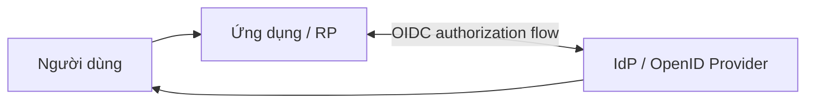
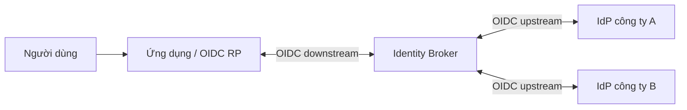
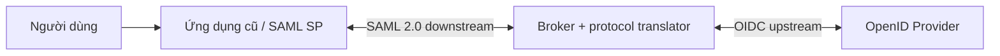
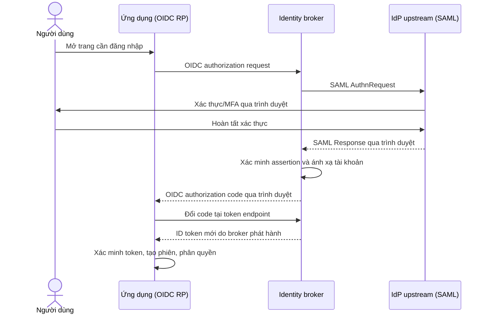

# Phân biệt liên kết danh tính, môi giới danh tính và chuyển đổi giao thức

## Mục tiêu học tập

Sau bài học, bạn có thể:

1. Giải thích chính xác **identity federation (liên kết danh tính)**, **identity brokering (môi giới danh tính)** và **protocol translation (chuyển đổi giao thức)** trong bối cảnh Single Sign-On (SSO).
2. Nhận diện mô hình đăng nhập trực tiếp giữa ứng dụng và nhà cung cấp danh tính (IdP), mô hình qua broker và mô hình sử dụng hai giao thức ở hai phía.
3. Xác định vai trò IdP, Relying Party (RP), Service Provider (SP), broker và các ranh giới xác thực, phiên, trust, token/claim.
4. Giải thích vì sao broker phải **xác minh bằng chứng đầu vào rồi phát hành bằng chứng đầu ra mới**, vì sao không thể chỉ đổi định dạng JWT/XML, và cách bảo vệ ánh xạ tài khoản.
5. Chọn kiến trúc thích hợp khi tích hợp ứng dụng Spring Security với nhiều IdP hoặc với hệ thống SAML/OIDC khác nhau.

## 1. Bối cảnh: SSO giải quyết vấn đề gì?

**Single Sign-On (SSO)** cho phép người dùng sử dụng một lần xác thực hoặc phiên xác thực đang có ở hệ thống đăng nhập để truy cập nhiều ứng dụng đã được thiết lập tin cậy, theo chính sách từng ứng dụng. Ví dụ, nhân viên đăng nhập cổng doanh nghiệp rồi mở hệ thống báo cáo mà không phải nhập mật khẩu lại.

SSO là **trải nghiệm/kết quả mong muốn**; federation, brokering và protocol translation là **những khái niệm kiến trúc khác nhau** có thể phối hợp để tạo trải nghiệm đó.

Một luồng đăng nhập có thể có:

- **Người dùng (End-User):** chủ thể yêu cầu đăng nhập.
- **Identity Provider (IdP):** hệ thống xác thực người dùng và phát hành bằng chứng về lần xác thực/danh tính.
- **Relying Party (RP):** ứng dụng tin cậy OpenID Provider qua **OpenID Connect (OIDC)**.
- **Service Provider (SP):** ứng dụng nhận và xác minh assertion của **SAML 2.0 IdP**.
- **Trình duyệt:** chuyển hướng và truyền một số phản hồi đăng nhập; không phải bên xác minh danh tính.
- **Broker (nếu có):** hệ thống trung gian đứng giữa nhiều upstream IdP và các ứng dụng downstream.

Cần phân biệt **authentication** (người này là ai, đã xác thực ra sao) với **authorization** (người này được phép làm gì trong ứng dụng/API). Đăng nhập SSO thành công không tự cấp quyền quản trị hay quyền truy cập mọi dữ liệu.

## 2. Ba khái niệm: bản chất, vai trò và sự khác biệt

| Khái niệm | Câu hỏi nó trả lời | Bản chất | Có bắt buộc trung gian không? | Có bắt buộc đổi giao thức không? |
| --- | --- | --- | --- | --- |
| **Liên kết danh tính (identity federation)** | “Ứng dụng A có thể tin danh tính do miền/hệ thống B xác thực như thế nào?” | Quan hệ tin cậy và quy trình chia sẻ bằng chứng xác thực giữa các miền quản lý danh tính | **Không.** RP/SP có thể làm việc trực tiếp với IdP | **Không.** Hai bên có thể cùng dùng OIDC hoặc cùng dùng SAML |
| **Môi giới danh tính (identity brokering)** | “Làm sao một lớp trung gian kết nối nhiều IdP với một hay nhiều ứng dụng?” | **Kiến trúc/thành phần** trung gian xác thực với upstream và cung cấp danh tính cho downstream | **Có, theo định nghĩa broker** | **Không.** Broker có thể dùng OIDC ở cả hai phía |
| **Chuyển đổi giao thức (protocol translation)** | “Làm sao kết nối hai hệ thống có giao thức/kiểu bằng chứng không tương thích?” | **Chức năng chuyển tiếp ngữ nghĩa giữa các giao thức**, có xác minh và phát hành mới | Thường được thực hiện ở broker/gateway/adapter | **Có**, vì mục đích là nối hai giao thức khác nhau |

**Quan hệ giữa chúng:** một giải pháp có thể đồng thời là *federation + broker + translation*. Tuy nhiên không phải mọi federation đều cần broker; không phải mọi broker đều đổi giao thức; và việc đổi giao thức chỉ an toàn khi có cơ chế xác thực, tin cậy, ánh xạ và phát hành phù hợp.

### 2.1. Identity federation: hai miền tin cậy nhau

Ví dụ, cổng nhân sự của công ty X tin IdP của đối tác Y. Người dùng xác thực tại Y; cổng X chỉ tin kết quả sau khi xác minh phản hồi OIDC/SAML đúng issuer, đối tượng nhận, chữ ký và các điều kiện của giao thức.

- **Upstream IdP:** bên phát hành kết quả xác thực.
- **Downstream RP/SP:** bên tiếp nhận và kiểm tra kết quả.
- **Trust:** đăng ký client hoặc trao đổi metadata/chứng thư/khóa, endpoint, audience, redirect URI/ACS và chính sách xác thực.
- **Kết quả:** ứng dụng nhận biết một danh tính từ miền ngoài và quyết định tạo phiên cục bộ.

Federation **không có nghĩa** mọi hệ thống dùng chung cơ sở dữ liệu người dùng, mật khẩu hay cookie phiên. RP có thể tạo tài khoản cục bộ tương ứng với tài khoản được liên kết, hoặc thực hiện just-in-time provisioning theo chính sách riêng.

### 2.2. Identity brokering: một hệ thống đứng ở giữa

Một **identity broker** tự đóng hai vai trò trên hai quan hệ khác nhau:

- **Đối với IdP upstream:** broker hành xử như **RP** (nếu upstream là OIDC) hoặc **SP** (nếu upstream là SAML).
- **Đối với ứng dụng downstream:** broker hành xử như **OIDC Provider/IdP** hoặc **SAML IdP**, tùy giao thức mà ứng dụng dùng.

Broker thường cung cấp một địa chỉ đăng nhập thống nhất, chọn IdP theo tổ chức/tenant/tên miền hoặc lựa chọn của người dùng, ánh xạ tài khoản, áp dụng chính sách đăng nhập và cung cấp bộ định danh/claim ổn định cho ứng dụng.

**Broker cũng phải được tin cậy**: một ứng dụng nhận ID token **do broker phát hành** sẽ kiểm tra issuer của broker. Ứng dụng đó không mặc nhiên tin token do mọi IdP upstream phát hành trực tiếp.

Ví dụ: 12 ứng dụng nội bộ chỉ cấu hình tin một broker, trong khi broker kết nối với ba IdP của các công ty thành viên. Khi thay IdP của một thành viên, nhiều thay đổi có thể được cô lập tại broker. Đổi lại, broker trở thành hạ tầng đăng nhập quan trọng phải bảo vệ, giám sát và thiết kế tính sẵn sàng cao.

### 2.3. Protocol translation: hai phía dùng chuẩn khác nhau

Ví dụ một hệ thống cũ chỉ hỗ trợ **SAML 2.0**, còn IdP mới chỉ hỗ trợ **OIDC**. Bộ chuyển đổi nhận kết quả đăng nhập OIDC trong quan hệ upstream, xác minh nó, ánh xạ danh tính/ngữ nghĩa và **phát hành một SAML assertion mới** cho SP cũ trong quan hệ downstream.

Chuyển đổi là công việc **ở lớp bảo mật và ngữ nghĩa**, không phải thao tác cơ học “đổi JWT thành XML”:

- Bằng chứng đầu vào và đầu ra có issuer, audience/recipient, chữ ký, hiệu lực và điều kiện sử dụng khác nhau.
- Thuộc tính như `sub`, `NameID`, email, nhóm hoặc ngữ cảnh MFA có thể có mô hình ngữ nghĩa khác nhau.
- Bộ chuyển đổi phải thiết lập hai quan hệ tin cậy độc lập, quản lý trạng thái giao dịch và ngăn replay/session confusion.
- Các chuẩn không có ánh xạ tương đương tuyệt đối cho mọi tính năng; chỉ chuyển những gì kiểm chứng và cam kết được.

## 3. Ba sơ đồ SSO đối chiếu

### Mô hình A – Federation trực tiếp, không broker



1. Người dùng mở ứng dụng.
2. Ứng dụng gửi yêu cầu đăng nhập tới IdP đã đăng ký.
3. IdP xác thực người dùng; ứng dụng nhận và kiểm tra kết quả.
4. Ứng dụng tạo phiên riêng và kiểm tra quyền khi truy cập tài nguyên.

Quan hệ tin cậy: **ứng dụng ↔ IdP**. Hai bên trực tiếp hiểu cùng một giao thức. Không có thành phần đứng giữa phát hành danh tính mới.

### Mô hình B – Federation qua broker, không đổi giao thức



1. Ứng dụng khởi tạo OIDC login với broker.
2. Broker chọn IdP A hoặc B và khởi tạo **một OIDC login upstream khác**.
3. Broker kiểm tra ID token/đáp ứng upstream, liên kết danh tính theo chính sách.
4. Broker hoạt động như OpenID Provider ở downstream và phát hành **ID token mới** cho ứng dụng.
5. Ứng dụng xác minh token do **broker** ký, tạo phiên và áp dụng quyền.

**OIDC → OIDC vẫn là brokering.** Có hai phiên/quan hệ xác thực ở những phạm vi khác nhau, chứ không đơn giản là relay nguyên ID token upstream đến ứng dụng.

### Mô hình C – Broker đồng thời chuyển đổi giao thức



1. Ứng dụng cũ phát sinh SAML `AuthnRequest` tới broker (broker đóng vai **SAML IdP**).
2. Broker tạo OIDC authorization request tới upstream OP (broker đóng vai **OIDC RP**).
3. Người dùng xác thực tại upstream; broker nhận authorization code, đổi code và **xác minh ID token**.
4. Broker liên kết danh tính OIDC với định danh nội bộ; áp dụng chính sách/điều kiện cần thiết.
5. Broker tạo **SAML assertion mới** với `Issuer` là broker, `AudienceRestriction` và `Recipient` đúng cho SP cũ; ký bằng khóa thích hợp.
6. SP kiểm tra SAML Response/assertion rồi tạo phiên đăng nhập cục bộ.

Chiều ngược lại **SAML upstream → OIDC downstream** cũng khả thi: broker làm **SAML SP** với IdP cũ và **OIDC Provider** với ứng dụng mới. Không có yêu cầu bắt buộc mọi hệ thống phải di chuyển sang một giao thức trong cùng thời điểm.

**Lưu ý thuật ngữ:** “OIDC federation” đôi khi chỉ cấu hình các RP tin một OP; “identity broker” chỉ vai trò trung gian; “protocol bridge/adapter” thường nhấn mạnh chức năng nối chuẩn. Tên thương mại khác nhau, nên phải nhìn **vai trò và giao thức từng kết nối** thay vì chỉ dựa trên tên sản phẩm.

## 4. Đi sâu vào luồng có broker: mỗi phía là một giao dịch riêng

Lấy mô hình **OIDC RP → OIDC Broker → SAML IdP**. Trình tự có thể được biểu diễn như sau:



Trong thực tế, các thông điệp đi qua trình duyệt ở bước SAML/redirect; hình trên rút gọn đường đi để nhấn mạnh **vai trò bên nào phát hành/kiểm tra**.

Có ba danh tính hoặc định danh cần phân biệt:

1. **Upstream subject:** tài khoản được IdP SAML xác nhận, chẳng hạn NameID bền vững hoặc thuộc tính bất biến đã thỏa thuận.
2. **Broker subject:** hồ sơ cục bộ của broker gắn với một hoặc nhiều upstream identities bằng quy tắc liên kết tài khoản an toàn.
3. **Downstream subject:** `sub` mà broker phát hành cho ứng dụng OIDC, có thể là định danh công khai hoặc pairwise theo từng RP.

Ba định danh này **không bắt buộc giống nhau**. Điều bắt buộc là broker có phép ánh xạ đáng tin và ổn định, không tạo trùng danh tính khi hai IdP cùng cấp tên/email giống nhau.

### 4.1. Ví dụ ánh xạ định danh

| Phía | Trường | Giá trị minh họa | Ý nghĩa |
| --- | --- | --- | --- |
| IdP A (OIDC) | `iss` | `https://idp-a.example.org` | Miền phát hành upstream |
| IdP A (OIDC) | `sub` | `u-2048` | Định danh người dùng **trong miền issuer A** |
| Broker | Internal user ID | `account-761` | Hồ sơ được liên kết tại broker |
| Broker (OIDC) | `iss` | `https://login.example.org` | Issuer mà RP downstream tin cậy |
| Broker (OIDC) | `sub` | `person-761` | Định danh downstream do broker cấp |
| Broker (OIDC) | `aud` | `portal-web` | Client/RP được phép nhận ID token này |

RP downstream kiểm tra token có `iss=https://login.example.org` và `aud` chứa `portal-web`, không chấp nhận token upstream phát hành cho broker chỉ vì token đó có chữ ký hợp lệ.

**Khóa liên kết upstream** thường phải bao gồm issuer + subject (OIDC: `(iss, sub)`). Trong SAML cần xác định rõ issuer + NameID/thuộc tính định danh bền vững và qualifier/format theo cấu hình của IdP. Email không bảo đảm duy nhất hoặc bất biến qua các miền; có thể được tái sử dụng hoặc chưa xác minh. **Không tự nối hai tài khoản nhạy cảm chỉ vì trùng email.**

### 4.2. Broker kiểm tra gì trước khi phát hành bằng chứng mới?

**Upstream OIDC:** kiểm tra authorization response theo giao thức, `state`, PKCE khi áp dụng, xác thực client/đổi code, chữ ký và thuật toán được cho phép, `iss`, `aud`, thời gian hiệu lực, `nonce` khi được dùng; áp dụng các kiểm tra bổ sung theo flow. Chỉ dùng issuer, endpoint và khóa do cấu hình tin cậy cung cấp.

**Upstream SAML:** kiểm tra chữ ký phù hợp trên response/assertion, issuer, destination, audience, ACS/recipient, thời điểm hiệu lực, `InResponseTo` khi là SP-initiated, độ mới và replay, điều kiện SubjectConfirmation, metadata/chứng thư tin cậy. Không chấp nhận XML chỉ vì nó có tên người dùng hay namespace hợp lệ.

**Phía phát hành downstream:** broker tạo bằng chứng **mới và giới hạn đối tượng nhận**, đặt thời hạn, issuer, subject, audience/recipient, ký đúng khóa và xử lý đối chiếu trạng thái giao dịch. Downstream RP/SP phải xác minh bằng chứng này độc lập.

Không sao chép `aud` của upstream sang downstream; upstream ID token vốn được phát hành **cho broker**. Cũng không đổi thuộc tính vai trò/MFA thành claim quyền cao hơn nếu không có cơ sở.

## 5. Chuyển đổi ngữ nghĩa: cái gì có thể và không thể chuyển?

Một protocol translator phải có bảng ánh xạ và quy tắc đáng tin, vì SAML và OIDC có cấu trúc khác nhau.

| Nội dung | OIDC | SAML 2.0 | Yêu cầu khi chuyển đổi |
| --- | --- | --- | --- |
| Định danh IdP | `iss` | `Issuer` | Xác minh nguồn upstream; phát hành issuer **mới** là broker cho downstream |
| Định danh người dùng | `sub` | `NameID` hoặc thuộc tính ổn định | Ánh xạ bằng khóa namespace ổn định; không giả định hai chuỗi tương đương |
| Ứng dụng nhận | `aud` chứa client ID | `AudienceRestriction`/`Recipient` cho SP | Đặt mới theo đăng ký **downstream**, không copy audience upstream |
| Chứng thực/độ toàn vẹn | Chữ ký ID token/JWS hoặc cách xác thực theo flow | XML Signature trên response/assertion theo profile | Xác minh bằng khóa upstream; phát hành và ký lại bằng khóa broker |
| Thời hạn | `iat`, `exp`, điều kiện khác | `Conditions`, `NotBefore`, `NotOnOrAfter` | Không kéo dài mức bảo đảm/quá hạn; kiểm tra lệch đồng hồ hợp lý |
| Thời điểm và cách xác thực | `auth_time`, `acr`, `amr` (nếu có) | `AuthnInstant`, `AuthnContextClassRef` | Chỉ ánh xạ các giá trị có ngữ nghĩa được thỏa thuận; không tự suy ra MFA |
| Thuộc tính | OIDC claims như `email`, `name`, `groups` (nếu được cung cấp) | SAML Attributes | Ánh xạ theo schema/nguồn tin cậy; tối thiểu hóa dữ liệu và kiểm soát quyền |
| Trạng thái giao dịch | `state`, `nonce`, authorization code, PKCE | `RelayState`, `AuthnRequest`/`InResponseTo` | Duy trì tương quan **riêng từng hop**, chống CSRF, replay, mix-up |
| Đăng xuất | OIDC logout mechanisms tùy cấu hình/hỗ trợ | SAML Single Logout tùy triển khai | Cần thiết kế liên thông chủ động; không có đảm bảo tự động 1:1 |

Có những đặc tính không chuyển được trọn vẹn: ví dụ một upstream chỉ cho biết người dùng đã xác thực nhưng không đưa ra bằng chứng đủ mạnh về MFA, thì broker **không được khẳng định downstream đã đạt mức MFA cao**. Chính sách có thể yêu cầu xác thực lại, step-up hoặc từ chối truy cập nếu điều kiện downstream không được đáp ứng.

**Token exchange khác protocol translation:** OAuth 2.0 Token Exchange (RFC 8693) định nghĩa cách trao đổi một security token lấy token khác tại authorization server theo điều kiện được hỗ trợ. Điều đó không tự cung cấp cây cầu OIDC ↔ SAML, không tự tạo phiên browser SSO hoặc tự giải quyết việc ánh xạ danh tính. Cần thiết kế riêng phù hợp use case.

## 6. Ví dụ kiến trúc thực tế

### Tình huống 1 – Hai ứng dụng và một IdP, cùng OIDC

`https://portal.example.org` và `https://reports.example.org` đều cấu hình OIDC trực tiếp với `https://login.example.org`. Không cần broker riêng. SSO đến từ phiên tại cùng IdP; mỗi ứng dụng tạo session và kiểm tra quyền của mình.

**Phân loại:** federation trực tiếp + SSO; **không có broker; không có protocol translation.**

### Tình huống 2 – Một ứng dụng phục vụ nhiều khách hàng doanh nghiệp

Ứng dụng SaaS cần đăng nhập cho khách hàng A qua OIDC, khách hàng B qua SAML và khách hàng C qua một hệ thống OIDC khác. Thay vì ứng dụng tự cấu hình và duy trì từng IdP, ứng dụng chỉ tin OIDC broker.

Broker lựa chọn upstream IdP theo tenant, xác minh kết quả, liên kết account và phát hành token OIDC có issuer của broker. Phải giới hạn lựa chọn IdP/tenant đã đăng ký; không để người dùng nhập issuer tùy ý làm hệ thống tự tin nhận endpoint lạ.

**Phân loại:** federation + identity brokering; có protocol translation **cho kết nối SAML → OIDC**; các kết nối OIDC → OIDC chỉ là brokering.

### Tình huống 3 – Giữ SP SAML cũ, hiện đại hóa IdP sang OIDC

Ứng dụng ERP cũ yêu cầu SAML 2.0 SP. Công ty chuyển sang IdP mới hỗ trợ OIDC. Broker trở thành SAML IdP của ERP và OIDC RP của IdP mới; ứng dụng không cần hiểu OIDC.

**Phân loại:** federation + brokering + translation OIDC → SAML. Cần thiết lập chứng thư, entity ID, ACS, NameID, AuthnContext và chính sách SLO rõ ràng.

### Tình huống 4 – Một ứng dụng có hai nút đăng nhập mạng xã hội

Spring Security RP trực tiếp cấu hình hai `ClientRegistration` cho hai OIDC providers và để người dùng chọn đăng nhập. Ứng dụng tự xử lý hai luồng đăng nhập và tự ánh xạ user. **Chỉ việc có nhiều lựa chọn IdP không biến ứng dụng thành broker downstream**, vì ứng dụng không cung cấp OIDC/SAML login service cho các ứng dụng khác.

**Phân loại:** nhiều quan hệ federation trực tiếp; chưa có broker chuyên biệt hoặc protocol translation.

## 7. Ranh giới bảo mật: hai kết nối, hai niềm tin

Với broker, hãy tách hai vế:

| Ranh giới | Ai kiểm tra? | Ai phát hành bằng chứng? | Điều phải cấu hình |
| --- | --- | --- | --- |
| **Upstream: IdP → Broker** | Broker, dưới vai trò RP/SP | IdP upstream | Issuer/Entity ID, client registration hoặc metadata/chứng thư, callback/ACS, thuật toán/khóa, claim/định danh, chính sách MFA |
| **Downstream: Broker → Ứng dụng** | Ứng dụng, dưới vai trò RP/SP | Broker, dưới vai trò IdP/OP | Issuer/Entity ID của broker, client/ACS, audience, token/assertion signature, endpoint, session và quyền |
| **Ứng dụng → API** (nếu có) | Resource Server/API | Authorization Server được tin theo mô hình API | Access token đúng audience/scope, issuer, signature hoặc introspection, phân quyền theo tài nguyên |

Ba mối quan hệ có thể dùng ba token khác nhau. **ID token** xác thực End-User với OIDC RP; **access token** dành cho Resource Server/API; **SAML assertion** được phát cho SP theo profile SAML. Không lấy ID token upstream gắn thẳng vào header `Authorization: Bearer` của API downstream nếu API không được thiết kế và cấu hình để chấp nhận loại token đó; thường API phải nhận access token đúng audience và quyền.

**Phân quyền không tự đi xuyên các lớp:** broker có thể ánh xạ `groups` vào downstream claims, nhưng ứng dụng phải kiểm tra ý nghĩa và giới hạn quyền tại chính tài nguyên của mình. Nguồn upstream không tự quyết định ai được làm admin cho tất cả RP.

### 7.1. Các loại phiên cần tính riêng

- **Phiên IdP upstream:** có thể cho phép SSO khi người dùng quay lại IdP mà không cần nhập mật khẩu.
- **Phiên tại broker:** cho phép broker nhớ giao dịch và danh tính liên kết, với thời hạn/chính sách riêng.
- **Phiên ứng dụng downstream:** do từng RP/SP quản lý; có cookie, timeout và cơ chế thu hồi riêng.

Đăng xuất ứng dụng không tự bảo đảm người dùng đã đăng xuất broker, upstream IdP hay ứng dụng khác. OIDC logout và SAML Single Logout phụ thuộc thiết lập/hỗ trợ từng phía, có thể thất bại từng phần. Nếu cần hiệu lực đăng xuất toàn hệ thống, phải thiết kế và kiểm thử rõ ràng từng đường truyền, không suy luận từ việc đã xóa một cookie.

### 7.2. Vòng đời tài khoản và thông tin cá nhân

Federation không đồng nghĩa **provisioning**. Tạo, vô hiệu hóa và đồng bộ tài khoản có thể cần quy trình riêng (chẳng hạn SCIM hoặc đồng bộ theo chính sách). Khi nhân viên bị khóa ở upstream, ứng dụng đã có phiên downstream cần chiến lược hết hạn/thu hồi/đánh giá lại quyền phù hợp.

Các rule an toàn cho broker:

1. Lưu liên kết danh tính dựa trên khóa upstream ổn định theo issuer; hỗ trợ nhiều danh tính upstream liên kết một user chỉ qua quy trình có kiểm soát.
2. Cô lập tenant; không cho claim của tenant A được ánh xạ thành quyền của tenant B.
3. Chỉ truyền claims cần thiết, tuân thủ chính sách dữ liệu và thời gian lưu trữ.
4. Ghi audit các sự kiện đăng nhập, thay đổi liên kết, nguồn upstream được chọn, lỗi xác thực, thay đổi khóa và quyền quan trọng; không log token/secret thô.
5. Quản lý vòng đời secret/chứng thư/khóa ký, rollover JWKS và metadata cache an toàn.
6. Kiểm thử dự phòng: broker không sẵn sàng sẽ ảnh hưởng nhiều ứng dụng; cần HA, monitoring và kế hoạch sự cố.

## 8. Spring Security nằm ở vị trí nào?

**Spring Security** cung cấp các tính năng để ứng dụng Java làm **OIDC/OAuth Client**, **SAML 2.0 SP/RP** hoặc **OAuth 2.0 Resource Server**. Chúng không mặc nhiên biến mọi ứng dụng có trang đăng nhập thành identity broker cung cấp giao thức cho ứng dụng khác.

| Nhu cầu | Vai trò của ứng dụng Spring | Thành phần thường gặp |
| --- | --- | --- |
| Ứng dụng web đăng nhập với **OIDC broker** | Downstream OIDC RP | `oauth2Login()`, `ClientRegistration`/`OidcUser` |
| Ứng dụng web đăng nhập với **SAML broker** | Downstream SAML SP/RP | `saml2Login()`, `RelyingPartyRegistration` |
| REST API nhận access token đúng audience | Resource Server | `oauth2ResourceServer(...)`, JWT decoder hoặc introspection thích hợp |
| Xây một hệ thống làm OP/authorization server | Phía **phát hành** token cho client khác | Authorization Server có hỗ trợ OIDC được cấu hình phù hợp |
| Xây **broker chuyển OIDC ↔ SAML** | Vừa là upstream RP/SP vừa là downstream IdP/OP | Cần **nền tảng broker/gateway** hoặc tự triển khai đầy đủ các vai trò, state, phát hành, metadata và chính sách; chỉ `oauth2Login()`/`saml2Login()` là chưa đủ |

### 8.1. Ví dụ: ứng dụng Spring Boot đăng nhập qua broker OIDC

Giả sử broker là một OpenID Provider đã được cấu hình, và phía ứng dụng chỉ cần làm RP. Đây là ví dụ **một phần của dự án Spring Boot servlet**, dùng Java 17+ và các dependency `spring-boot-starter-security` cùng `spring-boot-starter-oauth2-client`; bản thân đoạn code không phải chương trình độc lập chạy bằng `javac`.

**Tệp `WebSecurityConfig.java`:**

```java
import org.springframework.context.annotation.Bean;
import org.springframework.context.annotation.Configuration;
import org.springframework.security.config.Customizer;
import org.springframework.security.config.annotation.web.builders.HttpSecurity;
import org.springframework.security.web.SecurityFilterChain;

@Configuration
public class WebSecurityConfig {
    @Bean
    SecurityFilterChain securityFilterChain(HttpSecurity http) throws Exception {
        return http
            .authorizeHttpRequests(auth -> auth
                .requestMatchers("/").permitAll()
                .anyRequest().authenticated()
            )
            .oauth2Login(Customizer.withDefaults())
            .build();
    }
}
```

**Tệp `application.yml` (các địa chỉ và client ID minh họa, thay bằng đăng ký thực tế):**

```yaml
spring:
  security:
    oauth2:
      client:
        registration:
          company-broker:
            provider: company-broker
            client-id: portal-web
            client-secret: ${OIDC_CLIENT_SECRET}
            scope: [openid, profile, email]
        provider:
          company-broker:
            issuer-uri: https://login.example.org/realms/workforce
```

Cách đọc ví dụ:

- `registrationId` là `company-broker`; ứng dụng tin **issuer của broker** tại `issuer-uri`, không cấu hình tin trực tiếp mọi upstream IdP.
- IdP/broker phải thực sự phục vụ OIDC discovery cho issuer đó; client `portal-web` và redirect URI phải được đăng ký đúng ở broker.
- Spring Security mặc định dùng callback dạng `{baseUrl}/login/oauth2/code/{registrationId}`; trong triển khai thực phải đăng ký callback chính xác, dùng HTTPS và cấu hình proxy/base URL phù hợp.
- Client secret lấy từ biến môi trường/secret manager; không đưa giá trị thực vào repository.
- Thư viện thực hiện luồng OIDC, xác minh token theo cấu hình và tạo `Authentication`. Ứng dụng vẫn cần phân quyền nghiệp vụ và quản lý tài khoản/phiên.
- Đây là cấu hình **ứng dụng downstream**; broker đã hoạt động ở một hệ thống khác. Cấu hình này không cho phép ứng dụng phát hành SAML assertion hay ID token mới cho RP thứ hai.

Nếu downstream chỉ hỗ trợ SAML, phía ứng dụng Spring dùng `saml2Login()` và cấu hình `RelyingPartyRegistration` cùng metadata/chứng thư của broker ở vai trò SAML IdP. Không thể chỉ đổi tên method rồi dùng nguyên `issuer-uri` OIDC.

### 8.2. Ví dụ kiểm tra thiết kế trong team

Giả sử một đội đề xuất: “Dùng `oauth2Login()` nhận OIDC từ IdP, rồi trả nguyên ID token đó cho ứng dụng SAML cũ; coi như đã chuyển đổi giao thức”.

Đề xuất **không hợp lệ** vì:

- Ứng dụng SAML cần **SAML Response/assertion**, không chấp nhận ID token OIDC.
- ID token upstream có `aud` là client nhận token (broker), không phải SP SAML.
- Đăng nhập upstream thành công chưa tự tạo một subject bền vững, claim mapping, SAML conditions, signature, session/correlation và chính sách được SP tin.
- Cần thành phần đóng vai SAML IdP thật ở downstream, phát hành response/assertion mới sau khi đã xác minh và ánh xạ upstream.

Giải pháp đúng là sử dụng broker có hỗ trợ hai giao thức và cấu hình đầy đủ hai quan hệ tin cậy; hoặc thiết kế thành phần tương đương có kiểm định bảo mật thích hợp.

## 9. Checklist lựa chọn kiến trúc

| Dấu hiệu yêu cầu | Hướng phù hợp | Điểm cần xác minh |
| --- | --- | --- |
| Một hoặc vài ứng dụng cùng hỗ trợ OIDC với một IdP | **Federation trực tiếp** | Client registration, issuer, redirect, khóa, account mapping |
| Nhiều tenant/IdP, ứng dụng muốn một đầu mối danh tính | **Broker** | Home realm discovery/routing, cô lập tenant, linked identities, HA, audit |
| Ứng dụng SAML cũ phải dùng IdP chỉ hỗ trợ OIDC | **Broker + OIDC → SAML translation** | SAML IdP downstream, claim/NameID mapping, metadata, chữ ký, ACS |
| Ứng dụng OIDC mới phải dùng IdP chỉ hỗ trợ SAML | **Broker + SAML → OIDC translation** | SAML SP upstream, issuer/client OIDC downstream, subject mapping |
| Chỉ cần REST API xác minh quyền với JWT access token | **Resource Server** | Issuer, audience, scope/authority, không suy luận login SSO từ access token |
| Muốn đồng bộ tạo/xóa tài khoản, nhóm và vòng đời người dùng | **Provisioning/identity lifecycle bổ sung** | SCIM/sync, quy trình deprovisioning, phiên còn hiệu lực |

### Checklist trước khi đưa broker vào production

- **Trust:** mỗi upstream/downstream có issuer, client ID/entity ID, audience, endpoint, khóa/chứng thư xác thực riêng.
- **Routing:** mỗi request gắn đúng tenant và upstream tin cậy; chống mix-up, redirect open redirect và IdP giả.
- **Binding:** phản hồi được liên hệ đúng yêu cầu ban đầu qua `state`/`nonce`/PKCE hoặc `InResponseTo`/`RelayState` theo giao thức.
- **Identity:** quy tắc linked accounts ổn định, không ghép mù theo email, có chính sách cho tài khoản đổi tên/bị khóa.
- **Claims:** các nhóm, role, `acr`/`amr`/AuthnContext chỉ ánh xạ khi bảo đảm được ngữ nghĩa, không nâng quyền.
- **Session/logout:** xác định rõ session ở upstream, broker và RP, cùng hành vi khi timeout, logout, token bị thu hồi.
- **Operations:** sẵn sàng cao, giám sát, hạn chế thông tin nhạy cảm trong log, xoay khóa và kiểm thử lỗi từng hop.

## 10. Những nhầm lẫn thường gặp

| Phát biểu | Kết luận | Lý do |
| --- | --- | --- |
| “Muốn dùng federation thì bắt buộc có broker.” | **Sai** | RP/SP có thể xác thực liên kết trực tiếp với IdP. |
| “Broker luôn chuyển từ SAML sang OIDC.” | **Sai** | Broker OIDC → OIDC hoàn toàn hợp lệ; translation là chức năng tùy nhu cầu. |
| “Có broker thì ứng dụng downstream được tin mọi token của upstream.” | **Sai** | Downstream thường chỉ tin bằng chứng do broker phát hành cho chính RP/SP đó. |
| “Chuyển token JWT sang XML là đủ làm protocol translation.” | **Sai** | Cần xác minh, lập giao dịch, map subject/claim, phát hành và ký assertion mới. |
| “Broker đã đăng nhập được thì ứng dụng không cần kiểm tra quyền.” | **Sai** | Authentication và authorization là hai quyết định khác nhau. |
| “Hai IdP trả cùng email thì chắc chắn cùng user.” | **Sai** | Phải dùng định danh ổn định theo issuer và cơ chế account linking an toàn. |
| “Logout ở RP chắc chắn logout upstream IdP và mọi RP.” | **Sai** | Session và logout được quản lý theo từng bên/giao thức. |
| “`oauth2Login()` tự tạo một OIDC Provider cho các app khác.” | **Sai** | Đó là phía RP/OAuth client, không phải hạ tầng phát hành danh tính downstream. |
| “SSO, federation và brokering là ba tên gọi của một thứ.” | **Sai** | SSO là trải nghiệm; federation là quan hệ tin cậy; broker là thành phần/kiến trúc trung gian. |

## 11. Tự kiểm tra kiến thức

**Câu 1.** Ứng dụng A là OIDC RP, IdP X phát hành ID token trực tiếp cho A. Có broker hoặc translation không?

**Trả lời:** Có **federation trực tiếp**; không có broker và không có translation nếu hai phía đều dùng OIDC.

**Câu 2.** A chỉ tin issuer B. B lần lượt xác thực người dùng bằng OIDC tại IdP X hoặc IdP Y, sau đó phát hành token mới cho A. Mô hình gì?

**Trả lời:** **Identity brokering**, đồng thời có quan hệ federation ở mỗi phía. Nếu cả hai phía là OIDC thì **không cần protocol translation**.

**Câu 3.** Một SP SAML cũ gửi AuthnRequest đến broker; broker lại xác thực với một OP OIDC. Ai ký SAML assertion mà SP sẽ kiểm tra?

**Trả lời:** Broker ở vai trò **SAML IdP downstream**, dùng khóa ký mà SP đã thiết lập tin cậy. Nó phải kiểm tra kết quả OIDC upstream trước khi phát hành assertion riêng.

**Câu 4.** Vì sao không gửi ID token upstream trực tiếp tới RP downstream, kể cả khi cả hai dùng OIDC?

**Trả lời:** Token upstream thường có issuer và audience dành cho **broker**, khác quan hệ tin cậy với RP downstream; có thể có subject, claims và điều kiện không phù hợp. Broker phải kiểm tra token upstream rồi phát hành token mới với issuer/audience/sub và chính sách downstream phù hợp.

**Câu 5.** Nếu IdP không cung cấp bằng chứng MFA, broker có được xuất claim “MFA đạt” cho RP không?

**Trả lời:** **Không**, trừ khi broker có cơ sở xác thực độc lập đủ mạnh hoặc cơ chế step-up thực sự đáp ứng yêu cầu. Không được biến đổi claim làm tăng mức bảo đảm chỉ bằng cách đổi tên trường.

**Câu 6.** Một ứng dụng Spring Security dùng `oauth2Login()` và cấu hình hai ClientRegistration cho hai IdP. Nó có tự thành broker không?

**Trả lời:** **Chưa.** Đó vẫn là ứng dụng RP có hai quan hệ đăng nhập trực tiếp. Chỉ khi nó cung cấp dịch vụ danh tính downstream cho các ứng dụng khác với đầy đủ chức năng phát hành và quan hệ tin cậy thì mới giữ vai trò broker.

## Tổng kết

Ba khái niệm cần nhớ qua **một câu hỏi kiểm tra kiến trúc**:

- **Federation:** ai **tin danh tính** do ai xác thực?
- **Brokering:** ai **đứng giữa kết nối** các hệ thống danh tính và ứng dụng?
- **Protocol translation:** ai **xác minh và phát hành lại bằng chứng** để hai phía nói các giao thức khác nhau?

Chúng có thể cùng xuất hiện trong một SSO flow, nhưng không thay thế ý nghĩa của nhau. Trong Spring Security, cần xác định ứng dụng đang là **RP/SP**, **Resource Server** hay đang xây hạ tầng **OP/IdP/broker** trước khi chọn cơ chế và cấu hình.

### Tài liệu tham khảo

- [Spring Security – OAuth 2.0 Login](https://docs.spring.io/spring-security/reference/servlet/oauth2/login/index.html)
- [Spring Security – SAML 2.0 Login](https://docs.spring.io/spring-security/reference/servlet/saml2/login/)
- [OpenID Connect Core 1.0](https://openid.net/specs/openid-connect-core-1_0.html)
- [OAuth 2.0 Token Exchange – RFC 8693](https://www.rfc-editor.org/rfc/rfc8693)
