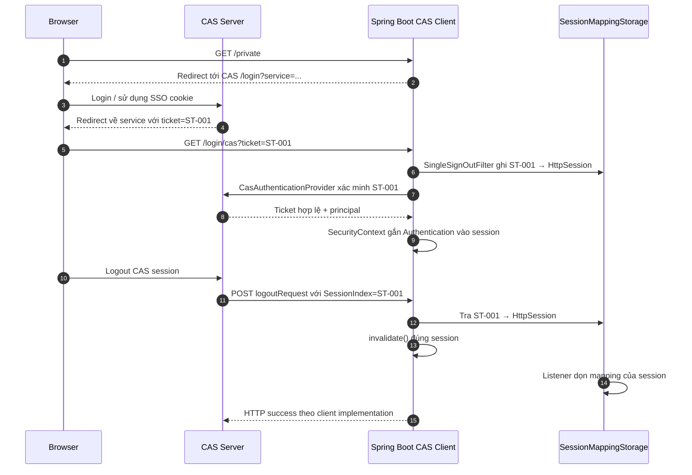
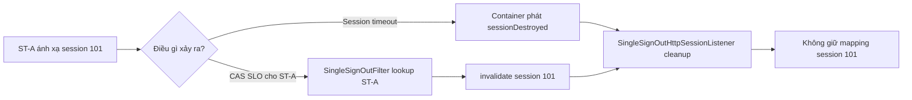

# SingleSignOutFilter, listener và thành phần hỗ trợ theo thư viện client

## 1. Bài toán: CAS SSO có thể còn nhiều phiên ứng dụng

Một người dùng đăng nhập qua **Central Authentication Service (CAS)** và truy cập ba ứng dụng Spring Boot: Portal, Reports và Admin. CAS server giữ **phiên SSO** của người dùng; mỗi ứng dụng lại có **`HttpSession`** và `SecurityContext` riêng. Khi người dùng đăng xuất khỏi CAS, nếu các ứng dụng không xử lý **Single Logout (SLO)**, phiên ở Portal hoặc Reports có thể vẫn hợp lệ dù phiên SSO trung tâm đã kết thúc.

**CAS Single Logout không có nghĩa CAS server trực tiếp xóa cookie/session của mọi ứng dụng.** CAS phát **thông báo logout** tới các CAS clients, còn ứng dụng phải tìm đúng phiên cục bộ và **vô hiệu hóa phiên** đó. Với Apereo Java CAS Client, các thành phần chủ đạo là:

- **`org.apereo.cas.client.session.SingleSignOutFilter`:** nhận biết CAS Service Ticket trong request đăng nhập, ghi ánh xạ ticket → HTTP session, rồi nhận logout notification và yêu cầu hủy phiên đã ghi nhận.
- **`org.apereo.cas.client.session.SingleSignOutHttpSessionListener`:** dọn ánh xạ khi servlet session tự hết hạn hoặc bị invalidate bởi đường khác.
- **`SingleSignOutHandler`** và **`SessionMappingStorage`:** thành phần nội bộ/hạ tầng chịu trách nhiệm tương quan ticket, phiên và xử lý logout.
- **Spring Security CAS filters/handler:** xác thực Service Ticket khi đăng nhập, xóa `SecurityContext` khi logout cục bộ, hoặc khởi tạo chuyển browser tới CAS `/logout` khi chính sách yêu cầu.

Bài này giải thích chi tiết **chức năng, thứ tự filter, cấu hình Servlet/Boot, vòng đời mapping, bảo mật callback, test và vận hành nhiều replica**, trong bối cảnh Spring Security CAS. Tên miền `example.test` và Service Ticket ``ST-...` trong ví dụ không phải tài khoản/hạ tầng thật.

### Kết quả cần đạt

1. Phân biệt **logout ứng dụng**, **logout CAS SSO**, **CAS Single Logout** và **Spring Security SAML2 Logout**.
2. Giải thích đúng vì sao cần cả `SingleSignOutFilter` **và** `SingleSignOutHttpSessionListener`.
3. Hiểu `SessionIndex` trong CAS SLO thường là **CAS Service Ticket ID**, **không phải Servlet session ID**.
4. Cấu hình Apereo Java CAS Client đúng thứ tự trước các authentication filters và tránh đăng ký trùng trong Spring Boot.
5. Biết các tham số `artifactParameterName`, `logoutParameterName`, `logoutCallbackPath` và các phiên bản thư viện tương thích.
6. Kiểm tra back-channel POST, front-channel, CSRF, cookie, reverse proxy, session fixation và multi-replica.
7. Viết một ví dụ Java 17 độc lập mô phỏng mapping + cleanup + duplicate notification và hiểu giới hạn của ví dụ.
8. Xây dựng test matrix xác nhận phiên bị invalidated mà không hủy nhầm user/tenant khác.

## 2. Bốn hành động đăng xuất khác nhau

| Hành động | Bên thực hiện | Phiên nào chắc chắn bị ảnh hưởng? | Điều kiện để tác động phiên khác |
| --- | --- | --- | --- |
| **Local logout** | Browser → `POST /logout` tại ứng dụng A | Phiên Spring/Servlet của A theo logout handlers | Không có; CAS TGT và ứng dụng B vẫn có thể còn |
| **CAS logout** | Browser → `https://cas.example.test/cas/logout` | Phiên SSO/Ticket Granting Ticket ở CAS | CAS phải gửi SLO notifications và clients phải xử lý |
| **CAS Single Logout** | CAS → dịch vụ A/B thông qua callback | Phiên ứng dụng khớp CAS Service Ticket trong mapping | Service đã đăng ký, nhận được message, mapping còn và invalidate thành công |
| **Spring Security SAML2 SLO** | SAML SP/IdP dùng `saml2Logout`/`LogoutResponse` | Tùy SAML2 profile | Không dùng `SingleSignOutFilter` của CAS thay thế |

Cùng một CAS server có thể hỗ trợ CAS protocol, SAML2 và OIDC. Tuy nhiên **CAS-protocol SLO** là một flow riêng: dù thông điệp được biểu diễn thành **XML `<samlp:LogoutRequest>`**, không có nghĩa ứng dụng phải cài Spring Security `.saml2Logout()` để nhận nó.

**Vấn đề UX:** sau local logout, browser có thể quay lại Portal và được CAS tự động đăng nhập bằng cookie SSO chưa hết hạn. Đây là hệ quả đúng của local logout. Muốn kết thúc phiên SSO, cần khởi tạo CAS logout đúng chính sách và xử lý notifications ở các ứng dụng liên quan.

## 3. Hai kho phiên độc lập: CAS TGT và ứng dụng HttpSession

```text
Browser
  |-- Cookie của cas.example.test (TGC) --> CAS server
  |                                         -> TGT/SSO session
  |
  |-- Cookie của portal.example.test ------> Portal HttpSession A
  |
  |-- Cookie của reports.example.test -----> Reports HttpSession B
```

- **Ticket Granting Cookie (TGC):** cookie giúp CAS liên hệ browser với TGT, thường chỉ gửi về **domain CAS**.
- **Ticket Granting Ticket (TGT):** trạng thái SSO do CAS quản lý; không được trao làm session credential cho Portal/Reports.
- **Service Ticket (ST):** do CAS phát cho một `service` cụ thể trong lúc đăng nhập ứng dụng; client xác minh với CAS và nó thường **chỉ dùng một lần**.
- **Application session:** `HttpSession` do từng servlet application quản lý, có thể nằm trong JVM local hoặc Spring Session/Redis.

Khi TGT hết hoặc bị hủy, CAS không thể trực tiếp gọi `session.invalidate()` trong JVM của Portal. CAS cần **gửi thông điệp SLO** để Portal tìm session đã từng được liên hệ với ST, sau đó invalidation tại Portal.

Ngược lại, nếu Portal tự `session.invalidate()`, CAS TGT không tự bị hủy. Sự bất đối xứng này giải thích vì sao cần xử lý cả **CAS-initiated** và **application-initiated logout**.

## 4. Luồng CAS login và ghi ánh xạ Service Ticket → session

Kịch bản back-channel SLO phổ biến:



Sơ đồ thể hiện **trách nhiệm logic**. Thứ tự mapping, session fixation strategy, thành công/failure handler và request dispatch có thể khác theo Spring Security/CAS Client release. Vì thế cần test SLO end-to-end sau khi nâng cấp CAS client hoặc thay cách giữ session.

### Vì sao mapping dùng ST chứ không dùng username?

Một user có thể có **nhiều ứng dụng và nhiều phiên**. Nếu logout callback chỉ mang `user-123` rồi ứng dụng chọn phiên theo username, nó có thể vô hiệu hóa sai phiên hoặc mọi phiên của tenant khác.

CAS-protocol SLO dùng **Service Ticket ID** như mã tương quan với HTTP session đã tạo khi ticket ấy đi qua. Bởi vậy `SingleSignOutFilter` phải chạy đủ sớm để thấy request có `ticket=ST-...`, **trước** filter hoàn tất CAS authentication.

## 5. SingleSignOutFilter thực sự xử lý hai loại request

Theo Apereo Java CAS Client, `SingleSignOutFilter` nhận và giao cho `SingleSignOutHandler`:

**A. Request có CAS ticket artifact:**

```http
GET /login/cas?ticket=ST-ONE-TIME-EXAMPLE HTTP/1.1
Host: portal.example.test
```

Handler có thể lấy `HttpSession` của request (với `eagerlyCreateSessions` theo cấu hình) và ghi mapping:

```text
"ST-ONE-TIME-EXAMPLE" -> HttpSession của browser tại Portal
```

Đây là **mapping nội bộ ứng dụng**, không phải ticket validation. Một ST sai vẫn cần CAS provider xác minh; `SingleSignOutFilter` nhìn thấy token **không đủ để xác thực user**. Khi validation thất bại, ứng dụng phải tránh giữ state không cần thiết quá lâu; listener/cleanup và security handlers giúp kiểm soát vòng đời.

**B. Request có thông báo Single Logout:**

```http
POST /login/cas HTTP/1.1
Host: portal.example.test
Content-Type: application/x-www-form-urlencoded

logoutRequest=URL_ENCODED_CAS_LOGOUT_XML
```

Handler nhận giá trị `logoutRequest`, đọc `SessionIndex` để lấy **Service Ticket ID**:

```text
SessionIndex=ST-ONE-TIME-EXAMPLE
  -> SessionMappingStorage remove(ST-ONE-TIME-EXAMPLE)
  -> HttpSession.invalidate()
  -> SecurityContext/session state không còn dùng được
```

Theo source Java CAS Client, handler xử lý callback logout rồi **không chuyển request tiếp qua các filters nghiệp vụ thông thường**. Điểm quan trọng trong triển khai là đăng ký servlet filter **trước Spring Security filter chain**, để back-channel POST không vô tình bị CSRF/login redirect chặn trước khi CAS client xử lý.

**Không tự tạo endpoint `@PostMapping("/login/cas")` để parse XML và xóa session** trong khi đã dùng CAS library. Nó có thể tranh cùng route với `CasAuthenticationFilter` và bỏ qua mapping/thành phần hỗ trợ.

## 6. Nội dung logoutRequest và ý nghĩa SessionIndex

CAS server có thể gửi XML dạng **SAML LogoutRequest** trên **CAS protocol back-channel**:

```xml
<samlp:LogoutRequest
    xmlns:samlp="urn:oasis:names:tc:SAML:2.0:protocol"
    xmlns:saml="urn:oasis:names:tc:SAML:2.0:assertion"
    ID="_logout-example-01"
    Version="2.0"
    IssueInstant="2026-11-07T04:00:00Z">
    <saml:NameID>user-123</saml:NameID>
    <samlp:SessionIndex>ST-ONE-TIME-EXAMPLE</samlp:SessionIndex>
</samlp:LogoutRequest>
```

Đây là **cấu trúc minh họa**, không phải bản tin có thể đem gửi tới một hệ thống thật. Server CAS đóng gói vào request parameter `logoutRequest`, thông thường là form-encoded XML trên back-channel POST.

| Trường | Chức năng | Không nên nhầm với |
| --- | --- | --- |
| `ID` | ID của thông điệp logout | Service Ticket / JSESSIONID |
| `IssueInstant` | Thời điểm thông điệp được phát | Thời điểm session web hết hạn |
| `NameID` | Danh tính người dùng theo nội dung CAS SLO | Khóa tra session duy nhất |
| **`SessionIndex`** | **ST ID đã dùng ở lần login** theo CAS SLO | `HttpSession#getId()` hoặc SAML2 SessionIndex từ login SAML riêng |
| `logoutRequest` | Tên tham số HTTP mang message | `ticket` trong CAS login |

**Điểm cần ghi nhớ:** ở CAS SLO, `SessionIndex` được dùng để liên hệ **CAS Service Ticket → HttpSession**. Nó không phải servlet session ID và cũng không phải giá trị cookie `JSESSIONID`.

Đừng lấy `NameID` rồi xóa mọi session có cùng username. Đừng gán session ID vào `SessionIndex` do ứng dụng tự chế vì CAS client đã có contract riêng.

## 7. SingleSignOutHttpSessionListener làm gì?

`org.apereo.cas.client.session.SingleSignOutHttpSessionListener` là **Servlet `HttpSessionListener`**, làm nhiệm vụ **dọn mapping khi session bị hủy hoặc hết hạn**.

Ví dụ chu trình:

1. User vào Portal bằng `ST-A`; SLO filter ghi `ST-A → session-101`.
2. Session-101 hết hạn do `server.servlet.session.timeout`.
3. Servlet container phát sự kiện `sessionDestroyed`.
4. `SingleSignOutHttpSessionListener` yêu cầu dọn mapping liên quan session-101.
5. Nếu CAS gửi SLO cho ST-A sau đó, mapping đã không còn; handler **không được hủy nhầm session mới**.

Listener còn quan trọng khi session bị invalidate bởi **local logout**, session fixation policy hoặc business code.

**Listener không thay thế filter:** listener chỉ nhận lifecycle events do servlet container phát, không đọc `logoutRequest` và không biết CAS đã đăng xuất khi **session vẫn đang active**. Nếu chỉ đăng ký listener mà quên filter, back-channel CAS SLO sẽ không tìm/hủy đúng session ứng dụng.

**Filter không thay thế listener:** nếu chỉ đăng ký filter mà không có listener, mapping có thể giữ tham chiếu/session ID cũ lâu hơn cần thiết, gây memory leak hoặc khiến cleanup chậm/sai. Spring Security CAS docs yêu cầu hai thành phần đi cùng nhau.

## 8. Các thành phần hỗ trợ và ranh giới trách nhiệm

| Thành phần | Package / module | Trách nhiệm |
| --- | --- | --- |
| `SingleSignOutFilter` | `org.apereo.cas.client.session` / Apereo cas-client-core | Nhận request có `ticket` và thông báo logout |
| `SingleSignOutHandler` | `org.apereo.cas.client.session` | Phát hiện request, ghi mapping, tra `SessionIndex` và hủy session |
| `SessionMappingStorage` | CAS client session package | Contract mapping CAS ticket ↔ Servlet session |
| `HashMapBackedSessionMappingStorage` | CAS client session package | Mapping in-memory mặc định/phổ biến theo implementation |
| **`SingleSignOutHttpSessionListener`** | CAS client session package | Dọn mapping khi `HttpSession` kết thúc |
| `CasAuthenticationFilter` | `org.springframework.security.cas.web` | Tiếp nhận/đăng nhập với CAS ST |
| `CasAuthenticationProvider` | `org.springframework.security.cas.authentication` | Xác minh ST với CAS và tạo Spring Authentication |
| `CasAuthenticationEntryPoint` | `org.springframework.security.cas.web` | Redirect browser chưa đăng nhập về CAS login |
| `SecurityContextLogoutHandler` | Spring Security | Xóa authentication, `SecurityContext`, invalidate session theo cấu hình |
| `LogoutFilter` | Spring Security | Điều phối local logout hoặc custom CAS logout initiation |
| `FilterRegistrationBean` | Spring Boot Servlet | Đăng ký Servlet Filter và thứ tự chạy |
| `ServletListenerRegistrationBean` | Spring Boot Servlet | Đăng ký HttpSessionListener |
| `Spring Session` | Extension riêng | Thay session storage; **không tự biến CAS mapping mặc định thành phân tán** |

Có thể dùng hai cách tích hợp CAS Client: **Servlet filters thuần Apereo** hoặc **Spring Security CAS** kết hợp một số Apereo filters. Không “thêm hết filters của cả hai cách” nếu chúng xử lý trùng login/ticket, trừ khi đã thiết kế rõ thứ tự và trách nhiệm.

## 9. Vì sao thứ tự filter là điều kiện thiết yếu?

Theo Spring Security CAS docs, `SingleSignOutFilter` cần được đặt **trước `CasAuthenticationFilter`**. Khi sử dụng Apereo CAS Client dạng Servlet filters, tài liệu Java CAS Client yêu cầu `SingleSignOutFilter` **đứng trước các authentication/validation filters**.

Ví dụ thứ tự mong muốn:

```text
HTTP request
  → CharacterEncodingFilter (UTF-8)
  → SingleSignOutFilter (ticket mapping + logoutRequest)
  → Spring Security FilterChainProxy
      → CasAuthenticationFilter / other security filters
      → AuthorizationFilter
  → Spring MVC / controller
```

Ý nghĩa:

- Ở login callback có `ticket=ST-...`, mapping phải được ghi khi request **chưa bị CAS auth filter tiêu thụ/redirect**.
- Ở CAS back-channel POST, filter nên xử lý `logoutRequest` trước khi `CsrfFilter` hoặc `ExceptionTranslationFilter` của web chain trả 403/302.
- Nếu logout request đi vào controller và được trả 404, CAS có thể coi notification đã không được xử lý.
- `CharacterEncodingFilter` UTF-8 chạy sớm giúp tránh đọc/parse form body sai encoding.

**Không dựa vào mỗi `@Order` đặt trên một `@Component`** nếu đã có nhiều `FilterRegistrationBean`/`SecurityFilterChain`. Thứ tự servlet filter ngoài container và thứ tự security filters **bên trong `FilterChainProxy` là hai cấp khác nhau**; phải kiểm tra chain thực tế.

### Cần tránh đăng ký filter hai lần

Nếu tạo `@Bean SingleSignOutFilter` rồi lại tạo `FilterRegistrationBean` cho chính filter đó và đồng thời `http.addFilterBefore(...)`, có nguy cơ filter chạy hai lần. Dùng **một chiến lược đăng ký** nhất quán: Servlet FilterRegistrationBean **hoặc** filter trong security chain với vị trí được kiểm chứng; cấu hình dưới chọn **Servlet FilterRegistrationBean duy nhất**.

## 10. Web.xml truyền thống: cấu hình cả filter và listener

Nếu ứng dụng Servlet triển khai bằng `web.xml`, cấu hình theo Apereo Java CAS Client:

```xml
<!-- CharacterEncodingFilter nên chạy trước CAS SLO filter. -->
<filter>
  <filter-name>encoding</filter-name>
  <filter-class>
    org.springframework.web.filter.CharacterEncodingFilter
  </filter-class>
  <init-param>
    <param-name>encoding</param-name>
    <param-value>UTF-8</param-value>
  </init-param>
  <init-param>
    <param-name>forceEncoding</param-name>
    <param-value>true</param-value>
  </init-param>
</filter>
<filter-mapping>
  <filter-name>encoding</filter-name>
  <url-pattern>/*</url-pattern>
</filter-mapping>

<filter>
  <filter-name>casSingleSignOut</filter-name>
  <filter-class>
    org.apereo.cas.client.session.SingleSignOutFilter
  </filter-class>
  <init-param>
    <param-name>artifactParameterName</param-name>
    <param-value>ticket</param-value>
  </init-param>
  <init-param>
    <param-name>logoutParameterName</param-name>
    <param-value>logoutRequest</param-value>
  </init-param>
  <init-param>
    <param-name>logoutCallbackPath</param-name>
    <param-value>/login/cas</param-value>
  </init-param>
</filter>
<filter-mapping>
  <filter-name>casSingleSignOut</filter-name>
  <url-pattern>/*</url-pattern>
</filter-mapping>

<listener>
  <listener-class>
    org.apereo.cas.client.session.SingleSignOutHttpSessionListener
  </listener-class>
</listener>
```

**Đây là fragment `web.xml`**, không phải toàn bộ file XML descriptor. Phải bổ sung CAS authentication filters/Spring Security container setup phù hợp ứng dụng. `SingleSignOutFilter` phải được map `/*` để nhìn thấy **cả lần login có `ticket`** và **logout POST**.

Nếu chỉ map filter vào `/cas/logout/callback`, nó **có thể không thấy request login và không ghi mapping**. Hãy giữ global mapping rồi giới hạn chính xác đường nhận notification bằng `logoutCallbackPath` khi version hỗ trợ. Cần đồng bộ URL path này với CAS service registry.

### CAS service được dùng để nhận SLO

Mặc định CAS có thể gửi logout POST tới service URL đã thấy ở lần đăng nhập. Với ví dụ `/login/cas`, sử dụng `logoutCallbackPath=/login/cas` là hợp lý nếu CAS thực sự post tới đó. Nếu CAS được cấu hình `logoutUrl` riêng như `/internal/cas/slo`, thì khai báo callback path tương ứng **và giữ filter mapped `/*` để capture ST**.

## 11. Tham số cấu hình quan trọng của SingleSignOutFilter

Theo tài liệu Apereo Java CAS Client, các init params tiêu biểu:

| Init param | Giá trị mặc định được ghi trong README | Tác dụng |
| --- | --- | --- |
| `artifactParameterName` | `ticket` | Tên tham số mang CAS Service Ticket |
| `logoutParameterName` | `logoutRequest` | Tên tham số chứa thông điệp SLO |
| `relayStateParameterName` | `RelayState` | Hỗ trợ một số flow liên quan SAML |
| `eagerlyCreateSessions` | `true` | Khi thấy ticket, có thể tạo `HttpSession` sớm để ghi mapping |
| `artifactParameterOverPost` | `false` | Quy tắc chấp nhận ticket artifact qua POST theo library |
| `logoutCallbackPath` | Không đặt | Giới hạn đường nhận logout **POST** theo implementation, thay vì quét mọi form POST |

### Nguy cơ khi dùng eager session creation

`eagerlyCreateSessions=true` thuận tiện: khi request có CAS ticket nhưng chưa có session, filter có thể tạo mới session để ghi mapping. Tuy nhiên việc tạo session trước authentication:

- Có thể làm phát sinh nhiều session chưa xác thực nếu endpoint public nhận ticket giả.
- Yêu cầu hạn mức request/session và logout handling an toàn.
- Phải kiểm thử tương tác với Spring Security **session fixation strategy**, vì authentication success có thể đổi session ID hoặc thay session.
- Nếu đặt `false` và chưa có session khi ticket tới, **không có mapping để SLO về sau tìm**.

**Không đặt `eagerlyCreateSessions=false` chỉ để giảm memory rồi coi SLO vẫn đảm bảo.** Cần tạo session đúng lúc và E2E test mapping trước/ sau CAS login.

### Tính nhất quán với CAS Server

Nếu CAS gửi field `logoutRequest` mà client đổi sang `casLogoutPayload`, filter có thể không nhận message. Nếu CAS ticket parameter không phải `ticket` (ví dụ `SAMLart` trong SAML 1.1 CAS Client mode), phải cấu hình thống nhất trong authentication/validation và SLO filter. **Không đổi tùy tiện** khi chưa phân biệt CAS protocol, CAS SAML 1.1 và SAML2 Web Browser SSO.

## 12. Spring Boot 3.x/Java 17: đăng ký Servlet Filter + Listener

Ví dụ dưới đây có thể **biên dịch/khởi động trong một dự án Spring Boot Servlet đã cấu hình Gradle và dependencies tương thích**, minh họa wiring của CAS SLO. Nó **không tự hoàn tất CAS login**: một ứng dụng SSO thực phải có `CasAuthenticationFilter`, `CasAuthenticationProvider`, `ServiceProperties`, `CasAuthenticationEntryPoint` hoặc cơ chế CAS client khác; CAS server/registered service phải tồn tại thật.

### 12.1. Dependencies

Trong `build.gradle` của project Spring Boot 3.x có Java 17+, repositories và Boot dependency management, thêm:

```groovy
dependencies {
    implementation "org.springframework.boot:spring-boot-starter-web"
    implementation "org.springframework.boot:spring-boot-starter-security"
    implementation "org.springframework.security:spring-security-cas"

    // Chọn CAS Java Client có jakarta.servlet cho Spring Boot 3.
    // Version 4.1.0 là một bản phát hành CAS client 4.x; kiểm tra
    // BOM, advisory và version tương thích của deployment thực tế.
    implementation "org.apereo.cas.client:cas-client-core:4.1.0"
}
```

**Quan trọng về phiên bản:** Spring Boot 3.x dùng **`jakarta.servlet.*`**, còn code CAS client đời cũ có thể dùng `javax.servlet.*`. Hai namespace không hoán đổi được. Chỉ dùng CAS client version có Servlet/Jakarta API tương thích và giải quyết transitive dependencies theo BOM của dự án. `4.1.0` là **ví dụ release** trong họ 4.x, không tuyên bố là mới nhất ở mọi thời điểm.

### 12.2. Class wiring

Lưu tại `src/main/java/demo/cas/SloWiringApplication.java`:

```java
package demo.cas;

import java.util.Map;

import org.apereo.cas.client.session.SingleSignOutFilter;
import org.apereo.cas.client.session.SingleSignOutHttpSessionListener;

import org.springframework.boot.SpringApplication;
import org.springframework.boot.autoconfigure.SpringBootApplication;
import org.springframework.boot.web.servlet.FilterRegistrationBean;
import org.springframework.boot.web.servlet.ServletListenerRegistrationBean;
import org.springframework.context.annotation.Bean;
import org.springframework.core.Ordered;
import org.springframework.web.bind.annotation.GetMapping;
import org.springframework.web.bind.annotation.RestController;

@SpringBootApplication
@RestController
public class SloWiringApplication {

    public static void main(String[] args) {
        SpringApplication.run(SloWiringApplication.class, args);
    }

    @Bean
    FilterRegistrationBean<SingleSignOutFilter> casSloFilter() {
        FilterRegistrationBean<SingleSignOutFilter> registration =
                new FilterRegistrationBean<>();
        registration.setFilter(new SingleSignOutFilter());
        registration.setName("casSingleSignOutFilter");

        // Cần quan sát cả ticket login và logoutRequest.
        registration.addUrlPatterns("/*");

        // Thứ tự Servlet filter, chạy trước Spring Security.
        registration.setOrder(Ordered.HIGHEST_PRECEDENCE + 10);

        registration.setInitParameters(Map.of(
                "artifactParameterName", "ticket",
                "logoutParameterName", "logoutRequest",
                "logoutCallbackPath", "/login/cas",
                "eagerlyCreateSessions", "true"));

        return registration;
    }

    @Bean
    ServletListenerRegistrationBean<SingleSignOutHttpSessionListener>
    casSessionListener() {
        return new ServletListenerRegistrationBean<>(
                new SingleSignOutHttpSessionListener());
    }

    @GetMapping("/")
    public String home() {
        return "CAS SLO filter/listener wiring sample";
    }
}
```

Giải thích:

- Dùng `FilterRegistrationBean` thay vì `http.addFilterBefore` để bảo đảm filter CAS SLO là **Servlet filter ngoài security chain** trong ví dụ này. Không đăng ký cùng filter lần nữa.
- `Ordered.HIGHEST_PRECEDENCE + 10` đặt thứ tự tương đối rất sớm; cần kiểm tra `CharacterEncodingFilter` chạy **sớm hơn** và Spring Security filter chain **sau** CAS SLO.
- `addUrlPatterns("/*")` cần thiết để ghi mapping khi CAS Service Ticket đến qua `/login/cas`, ngay cả khi cấu hình CAS logout callback thành đường riêng.
- `logoutCallbackPath` giới hạn đường POST được coi là SLO. Trong ví dụ, CAS phải gửi đúng `POST /login/cas`. Nếu có context path, giá trị thường là **path bên trong context**, cần test implementation/version thực.
- `ServletListenerRegistrationBean` đăng ký listener dọn mapping khi session destroyed. Nó không cần một `@Controller` xử lý SLO.
- `GET /` chỉ xác nhận app đã khởi động; **không chứng minh SLO hoạt động** nếu thiếu CAS auth và server.

**Tương thích deployment:** nếu ứng dụng đã dùng `cas-client-support-springboot` với `@EnableCasClient` hoặc auto-config có đăng ký SingleSignOutFilter/listener, **không thêm hai beans trên lần thứ hai**. Kiểm tra filter/listener đang thực sự được tạo bởi starter/version trước khi tự wiring.

### 12.3. Chạy demo wiring

Với dự án Gradle Boot có wrapper và dependency resolution đúng:

```bash
./gradlew bootRun
```

Truy cập trang chủ:

```text
GET /  ->  CAS SLO filter/listener wiring sample
```

Đây là output HTTP body của `GET /` sau khi ứng dụng đã khởi động, **không phải kết quả CAS login/SLO**. Để có CAS SSO thật, phải cấu hình CAS client authentication, trusted `https://cas.example.test/cas`, `ServiceProperties.service`, ticket validation, public login URL và registered service tại CAS Server.

## 13. Tích hợp Spring Security CAS mà không làm trùng nhiệm vụ

Trong một ứng dụng có CAS login đã cấu hình bằng Spring Security, các thành phần thường có:

```text
CasAuthenticationEntryPoint
  -> redirect browser tới CAS /login

CasAuthenticationFilter
  -> nhận ticket từ /login/cas

CasAuthenticationProvider
  -> verify Service Ticket với /serviceValidate hoặc /proxyValidate
  -> tạo CasAuthenticationToken và SecurityContext

SingleSignOutFilter (Apereo)
  -> ghi ST → HttpSession và xử lý logoutRequest

SingleSignOutHttpSessionListener (Apereo)
  -> dọn mapping theo session lifecycle
```

**Đừng thay `CasAuthenticationFilter` bằng `SingleSignOutFilter`.** CAS SLO filter không kiểm tra password hoặc giá trị ST; nó chỉ quản lý mapping/notification. `CasAuthenticationProvider` mới xác minh ticket với CAS.

Spring Security CAS docs có cấu hình XML dùng:

```xml
<security:http entry-point-ref="casEntryPoint">
    <security:logout logout-success-url="/signed-out"/>
    <security:custom-filter
        ref="singleLogoutFilter" before="CAS_FILTER"/>
</security:http>

<bean id="singleLogoutFilter"
      class="org.apereo.cas.client.session.SingleSignOutFilter"/>
```

Đây là **trích đoạn cấu hình Spring Security XML** (một phương án lịch sử), không dùng đồng thời với `FilterRegistrationBean` trong mục 12. Dù một filter có thể được đặt trước `CAS_FILTER` **bên trong** security chain, cần bảo đảm CAS back-channel POST không bị các security filters đứng trước chặn. Cách servlet filter bên ngoài chain thường dễ quan sát thứ tự hơn trong Spring Boot.

Nếu áp dụng Spring Security 6.x với Java DSL, ưu tiên giữ việc xác thực ST đã hoạt động và **bổ sung đúng một cặp SLO filter/listener**. Không tạo đường auth mới hoặc thay policy logout chỉ để sửa mapping.

## 14. Local logout và CAS logout initiation là hai đường khác nhau

Một nút “Đăng xuất” trong ứng dụng có thể có hai mục đích:

**A. Chỉ đăng xuất ứng dụng:** gọi `POST /logout` qua Spring Security `LogoutFilter`, `SecurityContextLogoutHandler` xóa SecurityContext và invalidate `HttpSession`. `SingleSignOutHttpSessionListener` dọn mapping ST→session. CAS TGT vẫn còn; login tiếp có thể diễn ra không cần password.

**B. Đăng xuất toàn bộ CAS SSO:** sau khi xóa session cục bộ, chuyển browser tới **CAS Server `/cas/logout`** để CAS hủy TGT và phát notifications đến các services khác. App cần chính sách redirect URL cố định/allowlist, không nhận một `next=https://evil.test` tùy ý.

Spring Security CAS docs minh họa một `requestSingleLogoutFilter` riêng, là **`org.springframework.security.web.authentication.logout.LogoutFilter`** được cấu hình để redirect browser đến CAS logout:

```xml
<bean id="requestSingleLogoutFilter"
      class="org.springframework.security.web.authentication.logout.LogoutFilter">
  <constructor-arg value="https://cas.example.test/cas/logout"/>
  <constructor-arg>
    <bean class=
      "org.springframework.security.web.authentication.logout.SecurityContextLogoutHandler"/>
  </constructor-arg>
  <property name="filterProcessesUrl" value="/logout/cas"/>
</bean>
```

Đây là **mảnh Spring XML minh họa cách gửi user đến CAS logout**, không phải code thêm vào cùng lúc nếu app đã có logout initiation flow. Mảnh lịch sử không tự bảo đảm CSRF cho custom URL theo mọi cấu hình; trong Spring Boot mới, **đặt user logout trigger là POST có CSRF token** và định nghĩa success handler redirect cố định tới CAS sau local cleanup.

**Không nhầm `POST /logout/cas` do browser khởi tạo với `POST /login/cas` chứa `logoutRequest` từ CAS server.** Cả hai có thể là POST nhưng nguồn, mục tiêu và cách bảo vệ khác nhau.

## 15. SingleSignOutHttpSessionListener và sessionDestroyed

Sự kiện Servlet session destroyed có thể đến từ:

- Session timeout/idle expiry.
- `HttpSession.invalidate()` khi local logout.
- CAS SLO filter gọi invalidate khi nhận SessionIndex phù hợp.
- Session fixation protection có thể invalidate một session cũ và tạo session mới, tùy strategy.
- Servlet container shutdown/redeployment với lifecycle semantics tùy implementation.

Listener có mục tiêu dọn mapping; nó **không tự logout CAS session**.



**Tính idempotent:** sau khi session đã bị invalidate, một CAS SLO callback lặp lại không nên hủy nhầm session khác; mapping đã bị remove hoặc session không còn hợp lệ. Phải xử lý `IllegalStateException`/session-not-found như trạng thái bình thường trong khoảng thời gian đồng thời, không tạo một authenticated session mới.

**Memory hygiene:** mapping còn giữ tham chiếu `HttpSession` khi listener không được đăng ký đúng hoặc app không giải phóng state. Một lượng lớn phiên timeout có thể gây tăng memory usage nếu không cleanup.

## 16. Session fixation và thay Session ID sau CAS login

Spring Security có các cơ chế **session fixation protection**:

- `changeSessionId()`: đổi ID trong servlet container hiện đại.
- `migrateSession()` hoặc `newSession()`: có thể tạo session mới/invalidate session cũ theo policy/version.
- `none()`: không có session fixation protection (không phải khuyến nghị mặc định).

CAS SLO mapping có thể được ghi **khi request mang ST tới filter**, trước khi Spring Security hoàn tất authentication. Nếu sau đó app thay session, phải xác minh rằng CAS client storage vẫn liên hệ **đúng HttpSession còn active**.

Ví dụ rủi ro:

```text
1. Filter map ST-1 → oldSession
2. Spring Security invalidates oldSession and creates newSession
3. Listener removes mapping ST-1
4. CAS posts LogoutRequest SessionIndex=ST-1
5. Client cannot find newSession; user may remain authenticated
```

Không “khắc phục” bằng cách tắt session fixation protection vô điều kiện; đó là giảm bảo mật login. Hãy chọn strategy tương thích, kiểm tra CAS client version, session mapping lifecycle và thực hiện integration test:

1. Login CAS tới protected route.
2. Ghi nhận **chỉ hash/truncated diagnostics** của session ID trước/sau authentication.
3. Từ CAS Server yêu cầu logout.
4. Truy cập protected route bằng browser cookie cũ.
5. Xác nhận không còn SecurityContext authenticated.

Nhiều mô hình chạy với `changeSessionId()` nhưng không giả định mọi session store/library xử lý lifecycle y hệt. Những câu hỏi này phải được trả lời bằng kiểm thử trên đúng container, Spring Security và CAS client versions đã ghim.

## 17. CAS back-channel khác front-channel

CAS có thể phát SLO notifications bằng hai cơ chế, cấu hình tại CAS registered service:

| Cơ chế | Ai thực sự phát HTTP request tới app? | Phương thức thường gặp | Yêu cầu |
| --- | --- | --- | --- |
| **Back-channel** | CAS server | **POST** form với `logoutRequest` | CAS có network route tới app, filter xử lý body; không cần browser cookie |
| **Front-channel** | Browser do CAS điều phối | Có thể **GET/JSONP** hoặc iframe theo release | Browser policies, third-party cookies/cross-site restrictions, client support tương ứng |
| **Local logout** | Browser ở ứng dụng | POST tới app logout | CSRF token và session cookie theo policy |

CAS 7.x/8.x docs mô tả `logoutType=BACK_CHANNEL` là kiểu phổ biến/default cho registered service, đồng thời có tùy chọn `FRONT_CHANNEL` hoặc `NONE`. **Không giả định mọi phiên bản CAS Java Client hỗ trợ front-channel giống nhau**: Java CAS Client README nói rõ cần xác minh client hỗ trợ khi chọn propagation type.

Back-channel thường dễ lý giải hơn vì CAS server trực tiếp gửi request, nhưng yêu cầu ingress/firewall/reverse proxy cho phép CAS gọi callback. Front-channel chịu ảnh hưởng browser privacy, CORS/iframe/JSONP policies và có thể thất bại dù CAS SSO đã hết.

**Không dùng SameSite=None để chữa lỗi server-to-server back-channel thiếu session cookie.** Back-channel không cần cookie browser; nó dựa vào mapping ST→HttpSession đã lưu. Nếu callback đến nhưng không tìm được session, kiểm tra storage/lifecycle/replica trước.

## 18. CAS registered service: logoutType và logoutUrl

CAS thường gửi callback đến service URL đã ghi khi cấp ticket. Có thể cấu hình **đường logout riêng** theo registered service, ví dụ:

```json
{
  "@class": "org.apereo.cas.services.CasRegisteredService",
  "serviceId": "^https://portal\\.example\\.test/.*",
  "name": "portal",
  "id": 123,
  "logoutType": "BACK_CHANNEL",
  "logoutUrl": "https://portal.example.test/internal/cas/slo"
}
```

Đây là **ví dụ JSON cho CAS service registry**, không có nghĩa tên class và regex trên hợp lệ với mọi storage/JSON serializer/release. Cần đối chiếu CAS server version và registered-service schema đang dùng.

Nếu CAS gọi `https://portal.example.test/internal/cas/slo`:

- Apereo `SingleSignOutFilter` nên **vẫn map `/*`** để thấy `?ticket=...` tại login.
- `logoutCallbackPath` trong filter phải phản ánh `/internal/cas/slo` nếu dùng tính năng này.
- Ingress/WAF phải forward **POST body** của CAS.
- Callback không được trả login redirect hoặc bị chặn trước bởi Spring Security.
- Bảo vệ quyền gọi callback và source validation theo kiến trúc.

Nếu CAS đã đăng ký `logoutType=NONE` cho service, client có SLO filter/listener cũng **không tự được CAS gửi notifications**. Nếu CAS chỉ gửi front-channel mà client chỉ xử lý back-channel, cần sửa protocol compatibility chứ không tăng session timeout.

## 19. CSRF với logoutRequest: không tắt toàn bộ ứng dụng

Một CAS back-channel POST thường không có browser session cookie và không biết CSRF token của ứng dụng. Nếu request đi qua Spring Security `CsrfFilter` như một form POST bình thường, nó có thể bị **403** trước khi SLO handler xử lý.

Giải pháp ưu tiên trong Spring Boot ví dụ:

1. Đăng ký `SingleSignOutFilter` ở **Servlet filter layer trước Spring Security** để nó nhận/consume CAS `logoutRequest` đúng route.
2. Đảm bảo callback không bị các WAF/ingress/body parsers làm biến dạng.
3. Giữ CSRF protection cho **các form/API dùng browser session**.
4. Nếu không thể xử lý ở tầng filter trước, cấu hình **CSRF exception chỉ cho callback path chính xác** theo security threat model; không ignore toàn `/api/**` hoặc tắt CSRF toàn app.
5. Không cho callback path đồng thời xử lý business POST có side effects; tách endpoint riêng khi có thể.

**Không biến callback CAS thành route “permitAll và invalidate mọi session theo user name”**. Đường back-channel được cho phép không có nghĩa mọi body là đáng tin; phải kiểm soát nguồn và mapping chính xác.

### Authenticity của CAS logout request

Không nên **mặc nhiên tuyên bố** CAS client cổ điển verify một **XML signature bắt buộc** trên mọi logoutRequest: CAS-protocol SLO truyền SAML2-shaped XML nhưng cơ chế trust/signature có thể khác SAML2 Single Logout. Nhiều client implementations chỉ lấy SessionIndex rồi tra mapping, không kiểm tra signature XML ở mọi deployment. Hãy:

- Chỉ nhận callback qua HTTPS từ CAS server/network policy tin cậy, ưu tiên mTLS hoặc xác thực ở gateway nếu deployment hỗ trợ.
- Hạn chế callback URL, request method/body/size, rate limits và logging đã redact.
- Kiểm tra CAS release và client source/API có thực hiện kiểm tra gì, không giả định chữ ký tồn tại.
- Không hủy phiên dựa trên username do request tự khai; chỉ dùng ticket mapping mà client đã ghi.
- Nếu an ninh yêu cầu chống forged logout request mạnh hơn, bổ sung gateway/source authentication hoặc một protocol có signed logout assertions được validate phù hợp.

Một forged notification có thể gây **forced logout/denial-of-service**, dù thường không trực tiếp cho kẻ tấn công quyền đăng nhập.

## 20. Vấn đề parsing, body stream và character encoding

`logoutRequest` thường nằm trong request form POST, ví dụ `application/x-www-form-urlencoded`. Một số middleware **đọc raw request body trước filter**, hoặc ngược lại, khiến body/input stream không thể đọc lại. CAS Java Client README có cấu hình `logoutCallbackPath` để giới hạn nơi đọc/nhận logout param và tránh ảnh hưởng các form posts khác.

Các điểm cần kiểm tra:

- `CharacterEncodingFilter` UTF-8 chạy trước.
- Request Content-Type và payload đúng theo client library/version.
- Nếu có JSON body parser/request-wrapper, nó có chặn `getParameter("logoutRequest")` không?
- WAF có strip XML namespace/parameter hoặc reject POST form không?
- `logoutCallbackPath` có khớp servlet path thực sau context path/rewrite không?
- Client có kiểm tra GET/POST theo đường khác nhau không? Đừng gán ý nghĩa giống nhau nếu source/version không hỗ trợ.
- Có XML parser safety/size limits để ngăn entity expansion/DoS khi nhận dữ liệu chưa tin.

**Không giải quyết bằng cách log nguyên `logoutRequest`**. XML có principal và `SessionIndex`; log thô có thể làm lộ định danh/correlation ticket.

## 21. SessionMappingStorage và multi-replica

Spring Security CAS docs mô tả cách `SingleSignOutFilter` dùng một mapping ở ứng dụng (trong ví dụ lịch sử là **static Map**), rồi gọi `HttpSession.invalidate()` khi nhận được logout message. Điều này có vấn đề khi triển khai nhiều replicas:

```text
                   Public HTTPS Host
                          |
                     Load Balancer
                  +-------+-------+
                  |               |
               Pod A            Pod B
                  |               |
   Login ST-7 -> map ST-7       SLO POST arrives
                 to session A    (map ST-7 absent)
                  |               |
                  +-------+-------+
                          |
                    Redis Sessions?
```

**Spring Session Redis chỉ chia sẻ HTTP session state; không tự chứng minh CAS client's in-memory ST→HttpSession mapping được chia sẻ.** Nếu CAS SLO POST vào pod B nhưng ST→session mapping ở pod A, callback có thể được trả 200 mà session vẫn active ở Redis hoặc ở pod A.

Các lựa chọn cần đánh giá:

- Đưa mapping vào **storage phù hợp cluster** với lookup atomic, TTL, session-id mapping và session revocation semantics. Kiểm tra CAS client API/version hỗ trợ extension nào; không giả định một HashMap static có thể gắn Redis chỉ bằng property.
- Dùng **sticky routing** nếu topology cho phép, nhưng CAS server-to-server callback có thể **không mang browser sticky cookie**, nên không đảm bảo nó đến đúng pod.
- Dùng một **central SLO gateway** tiếp nhận callback rồi đánh dấu session revoked trong shared state, được từng pod thi hành; đây là thiết kế riêng cần security review.
- Nếu phiên chỉ nằm trong pod và ingress định tuyến đúng, phải hiểu mất phiên khi restart, duplicate callbacks và CAS URL từng đăng ký.
- Có telemetry cho mapping miss, session invalidation success/failure, CAS callback failures và TTL cleanup.

**Không giữ trực tiếp Java `HttpSession` object của pod A trong Redis**: đối tượng session/servlet container không phải hợp đồng serialization an toàn giữa pods. Mapping phân tán thường phải dùng session ID/revocation state, rồi phối hợp với Spring Session APIs theo version, chứ không serialize session object.

## 22. Một callback không nhất thiết “đăng xuất mọi thứ”

CAS SLO là best-effort theo tình trạng các services, mạng và client library. Một callback thành công tại Portal không chứng minh:

- Các ứng dụng khác (Reports/Admin) đã nhận/callback thành công.
- Browser đã xóa mọi cookies ứng dụng.
- Các long-lived API tokens/OAuth access tokens do hệ thống khác phát đã bị thu hồi.
- WebSocket connections hoặc server-side jobs đang chạy đã dừng.
- Một IdP upstream trong mô hình CAS-as-broker đã logout.
- Tài liệu đang mở trong browser đã được đóng/lưu an toàn.

**CAS không phải session manager tập trung cho mọi ứng dụng**. CAS quản lý SSO/TGT và cố gửi thông báo; từng ứng dụng phải quản lý phiên của mình, và việc hủy phiên không tự động đóng mọi kết nối đã mở.

Cần phân biệt **“CAS SSO session ended”**, **“notification delivered”**, **“mapping found”** và **“local session invalidated”** trong dashboard vận hành. Tránh UI thông báo chắc chắn “đã đăng xuất tất cả ứng dụng” khi chỉ biết CAS logout đã được gọi.

## 23. Java 17 độc lập: mô phỏng mapping ST → session và listener cleanup

Chương trình dưới đây **chạy với Java 17+ mà không cần Spring/CAS dependencies**, để kiểm chứng quy tắc session mapping và duplicate notification. Nó không verify ST, không parse CAS XML, không chạy servlet filter, không gọi CAS server; dùng **giá trị test** và mô phỏng logic sau khi lớp giao thức đã nhận ticket/notification.

Lưu `SingleLogoutMapDemo.java`:

```java
import java.util.Map;
import java.util.concurrent.ConcurrentHashMap;
import java.util.concurrent.atomic.AtomicBoolean;

public final class SingleLogoutMapDemo {

    record Session(String id, AtomicBoolean active) {
        Session(String id) {
            this(id, new AtomicBoolean(true));
        }

        void invalidate() {
            active.set(false);
        }
    }

    private final Map<String, Session> byServiceTicket =
            new ConcurrentHashMap<>();

    // Minh họa filter thấy ticket ở CAS login callback.
    void onValidatedLogin(String serviceTicket, Session session) {
        if (serviceTicket == null || serviceTicket.isBlank()
                || session == null) {
            throw new IllegalArgumentException("Missing mapping");
        }
        byServiceTicket.put(serviceTicket, session);
    }

    // Minh họa callback có SessionIndex bằng Service Ticket.
    boolean onCasLogout(String serviceTicket) {
        Session matched = byServiceTicket.remove(serviceTicket);
        if (matched == null) {
            return false;
        }
        matched.invalidate();
        return true;
    }

    // Minh họa Servlet HttpSessionListener.sessionDestroyed.
    void onSessionDestroyed(Session ended) {
        byServiceTicket.entrySet().removeIf(
                entry -> entry.getValue() == ended);
    }

    public static void main(String[] args) {
        SingleLogoutMapDemo store = new SingleLogoutMapDemo();
        Session alice = new Session("session-a");
        Session bob = new Session("session-b");

        store.onValidatedLogin("ST-A", alice);
        store.onValidatedLogin("ST-B", bob);

        System.out.println("initial=" + store.byServiceTicket.size());
        System.out.println("logoutA=" + store.onCasLogout("ST-A"));
        System.out.println("aliceActive=" + alice.active().get());
        System.out.println("bobActive=" + bob.active().get());
        System.out.println("duplicateA=" + store.onCasLogout("ST-A"));

        store.onSessionDestroyed(bob);
        System.out.println("remaining=" + store.byServiceTicket.size());
    }
}
```

Biên dịch và chạy:

```bash
javac SingleLogoutMapDemo.java
java SingleLogoutMapDemo
```

**Stdout chính xác:**

```text
initial=2
logoutA=true
aliceActive=false
bobActive=true
duplicateA=false
remaining=0
```

Ý nghĩa:

- `initial=2`: có hai Service Tickets đã được liên hệ với hai sessions.
- `logoutA=true`: CAS SLO cho ST-A tìm đúng session A.
- `aliceActive=false` nhưng `bobActive=true`: không logout nhầm session B.
- `duplicateA=false`: callback lặp lại không tìm mapping đã remove.
- `remaining=0`: listener dọn entry của session B khi session này kết thúc.

**Không lấy demo này làm implementation production.** Nó chưa có listener/filter thật, không có security binding giữa CAS server và request, không có TTL, không xử lý multiple tickets per session, không share cluster state, không giới hạn input, không chống forged requests. `onValidatedLogin` được đặt tên cho dễ học; **SingleSignOutFilter thật có thể ghi mapping trước khi ticket được CAS provider validate**, như phân tích ở mục 5.

## 24. Các bài test end-to-end phải có

### A. Happy path

1. User mở Portal, được redirect CAS và đăng nhập.
2. Browser quay về Portal với `ticket=ST-...`.
3. CAS Client xác minh ticket, Spring Security tạo authenticated session.
4. `SingleSignOutFilter` đã ghi mapping với ST (theo implementation).
5. User truy cập protected `/profile` thành công.
6. Browser logout ở CAS `/cas/logout`.
7. CAS back-channel POST `logoutRequest` chứa `SessionIndex=ST-...` đến đúng service/callback.
8. `SingleSignOutFilter` lookup mapping, invalidate phiên phù hợp.
9. Browser gửi cookie Portal cũ truy cập lại `/profile`; không còn authenticated session.
10. `SingleSignOutHttpSessionListener` đã dọn mapping; callback lại không làm lộ/ảnh hưởng phiên khác.

### B. Negative tests và các môi trường đặc biệt

| Test | Kỳ vọng |
| --- | --- |
| POST `logoutRequest` trước khi ticket login được ghi | Không tìm session; không hủy phiên bất kỳ |
| ST lạ trong SessionIndex | Không hủy session người khác |
| Cùng user có hai sessions với hai ST khác nhau | Hủy đúng phiên theo mapping, không dựa username |
| Callback lặp lại cùng SessionIndex | Idempotent, không tạo authenticated session |
| CAS callback POST bị CSRF filter chặn | Phát hiện lỗi order/matcher, không tắt CSRF toàn web |
| Filter đăng ký sau CAS auth filter | Kiểm thử phát hiện mapping miss |
| Chỉ có listener không có filter | Không xử lý CAS SLO; fail setup test |
| Chỉ có filter không có listener | Session cleanup/memory test thất bại |
| `artifactParameterName` sai | Không ghi mapping cho login ST |
| `logoutParameterName` sai | Không nhận notification |
| `logoutCallbackPath` sai so CAS service registry | Notification không xử lý |
| Callback vào pod B nhưng mapping ở pod A | Failover test chỉ ra thiếu shared state |
| Spring Session Redis nhưng mapping in-memory | Không mặc định coi cluster SLO thành công |
| Session fixation protection thay session sau CAS login | Mapping phải còn dẫn tới phiên active |
| Session timeout trước khi SLO | Listener đã xóa mapping; không hủy phiên khác |
| CAS server ngắt kết nối | Không nhận notification; có retry/monitor/policy |
| CAS `logoutType=NONE` | Không có SLO callback, local sessions vẫn tồn tại |
| CAS front-channel nhưng client chỉ hỗ trợ back-channel | Test protocol incompatibility |
| SLO request có XML malformed/oversized | Không làm sập app; giới hạn và log đã redact |
| SLO request giả từ Internet | Hạn chế nguồn, không cho hủy phiên tùy ý |
| Logout local nhưng CAS TGT còn | Login lại có thể tự động, được ghi nhận đúng |
| WebSocket background job tiếp tục sau invalidation | Có cơ chế revoke/close riêng nếu policy yêu cầu |
| OAuth access token còn hạn dù CAS SLO | Xác nhận revocation policy riêng; không giả định |
| Ingress trả 302/login page thay cho 200 callback | Phát hiện callback bị security chain chặn |
| Cookie `SameSite=Lax` trong CAS back-channel | Không được coi là nguyên nhân chính của server-to-server callback |
| User login thành công nhưng không có map | Kiểm tra eagerlyCreateSessions/filter ordering |
| CAS Service Ticket đã qua validation một lần | Không gọi lại validation để tạo mapping bổ sung |
| CAS client từ `javax.servlet` chạy trên Spring Boot 3 | Dependency compatibility fail; chọn jakarta-compatible release |

### C. Test với Spring Security

- **MockMvc** có thể kiểm tra local CSRF/logout và protected resource, nhưng không chứng minh Servlet container đã đăng ký listener hoặc CAS server gửi callback.
- **Servlet integration test** với `FilterRegistrationBean`, listener, CAS sandbox và session store thật kiểm tra callback order/session invalidation.
- **Multi-replica E2E** phải chạy với LB/proxy thật: login pod A, callback pod B, protected resource trên pod C.
- Nếu chỉ test server authentication bằng `@WithMockUser`, không có CAS ST mapping và **không chứng minh SingleSignOutFilter hoạt động**.

## 25. Lỗi thường gặp và chẩn đoán

| Triệu chứng | Nguyên nhân khả dĩ | Hướng kiểm tra |
| --- | --- | --- |
| CAS logout nhưng Portal vẫn authenticated | Không có filter/listener hoặc missing mapping | Filter registrations và ST→session mapping |
| POST callback 403 | CSRF/web chain chạy trước SLO filter | Thứ tự servlet filter, matcher callback |
| POST callback 302 tới CAS login | CAS auth entry point nhận nhầm callback | Đảm bảo SLO xử lý trước auth |
| POST callback 404/405 | CAS `logoutUrl` hoặc ingress sai | Public host/path, CAS registry, HTTP method |
| Session login tốt nhưng CAS logout không tìm mapping | Filter chỉ map callback path, không bắt ticket | Đổi filter mapping `/*` và test ticket capture |
| Listener không cleanup | Chưa được đăng ký/namespace sai | Servlet context events, listener registration |
| SLO mapping bị mất sau login | Session fixation session replacement | Test mapping qua login/`changeSessionId` |
| CAS server không gửi callback | `logoutType=NONE`/service registration sai | CAS registered-service config và logs |
| CAS front-channel lỗi một số browser | Client không hỗ trợ, privacy policy | Dùng back-channel nếu thích hợp |
| Callback tới pod sai | Mapping in-memory theo JVM | Cluster storage/revocation architecture |
| `logoutRequest` không được nhận | Tên param/path/content-type/body wrapper sai | Compare CAS wire request và client init params |
| Session bị hủy nhầm | Custom mapping theo user hoặc thiếu namespace | Dùng đúng ST mapping, tenant/session isolation |
| User logout rồi login lại tự động | Chỉ logout local; CAS SSO cookie vẫn còn | Có user flow CAS logout đúng chưa? |
| ST xuất hiện trong logs | Query param ticket được ghi đầy đủ | Redact access logs/APM, giảm raw query captures |
| App memory tăng theo số login | Mapping không cleanup, listener thiếu | Memory profile, sessionDestroyed/TTL |
| Đã nhận callback 200 nhưng session còn | Không tìm được session, filter trả success | Theo dõi invalidation, kiểm tra protected route sau SLO |
| Dùng `saml2Logout` thay CAS filter | Nhầm CAS-protocol SLO với SAML2 profile | Dùng đúng CAS client component |
| GET callback bị coi là business request | Front-channel client path khác expected | CAS front-channel support và URL design |
| Port/hostname nội bộ hiện trong logout URL | Reverse proxy headers/bases sai | Public HTTPS service URL và proxy trust |

### Mức logging nên dùng

Log an toàn: CAS service name/registration, loại notification, có mapping hay không, session invalidation result, cluster node/correlation ID nội bộ, HTTP status, source IP sau trusted proxy. Nếu cần trace ticket, dùng **hash có salt/secret/giá trị rút gọn do hệ thống tạo**, không đưa ST nguyên bản hay SessionIndex vào logs.

Không log: raw `logoutRequest`, `ticket=ST-...`, cookie `JSESSIONID`, CAS TGT/TGC, credential, user PII hoặc `SAMLResponse`. Cấu hình access logs phải loại bỏ/che query strings chứa ticket.

## 26. Bảo mật: callback trust và chống logout CSRF/DoS

Một attacker có thể cố gửi POST `logoutRequest` giả hoặc đoán/thu thập một Service Ticket ID đã từng xuất hiện ở URL. Tùy CAS client/protocol version, callback có thể không luôn có XML signature được thư viện kiểm tra.

**Các kiểm soát nên có:**

1. **Ingress allowlist** CAS server source IP/network hoặc mTLS, tùy hạ tầng; đừng tin `X-Forwarded-For` do client tự gửi.
2. **HTTPS** toàn tuyến public; certificate hostname/trust chính xác và tránh chuyển qua HTTP.
3. **Service Ticket IDs không bị log/đăng công khai**; bảo vệ access/query logs, tracing và error reports.
4. **Session mapping theo ticket**, không theo username hoặc client-supplied sessionId.
5. **Callback path cố định**, form size limits, rate limiting, parser XML safe, reject malformed requests.
6. **Không disable CSRF toàn ứng dụng**; xử lý CAS protocol callback trước hoặc ngoại lệ hẹp.
7. **Local logout vẫn cần CSRF token** khi có cookie-based authentication.
8. **Keepalive/expiry** của session và TTL mappings; giám sát mapping miss do cluster.
9. **Idempotent invalidation**, không tự tạo session khi xử lý notification.
10. **Threat model** cho nội bộ/broker: CAS logout không tự thu hồi JWT/Refresh token hoặc API sessions ở hệ khác.

**CAS SLO thiên về session invalidation, không phải cơ chế cấp quyền.** Một callback sai thường gây cưỡng ép đăng xuất hoặc DoS, không phải quyền đăng nhập; tuy nhiên nó vẫn là rủi ro availability và UX đáng kể, đặc biệt với ứng dụng tài chính/điều hành.

## 27. Checklist cấu hình thực tế

- [ ] CAS server protocol/release đã được xác nhận; SLO được bật toàn cục và service `logoutType` phù hợp.
- [ ] CAS registered service `serviceId`, `logoutUrl`/service URL, HTTPS public host/path đúng.
- [ ] `SingleSignOutFilter` được đăng ký **một lần**, trước CAS login/authentication filters.
- [ ] Filter được map `/*` để thấy request có Service Ticket, không chỉ logout callback.
- [ ] `SingleSignOutHttpSessionListener` được đăng ký **một lần** và cleanup khi sessionDestroyed.
- [ ] `artifactParameterName=ticket` khớp CAS login; nếu khác, cấu hình thống nhất.
- [ ] `logoutParameterName=logoutRequest` khớp notification của CAS server.
- [ ] `logoutCallbackPath` khớp path CAS server POST tới khi có cấu hình.
- [ ] `CharacterEncodingFilter` UTF-8 chạy sớm, form body không bị middleware consume sai.
- [ ] CAS back-channel POST đi qua ingress/WAF và đến filter trước CSRF/entry point.
- [ ] `HttpSession` vẫn là session đã được tạo/ghi mapping khi nhận ST và sau authentication.
- [ ] Session fixation protection vẫn hoạt động, mapping sau login vẫn đúng.
- [ ] Session timeout/local logout đều kích hoạt listener cleanup.
- [ ] Multi-replica không dựa mù vào static Map hoặc sticky browser cookie.
- [ ] Back-channel/front-channel được chọn theo hỗ trợ thật của CAS client/version.
- [ ] Không nhận XML logout giả từ mạng không tin cậy; có IP allowlist/mTLS/gateway nếu phù hợp.
- [ ] Không log ST, raw logoutRequest, SessionIndex, cookies hoặc PII.
- [ ] Local logout và CAS logout initiation được phân biệt trong UX.
- [ ] Protected resource sau SLO yêu cầu xác thực lại, không chỉ nhận HTTP 200 callback.
- [ ] Không nhầm CAS SLO với Spring Security SAML2 `saml2Logout`.
- [ ] Có tests cho duplicate notification, missing mapping, wrong pod, session timeout và phiên user khác.
- [ ] API tokens/WebSockets/background jobs có revocation riêng khi chính sách yêu cầu.

## 28. Câu hỏi tự đánh giá

**1. Vì sao cần cả SingleSignOutFilter và SingleSignOutHttpSessionListener?**  
Filter ghi/tra ticket mapping và xử lý CAS notification; listener dọn mapping khi `HttpSession` kết thúc, kể cả không do CAS logout.

**2. SessionIndex trong CAS SLO là gì?**  
Trong CAS protocol, thường là **Service Ticket ID** dùng để map tới phiên ứng dụng, không phải JSESSIONID.

**3. Vì sao SingleSignOutFilter phải đứng trước CasAuthenticationFilter?**  
Để thấy request `ticket=ST-...`, ghi mapping trước khi các bước authentication/redirect khác xử lý ticket.

**4. Khi CAS back-channel gửi POST mà browser không có cookie thì có bình thường không?**  
Có. CAS server gọi trực tiếp backend ứng dụng; client tra session bằng ST mapping, không dùng browser cookie trong callback đó.

**5. Listener có tự gọi CAS logout URL không?**  
Không. Listener xử lý `sessionDestroyed` và dọn state, không khởi tạo CAS logout.

**6. Nếu chỉ gọi Spring Security `POST /logout`, TGT của CAS có hết không?**  
Không mặc định. Đây là local logout; CAS SSO có thể vẫn còn.

**7. Nếu lọc chỉ `/internal/cas/slo`, SingleSignOutFilter còn thấy ST login không?**  
Không nếu Servlet Filter mapping cũng bị thu hẹp. Cần map filter rộng đủ để thấy ticket, dùng `logoutCallbackPath` để giới hạn notification path.

**8. Vì sao không dùng username để hủy session?**  
Một user có nhiều sessions; callback mang Service Ticket ID để xác định phiên liên quan. Dùng username dễ hủy nhầm.

**9. Spring Session Redis có tự làm SessionMappingStorage phân tán không?**  
Không được phép giả định. CAS client's in-memory map có thể vẫn tách theo JVM; cần kiến trúc phân tán riêng và test.

**10. Tại sao POST logoutRequest có thể bị 403?**  
Nếu CSRF filter xử lý trước CAS SLO filter hoặc callback path chưa được loại trừ đúng phạm vi. Không tắt CSRF cho web app.

**11. Nếu callback HTTP 200 nhưng session vẫn authenticated có thể do đâu?**  
Không tìm thấy mapping, callback tới replica khác, listener/session fixation làm mất mapping hoặc filter xử lý không đúng route. Phải test lại protected resource.

**12. Có thể dùng Spring Security `.saml2Logout()` thay CAS SingleSignOutFilter không?**  
Không. CAS-protocol SLO dù mang XML hình thức SAML LogoutRequest vẫn dùng CAS client ticket mapping riêng.

## 29. Tài liệu tham khảo

- [Spring Security — CAS Authentication, Single Logout](https://docs.spring.io/spring-security/reference/servlet/authentication/cas.html): `SingleSignOutFilter` trước `CAS_FILTER`, `LogoutFilter`, `SingleSignOutHttpSessionListener`, local vs CAS logout.
- [Spring Security 6.5 — CAS Authentication](https://docs.spring.io/spring-security/reference/6.5/servlet/authentication/cas.html): đối chiếu DSL và integration cho dự án Spring Security 6.x.
- [Apereo Java CAS Client — README, Configuring Single Sign Out](https://github.com/apereo/java-cas-client/blob/master/README.md): filter/listener, `artifactParameterName`, `logoutParameterName`, `eagerlyCreateSessions`, `logoutCallbackPath` và thứ tự.
- [Apereo Java CAS Client — SingleSignOutHandler source](https://github.com/apereo/java-cas-client/blob/master/cas-client-core/src/main/java/org/apereo/cas/client/session/SingleSignOutHandler.java): logic `recordSession`, `SessionMappingStorage`, `destroySession` và đọc `SessionIndex`.
- [Apereo Java CAS Client — Releases](https://github.com/apereo/java-cas-client/releases): các phiên bản client và khả năng tương thích.
- [Apereo CAS 8.x — Logout and Single Logout](https://apereo.github.io/cas/8.0.x/installation/Logout-Single-Signout.html): back-channel/front-channel, `logoutType`, `logoutUrl`, SSO session vs app session.
- [Apereo CAS — CAS Protocol Specification, Single Logout](https://apereo.github.io/cas/development/protocol/CAS-Protocol-Specification.html): CAS logout `/logout` và ví dụ XML `LogoutRequest`.
- [Spring Boot — Servlet Filters and Listeners](https://docs.spring.io/spring-boot/reference/web/servlet.html): `FilterRegistrationBean`, `ServletListenerRegistrationBean` và order.
- [Spring Security — Servlet Session Management](https://docs.spring.io/spring-security/reference/servlet/authentication/session-management.html): session fixation strategies và `SecurityContext`.
- [OWASP — Session Management Cheat Sheet](https://cheatsheetseries.owasp.org/cheatsheets/Session_Management_Cheat_Sheet.html): session invalidation, expiry, cookie handling.
- [OWASP — Cross-Site Request Forgery Prevention](https://cheatsheetseries.owasp.org/cheatsheets/Cross-Site_Request_Forgery_Prevention_Cheat_Sheet.html): local logout CSRF protection và giới hạn ngoại lệ callback.
