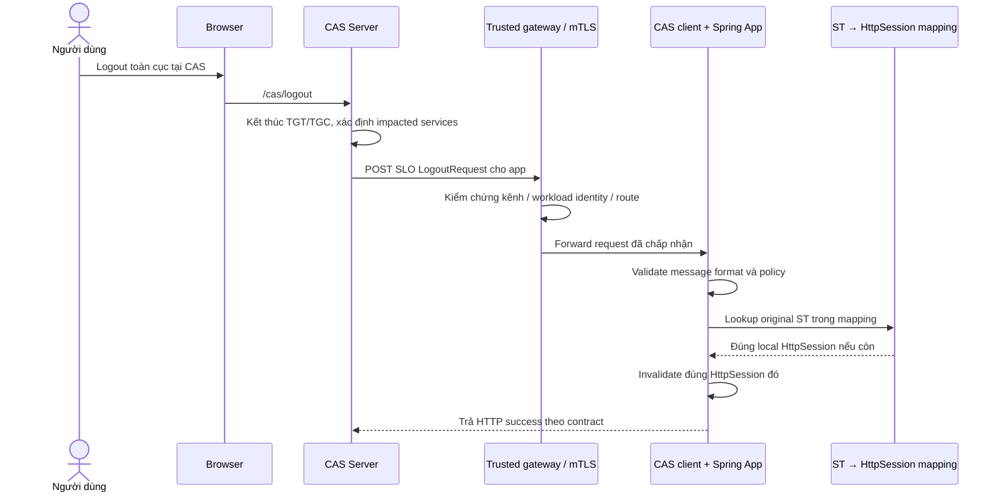
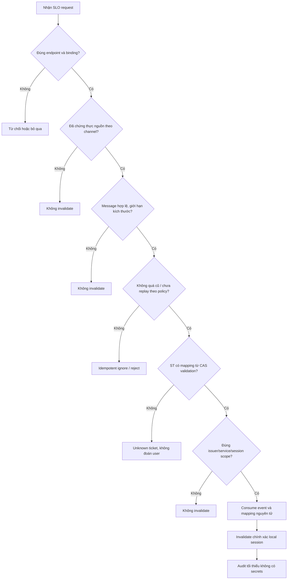

# Xác minh điều kiện tin cậy khi tiếp nhận thông báo đăng xuất từ CAS

**Chủ đề:** Spring Security – federation → Đăng xuất CAS.  
**Phạm vi:** **CAS native Single Logout (SLO)** khi CAS Server gửi thông báo kết thúc phiên tới ứng dụng Java/Spring Security; không nhầm với SAML2 Single Logout của một SAML Identity Provider hoặc OIDC Back-Channel Logout.  
**Đối tượng:** Java 17+, Spring Security Servlet/Jakarta, Apereo CAS Client và các ứng dụng nhiều instance.

## Mục tiêu học tập

Sau bài học, bạn có thể:

1. Phân biệt **đăng xuất ứng dụng**, **đăng xuất phiên CAS**, **CAS SLO back-channel/front-channel** và logout của các giao thức federation khác.
2. Xác định **điều kiện tin cậy** trước khi ứng dụng cho phép một thông báo CAS SLO làm mất hiệu lực phiên: nguồn gửi và kênh giao tiếp, endpoint/binding, cấu trúc message, thời gian/replay theo policy, liên kết **Service Ticket đã xác minh ↔ HttpSession**, phạm vi ảnh hưởng và xử lý đồng thời.
3. Nhận biết giới hạn bảo mật: **XML có tên `samlp:LogoutRequest` không tự được ký hoặc xác thực nguồn**, `SessionIndex` của CAS native SLO thường biểu diễn **Service Ticket ID**, không phải `JSESSIONID` hoặc SAML2 SessionIndex của một luồng SP/IdP khác.
4. Dùng `SingleSignOutFilter` và `SingleSignOutHttpSessionListener` của Apereo Java CAS Client đúng vị trí, xây hàng rào tin cậy trước filter và thử cả những request giả mạo.
5. Kiểm thử an toàn khi logout notification mất, gửi lặp, tới sai node, chứa ticket không tồn tại hoặc cố tình gây logout nhầm người khác.

**Quy tắc cốt lõi:** Một CAS SLO notification là **yêu cầu tác động đến trạng thái đăng nhập**. Không được tin nó chỉ vì có tham số `logoutRequest` hoặc XML trông giống SAML. Ứng dụng phải biết **ai được phép yêu cầu logout**, **đúng phiên nào được tác động**, **message có hợp lệ không** và **việc xử lý có giới hạn, idempotent không**.

## 1. Vì sao điều kiện tin cậy quan trọng?

Khi người dùng đăng nhập SSO:
- CAS Server quản lý **TGT/TGC** – phiên đăng nhập SSO tập trung.
- Ứng dụng Portal A xác minh **Service Ticket ST_A**, sau đó tạo/duy trì **HttpSession riêng** của Portal A.
- Ứng dụng Reports B cũng có thể có **HttpSession riêng**, với ticket ST_B.
- CAS Server **không trực tiếp sở hữu** các HttpSession của A/B sau khi xác thực xong.

Nếu người dùng logout tại CAS, CAS có thể gửi SLO notification đến A/B để yêu cầu chúng tự vô hiệu hóa phiên. Nhưng URL nhận thông báo của A thường là HTTP endpoint có thể bị gọi bởi người ngoài nếu cấu hình ingress sai. Kẻ tấn công có thể thử gửi:

```text
POST /login/cas
logoutRequest=<tài liệu XML do attacker tự tạo>
```

Nếu ứng dụng xử lý bất kỳ body nào có chữ `LogoutRequest` như yêu cầu đáng tin, nó có nguy cơ:
- Gây **đăng xuất cưỡng ép** (logout denial of service) cho user khác nếu biết ticket/session correlation key.
- Làm lộ thông tin tồn tại của session qua response khác biệt.
- Tiêu thụ CPU/bộ nhớ bằng XML lớn, entity expansion hoặc nhiều thông báo giả.
- Xóa nhầm mọi session của cùng username/tenant thay vì chỉ phiên đã gắn ticket.
- Tạo lỗ hổng CSRF, request routing hoặc trust-boundary confusion khi dùng front-channel và back-channel trộn lẫn.

**Logout giả thường không trực tiếp giúp attacker truy cập tài khoản**, nhưng vẫn là tấn công tính sẵn sàng và có thể gây hậu quả nghiệp vụ; vì vậy kiểm chứng nguồn gửi là một yêu cầu bảo mật, không chỉ để hệ thống tránh logout nhầm.

## 2. Bốn thao tác “logout” khác nhau

| Thao tác | Chủ thể khởi tạo | Điều kết thúc | Không tự đảm bảo |
| --- | --- | --- | --- |
| **Local application logout** | Browser/user hoặc app | `SecurityContext`/`HttpSession` của **một ứng dụng** | TGT/TGC CAS Server và phiên các app khác cũng kết thúc |
| **CAS logout** | User tại CAS `/logout` | Phiên SSO CAS (TGT/TGC) theo CAS policy | Tất cả phiên local của các app đã bị hủy |
| **CAS Single Logout (SLO)** | CAS Server truyền notification đến các service | CAS yêu cầu app tự invalidate phiên gắn ST | Các app nhận/tiêu thụ notification thành công 100% |
| **SAML2/OIDC logout** | IdP/OP hoặc RP theo giao thức tương ứng | Theo SAML2 SLO hoặc OIDC logout token/session | Có thể dùng chung CAS native SLO parser/filter |

Theo tài liệu Apereo, **CAS SLO là best-effort**: các notification có thể gửi bất đồng bộ và thất bại ở một số ứng dụng mà CAS logout vẫn hoàn tất. Vì thế nếu bảo mật yêu cầu “khóa user ngay lập tức trên mọi ứng dụng”, cần kiểm soát bổ sung như thời hạn session ngắn, forced authentication, authorization lookup/revocation và telemetry.

### 2.1. CAS native SLO không phải SAML2 SLO

CAS native back-channel gửi XML có hình dạng của `samlp:LogoutRequest` và một `samlp:SessionIndex`. Nhưng đây là **cơ chế CAS SLO** được Apereo mô tả riêng. Đừng suy rằng:
- Message đã có XML Digital Signature chỉ vì namespace là `urn:oasis:names:tc:SAML:2.0:protocol`.
- Có thể áp nguyên `SAML2 LogoutRequest` signature policy vào Java CAS Client `SingleSignOutFilter` mà không cấu hình/custom integration phù hợp.
- `SessionIndex` ở đây là SAML AuthnStatement SessionIndex, `TGT` hay browser `JSESSIONID`.

**Nếu đang tích hợp SAML2 IdP** dùng Spring `saml2Login`, phải dùng SAML2 SLO endpoint, metadata, issuer, signature và logout-request validation của giao thức SAML2. Nếu dùng OIDC, phải kiểm tra `logout_token` theo OIDC Back-Channel Logout; không mang thuật toán đó gán cho CAS native notification.

## 3. Back-channel và front-channel ảnh hưởng cách xác minh nguồn

### 3.1. Back-channel: CAS Server → ứng dụng bằng HTTP POST

Apereo CAS mô tả cơ chế truyền thống: CAS Server trực tiếp **HTTP POST** tới service URL mà CAS đã thu thập trong khi login, hoặc tới `logoutUrl` cụ thể của registered service nếu được cấu hình.



**Điểm tin cậy chính:** request nguồn thật phải đến từ **CAS Server được phê duyệt** qua kênh và tuyến được bảo vệ. Với CAS native SLO không tự có chữ ký, chỉ parse XML và so `IssueInstant` không chứng minh điều này; cần một biện pháp **xác thực nguồn ở tầng vận chuyển/hạ tầng**, như mTLS từ CAS workload và gateway đã xác minh client identity, hoặc đường private ingress được giới hạn chặt kết hợp kiểm soát hệ thống.

**Địa chỉ IP một mình là biện pháp yếu** nếu phía ứng dụng chỉ đọc `X-Forwarded-For` do client gửi. Nếu dùng allowlist IP, phải kiểm soát proxy hops và địa chỉ nguồn ở điểm kết nối đáng tin. Với độ nhạy cao, mTLS/workload identity mang bằng chứng nguồn mạnh hơn một custom `X-CAS-Logout: true` header không ký.

### 3.2. Front-channel: browser gửi GET/JSONP/iframe

CAS cũng có front-channel theo cấu hình `logoutType`: browser gửi request đến ứng dụng, ví dụ:

```text
GET https://portal.example.com/cas/slo
    ?logoutRequest=[Base64-encoded SLO XML]
    &callback=[JSONP-callback]
```

Trong mô hình này request **đến từ browser**, không phải kết nối TCP trực tiếp của CAS Server. Vì thế:
- Không thể yêu cầu source IP của browser phải là IP CAS Server.
- `Referer`, `Origin` hoặc tên callback JSONP không đủ làm chứng cứ mật mã rằng CAS đã khởi tạo event; có thể thiếu hoặc dễ tác động.
- Trình duyệt hiện đại hạn chế third-party cookies và cross-site framing, nên callback có thể không nhận đúng session và front-channel không đáng tin cậy để bao phủ mọi browser.
- JSONP callback chỉ là giao diện truyền/hiển thị, không phải chữ ký.
- Chỉ dùng nếu CAS client và security model thực sự hỗ trợ, đã kiểm thử. Nếu yêu cầu authenticated server-to-server logout, **ưu tiên back-channel**, hoặc thiết kế protocol có chứng thực thông điệp phù hợp.

**Không suy front-channel và back-channel có cùng trust checks.** Một edge mTLS policy áp cho back-channel **không thể** áp tương tự cho browser GET mà vẫn cho mọi người dùng bình thường hoạt động.

### 3.3. Cấu hình theo registered service

Một registered service trong CAS có thể khai báo `logoutType` là `BACK_CHANNEL` hoặc `FRONT_CHANNEL` hoặc disabled, cùng `logoutUrl` tùy trường hợp. Ví dụ **mảnh minh họa** (phải kiểm chứng schema chính xác theo CAS release/registry backend):

```json
{
  "@class": "org.apereo.cas.services.CasRegisteredService",
  "serviceId": "^https://portal\\.example\\.com/login/cas$",
  "name": "portal",
  "id": 301,
  "logoutType": "BACK_CHANNEL",
  "logoutUrl": "https://portal.example.com/cas/slo"
}
```

Nếu đặt `logoutUrl=/cas/slo` riêng, ứng dụng phải cấu hình filter nhận request đó; **filter cũng cần thấy sự kiện ST login thành công** để lập ánh xạ ST → session. Chỉ map filter vào URL logout mà không theo dõi login callback có thể dẫn tới **không tìm thấy phiên để hủy**. Với ingress, có thể cấu hình bảo vệ đường `/cas/slo` riêng nhưng vẫn để request login đi qua filter nội bộ.

## 4. Cấu trúc thông báo CAS native SLO

Ví dụ back-channel theo tài liệu Apereo:

```xml
<samlp:LogoutRequest
    xmlns:samlp="urn:oasis:names:tc:SAML:2.0:protocol"
    xmlns:saml="urn:oasis:names:tc:SAML:2.0:assertion"
    ID="_logout-3821"
    Version="2.0"
    IssueInstant="2026-11-07T03:10:00Z">
  <saml:NameID>alice</saml:NameID>
  <samlp:SessionIndex>ST-example-for-portal</samlp:SessionIndex>
</samlp:LogoutRequest>
```

**Đây là mẫu không ký, không phải SAML2 request thực có xác minh chữ ký.** Các giá trị `ST-example-for-portal`/`alice` là dữ liệu học tập. Tuyệt đối không gửi request thật vào endpoint của người khác để “thử”.

| Trường | Điều kiện cần xét | Không được giả định |
| --- | --- | --- |
| `LogoutRequest` root | Đúng namespace/element mà CAS client hỗ trợ | Chỉ có chuỗi “LogoutRequest” trong text là hợp lệ |
| `ID` | Duy nhất/không rỗng, có thể dùng replay cache theo contract | Nó tự chứng minh được CAS đã gửi |
| `Version` | Phù hợp định dạng CAS native SLO được hỗ trợ | Mọi phiên bản hoặc namespace đều được parse |
| `IssueInstant` | Thời gian parse UTC, giới hạn độ lệch và age nếu policy cho phép | Timestamp hiện tại = nguồn gửi đáng tin |
| `NameID` | Có thể xuất hiện, dùng tham khảo đúng contract | Có thể logout **mọi** session của username này |
| **`samlp:SessionIndex`** | **Original CAS Service Ticket ID** để tra `ST → HttpSession` | Là `JSESSIONID`, TGT, SAML2 IdP SessionIndex hoặc khóa logout user toàn cục |
| XML signature | Chỉ xác minh nếu triển khai/profile thực sự có signature và trust anchor | Native CAS SLO mặc định đã được ký |

**Không dùng NameID làm khóa hủy phiên.** Một người dùng có thể mở hai browser, hai thiết bị hoặc hai phiên CAS. Thông báo mang ST đã xác minh phải tác động **đúng mapping**, không phải “đăng xuất tất cả phiên của alice” theo một câu SQL không có điều kiện.

### 4.1. SessionIndex của CAS thường là Service Ticket ID

Trong CAS native SLO, server có thể gửi `SessionIndex` là **ST đã phát cho service khi đăng nhập**. Ví dụ:
- CAS cấp `ST-portal-X` và A xác minh thành công.
- Java CAS Client liên kết `ST-portal-X` → HttpSession A.
- CAS logout gửi `SessionIndex=ST-portal-X`.
- A tìm session liên kết ticket này và invalidate.

Không nhất thiết server phải biết `HttpSession.getId()` của A, vì CAS Server không sở hữu local session. **Đừng gửi `SessionIndex` vào `session.invalidate()` trực tiếp** như thể đó là session ID. Trong API Servlet, `invalidate()` được gọi trên đúng đối tượng `HttpSession` đã tìm từ mapping, hoặc trên session store đã được chỉ định.

### 4.2. Phạm vi: đúng ứng dụng, đúng người, đúng lần login

Một mapping đúng cần đảm bảo:
- ST đã được **CAS validation thành công** với đúng `service` tại login.
- Mapping chỉ thuộc **CAS issuer/realm/service context đã được tin**, không trộn nhiều CAS servers.
- Session được tạo/đăng ký sau validation, và không bị chuyển user/account ngoài policy.
- Khi session hết hạn/local logout/session rotation hoặc app restart, mapping được cập nhật/xóa phù hợp.
- Nếu ST không tồn tại trong mapping, **không dò theo username/email hoặc substring** để chọn session “gần đúng”.

Với cluster, một HTTP node nhận SLO có thể khác node tạo ST mapping; dùng session mapping/shared store hoặc routing được thiết kế, không đoán session bằng session ID mà CAS không biết.

## 5. Điều kiện tin cậy trước khi chấp nhận SLO

Có thể chia kiểm soát thành **bảy tầng**. Với một hệ thống có rủi ro cao, phải có đủ kiểm soát thích hợp theo cơ chế CAS đã chọn; nếu thiếu bằng chứng nguồn ở back-channel, không nên coi notification là authenticated.

### Tầng 1 – Đúng endpoint và binding

- Nhận trên path mà CAS client/gateway đã công bố; nếu có `logoutUrl` riêng, CAS phải dùng đúng URL.
- Back-channel thường là **POST** theo CAS native spec; không nhận GET làm equivalent chỉ vì có `logoutRequest` nếu cấu hình chỉ cho POST.
- Front-channel có thể GET và Base64/JSONP theo CAS client; phải bật rõ và quản lý riêng.
- Bounded request body và timeout; kiểm tra Content-Type/encoding phù hợp cách gửi.
- Không lẫn endpoint SLO với `/logout` do user gọi để logout local; hai hành động có threat model khác nhau.

### Tầng 2 – Nguồn yêu cầu thực sự được xác thực

**Đây là lớp phân biệt chính giữa “nhận XML” và “tin CAS notification”.**

Với back-channel:
- Dùng HTTPS từ CAS đến ingress/application.
- Ưu tiên **mTLS** hoặc workload identity khi hạ tầng hỗ trợ: edge kiểm tra chứng thư client thuộc CAS workload/CA được phê duyệt.
- Chỉ nhận SLO trên ingress/private route từ CAS/proxy đã được kiểm soát; cấu hình firewall/network policy/service mesh phù hợp.
- Nếu dựa IP allowlist, lấy peer IP tại trusted edge; **không** tin `X-Forwarded-For` hoặc `X-Real-IP` do client Internet tự đặt.
- Edge xóa/ghi đè mọi header nói về source identity trước khi chuyển đến app; ứng dụng chỉ tin header nội bộ do edge **đã xác thực** tạo ra.
- Nếu sử dụng một cơ chế thông điệp ký riêng, phải xác minh khóa và binding chính xác theo hợp đồng; **không mặc định** CAS native SLO có signature.

Với front-channel, browser là bên truyền, nên không áp giả định mTLS CAS client hoặc CAS source IP; cân nhắc tắt front-channel nếu cần nguồn chắc chắn và sử dụng back-channel bảo vệ đúng.

**Không dùng một shared secret trong query string hoặc `?trusted=true` tự chế** làm cách duy nhất bảo vệ; URL dễ bị log. Nếu custom HMAC signature được triển khai, cần protected keys, timestamp, nonce/replay checks và specification được review, tốt nhất tránh tự thiết kế nếu đã có mTLS.

### Tầng 3 – XML/message hợp lệ, parser được bảo vệ

- Giới hạn kích thước (ví dụ policy vài KiB phù hợp payload thực), chặn payload khổng lồ.
- Parse XML bằng thư viện đáng tin, **namespace-aware**; không dựa vào regex lấy `SessionIndex` từ raw body.
- Cấm external entities, DTD, XInclude và remote schema resolution; giới hạn entity expansion/độ sâu.
- Kiểm tra root/namespace, đúng cấu trúc `LogoutRequest` và **một** SessionIndex theo implementation contract; từ chối ambiguous/multi-valued/trống.
- Parse `IssueInstant` theo UTC và kiểm tra thời gian khi đã có chính sách skew/TTL tương thích CAS Server.
- Không tải URL/DTD từ body hoặc truy cập file hệ thống.
- Không chấp nhận body XML lạ là request logout chỉ vì HTTP 200.

**Lưu ý:** parser/validator của Apereo Java CAS Client có phiên bản/behavior riêng. Phải audit phiên bản đang chạy; nếu có yêu cầu strict validation bổ sung, đặt tại trusted prefilter/adapter đã review, không tự viết parser bằng regular expression và bỏ qua default client validation.

### Tầng 4 – Freshness và replay, sau khi đã kiểm chứng nguồn

- `ID` và `IssueInstant` có thể dùng để phát hiện thông báo phát lại hoặc quá cũ **nếu deployment bảo đảm trường hiện diện/ổn định**.
- Thiết lập clock-skew hữu hạn với NTP, TTL sự kiện và cache consumed IDs per trusted CAS issuer/service.
- Idempotent: cùng logout message đến hai lần phải không hủy phiên mới hoặc làm lỗi hệ thống.
- Nếu ticket đã bị xử lý và mapping đã xóa, response an toàn không tiết lộ tài khoản; không phục hồi mapping.
- Đừng biến replay cache thành tập không giới hạn gây memory DoS; TTL/bounds và namespace khóa.
- **Timestamp/ID không có chữ ký hoặc nguồn đáng tin thì attacker vẫn giả được.** Đây là kiểm soát bổ sung, không thể thay tầng 2.

### Tầng 5 – Session correlation đúng tuyệt đối

- Dựa `SessionIndex=original ST` tìm session **được ghi nhận khi ST đã được CAS validate**.
- Mapping thuộc đúng CAS authority và service/tenant; không tìm theo email hoặc NameID.
- Nếu không có mapping, **không xóa phiên khác**. Có thể xử lý idempotent unknown-ticket theo policy.
- Trong multi-node, mapping/session store phải đúng node hoặc chia sẻ; không assume in-memory map trên mọi pod.
- Khi Spring Security đổi session ID do session fixation protection, correlation vẫn phải đến đúng session object/store, không bị trỏ vào session cũ vô hiệu.
- Khi app đổi user trong session, mapping/authority phải cập nhật; không cho logout ticket của user cũ xóa session user mới nếu session bị tái sử dụng trái policy.

### Tầng 6 – Chỉ tác động trạng thái được cho phép

Khi đủ điều kiện, invalidate **đúng local HttpSession** và security context tương ứng. Xóa/đóng các state liên quan:
- Authenticated session, saved credentials/tokens trong scope local session theo quy trình app.
- Session mapping ST → HttpSession, session caches liên quan.
- WebSocket hoặc authenticated server-side state nếu ứng dụng có cơ chế session revocation tích hợp.
- Bất kỳ privileged proof/cached authorization nào gắn chặt với session.

**Không**:
- Xóa database account hoặc roles chỉ vì một logout notification.
- Đăng xuất tất cả user có cùng `NameID`/email.
- Xóa toàn bộ tenant sessions theo một ST.
- Xem logout là bằng chứng phải thu hồi mọi JWT/token stateless nếu không có hợp đồng revocation riêng.

### Tầng 7 – Theo dõi và phân loại kết quả

Ghi telemetry sau khi xử lý:
- `CAS_SLO_ACCEPTED` / `CAS_SLO_IGNORED_UNKNOWN_TICKET` / `CAS_SLO_REPLAY` / `CAS_SLO_REJECTED_UNTRUSTED_SOURCE` / `CAS_SLO_INVALID_XML` / `CAS_SLO_SESSION_INVALIDATED`.
- Service ID/route và timestamp, trusted CAS source identity từ gateway, latency, phiên app bị vô hiệu đã được pseudonymize.
- Không log raw `LogoutRequest`, Service Ticket, `TGC`, `JSESSIONID` hoặc PII; nếu cần correlation, dùng keyed digest/HMAC có TTL và quản lý key.

Phân biệt HTTP response kỹ thuật với business outcome: CAS có thể nhận HTTP success theo protocol nhưng app vẫn báo “unknown ticket” một cách idempotent; không tuyên bố tất cả phiên đã mất chỉ từ status code.

## 6. Quy trình quyết định từ request đến invalidate



Thứ tự có thể được hiện thực qua **trusted gateway → Servlet filter → Apereo CAS session mapping → application session store**, không nhất thiết phải viết một controller chứa toàn bộ logic. Mục tiêu là không có **đường đi nào cho request chưa được chứng thực** dẫn đến `HttpSession.invalidate()`.

## 7. Tích hợp Apereo Java CAS Client trong Spring Security

Apereo Java CAS Client hỗ trợ native SLO bằng:
- `org.apereo.cas.client.session.SingleSignOutFilter`.
- `org.apereo.cas.client.session.SingleSignOutHttpSessionListener`.
- Session mapping giữa CAS ticket và `HttpSession` do client quản lý.

Tài liệu Apereo Java CAS Client yêu cầu đặt `SingleSignOutFilter` **trước các CAS authentication/validation filters** khi dùng Servlet filters, để nhận diện cả lần nhận ST ban đầu và notification SLO. Listener cleanup mapping khi `HttpSession` hết hạn.

### 7.1. Ví dụ `web.xml` (mảnh cấu hình)

```xml
<!-- Đặt sớm trước các CAS authentication/validation filters. -->
<filter>
  <filter-name>CAS Single Logout</filter-name>
  <filter-class>
    org.apereo.cas.client.session.SingleSignOutFilter
  </filter-class>
</filter>

<filter-mapping>
  <filter-name>CAS Single Logout</filter-name>
  <url-pattern>/*</url-pattern>
</filter-mapping>

<listener>
  <listener-class>
    org.apereo.cas.client.session.SingleSignOutHttpSessionListener
  </listener-class>
</listener>
```

**Đây không phải một `web.xml` đầy đủ**, cần `web-app` descriptor Jakarta Servlet/container đúng major, những filters CAS và Spring Security còn lại, URL matchers và session store. Vì filter `/*` nhìn thấy mọi request, **không phải mọi POST được phép điều khiển logout**: điều kiện tin cậy phải được enforcement trên **đường SLO nhận từ CAS** trước khi request chạy logic invalidation (gateway/mTLS hoặc prefilter đã review).

Không đặt Spring `CsrfFilter` hoặc custom security chain theo cách ngăn CAS back-channel POST hợp lệ trước khi `SingleSignOutFilter` nhận, rồi chữa bằng `csrf.disable()` cho toàn ứng dụng. Nếu có một logout endpoint chuyên biệt `/cas/slo`, áp **CSRF exemption hẹp tại đúng endpoint** chỉ sau khi đã có **cơ chế xác thực nguồn riêng**. Cross-site browser CSRF và server-to-server CAS SLO là hai threat model khác nhau. Cần test thứ tự filter thực tế trong Boot/Security version deploy.

### 7.2. Spring Security CAS filter chain

Một hệ thống dùng `spring-security-cas` có thể gồm:
- `CasAuthenticationEntryPoint` redirect user tới CAS login.
- `CasAuthenticationFilter` nhận ST tại callback.
- `CasAuthenticationProvider` cùng Apereo TicketValidator xác minh ST.
- `SingleSignOutFilter` + `SingleSignOutHttpSessionListener` quản lý SLO mapping/invalidation.
- `SecurityContextRepository`/`HttpSession` và Spring session management cho authenticated state.

**Không thiết lập hai bộ Apereo client filters và Spring CAS filters cùng consume một ST** trừ khi kiến trúc đã tích hợp được kiểm thử, vì ST thường one-time. SLO filter chỉ theo dõi ticket/session, không được coi nó là thành phần thay thế xác thực ST.

Spring Security CAS reference cung cấp ví dụ XML cũ cho SLO. Khi dùng Spring Security 6/7 phải đối chiếu đúng API Servlet/Jakarta và filter order; không copy nguyên namespace XML Security 3.x. Với Spring Boot 4/Security 7, Java CAS Client 4.x là dòng Jakarta phù hợp để khảo sát, nhưng mỗi bản patch phải được compile/test với BOM và client actual version.

### 7.3. Vị trí auth gateway

Một thiết kế back-channel đáng tin:

```text
External CAS Server
  → private / mTLS listener tại ingress
  → xác minh CAS client certificate hoặc workload identity
  → (nếu cần) edge sets trusted internal identity
  → app /cas/slo (Servlet)
  → Apereo SingleSignOutFilter
  → ST-to-session mapping
  → invalidate local HttpSession
```

**Đừng yêu cầu user browser phải có mTLS certificate của CAS Server** để dùng portal bình thường. Đường được bảo vệ chỉ áp cho SLO back-channel. Login callback và app UI vẫn chạy theo browser security model.

Một phương án khác là endpoint SLO nằm trên private ingress khác hostname/port, map đến cùng app/filter chain và được CAS Server gửi tới qua registered service `logoutUrl`. Dù tách ingress, hãy bảo đảm `SingleSignOutFilter` vẫn quan sát ST ở login callback để tạo mapping.

### 7.4. Vì sao chỉ kiểm tra `request.getRemoteAddr()` là chưa đủ?

`getRemoteAddr()` trong app sau reverse proxy thường là **địa chỉ proxy**, không phải CAS. Nếu app cho phép mọi request từ ingress vì ingress có cùng IP, kẻ ngoài có thể đi qua ingress công khai và vẫn xuất hiện cùng `remoteAddr`. Cần chặn/tách tại **edge ngay nơi xác định client peer identity**, rồi chỉ chuyển traffic được xác minh qua internal route. Mọi `X-Forwarded-*` phải được gateway chuẩn hóa; ứng dụng không được tin giá trị do client Internet gửi.

## 8. Java 17 runnable: kiểm tra điều kiện tin cậy và phiên được phép hủy

Chương trình dưới đây **chạy bằng JDK 17+**, mô phỏng quyết định SLO trên một **thông báo đã được parse từ CAS và một kết nối đã xác thực**. Nó:
- Từ chối nguồn chưa xác thực.
- Từ chối XML/event timestamp ngoài policy.
- Liên kết original CAS Service Ticket với local session đã đăng ký.
- Giới hạn đúng service.
- Xử lý idempotent khi message bị replay.
- Không cho unknown ticket hủy bất kỳ session nào.

**Đây là mô hình, không phải Servlet filter production**. Cờ `authenticatedTransport` được gán từ trusted gateway trong test; tuyệt đối không lấy từ query/header client tự gửi. String ST và session ID trong demo là dữ liệu giả.

Tệp `CasSloTrustDemo.java`:

```java
import java.time.Duration;
import java.time.Instant;
import java.util.HashMap;
import java.util.HashSet;
import java.util.Map;
import java.util.Set;

public class CasSloTrustDemo {
    record Link(String service, String localSession) {}
    record Notice(String id, String serviceTicket, Instant issuedAt) {}

    static final class Gate {
        private static final String SERVICE =
                "https://portal.example.com/login/cas";
        private final Map<String, Link> byTicket = new HashMap<>();
        private final Set<String> handledIds = new HashSet<>();
        private final Duration maxAge = Duration.ofMinutes(2);
        private final Duration skew = Duration.ofSeconds(30);

        void recordValidatedTicket(String st, String service, String session) {
            byTicket.put(st, new Link(service, session));
        }

        String apply(Notice notice, boolean authenticatedTransport,
                     Instant now) {
            if (!authenticatedTransport) {
                return "REJECT:untrusted-source";
            }
            if (notice == null || notice.id() == null
                    || notice.serviceTicket() == null
                    || notice.issuedAt() == null) {
                return "REJECT:malformed";
            }
            Instant time = notice.issuedAt();
            if (time.isBefore(now.minus(maxAge))
                    || time.isAfter(now.plus(skew))) {
                return "REJECT:stale";
            }
            if (handledIds.contains(notice.id())) {
                return "IGNORE:replay";
            }
            Link link = byTicket.get(notice.serviceTicket());
            if (link == null) {
                return "IGNORE:unknown-ticket";
            }
            if (!SERVICE.equals(link.service())) {
                return "REJECT:wrong-service";
            }
            handledIds.add(notice.id());
            byTicket.remove(notice.serviceTicket());
            return "INVALIDATED:" + link.localSession();
        }

        boolean stillMapped(String st) {
            return byTicket.containsKey(st);
        }
    }

    public static void main(String[] args) {
        Gate gate = new Gate();
        Instant now = Instant.parse("2026-11-07T03:12:00Z");
        gate.recordValidatedTicket(
                "ST-DEMO-A", "https://portal.example.com/login/cas",
                "SESSION-A");
        gate.recordValidatedTicket(
                "ST-DEMO-B", "https://portal.example.com/login/cas",
                "SESSION-B");
        gate.recordValidatedTicket(
                "ST-DEMO-C", "https://other.example.com/login/cas",
                "SESSION-C");

        Notice first = new Notice(
                "_evt-1", "ST-DEMO-A",
                Instant.parse("2026-11-07T03:11:30Z"));

        System.out.println("Trusted logout: "
                + gate.apply(first, true, now));
        System.out.println("Replay: "
                + gate.apply(first, true, now));
        System.out.println("Untrusted source: "
                + gate.apply(new Notice("_evt-2", "ST-DEMO-B", now),
                        false, now));
        System.out.println("Unknown ticket: "
                + gate.apply(new Notice("_evt-3", "ST-UNKNOWN", now),
                        true, now));
        System.out.println("Wrong service: "
                + gate.apply(new Notice("_evt-4", "ST-DEMO-C", now),
                        true, now));
        System.out.println("Stale event: "
                + gate.apply(new Notice("_evt-5", "ST-DEMO-B",
                        now.minus(Duration.ofMinutes(10))),
                        true, now));
        System.out.println("Other session preserved: "
                + gate.stillMapped("ST-DEMO-B"));
    }
}
```

Lệnh:

```bash
javac CasSloTrustDemo.java
java CasSloTrustDemo
```

**Stdout chính xác:**

```text
Trusted logout: INVALIDATED:SESSION-A
Replay: IGNORE:replay
Untrusted source: REJECT:untrusted-source
Unknown ticket: IGNORE:unknown-ticket
Wrong service: REJECT:wrong-service
Stale event: REJECT:stale
Other session preserved: true
```

**Giới hạn cực kỳ quan trọng:** chương trình chỉ xóa **mapping trong Map**, chưa thực hiện `HttpSession.invalidate()`, không có CAS SSO, XML parser, HTTPS, mTLS, Redis, concurrency, session rotation hoặc security filters. Production phải dùng session store/client library để invalidate đúng local session và làm thao tác tiêu thụ event/mapping **nguyên tử** trong hệ thống phân tán. ID + timestamp chưa xác thực không chặn giả mạo; cờ trusted phải do hạ tầng đáng tin xác định.

### 8.1. Kiểm tra mã và output

- `ST-DEMO-A` đã được ghi nhận trước đó, kết nối trusted và timestamp trong cửa sổ → chỉ xóa mapping A.
- Dùng lại `_evt-1` → `IGNORE:replay`.
- Notice nhắm B nhưng từ nguồn không đáng tin → không đổi mapping B.
- ST không tồn tại → không đoán user.
- ST thuộc service khác → không xóa session của ứng dụng khác.
- Event quá cũ → không xóa mapping B.
- B còn mapped → in `true`.

Trong test thực tế, nếu muốn xử lý **unknown-ticket** idempotent, không tiết lộ chi tiết tên user/ticket cho caller công khai; audit nội bộ có thể ghi mã kết quả đã được pseudonymize.

## 9. Replay, idempotency và thay đổi phiên

### 9.1. Cùng thông báo có thể đến nhiều lần

CAS có thể retry ở một số tích hợp/gateway, hoặc callback được gửi lặp do hệ thống trung gian. Khi session đã bị invalidate:
- Không có session cũ để hủy, nhưng không throw lỗi toàn hệ thống.
- Không hủy **phiên mới** người dùng vừa đăng nhập lại.
- Không lấy ticket cũ như wildcard để truy vấn toàn bộ sessions.
- Không restore ST-to-session mapping từ cache đã hết hạn.
- Ghi telemetry riêng cho duplicate/unknown nếu cần.

Replay không chỉ là tấn công; có thể là điều kiện mạng bình thường. **Idempotency** là yêu cầu kỹ thuật. Trong môi trường nhiều instance, `handledIds` nên là cache có TTL/atomic insert-if-absent; một `HashSet` trong Java demo không đủ.

### 9.2. Race: logout vừa đến trong lúc login

Một tình huống:
1. User login, app đã validate ST.
2. CAS logout diễn ra ngay khi app còn chưa ghi ST → HttpSession mapping.
3. CAS notification đến app.
4. App không thấy mapping và bỏ qua.
5. App lưu session authenticated **sau** notification → có nguy cơ phiên vẫn hoạt động dù CAS SSO đã kết thúc.

Đây là race giữa login, session persistence và SLO. Cần test thực tế theo thứ tự filter/commit:
- Ghi mapping đúng lifecycle ngay sau ST validation và bảo đảm **atomic** với session registration hoặc state machine.
- Không chấp nhận ticket từ một session CAS đã bị revoke nếu validation chưa xong.
- Nếu có event-before-mapping, cân nhắc short-lived tombstone/pending logout ticket và kiểm tra trước khi kích hoạt session; thiết kế này phải dùng trusted events và TTL an toàn.
- Không mặc định mọi library đã giải quyết race trong cluster; xem source/version và e2e concurrency test.
- Xem thêm forced reauthentication hoặc timeout ngắn cho hành động rất nhạy cảm.

### 9.3. Session fixation protection sau CAS login

Spring Security có thể đổi session ID khi authentication thành công. Mapping SLO nên trỏ đến **đối tượng/session record còn sống**, không lưu cứng một ID pre-auth đã bị thay và vẫn dùng nó để hủy phiên sau login. Với Spring Session Redis, session ID có thể được cập nhật qua framework; cần test ST → actual live session across rotation.

### 9.4. Một user có nhiều session

Ví dụ:
- Laptop: ST_A → session L.
- Điện thoại: ST_B → session M.
- Browser thứ ba: ST_C → session N.

Nếu một CAS SLO event mang `SessionIndex=ST_A`, chỉ hủy **session L** theo mapping. Nếu CAS chấm dứt toàn bộ TGT và phát nhiều notifications cho từng service/session, client xử lý **từng ticket**. Đừng lấy `NameID=alice` làm điều kiện DELETE toàn bộ sessions trừ khi có một policy global revocation riêng đã xác minh.

## 10. Cluster và `SessionMappingStorage`

Một Java web app có ba pod:

```text
ST validation + session registration → Pod A
CAS SLO back-channel              → Pod B
HttpSession backing store          → Redis / cluster
```

Nếu `SingleSignOutFilter` giữ mapping **in-memory** riêng ở Pod A, Pod B không tìm thấy phiên dù CAS notification đúng. Điều này không phải lỗi CAS Server “không gửi logout”, mà là lỗi **không chia sẻ correlation state**.

Kiến trúc phù hợp có thể là:
- Sticky routing có thiết kế failover + mapping cùng node (vẫn có điểm yếu nếu node chết).
- Custom/shared `SessionMappingStorage` hoặc adapter đã được hỗ trợ, ánh xạ ticket→session record ở Redis/database, có TTL và isolation.
- Session store tập trung như Spring Session (nếu tích hợp phù hợp), kèm cách invalidate session từ bất kỳ node nào.
- Queue trusted SLO events đã xác thực tại edge, idempotent processor với retry/backoff và dead-letter monitoring nếu logout delivery cần tin cậy hơn.
- Phân vùng theo CAS issuer/tenant/service; không dùng cùng ST key không có namespace khi nhiều CAS servers.

**Spring Session Redis không tự giải quyết mọi SLO mapping**: cần kiểm tra `SingleSignOutFilter`/`SessionMappingStorage` và việc tìm/xóa session object khi backing session chuyển sang Spring Session. Shared HttpSession storage và shared ticket-to-session mapping là hai nhu cầu liên quan nhưng khác nhau.

### 10.1. TTL và cleanup

Mapping ST→session không nên tồn tại vô hạn:
- Hủy khi session logout/hết hạn và khi SLO consume event.
- TTL không dài hơn vòng đời hợp lý của local authenticated session, có kiểm soát eviction.
- Bảo vệ mapping khỏi sửa bởi user thường hoặc service không có quyền.
- Không log raw ST trong Redis keys có thể quan sát công khai; dùng key namespace và policy bảo vệ; cân nhắc HMAC/digest cho logs.
- Theo dõi sự kiện `HttpSessionListener.sessionDestroyed` và listener Apereo để dọn mapping.
- Sau restart/redis failover, test trường hợp mapping mất và quy tắc fallback bảo mật (timeout/revalidation), không đoán.

## 11. Spring Security logout và CAS SLO không phải cùng filter

Một ứng dụng có thể dùng `LogoutFilter` của Spring Security cho `POST /logout` (user chủ động logout) và `SingleSignOutFilter` của Apereo CAS cho **CAS server-initiated notifications**. Cần phân biệt:

| Luồng | Tác động | Thực thi |
| --- | --- | --- |
| `POST /logout` của ứng dụng | Xóa phiên app hiện tại và SecurityContext | `LogoutFilter`/`SecurityContextLogoutHandler` hoặc app policy |
| Redirect tới CAS `/logout` | Kết thúc TGT/TGC theo CAS policy | Browser đi tới CAS; app chưa chắc nhận notification |
| CAS back-channel SLO `POST /cas/slo` | Yêu cầu app hủy session gắn original ST | Trusted ingress + `SingleSignOutFilter` + session mapping |
| CAS front-channel `GET` | Yêu cầu từ browser theo CAS config | Chỉ khi client hỗ trợ và security trade-off được chấp nhận |
| OIDC logout_token | Signed logout token theo OIDC Back-Channel Logout | OIDC JWT verifier riêng |
| SAML2 LogoutRequest | SAML2 SLO binding/signature metadata | SAML2 SLO filter/validator riêng |

**Không thêm `permitAll("/cas/slo")` rồi tự coi request là trusted.** `permitAll` chỉ bỏ yêu cầu người dùng đăng nhập trong Spring Security, không xác thực rằng request đến từ CAS Server. Tương tự, chỉ `csrf.ignoringRequestMatchers("/cas/slo")` không tạo nguồn tin cậy. Nếu phải cho server-to-server callback qua, yêu cầu ingress mTLS/trusted proxy và handler đúng, chỉ bỏ một CSRF rule không phù hợp ở **đúng endpoint** sau khi bảo vệ kênh.

### 11.1. Logout local có gọi CAS Server không?

Nếu muốn người dùng logout toàn bộ SSO, có thể redirect browser tới CAS `https://sso.example.com/cas/logout` theo chính sách. **Không** lấy `service` redirect sau logout từ URL tùy ý người dùng rồi xây open redirect. CAS service registry phải cho phép target. Trong hệ thống có nhiều app, global logout là best-effort; cần kiểm tra app local session thật sự hết hiệu lực, không chỉ nhìn CAS logout page.

### 11.2. SLO có phải xóa JWT access tokens không?

Không tự động. `SingleSignOutFilter` thường tác động session map/HttpSession. Nếu app còn phát OAuth2 access token hoặc mobile refresh token độc lập, những token đó có vòng đời riêng. Để global revocation đáng tin:
- Có token revocation/back-channel event được hệ thống authorization server hỗ trợ.
- Dùng token TTL ngắn và audience/resource server checks.
- Nếu quyền thay đổi/revocation nhạy cảm, có session/token version hoặc introspection phù hợp.
- Không tuyên bố “global logout hoàn toàn” chỉ vì CAS SLO callback báo 200.

## 12. Rủi ro bảo mật khi nhận SLO từ nguồn chưa tin

### 12.1. Logout DoS bằng SessionIndex bị biết/lộ

CAS ST có thể từng xuất hiện trong callback URL `?ticket=ST-...`. Nếu ứng dụng vô tình log full URL, gửi analytics hoặc đặt link qua third party, kẻ xấu có thể biết ST đã dùng để tạo mapping. Nếu SLO endpoint không xác thực nguồn, attacker có thể tạo fake LogoutRequest chứa ST đó, gây hủy phiên của nạn nhân.

**Giảm thiểu:** không log ticket, tắt query logging cho callback, response policies không gửi referer nhạy cảm, xác thực nguồn SLO, chỉ hủy đúng mapping và rate limit. Điều kiện “ST ngẫu nhiên đủ dài” không thay thế xác thực nguồn khi ST có thể bị lộ qua logs.

### 12.2. XML parser / XXE / Billion Laughs

Một endpoint nhận XML có thể bị tấn công ngay cả khi chưa hủy session. Giới hạn body size ở ingress; parser secure; tắt DTD/external entities/XInclude và egress tới metadata lạ. Nếu bên trong client library có parser cũ, nâng bản vá và regression test. **Không tự parse XML bằng string split/regex**, vì namespace prefixes, encoding và entity semantics sẽ gây sai.

### 12.3. Spoofed proxy headers

Nguy hiểm:

```text
Internet client -> public ingress -> app
Header tự tạo: X-Forwarded-For: 10.0.0.5  # IP CAS
```

Nếu app chỉ so header với CAS IP, mọi client có thể giả mạo. Đúng: gateway xác minh **kết nối thật**, xóa inbound forwarding headers, tạo trusted identity nội bộ và hạn chế quyền tới private SLO route.

### 12.4. Tự cho phép signed XML nhưng không verify

Một số app nhìn thấy `<ds:Signature>` rồi coi tin cậy mà không xác minh canonicalization, key, trust anchor, issuer, replay và XML Signature Wrapping. **Có phần tử Signature không có nghĩa signature hợp lệ.** CAS native SLO không mặc nhiên ký; nếu tổ chức bổ sung một signed-message protocol thì phải tuân thủ chuẩn của chính protocol đó, không tự tin vào sự hiện diện của tag.

### 12.5. Hủy theo NameID

Một logout XML có NameID `alice`. Nếu controller chạy `DELETE FROM sessions WHERE username='alice'`, nó có thể hủy mọi session cả trên nhiều thiết bị/tenants; sai phạm vi và dễ bị lạm dụng. CAS SLO native dùng correlation theo **ST**, vì vậy không dùng NameID thay thế.

### 12.6. Replay sau đăng nhập lại

User login bằng ST_A → session A. Logout event ST_A được xử lý. User login lại bằng ST_B → session B. Nếu SLO cũ ST_A đến lần nữa, app không được hủy session B; mapping ST_A đã xóa. Đừng giữ một mapping theo username được overwrite bởi ST_B rồi tra từ ST_A bằng NameID.

## 13. Ma trận kiểm thử điều kiện tin cậy

| Ca | Dữ liệu/tình huống | Kết quả kỳ vọng |
| --- | --- | --- |
| Trusted CAS back-channel SLO | mTLS/ingress verified; ST_A mapped | Hủy **đúng** HttpSession A |
| Một user có hai phiên | ST_A, ST_B cùng NameID | Event ST_A không hủy B |
| POST từ Internet không qua trusted ingress | XML có đúng ST_A | **Deny**, không hủy A |
| Giả `X-Forwarded-For` là IP CAS | Client Internet tự gửi | **Deny** tại edge |
| Nguồn đúng nhưng XML không đúng schema | Root/namespace sai | **Deny**, không hủy |
| XML có DTD/external entity | Payload cố đọc file/network | **Deny**, không xử lý XXE |
| Body quá lớn | XML hàng MB | Block ở ingress/parser |
| `SessionIndex` trống | Không có key | **Deny** |
| Có nhiều SessionIndex ambiguous | Không xác định rõ ST | Reject theo strict policy |
| SessionIndex = JSESSIONID giả | Không phải ST đã validate | Unknown ticket, không hủy |
| NameID đúng, ST sai | XML tự tạo | Không hủy theo NameID |
| ST từ CAS issuer khác | Multi-CAS app | Không match namespace, không hủy |
| ST thuộc service khác | Sai service mapping | Không hủy session của service khác |
| Event cũ ngoài freshness window | IssueInstant quá cũ | Reject/ignore theo policy |
| Event thời gian tương lai quá xa | Clock skew quá lớn | Reject/alert |
| Cùng event ID gửi lại | Replay | Idempotent, không đụng phiên mới |
| CAS logout trước khi mapping được lưu | Race | Test tombstone/atomic registration strategy |
| App session đã hết hạn | ST cũ mapped hoặc mapping đã dọn | Idempotent cleanup, không lỗi |
| Session fixation làm đổi JSESSIONID | ST vẫn trỏ session hiện hành | Logout hủy session sau rotation |
| SLO tới pod B, login vào pod A | Distributed store | Có mapping dùng chung và hủy đúng |
| App logout local nhưng CAS còn SSO | Browser quay lại app | Có thể SSO lại theo CAS policy, không tự coi global logout |
| CAS logout nhưng callback mất | Network timeout | CAS best-effort; app timeout/revalidation xử lý rủi ro |
| CAS front-channel bị chặn cookie | Third-party cookie/browser policy | Hiển thị limitation, không hứa global logout |
| Front-channel GET giả | Browser tự gọi `logoutRequest` | Không được coi là authenticated back-channel |
| SAML2 LogoutRequest trên CAS native endpoint | Khác protocol | Không trộn protocol/validators |
| OIDC logout_token gửi vào CAS filter | Khác protocol | Không chấp nhận |
| HTTP 200 nhưng session còn sống | Filter không tạo mapping, SLO no-op | **QA fail**, phải kiểm session thực |
| SLO đúng nhưng JWT còn hợp lệ | Stateless token ngoài HttpSession | Tách revocation/TTL policy |
| CAS service logoutUrl sai | Callback bị gửi nhầm path | Test registration/edge/filter match |
| Listener không được đăng ký | Mapping leak khi session expired | Test `SingleSignOutHttpSessionListener` |
| Các request song song | Session invalidated khi đang dùng | Không phục hồi authenticated state sau logout |
| Log level DEBUG | Raw XML có ST/PII | Redact, log mã/timing thay thế |

**Tầng test:** unit test trust policy/session matching; integration test với Apereo Java CAS Client và CAS sandbox; browser E2E cho login/local logout/global SLO; network security test cho mTLS/ingress; multi-node Redis/cluster test; negative test XML malformed/replay/timeout. `@WithMockUser` không chứng minh CAS ticket/session mapping hoặc SLO có hoạt động.

## 14. Runbook khi CAS logout nhưng ứng dụng vẫn đăng nhập

1. **CAS Server thực sự có event SLO?** Kiểm `TGT` đã hết hạn/logout, service registration, `logoutType` và `logoutUrl`.
2. **CAS có gửi callback tới đúng app?** Kiểm ở network/ingress logs với event correlation đã che; không log raw `LogoutRequest`/ST.
3. **Request đã đi qua trusted gate?** Chứng thư mTLS/source workload identity hợp lệ, không bị firewall/authorization deny sai.
4. **Đúng binding/path/method?** Back-channel POST khác front-channel GET/JSONP. Filter mapping phải thấy callback và login ST.
5. **XML có parse được?** Kiểm namespace/format, body size, charset, parser errors, không tắt security restrictions.
6. **SessionIndex có ánh xạ ST đã được CAS validate?** Kiểm mapping storage; đừng so với JSESSIONID.
7. **Listener/cleanup đã đăng ký?** Session mapping có stale/dropped entries? Kiểm TTL, Spring Session rotation.
8. **Có phải cluster?** Callback vào pod khác session creation; có shared mapping/session invalidation không?
9. **CAS trả HTTP 200 nhưng HttpSession chưa bị xóa?** Kiểm thật bằng request có cookie cũ vào trang bảo vệ. HTTP status đơn lẻ không đủ.
10. **Người dùng tự đăng nhập lại ngay?** CAS SSO có thể vẫn sống nếu chỉ local logout; browser có thể nhận ST mới.
11. **Có token stateless không?** CAS SLO không tự thu hồi JWT/access token.
12. **Rollback an toàn:** không tạm chấp nhận XML từ mọi nguồn, không tắt TLS, không xóa tất cả session của username để “đăng xuất chắc chắn”.

### 14.1. Telemetry nên có

```text
cas_slo_received_total{channel="back",trusted="true|false"}
cas_slo_rejected_total{reason="source|method|xml|replay|stale"}
cas_slo_mapping_lookup_total{result="hit|miss"}
cas_slo_session_invalidated_total{service="portal"}
cas_slo_duration_ms
cas_slo_callback_delivery_failure_total
```

Đây là **tên metric minh họa** do ứng dụng tự đặt, không phải metrics mặc định của Apereo CAS. Không sử dụng raw ST/session IDs/NameID làm metric labels vì cardinality và rò rỉ dữ liệu.

## 15. Checklist vận hành và kiểm thử trước production

**Hợp đồng CAS**
- [ ] Đã phân biệt CAS native SLO với SAML2/OIDC logout.
- [ ] Đã chọn `BACK_CHANNEL` hay `FRONT_CHANNEL` theo registered service và kiểm tra CAS client hỗ trợ.
- [ ] `logoutUrl`/service URL chính xác, method/path/encoding được kiểm thử.
- [ ] Hiểu CAS SLO best-effort; có compensating controls cho ứng dụng nhạy cảm.

**Nguồn và định dạng**
- [ ] Back-channel source xác thực tại ingress bằng mTLS/workload identity hoặc private trusted route tương đương.
- [ ] Không tin `X-Forwarded-For`/headers do Internet client tự khai.
- [ ] HTTPS/TLS trust được bật; không trust-all.
- [ ] XML parser namespace-aware, XXE-safe, giới hạn size/time.
- [ ] Không coi tên element, IssueInstant hay `SessionIndex` là chữ ký.
- [ ] Replay/freshness checks có TTL, giới hạn đồng hồ và idempotency.

**Session correlation**
- [ ] `SingleSignOutFilter` nhận cả login ST và SLO callback đúng lifecycle.
- [ ] `SingleSignOutHttpSessionListener` dọn mapping khi HttpSession expire.
- [ ] SLO chỉ dùng **validated CAS Service Ticket ID** để tìm đúng local HttpSession.
- [ ] Không logout theo NameID/email hoặc JSESSIONID từ XML.
- [ ] Mapping/session store hoạt động qua nhiều node và session ID rotation.
- [ ] Unknown ST, old event, duplicate message và wrong service không ảnh hưởng session khác.

**Bảo mật ứng dụng**
- [ ] Spring Security logout local, CAS logout và SLO được test riêng.
- [ ] Không có `permitAll`/CSRF exemption bị hiểu nhầm là source authentication.
- [ ] JWT/access tokens ngoài HttpSession có revocation/TTL riêng.
- [ ] No logs of ST/TGT/TGC/JSESSIONID/LogoutRequest/PII.
- [ ] Có alert cho callback denied, invalidation lag và CAS outage.
- [ ] Có negative tests cho forged source, XXE, replay, cluster và race.

## 16. Các hiểu nhầm thường gặp

1. **“XML là `samlp:LogoutRequest` nên chắc chắn do CAS gửi.”** Sai. Tag XML không xác thực nguồn.
2. **“`SessionIndex` là JSESSIONID của ứng dụng.”** Sai trong CAS native SLO; thường là original CAS ST để ánh xạ.
3. **“Thấy NameID=alice thì hủy mọi session của alice.”** Sai phạm vi, có thể logout DoS.
4. **“Chỉ cần check `IssueInstant` mới là đủ.”** Không. Attacker cũng viết được timestamp mới.
5. **“Kiểm `X-Forwarded-For` là IP CAS thì an toàn.”** Không, nếu header do client khai hoặc ingress dùng chung.
6. **“`permitAll` cho callback nghĩa là CAS đã trusted.”** Không; `permitAll` chỉ bỏ login requirement.
7. **“Bỏ CSRF endpoint là xác minh được CAS Server.”** Không; phải có authenticated back-channel riêng.
8. **“SLO back-channel và browser front-channel giống nhau.”** Không; nguồn request, cookie và security model khác.
9. **“CAS native SLO mặc định có ký XML theo SAML2.”** Không nên giả định; cần bảo vệ kênh/contract thực tế.
10. **“Một app nhận 200 là đã logout mọi app.”** Không. CAS SLO best-effort và mỗi ứng dụng giữ session riêng.
11. **“Shared Redis HttpSession tự giải quyết ST mapping.”** Không chắc; cần test cả mapping `ST → HttpSession`.
12. **“Logout CAS tự thu hồi mọi OAuth2/JWT.”** Không; cần revocation/token TTL riêng.
13. **“Nếu SLO không tìm thấy ST, xóa session gần giống.”** Không; fail closed và idempotent.
14. **“Cứ log toàn bộ LogoutRequest để debug.”** Không; raw ticket/NameID có thể lộ credential và PII.
15. **“Nếu front-channel thất bại thì mở back-channel public cho mọi nguồn.”** Không; tách ingress bảo vệ và kiểm thử.

## 17. Câu hỏi tự kiểm tra

**Q1. Bước xác minh quan trọng nhất trước khi hủy session theo CAS back-channel SLO là gì?**  
Xác thực **nguồn CAS Server và kênh** qua trusted infrastructure (ví dụ mTLS/workload identity), sau đó validate message và tìm session theo original **ST đã được CAS xác minh**. Chỉ parse XML không đủ.

**Q2. Vì sao không đọc `SessionIndex` rồi dùng nó như `JSESSIONID`?**  
Vì `SessionIndex` trong CAS native SLO biểu diễn CAS **Service Ticket** đã phát cho dịch vụ, không phải ID HttpSession do app quản lý. Phải lookup mapping ST → local session.

**Q3. Tại sao không tin `NameID` để hủy phiên?**  
NameID không định danh duy nhất một phiên/browser; cùng user có thể có nhiều local sessions. Event phải tác động theo ST/session correlation và đúng service.

**Q4. Back-channel và front-channel khác nhau thế nào về nguồn?**  
Back-channel là kết nối từ CAS Server tới app và có thể bảo vệ bằng mTLS/private route. Front-channel do **browser** chuyển thông báo, không thể tin CAS IP/MTLS trên request; cần threat model riêng và client hỗ trợ.

**Q5. Nếu CAS SLO callback báo HTTP 200 mà trang `/private` vẫn mở bằng cookie cũ thì sao?**  
SLO chưa đạt tiêu chí nghiệp vụ: kiểm filter ordering, ST mapping, cluster/session store, protocol và authorization/session persistence. Không dùng 200 làm bằng chứng duy nhất.

**Q6. Có thể bảo đảm CAS SLO hủy mọi session tức thời không?**  
Không mặc định. Apereo mô tả **best-effort**; cần session expiration, revalidation/revocation và audit theo mức rủi ro nếu yêu cầu mạnh hơn.

## 18. Tài liệu chính thức

1. [Apereo CAS 8 – Logout & Single Logout](https://apereo.github.io/cas/8.0.x/installation/Logout-Single-Signout.html): back-channel POST/front-channel GET, `logoutType`/`logoutUrl`, SLO callback, ST SessionIndex và giới hạn best-effort.
2. [Apereo CAS – CAS Protocol Specification, `/logout` and Single Logout](https://apereo.github.io/cas/8.0.x/protocol/CAS-Protocol-Specification.html): SLO POST XML, local client responsibilities, xử lý lỗi không chặn logout CAS.
3. [Apereo Java CAS Client – Configuring Single Sign Out](https://github.com/apereo/java-cas-client): `SingleSignOutFilter`, `SingleSignOutHttpSessionListener`, vị trí filter và lifecycle.
4. [Spring Security – CAS Authentication and Single Logout](https://docs.spring.io/spring-security/reference/servlet/authentication/cas.html): Apereo `SingleSignOutFilter` trong Spring Security, CAS logout filter và session.
5. [Apereo CAS – Security Guide](https://apereo.github.io/cas/8.0.x/planning/Security-Guide.html): best-effort SLO, thời gian session, forced authentication và xử lý failure.
6. [OWASP – Session Management Cheat Sheet](https://cheatsheetseries.owasp.org/cheatsheets/Session_Management_Cheat_Sheet/): session invalidation, cookie, timeout và defense-in-depth.
7. [OWASP – XML External Entity Prevention Cheat Sheet](https://cheatsheetseries.owasp.org/cheatsheets/XML_External_Entity_Prevention_Cheat_Sheet.html): cấu hình secure XML parser.
8. [OWASP – Transport Layer Security Cheat Sheet](https://cheatsheetseries.owasp.org/cheatsheets/Transport_Layer_Security_Cheat_Sheet.html): xác minh TLS và trust.
9. [OIDC Back-Channel Logout 1.0](https://openid.net/specs/openid-connect-backchannel-1_0.html): tham chiếu **để đối chiếu**, không dùng logout_token của OIDC cho CAS native SLO.
10. [Apereo CAS – SAML2 Logout & SLO](https://apereo.github.io/cas/8.0.x/installation/Configuring-SAML2-Logout.html): trust/signature semantics của **SAML2 IdP**, khác CAS native SLO.

**Kết luận:** nhận một CAS SLO notification chỉ an toàn khi ứng dụng xác minh **nguồn back-channel đáng tin**, đúng binding/endpoint, message và freshness/replay theo policy, rồi dùng **Service Ticket đã validate** để tìm **chính xác phiên local** phải vô hiệu hóa. Không tin XML/NameID/SessionIndex tự thân, không nhầm CAS SLO với SAML2/OIDC và không coi HTTP 200 hay trang logout CAS là bằng chứng mọi phiên đã chấm dứt.