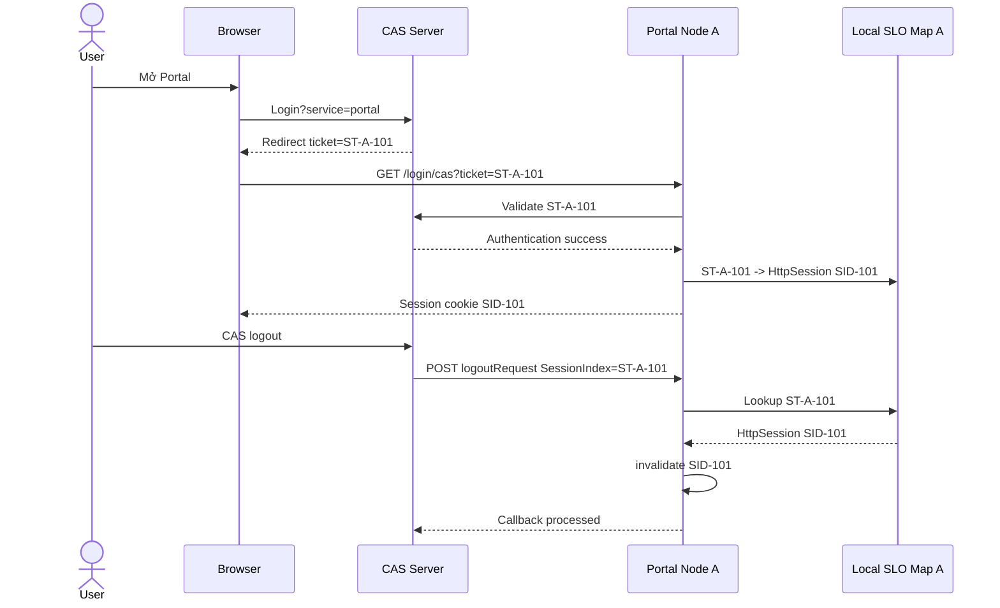
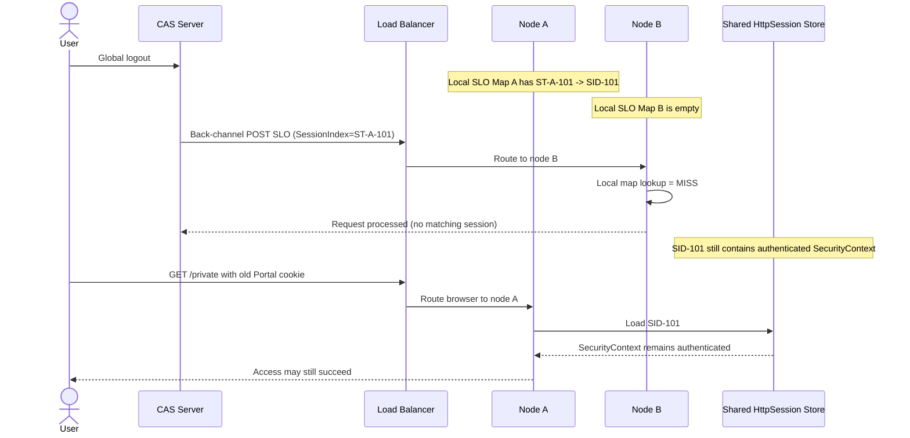
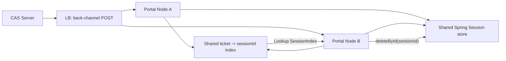

# Giới hạn kho ánh xạ phiên trong bộ nhớ khi ứng dụng chạy nhiều nút

## Mục tiêu học tập

Sau bài này, bạn có thể:

1. Phân biệt **CAS Single Logout (SLO)**, phiên SSO trên CAS Server, phiên `HttpSession` của từng ứng dụng và **kho ánh xạ ticket → phiên** được CAS Client dùng để tìm phiên cần hủy.
2. Mô tả vì sao `SingleSignOutFilter` / `SingleSignOutHandler` với kho ánh xạ mặc định dựa trên bộ nhớ **chỉ nhìn thấy phiên đã ghi tại JVM hiện tại**, không phải toàn cụm.
3. Giải thích tình huống đăng nhập tại node A nhưng CAS Server gửi **back-channel logout** tới node B: logout callback có thể thành công ở HTTP nhưng không tìm được session và ứng dụng vẫn authenticated.
4. Phân biệt **sticky sessions**, **Spring Session dùng Redis/JDBC** và **distributed CAS session-ticket mapping**; biết vì sao chỉ triển khai một trong ba có thể không đủ.
5. Đánh giá các phương án xử lý: tích hợp SLO qua lớp phân tán có `ticketIndex → sessionId`, routing có kiểm soát, callback fan-out, short session TTL, centralized deny/epoch và phương án dùng chính CAS client đã được hỗ trợ.
6. Thiết kế lifecycle ánh xạ đúng với **session creation, session ID rotation, logout, expiry, re-login, node restart, session deletion, concurrent callbacks và replay**.
7. Thực hành code **Java 17+ độc lập** mô phỏng memory index trên hai node, session store chung và tình huống session ID đổi; quan sát stdout chính xác.
8. Áp dụng ví dụ Spring Session về `SessionRepository.deleteById(...)` và Redis mapping **chỉ sau khi SLO callback đã được thẩm định**, cùng kiểm thử end-to-end và checklist vận hành an toàn.

## 1. Bối cảnh: CAS có thể đăng xuất tập trung nhưng không giữ phiên ứng dụng

**CAS – Central Authentication Service** xác thực người dùng và duy trì phiên SSO thông qua **Ticket-Granting Ticket (TGT)** cùng cookie phía CAS Server. Khi người dùng đăng nhập vào Service Provider (SP)/CAS Client, CAS cấp **Service Ticket (ST)** gắn với URL `service` cụ thể. Ứng dụng Spring Security validate ST với CAS Server rồi tạo **SecurityContext** và **HttpSession** riêng.

Ở thời điểm khác, người dùng yêu cầu logout toàn bộ phiên CAS. CAS Server có thể gửi **Single Logout notification** đến các ứng dụng đã tham gia SSO. Nhưng CAS **không có quyền trực tiếp gọi `HttpSession.invalidate()` bên trong mọi ứng dụng**. Mỗi CAS Client cần nhận callback, tìm đúng phiên ứng dụng và tự làm cho phiên đó không còn hiệu lực.

Ví dụ hệ thống:

- CAS Server `https://sso.example.org/cas`.
- Ứng dụng Portal `https://portal.example.org`.
- Hai instance Portal **node A** và **node B** đằng sau load balancer.
- Browser đăng nhập qua A bằng ST `ST-A-101` và được ứng dụng cấp session `SID-101`.
- CAS Client theo dõi cặp **`ST-A-101 → phiên SID-101`** để về sau tìm phiên khi nhận SLO.
- Người dùng logout tại CAS; callback SLO rơi vào **node B**.
- B có thể biết cấu hình CAS Server nhưng **không có cặp ánh xạ được A ghi trong RAM**.

**Kết quả nguy hiểm:** CAS đã chấm dứt TGT, CAS SLO request được gửi, nhưng `SID-101` trên ứng dụng có thể tiếp tục truy cập các tài nguyên được bảo vệ. Đây là lỗi **session revocation coverage**, không phải lỗi CAS Server xác thực sai user.

### 1.1. Bốn “kho” hoàn toàn khác nhau

| Kho/trạng thái | Chủ sở hữu | Nội dung chính | Phạm vi |
| --- | --- | --- | --- |
| **CAS Ticket Registry/TGT** | CAS Server | Phiên SSO và tickets CAS | Phụ thuộc kiến trúc CAS Server; không phải app session store |
| **App HttpSession store** | Portal/Spring Session/container | `SecurityContext`, app state, session ID | In-memory một node hoặc shared Redis/JDBC |
| **CAS Client SLO mapping storage** | Apereo CAS Java Client trong Portal | Ánh xạ **CAS ticket/SessionIndex → HttpSession** | Mặc định có thể là map trong bộ nhớ JVM |
| **Browser cookie** | Browser | App session identifier và CAS TGC ở domain tương ứng | Browser không xuất hiện trong back-channel request CAS → app |

**Điểm mấu chốt:** khi ứng dụng dùng **Spring Session Redis**, map riêng của CAS Client **không tự biến thành distributed map**. Nó vẫn có thể được giữ tại node A, trong khi Redis lưu session `SID-101` được A và B cùng đọc.

### 1.2. CAS logout khác ứng dụng tự logout

- **Local logout tại Portal:** ứng dụng thường clear Spring Security Authentication, invalidate `HttpSession` và xóa cookie app; CAS TGT/TGC có thể còn hiệu lực, nên lần đăng nhập sau có thể tự SSO lại.
- **CAS logout:** CAS Server kết thúc phiên SSO/TGT. Nếu **không** có cơ chế SLO hoạt động ở Portal, các sessions ứng dụng đã tạo có thể tiếp tục hợp lệ.
- **CAS Single Logout:** CAS gửi thông điệp (back-channel hoặc front-channel tùy cấu hình) yêu cầu client tự invalidate sessions. Đây là **cơ chế phối hợp best-effort**, không phải bảo đảm nguyên tử mọi ứng dụng đã logout.
- **Admin/emergency revocation:** có thể cần xóa session theo user/tenant hoặc thêm deny flag ngay cả khi SLO notification bị thất lạc.

## 2. Cơ chế ánh xạ SLO trong CAS Client

Apereo CAS Java Client có các thành phần thông dụng:

| Thành phần | Vai trò |
| --- | --- |
| `org.apereo.cas.client.session.SingleSignOutFilter` | Quan sát request chứa ticket lúc đăng nhập và thông điệp CAS logout; điều phối ghi ánh xạ hoặc invalidate session |
| `SingleSignOutHandler` | Logic lưu mapping, nhận và xử lý logout message |
| `SessionMappingStorage` | Abstraction cho ánh xạ mapping ID ↔ servlet session |
| `HashMapBackedSessionMappingStorage` | Implementation dựa trên map trong bộ nhớ của một JVM |
| `SingleSignOutHttpSessionListener` | Dọn mapping khi servlet session bị hủy theo các sự kiện mà listener quan sát được |

**Tên package/version cần kiểm:** Apereo Java CAS Client mới dùng `org.apereo.cas.client.*`; một số bài cũ sử dụng `org.jasig.cas.client.*` hoặc `javax.servlet.*`. Với Spring Boot 3 phải chọn bản tương thích **Jakarta Servlet**, không copy một file `web.xml` cũ rồi cho rằng API tự tương thích.

### 2.1. Map chứa gì?

Trong một triển khai CAS native protocol, CAS khi cấp Service Ticket `ST-A-101` sẽ nhớ service mà ticket được cấp. CAS Client có thể ghi:

```text
CAS Client node A / local JVM
  mapping ID: ST-A-101
      |
      v
  HttpSession SID-101

CAS Client node B / local JVM
  (empty)
```

Khi người dùng logout toàn bộ CAS, back-channel logout message gửi tới Portal có thể chứa `<samlp:SessionIndex>ST-A-101</samlp:SessionIndex>`. CAS Client dùng giá trị này để tìm `HttpSession` trước đây được liên kết với ST rồi invalidate.

**Lưu ý kỹ thuật:** `SessionIndex` trong CAS SLO truyền thống thường được dùng để tham chiếu đến ST đã phát cho service; nó **không mặc nhiên là TGT**, email hay `JSESSIONID`. Profile, CAS Server version và loại SLO cụ thể phải được xác minh. Không bao giờ thay mọi thứ bằng `username` khi cần tìm đúng phiên theo ticket.

### 2.2. Luồng khi chỉ có một node



Trong môi trường một node, hoặc tình cờ khi callback về đúng node chứa mapping và session object còn hợp lệ, hành vi này có thể hoạt động đúng. **Thành công trong thử nghiệm localhost một node không chứng minh SLO hoạt động khi scale.**

### 2.3. Không lưu username thay cho mapping theo ST

Một user có thể đồng thời có nhiều sessions và thiết bị; hai CAS service tickets khác nhau có thể gắn các phiên khác nhau. Mapping từ username → một session có nguy cơ sai phạm vi và nhầm tenant. Với CAS native SLO, dữ liệu tương quan phải dựa trên **giá trị phiên/ticket đúng theo protocol** và ứng dụng cần biết session nào do ticket đó tạo.

Một bản ghi ứng dụng tự quản lý có thể lưu metadata bổ sung phục vụ audit:

```text
service_namespace : portal-prod
cas_ticket_digest : HMAC-SHA256(ST-A-101, secret-app)
app_session_id    : SID-101
created_at        : ...
expires_at        : ...
status            : active
```

Đây là **mô hình dữ liệu đề xuất**, không phải nội dung mà CAS Server tự cung cấp hoặc class có sẵn của Spring Security. Để tránh lộ raw ST, hệ thống có thể dùng HMAC digest làm khóa lookup, quản lý HMAC secret qua KMS/secret manager.

## 3. Vì sao kho ánh xạ RAM gặp lỗi khi chạy nhiều nút?

### 3.1. Back-channel logout không đi theo cookie của browser

Một load balancer cấu hình sticky session thường dựa vào browser cookie `JSESSIONID`. Nhưng **back-channel SLO** là HTTP request **CAS Server → Portal**, không phải browser → Portal. Nó có thể không mang cookie ứng dụng của user và không thể sử dụng sticky browser affinity để đi về node A.



Ngay cả khi Redis được dùng làm **shared app session store**, nếu CAS client `SingleSignOutHandler` nhìn vào **map JVM B** thì không thấy mapping ở A. Việc có session chung **không giúp B biết session ID cần xóa**.

### 3.2. So sánh ba cấu hình

| Kiến trúc | App HttpSession | CAS ticket→session index | Back-channel SLO vào node khác |
| --- | --- | --- | --- |
| Một node | RAM A | RAM A | Không có node khác; vẫn có rủi ro restart/TTL |
| Nhiều node, sticky browser | RAM riêng A/B | RAM riêng A/B | **Không đáng tin**: callback CAS không có browser affinity |
| Nhiều node, Spring Session Redis | Shared Redis | RAM riêng A/B | **Vẫn có thể MISS** ở node B |
| Nhiều node, shared session + shared ticket index | Shared Redis/JDBC | Distributed index có TTL | Có thể tìm đúng session ID và revoke nếu xử lý đầy đủ |
| Nhiều node, shared index nhưng session RAM riêng | RAM riêng A/B | Distributed index | Biết ID nhưng B **không chắc** invalidate được session thuộc A |
| Session deny flag/epoch trung tâm | Bất kỳ, với request-time check | Có thể bổ sung | Chặn access nếu SLO events được ánh xạ và deny đồng bộ đúng |

**Kết luận:** cần giải cả **khả năng tìm phiên** (ticket → session) lẫn **khả năng hủy/deny phiên** (xóa session theo ID ở toàn cluster). Chỉ giải một nửa chưa đủ.

### 3.3. Lỗi ngẫu nhiên 50% không phải tình cờ

Nếu hai node có cùng xác suất nhận callback và chỉ một node giữ mapping, trong điều kiện đơn giản, có thể thấy logout thành công trên một số lần và thất bại trên số còn lại. **Không đưa 50% làm SLA hay dự báo thực tế**: kết quả còn phụ thuộc ingress, CAS callback URL, session routing, node restarts, load balancing weights, retry và các cấu hình khác.

Triệu chứng thường thấy:

- Logout một node chạy, hai hoặc nhiều node thất bại không ổn định.
- Người dùng ở tab đang đăng nhập vẫn mở được `/reports` sau CAS logout.
- Khi tắt node A, các phiên do A đăng nhập không thể tra từ B dù Redis còn session.
- SLO callback HTTP trả 200 hoặc 204 nhưng không có log `session invalidated`.
- Một node có số mapping lớn trong heap, node khác gần bằng 0.
- Chỉ có browser local logout hoạt động; CAS global logout không làm hết app sessions.

Không suy rằng **HTTP 200** nghĩa là phiên đã bị hủy. Nó chỉ có thể cho biết callback được web server nhận và handler đã chạy.

## 4. Vấn đề không chỉ là load balancing

### 4.1. Node restart hoặc rolling deploy

Map `HashMapBackedSessionMappingStorage` sống trong RAM. Sau khi pod A restart:

- CAS Server có thể còn TGT hoặc SLO sẽ đến trong tương lai.
- Spring Session Redis vẫn có `HttpSession SID-101` đã xác thực.
- Map ticket→session trên A **đã mất**.
- Callback sau restart không tìm thấy mapping nên không hủy được SID-101.

Nếu người dùng có app session TTL dài, nguy cơ tồn tại nhiều giờ sau khi CAS logout dù CAS Server đã hết TGT.

### 4.2. Memory growth và cleanup

Map chứa key→`HttpSession` reference hoặc cấu trúc tương đương, có thể giữ những đối tượng nặng nếu cleanup thiếu:

- `SessionMappingStorage` cần remove mapping khi session bị hủy.
- `SingleSignOutHttpSessionListener` hỗ trợ dọn theo servlet session lifecycle; nhưng trong môi trường Spring Session distributed, không mặc định mọi event Redis/JDBC expiration đều được chuyển thành **đúng loại servlet listener callback** ở JVM đã giữ object mapping.
- Nếu session bị xóa ngoài JVM (Redis key expiry/admin revoke), local mapping có thể không được cleanup theo cách dự kiến.
- Một ST/phiên không bị dọn có thể giữ `HttpSession`/principal/attributes lâu hơn cần thiết, tăng heap và tạo nguy cơ retention.
- Khởi động lại JVM giải phóng map RAM nhưng **không thu hồi app sessions** đã được ghi ở external store.

Vì vậy test **cleanup trong runtime thật**, không chỉ test `HttpSession.invalidate()` ở servlet container in-memory. Quan sát số mapping, tuổi mapping, session destruction events, heap và cache eviction.

### 4.3. Session ID rotation và fixation protection

Spring Security thường rotate/change session ID sau authentication để chống session fixation. Nếu ánh xạ SLO được ghi **trước** khi session ID đổi mà ứng dụng chỉ lưu một chuỗi **ID cũ**, callback sau đó có thể tìm được ID đã nghỉ hưu nhưng không tìm session ID mới.

```text
Before CAS login:   SID-OLD
Record mapping:     ST-A-101 -> SID-OLD
After CAS success:  SID-NEW (rotated)
Back-channel SLO:   ST-A-101 -> SID-OLD
Session store:      SID-NEW still authenticated
```

**Không kết luận mọi CAS client mặc định luôn gặp lỗi trên.** Một implementation lưu **HttpSession object reference** có thể tiếp tục nhìn thấy object sau ID change, tùy container/strategy. Vấn đề cần kiểm là: nếu hệ thống tự chuyển mapping sang **distributed index chứa session ID dạng chuỗi**, phải đảm bảo mapping phản ánh **ID cuối sau session fixation protection**, cùng listener/transaction xử lý đổi ID.

**Không tắt session fixation protection** như một giải pháp đơn giản để tránh cập nhật mapping. Hãy cập nhật index và kiểm race conditions.

### 4.4. SLO callback tới trước khi mapping lưu xong

Một race khác:

1. CAS validation/redirect thành công.
2. CAS Server phát SLO vì user logout gần như cùng lúc.
3. SLO callback đến node B **trước** khi node A đã ghi mapping ST→final session ID.
4. Node B lookup = miss; coi như đã xử lý.
5. Node A sau đó ghi mapping và lưu authenticated session.
6. Phiên vẫn tồn tại dù logout vừa xảy ra.

Giải pháp phải xét **event ordering**: marker “revoked ticket”, atomic link-if-not-revoked, transaction/lock hoặc event stream durable, có TTL và replay handling. Chỉ thêm Redis map mà không xử lý race này có thể để lại lỗ hổng.

### 4.5. Một session, nhiều tickets hoặc đăng nhập lại

Một browser/app session có thể có nhiều CAS service tickets theo các lần reauth/login. Nếu tự xây index:

- Một session có thể cần nhiều mapping ST→session ID trong một số flow.
- Khi session destroyed, cần dọn **tất cả mapping** liên quan, không chỉ ticket gần nhất.
- Không cho một SLO cũ vô tình xóa một phiên khác vừa được cấp lại theo policy; xác định liên kết giữa original CAS session, service ticket và app session.
- Nếu một ST key bị dùng lại do bug/giả lập, fail closed và audit. CAS ST trong thực tế phải khó đoán, duy nhất và dùng một lần.
- Session ID có thể bị rotate nhiều lần: index cần phản ánh session hiện tại hoặc có cơ chế invalidate theo stable app session identity.

### 4.6. Callback được nhận nhưng server chưa thật sự revoke

Một handler có thể đọc `SessionIndex` rồi gọi `session.invalidate()`, nhưng có thể lỗi:

- Session đã expired (no-op hợp lệ) hoặc chưa từng tồn tại ở node hiện tại.
- Session repository/network tạm unavailable.
- Serialization/namespace không tương thích giữa nodes.
- Callback chỉ cập nhật in-memory map, không gọi distributed session deletion.
- Handler bắt lỗi rồi trả 2xx mà không có retry/dead letter.
- Request ứng dụng khác đã load context và đang xử lý đồng thời trước khi session bị xóa.

Thiết kế idempotency, observability và retry/ack theo actual revocation outcome; không khẳng định xóa session làm ngừng tức thì mọi request đang chạy hoặc WebSocket connection.

## 5. CAS Single Logout back-channel và front-channel

Apereo CAS hỗ trợ các chế độ logout tùy version, registration và protocol:

| Kiểu | Đường đi | Ưu điểm | Giới hạn |
| --- | --- | --- | --- |
| **Back-channel SLO** | CAS Server gửi HTTP POST tới service callback | Không cần browser gửi cookie app; có thể xử lý server-to-server | Phải tìm session qua correlation ID; callback có thể tới node khác |
| **Front-channel SLO** | Browser/iframe/AJAX redirect hoặc request tới service theo CAS setting | Một số app có thể dùng browser context | Bị cookie SameSite/privacy/CSP/iframe/JS restrictions; không luôn hỗ trợ |
| **Local logout** | User gửi app `/logout` | App chủ động invalidate đúng session hiện tại | CAS TGT/những ứng dụng khác không tự logout |
| **CAS global logout** | User yêu cầu CAS `/logout` | Chấm dứt CAS SSO session | Không tự xóa app sessions nếu clients không xử lý SLO |

Back-channel SLO thường được cấu hình qua service `logoutType=BACK_CHANNEL` hoặc callback URL cụ thể tại CAS Server. Hành vi mặc định và endpoint chính xác **phụ thuộc CAS release**, không suy ra từ một hướng dẫn version khác. Phải kiểm CAS Server có thật sự gửi notification tới Portal không, message được định tuyến đến đâu, và client hỗ trợ profile ấy.

**Back-channel request từ CAS Server không có JSESSIONID của browser**, nên sticky routing không giải được theo cách thông thường.

### 5.1. Định dạng thông điệp logout

Một SLO notification thường chứa XML tương tự:

```xml
<samlp:LogoutRequest
  xmlns:samlp="urn:oasis:names:tc:SAML:2.0:protocol"
  xmlns:saml="urn:oasis:names:tc:SAML:2.0:assertion"
  ID="_logout-123"
  Version="2.0"
  IssueInstant="2026-11-07T04:00:00Z">
  <saml:NameID>user-id</saml:NameID>
  <samlp:SessionIndex>ST-A-101</samlp:SessionIndex>
</samlp:LogoutRequest>
```

Đây là **XML minh họa** cho trường `SessionIndex`. Trong thực tế một CAS client có thể nhận nội dung qua tham số POST `logoutRequest` và dùng XML parser/handler của thư viện. Không cố tự decode tùy tiện mọi profile; kiểm version CAS và client.

**Đừng dùng NameID/email để xóa “mọi phiên người này” một cách âm thầm** nếu protocol chỉ yêu cầu hủy một session/ticket cụ thể. Phạm vi revocation rộng hơn có thể được quyết định riêng theo chính sách an ninh, nhưng phải ghi rõ.

### 5.2. Xác thực nguồn gửi logout

Bất kỳ người ngoài nào có thể cố POST `logoutRequest` tới endpoint công khai. Một hệ thống tùy biến **không được lấy một `SessionIndex` chưa được thẩm định rồi xóa session ngay**.

Trước khi xử lý, cần thiết kế controls phù hợp CAS deployment:

- TLS, cấu hình endpoint/ingress, authentication hoặc network ACL cho trusted CAS Server khi áp dụng được.
- Kiểm chữ ký XML nếu profile yêu cầu/hỗ trợ; không giả định mọi CAS native SLO notification đều có XML Signature.
- Kiểm đúng `Issuer`/service binding/format/validation requirements tùy protocol, hạn chế message size và XML entity expansion.
- Kiểm timestamp/replay ID/correlation khi profile cung cấp và được tích hợp, không dựa duy nhất vào IP nếu đi qua proxy có thể spoof header.
- Không tin header `X-Forwarded-For` do internet client tự gửi; chỉ trusted ingress được đặt.
- Log reject reasons không để lộ raw ST, SessionIndex, username hay XML có PII.

**Đối với built-in `SingleSignOutFilter`, phải kiểm các biện pháp xác thực callback thực tế của CAS client và hạ tầng**. Việc filter parse XML và hủy session là tính năng protocol, **không có nghĩa mọi callback đã được cryptographically authenticated**. Không viết một public REST controller `POST /revoke?ticket=...` không có bảo vệ.

## 6. Các phương án kiến trúc khi chạy nhiều nút

### 6.1. Phương án A – Một node, cấu hình SLO mặc định

Thích hợp cho lab/ứng dụng nhỏ **không scale ngang** khi đã hiểu giới hạn:

- Một JVM lưu ánh xạ ST→`HttpSession`.
- `SingleSignOutFilter` nhận callback, tìm session và invalidate.
- `SingleSignOutHttpSessionListener` dọn map khi session destroyed.
- Session timeout hạn chế tuổi phiên nếu missed logout.

**Giới hạn:** JVM restart làm mất mapping, local session hoặc distributed session lifecycle có thể không đồng bộ, không hỗ trợ HA đúng nghĩa. Không gọi đây là thiết kế an toàn cho hai nodes chỉ vì đã bật sticky sessions.

### 6.2. Phương án B – Sticky sessions

Sticky routing cho **browser requests** có thể giúp request sau login quay lại đúng app node đang giữ HttpSession. Nhưng callback **CAS Server → LB → Portal** không có browser cookie; thường không có cách cùng affinity.

Có thể thiết kế callback routing theo ticket hash hoặc dedicated ownership layer, nhưng đó **không phải sticky browser session** thông thường; cần mapping/router có tính nhất quán, HA/restart behavior và kiểm soát bảo mật. Thường phức tạp hơn distributed index và session store.

**Không coi sticky là giải pháp mặc định cho SLO đa node.**

### 6.3. Phương án C – Spring Session Redis/JDBC mà giữ CAS map mặc định

Spring Session chia sẻ `HttpSession` giữa nodes:

```text
Node A -> Redis: SID-101 SecurityContext
Node B -> Redis: SID-101 SecurityContext

CAS SLO map A: ST-A-101 -> HttpSession SID-101
CAS SLO map B: empty
```

Điều này **sửa được khả năng đọc session từ node bất kỳ khi có cookie**, nhưng **không tự chia sẻ ST→session mapping** của CAS Client. Khi SLO POST tới B, nó vẫn miss. Phải thay cách ánh xạ/hủy session hoặc xác minh thư viện đã có distributed adapter hỗ trợ đúng version.

### 6.4. Phương án D – Shared session store + distributed SLO index

Đây là hướng tổng quát dễ kiểm chứng nếu cần SLO đáng tin cậy khi scale:

1. Application lưu `HttpSession` trong shared store (Spring Session Redis/JDBC, TTL phù hợp).
2. Khi ST đã được validate, bảo đảm session được thiết lập và biết **session ID cuối** sau fixation protection.
3. Ghi một **distributed mapping** keyed by ticket identifier (khuyến nghị keyed digest/HMAC) → **app session ID**. Có TTL, namespace theo service/environment.
4. CAS SLO callback đến node bất kỳ; handler **được xác thực/thẩm định** lấy `SessionIndex` rồi tra shared index.
5. Từ session ID, handler gọi `SessionRepository.deleteById(sessionId)` hoặc cơ chế revoke/deny trung tâm.
6. Dọn mapping/index phụ trợ, ghi audit/metrics không lộ secrets; xử lý retry/partial failure.
7. Kiểm race logout-before-link, concurrent callbacks, session ID rotation, session expiration, node restart và cache connectivity.
8. Nếu callback không thể được xử lý, **không báo đã revoke thành công**; retry/quarantine/alert theo policy.



**Lưu ý interface cũ:** `SessionMappingStorage` của một số bản Java CAS Client có API giữ **`HttpSession` object**, không phải plain session ID. **Không serialize `HttpSession` trực tiếp vào Redis** rồi mong tái dựng Servlet session trên JVM khác. Để dùng Spring Session, thường phải xây integration/adapter riêng ở mức **ST→sessionId** và `SessionRepository`, hoặc chọn implementation/library đã được kiểm chính thức hỗ trợ distributed mapping. Đừng tự quảng cáo một `RedisSessionMappingStorage` tưởng tượng như có sẵn trong mọi version.

### 6.5. Phương án E – Centralized access-deny/incident epoch

Khi yêu cầu thu hồi gần tức thời hoặc không chắc callbacks sẽ luôn đến, có thể bổ sung:

- User/session/tenant revocation markers trong kho chung.
- Session epoch và recheck ở request authorization boundary, không chỉ chờ HttpSession expiry.
- Shorter session TTL và reauth cho vùng nhạy cảm.
- Force logout theo user/tenant qua session index do ứng dụng quản lý.
- Giám sát missed SLO và reconcile với quyền user/business state.

Đây là **phòng vệ bổ sung**, không chứng minh CAS SLO đã xử lý thành công. Với user làm admin, request đã bắt đầu trước revocation hoặc WebSockets/background tasks có thể vẫn cần cơ chế ngắt riêng.

### 6.6. So sánh lựa chọn

| Giải pháp | Sửa tìm session trên node khác? | Sửa hủy session trên node khác? | Hạn chế chính |
| --- | --- | --- | --- |
| Chỉ sticky browser session | Không chắc | Không chắc | CAS callback không mang browser cookie |
| Chỉ Spring Session Redis/JDBC | Không | Có nếu biết session ID | Map ticket của CAS client vẫn ở RAM |
| Chỉ distributed ticket index | Có | Không chắc | Local HttpSession có thể không accessible ở node khác |
| Shared index + shared session store | Có | Có về mặt thiết kế | Cần code/test/auth/TTL/race/retry |
| CAS client/library có hỗ trợ SLO cluster chính thức | Tùy implementation | Tùy implementation | Phải đối chiếu version và topology cụ thể |
| Session deny flag/epoch | Bổ sung khả năng chặn | Có thể chặn access mới | Phải check mỗi request nhạy cảm; không thay SLO callback |

## 7. Demo Java 17+: hai node, một shared session store

Ví dụ **Java thuần** mô phỏng failure mode. Không dùng Spring, CAS tickets thật, mạng hoặc Redis. Nó chỉ tách hai cấu trúc: local SLO map và session store chung.

Tệp `CasMultiNodeLogoutDemo.java`:

```java
import java.util.HashMap;
import java.util.Map;

public final class CasMultiNodeLogoutDemo {

    static final class Node {
        private final Map<String, String> localTicketIndex =
                new HashMap<>();

        void recordLogin(String ticket, String sessionId) {
            localTicketIndex.put(ticket, sessionId);
        }

        boolean onLogout(
                String ticket, Map<String, Boolean> sharedSessions) {
            String sessionId = localTicketIndex.remove(ticket);
            if (sessionId == null) {
                return false;
            }
            sharedSessions.remove(sessionId);
            return true;
        }
    }

    public static void main(String[] args) {
        Map<String, Boolean> sharedSessions = new HashMap<>();
        Node nodeA = new Node();
        Node nodeB = new Node();

        sharedSessions.put("SID-101", true);
        nodeA.recordLogin("ST-101", "SID-101");

        System.out.println("Session exists: "
                + sharedSessions.containsKey("SID-101"));

        // CAS back-channel logout bị LB chuyển tới node B.
        boolean foundOnB =
                nodeB.onLogout("ST-101", sharedSessions);
        System.out.println("Node B found local mapping: " + foundOnB);
        System.out.println("Session after node B SLO: "
                + sharedSessions.containsKey("SID-101"));

        // Chỉ khi callback rơi đúng node A mới tra được local map.
        boolean foundOnA =
                nodeA.onLogout("ST-101", sharedSessions);
        System.out.println("Node A found local mapping: " + foundOnA);
        System.out.println("Session after node A SLO: "
                + sharedSessions.containsKey("SID-101"));

        // Shared ticket index + shared session store.
        Map<String, String> distributedIndex = new HashMap<>();
        sharedSessions.put("SID-202", true);
        distributedIndex.put("ST-202", "SID-202");

        String sid = distributedIndex.remove("ST-202"); // Node B đọc.
        boolean centralFound = sid != null;
        if (centralFound) {
            sharedSessions.remove(sid);
        }
        System.out.println("Distributed index found: " + centralFound);
        System.out.println("Session after central SLO: "
                + sharedSessions.containsKey("SID-202"));

        // Phiên bị rotate nhưng mapping ID chưa được cập nhật.
        sharedSessions.put("SID-NEW", true);
        distributedIndex.put("ST-303", "SID-OLD");
        String stale = distributedIndex.remove("ST-303");
        sharedSessions.remove(stale);
        System.out.println("Rotated session still active: "
                + sharedSessions.containsKey("SID-NEW"));

        // Nếu mapping biết ID cuối, có thể xóa đúng phiên.
        distributedIndex.put("ST-304", "SID-NEW");
        String finalId = distributedIndex.remove("ST-304");
        sharedSessions.remove(finalId);
        System.out.println("After final-ID mapping: "
                + sharedSessions.containsKey("SID-NEW"));
    }
}
```

Biên dịch và chạy:

```bash
javac CasMultiNodeLogoutDemo.java
java CasMultiNodeLogoutDemo
```

**Stdout chính xác:**

```text
Session exists: true
Node B found local mapping: false
Session after node B SLO: true
Node A found local mapping: true
Session after node A SLO: false
Distributed index found: true
Session after central SLO: false
Rotated session still active: true
After final-ID mapping: false
```

Diễn giải:

- Node B không có mapping trong RAM nên **không thể tìm SID-101**, dù shared session store có entry.
- Node A nhìn thấy mapping của mình và xóa đúng phiên.
- Distributed index cho phép node B nhận SLO và tra được session ID để hủy trong shared store.
- Một index chứa **SID-OLD** sau khi fixation protection đã đổi ID thành **SID-NEW** vẫn có thể hủy sai/không hủy được phiên mới.
- Đoạn code chỉ chứng minh khái niệm. `HashMap` không bảo vệ nhiều thread và không có network/TTL/security; Redis/JDBC cần transaction, HMAC, retry và audit thật.
- Trong ứng dụng CAS production, **chỉ liên kết ST sau khi CAS ticket đã được xác thực**, không từ một `ticket` người dùng tự gửi.
- Đừng dùng raw `ST-101`/`SID-101` như audit data; chúng là fixtures cố định dùng cho việc học.

## 8. Spring Session: lớp xóa session phân tán

Trong ứng dụng Spring Boot 3 với Spring Session, bạn có thể dùng `SessionRepository` để tìm/hủy session theo ID trên shared store. Đây là **nửa thứ hai** của bài toán; nó **không tự biết Service Ticket nào thuộc session nào**.

### 8.1. Dependencies và cấu hình

Trong `build.gradle` thuộc Spring Boot 3 project đã có plugin/BOM:

```groovy
dependencies {
    implementation 'org.springframework.boot:spring-boot-starter-web'
    implementation 'org.springframework.boot:spring-boot-starter-security'
    implementation 'org.springframework.security:spring-security-cas'
    implementation 'org.apereo.cas.client:cas-client-core'

    implementation 'org.springframework.session:spring-session-data-redis'
    implementation 'org.springframework.boot:spring-boot-starter-data-redis'
}
```

**Điều kiện:** CAS Java Client dependency phải tương thích Jakarta Servlet ở Spring Boot 3. Redis phải có ACL/TLS/credentials từ secret manager. Không để `localhost`/port mặc định ở production chỉ vì tutorial dùng vậy.

`application.yml` tối thiểu (chỉ là ví dụ, không đủ production):

```yaml
server:
  servlet:
    session:
      timeout: 20m
      cookie:
        secure: true
        http-only: true
spring:
  data:
    redis:
      host: redis.internal.example
      port: 6379
  session:
    timeout: 20m
```

Trong production còn cần `spring.data.redis.ssl`/TLS, auth, namespace, network ACL, availability/replication, serializer và policy dữ liệu nhạy cảm. Một số Spring Session Redis repositories hỗ trợ **principal indexes** khác nhau; lựa chọn exact implementation theo Boot/Spring Session release.

### 8.2. Service tối thiểu cho thao tác xóa session theo ID

Đây là **Spring-managed service snippet**, không chạy độc lập bằng `javac`:

```java
package com.example.cas.slo;

import org.springframework.session.Session;
import org.springframework.session.SessionRepository;
import org.springframework.stereotype.Service;

@Service
public class SessionDeletionService {

    private final SessionRepository<? extends Session> sessions;

    public SessionDeletionService(
            SessionRepository<? extends Session> sessions) {
        this.sessions = sessions;
    }

    // Chỉ gọi từ SLO handler đã xác thực hoặc admin workflow được phép.
    public void revokeSessionById(String sessionId) {
        if (sessionId == null || sessionId.isBlank()) {
            throw new IllegalArgumentException("sessionId required");
        }
        sessions.deleteById(sessionId);
    }
}
```

- `SessionRepository.deleteById` xóa session theo ID. Với shared Spring Session store, request tiếp theo từ bất kỳ node nào thường không load được security context cũ.
- Method **không nhận REST query của user tùy ý** để delete session; handler phải chứng minh có quyền thu hồi session đó.
- Một request đang chạy có thể đã nạp `Authentication` trước khi session bị xóa; cần check revoke marker tại hành động đặc biệt nhạy cảm nếu cần immediate enforcement.
- Session ID phải thuộc **đúng session namespace/ứng dụng**. Không dùng session IDs từ tenant khác để xóa bừa.
- Không mở public `/deleteSession?id=...` — đó là API gây DoS nếu không có kiểm soát.

### 8.3. Vì sao `FindByIndexNameSessionRepository` không thay SLO ticket index?

`FindByIndexNameSessionRepository.findByPrincipalName(user)` tìm sessions của một **principal name** nếu index đã được ghi. Nhưng CAS SLO callback có thể chỉ cung cấp **SessionIndex/ST identifier**, không phải stable subject hay một yêu cầu “logout mọi thiết bị của user”.

Do đó:

- Không suy từ `SessionIndex` ra `principalName` nếu protocol không bảo đảm.
- Không chọn một session bất kỳ của username trùng giữa tenants.
- Với yêu cầu revoke toàn bộ user/tenant theo nghiệp vụ, principal index hữu ích **khi được populate và namespaced đúng** — đó là một operation **riêng** với CAS SLO theo ST.
- Nếu bắt buộc map ST → session, cần **index theo đúng CAS ticket/SessionIndex**, không dựa vào tính năng principal lookup mặc định.

## 9. Distributed ticket index: mô hình an toàn để kết nối hai lớp

Một thiết kế production có thể dùng Redis làm index:

```text
Key:
  portal-prod:cas:slo:map:v1:<HMAC-SHA256(ST or SessionIndex)>

Value:
  finalAppSessionId (có bảo vệ, TTL giới hạn)

Lookup:
  Trusted SLO callback -> HMAC(SessionIndex) -> lookup sessionId
  -> SessionRepository.deleteById(sessionId)
  -> remove mapping after success
```

**Tại sao dùng HMAC?** Ticket/SessionIndex là dữ liệu định danh nhạy cảm. Raw key trong Redis/log có thể cho phép liên kết dữ liệu qua hệ thống. HMAC với secret khác biệt và namespace giúp tránh phơi bày trực tiếp ticket IDs và hạn chế lookup theo dictionary so với digest không khóa. Nhưng **HMAC không thay xác minh nguồn CAS SLO callback**, cũng không làm session IDs trong value không nhạy cảm.

### 9.1. Nguyên tắc ghi index

1. **Chỉ sau CAS validation thành công:** không ghi ST do browser gửi trước khi validator xác minh, tránh index poisoning.
2. **Biết final session ID:** sau session-fixation strategy đã đổi ID; nếu có listener ID changed phải cập nhật atomic hoặc có stable reference được thiết kế.
3. **Gắn service/tenant/realm namespace:** `portal-prod` không dùng chung Redis key space với ứng dụng khác nếu không có phân tách rõ.
4. **TTL phù hợp:** tối đa không vượt policy session lifetime và có buffer ngắn cho late SLO events; không giữ ticket indefinitely.
5. **Một lần / idempotency:** callback lặp không được tạo login mới hoặc revive mapping.
6. **Dọn khi local logout/session expiry:** dùng reverse index hoặc session lifecycle events phù hợp để không giữ stale mappings; phải test listener thật.
7. **Race-safe khi logout đến trước link:** đánh dấu revoked ticket trong shared state, từ chối tạo link/session sau marker, hoặc giao tiếp CAS/client theo protocol có transaction; test trường hợp này.
8. **SLO handler được xác thực:** Không mở method tra ST→ID cho HTTP client bất kỳ.

### 9.2. Pseudocode đáng tin cậy hơn một controller public

```text
onCasTicketValidated(ticket, finalHttpSessionId, serviceNamespace):
    assert authentication is successful and ticket belongs to trusted CAS
    key = HMAC(serviceNamespace, ticket)
    atomically:
        if revokedMarker(key): reject/purge login session
        else store key -> finalHttpSessionId with bounded TTL

onTrustedCasLogout(message):
    verify trusted delivery, protocol format and replay policy
    sessionIndex = parseApprovedSessionIndex(message)
    key = HMAC(serviceNamespace, sessionIndex)
    atomically mark revokedMarker(key)
    sessionId = lookup(key)
    if sessionId exists:
        delete sessionId from shared SessionRepository
        remove mapping only after deletion completed
    record result (success / already gone / retry / unknown)
```

**Đây là pseudocode thiết kế, không phải API CAS Client/Spring có sẵn.** Cần quyết định atomicity giữa Redis index và session store, retry/deduplication, secret rotation và handling khi lookup không thấy mapping. Nếu network partition khiến không thể xác định kết quả, không trả “đã thu hồi hết phiên”.

### 9.3. Spring Boot sample: một bridge Redis → Spring Session

Đây là **snippet có thể tích hợp** vào Spring Boot 3/Spring Data Redis/Spring Session, nhưng **không phải SLO end-to-end tự động**. Caller phải là workflow nội bộ đã **CAS ticket validation + session ID finalized** và trusted SLO callback handler. Không đăng ký endpoint public nhận `SessionIndex` rồi gọi thẳng method dưới đây.

Tệp `src/main/java/com/example/cas/slo/CasSloIndexBridge.java`:

```java
package com.example.cas.slo;

import java.nio.charset.StandardCharsets;
import java.time.Duration;
import java.util.Base64;
import java.util.HexFormat;
import javax.crypto.Mac;
import javax.crypto.spec.SecretKeySpec;

import org.springframework.beans.factory.annotation.Value;
import org.springframework.data.redis.core.StringRedisTemplate;
import org.springframework.session.Session;
import org.springframework.session.SessionRepository;
import org.springframework.stereotype.Service;

@Service
public final class CasSloIndexBridge {
    private static final Duration INDEX_TTL = Duration.ofHours(8);
    private static final String NAMESPACE = "portal-prod:cas:slo:v1:";

    private final StringRedisTemplate redis;
    private final SessionRepository<? extends Session> sessions;
    private final SecretKeySpec hmacSecret;

    public CasSloIndexBridge(
            StringRedisTemplate redis,
            SessionRepository<? extends Session> sessions,
            @Value("${app.cas.slo.hmac-key-base64}") String keyBase64) {
        byte[] secret = Base64.getDecoder().decode(keyBase64);
        if (secret.length < 32) {
            throw new IllegalArgumentException(
                    "SLO HMAC secret must be at least 256 bits");
        }
        this.redis = redis;
        this.sessions = sessions;
        this.hmacSecret = new SecretKeySpec(secret, "HmacSHA256");
    }

    // Only call after CAS validates ST AND session fixation rotation is done.
    public void linkValidatedTicket(String ticket, String finalSessionId) {
        if (ticket == null || ticket.isBlank()
                || finalSessionId == null || finalSessionId.isBlank()) {
            throw new IllegalArgumentException("Missing ticket/session");
        }
        String key = keyFor(ticket);
        redis.opsForValue().set(key, finalSessionId, INDEX_TTL);
    }

    // Only call after the SLO callback was authenticated and validated.
    public boolean revokeTrustedSessionIndex(String sessionIndex) {
        if (sessionIndex == null || sessionIndex.isBlank()) {
            throw new IllegalArgumentException("Missing SessionIndex");
        }
        String key = keyFor(sessionIndex);
        String sessionId = redis.opsForValue().get(key);
        if (sessionId == null) {
            return false;
        }
        // Delete first: if storage fails, retain mapping for retry.
        sessions.deleteById(sessionId);
        redis.delete(key);
        return true;
    }

    private String keyFor(String identifier) {
        try {
            Mac mac = Mac.getInstance("HmacSHA256");
            mac.init(hmacSecret);
            byte[] digest = mac.doFinal(
                    identifier.getBytes(StandardCharsets.UTF_8));
            return NAMESPACE + HexFormat.of().formatHex(digest);
        } catch (java.security.GeneralSecurityException ex) {
            throw new IllegalStateException(
                    "Cannot compute SLO index key", ex);
        }
    }
}
```

**Chú ý trước khi triển khai:**

- Property `app.cas.slo.hmac-key-base64` phải lấy từ **secret manager hoặc environment đã bảo vệ**, không hard-code secret trong Git. Tất cả nodes của cùng namespace phải sử dụng **cùng HMAC key version**; key rotation đòi lookup key phiên bản cũ trong thời gian kiểm soát.
- `linkValidatedTicket` chỉ được gọi **sau xác thực CAS thành công và sau đổi session ID**. Nếu móc sai vào filter lifecycle, code sẽ lưu ID cũ hoặc raw unvalidated ST.
- `revokeTrustedSessionIndex` chỉ được gọi **từ trusted handler** sau khi xác minh nguồn/format/correlation của SLO. **Không có REST controller ở ví dụ này**.
- `redis.opsForValue().get(key)` và `redis.delete(key)` là hai thao tác riêng, không atomic. Với ticket keys không được tái sử dụng, revoke idempotent thường chấp nhận được, **nhưng concurrency/race với `linkValidatedTicket`, reauthentication và logout-before-link chưa được giải quyết**.
- Xóa session trước xóa mapping cho phép retry nếu delete session lỗi; tuy nhiên nếu delete thành công nhưng xóa Redis lỗi, callback lặp có thể delete lại session (thường idempotent). Cần quan sát partial outcomes.
- TTL 8 giờ là **fixture**; phải lấy từ CAS/app session policy thật và xét session max lifetime, logout delays và storage retention.
- Snippet **chưa dọn index khi session expired**, chưa có reverse index, marker logout-before-link, transaction/lock, callback authentication, metrics, reconciliation hoặc full integration with `SingleSignOutHandler`. Đây là một **mảnh của giải pháp**, không phải tuyên bố SLO cluster đã hoàn thiện.
- Với `HashMapBackedSessionMappingStorage` của thư viện, không thể chỉ viết bridge cạnh bên mà tự nhiên `SingleSignOutFilter` chuyển sang dùng bridge. Phải tích hợp đúng **lifecycle/extension points hoặc tự xây verified SLO adapter** và tránh hai handlers cùng xử lý một callback theo hai kho khác nhau.
- Khi chạy multi-tenant, namespace phải phân tách theo service/realm; không dùng một raw ticket ID để revoke session thuộc ứng dụng khác.
- Đặt `app.cas.slo.hmac-key-base64` trong external secret configuration của Boot; không viết literal vào tài liệu triển khai công khai.

### 9.4. Khi cần tính nguyên tử mạnh

Để xử lý **logout-before-link**, một flow an toàn hơn có thể:

1. Khi logout callback đến, ghi **revoked marker** key theo HMAC trước/đồng thời với tra session.
2. Khi callback login chuẩn bị link, dùng **Redis Lua/transaction hoặc backend transactional** để kiểm marker và ghi mapping trong một thao tác atomic.
3. Nếu đã revoked, phải **không để session authenticated mới tồn tại** — invalidate ngay/fail login.
4. Nếu link đã có, SLO lấy session ID và delete; publish revocation outcome.
5. Dùng TTL/replay ID và deduplication, vì callback có thể gửi lại.
6. Nếu Redis/network lỗi và hệ thống không xác minh được trạng thái revoked, áp dụng fail-closed policy cho vùng nhạy cảm hoặc có deferred processing đã bảo đảm.

**Không coi đoạn bridge đơn giản ở mục 9.3 đã giải quyết race này.** Chỉ dùng nó để minh họa kết nối shared index và `SessionRepository`.

## 10. Filter order, listener và tích hợp CAS Client

Apereo Java CAS Client tài liệu về SLO thường cấu hình:

- `SingleSignOutFilter` trước các authentication filters khi dùng CAS Client Servlet filters.
- `SingleSignOutHttpSessionListener` để xóa mapping khi session destroyed.
- `CasAuthenticationFilter` của Spring Security để validate CAS ST.
- Các FilterRegistrationBean và SecurityFilterChain chỉ được đăng ký **một lần**, đúng thứ tự, tránh Spring Boot auto-register hai bản.

**Ví dụ cấu hình Servlet SLO có tên lớp (mang tính minh họa):**

```xml
<filter>
  <filter-name>CAS Single Logout</filter-name>
  <filter-class>
    org.apereo.cas.client.session.SingleSignOutFilter
  </filter-class>
</filter>
<filter-mapping>
  <filter-name>CAS Single Logout</filter-name>
  <url-pattern>/*</url-pattern>
</filter-mapping>
<listener>
  <listener-class>
    org.apereo.cas.client.session.SingleSignOutHttpSessionListener
  </listener-class>
</listener>
```

Đây là **cú pháp `web.xml` minh họa cho môi trường Servlet**. Với Spring Boot embedded container, thường dùng `FilterRegistrationBean`/`ServletListenerRegistrationBean` hoặc cấu hình được thư viện hỗ trợ. Điều quan trọng hơn XML là filter đặt đúng thứ tự, nhận callback trước khi body bị consumer khác đọc, session listener nhận events và bảo vệ endpoint.

**Không kết luận việc đăng ký hai classes trên đã giải quyết multi-node.** Nếu storage mặc định vẫn local HashMap, topology vẫn có failure mode A/B. Nếu app dùng Spring Session, phải kiểm listener/cleanup event khi session bị xóa từ **node khác/Redis TTL**, không chỉ session.invalidate() cùng JVM.

### 10.1. CAS SLO trong Spring Security documentation

Tài liệu Spring Security CAS mô tả `SingleSignOutFilter` có thể lưu `HttpSession` trong một static `Map` rồi khi CAS logout đến sẽ invalidate phiên. Đây là lý do mô hình một node hoạt động nhưng **không nên suy ra static map Java là distributed store**.

Nếu dùng Spring Security 6 với `SecurityContextHolderFilter`, ứng dụng vẫn cần session persistence đúng trong login flow; **SLO handler và SecurityContextRepository là hai lớp khác nhau**. SLO muốn xóa app session cần tìm đúng `HttpSession`/`SessionRepository` entry; chỉ gọi `SecurityContextHolder.clearContext()` ở thread xử lý callback sẽ không xóa browser session của người khác.

### 10.2. Cách biết filter đã chạy đúng

Quan sát ở môi trường test:

1. Khi CAS callback ticket vào `/login/cas`, SLO mapping có được tạo sau validation thành công?
2. Sau rotate session ID, mapping trỏ đúng phiên còn active không?
3. Khi CAS Server POST `logoutRequest`, filter có thực sự intercept? Hay đi tới Spring Security CSRF/filter chain và bị 403?
4. Callback có được CAS Server đặt `logoutUrl`/`logoutType` đến đúng public path và đúng LB listener?
5. Session lookup có hit? Session delete/invalidate có thành công trên shared store?
6. Nếu Redis hoặc session deletion lỗi, callback ghi failure/retry state thay vì chỉ trả 200?
7. Sau callback, browser giữ cookie cũ gửi `GET /reports` có bị yêu cầu login lại hoặc denied không?
8. Khi app session expired độc lập, index/heap có được cleanup không?

## 11. Thiết kế thứ tự sự kiện và tính nhất quán

### 11.1. Event timeline nên có

```text
T0  Browser nhận CAS ST (one-time)
T1  CAS Client validate ST thành công
T2  Spring Security tạo Authentication/HttpSession
T3  Session fixation strategy đổi session ID nếu cần
T4  Context được lưu vào shared session repository
T5  Distributed SLO index liên kết ST -> final session ID
T6  CAS Server logout và gửi back-channel SLO
T7  Trusted handler lookup ST, xóa session và index
T8  Browser GET /reports -> unauthorized hoặc redirect login
```

Đây là **thứ tự mong muốn**, không phải luôn được framework đảm bảo nguyên tử. Race T3–T5 có thể tạo cửa sổ login/logout. Phải định nghĩa behavior khi T6 xảy ra giữa T1 và T5 và test bằng concurrency controls; không chỉ thêm sleep trong unit test rồi cho là đã an toàn.

### 11.2. Invariant phục vụ thiết kế

Những điều kiện nên giữ:

- **I1:** Một SLO event hợp lệ cho ticket X phải khiến session ứng dụng liên kết X không còn được dùng sau khi xử lý hoàn tất, bất kể callback vào node nào.
- **I2:** Index X phải tham chiếu tới session ID đang active hoặc cơ chế stable identity có thể revoke nó, kể cả sau session rotation.
- **I3:** Nếu SLO(X) xử lý trước khi mapping của X được ghi, mapping/login sau đó không được khiến session sống lại.
- **I4:** Gửi SLO(X) nhiều lần phải có hành vi idempotent; không xóa session không liên quan.
- **I5:** Hết hạn/xóa session phải có cleanup index, không tăng heap/Redis vô hạn.
- **I6:** Lỗi Redis/network không được bị báo cáo như “session revoked” nếu chưa có bằng chứng.
- **I7:** CAS Server event đã hết TGT không làm app tự tin user còn role/tenant entitlement vô hạn; cần local policy và TTL.

### 11.3. Những lựa chọn consistency

| Vấn đề | Thiết kế cần cân nhắc |
| --- | --- |
| SLO trước mapping | Revoked tombstone + atomic insert-if-not-revoked |
| Delete session xong nhưng xóa mapping lỗi | Retry/idempotent cleanup, không tạo phiên mới |
| Remove mapping trước nhưng session deletion lỗi | **Nguy hiểm:** mất bằng chứng để retry; cần durable job/outbox |
| Session ID đổi | Update shared index và reverse index cùng revision, hoặc stable session key |
| Node crash giữa operations | Durable work queue, replay/correlation audit, scheduled reconcile |
| Một ST liên hệ nhiều sessions | Bảo đảm data model hỗ trợ phạm vi thực tế, không overwriting tùy tiện |
| SLO từ IdP/CAS không đáng tin | Reject callback, hạn chế XML/SSRF, kiểm ingress/signature theo profile |
| TTL index sớm hơn app session | Callback hợp lệ đến muộn nhưng không tìm phiên; TTL policy phải phù hợp |
| Shared Redis outage | Đánh giá fail closed cho actions nhạy cảm và hỗ trợ retry; không trả 2xx giả |

**Không phải mọi nguy cơ trên đều giải quyết được bằng một dòng `redis.opsForValue().getAndDelete(...)`.** Khi cần độ tin cậy cao, xử lý event như một giao dịch nghiệp vụ với observability và retry.

## 12. Monitoring, alerts và kiểm chứng SLO đa node

### 12.1. Metrics

| Metric đề xuất | Ý nghĩa | Cảnh báo |
| --- | --- | --- |
| `cas_slo_received_total{node}` | Tổng callback hợp lệ được nhận | Không nhận gì dù CAS logout xảy ra |
| `cas_slo_mapping_hit_total{node}` | Tìm thấy ticket→session | Bất thường giảm sau scale |
| `cas_slo_mapping_miss_total{node}` | Không tìm được mapping | Tăng mạnh sau rollout, load balance |
| `cas_slo_session_delete_success_total` | Repository xóa session | Không khớp expected callbacks |
| `cas_slo_session_delete_failure_total` | Lỗi store/session delete | Retry/backlog/alert |
| `cas_slo_replayed_total` | Callback trùng | Phải idempotent; nghiên cứu bất thường |
| `cas_slo_pending_events` | Event chờ retry | Tăng vượt SLO objective |
| `cas_slo_index_entries` | Số index entries trong Redis | Tăng mãi do cleanup thiếu |
| `cas_app_sessions_active` | Số app sessions theo phạm vi cho phép | Sau global logout không giảm như kỳ vọng |
| `cas_session_revocation_latency` | Từ valid SLO đến session no longer usable | Quá ngưỡng policy thì cảnh báo |

**Không dùng raw ticket, SessionIndex, JSESSIONID, email, NameID, HMAC secret hay CAS Assertion làm labels/log**. Dùng correlation ID nội bộ ngẫu nhiên, node ID và reason category đã được lọc; thậm chí HMAC digests cũng là identifiers nhạy cảm nếu giúp liên kết phiên qua các logs.

### 12.2. Những điểm cần quan sát trong logs

Ở **CAS Server**: TGT logout event, những services được thông báo, `logoutType`, `logoutUrl`, HTTP callback status/retry policy.

Ở **Portal node**: callback nhận ở node nào, parsed/validated event status, mapping lookup hit/miss, session ID có hợp lệ trong shared store không, session delete result, app request sau đó bị từ chối, session lifecycle/cleanup events.

Ở **Redis/JDBC**: session key existence, namespace, TTL, deletion failures, index TTL và consistency giữa node revisions. Không dump toàn bộ session contents vì có thể chứa `SecurityContext` và attributes nhạy cảm.

**Đối chiếu hai phía bằng incident correlation ID**, không cần đưa ST thô vào ticket support.

## 13. Test matrix bắt buộc khi đưa CAS SLO vào cluster

| Tình huống | Kết quả mong đợi |
| --- | --- |
| Đăng nhập tại node A, logout callback tại A | App session bị hủy |
| Đăng nhập tại A, callback tại B | App session bị hủy **nếu kiến trúc distributed SLO hoàn chỉnh** |
| Browser sticky A, back-channel vào B | Không phụ thuộc browser affinity |
| Spring Session Redis, CAS map local A/B | Test tái hiện **mapping MISS** và phát hiện bug |
| Chỉ shared index nhưng app sessions local | Test phát hiện B không xóa session thuộc A |
| Node A restart sau login, trước SLO | Callback vẫn có thể revoke qua shared index/session store |
| Session ID rotate sau login | SLO xóa final session, không chỉ old ID |
| SLO callback đến trước link | Phiên không được tạo lại sau marker |
| Hai SLO cùng ticket gửi đồng thời | Idempotent, không xóa phiên khác |
| Callback dùng SessionIndex không tồn tại | Ghi miss/reason, không xóa bừa sessions |
| Cookie browser tồn tại nhưng session đã xóa | GET tiếp không authenticated |
| Session expire tự nhiên | Index được cleanup hoặc TTL; không memory leak |
| CAS client filter và Spring SLO filter bị đăng ký hai lần | Detect configuration error; không double-process |
| SLO callback sai source/không được tin | Bị reject, không cho xóa session |
| Redis mất kết nối lúc delete | Không report success giả; retry/alert theo policy |
| Node B dùng namespace app khác | Không xóa nhầm session của tenant/app khác |
| App local logout nhưng CAS TGT còn | Có thể login lại qua SSO; ghi rõ behavior |
| CAS logout nhưng app SLO disabled | App session có thể còn; test chứng minh failure |
| User không có authorization role | 403 dù CAS login thành công |
| Long-running request/WebSocket | Đánh giá access sau revocation theo chính sách |
| Scaling 2 → 5 nodes | Callback vào node ngẫu nhiên vẫn revoke đúng |
| Rolling deploy, cấu trúc session thay đổi | Serialization/version compatibility không làm mất khả năng invalidate |

### 13.1. Test end-to-end thật sự phải gồm request sau logout

1. Dùng browser B0 đăng nhập Portal qua CAS Server trong test environment.
2. Cố ý route callback login/ST validation tới node A.
3. Xác nhận Portal session `S` đã tồn tại trong shared store và `GET /me` authenticated.
4. Đăng xuất tại CAS Server, ghi nhận SLO callback request (không log raw ticket).
5. Cố tình route SLO callback tới **node B**.
6. Assert distributed lookup có mapping và xóa `S` trong shared store, hoặc deny marker có hiệu lực.
7. Gửi **HTTP request mới** bằng cookie Portal cũ tới node A và node B.
8. Assert không còn authenticated access. Nếu browser được CAS SSO lại tự động, phải tách hành vi **request đầu bị từ chối** với flow cấp ST mới.
9. Lặp lại với node A restart trước SLO, session fixation rotation, duplicate SLO và Redis outage.
10. Kiểm cleanup index sau `HttpSession` expiry/local logout.

**Chỉ kiểm HTTP 200 từ SLO callback không đủ.** Kết quả cần xác nhận là **app session thực tế không còn cho phép truy cập**.

### 13.2. Unit tests cho HMAC index và bridge

- `linkValidatedTicket` không chấp nhận null/blank ticket hoặc session ID.
- Một ticket cùng key và namespace tạo cùng lookup key trên mọi node.
- Namespace app/tenant khác không dùng nhầm mapping.
- Link chỉ được gọi **sau** CAS validation và session ID finalized.
- Fake SLO handler không authenticated **không thể gọi** revoke trong integration.
- Khi session delete lỗi, mapping được giữ để retry.
- Khi session delete thành công, mapping được dọn; callback trùng idempotent.
- Khi session ID đổi, reverse/index update đúng hoặc callback dùng stable identity.
- Khi marker revoked tồn tại, link sau đó không hồi sinh session.
- Khi secret HMAC rotate, có kế hoạch đọc old key version trong TTL hoặc migration.
- Khi TTL mapping hết trước session, test ghi rõ lựa chọn xử lý late callback.

### 13.3. Kiểm thử Java demo

Tạo `CasMultiNodeLogoutDemo.java` như mục 7 và chạy:

```bash
javac CasMultiNodeLogoutDemo.java
java CasMultiNodeLogoutDemo
```

Chương trình cho thấy bug topology một cách độc lập, không yêu cầu CAS Server/Redis. **Nó không phải integration test**; phải tiếp tục kiểm với CAS Client Jakarta-compatible, Spring Session store và load balancer thật.

## 14. Vận hành và khôi phục khi đã thấy miss

Nếu phát hiện nhiều users vẫn truy cập Portal sau CAS global logout:

1. **Phân loại mức độ:** ứng dụng/tenant nào, đã có ai bị ảnh hưởng, mức độ quyền và dữ liệu nhạy cảm.
2. **Cô lập:** nếu có rủi ro truy cập trái phép, bật revoke/deny flag hoặc tạm giới hạn endpoint nhạy cảm; không đợi restart các nodes rồi mặc nhiên coi đã xong.
3. **Kiểm dấu hiệu:** CAS Server gửi SLO có đúng URL không, node nào nhận, mapping hit/miss, shared session store có session sau callback không.
4. **Chặn đường lặp lại:** đảm bảo ingress routing/callback handler, cùng session store và distributed ticket index; kiểm version/filter order.
5. **Thu hồi phiên tồn dư:** qua session index đáng tin hoặc revoke rộng hơn theo risk assessment; không dùng một public controller nhận ID tùy ý.
6. **Kiểm request sau revoke:** browser cũ có truy cập được không, WebSockets/background operations có tiếp tục không.
7. **Thông báo đối tác/đội bảo mật:** ghi sự cố, timeline, giới hạn ảnh hưởng, session coverage, điều chưa biết.
8. **Làm hậu kiểm:** root cause, scale/restart tests, monitoring mapping MISS, data retention và security hardening.

**Không lộ raw ticket** trong incident ticket, support chat hay screenshot. CAS SLO `SessionIndex`/ST là định danh tương quan có thể nhạy cảm; việc chụp cả SAML XML có thể lộ PII.

### 14.1. Nếu chưa thể triển khai index phân tán

Biện pháp tạm thời có điều kiện:

- Hạn chế app session lifetime phù hợp policy.
- Force logout/revoke qua admin theo user/tenant/incident window.
- Kiểm lại entitlement/disabled user/tenant flags ở mọi sensitive request.
- Tạm chạy một node **nếu chấp nhận giới hạn availability** và giải quyết restart/mapping loss; một node không bảo đảm missed SLO do restart.
- Theo dõi CAS callbacks, session counts và mapping misses; ghi rõ **SLO chưa đạt cluster-safe**.
- Không tuyên bố “Single Logout hoạt động” chỉ vì nút duy nhất ở staging đã pass.

## 15. Những sai lầm thường gặp

| Sai lầm | Vì sao không đúng | Cách xử lý |
| --- | --- | --- |
| “Static HashMap của CAS client được share giữa pods.” | Static chỉ trong **một JVM/classloader** | Distributed index hoặc adapter chính thức |
| “Có Spring Session Redis là SLO đã cluster-safe.” | Redis chia sẻ `HttpSession`, không tự chia sẻ CAS ticket mapping | Cần thêm ST→sessionId lookup dùng chung |
| “Sticky browser session đưa back-channel về đúng node.” | Callback từ CAS Server không mang browser cookie | Thiết kế distributed SLO |
| “SLO callback trả 200 nghĩa là phiên đã chết.” | Handler có thể mapping MISS | Kiểm session delete và request sau logout |
| “Lưu `HttpSession` object vào Redis là đủ.” | Servlet session object không phải format portable JVM | Lưu session ID và dùng SessionRepository |
| “Chỉ clear `SecurityContextHolder` trên SLO callback.” | Holder là của request callback, không phải browser request user | Delete/deny user app session thật |
| “Dùng NameID/email làm mapping key.” | Không chính xác theo CAS ST semantics, nhiều devices/tenant | Map đúng ticket/SessionIndex và session |
| “Bỏ session fixation để khỏi sửa map.” | Giảm bảo vệ session | Index final session ID sau rotation |
| “Map không cần TTL, listener luôn dọn.” | Expiry ở remote node/store có thể không gọi đúng listener | TTL, lifecycle events, cleanup/reconcile |
| “SLO callback chưa xác minh cứ nhận để tiện.” | Attacker có thể gây logout DoS | Trusted callback validation/ingress |
| “Xóa mapping trước, xóa session sau.” | Nếu delete session thất bại sẽ mất retry state | Durable revocation/transaction hoặc delete-first |
| “Delete session dừng mọi request tức thì.” | Ongoing requests/WebSocket có thể còn context | Authorization recheck, active connection handling |
| “Key HMAC của index được nhúng sẵn trong code.” | Lộ key/khó rotate | KMS/secret manager, versioned keys |
| “CAS Server có logout nên không cần app tests.” | CAS không tự quản app sessions | Test Portal sau logout trên mọi nodes |
| “CAS SLO là đồng bộ, tất cả apps logout một lần.” | Thông báo có thể async/best-effort | Tracking, retry, explicit revocation SLA |

## 16. Checklist triển khai nhiều nút

### Kiến trúc

- [ ] Biết rõ ST/SessionIndex được CAS Client ánh xạ với session nào và ở đâu.
- [ ] Không dựa vào JVM-local map trong môi trường cần cluster-safe SLO.
- [ ] Có shared app session store và distributed ST→sessionId index/approved adapter.
- [ ] Không serialize `HttpSession` raw qua JVM; mapping chỉ chứa dữ liệu tối thiểu.
- [ ] Xử lý session ID rotation, logout-before-link, duplicate callbacks, cleanup và TTL.
- [ ] CAS Server configured đúng service `logoutUrl`/`logoutType` và callback.
- [ ] Trusted ingress/callback validation, XML parser an toàn, anti-replay theo profile.

### Spring Security / Spring Session

- [ ] Browser CAS login validate ST đúng `service`; Spring Security persist `SecurityContext`.
- [ ] Session repository có thể `deleteById` trên mọi node; namespace phân tách đúng.
- [ ] `SingleSignOutFilter` và listener được đăng ký đúng version Jakarta, không double-registration.
- [ ] Khi có custom distributed SLO bridge, đã tích hợp thật với login and callback lifecycle.
- [ ] Không đặt `SessionCreationPolicy.STATELESS` nếu app cần session-based CAS login.
- [ ] Không xóa mỗi cookie/ThreadLocal mà để app session trong Redis còn active.
- [ ] Có policy cho session expiry, logout local, CAS global logout và emergency revoke riêng.

### Kiểm thử và vận hành

- [ ] Login ở A → SLO ở B → old session bị từ chối trên **A và B**.
- [ ] Node restart/rolling deployment không làm mất khả năng revoke khi session còn.
- [ ] Old ID sau fixation rotation không làm bỏ sót session mới.
- [ ] Callback trước index link không hồi sinh authentication.
- [ ] Redis failure/partial delete được retry/alert, không report success giả.
- [ ] Monitoring mapping hit/miss, delete outcome, revocation latency và session counts.
- [ ] Không log tickets, SessionIndex, JSESSIONID, PII hoặc HMAC secrets.
- [ ] Diễn tập emergency mass revocation khi không biết đủ mapping.

## 17. Câu hỏi tự kiểm tra

**1. Tại sao CAS Server logout không tự xóa HttpSession ở Portal?**

CAS Server quản lý TGT/SSO, còn Portal quản lý app `HttpSession`. CAS chỉ gửi SLO notification và Portal phải tìm, invalidate đúng phiên.

**2. Kho `HashMapBackedSessionMappingStorage` lưu gì và ở đâu?**

Nó lưu ánh xạ ticket/SessionIndex đến servlet `HttpSession` trong bộ nhớ CAS Client của một JVM; không phải distributed store.

**3. Vì sao sticky browser sessions không đủ khi CAS gửi back-channel SLO?**

Callback là request CAS Server đến Portal, thường không có app `JSESSIONID` của browser, nên LB không biết phải route về node đăng nhập.

**4. Có Spring Session Redis rồi thì có cần xử lý mapping SLO không?**

Có. Redis session store biết session ID → state, nhưng CAS SLO message có ticket/SessionIndex; phải tra mapping ticket→session ID.

**5. Có thể chỉ dùng distributed ticket index nhưng giữ session RAM riêng từng node không?**

Không đáng tin. Node nhận callback có thể biết ID nhưng không invalidate được session nằm trong JVM khác. Cần shared deletion path hoặc coordination chắc chắn.

**6. `SessionIndex` của CAS SLO thường mang ý nghĩa gì?**

Trong CAS native SLO truyền thống, thường tương quan với service ticket đã phát cho ứng dụng, không phải mặc nhiên username/TGT/JSESSIONID.

**7. Tại sao không lưu trực tiếp `HttpSession` vào Redis?**

Servlet HttpSession là object gắn với container/runtime, không phải dữ liệu portable để deserialize vào một JVM bất kỳ. Nên lưu session ID và dùng shared `SessionRepository`.

**8. Session fixation rotation có ảnh hưởng distributed index không?**

Có thể. Nếu index giữ ID trước rotation, callback xóa old ID nhưng new session còn active. Phải ghi/update ID cuối và test event order.

**9. Nếu logout callback đến trước khi login flow ghi mapping, vấn đề gì xảy ra?**

Mapping MISS rồi login ghi mapping/session sau đó, khiến phiên có thể sống lại dù CAS đã logout. Cần revoked marker và atomic link-if-not-revoked hoặc thiết kế equivalent.

**10. Vì sao không xóa mapping trước khi delete session?**

Nếu session deletion lỗi, đã mất mapping để retry; cần durable processing hoặc delete-first/transaction cùng handling partial failure.

**11. Vì sao phải xác minh nguồn SLO callback?**

Một người ngoài có thể POST một XML/logoutRequest giả để cố buộc app hủy sessions. Cần controls theo CAS profile, trusted ingress, validation và anti-replay khi hỗ trợ.

**12. SLO callback trả 200 có chứng minh user đã logout ở Portal không?**

Không. Phải xác minh session đã bị delete/denied và request tiếp theo với cookie cũ không còn authenticated access.

**13. CAS Client `SingleSignOutHttpSessionListener` có bảo đảm cleanup mapping khi Redis session expire trên node khác không?**

Không nên mặc định. Cần kiểm event bridge và CAS client implementation thực tế; bổ sung TTL/cleanup/reconciliation.

**14. User có hai app sessions khác nhau. Có nên xóa “mọi session cùng email” khi chỉ nhận một ST logout?**

Không tự động. CAS SLO tương quan một ticket/session cụ thể; revoke toàn bộ user là policy riêng và cần mapping danh tính/tenant đáng tin.

**15. Khi deploy 5 nodes thay vì 2 nodes, kiểm thử tối thiểu nào khẳng định cluster-safe SLO?**

Đăng nhập ở node A, buộc SLO callback đến các nodes khác, kiểm session bị hủy trong shared store và old cookie không còn truy cập được; lặp lại với restart, rotation, race, duplicate và outages.

## Ghi nhớ

**Bài toán cốt lõi của CAS Single Logout trong hệ nhiều nút là sự khác biệt giữa “session được lưu ở đâu” và “làm cách nào tìm đúng session khi CAS gửi logout notification”.**

**CAS ST/SessionIndex → ánh xạ ticket đến app session → hủy app session → request sau không còn authenticated.**

Khi dùng **`HashMapBackedSessionMappingStorage`**, ánh xạ chỉ ở bộ nhớ một JVM. Nếu callback từ CAS Server tới node khác, local lookup có thể miss. **Sticky browser sessions không giải được back-channel SLO. Spring Session Redis/JDBC chỉ chia sẻ HttpSession, không tự chia sẻ CAS mapping.**

Giải pháp cluster-safe cần đồng thời: **distributed ticket→session ID index, shared session deletion/revocation, callback authentication, session ID rotation, TTL/cleanup, race handling và negative tests sau logout trên nhiều nodes**. Đừng tuyên bố logout toàn bộ đã hoàn tất chỉ dựa trên HTTP 200 từ callback.

### Tài liệu tham khảo

- [Apereo CAS 7.3 – Logout & Single Logout: back-channel, front-channel, SessionIndex](https://apereo.github.io/cas/7.3.x/installation/Logout-Single-Signout.html)
- [Apereo Java CAS Client – Configuring Single Sign Out](https://github.com/apereo/java-cas-client#configuring-single-sign-out)
- [Spring Security – CAS Authentication and Single Logout](https://docs.spring.io/spring-security/reference/servlet/authentication/cas.html)
- [Spring Session – Reference](https://docs.spring.io/spring-session/reference/)
- [Spring Session – FindByIndexNameSessionRepository](https://docs.spring.io/spring-session/reference/api/java/org/springframework/session/FindByIndexNameSessionRepository.html)
- [Spring Session – RedisIndexedSessionRepository](https://docs.spring.io/spring-session/reference/api/java/org/springframework/session/data/redis/RedisIndexedSessionRepository.html)
- [OWASP – Session Management Cheat Sheet](https://cheatsheetseries.owasp.org/cheatsheets/Session_Management_Cheat_Sheet.html)
