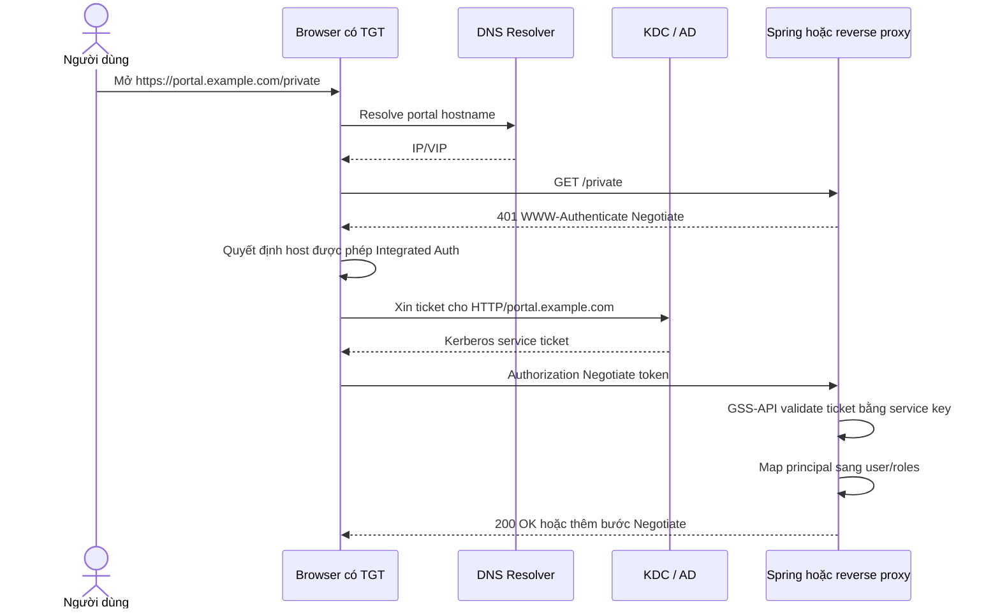

# DNS, tên máy chủ, đồng bộ thời gian và điều kiện hoạt động của Kerberos/SPNEGO

**Học phần:** Spring Security – federation → Kerberos và SPNEGO.

**Mục tiêu:** hiểu vì sao một ứng dụng Java/Spring Security có thể trả HTTP 200 qua HTTPS nhưng đăng nhập Kerberos/SPNEGO vẫn thất bại; xác định và kiểm tra các điều kiện thực tế về DNS, hostname công khai, SPN dạng `HTTP/hostname`, Kerberos realm, KDC, service account, keytab/KVNO, time synchronization, browser policy, firewall và reverse proxy. Bài gồm sơ đồ hoạt động, lệnh khảo sát Windows/Linux, ví dụ Java 17 chạy độc lập, ma trận sự cố và checklist triển khai.

**Quy tắc quan trọng nhất:** browser phải xin service ticket cho **đúng Service Principal Name (SPN)**; KDC phải biết SPN thuộc service account nào; server hoặc reverse proxy tiếp nhận Negotiate phải giữ **đúng service key**; thời gian giữa client/KDC/acceptor phải đáp ứng chính sách clock skew; và browser phải thực sự cho phép Integrated Authentication cho hostname đang truy cập. Thiếu một điều kiện là đủ làm SSO lỗi, dù DNS A record và HTTPS đều hoạt động.

Ví dụ xuyên suốt:

| Thành phần | Giá trị giả định |
| --- | --- |
| Kerberos realm | `EXAMPLE.COM` |
| Active Directory DNS domain | `example.com` |
| Public URL | `https://portal.example.com/private` |
| Kerberos HTTP SPN | `HTTP/portal.example.com@EXAMPLE.COM` |
| KDC/Domain Controllers | `dc01.example.com`, `dc02.example.com` |
| AD service account | `EXAMPLE\\svc-portal` |
| Acceptor keytab | `/run/secrets/kerberos/portal.keytab` |
| Backend | Spring Security Servlet trên app01/app02 |
| Reverse proxy | `portal.example.com` trỏ đến VIP/ingress |

Domain, account, IP và keytab trong bài đều là mẫu, không phải credential hợp lệ. Lệnh thay đổi SPN, password, DNS hoặc time service cần được quản trị viên thực hiện theo change control; người học chủ yếu dùng lệnh **đọc/quan sát** trong môi trường được phép.

## 1. Tổng quan Kerberos trên HTTP qua SPNEGO

**SPNEGO** (Simple and Protected GSS-API Negotiation Mechanism) là cơ chế đàm phán GSS-API. Trong HTTP, server thách thức bằng header `WWW-Authenticate: Negotiate` và browser gửi `Authorization: Negotiate`. Trong intranet, GSS mechanism thường là Kerberos; một số nền tảng có thể dùng NTLM nếu được phép.



Một phản hồi `401` đầu tiên thường là **challenge bình thường**, không phải lỗi bảo mật. Có thể có thêm vòng Negotiate trước khi hoàn tất context. Nếu browser không gửi Authorization header sau challenge, hãy điều tra browser policy, credentials và KDC trước khi đổ lỗi cho Spring.

Ví dụ HTTP (token là placeholder, không dùng thật):

```http
HTTP/1.1 401 Unauthorized
WWW-Authenticate: Negotiate
```

```http
GET /private HTTP/1.1
Host: portal.example.com
Authorization: Negotiate <base64-gssapi-token>
```

**Không copy token thật vào log, ticket hoặc chat.** SPNEGO không phải OIDC ID Token hay SAML Assertion. Sau khi GSS authentication thành công, ứng dụng vẫn phải kiểm tra quyền truy cập dữ liệu và tenant.

## 2. Tên máy chủ chính là một phần của danh tính service

Theo RFC 4559, principal dạng host-based service cho Kerberos HTTP thường là:

```text
HTTP/hostname
```

Đối với realm:

```text
HTTP/portal.example.com@EXAMPLE.COM
```

**`HTTP` là Kerberos service class**, không phải scheme URL. Với `https://portal.example.com`, service class vẫn là `HTTP`, **không phải `HTTPS`.

Có ba hostname rất dễ bị nhầm:

```text
Tên URL browser:       portal.example.com
Tên máy backend:       app01.example.com
Tên pod/container:     portal-web-65c7c8c7fc-vj8ps
SPN người dùng cần:    HTTP/portal.example.com@EXAMPLE.COM
```

Nếu browser xin ticket cho `HTTP/portal.example.com`, server có keytab cho `HTTP/app01.example.com` chưa chắc giải mã được. Với load balancer, SPN nên được thiết kế theo **public FQDN mà browser dùng** (sau các quy tắc canonicalization thực tế), thay vì mặc định mỗi node tự tạo một SPN riêng.

### 2.1. Realm không phải DNS hostname

Kerberos realm `EXAMPLE.COM` và DNS domain `example.com` thường có quan hệ nhưng không tự động giống nhau trong mọi tổ chức. Một AD forest có domain con, trusted realm, UPN suffix, VPN split-DNS hoặc trust cross-realm. Phải thống nhất:
- Realm mà principal/service ticket thuộc về.
- DNS domain của public hostname.
- KDC có thẩm quyền cấp ticket cho SPN.
- Mapping `[domain_realm]` hoặc AD realm discovery.

Trong AD, lệnh `setspn` thường thao tác `HTTP/portal.example.com`, không cần hậu tố `@EXAMPLE.COM`; account/domain tạo namespace. Trong MIT Kerberos tools, principal đầy đủ thường ghi cả realm. Không tự coi khác cách in ra của hai công cụ là lỗi.

### 2.2. Port có tham gia SPN không?

Không phải lúc nào. Chrome/Chromium thường dùng `HTTP/<canonical-host>`, không thêm port. Enterprise policy `EnableAuthNegotiatePort` có thể làm SPN chứa port không chuẩn, ví dụ `HTTP/portal.example.com:8443`.

| URL | SPN thường dùng | Lưu ý |
| --- | --- | --- |
| `https://portal.example.com` | `HTTP/portal.example.com` | HTTPS vẫn dùng service class HTTP |
| `https://portal.example.com:443` | `HTTP/portal.example.com` | Port chuẩn thường bỏ qua |
| `https://portal.example.com:8443` | `HTTP/portal.example.com` | Có thể thêm :8443 theo browser policy |
| `http://portal` | Tùy DNS suffix/canonicalization | Tránh short hostname ở production |

Kết luận phải dựa vào **service ticket thực mà client xin** và keytab/registered SPN, không đoán bằng URL.

## 3. DNS A/AAAA là điều kiện cần nhưng chưa đủ

Public FQDN của ứng dụng phải resolve đến địa chỉ phù hợp trong network context của browser:

```dns
portal.example.com.   IN A    10.20.30.40
dc01.example.com.     IN A    10.20.1.10
dc02.example.com.     IN A    10.20.1.11
```

`10.20.30.40` có thể là VIP, ingress hoặc reverse proxy, không nhất thiết là Java backend. Desktop nội bộ, máy ngoài VPN, pod trong cluster và domain controller có thể nhận DNS view khác nhau. Kiểm tra từ **chính máy/cụm bị lỗi**.

Linux:

```bash
getent ahosts portal.example.com
dig portal.example.com A +short
dig portal.example.com AAAA +short
```

Windows PowerShell:

```powershell
Resolve-DnsName portal.example.com -Type A
Resolve-DnsName portal.example.com -Type AAAA
Resolve-DnsName dc01.example.com -Type A
```

Các lệnh chỉ xác minh resolution. `AAAA` không tồn tại **không nhất thiết là lỗi** trong môi trường IPv4-only; khi IPv6 được bật và client chọn địa chỉ IPv6, phải kiểm tra đường IPv6 tới ingress/KDC.

### 3.1. CNAME alias có thể làm SPN thay đổi

Ví dụ:

```dns
portal.example.com.      IN CNAME ingress01.example.com.
ingress01.example.com.   IN A     10.20.30.40
```

Browser mở `https://portal.example.com`, nhưng một số Kerberos libraries/Chromium configurations có thể canonicalize sang `ingress01.example.com` rồi xin ticket cho `HTTP/ingress01.example.com`. Khi server chỉ có key của `HTTP/portal.example.com`, Negotiate có thể thất bại dù IP và HTTPS đúng.

| SPN browser yêu cầu | SPN/key server có | Kết quả |
| --- | --- | --- |
| `HTTP/portal.example.com` | `HTTP/portal.example.com` | Có thể thành công |
| `HTTP/ingress01.example.com` | Chỉ `HTTP/portal.example.com` | Có thể lỗi key/SPN |
| `HTTP/portal.example.com` | SPN đăng ký AD trên account A, keytab của B | Thất bại |
| `HTTP/portal.example.com` | Cùng SPN bị đăng ký trùng account | KDC có thể từ chối hoặc phát ticket không đúng key |

Chromium có policy `DisableAuthNegotiateCnameLookup` ảnh hưởng việc dùng hostname ban đầu thay vì canonical name. Đây là **hành vi client-specific**, không phải một cờ toàn bộ KDC. Đừng sửa CNAME hoặc bật wildcard SPN cho toàn domain mà chưa biết browser đang xin service name nào.

### 3.2. Reverse DNS (PTR) có luôn bắt buộc?

Không. MIT Kerberos có tùy chọn `dns_canonicalize_hostname` và `rdns`; một cấu hình có thể forward resolve rồi reverse lookup địa chỉ để tìm canonical hostname. Khi PTR trỏ `app01` thay vì `portal`, client có thể xin SPN ngoài ý muốn. Tuy nhiên không phải mọi browser/OS dùng reverse lookup trong HTTP Negotiate.

Kiểm tra Linux:

```bash
dig -x 10.20.30.40 +short
```

Windows:

```powershell
Resolve-DnsName 10.20.30.40 -Type PTR
```

**Không coi PTR thiếu là nguyên nhân duy nhất của mọi lỗi Kerberos.** Nếu client thực không dùng reverse canonicalization, PTR thiếu có thể vô hại; cần quan sát SPN được yêu cầu. Với MIT clients, `rdns=false` đôi khi giải quyết sai tên PTR; điều này không tự thay đổi Chrome, Windows SSPI hoặc JDK ở mọi nền tảng.

### 3.3. Short hostname và DNS search suffix

`http://portal` có thể được OS hoàn thiện thành `portal.example.com` ở máy nội bộ, trong khi máy VPN khác thêm một DNS suffix khác. Browser cũng có thể coi short host là Intranet Zone và tự cho Negotiate, nhưng FQDN public có dấu chấm bị phân loại khác.

Khuyến nghị: dùng **một FQDN public canonical** cho application URL, SPN, TLS certificate và cấu hình proxy. Không dựa vào short hostname, localhost, tên node Kubernetes hoặc file hosts thủ công để làm hệ thống production chạy.

## 4. DNS SRV và tìm KDC

Kerberos client cần tìm KDC của realm. Trong Active Directory, DNS SRV records hỗ trợ tìm domain controller; MIT Kerberos có thể dùng DNS hoặc danh sách KDC trong `krb5.conf`.

Ví dụ:

```dns
_kerberos._tcp.example.com. IN SRV 0 100 88 dc01.example.com.
_kerberos._tcp.example.com. IN SRV 0 100 88 dc02.example.com.
_kerberos._udp.example.com. IN SRV 0 100 88 dc01.example.com.
```

SRV có priority, weight, port, target. **Port 88 là Kerberos/KDC, không phải HTTPS**. Các AD sites có thể có site-specific SRV records và logic chọn DC theo site.

Linux:

```bash
dig SRV _kerberos._tcp.example.com +short
dig SRV _kerberos._udp.example.com +short
```

Windows:

```powershell
Resolve-DnsName _kerberos._tcp.example.com -Type SRV
nltest /dsgetdc:example.com
```

DNS SRV trả về KDC **không đảm bảo** firewall/UDP/TCP 88 thông hoặc KDC có SPN đúng. Phải thử network và xin service ticket riêng.

### 4.1. Ví dụ `krb5.conf`

```ini
[libdefaults]
    default_realm = EXAMPLE.COM
    dns_lookup_kdc = true
    dns_lookup_realm = false
    rdns = false
    clockskew = 300

[realms]
    EXAMPLE.COM = {
        kdc = dc01.example.com
        kdc = dc02.example.com
    }

[domain_realm]
    .example.com = EXAMPLE.COM
    example.com  = EXAMPLE.COM
```

- `default_realm` là realm mặc định của client.
- `[realms]` cung cấp KDC cụ thể; khi khai cả danh sách và DNS lookup, kiểm xem implementation ưu tiên nguồn nào.
- `[domain_realm]` map hostname domain sang realm.
- `rdns=false` hữu ích cho một số MIT clients với reverse DNS không ổn định; **không phải cách sửa mọi browser**.
- `clockskew=300` là 300 giây, tương ứng mức phổ biến 5 phút; **không tăng bừa** để bỏ qua lỗi đồng hồ.

File mẫu cần chỉnh cho realm/KDC thật và chính sách bảo mật; không nên tắt DNS discovery khi có HA KDC nếu việc hardcode KDC làm mất khả năng failover.

### 4.2. Java 17 chọn realm/KDC thế nào?

JDK có Kerberos qua `java.security.jgss`, `org.ietf.jgss`, `javax.security.auth.kerberos` và JAAS. Có thể đặt:

```bash
java -Djava.security.krb5.conf=/etc/krb5.conf -jar app.jar
```

Hoặc hai system properties **phải đặt cùng nhau** khi chọn trực tiếp:

```bash
java \
  -Djava.security.krb5.realm=EXAMPLE.COM \
  -Djava.security.krb5.kdc=dc01.example.com \
  -jar app.jar
```

Nếu không chỉ rõ, JDK có cơ chế tìm file config theo Java home/OS. Biến `KRB5_CONFIG` của MIT libraries **không tự bảo đảm** JDK/JAAS dùng cùng file hoặc cùng DNS canonicalization; kiểm tra process config thực. Java Kerberos dùng package `javax.security.auth.kerberos` **kể cả khi Spring Boot 3/4 Servlet dùng `jakarta.servlet`**; hai nhóm API độc lập.

## 5. Đồng bộ thời gian và ngưỡng clock skew

Kerberos dùng timestamp của authenticator và thời hạn ticket để chống replay và kiểm soát phiên. Microsoft Windows/AD có chính sách **Maximum tolerance for computer clock synchronization** với mức mặc định phổ biến **5 phút**; MIT Kerberos thường mặc định `clockskew=300` giây. Đây là **policy có thể thay đổi**, không phải con số cố định cho mọi domain.

Các đồng hồ cần kiểm:
- Client browser/desktop đang xin TGT và service ticket.
- KDC/Domain Controller dùng để cấp vé.
- Spring server hoặc proxy xử lý GSS ticket.
- Các DC trong time hierarchy; VM host/Kubernetes nodes.
- Tùy flow, cross-realm KDC hoặc backend acceptor khác.

**Timezone khác nhau không phải lỗi** nếu các máy biểu diễn cùng một thời điểm tuyệt đối. Máy ở Việt Nam hiển thị 17:00 +07 và KDC hiển thị 10:00 UTC vẫn đồng bộ. Ngược lại, hai máy cùng timezone nhưng lệch nhau 8 phút có thể gây lỗi.

### 5.1. Ví dụ

```text
KDC clock        10:00:00 UTC
Client clock     10:02:00 UTC   (+120 seconds)
Server clock     10:00:30 UTC   (+30 seconds)
Default skew     300 seconds

Lệch trên dưới ngưỡng mô phỏng: có thể PASS nếu các điều kiện khác đúng.

KDC clock        10:00:00 UTC
Client clock     10:07:00 UTC   (+420 seconds)
Default skew     300 seconds

Client có thể bị từ chối vì time skew.
```

Đây là **mô hình giải thích**, không thay thế logic thực của RFC/KDC/acceptor. Ngưỡng khác nhau theo chính sách và loại ticket/message; dùng log hệ thống để xác định **chặng nào** báo clock skew.

**Mức 5 phút là tolerance, không phải mục tiêu vận hành.** Hệ thống production nên giữ offset nhỏ hơn nhiều, cảnh báo sớm khi time sync lỗi và không tự tăng tolerance lên một giờ.

### 5.2. Linux time diagnostics

```bash
date -u
timedatectl status
timedatectl timesync-status
chronyc tracking
chronyc sources -v
```

Không phải mọi Linux distro đều có `chrony` hay `systemd-timesyncd`; chỉ dùng công cụ được cài trên host. Kiểm time source, offset, stratum, last synchronization, host VM/hypervisor và khả năng đồng bộ của node. Container thường dùng **kernel clock của host**; đổi `TZ=UTC` chỉ đổi cách hiển thị, **không sửa NTP drift**.

### 5.3. Windows time diagnostics

```powershell
w32tm /query /status
w32tm /query /source
w32tm /query /peers
w32tm /stripchart /computer:dc01.example.com /dataonly /samples:5
```

Khi có quyền và change approval, có thể resync:

```powershell
w32tm /resync
```

Thao tác time service có thể ảnh hưởng scheduled tasks/logs. Không chỉnh thủ công đồng hồ domain controller hay disable clock checks; sửa nguồn NTP/domain hierarchy đúng.

### 5.4. Clock skew khác ticket expiry

| Lỗi/dữ liệu | Ý nghĩa |
| --- | --- |
| `KRB_AP_ERR_SKEW` hoặc `KRB5KRB_AP_ERR_SKEW` | Thời gian authenticator/request ngoài tolerance |
| `KRB_AP_ERR_TKT_EXPIRED` | Ticket hết hiệu lực, dù đồng hồ có thể đúng |
| `starttime/endtime/renew-till` | Vòng đời ticket/TGT |
| TGT trong `klist` hết hạn | Cần cơ chế renew/login hợp lệ |
| Certificate HTTPS hết hạn | TLS browser/proxy, **không phải trực tiếp Kerberos ticket clock skew** |

Không tăng ticket lifetime hoặc clockskew chỉ vì một lỗi `401` chưa phân loại.

## 6. Đăng ký SPN đúng service account

Trong Active Directory, attribute `servicePrincipalName` ánh xạ SPN đến account nhận key của dịch vụ. Nếu user xin vé cho SPN không có, KDC trả principal unknown; nếu SPN có nhưng keytab server thuộc account khác, server không giải mã được ticket.

### 6.1. Lệnh kiểm tra AD SPN

```powershell
setspn -Q HTTP/portal.example.com
setspn -X
setspn -L EXAMPLE\svc-portal
```

`-Q` tìm principal; `-X` phát hiện duplicates; `-L` liệt kê SPNs của service account. Cần quyền và scope AD phù hợp; `-X` có thể tốn thời gian nếu phạm vi forest lớn.

Lệnh thay đổi **chỉ cho admin đã phê duyệt**:

```powershell
setspn -S HTTP/portal.example.com EXAMPLE\svc-portal
```

`-S` kiểm duplicate trước khi thêm. Không đăng ký SPN trên nhiều accounts; không tạo wildcard SPN hay gán service account có đặc quyền cao không cần thiết. Nếu URL aliases/CNAME tạo tên mới mà browser thực sự xin vé, quản trị viên phải thiết kế SPNs tương ứng một cách nhất quán.

### 6.2. Keytab, KVNO và encryption types

**Keytab** chứa key material nhạy cảm để server GSS acceptor giải mã/chấp nhận Kerberos ticket. Nó cần principal đúng, account key đúng, enctype phù hợp và **Key Version Number (KVNO)** tương thích với KDC. Sau service account password rotation, keytab cũ có thể trở nên không dùng được.

Linux đọc metadata keytab trong môi trường được phép:

```bash
klist -k -t -e /run/secrets/kerberos/portal.keytab
```

Thông thường lệnh hiển thị principal, version và enctype, không in key bytes; nhưng **bản thân keytab là secret**, không copy/commit vào Git hay CI log. Admin có thể thử credential nếu policy cho phép:

```bash
kinit -k -t /run/secrets/kerberos/portal.keytab \
  HTTP/portal.example.com@EXAMPLE.COM
```

Đừng dùng principal service này như một user có quyền truy cập API tùy ý. Test trên môi trường kiểm soát, tuyệt đối không xuất keytab qua public tools.

### 6.3. Kiểm tra client xin được service ticket

Trên Linux có Kerberos utilities:

```bash
kinit user@EXAMPLE.COM
kvno HTTP/portal.example.com@EXAMPLE.COM
klist
```

Trên Windows:

```powershell
klist
klist get HTTP/portal.example.com
```

`kinit`/`klist` chứng minh TGT/cached tickets; `kvno`/`klist get` giúp kiểm tra ticket cho SPN cụ thể. **Xin ticket thành công chưa chứng minh Java acceptor có key và browser cho phép Negotiate**. Một test thật còn cần HTTP 401 challenge, Authorization header và acceptor authentication.

Nếu gặp `KRB_AP_ERR_MODIFIED` hoặc tương đương, kiểm:
- SPN thuộc **đúng service account** và không trùng.
- Keytab của process được tạo từ key cùng account.
- KVNO, encryption type (AES theo policy), key version sau rotation.
- Trong cluster, các pods đang sử dụng bộ keytab tương thích.
- CNAME/port browser có làm SPN khác với keytab không.

Không bật DES/RC4 yếu hoặc tắt integrity checks để “sửa lỗi”. Dùng algorithms/key lengths được domain/KDC và Java hỗ trợ theo security policy.

## 7. Mạng: HTTPS không phải dependency duy nhất

| Đường truyền | Port điển hình | Vai trò |
| --- | --- | --- |
| Browser → web app/proxy | TCP 443 | HTTPS và Negotiate |
| Client → KDC | TCP/UDP 88 | AS/TGS, xin TGT và service tickets |
| Máy liên quan → DNS | TCP/UDP 53 | A/AAAA/CNAME/PTR/SRV lookups |
| Time sources | UDP 123 hoặc AD time hierarchy | NTP/time synchronization |
| Password change service | TCP/UDP 464 | kpasswd nếu workflow cần |
| AD LDAP/DC discovery | TCP/UDP 389, LDAPS TCP 636 nếu dùng | User/group lookups, AD discovery |
| Cross-realm path | TCP/UDP 88 tới realm liên quan | Kerberos referral/trust |

Bảng là **port thông dụng**, không phải danh sách phải mở toàn bộ. Domain-join/GPO/AD management có thể cần các ports khác, nhưng không phải mỗi browser SPNEGO request đều dùng chúng. Hãy kiểm topology thật: browser có cần truy cập KDC trực tiếp hay thông qua VPN/domain environment? KDC nào được dùng theo site?

Linux:

```bash
getent hosts dc01.example.com
nc -vz dc01.example.com 88
curl -I --max-time 5 https://portal.example.com/private
```

Windows:

```powershell
Test-NetConnection dc01.example.com -Port 88
Test-NetConnection portal.example.com -Port 443
Resolve-DnsName _kerberos._tcp.example.com -Type SRV
```

`nc` và `Test-NetConnection` chủ yếu test TCP, không chứng minh UDP hoạt động. `curl -I` có thể chỉ thấy 401 challenge. **Không mở KDC port 88 công khai ra Internet** hoặc tắt firewall chỉ để có SSO cho máy ngoài VPN; dùng VPN/Zero Trust/Identity federation nếu được duyệt.

## 8. Browser phải cho phép gửi Integrated Authentication

Một client có TGT hợp lệ vẫn không tự gửi `Authorization: Negotiate` nếu browser không tin host, chạy profile giới hạn hoặc thiếu OS/GSS provider phù hợp.

### 8.1. Chrome/Edge

Các điểm thường cần khảo sát theo enterprise/browser policy:
- `AuthServerAllowlist` (tài liệu Chromium cũ dùng `AuthServerWhitelist`): danh sách hosts được phép nhận Integrated Authentication.
- `AuthSchemes` có hỗ trợ `negotiate`.
- `DisableAuthNegotiateCnameLookup` ảnh hưởng chọn SPN từ CNAME hay URL host gốc.
- `EnableAuthNegotiatePort` ảnh hưởng việc thêm port không chuẩn.
- `AuthNegotiateDelegateAllowlist` liên quan credential delegation, **không cần bật cho login thông thường**.
- Intranet Zone classification/enterprise policy; Chrome/Edge trên Windows có thể dùng OS SSPI. Incognito/Guest có thể bị hạn chế.

Kiểm browser `chrome://policy` hoặc `edge://policy` thực trên máy người dùng. Không cho phép wildcard tất cả host Internet nhận domain credentials. Một FQDN có dấu chấm đôi khi không thuộc Local Intranet Zone mặc định của Windows, vì vậy cần allowlist doanh nghiệp đúng.

### 8.2. Firefox/Linux/macOS và CLI

Firefox có setting/policy `network.negotiate-auth.trusted-uris` và các tùy chọn delegation tương ứng; xác minh theo phiên bản quản lý. Linux/macOS cần GSSAPI provider/credential cache phù hợp; một browser không nhất thiết chia sẻ TGT với browser khác.

Khi curl build có Negotiate support và máy có Kerberos credentials:

```bash
curl --negotiate -u : \
  --silent --show-error \
  --output /dev/null \
  --write-out 'HTTP %{http_code}\n' \
  https://portal.example.com/private
```

`200` chỉ chứng minh URL đã trả thành công, không tự chứng minh Kerberos nếu app còn đường anonymous/fallback. Cần kiểm GSS mechanism và server audit. **Không dùng curl `-k/--insecure` để bỏ TLS validation**, không bật verbose trace chứa SPNEGO token trong production.

### 8.3. SPNEGO không đồng nghĩa Kerberos-only

Một số stack Negotiate có thể đàm phán NTLM fallback. Nếu compliance yêu cầu **Kerberos-only**, phải đo mechanism thực, không đánh dấu test pass chỉ vì HTTP login thành công. Không chấp nhận fallback ngoài chủ đích khi không chứng minh được KDC/SPN.

## 9. Spring Security Kerberos và Java JAAS/JGSS

**Spring Security Kerberos** là extension riêng, không phải chức năng tự kích hoạt bằng `saml2Login()` hoặc `oauth2Login()`. Tài liệu Spring mô tả các thành phần:
- `SpnegoEntryPoint` tạo challenge.
- `SpnegoAuthenticationProcessingFilter` xử lý Negotiate header.
- `KerberosServiceAuthenticationProvider` dùng ticket validator để xác thực.
- `SunJaasKerberosTicketValidator` dùng JAAS/JGSS, service principal và keytab.
- `UserDetailsService`/LDAP ánh xạ Kerberos principal sang user/authorities.
- `SecurityFilterChain` định tuyến URL và session/authorization.

**Tương thích phiên bản phải kiểm tra riêng:** một Spring Security Kerberos extension có thể dùng Spring/Servlet API đời cũ. Java 17 JAAS dùng `javax.security.auth.kerberos`, còn Spring Boot 3/4 web dùng `jakarta.servlet`. Không copy một JAR `javax.servlet` cũ vào Boot 4 rồi kỳ vọng hoạt động; đối chiếu dependency tree, Javadoc, release support và end-to-end với KDC.

### 9.1. Mảnh bean Spring minh họa SPN/keytab

```java
import org.springframework.context.annotation.Bean;
import org.springframework.context.annotation.Configuration;
import org.springframework.core.io.FileSystemResource;
import org.springframework.security.kerberos.authentication.sun
        .SunJaasKerberosTicketValidator;

@Configuration
public class KerberosValidatorConfig {

    @Bean
    SunJaasKerberosTicketValidator kerberosTicketValidator() {
        SunJaasKerberosTicketValidator validator =
                new SunJaasKerberosTicketValidator();
        validator.setServicePrincipal(
                "HTTP/portal.example.com@EXAMPLE.COM");
        validator.setKeyTabLocation(new FileSystemResource(
                "/run/secrets/kerberos/portal.keytab"));
        validator.setDebug(false);
        return validator;
    }
}
```

Đây là **mảnh cấu hình**, không phải ứng dụng chạy riêng: còn cần extension dependency tương thích, Spring Boot app main, authentication provider, filter, entry point, user mapping, authorization và KDC thật. Lưu ý `servicePrincipal` phải tương thích SPN vé do client xin; file keytab phải mount read-only và chỉ service UID có quyền đọc.

`application.yml` hướng dẫn tách custom app config:

```yaml
app:
  kerberos:
    service-principal: HTTP/portal.example.com@EXAMPLE.COM
    keytab-location: /run/secrets/kerberos/portal.keytab
    public-url: https://portal.example.com

server:
  forward-headers-strategy: framework
  servlet:
    session:
      cookie:
        secure: true
        http-only: true
```

`app.kerberos` **không phải Spring Boot built-in SPNEGO auto-config**. Nếu không có code bind/read những giá trị này, chúng không kích hoạt Kerberos. `forward-headers-strategy` chỉ nên bật khi ingress chặn/strip header giả mạo từ client và Spring chỉ tin proxy có thẩm quyền.

### 9.2. Reverse proxy quyết định nơi cần service key

**Trường hợp A – proxy chấm dứt Negotiate:** nginx/Apache/IIS/auth gateway làm Kerberos acceptor, sở hữu keytab/service identity cho `HTTP/portal.example.com`. Spring nhận **trusted identity assertion/header** từ proxy nội bộ. Phải strip client-supplied identity headers, dùng mTLS/network isolation và không expose backend trực tiếp, nếu không attacker có thể tự đặt `X-User` rồi bypass authentication.

**Trường hợp B – proxy truyền Negotiate về Spring:** backend Java/JGSS sở hữu keytab/SPN; proxy phải chuyển `WWW-Authenticate: Negotiate` và `Authorization: Negotiate` đúng, không tái ghi/chặn headers hoặc tự xác thực một lần rồi cho backend xác thực thêm. Nếu terminate HTTPS ở proxy, bảo vệ kênh proxy→backend phù hợp.

**Trường hợp C – nhiều pods cùng public host:** toàn bộ acceptors phải có key tương ứng một public SPN và key version hợp lệ. Khi service account password/kvno đổi, rollout keytabs có kế hoạch, không để một nửa pods decrypt key cũ và một nửa key mới mà KDC đã ngừng cấp key cũ.

### 9.3. Session và authorization vẫn là ứng dụng chịu trách nhiệm

Sau GSS success, ứng dụng phải:
- Ánh xạ Kerberos principal sang đúng user nội bộ, tenant và roles.
- Không mặc định mọi domain user có `ROLE_ADMIN`.
- Bảo vệ `SecurityContext`/`HttpSession`, session fixation protection và CSRF cho POST nghiệp vụ.
- Cân nhắc logout: app xóa local session **không xóa Windows TGT/SSO credential cache**. Browser có thể ngay lập tức tự đăng nhập lại trên request sau.
- Thử filter order, endpoint challenge/response, failure path, multi-instance, auditing và thông báo lỗi.
- Tách rõ principal Kerberos với OAuth2/SAML identities nếu ứng dụng hỗ trợ nhiều login methods.

## 10. Java 17 chạy độc lập: kiểm tra logic SPN và clock drift

Bài tập Java sau chỉ dùng **JDK 17**, chạy bằng `javac/java`; không truy cập KDC/DNS, không đọc ticket/keytab và không xác thực user. Nó minh họa yêu cầu **tên SPN phải khớp** và **time drift phải nằm trong ngưỡng policy**.

Tệp `KerberosPrerequisiteDemo.java`:

```java
import java.net.URI;
import java.time.Duration;
import java.time.Instant;
import java.util.Locale;

public class KerberosPrerequisiteDemo {

    static String normalizeHost(String raw) {
        if (raw == null || raw.isBlank()) {
            throw new IllegalArgumentException("Host required");
        }
        String host = raw.toLowerCase(Locale.ROOT);
        return host.endsWith(".")
                ? host.substring(0, host.length() - 1)
                : host;
    }

    static String httpSpn(String host, String realm) {
        return "HTTP/" + normalizeHost(host) + "@" + realm;
    }

    static boolean allowedDrift(
            Instant first, Instant second, Duration maxSkew) {
        return Duration.between(first, second).abs()
                .compareTo(maxSkew) <= 0;
    }

    public static void main(String[] args) {
        URI uri = URI.create("https://PORTAL.example.com/private");
        String host = normalizeHost(uri.getHost());
        String service = httpSpn(host, "EXAMPLE.COM");
        String alias = httpSpn("ingress01.example.com", "EXAMPLE.COM");

        Instant kdc = Instant.parse("2026-11-07T03:00:00Z");
        Duration tolerance = Duration.ofMinutes(5);

        System.out.println("URL host: " + host);
        System.out.println("Service SPN: " + service);
        System.out.println("Alias matches: " + service.equals(alias));
        System.out.println("Drift 120s allowed: " +
                allowedDrift(kdc, kdc.plusSeconds(120), tolerance));
        System.out.println("Drift 420s allowed: " +
                allowedDrift(kdc, kdc.plusSeconds(420), tolerance));
    }
}
```

Chạy:

```bash
javac KerberosPrerequisiteDemo.java
java KerberosPrerequisiteDemo
```

**Stdout chính xác trên JDK 17+:**

```text
URL host: portal.example.com
Service SPN: HTTP/portal.example.com@EXAMPLE.COM
Alias matches: false
Drift 120s allowed: true
Drift 420s allowed: false
```

**Giới hạn:** `normalizeHost` chỉ chuẩn hóa chuỗi cho bài tập, **không làm DNS CNAME/PTR canonicalization**, IDN mapping hoặc host verification production. `allowedDrift` mô phỏng điều kiện khoảng cách thời gian, không triển khai RFC 4120 replay defense hoặc ticket lifetime. Mã SPN/realm được hardcode chỉ để stdout cố định. Với hệ thống thật, phải quan sát KDC ticket, browser behavior và keytab đúng environment.

## 11. Phân loại lỗi theo tầng thay vì đoán

| Dấu hiệu | Nguyên nhân có thể | Hành động đúng |
| --- | --- | --- |
| Browser thấy 401, **không** gửi Authorization Negotiate | Host không trusted, không TGT, browser policy | Kiểm `chrome://policy`/Intranet Zone, TGT, response headers |
| Browser gửi NTLM, không Kerberos | SPN/KDC lỗi hoặc fallback policy | Kiểm mechanism, SPN request, KDC |
| `KDC_ERR_S_PRINCIPAL_UNKNOWN` | Không có SPN hoặc lookup realm sai | `setspn -Q`, alias/CNAME, realm |
| `KRB_AP_ERR_MODIFIED` | Service key không đúng SPN/account/KVNO/enctype | SPN ownership, `setspn -X`, keytab |
| `KRB_AP_ERR_SKEW` | Client/KDC/acceptor không đồng bộ | `chronyc`/`w32tm`, time source |
| `KRB_AP_ERR_TKT_EXPIRED` | Ticket/TGT hết hạn | `klist`, renewal, KDC policy |
| FQDN thành công, alias thất bại | SPN canonicalization khác | DNS CNAME/PTR và browser policy |
| TCP 443 thành công, SSO không chạy | KDC TCP/UDP 88 hoặc keytab lỗi | SRV, network, service ticket, acceptor |
| Chỉ node B thất bại | Keytab cũ, KVNO/enctype/permissions khác | So rollout secrets từng node |
| Chỉ máy ngoài VPN thất bại | No TGT/KDC route, split DNS | Kiến trúc remote access/fallback rõ |
| Cùng timezone nhưng clock skew | Real clock drift giữa machines | So UTC và NTP offset |
| Có TGT, không xin được service ticket | SPN sai/realm/KDC | `kvno`, `klist get`, SPN ownership |
| Xin được service ticket nhưng HTTP 401 mãi | Keytab/GSS/browser/proxy header | Kiểm acceptor and 401 handshake |
| Kerberos auth thành công nhưng HTTP 403 | Mapping role/tenant không đủ | Authorization policy, không đổi SPN |
| Logout app xong tự login lại | OS vẫn giữ TGT | Phân biệt local logout và domain SSO |
| Java CLI chạy, Spring container lỗi | krb5.conf, UID/keytab, DNS, JAAS/filter khác | Check runtime pod config/JVM properties |
| Reverse proxy trả 401 vòng lặp | Chặn/strip Authorization hoặc WWW-Authenticate | Fix HTTP Negotiate forwarding |
| Browser auth được nhưng không đạt Kerberos-only | NTLM fallback | Kiểm mechanism, fail theo policy |

**Không dùng workaround nguy hiểm:** không tắt TLS hostname verification, không mở wildcard SPN/trusted hosts, không disable GSS integrity, không bật NTLM ngoài chính sách và không nâng clock skew vô hạn.

### 11.1. Các công cụ chỉ xác minh từng điều kiện

- `dig`/`Resolve-DnsName` xác minh DNS, không chứng minh SPN.
- `Test-NetConnection` TCP 88 không kiểm đủ UDP/KDC authentication.
- `kinit` cho TGT không chứng minh service ticket.
- `kvno`/`klist get` có service ticket nhưng không chứng minh acceptor keytab đúng.
- `setspn -Q` có SPN nhưng không chứng minh keytab/KVNO đúng.
- `curl -I` thấy 401 có thể là challenge bình thường.
- `w32tm`/`chronyc` cho time source nhưng phải kiểm **mọi** máy liên quan.

Nên kiểm theo thứ tự **browser URL → DNS → KDC discovery → SPN → keytab/KVNO → time sync → HTTP Negotiate → Spring Authentication → business authorization**.

### 11.2. Java debug chỉ bật có kiểm soát

```bash
java \
  -Djava.security.krb5.conf=/etc/krb5.conf \
  -Dsun.security.krb5.debug=true \
  -Dsun.security.jgss.debug=true \
  -Dsun.security.spnego.debug=true \
  -jar app.jar
```

Các thuộc tính debug tùy JDK implementation; Oracle Java tài liệu hóa nhóm Kerberos/JGSS/SPNEGO debugging. Logs có thể chứa principal, host, credential metadata hoặc thông tin nhạy cảm. Bật tạm trên sandbox/incident window, redact trước khi chia sẻ và tắt ngay sau kiểm tra.

Với JAAS `Krb5LoginModule`, các options `useKeyTab`, `keyTab`, `principal`, `storeKey`, `doNotPrompt`, `isInitiator` phải tương thích vai trò **acceptor** hoặc **initiator**. Không copy JAAS config cho outbound client sang SPNEGO server mà chưa kiểm.

## 12. Ma trận kiểm thử trước production

| Test case | Phương pháp | Kỳ vọng |
| --- | --- | --- |
| Public hostname | DNS A/AAAA + HTTPS | Trỏ đúng ingress/VIP, cert hợp lệ |
| CNAME alias | Kiểm SPN client thực | SPN tương thích account/keytab |
| Reverse DNS thiếu | Test trên client có/không rdns | Không tự coi PTR bắt buộc |
| Short hostname | VPN/off-VPN DNS suffix | Chọn canonical FQDN |
| KDC SRV records | Query _kerberos._tcp | KDC được tìm đúng realm |
| KDC connectivity | TCP/UDP 88 thực | Không bị firewall chặn |
| Cross realm | Realm trust/referral | User từ realm được phép lấy ticket |
| SPN uniqueness | setspn -Q/-X | Không trùng service account |
| Wrong account SPN | AD mapping sai | Ticket bị từ chối an toàn |
| Keytab principal | klist -k | Đúng HTTP/FQDN@REALM |
| Keytab KVNO/enctype | Rotate service account key | Pods có key phù hợp |
| User TGT | klist | Ticket hợp lệ |
| Service ticket | kvno/klist get | Đúng SPN |
| Initial 401 challenge | Browser network | Negotiate header được gửi |
| Trusted browser host | Enterprise allowlist | Authorization Negotiate được gửi |
| Unknown browser host | Không allowlisted | Không tự gửi domain credential |
| NTLM fallback | Kiểm mechanism | Deny nếu policy Kerberos-only |
| 120s simulated skew | Lab với chính sách 300s | Có thể pass |
| 420s simulated skew | Lab với chính sách 300s | Fail theo time policy |
| Time sync fail ở node | Chrony/Windows Time monitoring | Cảnh báo và cô lập lỗi |
| Different TZ same instant | UTC verification | Không báo lỗi giả |
| Reverse proxy passthrough | HTTP header tests | Không mất Authorization/Negotiate |
| Proxy terminate SPNEGO | Identity header security | Không spoofed user |
| Cluster rolling upgrade | Multiple pods/keytabs | SSO ổn trên mọi node |
| Local logout | Browser còn TGT | UX theo SSO design |
| Privilege mapping | Kerberos user thiếu role | 403, không cấp role ngầm |
| Off-domain browser | Không có TGT | Fallback đúng policy, không bypass |
| Debug logs | Security audit | Không lộ ticket/keytab/secret |

**Kiểm thử thật** phải có browser/OS đã được domain cấp credential, KDC/AD test environment, SPN/keytab, network đúng và nhiều node. Spring `@WithMockUser` chỉ đặt Authentication vào test SecurityContext, **không chứng minh Kerberos/SPNEGO hoạt động**.

## 13. Điều kiện với Kubernetes và load balancer

Một public hostname `portal.example.com` có thể trỏ tới nhiều pods:

```text
Browser ---> https://portal.example.com (HTTP/portal.example.com)
                |
             VIP / Ingress
                |
           +----+----+
           |         |
          Pod A     Pod B
           |         |
       Keytab N   Keytab N
```

Nếu **Spring ở từng pod tiếp nhận Negotiate**, tất cả pods phải có credential phù hợp với cùng SPN và ticket KDC cấp. Chạy pod bằng tên host ngẫu nhiên không tự là lỗi, miễn `servicePrincipal` cấu hình đúng. Khi rotate service account password/KVNO, rollout keytab đồng bộ và chờ in-flight tickets theo security policy; không lưu keytab trong container image.

Kubernetes containers thường dùng **system clock từ node**; nếu chỉ pods trên worker node B lỗi `KRB_AP_ERR_SKEW`, kiểm NTP của node/hypervisor. Chỉnh `TZ` trong pod chỉ đổi hiển thị.

Nếu proxy/ingress **tự terminate SPNEGO**, chỉ proxy cần Kerberos acceptor key. App downstream chỉ được tin danh tính sau khi proxy đã xác thực và strip client-provided identity headers. Tách hai mô hình rõ; đừng cấu hình proxy và Spring cùng consume token mà không có protocol flow được kiểm chứng.

**Remote users và split DNS:** máy ngoài VPN có thể thấy trang HTTPS nhưng không reach KDC hoặc không có TGT. Không công khai mở mọi domain controller/KDC để “đỡ lỗi”; chọn VPN/Zero Trust hoặc OIDC/SAML fallback được thiết kế rõ.

## 14. Runbook kiểm tra nhanh theo thứ tự

**DNS và hostname**
- [ ] Có FQDN public nhất quán cho browser và TLS.
- [ ] A/AAAA trỏ đúng VIP, CNAME/PTR được hiểu theo client thực.
- [ ] DNS SRV hoặc realm/KDC config trả KDC đúng.
- [ ] Không redirect sang host thiếu SPN.

**KDC và service identity**
- [ ] Browser/OS có TGT hoặc có đường lấy TGT hợp lệ.
- [ ] KDC reachable, đúng realm và trust path.
- [ ] SPN `HTTP/portal.example.com` tồn tại **duy nhất** trên account phù hợp.
- [ ] Keytab có key/KVNO/enctype hợp lệ; process có quyền đọc hạn chế.
- [ ] Service key rotation không để pods dùng bộ secrets không tương thích.

**Clock và browser**
- [ ] Client, KDC/DC, acceptor/VM nodes có time source tin cậy và offsets nhỏ.
- [ ] Không nhầm timezone hiển thị với thực tế đồng hồ lệch.
- [ ] Browser policy allowlist đúng host; không tự bật delegation rộng.
- [ ] Negotiate gửi và nhận đúng; xác định Kerberos vs NTLM nếu yêu cầu.

**Spring và vận hành**
- [ ] Extension SPNEGO tương thích Spring Security/Jakarta runtime, filter chain đúng.
- [ ] Reverse proxy không làm mất headers hoặc tin user header giả mạo.
- [ ] SecurityContext, CSRF, authorization/tenant và session/logout được kiểm thử.
- [ ] Có monitoring SPN/KDC/keytab/time skew, logs đã che credentials.
- [ ] Đã test cả VPN/off-VPN, cluster failover, key rotation và negative cases.

## 15. Câu hỏi tự kiểm tra

**Q1. Tại sao truy cập HTTPS thành công vẫn không đăng nhập Kerberos được?**  
Vì HTTPS chỉ xác thực/kết nối web server bằng TLS. Kerberos cần thêm browser trusted-host policy, TGT, KDC service ticket cho SPN đúng, keytab acceptor và thời gian hợp lệ.

**Q2. Khi URL là `https://portal.example.com` thì SPN có phải `HTTPS/portal.example.com`?**  
Không. Service class HTTP trong Kerberos thường là `HTTP/portal.example.com`, kể cả trên HTTPS.

**Q3. CNAME có thể làm SPN thay đổi không?**  
Có. Một số clients canonicalize từ URL alias sang target DNS; browser policy và library quyết định. Kiểm service ticket thực trước khi đăng ký SPN bổ sung.

**Q4. PTR thiếu có luôn làm SPNEGO thất bại?**  
Không. Nó quan trọng khi client làm reverse canonicalization; không phải điều kiện bắt buộc trong mọi implementation.

**Q5. Clock skew 5 phút có phải khuyến nghị giữ đồng hồ lệch 4 phút?**  
Không. Đó là tolerance mặc định phổ biến. Production cần offset nhỏ và alert sớm, không sử dụng hết khoảng này.

**Q6. `setspn -Q` thấy SPN rồi có chắc server giải mã được vé không?**  
Không. Keytab có thể sai account, KVNO/enctype, file permission hoặc browser xin SPN alias khác.

**Q7. Spring Boot 4 dùng `jakarta.servlet`, tại sao JDK vẫn có `javax.security.auth.kerberos`?**  
Vì đó là package JAAS của Java SE, không liên quan sự chuyển namespace của Servlet/Jakarta EE.

**Q8. Browser nhận 401 có phải failure?**  
Không nhất thiết. 401 ban đầu kèm `WWW-Authenticate: Negotiate` là bước challenge bình thường; cần xem browser có phản hồi với ticket hợp lệ không.

## 16. Tài liệu chính thức

1. [RFC 4559 – SPNEGO-based Kerberos and NTLM HTTP Authentication](https://www.rfc-editor.org/rfc/rfc4559): HTTP 401/Negotiate và SPN `HTTP/hostname`.
2. [RFC 4120 – Kerberos V5](https://www.rfc-editor.org/rfc/rfc4120): KDC, tickets, realms, thời hạn và replay.
3. [RFC 4178 – SPNEGO GSS-API Mechanism](https://www.rfc-editor.org/rfc/rfc4178): cơ chế negotiation.
4. [MIT Kerberos – Principal Names and DNS](https://www.mit.edu/~kerberos/krb5-1.21/doc/admin/princ_dns.html): CNAME, PTR, canonicalization và SPN.
5. [MIT Kerberos – krb5.conf](https://web.mit.edu/kerberos/krb5-latest/doc/admin/conf_files/krb5_conf.html): realm, DNS và clockskew.
6. [Microsoft – Kerberos troubleshooting](https://learn.microsoft.com/en-us/troubleshoot/windows-server/windows-security/kerberos-authentication-troubleshooting-guidance): SPN, keytab/mismatch và time.
7. [Microsoft – Maximum tolerance for computer clock synchronization](https://learn.microsoft.com/en-us/previous-versions/windows/it-pro/windows-server-2012-r2-and-2012/jj852172(v=ws.11)): chính sách mặc định khoảng 5 phút.
8. [Chromium – HTTP Authentication](https://www.chromium.org/developers/design-documents/http-authentication/): browser trusted-host allowlist, CNAME và port policies.
9. [Oracle Java 17 – Kerberos package](https://docs.oracle.com/en/java/javase/17/docs/api/java.security.jgss/javax/security/auth/kerberos/package-summary.html): Kerberos JDK/JAAS và `java.security.krb5.conf`.
10. [Oracle Java – Security Troubleshooting](https://docs.oracle.com/en/java/javase/24/security/troubleshooting-security.html): JGSS/Kerberos/SPNEGO debug flags.
11. [Spring Security – Spring and Spring Security Kerberos](https://docs.spring.io/spring-security/reference/servlet/authentication/kerberos/ssk.html): `SpnegoEntryPoint`, `KerberosServiceAuthenticationProvider`, `SunJaasKerberosTicketValidator`.
12. [Spring Security Kerberos Project](https://spring.io/projects/spring-security-kerberos/): extension và version support riêng.

**Kết luận:** SPNEGO/Kerberos ổn định khi **public FQDN, SPN mà browser yêu cầu, AD/KDC service account, acceptor keytab, realm/DNS discovery và thời gian hệ thống** đều nhất quán; browser còn phải cho phép Negotiate tới host đó. Hãy xử lý sự cố theo thứ tự **DNS → SPN → KDC → ticket → keytab/KVNO → NTP → HTTP headers → Spring Authentication → authorization**. Không bỏ qua chứng thực, tăng clock tolerance hay mở wildcard chỉ để làm biến mất lỗi 401.