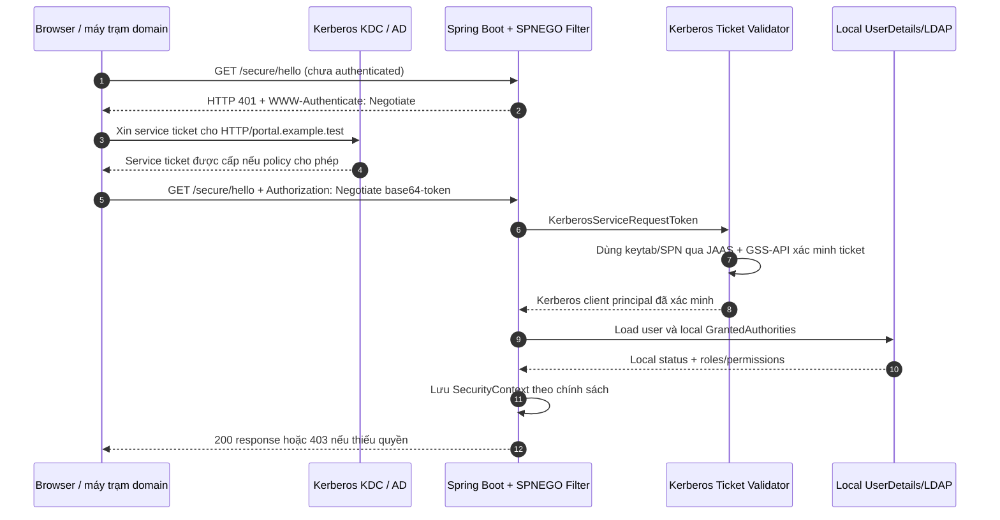

# Cấu hình phần mở rộng Spring Security Kerberos tương thích với ứng dụng

## 1. Bài toán và phạm vi

Một ứng dụng web chạy trong doanh nghiệp có thể cho nhân viên đã đăng nhập máy trạm thuộc domain truy cập trang nội bộ mà không nhập lại mật khẩu. Trình duyệt và máy chủ trao đổi **SPNEGO/HTTP Negotiate**, bên trong thường là **Kerberos service ticket**; Java xác minh ticket bằng key của dịch vụ, còn Spring Security tạo `Authentication` và áp quyền ứng dụng.

Điểm khó không chỉ là thêm một dependency. Spring Boot, Spring Security, phần mở rộng **Spring Security Kerberos**, phiên bản Java, servlet API, web browser, Domain Controller/Kerberos KDC, service principal name (SPN), keytab và chính sách phân quyền phải **tương thích ở nhiều lớp**. Nếu chọn thư viện Kerberos đời cũ trên Boot 3, code có thể lỗi `javax.servlet`/`jakarta.servlet`; nếu SPN sai, trình duyệt có thể lặp 401 dù cấu hình Java biên dịch.

Bài học hướng dẫn cách cấu hình **Spring Security Kerberos extension** cho **Spring Boot Servlet**. Trọng tâm triển khai là **Spring Boot 3.x + Spring Security 6.5.x + Java 17+ + Spring Security Kerberos 2.2.0**, sử dụng các lớp `SpnegoAuthenticationProcessingFilter`, `SpnegoEntryPoint`, `KerberosServiceAuthenticationProvider` và `SunJaasKerberosTicketValidator`.

Các URL `example.test`, principal, service account và tệp keytab đều chỉ là **dữ liệu minh họa**, không phải credential hoạt động. Để chạy SPNEGO thật cần realm/KDC, SPN, keytab và browser được IT/domain administrator thiết lập.

### Sau bài học, người học cần làm được

1. Chọn đúng **nhánh dependency** theo Spring Boot/Spring Security.
2. Giải thích luồng `WWW-Authenticate: Negotiate` → `Authorization: Negotiate` và trách nhiệm của từng Spring Security component.
3. Chuẩn bị SPN `HTTP/fqdn@REALM`, keytab, `krb5.conf`, DNS và đồng bộ giờ.
4. Cấu hình một `SecurityFilterChain` hợp lệ với filter SPNEGO, provider, ticket validator và `UserDetailsService`.
5. Phân biệt username Kerberos đã xác thực với **local roles/tenant/ACL**, không cấp quyền admin chỉ vì domain login thành công.
6. Thiết kế persistence/CSRF/session/HTTPS và tránh đăng ký filter trùng.
7. Tích hợp trong ứng dụng đã có OIDC/SAML/Bearer bằng những filter chains tách biệt.
8. Chẩn đoán 401, `KRB_AP_ERR_MODIFIED`, clock skew, keytab mismatch, SPN trùng, KDC/network lỗi, browser không đính Negotiate token.
9. Kiểm thử tích hợp thật mà không lộ Kerberos token hoặc nội dung keytab.

## 2. Kerberos, SPNEGO, JAAS và Spring Security khác nhau thế nào?

| Thành phần | Vai trò chính | Được kiểm chứng bằng gì? |
| --- | --- | --- |
| **Kerberos KDC** | Authentication Service/Ticket Granting Service, cấp TGT và service tickets | Realm principals, shared keys, thời gian và chính sách KDC |
| **Kerberos Ticket Granting Ticket (TGT)** | User/client giữ sau login domain, dùng xin service ticket | Ticket cache, KDC; không gửi TGT gốc tới ứng dụng web |
| **Service ticket** | Chứng minh user có vé dành cho dịch vụ `HTTP/host@REALM` | Service decrypt/verify bằng key tương ứng, replay/time checks |
| **SPNEGO / HTTP Negotiate** | HTTP authentication handshake, thương lượng mechanism | `WWW-Authenticate`/`Authorization` headers và GSS-API |
| **JAAS / JGSS của JDK** | Đăng nhập acceptor/service principal, xử lý GSS/Kerberos | `krb5.conf`, keytab, `javax.security.auth.*`, `org.ietf.jgss.*` |
| **Spring Security Kerberos extension** | Đọc Negotiate header, chạy Kerberos validator và gắn principal vào Spring Security | `SpnegoAuthenticationProcessingFilter`, provider, validator |
| **Spring Security Authorization** | Quyết định principal có thể xem/sửa tài nguyên nào | `GrantedAuthority`, `authorizeHttpRequests`, `@PreAuthorize`, ACL/tenant |

**Kerberos xác thực danh tính, không tự cấp quyền ứng dụng.** Keytab cho phép web server nhận service ticket có tên SPN tương ứng; nó **không** chứa danh sách vai trò business, và việc biết user `alice@EXAMPLE.TEST` không tự chứng minh Alice thuộc phòng tài chính.

Spring Security Kerberos là một **phần mở rộng**, không phải toàn bộ lõi `spring-security-config`. Nó đưa Kerberos vào hệ thống `AuthenticationManager`/`AuthenticationProvider`/`SecurityFilterChain` vốn có.

### Khác với SAML và OIDC

SAML SP nhận `SAMLResponse` tại ACS và xác minh XML Signature/trust metadata. OIDC RP nhận authorization code, ID Token và xác minh issuer/audience/nonce. SPNEGO dựa vào **domain ticket** và **HTTP Negotiate**. Một tài khoản Windows đã login domain không tự cấp OIDC ID Token, SAML Assertion hoặc OAuth Bearer access token.

## 3. Luồng HTTP Negotiate và authentication trong ứng dụng



Hai thông điệp HTTP điển hình:

```http
HTTP/1.1 401 Unauthorized
WWW-Authenticate: Negotiate
```

```http
GET /secure/hello HTTP/1.1
Host: portal.example.test
Authorization: Negotiate <BASE64_SPNEGO_TOKEN_REDACTED>
```

`Authorization: Negotiate` **không phải Basic Auth, cũng không phải OAuth Bearer**. Phần base64 là SPNEGO/GSS token, bên trong có thể chứa Kerberos AP-REQ. **Base64 không mã hóa thông điệp**; không đưa token này vào log, HAR công khai, proxy analytics hoặc exception response.

Nếu browser không có vé domain hoặc không tin host là intranet, nó có thể không gửi Negotiate token dù server đã trả challenge đúng. Vì thế phải kiểm tra cả browser/OS/KDC/SPN, không chỉ Java configuration.

## 4. Tương thích phiên bản là bước đầu tiên, không phải bước cuối

| Nhánh ứng dụng | Java / Servlet | Spring Security | Spring Security Kerberos extension | Cần lưu ý |
| --- | --- | --- | --- | --- |
| **Spring Boot 3.x phù hợp Security 6.5.x** | Java 17+, **`jakarta.servlet`** | **6.5.x** | **2.2.0**, group `org.springframework.security.kerberos` | Tài liệu 2.2.0 kiểm thử cùng JDK 17, Security 6.5.1 và Framework 6.2.8 |
| Spring Boot 3.x ở nhánh Security 6.0–6.3 | Java 17+, `jakarta.servlet` | 6.x cũ hơn | Chọn release extension **đã được kiểm thử với minor tương ứng**, ví dụ 2.0.x/2.1.x | Không khẳng định 2.2.0 phù hợp mọi Boot 3.x |
| Spring Boot 2.x cũ | Thường Java 8/11/17, **`javax.servlet`** | 5.x | Nhánh extension 1.x tương ứng, có kế hoạch nâng cấp | Không trộn jar 1.x với Jakarta application |
| Spring Security **7.x** / Spring Framework 7 | Java 17+ theo tài liệu extension, Jakarta | 7.x | Nhánh Kerberos **7.x**, group `org.springframework.security` | **Đổi tọa độ Maven/Gradle**, không copy group 2.2.0 |

**Điểm có nguồn xác minh:** tài liệu chính thức Spring Security Kerberos **2.2.0** nêu kiểm thử cùng **JDK 17, Spring Security 6.5.1, Spring Framework 6.2.8**. Tài liệu Spring Security Kerberos nhánh 7.x nêu groupId **`org.springframework.security`** thay vì **`org.springframework.security.kerberos`**.

Không chọn version theo số lớn nhất một cách mù quáng. Xác định **Boot BOM**, `spring-security-web`, `spring-security-config`, `spring-security-kerberos-core`, `spring-security-kerberos-web`, Servlet API và Java trước. Phần mở rộng có thể có mức hỗ trợ khác Spring Boot BOM, vì vậy phải kiểm tra dependency tree và integration tests.

### Những dấu hiệu chọn nhầm nhánh

- `ClassNotFoundException: javax.servlet.Filter` hoặc `NoClassDefFoundError: javax/servlet/...` trong Boot 3: có jar dùng Servlet cũ.
- `NoSuchMethodError` giữa `spring-security-web` và extension: lệch Spring Security API.
- Bean `SpnegoAuthenticationProcessingFilter` không implement đúng `jakarta.servlet.Filter`: dùng nhầm jar đời cũ.
- Plugin/bom tự thêm Security 7 nhưng extension 2.x: không áp dụng mà chưa đối chiếu compatibility.
- Maven có đồng thời hai versions `spring-security-kerberos-core`/`web`: cần thống nhất versions.

## 5. Chọn dependency cho Java 17 + Boot 3/Security 6.5

Trong dự án Gradle **đã cấu hình Spring Boot 3.x plugins, dependency management và Maven Central**, thêm các dependency sau (ví dụ pin phiên bản extension 2.2.0):

```groovy
dependencies {
    implementation "org.springframework.boot:spring-boot-starter-web"
    implementation "org.springframework.boot:spring-boot-starter-security"

    implementation "org.springframework.security.kerberos:spring-security-kerberos-core:2.2.0"
    implementation "org.springframework.security.kerberos:spring-security-kerberos-web:2.2.0"

    testImplementation "org.springframework.boot:spring-boot-starter-test"
    testImplementation "org.springframework.security:spring-security-test"
}
```

Đây là **mảnh `build.gradle`**, không phải project độc lập. Nếu dùng Maven, các coordinates tương đương:

```xml
<dependency>
    <groupId>org.springframework.security.kerberos</groupId>
    <artifactId>spring-security-kerberos-core</artifactId>
    <version>2.2.0</version>
</dependency>
<dependency>
    <groupId>org.springframework.security.kerberos</groupId>
    <artifactId>spring-security-kerberos-web</artifactId>
    <version>2.2.0</version>
</dependency>
```

Ví dụ Maven cũng là **mảnh `pom.xml`**.

Hai jar có trách nhiệm riêng:

- **Core:** Kerberos service authentication, JAAS ticket validator, client/JGSS integration.
- **Web:** SPNEGO HTTP filter và entry point.
- **Spring Security core/config/web:** authorization, filter chain, security context, user details.

Đừng copy dependency `org.springframework.security:spring-security-kerberos-web` của Spring Security 7 vào project đang chạy Spring Security 6.5. Ngược lại, khi nâng lên Security 7 hãy đọc **documentation của phiên bản 7** và đổi coordinates phù hợp, không cố giữ artifact 2.x.

### Kiểm tra dependency tree

```bash
./gradlew dependencyInsight \
  --dependency spring-security-web \
  --configuration runtimeClasspath

./gradlew dependencyInsight \
  --dependency spring-security-kerberos \
  --configuration runtimeClasspath
```

Mục tiêu: biết các versions đã được resolve, tránh một jar Security 6.5 và một jar 6.1 do dependency transitive. Có thể dùng `./gradlew dependencies --configuration runtimeClasspath` để xem toàn bộ graph. Nếu Maven, dùng `mvn dependency:tree` theo cấu hình build.

**Không tắt kiểm tra CVE hoặc ép dependency downgrade** để có bản extension biên dịch; cần lựa chọn một tập phiên bản có chính sách hỗ trợ/bản vá phù hợp, rồi chạy integration tests thực.

## 6. Kerberos realm, DNS, SPN, keytab và browser phải đồng ý về một tên

Giả sử:

```text
Kerberos realm:     EXAMPLE.TEST
KDC/AD domain:      ad.example.test
Ứng dụng public:    https://portal.example.test
HTTP service SPN:   HTTP/portal.example.test@EXAMPLE.TEST
Service keytab:     /run/secrets/kerberos/portal-http.keytab
```

Quy tắc thực tế:

1. Browser phải truy cập **FQDN khớp SPN**, không dùng IP pod, hostname ngắn tùy tiện hoặc alias chưa được đăng ký.
2. KDC phải có principal/service account sở hữu SPN chính xác, **không bị trùng** trên nhiều service accounts.
3. Keytab của ứng dụng chứa key đúng **principal, key version number (KVNO) và encryption type (enctype)** mà KDC dùng cho service ticket.
4. JVM cần cấu hình realm/KDC/DNS/trust thông qua `krb5.conf` hoặc cơ chế Java Kerberos tương thích.
5. Đồng hồ user, KDC và server phải đủ đồng bộ (NTP); Kerberos có giới hạn clock skew.
6. DNS public FQDN, reverse proxy và keytab SPN phải nhất quán, kể cả khi TLS kết thúc ở ingress.
7. Không bắt người dùng cung cấp domain password để “tạo SPNEGO”; browser/OS Kerberos client đã xử lý vé.

### Vì sao URL, Host và SPN không phải cùng một thứ?

- URL user gọi: `https://portal.example.test/secure/hello`.
- Kerberos service principal: `HTTP/portal.example.test@EXAMPLE.TEST`.
- Keytab: file bí mật chứa key cho SPN đó.
- TLS certificate: xác thực **HTTPS hostname**, không tự thay keytab hoặc Kerberos service key.
- KDC ticket: được mã hóa cho **service key**, không phải bằng TLS private key.

Nếu trình duyệt gọi `https://proxy-alias.example.test` mà KDC chỉ có SPN `HTTP/portal.example.test`, nó có thể xin ticket cho host alias không tồn tại hoặc server không giải mã được. Đăng ký SPN đúng alias được phê duyệt, hoặc dùng canonical public URL cố định.

## 7. Chuẩn bị service principal và keytab một cách an toàn

Trong Microsoft Active Directory, quản trị viên AD thường phải đăng ký SPN trên một **service account** được cấp quyền, ví dụ theo mẫu:

```powershell
# Chỉ là ví dụ quản trị AD; thay CORP và tên service account thật.
setspn -S HTTP/portal.example.test CORP\svc-portal
setspn -Q HTTP/portal.example.test
```

`-S` giúp phát hiện SPN trùng trước khi thêm theo công cụ Windows/AD tương ứng; `-Q` dùng tra cứu. Lệnh phải được chạy bởi quản trị viên có quyền và theo quy trình change control. **Không tự đăng ký SPN trên domain production từ application pod**.

Keytab phải được tạo bằng công cụ và quy trình hỗ trợ của hệ Kerberos/AD đang dùng (ví dụ `ktpass` dưới quản trị AD, hoặc `kadmin/ktadd` với MIT Kerberos), với principal, KVNO/enctype và account chính xác. **Không đưa lệnh có mật khẩu rõ trong bài, repository hoặc CI logs.** Thực tế có nhiều biến thể AD AES256/AES128 và hệ thống principal mapping; nên dùng runbook nội bộ đã duyệt.

Kiểm tra keytab **trên host/volume được ủy quyền**:

```bash
# Chỉ liệt kê metadata principal/KVNO/enctype; không in key material.
klist -kte /run/secrets/kerberos/portal-http.keytab
```

Lệnh `klist -kte` trên MIT Kerberos thường liệt kê principal, key version, encryption type; output vẫn có thể là thông tin cấu hình nhạy cảm nên không copy ra issue công khai. Một số hệ điều hành/JDK có công cụ khác; kiểm tra `klist --help` của môi trường thật.

**Một file keytab không đúng SPN/KVNO/enctype không thể được “sửa” chỉ bằng đổi tên file.** Cần cấp lại keytab và phối hợp với KDC/service account rotation.

## 8. Cấu hình krb5.conf, DNS và JVM

Ví dụ `/etc/krb5.conf` trong môi trường Linux dùng MIT Kerberos/Active Directory:

```ini
[libdefaults]
  default_realm = EXAMPLE.TEST
  dns_lookup_kdc = true
  rdns = false

[realms]
  EXAMPLE.TEST = {
    kdc = dc1.example.test
    kdc = dc2.example.test
  }

[domain_realm]
  .example.test = EXAMPLE.TEST
  example.test = EXAMPLE.TEST
```

Đây là **một cấu hình minh họa**, không nên thay cấu hình production đã được quản trị vận hành mà chưa đánh giá. Một số môi trường dựa vào DNS SRV thay danh sách KDC cố định; một số dùng cross-realm trusts, DNS aliases hoặc policies khác.

Với JVM, có thể chỉ định file `krb5.conf` cụ thể:

```bash
JAVA_TOOL_OPTIONS="-Djava.security.krb5.conf=/etc/krb5.conf" \
  ./gradlew bootRun
```

Trong container, truyền option qua command/`JAVA_TOOL_OPTIONS` tùy deployment. Cấu hình Java ở mức process ảnh hưởng mọi JAAS/GSS call dùng JVM đó. **Không** bật `sun.security.krb5.debug=true` trong production lâu dài vì debug có thể tiết lộ metadata/authentication details.

KDC connectivity: xác minh DNS resolve và network rules cho Kerberos (thường TCP/UDP port 88; AD có thêm LDAP 389/636 và DNS 53 tùy luồng). Không mở cổng rộng hoặc vô hiệu host firewall vì một lần test thất bại. LDAP chỉ cần nếu ứng dụng thực sự truy vấn AD để lấy roles/user attributes.

## 9. Cấu hình Spring Boot application.yml cho Kerberos

Spring Boot không có một property `spring.security.kerberos.enabled=true` tích hợp trong core giống `oauth2Login`. Với extension này, ứng dụng **tự khai báo beans** rồi lấy SPN/keytab từ properties.

```yaml
app:
  kerberos:
    service-principal: "HTTP/portal.example.test@EXAMPLE.TEST"
    keytab-location: "file:/run/secrets/kerberos/portal-http.keytab"

server:
  servlet:
    session:
      cookie:
        secure: true
        http-only: true
        same-site: "lax"
```

Hai property `app.kerberos.*` ở đây là **configuration keys do ví dụ định nghĩa**, không phải auto-config của Spring Boot. `keytab-location` dùng Spring Resource prefix `file:`, giúp Java đưa vào `FileSystemResource` hoặc `Resource` phù hợp.

Cookie `SameSite=Lax` chỉ là lựa chọn cho **web session nội bộ theo browser navigation**; tùy bối cảnh SAML/OIDC callback hay embedded app có thể phải điều chỉnh. SPNEGO không tự sửa cookie `Secure`/`HttpOnly` và không thay CSRF protection.

Đừng dùng `classpath:portal-http.keytab` trong production nếu nó làm gói private key vào JAR. Mount keytab từ secret manager hoặc volume read-only, giới hạn access cho OS account của app, và có quy trình rotate.

## 10. Những Spring Security beans cần liên kết

Một cấu hình SPNEGO điển hình có năm phần:

1. **`SunJaasKerberosTicketValidator`**: dùng keytab và HTTP service principal để validate Kerberos/AP-REQ thông qua JAAS/JGSS.
2. **`KerberosServiceAuthenticationProvider`**: dùng validator rồi gọi `UserDetailsService` để lấy authorities của user đã Kerberos authenticated.
3. **`AuthenticationManager`**: thường `ProviderManager` chứa provider Kerberos và những providers khác nếu app cần.
4. **`SpnegoAuthenticationProcessingFilter`**: đọc `Authorization: Negotiate` và gửi `KerberosServiceRequestToken` tới manager.
5. **`SpnegoEntryPoint`**: tạo HTTP `401` + `WWW-Authenticate: Negotiate` khi request protected chưa authenticated; có thể thiết lập fallback nếu có cấu hình riêng.

Luồng Spring Security:

```text
HTTP Negotiate header
     |
SpnegoAuthenticationProcessingFilter
     |
KerberosServiceRequestToken
     |
AuthenticationManager / KerberosServiceAuthenticationProvider
     |
SunJaasKerberosTicketValidator + SPN + keytab
     |
Kerberos identity được xác minh
     |
UserDetailsService -> local GrantedAuthorities
     |
SecurityContext -> authorizeHttpRequests -> Controller
```

**Không bắt buộc phải có `KerberosAuthenticationProvider`** nếu server chỉ nhận service tickets qua SPNEGO. `KerberosAuthenticationProvider` dùng `SunJaasKerberosClient` cho tình huống xác thực username/password qua Kerberos hoặc client-specific flow; tránh vô tình bật username/password fallback nếu app không cần.

## 11. Ví dụ Java 17/Spring Boot 3: SecurityFilterChain SPNEGO

Ví dụ dưới có đủ class Java để minh họa **wiring** cho Security 6.5/Kerberos 2.2.0. Nó sử dụng `Map` đơn giản làm **local user directory thử nghiệm**: user không nằm trong danh sách sẽ bị từ chối; production phải thay bằng database/LDAP/policy service được quản trị.

Lưu tại `src/main/java/demo/kerberos/KerberosWebApplication.java`:

```java
package demo.kerberos;

import java.util.Map;

import org.springframework.beans.factory.annotation.Value;
import org.springframework.boot.SpringApplication;
import org.springframework.boot.autoconfigure.SpringBootApplication;
import org.springframework.context.annotation.Bean;
import org.springframework.core.io.Resource;
import org.springframework.http.HttpStatus;
import org.springframework.security.authentication.ProviderManager;
import org.springframework.security.config.annotation.web.builders.HttpSecurity;
import org.springframework.security.core.Authentication;
import org.springframework.security.core.userdetails.User;
import org.springframework.security.core.userdetails.UserDetailsService;
import org.springframework.security.core.userdetails.UsernameNotFoundException;
import org.springframework.security.kerberos.authentication.KerberosServiceAuthenticationProvider;
import org.springframework.security.kerberos.authentication.sun.SunJaasKerberosTicketValidator;
import org.springframework.security.kerberos.web.authentication.SpnegoAuthenticationProcessingFilter;
import org.springframework.security.kerberos.web.authentication.SpnegoEntryPoint;
import org.springframework.security.web.SecurityFilterChain;
import org.springframework.security.web.authentication.session.ChangeSessionIdAuthenticationStrategy;
import org.springframework.security.web.authentication.www.BasicAuthenticationFilter;
import org.springframework.security.web.context.HttpSessionSecurityContextRepository;
import org.springframework.web.bind.annotation.GetMapping;
import org.springframework.web.bind.annotation.RestController;

@SpringBootApplication
@RestController
public class KerberosWebApplication {

    public static void main(String[] args) {
        SpringApplication.run(KerberosWebApplication.class, args);
    }

    @Bean
    UserDetailsService localUsers() {
        // Demo ONLY: account mapping của app, không chứa mật khẩu domain.
        Map<String, String[]> authorities = Map.of(
                "alice@EXAMPLE.TEST", new String[] { "ROLE_EMPLOYEE" },
                "ops@EXAMPLE.TEST", new String[] {
                        "ROLE_EMPLOYEE", "ROLE_ADMIN"
                }
        );

        return username -> {
            String[] granted = authorities.get(username);
            if (granted == null) {
                throw new UsernameNotFoundException(
                        "No approved local account for Kerberos identity");
            }

            // Password ở UserDetails này KHÔNG dùng trong SPNEGO path.
            return User.withUsername(username)
                    .password("{noop}not-used-for-kerberos")
                    .authorities(granted)
                    .build();
        };
    }

    @Bean
    SunJaasKerberosTicketValidator ticketValidator(
            @Value("${app.kerberos.service-principal}") String spn,
            @Value("${app.kerberos.keytab-location}") Resource keytab) {
        SunJaasKerberosTicketValidator validator =
                new SunJaasKerberosTicketValidator();
        validator.setServicePrincipal(spn);
        validator.setKeyTabLocation(keytab);
        validator.setDebug(false);
        return validator;
    }

    @Bean
    KerberosServiceAuthenticationProvider kerberosProvider(
            SunJaasKerberosTicketValidator validator,
            UserDetailsService localUsers) {
        KerberosServiceAuthenticationProvider provider =
                new KerberosServiceAuthenticationProvider();
        provider.setTicketValidator(validator);
        provider.setUserDetailsService(localUsers);
        return provider;
    }

    @Bean
    SecurityFilterChain webSecurity(
            HttpSecurity http,
            KerberosServiceAuthenticationProvider kerberosProvider)
            throws Exception {

        ProviderManager authenticationManager =
                new ProviderManager(kerberosProvider);

        SpnegoAuthenticationProcessingFilter spnego =
                new SpnegoAuthenticationProcessingFilter();
        spnego.setAuthenticationManager(authenticationManager);

        // QUAN TRỌNG: extension filter mặc định KHÔNG lưu
        // SecurityContext giữa các requests.
        spnego.setSecurityContextRepository(
                new HttpSessionSecurityContextRepository());

        // Áp session fixation protection trên lần authentication thành công.
        spnego.setSessionAuthenticationStrategy(
                new ChangeSessionIdAuthenticationStrategy());

        return http
                .authorizeHttpRequests(auth -> auth
                        .requestMatchers("/", "/health").permitAll()
                        .requestMatchers("/secure/admin/**")
                            .hasRole("ADMIN")
                        .requestMatchers("/secure/**").authenticated()
                        .anyRequest().denyAll())
                .exceptionHandling(errors -> errors
                        .authenticationEntryPoint(new SpnegoEntryPoint()))
                .authenticationProvider(kerberosProvider)
                .addFilterBefore(spnego, BasicAuthenticationFilter.class)
                .build();
    }

    @GetMapping("/")
    public String index() {
        return "Kerberos SPNEGO demonstration";
    }

    @GetMapping("/health")
    public String health() {
        return "up";
    }

    @GetMapping("/secure/hello")
    public String hello(Authentication authentication) {
        return "Hello " + authentication.getName();
    }

    @GetMapping("/secure/admin/status")
    public String admin(Authentication authentication) {
        return "Admin " + authentication.getName();
    }
}
```

### Điểm cần hiểu rõ

- `SpnegoAuthenticationProcessingFilter` **được tạo bằng `new` bên trong filter chain**, không khai báo `@Bean` riêng để tránh Spring Boot tự đăng ký nó như một **servlet container filter** ngoài Spring Security chain.
- `ProviderManager` dùng duy nhất `KerberosServiceAuthenticationProvider`. Nếu ứng dụng có OIDC/SAML hoặc các providers khác, phải thiết kế manager và filter chains cẩn thận.
- `SunJaasKerberosTicketValidator` xác minh ticket bằng SPN/keytab. Nó **không** tự tải role admin.
- `UserDetailsService` lấy authorities từ một **directory do ứng dụng quản lý**. User chưa provision ⇒ fail-closed.
- `.hasRole("ADMIN")` mặc định cần authority `ROLE_ADMIN`; Alice không được truy cập `/secure/admin/status`, còn ops chỉ được nếu Kerberos authentication và local lookup đều thành công.
- `SpnegoEntryPoint()` tạo Negotiate challenge. Nếu browser không hỗ trợ SPNEGO, nó có thể tiếp tục 401; fallback form login phải cấu hình rõ, không mặc định có.
- CSRF vẫn bật theo Spring Security mặc định. Không `csrf.disable()` toàn ứng dụng chỉ vì SPNEGO.
- `HttpSessionSecurityContextRepository` giúp giữ SecurityContext trong session cho browser web. Với stateless API, có thể chọn cơ chế repository khác và yêu cầu ticket/Negotiate mỗi request theo policy.

**Giới hạn môi trường:** class có thể biên dịch nếu dùng dependency/version ở mục 5, cấu hình Spring Boot hợp lệ và Java 17+. Nhưng **không thể hoàn tất Kerberos authentication nếu thiếu KDC, service principal và keytab phù hợp**. Không có stdout Kerberos cố định.

### Điểm cần cân nhắc về SecurityContext repository

Theo JavaDoc của `SpnegoAuthenticationProcessingFilter` bản 2.2.0, **mặc định filter không lưu `SecurityContext`** sau lần xác thực. Với ứng dụng browser session, ví dụ đã gọi:

```java
spnego.setSecurityContextRepository(
        new HttpSessionSecurityContextRepository());
```

Đây là cấu hình **cố ý**, không phải Spring Security tự bảo đảm cho custom filter. Nếu không lưu context, request sau có thể lại bị challenge hoặc yêu cầu negotiate lại dù user vừa login. Mặt khác, nếu ứng dụng API cố ý stateless, **đừng thêm session persistence** chỉ để che lỗi client không gửi token.

### Session fixation protection

JavaDoc filter cũng nêu `SessionAuthenticationStrategy` mặc định có thể là **no-op** nếu không thiết lập. Ở web session demo, `ChangeSessionIdAuthenticationStrategy` có tác dụng thay session ID sau authentication thành công trên Servlet container hỗ trợ, giúp giảm session fixation. Cần kiểm tra sự tương tác với session repository, Spring Session, concurrent-session controls và filter order trong application thật. `setSkipIfAlreadyAuthenticated` mặc định true theo API, giúp tránh negotiate lại khi một security context hợp lệ đã tồn tại.

## 12. Đường chạy web và response dự kiến

Khi app khởi động với keytab/realm đúng và client domain đã có Kerberos credentials:

1. `GET /` trả chuỗi public.
2. `GET /health` trả `up`.
3. `GET /secure/hello` khi chưa authenticated kích hoạt `401` với `WWW-Authenticate: Negotiate`.
4. Browser/OS xin service ticket từ KDC cho `HTTP/portal.example.test@EXAMPLE.TEST`.
5. Browser gửi Negotiate token; filter/provider/JAAS xác minh và load local user.
6. Nếu user là `alice@EXAMPLE.TEST`, `/secure/hello` có thể trả `Hello alice@EXAMPLE.TEST`.
7. Alice truy cập `/secure/admin/status` bị **403 Forbidden** vì thiếu `ROLE_ADMIN`.
8. `ops@EXAMPLE.TEST` có `ROLE_ADMIN` do app directory cho phép thì được truy cập admin endpoint.

Không mô tả các bước 4–8 là kết quả có thể thử trên laptop bất kỳ: máy cần tham gia Kerberos realm hoặc có ticket cache hợp lệ, browser phải được cấu hình cho Negotiate, KDC và keytab phải đồng bộ.

Nếu dùng lệnh `curl` để test, cần bản curl có GSSAPI/SPNEGO support và user ticket cache:

```bash
# Trên máy đã cấu hình realm và có user credential hợp lệ:
klist

# Yêu cầu curl dùng Negotiate (dấu ':' là thông số curl)
curl --negotiate -u : \
  https://portal.example.test/secure/hello
```

Nếu chưa có user TGT, môi trường được quản trị có thể yêu cầu chạy `kinit alice@EXAMPLE.TEST` trước, theo chính sách IT. Không ghi password vào lệnh shell, không xuất `KRB5CCNAME`/ticket cache ra nơi công cộng.

## 13. So sánh KerberosServiceAuthenticationProvider và KerberosAuthenticationProvider

Đây là hai tên gần nhau nhưng khác kịch bản:

| Provider | Input | Thành phần chính | Phù hợp |
| --- | --- | --- | --- |
| **KerberosServiceAuthenticationProvider** | `KerberosServiceRequestToken` mang service ticket/SPNEGO token | `KerberosTicketValidator`, như `SunJaasKerberosTicketValidator` | Web SPNEGO, server **nhận ticket** từ client |
| **KerberosAuthenticationProvider** | Username/password token theo Kerberos client path | `KerberosClient`, như `SunJaasKerberosClient` | Một số ứng dụng cần xác thực credentials qua Kerberos |

Ứng dụng chỉ nhận browser Negotiate token **không cần bắt user nhập domain password**, nên `KerberosServiceAuthenticationProvider` thường đủ. Nếu bật form fallback dùng AD/LDAP hoặc Kerberos password client, phải có yêu cầu sản phẩm, security review, TLS, CSRF, credential-handling policy và authentication manager đúng.

**Không thay `SunJaasKerberosTicketValidator` bằng `SunJaasKerberosClient`** khi server cần accept SPNEGO token. Một bên là service-side ticket validator, một bên là Kerberos client để khởi tạo authentication bằng credentials khác.

## 14. UserDetailsService: mapping identity sang role an toàn

Kerberos service ticket cho ứng dụng biết **client principal** đã được KDC xác thực. Nhưng `KerberosServiceAuthenticationProvider` vẫn cần `UserDetailsService` để lấy `UserDetails` và `GrantedAuthority`.

Trong demo dùng `Map`, production thường dùng:

- Database ứng dụng: bảng `external_identity_link` hoặc account directory mapping `kerberosPrincipal -> localUserId`.
- LDAP/Active Directory: đọc user status, groups hoặc thuộc tính đã được tổ chức ủy quyền.
- Policy service: quản lý quyền role/tenant theo local user ID, action và resource.
- Hệ thống provisioning nhân sự: quản lý account active/disabled và entitlement lifecycle.

Không tự cấp `ROLE_ADMIN` dựa vào:

- `username.endsWith("@EXAMPLE.TEST")`.
- Token SPNEGO có format đúng nhưng chưa validate.
- Group tên `Admins` từ một realm/forest trust chưa được policy phê duyệt.
- Hostname/subdomain của request.
- Giá trị `X-Remote-User` do client Internet gửi.

**Nguồn danh tính phải là Kerberos principal đã được validator xác nhận**, không phải một HTTP header do browser tự khai. Một user có thể có cùng `sAMAccountName` ở hai realms/trusts; namespace **principal đầy đủ và realm** phải được giữ khi map local account.

### Username canonicalization

Trong môi trường AD, principal có thể có realm chữ hoa, alias hoặc UPN khác username local. Cần thiết kế canonicalization **theo quy tắc đã được IT/identity team phê duyệt**. Không cắt `@REALM` rồi map mọi `alice` từ các trusted forests vào cùng một local user khi chưa xác minh tenant/issuer.

### Phân quyền trên từng tài nguyên

`hasRole("EMPLOYEE")` chỉ là guard HTTP tổng quát. Với API tài liệu/hồ sơ, method-level hoặc repository-level ACL phải kiểm tra **local user + tenant + documentId + action**. Kerberos authentication thành công không thay authorization.

## 15. Kết hợp LDAP/Active Directory lấy quyền

Spring Security Kerberos extension hỗ trợ tích hợp với LDAP/AD bằng một số thành phần:

- `KerberosLdapContextSource`: LDAP context có thể dùng JAAS Kerberos login.
- `SunJaasKrb5LoginConfig`: cấu hình principal/keytab/initiator cho JAAS khi thành phần client cần login.
- `FilterBasedLdapUserSearch` và `LdapUserDetailsService` trong Spring Security LDAP: tìm user và map attributes/authorities.
- `ActiveDirectoryLdapAuthenticationProvider`: tùy chọn **credential-based authentication** với AD, khác với service-ticket validation.

Một ví dụ **mảnh cấu hình** cho LDAP Kerberos context:

```java
KerberosLdapContextSource source =
        new KerberosLdapContextSource("ldap://dc1.example.test:389");

SunJaasKrb5LoginConfig jaas = new SunJaasKrb5LoginConfig();
jaas.setServicePrincipal("HTTP/portal.example.test@EXAMPLE.TEST");
jaas.setKeyTabLocation(
        new FileSystemResource("/run/secrets/kerberos/portal-http.keytab"));
jaas.setIsInitiator(true);
jaas.afterPropertiesSet();

source.setLoginConfig(jaas);
```

Đây là **đoạn API minh họa**, không phải class chạy độc lập. Với outbound LDAP Kerberos, tổ chức thường thiết kế **một initiator principal riêng** có quyền đọc LDAP thay vì tái sử dụng SPN acceptor; nó cần ticket phù hợp cho `ldap/dc1.example.test` và cross-realm policies. Đừng mặc định keytab HTTP service principal có quyền LDAP nào đó.

**LDAP identity lookup khác user password authentication.** Sau khi SPNEGO đã verify, bạn có thể dùng một service account LDAP có quyền read-only để tra groups; không nhất thiết bắt user nhập lại password. Khi kết nối LDAP trong production, cân nhắc LDAPS/StartTLS theo chính sách, certificate trust, LDAP filter escaping chống injection và các group mappings có allowlist.

Không copy nguyên một demo `DummyUserDetailsService` phát `ROLE_USER` cho tất cả domain users vào hệ thống có dữ liệu nhạy cảm.

## 16. SecurityFilterChain trong ứng dụng đã có SAML/OIDC hoặc Bearer API

Một ứng dụng federation có thể đồng thời phục vụ:

- `/intranet/**`: browser intranet dùng Kerberos SPNEGO.
- `/web/**`: browser Internet dùng OIDC/SAML SSO.
- `/api/**`: máy/ứng dụng gửi OAuth Bearer access token.

**Không dồn mọi kiểu authentication vào một filter chain rồi hy vọng Spring Security tự chọn đúng.** Cách rõ ràng là tách những `SecurityFilterChain` có `@Order` và `securityMatcher` theo path/host/semantics.

Sơ đồ:

```text
/api/**       -> JWT Resource Server (Bearer), stateless
/intranet/**  -> SPNEGO Negotiate (Kerberos), session hoặc policy rõ
/web/**       -> OIDC/SAML Login (browser), session + CSRF
everything else -> deny by default
```

Mảnh cấu hình API riêng:

```java
@Bean
@Order(1)
SecurityFilterChain api(HttpSecurity http) throws Exception {
    return http
            .securityMatcher("/api/**")
            .sessionManagement(session -> session
                    .sessionCreationPolicy(SessionCreationPolicy.STATELESS))
            .csrf(AbstractHttpConfigurer::disable)
            .authorizeHttpRequests(auth -> auth
                    .anyRequest().authenticated())
            .oauth2ResourceServer(oauth ->
                    oauth.jwt(Customizer.withDefaults()))
            .build();
}
```

Đây là **mảnh class cấu hình** dành cho hệ thống đã thực sự có JWT Resource Server dependency và `JwtDecoder` trusted issuer/audience; `.authenticated()` đơn thuần không thay object authorization. **Chỉ tắt CSRF ở API Bearer-only**, không tắt ở các web routes dùng cookies.

Mảnh Kerberos chain:

```java
@Bean
@Order(2)
SecurityFilterChain intranet(
        HttpSecurity http,
        KerberosServiceAuthenticationProvider provider) throws Exception {

    SpnegoAuthenticationProcessingFilter filter =
            new SpnegoAuthenticationProcessingFilter();
    filter.setAuthenticationManager(new ProviderManager(provider));
    filter.setSecurityContextRepository(
            new HttpSessionSecurityContextRepository());

    return http
            .securityMatcher("/intranet/**")
            .authorizeHttpRequests(auth -> auth
                    .anyRequest().authenticated())
            .exceptionHandling(ex -> ex
                    .authenticationEntryPoint(new SpnegoEntryPoint()))
            .authenticationProvider(provider)
            .addFilterBefore(filter, BasicAuthenticationFilter.class)
            .build();
}
```

Đây là **mảnh biến thể** không nên đặt song song với class mục 11 nếu không chủ đích chia chain; nó chỉ làm rõ phân tách. Web OIDC/SAML có thể dùng `@Order(3)` với `oauth2Login`/`saml2Login` và các protocol endpoints tương ứng.

### Cẩn thận với callback URLs

SPNEGO dựa vào challenge/response `Authorization: Negotiate` ở cùng host. OIDC và SAML có callback paths ví dụ `/login/oauth2/code/{registrationId}` và `/login/saml2/sso/{registrationId}`. Nếu dùng `securityMatcher("/web/**")` cho chain web, **callback nằm ngoài /web** có thể không vào đúng filter chain. Phải cấu hình `loginProcessingUrl`/callback processing paths hoặc matchers đủ bao phủ, với CSRF/redirect rules thích hợp. Đây là lý do cần integration tests path-by-path khi kết hợp nhiều federation protocols.

**Đừng bắt API Bearer thiếu token phải negotiate Kerberos** hoặc OIDC callback phải qua SPNEGO entrypoint; mỗi loại client có giao thức authentication khác nhau.

## 17. SPNEGO và reverse proxy

Hạ tầng thường:

```text
Browser --HTTPS--> public portal.example.test
                        |
                   Reverse Proxy
                        |
                 Spring Boot :8080
                        |
              Kerberos ticket validator
```

Các điều kiện:

1. Browser sử dụng URL **FQDN public** có SPN `HTTP/portal.example.test` đã đăng ký.
2. Proxy **không xóa hoặc thay** `Authorization: Negotiate` nếu Spring Boot chịu trách nhiệm xác minh ticket.
3. Proxy chuyển challenge `WWW-Authenticate: Negotiate` từ backend về browser.
4. Đảm bảo TLS, forwarded hosts và routing đúng; không expose backend Internet để nhận forged headers.
5. Nếu proxy **tự kết thúc Kerberos authentication** thay vì chuyển Negotiate header, Spring Boot không thể đơn giản tin `X-Remote-User`. Phải thiết kế trusted gateway với network isolation, header stripping, mTLS hoặc signed identity assertion, không bỏ authentication filter mù quáng.
6. Không yêu cầu Java keytab phải khớp **hostname nội bộ của pod** nếu browser lấy ticket cho **public FQDN**.
7. Trong nhiều replica, mọi node acceptor cần khả năng dùng đúng service principal/keytab, phiên bản key và storage/session policy.

### Extended Protection / channel binding

Windows AD, IIS hoặc Java GSS có thể yêu cầu **channel binding / Extended Protection for Authentication (EPA)**. Nếu cấu hình proxy TLS termination làm mất ngữ cảnh channel binding, có thể xảy ra lỗi `GSSException: Channel binding mismatch`. **Không khắc phục bằng cách vô hiệu hóa EPA/LM compatibility hay giảm policy máy trạm**. Cần đối chiếu phiên bản JDK, cách TLS termination, reverse proxy, GSS channel binding support và chính sách doanh nghiệp; thiết kế giải pháp với đội identity/security.

Một số tài liệu cũ đề cập registry workaround để tắt Extended Protection — **không áp dụng workaround giảm bảo mật này vào production** mà chưa có phân tích và chấp thuận bảo mật.

## 18. Session management, logout và CSRF

### SecurityContext sau SPNEGO

Spring Security 6 dùng `SecurityContextRepository` để nạp/lưu context tùy filter và cơ chế. JavaDoc của `SpnegoAuthenticationProcessingFilter` bản 2.2.0 ghi **mặc định không lưu context**. Trong ứng dụng intranet có session, phải cấu hình rõ `setSecurityContextRepository(...)` để tránh người dùng negotiate lại mọi request hoặc kết quả auth không được giữ.

Nếu ứng dụng stateless, không nên dùng session persistence; khi đó client phải cung cấp token/Negotiate theo request hoặc dùng chiến lược được thẩm định. Đừng bật session state chỉ để làm bài test passing.

### Session fixation

Filter extension hỗ trợ `setSessionAuthenticationStrategy(...)`. Nếu để no-op, có thể thiếu session ID rotation ngay sau SPNEGO success. Trong app session-oriented, ví dụ mục 11 dùng `ChangeSessionIdAuthenticationStrategy`. Khi tích hợp thêm Spring Session, concurrent session limits hoặc OIDC/SAML, test bảo đảm các chiến lược không đè nhau.

### CSRF

SPNEGO không tự loại bỏ CSRF: browser dùng session cookie thường gửi cookie tự động. Với POST/PUT/DELETE có side effect, **giữ CSRF token** hoặc một chính sách bảo vệ phù hợp. Chỉ khi một API thuần Bearer mà browser không dùng cookie auth mới có thể cân nhắc bỏ CSRF ở **chain riêng**.

### Logout

`POST /logout` trong Spring Security có thể invalidate session và clear context theo cấu hình; nó **không tự xóa Kerberos TGT trong OS/browser hoặc phiên Windows domain**. Người dùng có thể mở lại URL và được SPNEGO xác thực tự động. Phải truyền đạt đúng hành vi này trong UI/đặc tả: “đăng xuất ứng dụng” không đồng nghĩa “đăng xuất khỏi máy/domain/KDC”.

Một tính năng cần **user switching/logout mạnh** có thể phải dùng chính sách web/session/IdP khác hoặc reauthentication workflow; không hứa Spring SPNEGO có global logout tương đương SAML SLO.

## 19. Kerberos RestTemplate và outbound authentication

Khi Spring Boot **gọi một HTTP service khác** được Kerberos bảo vệ, vai trò của ứng dụng chuyển sang **Kerberos client/initiator**. Spring Security Kerberos cung cấp `KerberosRestTemplate`:

```java
// Mảnh Java cần imports và Kerberos environment:
KerberosRestTemplate client = new KerberosRestTemplate();

String result = client.getForObject(
        "https://backend.example.test/health",
        String.class);
```

Tài liệu còn mô tả constructor dùng keytab/principal khi client phải tự login bằng service account:

```java
// Chỉ là minh họa, không dùng keytab người dùng thật trong source:
KerberosRestTemplate client = new KerberosRestTemplate(
        "/run/secrets/kerberos/outbound-client.keytab",
        "svc-portal@EXAMPLE.TEST");
```

**Hai hướng có keytab khác nhau:**

- **Acceptor/inbound web:** `SunJaasKerberosTicketValidator` dùng keytab chứa `HTTP/portal...` để **nhận/verify** service ticket.
- **Initiator/outbound HTTP:** `KerberosRestTemplate` có thể dùng ticket cache hoặc một initiator principal/keytab để **xin/gửi** service ticket đến backend.

Đừng giả định A có thể tự chuyển ticket Kerberos của user sang B hoặc dùng inbound HTTP service keytab làm delegated user credential. **Delegation (Kerberos constrained delegation/S4U2Proxy)** có các yêu cầu AD/KDC, JAAS/GSS, quyền service accounts và risk model riêng; `KerberosRestTemplate` không tự bật user impersonation end-to-end. Đây là một thiết kế khác, cần identity team phê duyệt.

## 20. Diagnostic checklist: khi 401 Negotiate lặp

| Dấu hiệu | Nguyên nhân khả dĩ | Hướng kiểm tra |
| --- | --- | --- |
| Server không trả `WWW-Authenticate: Negotiate` | Sai chain, entry point chưa cấu hình, request không protected | `SecurityFilterChain` ordering, matcher, 401 response |
| Server trả 401 nhưng browser không gửi `Authorization: Negotiate` | Browser policy, URL không thuộc intranet, client chưa có TGT | Browser integrated auth allowlist, OS `klist`, host FQDN |
| Browser gửi NTLM thay Kerberos | SPN lookup lỗi, fallback Windows auth, unsupported mechanism | SPN/KDC/client settings, đừng giả định NTLM được chấp nhận |
| `KRB_AP_ERR_MODIFIED` | Keytab sai key/KVNO/enctype, SPN map sai hoặc trùng | SPN owner, `klist -kte`, account rotation, keytab generation |
| `KRB_AP_ERR_SKEW` | Clock skew lớn giữa client/KDC/server | NTP/time sync, clock skew policy |
| `Server not found in Kerberos database` | KDC không có `HTTP/FQDN` SPN | DNS/FQDN/SPN registration |
| `Cannot find key of appropriate type to decrypt AP-REQ` | Enctype mismatch/JDK crypto policy/keytab | AES settings, keytab enctypes, KDC ticket enctype |
| `LoginException: Unable to obtain password from user` | JAAS acceptor config không tìm keytab/principal | Resource path, file permissions, JAAS options |
| `Keytab file not found` | Mount/volume path sai, keytab không ở container | Kiểm tra `file:` Resource, volume, OS read permission |
| User Kerberos authenticated nhưng 403 | Local user không có role/ACL | `UserDetailsService`, account status, tenant permissions |
| Auth chỉ tồn tại một request | SPNEGO filter không lưu SecurityContext | `setSecurityContextRepository`, session cookie, repository |
| Auth request lặp sau login | Cookie session không gửi/expired hoặc filter skip policy | DevTools cookies, SameSite/Path/Domain, session store |
| Lỗi `javax.servlet` khi Boot 3 | Extension cũ trên Jakarta stack | Nâng Kerberos extension đúng nhánh |
| `NoSuchMethodError` sau upgrade | Security jars lệch version | Dependency insight/tree, BOM, plugin versions |
| Token bị proxy xóa | Proxy không forward Authorization/WWW-Authenticate | Ingress/Apache/Nginx filter rules |
| SPNEGO cần TLS channel binding | Reverse proxy/EPA mismatch | Đội security/AD kiểm tra cấu hình channel binding |
| Service chạy pod A được, B lỗi | Keytab/mount/versions khác nhau | Đồng bộ secrets, principal, KVNO, session store |
| Logout rồi login lại ngay | OS vẫn còn TGT/domain session | Giải thích local logout khác global OS logout |

**Không khắc phục Kerberos handshake bằng cách bật anonymous access cho `/secure/**` hoặc đổi `anyRequest().permitAll()`.** Cách đó loại bỏ bảo vệ thay vì sửa xác thực.

## 21. Quan sát an toàn bằng browser và logs

### Browser DevTools

Trên request protected, kiểm tra:

1. Response đầu có `401` và `WWW-Authenticate: Negotiate` không?
2. Request tiếp theo có `Authorization: Negotiate` không?
3. URL public mà browser gọi có đúng FQDN/SPN không?
4. Có redirect giữa hostname alias/shortname/FQDN làm browser lấy ticket cho host khác không?
5. Sau authentication có session cookie và GET protected thành công không?
6. 403 đến từ Kerberos principal đã authenticated nhưng thiếu authority hay từ CSRF?
7. Nếu dùng HTTP proxy, nó có forward challenge và token không?

**Không xuất HAR có Negotiate token, cookies, Authorization header hoặc PII lên chat/ticket công cộng.** Redact trước khi chia sẻ. SPNEGO token có thể chứa dữ liệu có ích cho attacker dù cơ chế Kerberos có replay protection.

### JVM diagnostics tạm thời

Trong lab an toàn, đôi khi cần:

```bash
java \
  -Djava.security.krb5.conf=/etc/krb5.conf \
  -Dsun.security.krb5.debug=true \
  -jar app.jar
```

Chỉ bật debug trong khoảng thời gian được phê duyệt, trên môi trường test/limited access, rồi tắt. Java Kerberos debug có thể log principal, KDC, enctype, ticket metadata và thông tin network. Không gửi toàn bộ debug logs ra dịch vụ public. Dùng correlation ID đã redact khi phân tích failure.

### Không in keytab hoặc tickets

Không dùng `cat /run/secrets/...keytab`, không chạy `klist -K` (có thể in key), không đưa service passwords vào shell history/CI logs. `klist -kte` chỉ dành cho quản trị viên được phép kiểm tra metadata khóa.

## 22. Test Java/Spring Security khi không có KDC thật

Có thể tách kiểm thử thành ba tầng:

**Tầng A — unit test authorization mapping:** dùng một `Authentication` fixture đã mô phỏng user Kerberos verified để test service role/tenant/ACL. Unit test này **không chứng minh ticket Kerberos được xác minh thật**.

**Tầng B — Spring MockMvc filter chain:** dùng `spring-security-test` để kiểm tra `/secure/**` bảo vệ đúng, entry point trả `401 Negotiate`, anonymous requests không được vào, CSRF hoạt động, 403 thiếu role. Nếu dùng `@WithMockUser`, mô phỏng principal đã authenticated; cần test rằng không có WWW-Authenticate token vẫn được coi là unauthenticated khi thiếu session.

**Tầng C — integration E2E với KDC sandbox/AD test:** tạo service principal/test keytab, client TGT, browser/curl GSSAPI, thực hiện handshake thật, kiểm tra rằng valid ticket tạo authentication còn invalid ticket bị từ chối. Đây là tầng duy nhất xác nhận SPNEGO, JAAS và keytab tương thích.

### Một mảnh MockMvc test chính sách URL

Trong class test được cấu hình `@SpringBootTest` và `@AutoConfigureMockMvc` với static imports phù hợp:

```java
mvc.perform(get("/secure/hello"))
        .andExpect(status().isUnauthorized())
        .andExpect(header().string(
                "WWW-Authenticate", "Negotiate"));

mvc.perform(get("/secure/admin/status")
        .with(user("alice@EXAMPLE.TEST").roles("EMPLOYEE")))
        .andExpect(status().isForbidden());

mvc.perform(get("/secure/admin/status")
        .with(user("ops@EXAMPLE.TEST").roles("ADMIN")))
        .andExpect(status().isOk());
```

Đây là **trích đoạn** trong test có `MockMvc mvc` và `spring-security-test`, không phải file Java độc lập; tùy `AuthenticationEntryPoint`/handler mà response header có thể chứa thêm giá trị, cần kiểm tra behavior release. `with(user(...))` chỉ dùng để test authorization **sau khi giả lập authenticated**; nó **không gửi Negotiate token** và không chạy JAAS/KDC. Không tuyên bố test này bảo đảm SPN/keytab đúng.

Nếu dùng test KDC embedded hoặc container, cô lập realm/test accounts, đặt clock sync và tuyệt đối không copy keytab production vào CI.

## 23. Test matrix trước khi phát hành

| Tình huống | Kỳ vọng |
| --- | --- |
| Java 17 + Boot 3 / Security 6.5 + Kerberos extension 2.2.0 | Startup và SPNEGO filter/provider wiring đúng |
| Dùng Kerberos extension 1.x trên Boot 3 | Phát hiện `javax.servlet` incompatibility; build fail có kiểm soát |
| Unknown HTTP service SPN | Browser không lấy đúng ticket hoặc validator reject |
| Keytab KVNO/enctype cũ | Authentication failure, không cấp role |
| Kerberos client ticket hợp lệ + local account active | Authenticated theo local policy |
| Ticket hợp lệ nhưng local account không provision | Authentication/authorization denied |
| Principal đúng nhưng role EMPLOYEE truy cập admin | 403 |
| Anonymous GET `/secure/hello` | 401 + Negotiate challenge |
| Browser không support integrated auth | 401 hoặc fallback đã được cấu hình |
| Browser gửi NTLM token không được server hỗ trợ | Deny/diagnose, không âm thầm coi là Kerberos |
| Token bị proxy xóa | Không bypass authentication |
| Replay Kerberos ticket | GSS/KDC replay policy từ chối theo cấu hình |
| Keytab không readable | Startup/validation fail, không tạo anonymous admin |
| Clock skew quá giới hạn | Ticket bị từ chối |
| LDAP group lookup không reachable | Fail-closed theo local authorization policy |
| Java debug bị bật production | Phát hiện trong configuration review, tắt |
| Browser logout web app rồi mở lại | Có thể tự SSO bằng OS TGT; được mô tả đúng |
| SPNEGO filter không save context | Test phát hiện yêu cầu negotiate lại hoặc context mất |
| Kerberos app và Bearer API chung service | Các filter chains không bắt API negotiate |
| HTTPS reverse proxy host khác SPN | Phát hiện mismatch, sửa public URL/SPN |
| Session cookie bị chặn | Không bypass credential validation |
| Secret rotation từ KVNO N sang N+1 | Triển khai keytab nhất quán qua nodes, test overlap |
| Multi-pod chỉ một node có keytab | Không âm thầm route user về node privileged |
| Kerberos principal từ realm khác trùng short username | Không auto-link vào cùng tài khoản local |
| HTTP POST nghiệp vụ thiếu CSRF | CSRF policy vẫn chặn khi dùng session cookie |

Khi mọi positive test chạy đúng nhưng negative tests chưa chạy, **chưa đủ** để nói integration sẵn sàng production. Với Kerberos, nhiều sự cố chỉ xuất hiện khi credential hết hạn, DC failover, key rotation, browser policy thay đổi hoặc pod restart.

## 24. Mã Java 17 độc lập: minh họa mapping principal vào quyền

Đoạn Java dưới **có thể chạy độc lập không cần Spring hoặc KDC**. Nó minh họa cách **từ chối principal không nằm trong directory của ứng dụng** và tách identity đã xác minh khỏi quyền quản trị. Hàm chỉ nhận `verifiedKerberosPrincipal` như một **giả lập sau authentication**; production tuyệt đối không lấy principal đó trực tiếp từ HTTP header do người dùng gửi.

Lưu `KerberosRoleMappingDemo.java`:

```java
import java.util.Map;
import java.util.Set;

public final class KerberosRoleMappingDemo {

    static final Map<String, Set<String>> DIRECTORY = Map.of(
            "alice@EXAMPLE.TEST", Set.of("ROLE_EMPLOYEE"),
            "ops@EXAMPLE.TEST", Set.of("ROLE_EMPLOYEE", "ROLE_ADMIN")
    );

    static boolean allowed(
            String verifiedKerberosPrincipal, String requiredRole) {
        return DIRECTORY.getOrDefault(
                verifiedKerberosPrincipal, Set.of()).contains(requiredRole);
    }

    public static void main(String[] args) {
        System.out.println("aliceEmployee="
                + allowed("alice@EXAMPLE.TEST", "ROLE_EMPLOYEE"));
        System.out.println("aliceAdmin="
                + allowed("alice@EXAMPLE.TEST", "ROLE_ADMIN"));
        System.out.println("opsAdmin="
                + allowed("ops@EXAMPLE.TEST", "ROLE_ADMIN"));
        System.out.println("unknownUser="
                + allowed("attacker@OTHER.TEST", "ROLE_EMPLOYEE"));
        System.out.println("shortNameOnly="
                + allowed("alice", "ROLE_EMPLOYEE"));
    }
}
```

Biên dịch/chạy Java 17+:

```bash
javac KerberosRoleMappingDemo.java
java KerberosRoleMappingDemo
```

Stdout chính xác:

```text
aliceEmployee=true
aliceAdmin=false
opsAdmin=true
unknownUser=false
shortNameOnly=false
```

Bài học: user được Kerberos xác thực chỉ được quyền thuộc **local directory/policy**; principal từ realm khác hoặc short username không tự ánh xạ vào tài khoản nội bộ. Demo **không xác minh Kerberos ticket**, chỉ minh họa policy sau khi validator thật đã thành công.

## 25. Khi nâng cấp thư viện, kiểm tra các điểm vỡ tương thích

Thực hiện upgrade theo thứ tự:

1. **Ghi nhận dependency tree hiện tại**: Java, Boot, Security, Framework, Kerberos core/web và Servlet API.
2. **Xác định nhánh hỗ trợ**: Security 6.5 tương ứng extension 2.2.0 đã được kiểm thử; Security 7 dùng group `org.springframework.security` và release cùng họ.
3. **Không trộn `javax.servlet` và `jakarta.servlet`**. Servlet filter extension phải implement đúng `jakarta.servlet.Filter` khi chạy Boot 3+.
4. **Kiểm tra DSL Spring Security**: mẫu cũ dùng `WebSecurityConfigurerAdapter`/`antMatchers` đã lỗi thời; dùng `SecurityFilterChain`/`requestMatchers`.
5. **Kiểm tra filter registration**: không `@Bean` SPNEGO filter nếu Boot tự đăng ký nó ngoài Spring Security chain.
6. **Kiểm tra session persistence**: JavaDoc extension filter nêu default không lưu `SecurityContext`; cần set repository theo policy.
7. **Kiểm tra session fixation strategy** khi filter tùy biến tự xử lý authentication.
8. **Kiểm tra keytab Resource**: `file:` path, secret mount, file permissions, SPN, KVNO, enctype.
9. **Kiểm tra JVM krb5.conf và KDC**: realm/DNS/NTP, cross-realm policy, AD/EPA.
10. **Kiểm tra browser và ingress**: challenge, Authorization header forwarding, public host.
11. **Kiểm tra principal/role mapping**: LDAP/directory contract, disabled accounts, tenant isolation.
12. **Kiểm tra tests**: MockMvc HTTP policy và E2E GSS ticket validation với KDC test realm.
13. **Kiểm tra logging**: disable Kerberos debug, redact tokens/keytabs.
14. **Thực hiện deployment canary** và giám sát 401/403, principal lookup failures, SPN/KVNO rotation metrics.

Không xác nhận thành công chỉ dựa vào ứng dụng startup: một số lỗi GSS chỉ xuất hiện khi browser gửi ticket đầu tiên. Không xác nhận thành công chỉ bằng HTTP 200 ở trang `/health` vốn public.

## 26. Các anti-pattern cần tránh

| Anti-pattern | Rủi ro | Cách đúng |
| --- | --- | --- |
| Dùng extension Kerberos 1.x với Boot 3 | `javax`/`jakarta` incompatibility | Chọn extension 2.x đã kiểm thử với Security 6.x |
| Dùng group 2.2.0 trong Security 7 không đối chiếu | Lệch tọa độ/API và dependency conflicts | Dùng coordinates/release 7.x tương ứng |
| Chỉ set `SpnegoEntryPoint` nhưng không có provider/validator | Browser bị challenge vô tận | Wiring đầy đủ filter–manager–provider–keytab |
| Khai báo SPNEGO filter `@Bean` và thêm vào HttpSecurity | Double registration, chạy sai thứ tự | Tạo filter bên trong chain hoặc kiểm soát container registration |
| Mặc định Spring sẽ lưu SecurityContext của custom SPNEGO filter | Session login không bền | Cấu hình `setSecurityContextRepository` khi session-oriented |
| Dùng keytab trong classpath/JAR public | Lộ long-lived service secret | Secret mount có quyền đọc tối thiểu |
| SPN trùng trên nhiều AD accounts | Service tickets decrypt lỗi hoặc bị gửi nhầm | `setspn -S/-Q` và quản trị SPN |
| Gọi ứng dụng bằng IP/alias lạ | Browser xin vé cho host khác | Public FQDN thống nhất và SPN đúng |
| Hardcode KDC/domain password trong Java | Lộ credential | Browser SSO + service keytab/secret manager |
| Tắt EPA/hostname verification để sửa channel binding | Giảm xác thực kênh và rủi ro relay | Đánh giá proxy/JDK/AD settings, giữ security controls |
| Coi `KerberosServiceAuthenticationProvider` tự phát role admin | Privilege escalation | UserDetailsService/local policy rõ ràng |
| Dùng short username bỏ realm | Nhầm user giữa realms | Identity link đủ namespace |
| Đưa Negotiate token vào log | Lộ authentication material | Redact headers/traces |
| Cho API Bearer dùng session SPNEGO như fallback ngầm | Lẫn trust boundary | Filter chains riêng và auth semantics rõ |
| Tắt CSRF toàn ứng dụng vì SPNEGO | Web forms dùng cookie dễ CSRF | Giữ CSRF cho session-authenticated routes |
| Tin `X-Remote-User` do Internet gửi | Header spoofing | Gateway trust contract hoặc tự validate ticket |
| Coi local logout là logout domain | UX/sự kiện bảo mật sai | Giải thích OS TGT vẫn tồn tại |
| Lặp lại Kerberos ticket từ client để debug | Token/cookie leakage | Dùng test realm và logs đã redact |

## 27. Checklist trước khi phát hành

- [ ] JDK version, Spring Boot, Spring Security, Kerberos core/web và servlet API được kiểm tra tương thích.
- [ ] Dự án Boot 3/Security 6.5 dùng extension 2.2.0 phù hợp; không có javax servlet jars.
- [ ] SPN `HTTP/FQDN@REALM` được đăng ký đúng, không trùng, service account được bảo vệ.
- [ ] Keytab đúng principal/KVNO/enctype, được mount read-only và không nằm trong JAR/Git.
- [ ] Realm/KDC/DNS/network/NTP được thiết lập và test qua machine domain/joined client.
- [ ] Trình duyệt hỗ trợ Integrated Authentication cho FQDN được phép.
- [ ] `SpnegoEntryPoint` gửi `WWW-Authenticate: Negotiate` đúng.
- [ ] `SpnegoAuthenticationProcessingFilter` nằm **một lần** trong SecurityFilterChain.
- [ ] `KerberosServiceAuthenticationProvider` sử dụng `SunJaasKerberosTicketValidator` đúng SPN/keytab.
- [ ] Local `UserDetailsService` tra quyền từ directory đã quản trị; unknown/disabled users fail-closed.
- [ ] `SecurityContextRepository` và session fixation strategy được thiết lập nếu app giữ session.
- [ ] Không cấp `ROLE_ADMIN` cho mọi Kerberos principal; kiểm tra tenant/ACL cho business APIs.
- [ ] Web session cookie có Secure/HttpOnly và CSRF protection phù hợp.
- [ ] Reverse proxy chuyển đúng Negotiate challenge/token, TLS và Host, không tin forwarded headers tùy ý.
- [ ] Nếu ứng dụng cũng có OIDC/SAML/Bearer, filter chains/callback URLs được test riêng.
- [ ] LDAP/AD group lookup được giới hạn quyền và có xử lý lỗi fail-closed.
- [ ] Key rotation và pod rollout có kế hoạch, credentials đồng nhất giữa replicas.
- [ ] Negative tests có SPN mismatch, unknown user, invalid ticket, clock skew, enctype, admin 403, CSRF và token bị proxy xóa.
- [ ] Không bật JVM Kerberos debug hoặc log raw Authorization/Negotiate header trong production.
- [ ] UI/operation docs mô tả local logout không xóa OS Kerberos TGT.

## 28. Câu hỏi tự đánh giá

**1. Kerberos extension có được tích hợp sẵn trong mọi Spring Boot starter security không?**  
Không. Cần dependency `spring-security-kerberos-core`/`web` phù hợp và cấu hình beans rõ ràng.

**2. Với Boot 3/Security 6.5, nên bắt đầu từ nhánh nào?**  
Tài liệu Spring Security Kerberos **2.2.0** kiểm thử trên JDK 17/Security 6.5.1/Framework 6.2.8; cần đồng bộ BOM và test integration.

**3. Spring Security 7 có cùng groupId như extension 2.2.0 không?**  
Không. Nhánh 7.x đổi sang `org.springframework.security`; tra đúng release docs.

**4. SPNEGO dùng header nào?**  
Server thách thức bằng `WWW-Authenticate: Negotiate`; client phản hồi bằng `Authorization: Negotiate ...`.

**5. SPN `HTTP/portal.example.test@EXAMPLE.TEST` liên quan đến gì?**  
Nó là danh tính Kerberos của HTTP service; KDC cấp service ticket cho SPN và server dùng keytab tương ứng để accept/verify.

**6. `SunJaasKerberosTicketValidator` có cấp ROLE_ADMIN không?**  
Không. Nó xác minh service ticket; `UserDetailsService`/local authorization cấp authorities.

**7. Vì sao Spring SPNEGO filter có thể không giữ login giữa requests?**  
JavaDoc extension nêu mặc định không save `SecurityContext`; app session-oriented phải cấu hình `SecurityContextRepository` thích hợp.

**8. Khi nhận `KRB_AP_ERR_MODIFIED` nên làm gì?**  
Kiểm tra SPN owner/duplication, KVNO/enctype của keytab, service-account rotation và hostname; không tắt ticket validation.

**9. Browser domain login rồi nhưng không gửi Negotiate token?**  
Kiểm tra KDC/TGT, intranet browser allowlist, public FQDN, SPN, proxy và 401 challenge.

**10. Có nên tắt CSRF khi dùng Kerberos SSO không?**  
Không mặc định. Web session dùng cookie vẫn có CSRF risk; giữ bảo vệ CSRF với hành động có side effects.

**11. `POST /logout` có xóa domain TGT trên Windows không?**  
Không. Nó chủ yếu logout app session; browser có thể negotiate lại ngay.

**12. Vì sao test `@WithMockUser` không đủ để xác nhận Kerberos integration?**  
Nó giả lập authentication, không chạy JAAS/keytab/KDC/Negotiate; cần E2E test với test realm.

## 29. Tài liệu đối chiếu

- [Spring Security Kerberos 2.2.0 — Introduction](https://docs.spring.io/spring-security-kerberos/reference/introduction.html): kiểm thử cùng **JDK 17**, Spring Security **6.5.1**, Spring Framework **6.2.8**.
- [Spring Security Kerberos 2.2.0 — Java Configuration](https://docs.spring.io/spring-security-kerberos/reference/ssk.html): `SpnegoAuthenticationProcessingFilter`, `SpnegoEntryPoint`, `KerberosServiceAuthenticationProvider`, `SunJaasKerberosTicketValidator`, LDAP và `KerberosRestTemplate`.
- [Spring Security Kerberos 2.2.0 — SpnegoAuthenticationProcessingFilter API](https://docs.spring.io/spring-security-kerberos/docs/current/api/org/springframework/security/kerberos/web/authentication/SpnegoAuthenticationProcessingFilter.html): authentication manager, repository, session strategy, filter behavior.
- [Maven Central — spring-security-kerberos-web 2.2.0](https://central.sonatype.com/artifact/org.springframework.security.kerberos/spring-security-kerberos-web/2.2.0): artifact coordinates, dependency on Jakarta Servlet and Spring Security 6.5.1.
- [Spring Security 7.x — Kerberos Introduction](https://docs.spring.io/spring-security/reference/servlet/authentication/kerberos/introduction.html): **dependency groupId đổi sang `org.springframework.security`** với nhánh 7.
- [Spring Security — Session Management](https://docs.spring.io/spring-security/reference/servlet/authentication/session-management.html): explicit SecurityContext persistence, session fixation, filter interactions.
- [Spring Security — HTTP Authorization](https://docs.spring.io/spring-security/reference/servlet/authorization/authorize-http-requests.html): SecurityFilterChain và URL rules.
- [Spring Security — CSRF Protection](https://docs.spring.io/spring-security/reference/servlet/exploits/csrf.html): cookie-based web actions và CSRF.
- [Spring Security Kerberos — GitHub Project](https://github.com/spring-projects/spring-security-kerberos): source, sample configurations, issue/release notes.
- [MIT Kerberos Documentation](https://web.mit.edu/kerberos/krb5-latest/doc/): realms, krb5.conf, klist/kinit, keytab và key rotation.
- [Microsoft — setspn Command Reference](https://learn.microsoft.com/en-us/windows-server/administration/windows-commands/setspn): SPN registration, duplicate detection và service accounts.
- [Microsoft — Kerberos Authentication Overview](https://learn.microsoft.com/en-us/windows-server/security/kerberos/kerberos-authentication-overview): TGT/service ticket, AD Kerberos infrastructure.
- [OWASP — Authentication Cheat Sheet](https://cheatsheetseries.owasp.org/cheatsheets/Authentication_Cheat_Sheet.html): authentication assurance, fallback và defense in depth.
- [OWASP — Session Management Cheat Sheet](https://cheatsheetseries.owasp.org/cheatsheets/Session_Management_Cheat_Sheet.html): session fixation, cookies, logout và lifecycle.
