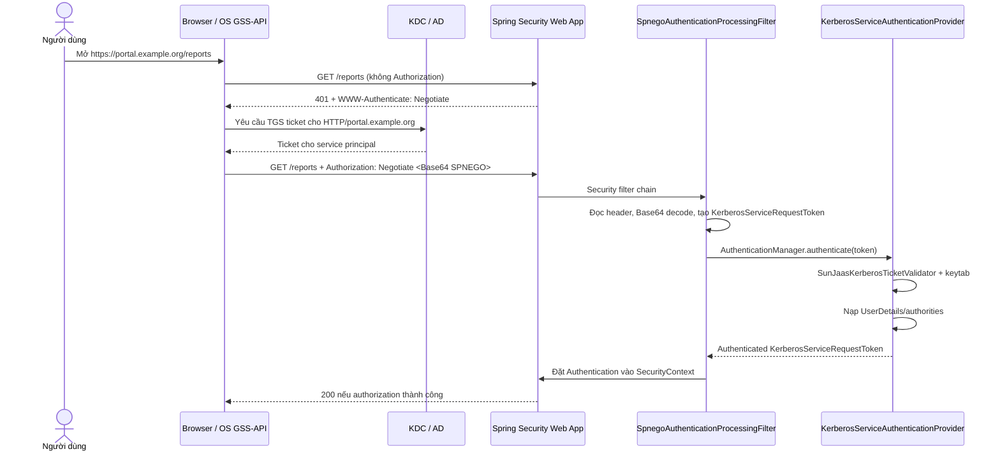

# SpnegoAuthenticationProcessingFilter và tiếp nhận token SPNEGO

## Mục tiêu học tập

Sau bài này, bạn có thể:

1. Mô tả HTTP **Negotiate/SPNEGO** và sự phối hợp giữa trình duyệt, **Kerberos KDC**, Service Principal Name (SPN), keytab và ứng dụng Spring Security.
2. Giải thích thông điệp `401 Unauthorized + WWW-Authenticate: Negotiate` và `Authorization: Negotiate <Base64-token>`, phân biệt token SPNEGO với username/password, JWT, CAS Service Ticket và SAMLResponse.
3. Phân tích chính xác vai trò `SpnegoAuthenticationProcessingFilter` trong **Spring Security Kerberos 2.2.x**: nhận header, giải Base64, tạo `KerberosServiceRequestToken`, gọi `AuthenticationManager`, xử lý thành công/thất bại và chuyển tiếp filter chain.
4. Cấu hình `SpnegoEntryPoint`, `KerberosServiceAuthenticationProvider`, `SunJaasKerberosTicketValidator`, `UserDetailsService` và keytab bằng Java 17+/Spring Boot 3/Spring Security 6 theo đúng ranh giới trách nhiệm.
5. Hiểu các defaults có ý nghĩa bảo mật: `skipIfAlreadyAuthenticated=true`, `RequestAttributeSecurityContextRepository`, `NullAuthenticatedSessionStrategy`, handler tùy chọn và `stopFilterChainOnSuccessfulAuthentication=false`.
6. Chẩn đoán những lỗi thường gặp: browser không gửi token, KDC/DNS/SPN/keytab sai, clock skew, crypto/key version, reverse proxy loại header, channel binding mismatch, failover nhiều node, vòng lặp 401 và user không có quyền local.
7. Phân biệt xác thực Kerberos với **authorization của ứng dụng**, cảnh giác fallback NTLM, token replay/relay, việc log raw Authorization và yêu cầu TLS/Extended Protection khi phù hợp.
8. Chạy một **Java 17+ độc lập** để phân loại cú pháp header `Negotiate` (không tự xác minh Kerberos), đồng thời xây test matrix cho Spring filter, GSS-API và HTTP end-to-end.

## 1. Tích hợp Kerberos là gì?

Trong mạng doanh nghiệp, Kerberos cho phép người dùng đã xác thực với **Key Distribution Center (KDC)** lấy một ticket chứng minh danh tính cho một dịch vụ cụ thể. Ứng dụng web thường tận dụng cơ chế này để hỗ trợ **Integrated Windows Authentication** hoặc SSO nội bộ mà không yêu cầu người dùng nhập lại mật khẩu tại form web.

Các vai trò:

| Thành phần | Ví dụ | Nhiệm vụ |
| --- | --- | --- |
| **Client/browser** | Edge/Chrome/Firefox được tổ chức cấu hình | Nhận HTTP Negotiate challenge, lấy/tạo security token qua hệ thống GSS/SSPI |
| **KDC** | Active Directory Domain Controller hoặc MIT Kerberos | Phát TGT/TGS tickets sau khi kiểm quyền và principal |
| **User principal** | `alice@EXAMPLE.ORG` | Định danh user theo realm, không mặc nhiên là role app |
| **Service principal (SPN)** | `HTTP/portal.example.org@EXAMPLE.ORG` | Định danh dịch vụ web mà client yêu cầu ticket |
| **Service keytab** | `/run/secrets/portal-http.keytab` | Chứa khóa bí mật cho service principal, dùng accept Kerberos ticket |
| **HTTP Negotiate** | `WWW-Authenticate` / `Authorization` | Vận chuyển các GSS-API/SPNEGO token qua HTTP |
| **SpnegoAuthenticationProcessingFilter** | Spring Kerberos extension | Nhận token từ HTTP request và chuyển cho authentication provider |
| **KerberosServiceAuthenticationProvider** | Spring Kerberos extension | Gọi ticket validator và nạp user details/authorities |
| **SecurityContextRepository** | Spring Security | Lưu/ngữ cảnh authentication sau khi xác minh thành công, nếu ứng dụng muốn stateful |

**SPNEGO** là cơ chế thương lượng security mechanism, thường chở Kerberos AP-REQ trong HTTP Negotiate. **SPNEGO không phải một loại JWT**: Base64 ở `Authorization` chỉ là cách biểu diễn dữ liệu nhị phân trên HTTP; token chỉ đáng tin sau khi cơ chế GSS-API/Kerberos xác minh bằng keytab/credential đúng.

### 1.1. Đừng nhầm các loại ticket/token

| Khái niệm | Cấp phát từ đâu? | Ai xác minh? |
| --- | --- | --- |
| Kerberos **TGT** | KDC sau AS exchange | KDC/TGS; không gửi trực tiếp như HTTP header cho ứng dụng |
| Kerberos **service ticket** | KDC/TGS cho SPN `HTTP/...` | Service dùng khóa/keytab và GSS-API |
| **SPNEGO token** | GSS-API/SSPI client tạo, có thể bao Kerberos message | Service acceptor qua GSS-API và negotiated mechanism |
| CAS **Service Ticket** | CAS Server qua browser redirect | CAS Server `/serviceValidate`, không phải validator SPNEGO |
| SAML **SAMLResponse** | IdP trả về ACS | SAML SP qua signature/trust/conditions |
| OIDC **ID token** | OIDC Provider | OIDC client theo JWKS/issuer/audience/nonce |
| App **HttpSession cookie** | Web app/container | Server lookup session; không phải Kerberos service ticket |

Người dùng có thể dùng Kerberos để login app rồi app tạo `HttpSession`. Từ đó, việc giữ phiên ứng dụng và logout **khác** lifecycle của TGT/TGS cache trên máy người dùng.

## 2. HTTP Negotiate handshake theo RFC 4559

RFC 4559 mô tả HTTP authentication scheme **Negotiate**, thường sử dụng SPNEGO GSS-API. Luồng có thể gồm một hoặc nhiều vòng; không được suy rằng mọi request có đúng một 401 và một 200.

### 2.1. Luồng cơ bản



**Diễn giải:**

1. Khi browser chưa có authentication với app, một tài nguyên được bảo vệ dẫn đến `401 Unauthorized` với challenge `WWW-Authenticate: Negotiate`. Spring `SpnegoEntryPoint` thường phát challenge này.
2. Browser, tùy cấu hình intranet/trust, nhờ OS GSS-API hoặc Windows SSPI lấy service ticket cho **SPN tương ứng URL public**, thường `HTTP/portal.example.org`.
3. Browser gửi `Authorization: Negotiate <token>` trong request kế tiếp. Token không phải mật khẩu người dùng và không cần JavaScript ứng dụng lấy ra.
4. `SpnegoAuthenticationProcessingFilter` trích bytes token từ header và chuyển sang Spring `AuthenticationManager`.
5. Provider dùng `KerberosTicketValidator` (ví dụ `SunJaasKerberosTicketValidator`) để accept token bằng service credentials; sau đó lookup user/roles.
6. Nếu thành công, Spring Security gắn `Authentication` vào context; controller/service chỉ chạy nếu authorization cho phép.
7. GSS exchange có thể cần thêm bước/challenge hoặc final response token (mutual authentication), tùy negotiated mechanism và client. Cần kiểm thực tế với browser/KDC/library.

### 2.2. Ví dụ HTTP messages

Request đầu:

```http
GET /reports HTTP/1.1
Host: portal.example.org
Accept: text/html
```

Response yêu cầu xác thực:

```http
HTTP/1.1 401 Unauthorized
WWW-Authenticate: Negotiate
Cache-Control: no-store
```

Browser gửi token sau khi có Kerberos credentials:

```http
GET /reports HTTP/1.1
Host: portal.example.org
Authorization: Negotiate BASE64_SPNEGO_APREQ
```

Response khi GSS/Kerberos authentication **và quyền ứng dụng** hợp lệ:

```http
HTTP/1.1 200 OK
Content-Type: text/plain;charset=UTF-8

Report for alice
```

`BASE64_SPNEGO_APREQ` là ký hiệu minh họa, **không phải một token Base64 thật**. Trong giao thức thật, browser gửi Base64 của dữ liệu GSS/SPNEGO nhị phân. Khi có mutual authentication, HTTP response thành công cũng có thể mang `WWW-Authenticate: Negotiate <final-token>`; không tự bỏ final-leg khi implementation yêu cầu.

### 2.3. Vì sao cần HTTPS dù Kerberos có mã hóa/xác thực?

RFC 4559 chỉ cung cấp cơ chế **authentication** qua HTTP; nó **không tự bảo vệ tất cả HTTP headers và body**. TLS cần để bảo vệ URL, cookies, nội dung ứng dụng và các auth headers khỏi quan sát/sửa đổi trên mạng.

Ngoài ra cần xem xét **Extended Protection/channel binding** trong môi trường có AD, reverse proxy hoặc TLS termination. Không xử lý lỗi channel binding bằng cách tùy tiện vô hiệu chính sách bảo mật ở domain controller/Windows registry; phải hiểu đường TLS và binding theo thiết kế triển khai.

## 3. SpnegoAuthenticationProcessingFilter trong Spring Security

`SpnegoAuthenticationProcessingFilter` thuộc module **Spring Security Kerberos Web**, package:

```java
org.springframework.security.kerberos.web.authentication.SpnegoAuthenticationProcessingFilter
```

Trong Spring Security Kerberos **2.2.0**, class này kế thừa `OncePerRequestFilter`, làm việc trong **Servlet security filter chain**. Nó không phải controller login, không phải SAML filter và không phát hành TGT.

### 3.1. Những gì filter thực sự làm

Bước xử lý thông thường:

1. Đọc `SecurityContextHolder`. Nếu đã authenticated và `skipIfAlreadyAuthenticated=true` thì cho request đi tiếp, không xác thực SPNEGO lại.
2. Đọc header `Authorization`.
3. Với header phù hợp `Negotiate <Base64>`, filter giải Base64 về bytes (bản 2.2.x còn nhận dạng một dạng header `Kerberos` cũ). Một số token NTLMSSP đặc trưng bị bỏ qua theo logic prefix; **không có nghĩa nó cung cấp bộ giải mã NTLM đầy đủ hoặc bảo đảm chặn mọi NTLM downgrade**.
4. Tạo `KerberosServiceRequestToken(byte[])` **chưa xác thực**.
5. Gọi `authenticationManager.authenticate(authenticationRequest)`. Provider quyết định ticket hợp lệ hay không.
6. Nếu xác thực thành công, thực thi `SessionAuthenticationStrategy`, tạo `SecurityContext` chứa `Authentication` trả về, set holder và gọi `SecurityContextRepository.saveContext(...)`.
7. Gọi `successHandler` nếu cấu hình; theo mặc định tiếp tục `chain.doFilter(...)` khi thành công.
8. Nếu có `AuthenticationException`, clear context và gọi `failureHandler` nếu có; nếu không, filter của bản nguồn 2.2.x có thể trả **HTTP 500**. Khi không có token phù hợp, filter thường cho chain tiếp tục; `ExceptionTranslationFilter`/`SpnegoEntryPoint` sẽ challenge user khi tài nguyên cần authentication.

**Không có header không đồng nghĩa filter “báo login sai”.** Nó có thể không làm gì rồi để authorization quyết định phải phát 401.

### 3.2. Bảng cấu hình mặc định cần biết

| Thuộc tính | Mặc định trong module 2.2.0 | Tác động |
| --- | --- | --- |
| `authenticationManager` | **Phải set** | Filter không thể gọi provider nếu thiếu |
| `skipIfAlreadyAuthenticated` | `true` | Bỏ qua header mới khi request hiện tại đã authenticated; lưu ý freshness/reauth policy |
| `sessionStrategy` | `NullAuthenticatedSessionStrategy` | Không tự rotate session ID khi authentication thành công nếu không cấu hình |
| `securityContextRepository` | `RequestAttributeSecurityContextRepository` | Chỉ lưu context trong phạm vi request, không mặc nhiên giữ browser login qua requests |
| `successHandler` | `null` | Không tự redirect xử lý đặc biệt; tiếp tục chain theo flag |
| `failureHandler` | `null` | Với `AuthenticationException`, có thể HTTP 500 thay vì challenge thân thiện |
| `stopFilterChainOnSuccessfulAuthentication` | `false` | Request thường tiếp tục filter chain sau authentication |
| `securityContextHolderStrategy` | Chiến lược từ `SecurityContextHolder` | Thường ThreadLocal trong Servlet flow |
| `authenticationDetailsSource` | `WebAuthenticationDetailsSource` | Bổ sung details; không là bằng chứng Kerberos trust |

**Điểm quan trọng cho Spring Security 6:** chỉ set `SecurityContextHolder` trong request hoặc dùng repository chỉ có request attributes thì request kế tiếp **có thể anonymous**. Muốn browser session, cấu hình **cùng `SecurityContextRepository`** ở filter và HTTP security chain, có session fixation strategy và kiểm end-to-end.

### 3.3. Filter không tự xác minh cryptographic token

`SpnegoAuthenticationProcessingFilter` chỉ lấy token bytes từ HTTP. Quyết định xác thực thuộc `AuthenticationManager` và `KerberosServiceAuthenticationProvider`, thông qua `KerberosTicketValidator`/GSS-API.

**Cảnh báo:** một chuỗi `Authorization: Negotiate AAAA` có thể đúng Base64 nhưng vô nghĩa đối với Kerberos. Parse thành công **không phải** login thành công. Không tự kiểm “token bắt đầu bằng chuỗi nào” rồi tạo `UsernamePasswordAuthenticationToken` authenticated.

### 3.4. Vị trí trong filter chain

Một cấu hình thông dụng:

```java
http.addFilterBefore(spnegoFilter, BasicAuthenticationFilter.class);
```

Đặt trước `BasicAuthenticationFilter` giúp SPNEGO có cơ hội đọc header trước các cơ chế khác, nhưng cũng phải xét `SecurityContextHolderFilter` (đã load context), `ExceptionTranslationFilter`, `AuthorizationFilter`, form login fallback nếu có và exception handling.

Nếu có nhiều `SecurityFilterChain` hoặc route `/api/**` tách biệt, filter phải nằm **đúng chain** áp dụng cho tài nguyên sử dụng Kerberos. Đừng đăng ký filter thêm một lần như global Servlet Filter rồi lại add vào Spring Security chain — có thể double processing, filter chạy sai thứ tự hoặc bỏ qua security context.

## 4. KerberosServiceAuthenticationProvider, validator và UserDetails

`KerberosServiceAuthenticationProvider` là `AuthenticationProvider` chuyên xử lý `KerberosServiceRequestToken`. Tầng này cần hai thứ riêng biệt:

- **`KerberosTicketValidator`**: dùng credentials của **service principal** để accept/verify Kerberos hoặc SPNEGO message, trả principal và các thông tin xác thực.
- **`UserDetailsService`**: nạp trạng thái người dùng và `GrantedAuthority` cục bộ, sau khi identity được Kerberos xác minh. App không tự nhận quyền admin chỉ vì user thuộc AD domain.

### 4.1. Vì sao cần SPN và keytab?

Khi browser truy cập `https://portal.example.org`, nó có thể yêu cầu ticket tới service principal:

```text
HTTP/portal.example.org@EXAMPLE.ORG
```

Realm `EXAMPLE.ORG` và hostname là **ví dụ**, không phải SPN thật. KDC phát ticket được bảo vệ bằng khóa service account. Ứng dụng cần keytab chứa khóa tương ứng với SPN và key version/algorithm mà KDC sử dụng để giải mã/accept ticket.

Nếu app cấu hình `HTTP/app.internal@EXAMPLE.ORG` nhưng browser yêu cầu `HTTP/portal.example.org@EXAMPLE.ORG`, mismatch SPN/keytab có thể gây `GSSException`. Cũng có thể các nguyên nhân AD duplicate SPN, wrong account, realm mismatch, DNS canonicalization và stale keytab sau password rotation.

### 4.2. KDC, app và OS có trách nhiệm khác nhau

| Bước | Chủ yếu xảy ra ở | Có cần gọi KDC ở mỗi HTTP request? |
| --- | --- | --- |
| Lấy/renew TGT | Client và KDC | Không ở mỗi request |
| Lấy service ticket cho HTTP SPN | Browser/OS và KDC/TGS | Có thể cache ticket, không cần mỗi request |
| Browser tạo GSS/SPNEGO token | Client OS/browser | Dựa trên cached credentials |
| Service accept Kerberos AP-REQ | App/GSS JAAS với service keytab | Thường có thể xác minh bằng local keytab; không suy là app gọi KDC cho mọi request |
| Tra user details/roles | Ứng dụng/AD/LDAP/DB | Tùy implementation/cache |
| Persist app session | Spring Security/Session | Không liên quan trực tiếp ticket issuance |

### 4.3. KerberosServiceRequestToken trước và sau authentication

`new KerberosServiceRequestToken(byte[])` tạo token **chưa authenticated** cho provider. Provider sau khi validate có thể trả token kiểu `KerberosServiceRequestToken` đã authenticated, chứa principal, `GrantedAuthority` và dữ liệu `KerberosTicketValidation`.

**Không nhầm với `CasAuthenticationToken`:** dù cả CAS và Kerberos đều có “ticket”, một bên dùng CAS Server `/serviceValidate`, bên kia dùng Kerberos/GSS/SPN/keytab. Các package và trust models khác nhau.

### 4.4. UserDetailsService không phải là Kerberos validator

Ví dụ nếu Kerberos chứng minh identity `alice@EXAMPLE.ORG` nhưng ứng dụng không có user đó:

- Ticket có thể hợp lệ.
- Local `UserDetailsService` có thể từ chối user chưa được provisioned, disabled, locked hoặc không thuộc tenant.
- Đó có thể là **authentication/authorization policy failure sau GSS**, không phải keytab sai.

**Không fallback sang một user mặc định có `ROLE_ADMIN` khi lookup thất bại.** Nếu cần quy đổi principal `alice@EXAMPLE.ORG` thành username nội bộ `alice`, phải định nghĩa mapping realm/identity ổn định, anti-collision và tenant isolation.

## 5. Chuẩn bị hạ tầng Kerberos trước khi viết Spring code

Một ứng dụng không thể “chạy Kerberos SSO” chỉ vì thêm Spring dependency. Trước tiên cần một môi trường KDC/AD có DNS, time và service account đúng.

### 5.1. Checklist SPN và DNS

1. Xác định **public FQDN** người dùng truy cập, ví dụ `portal.example.org`.
2. Đảm bảo DNS trỏ đúng ứng dụng hoặc reverse proxy; tránh alias/canonicalization làm browser chọn SPN khác.
3. Trong AD/MIT KDC, tạo hoặc gán **SPN `HTTP/portal.example.org`** cho service account được quản trị.
4. Đảm bảo không có duplicate SPN hoặc SPN bị gắn vào sai principal. Cần quyền quản trị AD/KDC theo quy định.
5. Keytab được tạo từ service credentials phù hợp realm, SPN, kvno và enctypes chấp nhận; cấp vào runtime bằng secret manager/mount riêng.
6. Kiểm DNS lookup, KDC connectivity, đồng bộ giờ (NTP/chrony/Windows Time Service).
7. Nếu có nhiều app nodes, tất cả nodes accept cùng public service principal hoặc kiến trúc SPN/keytab đã được phê duyệt cho từng host; không để một node dùng keytab cũ và node kia keytab mới.
8. Thử với browser domain-joined/trusted zone và user account hợp lệ, không dùng fake `Authorization` string để kết luận Kerberos đã hoạt động.

### 5.2. Lệnh chẩn đoán có kiểm soát

Trên Linux có công cụ Kerberos (và quyền phù hợp):

```bash
# Chỉ xem các principal/kvno/enctype trong keytab được cấp, không in key.
klist -k -e /run/secrets/portal-http.keytab

# Xem ticket cache của user test, nếu được phép dùng môi trường đó.
klist

# Yêu cầu service ticket trong test realm nếu ticket credentials đã có.
kvno HTTP/portal.example.org@EXAMPLE.ORG
```

Các lệnh này **không có stdout cố định**: kết quả phụ thuộc KDC, quyền đọc keytab, principal, realm, vé còn hạn và hệ thống. Đừng paste full keytab/binary token vào ticket hỗ trợ.

Trên Windows domain admin workstation có thể kiểm SPN qua công cụ như `setspn -Q HTTP/portal.example.org` theo quy trình AD; một user test có thể xem cache với `klist`. Các lệnh cần quyền, môi trường và chính sách cụ thể, không nên thử với domain production nếu chưa được phép.

### 5.3. Bảo vệ keytab

**Keytab là secret, không phải certificate công khai.** Người có keytab và điều kiện phù hợp có thể mạo danh service hoặc giải mã ticket dành cho service. Do đó:

- Không commit keytab vào Git, container image hoặc `src/main/resources` của app.
- Mount vào đường chỉ service process đọc được; cấp quyền file tối thiểu, storage encryption và backup ACL.
- Không log binary keytab, không đưa lên issue tracker hay chat.
- Ký quy trình key rotation/compromise response, xác minh kvno/enctype mới, triển khai đồng bộ nodes và xác nhận ticket mới pass, key cũ fail theo policy.
- Không tắt channel binding/Extended Protection, hostname verification hoặc cho phép NTLM fallback chỉ vì keytab được tạo sai.

## 6. Spring Boot 3 + Spring Security 6: tích hợp SPNEGO

**Phạm vi:** ví dụ Servlet web app Java 17+ với **Spring Security Kerberos 2.2.0**, vốn được dự án công bố xây/test với JDK 17, Spring Security 6.5.1 và Spring Framework 6.2.8. Không lấy Maven coordinates của Spring Security 7.x áp vào Boot 3: nhánh 7.x đã thay groupId và baseline dependencies.

Tất cả hostname, realm, username và paths bên dưới là fixtures; cần provision KDC/keytab thật trước khi login end-to-end. Code Spring phụ thuộc Gradle project, không chạy trực tiếp `javac SecurityConfig.java`.

### 6.1. Gradle dependencies

Tệp `build.gradle`, với Spring Boot 3 plugin và dependency management/BOM tương thích:

```groovy
dependencies {
    implementation 'org.springframework.boot:spring-boot-starter-web'
    implementation 'org.springframework.boot:spring-boot-starter-security'

    implementation 'org.springframework.security.kerberos:spring-security-kerberos-core:2.2.0'
    implementation 'org.springframework.security.kerberos:spring-security-kerberos-web:2.2.0'

    testImplementation 'org.springframework.boot:spring-boot-starter-test'
    testImplementation 'org.springframework.security:spring-security-test'
}
```

**Ghi chú version:**

- Module Kerberos là dự án extension, **không** nằm mặc định trong `spring-boot-starter-security`.
- Các artifact `org.springframework.security.kerberos` ở **2.2.0** khác với coordinates `org.springframework.security:spring-security-kerberos-*` được giới thiệu ở Spring Security 7.x.
- Boot/Spring Security BOM có thể quản lý version Spring Security, nhưng không mặc định quản lý mọi phiên bản extension; kiểm dependency graph để tránh kéo Spring Security core/web không đồng bộ.
- Nếu project dùng Spring Security 7, phải áp dụng API/coordinates riêng của 7; ví dụ này chủ đích Spring Security 6.x.

### 6.2. Cấu hình không nhúng keytab

Tệp `src/main/resources/application.yml`:

```yaml
server:
  servlet:
    session:
      timeout: 20m
      cookie:
        secure: true
        http-only: true
        same-site: lax

app:
  kerberos:
    service-principal: "HTTP/portal.example.org@EXAMPLE.ORG"
    keytab-path: "/run/secrets/portal-http.keytab"
```

`same-site: lax` là lựa chọn ví dụ cho stateful browser requests; với Negotiate auth, browser có thể gửi ticket ở request riêng ngay cả không có session cookie. Cookie policy cần được quyết định dựa trên ứng dụng, CSRF và browser deployment. Không xem `SameSite=Lax` là thay thế SPN/keytab/Negotiate.

Nên dùng **external configuration/secret manager** cho principal và đường dẫn keytab tùy môi trường. Nội dung keytab **không** nằm trong YAML.

### 6.3. Main application

Tệp `src/main/java/com/example/kerberos/PortalApplication.java`:

```java
package com.example.kerberos;

import org.springframework.boot.SpringApplication;
import org.springframework.boot.autoconfigure.SpringBootApplication;

@SpringBootApplication
public class PortalApplication {
    public static void main(String[] args) {
        SpringApplication.run(PortalApplication.class, args);
    }
}
```

### 6.4. UserDetailsService: ánh xạ user đã được Kerberos xác minh

Tệp `src/main/java/com/example/kerberos/PortalUsers.java`:

```java
package com.example.kerberos;

import org.springframework.context.annotation.Bean;
import org.springframework.context.annotation.Configuration;
import org.springframework.security.core.userdetails.User;
import org.springframework.security.core.userdetails.UserDetailsService;
import org.springframework.security.core.userdetails.UsernameNotFoundException;

@Configuration
public class PortalUsers {

    @Bean
    UserDetailsService userDetailsService() {
        // DEMO ONLY: production dùng local IAM/DB/LDAP mapping có tenant policy.
        return principalName -> {
            if (!"alice@EXAMPLE.ORG".equalsIgnoreCase(principalName)) {
                throw new UsernameNotFoundException(
                        "Unknown or unapproved Kerberos principal");
            }
            return User.withUsername(principalName)
                    .password("{noop}unused-for-spnego-demo")
                    .authorities("REPORT_READ")
                    .build();
        };
    }
}
```

**Giới hạn:** ví dụ chấp nhận duy nhất principal test `alice@EXAMPLE.ORG`. Không dùng `{noop}` cho password login thực tế; password placeholder ở đây **không được filter SPNEGO sử dụng để xác thực**. Nếu tích hợp AD/LDAP hoặc nhiều realms, cần thiết kế mapping principal/realm → account và role allowlist có kiểm chứng. Không tự gán mọi `*@EXAMPLE.ORG` thành admin.

### 6.5. SecurityConfig với filter, provider, repository và entry point

Tệp `src/main/java/com/example/kerberos/SecurityConfig.java`:

```java
package com.example.kerberos;

import org.springframework.beans.factory.annotation.Value;
import org.springframework.context.annotation.Bean;
import org.springframework.context.annotation.Configuration;
import org.springframework.core.io.FileSystemResource;
import org.springframework.security.authentication.AuthenticationManager;
import org.springframework.security.authentication.ProviderManager;
import org.springframework.security.config.annotation.method.configuration.EnableMethodSecurity;
import org.springframework.security.config.annotation.web.builders.HttpSecurity;
import org.springframework.security.config.http.SessionCreationPolicy;
import org.springframework.security.core.userdetails.UserDetailsService;
import org.springframework.security.kerberos.authentication.KerberosServiceAuthenticationProvider;
import org.springframework.security.kerberos.authentication.sun.SunJaasKerberosTicketValidator;
import org.springframework.security.kerberos.web.authentication.SpnegoAuthenticationProcessingFilter;
import org.springframework.security.kerberos.web.authentication.SpnegoEntryPoint;
import org.springframework.security.web.SecurityFilterChain;
import org.springframework.security.web.authentication.www.BasicAuthenticationFilter;
import org.springframework.security.web.authentication.session.ChangeSessionIdAuthenticationStrategy;
import org.springframework.security.web.context.DelegatingSecurityContextRepository;
import org.springframework.security.web.context.HttpSessionSecurityContextRepository;
import org.springframework.security.web.context.RequestAttributeSecurityContextRepository;
import org.springframework.security.web.context.SecurityContextRepository;

@Configuration
@EnableMethodSecurity
public class SecurityConfig {

    @Bean
    SecurityContextRepository securityContextRepository() {
        return new DelegatingSecurityContextRepository(
                new RequestAttributeSecurityContextRepository(),
                new HttpSessionSecurityContextRepository());
    }

    @Bean
    KerberosServiceAuthenticationProvider kerberosServiceProvider(
            UserDetailsService users,
            @Value("${app.kerberos.service-principal}") String principal,
            @Value("${app.kerberos.keytab-path}") String keytabPath) {

        SunJaasKerberosTicketValidator validator =
                new SunJaasKerberosTicketValidator();
        validator.setServicePrincipal(principal);
        validator.setKeyTabLocation(new FileSystemResource(keytabPath));
        validator.setDebug(false); // tránh lộ GSS/Kerberos diagnostics nhạy cảm

        KerberosServiceAuthenticationProvider provider =
                new KerberosServiceAuthenticationProvider();
        provider.setTicketValidator(validator);
        provider.setUserDetailsService(users);
        return provider;
    }

    @Bean
    SecurityFilterChain kerberosChain(
            HttpSecurity http,
            KerberosServiceAuthenticationProvider provider,
            SecurityContextRepository contextRepository) throws Exception {

        AuthenticationManager manager = new ProviderManager(provider);
        SpnegoAuthenticationProcessingFilter spnegoFilter =
                new SpnegoAuthenticationProcessingFilter();
        spnegoFilter.setAuthenticationManager(manager);

        // 2.2.x default chỉ dùng RequestAttribute repository:
        // cấu hình riêng nếu muốn duy trì login bằng HttpSession.
        spnegoFilter.setSecurityContextRepository(contextRepository);

        // Với custom authentication filter, quản lý chống fixation rõ ràng.
        spnegoFilter.setSessionAuthenticationStrategy(
                new ChangeSessionIdAuthenticationStrategy());

        // Không để failure mặc định biến AuthenticationException thành 500.
        spnegoFilter.setFailureHandler((request, response, exception) -> {
            response.setHeader("WWW-Authenticate", "Negotiate");
            response.sendError(401);
        });

        http.authorizeHttpRequests(auth -> auth
                    .requestMatchers("/").permitAll()
                    .requestMatchers("/admin/**").hasAuthority("PORTAL_ADMIN")
                    .anyRequest().authenticated())
                .exceptionHandling(ex -> ex
                    .authenticationEntryPoint(new SpnegoEntryPoint()))
                .sessionManagement(session -> session
                    .sessionCreationPolicy(SessionCreationPolicy.IF_REQUIRED))
                .securityContext(sc -> sc
                    .securityContextRepository(contextRepository))
                .addFilterBefore(spnegoFilter, BasicAuthenticationFilter.class);

        return http.build();
    }
}
```

**Giải thích chi tiết:**

1. `SunJaasKerberosTicketValidator` dùng `servicePrincipal` và file keytab để GSS/JAAS accept ticket. Nó không chỉ “so chuỗi SPN”; cryptographic validation phải qua JGSS/JDK.
2. `KerberosServiceAuthenticationProvider` được cấp validator và `UserDetailsService`. Một ticket hợp lệ nhưng user chưa provisioned vẫn có thể bị từ chối theo policy local.
3. `ProviderManager` nhận `KerberosServiceRequestToken` và gọi provider. Không cấu hình `UsernamePasswordAuthenticationProvider` rồi mong nó tự validate token SPNEGO.
4. `SpnegoAuthenticationProcessingFilter` là instance **chỉ thêm vào Spring Security chain**, không tạo `@Bean Filter` để Boot đăng ký toàn cục lần thứ hai.
5. `setSecurityContextRepository` của filter và `http.securityContext(...)` dùng **cùng repository**. Điều này cho phép request kế nạp context từ `HttpSession` khi ứng dụng lựa chọn stateful login.
6. `ChangeSessionIdAuthenticationStrategy` hỗ trợ session fixation protection. Bộ lọc 2.2.0 mặc định dùng `NullAuthenticatedSessionStrategy`; không mặc định cho rằng mọi custom filter được nhận session strategy của form login DSL.
7. `SpnegoEntryPoint()` trả 401 challenge Negotiate cho các request được bảo vệ mà chưa authenticated. Với browser không hỗ trợ SPNEGO, cần UX/fallback riêng được phê duyệt.
8. Failure handler ví dụ trả 401/challenge để tránh HTTP 500 mặc định. **Đây không tự giải quyết multi-leg GSS negotiation, keytab hoặc NTLM.** Đừng dùng catch-all rồi xác thực người dùng giả; ghi reason category đã redacted.
9. App authorization vẫn bảo vệ `/admin/**` bằng `PORTAL_ADMIN`; user demo chỉ có `REPORT_READ` nên không được admin.
10. `SecurityContextRepository` có `HttpSession` nghĩa application có local app session; đăng xuất Windows/Kerberos hoặc TGT expiry **không tự revoke** phiên app đã tạo.
11. Với sản phẩm **stateless per-request Negotiate**, có thể thiết kế không persist app session; nhưng cần kiểm GSS continuity, browser/connection/challenge và load balancing. Không dùng ví dụ stateful rồi đặt `SessionCreationPolicy.STATELESS` một cách mâu thuẫn.

**Các phần còn thiếu để deploy:** KDC/realm setup, SPN registration, keytab mount và access policy, reverse proxy, TLS, domain-joined browser, endpoint bảo vệ, logging redaction, authorization source production và test với KDC thật. Không thể thử bằng cách tự chế Base64 token bất kỳ.

### 6.6. Endpoint thử nghiệm

Tệp `src/main/java/com/example/kerberos/PortalController.java`:

```java
package com.example.kerberos;

import java.util.Map;
import org.springframework.security.core.Authentication;
import org.springframework.web.bind.annotation.GetMapping;
import org.springframework.web.bind.annotation.RestController;

@RestController
public class PortalController {

    @GetMapping("/")
    public String home() {
        return "Public";
    }

    @GetMapping("/me")
    public Map<String, Object> me(Authentication auth) {
        return Map.of(
                "principalName", auth.getName(),
                "authenticated", auth.isAuthenticated());
    }

    @GetMapping("/reports")
    public String reports(Authentication auth) {
        return "Report for " + auth.getName();
    }
}
```

Nếu user `alice@EXAMPLE.ORG` có Kerberos credentials đúng, service keytab đúng, local user approved và browser đã negotiate thành công, `GET /reports` **có thể** trả:

```text
Report for alice@EXAMPLE.ORG
```

Đây là **kết quả minh họa có điều kiện**, không phải output cố định khi chưa có KDC/keytab thật. API `/me` chỉ trả name/authenticated, tránh echo `Authorization`, raw ticket bytes hay `Authentication.toString()` có thể chứa details nhạy cảm.

## 7. Kiểm soát từng bước từ HTTP header đến Authentication

### 7.1. Mốc chẩn đoán

| Giai đoạn | Input | Thành công | Thất bại điển hình |
| --- | --- | --- | --- |
| Browser nhận challenge | 401 + `WWW-Authenticate: Negotiate` | Browser thử GSS/SSPI | Header bị proxy loại, browser không trusted |
| Browser lấy TGS ticket | Public SPN `HTTP/portal.example.org` | Có service ticket hợp lệ | SPN không tồn tại, DNS/realm/KDC lỗi |
| Browser gửi header | `Authorization: Negotiate Base64` | HTTP request mang token | NTLM fallback, header trống/quá lớn |
| Filter parse | Header/token bytes | Tạo `KerberosServiceRequestToken` | Sai scheme, Base64 malformed, unsupported form |
| Provider validate | GSS token + keytab | Xác minh AP-REQ/identity | Keytab/SPN/kvno/enctype/clock skew |
| User details | Verified principal | Local user/authorities hợp lệ | Unknown user/disabled/no tenant mapping |
| Context persistence | Authenticated token | Lưu hoặc giữ theo policy | RequestAttribute only, cookie/store không có |
| Authorization | Local identity/permissions | Controller/service được phép | 403 nếu thiếu role/tenant action |

### 7.2. Đã authenticated thì filter có luôn xử lý Negotiate mới không?

Mặc định `setSkipIfAlreadyAuthenticated(true)`. Nếu `SecurityContextHolder` đã chứa một authentication được đánh dấu authenticated và không phải `AnonymousAuthenticationToken`, filter cho request đi tiếp mà **không revalidate header**.

Điều này có ý nghĩa khi:

- User đã có app session: browser có gửi một Negotiate header mới, nhưng filter có thể bỏ qua.
- Muốn buộc reauthenticate theo chính sách sensitivity, phải thiết kế logout/re-auth/`skipIfAlreadyAuthenticated` và session strategy riêng; **không chỉ bật false bừa** để “an toàn hơn”.
- Nếu dùng nhiều authentication mechanisms (SAML/CAS/form/API), filter có thể bỏ qua vì user đã authenticated bằng mechanism khác. Cần phân tách chains, xác định authentication type/freshness rõ ràng nếu route yêu cầu Kerberos.

Đừng tắt skip với mỗi HTTP request trong cluster mà không đánh giá hiệu năng, replay policy, browser handshake và load balancer.

### 7.3. Header trống, Basic và NTLM

- Không có `Authorization` → filter bỏ qua; entry point có thể yêu cầu Negotiate sau khi authorization phát hiện anonymous.
- `Authorization: Basic ...` hoặc `Bearer ...` → filter này không xác thực các schemes đó. Nếu ứng dụng có chain khác, phải phân loại rõ đường API.
- `Authorization: Negotiate ...` với Base64 sai → parse/decode có thể thất bại; xử lý 400/401/500 tùy exception và filter behavior. Hãy test thay vì suy rằng mọi lỗi vào cùng `AuthenticationException` handler.
- Một số browser/Windows triển khai **Negotiate chọn NTLM** nếu Kerberos không khả dụng. Filter Spring 2.2.x có logic bỏ qua prefix NTLMSSP đặc trưng. **Không có nghĩa mọi NTLM payload đều bị loại**; cần policy/KDC/mechanism kiểm soát nếu hệ thống yêu cầu Kerberos-only.
- `Authorization: Kerberos ...` là một dạng filter source 2.2.x có thể nhận cho tương thích; chuẩn HTTP Negotiate trong RFC 4559 vẫn là `Negotiate`, không thiết kế mới dựa trên prefix khác nếu không có lý do.

### 7.4. Đừng nhầm parse Base64 với xác thực

Base64 là encoding, không phải encryption, MAC hay signature. Ví dụ:

```text
Authorization: Negotiate AQID
```

`AQID` giải được thành bytes `01 02 03`, nhưng **không phải** một Kerberos AP-REQ hợp lệ. Chỉ `KerberosTicketValidator`/GSS-API với service keytab đúng mới kết luận authentication thành công.

## 8. Java 17+ độc lập: phân loại cú pháp header, không giả lập Kerberos

Để hiểu filter nhận token ở mức HTTP, ta viết một chương trình chỉ làm **syntactic inspection**. Nó KHÔNG biết KDC, SPN, keytab, GSS-API hoặc ticket integrity. Mọi token nhìn hợp lệ đều được gắn nhãn **CANDIDATE_NOT_AUTHENTICATED**, không được dùng để login.

Tệp `NegotiateHeaderDemo.java`:

```java
import java.nio.charset.StandardCharsets;
import java.util.Base64;

public final class NegotiateHeaderDemo {

    private static final byte[] NTLM_MAGIC =
            "NTLMSSP\0".getBytes(StandardCharsets.US_ASCII);

    public static String classify(String header) {
        if (header == null || header.isBlank()) {
            return "NO_CREDENTIALS";
        }
        if (!header.startsWith("Negotiate ")) {
            return "OTHER_SCHEME";
        }

        String encoded = header.substring("Negotiate ".length()).trim();
        if (encoded.isEmpty()) {
            return "EMPTY_TOKEN";
        }

        byte[] token;
        try {
            token = Base64.getDecoder().decode(encoded);
        } catch (IllegalArgumentException exception) {
            return "BAD_BASE64";
        }
        if (token.length == 0) {
            return "EMPTY_TOKEN";
        }
        if (startsWith(token, NTLM_MAGIC)) {
            return "NTLM_NOT_KERBEROS";
        }
        return "CANDIDATE_NOT_AUTHENTICATED";
    }

    private static boolean startsWith(byte[] bytes, byte[] prefix) {
        if (bytes.length < prefix.length) {
            return false;
        }
        for (int i = 0; i < prefix.length; i++) {
            if (bytes[i] != prefix[i]) {
                return false;
            }
        }
        return true;
    }

    public static void main(String[] args) {
        String fakeNtlm = "Negotiate " + Base64.getEncoder()
                .encodeToString(NTLM_MAGIC);
        String arbitraryBytes = "Negotiate " + Base64.getEncoder()
                .encodeToString(new byte[] {1, 2, 3});

        System.out.println("Missing: " + classify(null));
        System.out.println("Bearer: " + classify("Bearer abc"));
        System.out.println("Empty: " + classify("Negotiate "));
        System.out.println("Malformed: " + classify("Negotiate %%%"));
        System.out.println("NTLM magic: " + classify(fakeNtlm));
        System.out.println("Other Base64: " + classify(arbitraryBytes));
    }
}
```

Biên dịch và chạy với JDK 17+:

```bash
javac NegotiateHeaderDemo.java
java NegotiateHeaderDemo
```

**Stdout chính xác:**

```text
Missing: NO_CREDENTIALS
Bearer: OTHER_SCHEME
Empty: EMPTY_TOKEN
Malformed: BAD_BASE64
NTLM magic: NTLM_NOT_KERBEROS
Other Base64: CANDIDATE_NOT_AUTHENTICATED
```

**Điều cần hiểu:**

- Chương trình chỉ phân biệt `Authorization` header scheme và tính hợp lệ cú pháp Base64.
- Bytes `01 02 03` đã decode thành công nhưng **không có bằng chứng cryptographic Kerberos**; không cho authenticated.
- Việc phát hiện `NTLMSSP\0` đứng đầu byte stream chỉ là **heuristic demo**. Một token SPNEGO thực có thể bọc thông điệp bên trong và không có magic bytes ở offset 0. Chặn NTLM downgrade cần negotiated mechanism validation và enterprise policy, không chỉ substring/magic match.
- Một production parser còn cần giới hạn kích thước request/header, structured error handling, rate limiting và tránh log raw token. Không copy demo thay cho Spring `SpnegoAuthenticationProcessingFilter`.
- Nếu HTTP header đã qua reverse proxy, có thể bị loại hoặc chỉnh sửa. Không cho client chọn headers tin cậy như `X-Remote-User` rồi bypass Kerberos; identity phải đến từ validator hoặc một trusted authenticated proxy contract có bảo vệ.
- Không dùng `NegotiateHeaderDemo` như một “SPNEGO validator” trong controller.

## 9. Các vấn đề liên quan trình duyệt, DNS và proxy

### 9.1. Browser không gửi Authorization dù server đã 401

Nguyên nhân thường là browser không tin URL đủ để thực hiện **Integrated Authentication** hoặc user không có Kerberos credentials:

- Host không nằm trong intranet/integrated authentication allowlist theo browser/device policy.
- Browser đang chạy ngoài domain-joined hoặc không có TGT.
- DNS/realm không khớp, KDC không tìm thấy SPN.
- SPN đăng ký cho alias khác với hostname mà user truy cập.
- Browser/proxy thay hostname bằng IP address, CNAME hoặc internal endpoint làm chọn SPN sai.
- Corporate proxy chặn `WWW-Authenticate` hoặc `Authorization`; ingress tự trả 401 không đúng.
- Client dùng NTLM fallback thay Kerberos, còn server chỉ chấp nhận Kerberos.

**Không sửa bằng cách bật NTLM, loại bỏ hostname checks hoặc thêm mọi URL vào intranet allowlist.** Cần giới hạn hostnames và thiết bị được phép, xác nhận policy, kiểm KDC/SPN/DNS.

### 9.2. Reverse proxy và TLS termination

Luồng triển khai:

```text
Browser  -- HTTPS public URL -->  Ingress/LB
Ingress  -- protected hop -->     Spring Boot instance
Public SPN: HTTP/portal.example.org@EXAMPLE.ORG
Validator keytab: service account credential cho public SPN
```

Điểm cần đảm bảo:

1. Browser yêu cầu ticket cho **public hostname**, không phải pod hostname `portal-app-1.internal`.
2. Kerberos acceptor ở Spring Boot có keytab đúng public SPN.
3. Ingress chuyển nguyên `Authorization: Negotiate ...` và không tự thay thành Basic/Bearer hoặc xóa header.
4. TLS đường public và hop nội bộ có security policy phù hợp; nếu TLS termination ảnh hưởng channel binding, phải xét kiến trúc Extended Protection.
5. Nếu ingress **tự làm Kerberos authentication**, kiến trúc đổi thành **trusted proxy authentication**. Khi đó đừng chạy filter SPNEGO lần hai trên header không còn có ý nghĩa. Identity header từ proxy chỉ đáng tin nếu app chặn direct access, mạng mTLS/ACL và header được proxy ghi đè, không nhận từ internet.
6. Load balancer, keep-alive và HTTP/2 có thể ảnh hưởng một số GSS multi-leg/connection-bound implementation. Test browser thực tế và proxy settings, không chỉ curl.
7. Giới hạn header size hợp lý nhưng tính tới token Kerberos với PAC/group memberships lớn; header quá dài có thể trả **400/431** trước khi Spring filter chạy.

### 9.3. Multi-node và keytab

Nếu A/B cùng phục vụ `https://portal.example.org`, cả hai phải **accept tickets cho cùng SPN public** và key version/algorithm phù hợp. Lựa chọn:

- Mount cùng service keytab/secret đến mỗi node qua secret manager, file ACL phù hợp.
- Hoặc triển khai service credential/acceptor design đã được IAM/KDC phê duyệt, có key rotation đồng bộ.
- Bảo đảm cùng user realm mapping, session persistence (nếu stateful), roles và proxy configuration trên A/B.
- Kiểm rolling deployment: node mới dùng keytab phiên bản mới, node cũ chưa cập nhật có thể gây 401 không ổn định. Dùng plan rollover và testing.
- Không copy raw keytab thủ công qua chat/issue; cấp qua kênh secret delivery chuẩn.

### 9.4. Clock skew và DNS canonicalization

Kerberos nhạy với thời gian: chênh lệch clock giữa client/KDC/service có thể làm ticket bị từ chối. Đồng bộ thời gian bằng NTP/Windows Time Service, kiểm timezone vs UTC trong logs, **không tăng clock skew vô hạn** để che lỗi.

DNS alias/CNAME, SPN duplication và default realm mapping ảnh hưởng tên principal mà browser xin. Đối chiếu actual requested SPN từ log Kerberos đã redacted/KDC events, public URL và entries trong keytab. Không tự động thử mọi SPN nếu user được nhận từ một host không đáng tin.

## 10. Bảo mật đặc thù của HTTP Negotiate

### 10.1. SPNEGO có thể thương lượng cơ chế không mong muốn

SPNEGO là cơ chế chọn authentication protocol. Trong Windows, một số Negotiate deployments có thể **fallback sang NTLM** khi Kerberos không khả dụng.

- Spring filter 2.2.x có logic loại một dạng `NTLMSSP` prefix đã biết, nhưng **không dùng logic đó làm chứng cứ toàn bộ hệ thống đã chống NTLM**.
- Bảo đảm policy client/server yêu cầu Kerberos khi ứng dụng được thiết kế Kerberos-only; kiểm negotiated mechanism thực tế.
- NTLM relay/downgrade và keytab failure là các rủi ro phải threat-model; không chủ động hạ mức xác thực để “đỡ thấy 401”.
- Đừng dùng `Authorization` raw prefix hoặc Base64 decode làm bằng chứng principal; chỉ tin GSS acceptor/provider.

### 10.2. Mutual authentication và channel binding

RFC 4559 cho phép final leg token trong `WWW-Authenticate` cả khi HTTP status thành công; browser có thể cần xử lý nó để hoàn thiện mutual authentication. Các chi tiết channel binding phụ thuộc Windows/AD, TLS termination, GSS mechanism và thư viện.

**Đừng xử lý lỗi “Channel binding mismatch” bằng cách tắt Extended Protection trong registry/hạ chính sách toàn tổ chức theo một ví dụ cũ.** Hãy xác định termination point, chứng thư TLS, SPN/CBT, Java runtime và chính sách tương thích; phối hợp IAM/security để chọn kiến trúc có kiểm chứng.

### 10.3. Token và logs là dữ liệu nhạy cảm

Một số bản mã nguồn `SpnegoAuthenticationProcessingFilter` của Spring Security Kerberos 2.2.x có đường debug/warn chứa **toàn bộ `Authorization` header** (kể cả khi authentication fail). Đây là điểm phải xem xét khi triển khai bảo mật:

- **Không bật debug Kerberos/GSS/Spring filter trên production lâu dài**; audit lại warning path của chính dependency/version đang chạy.
- Chỉ log reason code, node ID, request correlation ID server-generated, đã authenticated hay chưa và principal/realm ở mức được phép.
- Không log Base64 SPNEGO bytes, service tickets, keytab, TGT cache, `JSESSIONID`, full PAC hoặc user attributes trong issue/trace.
- Trước khi bật diagnostic mode trong môi trường thử, dùng test identities và log storage có ACL/retention; xóa artifacts có token khi kết thúc.
- Nếu module phát raw token ở WARN do behavior code, chỉ tắt DEBUG là **chưa chắc đủ**. Cần filter logging redaction, cấu hình logger/safe patch/version thay thế, hoặc kiểm custom deployment có thể giữ log an toàn mà không mất khả năng vận hành.

### 10.4. Không tự tin vào client-provided identity header

Một số reverse proxies/SSO gateways có thể truyền user qua header như `X-Authenticated-User`. Đây là **một authentication architecture khác** và đòi trust boundary nghiêm ngặt. Nếu app chấp nhận header do browser trực tiếp gửi:

```http
GET /admin HTTP/1.1
X-Authenticated-User: administrator
```

thì attacker có thể tự đặt tên user. Không bao giờ tạo `Authentication` chỉ từ header này nếu không có proxy mTLS/allowlist, header stripping, signed assertion hoặc cơ chế tương đương đáng tin.

## 11. Ngữ cảnh phiên, logout và quyền ứng dụng

### 11.1. Filter có thể “bỏ qua” vì user đã đăng nhập

`SpnegoAuthenticationProcessingFilter` mặc định `skipIfAlreadyAuthenticated=true`. Nếu browser gửi SPNEGO ticket mới nhưng app session đang authenticated bằng cơ chế khác, filter có thể không xử lý ticket.

Khi thiết kế nhiều phương thức đăng nhập (SPNEGO + form/LDAP, SPNEGO + SAML2 hoặc OAuth API), cần:

- Chia security filter chains theo path và entry point.
- Xác định **path nào bắt buộc Kerberos** thay vì chỉ “any authenticated”.
- Kiểm authentication type, issuer/realm và mức độ mới của login (freshness), không chỉ boolean authenticated.
- Quyết định chuyện re-authentication/`skipIfAlreadyAuthenticated(false)` dựa trên policy, performance và GSS negotiation.
- Thử session fixation, CSRF, local logout và change principal giữa tabs theo mô hình browser.

### 11.2. Lưu SecurityContext qua các HTTP requests

Nếu dùng `RequestAttributeSecurityContextRepository` mặc định của filter, auth chỉ có thể sống trong cùng request/dispatch. Để một browser SSO session kéo dài:

- Dùng `HttpSessionSecurityContextRepository` hoặc `DelegatingSecurityContextRepository` gồm request attribute + HttpSession.
- Set repository **trên filter** và trong `HttpSecurity.securityContext(...)`.
- Có chiến lược session fixation; giữ `Secure`, `HttpOnly`, `SameSite` theo browser/hạ tầng.
- Với nhiều pods cần shared session store (Spring Session Redis/JDBC) hoặc routing nhất quán; **shared session store không thay keytab/SPN đúng trên mọi node**.
- Kiểm session expiry, logout và những quyền bị thu hồi sau login.

Nếu ứng dụng chủ động **stateless per-request** (ví dụ intranet API negotiate từng request), cần test GSS handshake/client behavior và session cost; không đặt stateful sample rồi tắt session mà không thay đổi cơ chế.

### 11.3. Logout và AD disable không tức thời xóa app session

Một user đã authenticated ở app có thể tiếp tục dùng `HttpSession` dù TGT trên máy đã hết hạn hoặc tài khoản bị khóa trong AD, nếu app không revalidate state. Không suy Kerberos automatically pushes logout.

Có thể cần:

- Local logout invalidate session.
- Admin session revocation theo principal/tenant/device.
- Giới hạn session inactivity/maximum lifetime.
- Kiểm local entitlements và account disabled status cho sensitive actions.
- Step-up/reauth theo policy; không tự dùng raw Negotiate token từ request bất kỳ để cấp admin.
- Revocation của WebSocket sessions/API tokens nếu ứng dụng cung cấp các kênh khác ngoài browser.

### 11.4. Authorization sau khi nhận principal

Principal Kerberos `alice@EXAMPLE.ORG` là **identity đã xác minh**, không tự có quyền dữ liệu tenant nào. `UserDetailsService` hoặc authorization service phải ánh xạ:

```text
Verified Kerberos principal: alice@EXAMPLE.ORG
        |
        v
Internal account: account-42
        |
        +-- Tenant: finance-vn
        +-- Permissions: REPORT_READ, REPORT_EXPORT
        +-- Status: ACTIVE
        |
        v
GET /tenants/finance-vn/reports -> 200
GET /tenants/another-team/reports -> 403
GET /admin                    -> 403
```

Đây là **minh họa**; không phải mọi realm đều theo cùng format username. Cấm gộp user bằng phần username trước `@` khi hai realms có user trùng tên. Không chỉ kiểm `hasAuthority('REPORT_READ')` ở API có `tenantId` do browser chọn; cần object-level permission.

## 12. Chẩn đoán lỗi theo triệu chứng

| Triệu chứng | Khả năng | Hướng kiểm/khắc phục |
| --- | --- | --- |
| Luôn 401, browser không gửi Authorization | Browser integrated auth policy, không có TGT, hostname không trusted | Kiểm browser allowlist/OS ticket cache, thử đúng public FQDN |
| Browser gửi `Negotiate TlRMTVNTUA...` | Đang thử NTLM fallback | Kiểm SPN/KDC/AD domain policies, không mở NTLM ngoài ý muốn |
| `GSSException: Defective token` | Header không phải AP-REQ hợp lệ, bị cắt/chỉnh, GSS mechanism mismatch | Kiểm proxy/header limit/encoding, không log raw token |
| `GSSException: Clock skew too great` | Giờ máy lệch | Đồng bộ time client/KDC/server |
| `KRB_AP_ERR_MODIFIED` hoặc checksum failure | Keytab sai, SPN trùng/sai account, kvno/enctype stale | Đối chiếu keytab SPN/kvno, KDC service account, rotation |
| `Server not found in Kerberos database` | Browser hỏi SPN chưa đăng ký | Đăng ký/gỡ duplicate SPN đúng hostname/realm |
| `Cannot locate default realm` | Cấu hình `krb5.conf`/realm mapping lỗi | Kiểm KDC DNS/SRV/krb5.conf/realm |
| `Pre-authentication failed` khi lấy TGT | User credentials/AD account/cipher policy | Chẩn đoán client/KDC, không chỉ Spring filter |
| Header có token nhưng filter không chạy | Filter chain/path/order sai; global registration trùng | Kiểm `SecurityFilterChain` matchers và `addFilterBefore` |
| Filter gọi provider nhưng trả 500 | `AuthenticationException` và thiếu failure handler hoặc runtime exception | Cấu hình safe handler, phân loại root cause |
| Login Kerberos thành công, request sau anonymous | Repository chỉ RequestAttribute, cookie không tới, session store miss | Cùng `SecurityContextRepository` ở filter+chain, cookie/session checks |
| Authenticated nhưng 403 | Không có local role/tenant permission | Kiểm `UserDetailsService`/authorities; không bỏ authorization |
| 401 chỉ sau deploy node mới | Keytab/realm version không đồng bộ | Kiểm keytab mounts/kvno/crypto trên mọi node |
| 401 qua proxy, trực tiếp app thành công | Ingress strip `Authorization` hoặc CBT/TLS mismatch | Kiểm proxy forwarding, TLS/channel binding |
| Header quá dài bị 431/400 | PAC/groups lớn, header size limit | Cân đối size policy, giảm group bloat; không mở vô hạn |
| User A bị nhận thành user B | Cấu hình global context sai, header spoofing, session mix-up | Giữ context per request, không tự tin `X-User` |
| Log có Base64 tickets | Logging debug/warn của filter hoặc proxy | Redact/tắt đường log nhạy cảm, xử lý artifacts như secrets |
| Logout Windows xong web vẫn chạy | App `HttpSession` đã authenticated | Revocation/expiry/reauth policy độc lập |
| Browser đòi password popup | Không có Kerberos SPN hoặc Negotiate bị fallback | Kiểm device/domain/browser policies, cung cấp fallback đã duyệt |

### 12.1. Quy trình debug có thứ tự

1. **Không bắt đầu bằng sửa code.** Kiểm public URL, KDC/realm, SPN, keytab location và quyền đọc keytab.
2. Dùng browser DevTools/Network trong môi trường thử để xác định `401 + WWW-Authenticate: Negotiate` được gửi.
3. Kiểm browser có gửi `Authorization: Negotiate` hay không. **Không sao chép token** ra ticket/chat; chỉ ghi present/absent và byte-size nếu chính sách cho phép.
4. Kiểm ingress/LB chuyển header nguyên vẹn, không biến thành `Bearer`/Basic hoặc xóa token.
5. Kiểm Spring filter chạy trong đúng `SecurityFilterChain` và `AuthenticationManager` có provider hỗ trợ `KerberosServiceRequestToken`.
6. Kiểm keytab SPN/kvno/enctypes, đồng hồ và Kerberos GSS error reason đã redacted; phân biệt thiếu ticket với sai ticket.
7. Sau GSS thành công, kiểm local `UserDetailsService` lookup và authorities.
8. Sau callback/request, kiểm `SecurityContextRepository` và session cookie cho request kế.
9. Nếu authentication pass nhưng trả 403, kiểm authorization/tenant — **không** hạ trust Kerberos.
10. Kiểm nhiều nodes, keytab distribution và log redaction trước khi kết luận hoàn tất.

### 12.2. Không “sửa” bằng các anti-pattern

- Không hard-code keytab trong classpath/Git.
- Không hạ yêu cầu HTTPS/TLS/Extended Protection để tránh channel binding lỗi.
- Không bật accept NTLM fallback tùy ý khi security policy yêu cầu Kerberos.
- Không lấy header `Authorization`, decode Base64 rồi tự tạo authenticated user.
- Không tin `X-Remote-User` do client gửi nếu không có trusted proxy contract.
- Không gán quyền admin từ tên `user@REALM` hoặc danh sách AD group chưa duyệt.
- Không đặt `SessionCreationPolicy.STATELESS` cho một luồng cần stateful context mà chưa thay kiến trúc.
- Không log full GSS token, ticket, keytab, credentials hoặc principal attributes nhạy cảm.
- Không dùng `skipIfAlreadyAuthenticated=false` ở mọi request để cố ép kiểm lại nếu chưa hiểu GSS/session behavior.
- Không chấp nhận bất kỳ realm/SPN nào chỉ vì keytab có nhiều principal; định nghĩa allowlist và realm mapping rõ ràng.

## 13. Test matrix cho SpnegoAuthenticationProcessingFilter

### 13.1. Unit/filter behavior

| Test | Input | Kết quả mong đợi |
| --- | --- | --- |
| Anonymous và thiếu header | Không `Authorization` | Filter để chain tiếp, entry point challenge nếu protected |
| Header Basic/Bearer | `Authorization` không phải Negotiate | Filter không nhầm thành Kerberos |
| Token Base64 hợp lệ nhưng ngẫu nhiên | `Negotiate AQID` | Không tạo authenticated user; provider/GSS FAIL |
| Header Negotiate malformed | Base64 lỗi | Bị xử lý an toàn, không cấp user; kiểm exception path thực |
| Token Kerberos hợp lệ | Token GSS từ KDC thật | Provider validate, user details lookup, context authenticated |
| Token sai service principal | AP-REQ cho SPN khác | GSS reject, không cấp session |
| Đúng ticket, user disabled | Local UserDetails không cho | Không cấp quyền dù token cryptographic hợp lệ |
| Header NTLMSSP | Client fallback NTLM | Không chấp nhận dưới policy Kerberos-only |
| Đã authenticated, skip mặc định | Có app session | Filter thường bỏ qua revalidate header |
| Có filter trong chain khác | URL sai matcher | Phát hiện filter không chạy, sửa chain |
| Success và `stopFilterChain=false` | Token valid | Request tiếp tục tới authorization |
| Failure handler an toàn | Token invalid | 401 challenge/failure UX, không phải 500/stack trace lộ dữ liệu |
| Repository request-only | Success ở request A | Request B có thể anonymous |
| Repository HttpSession | Success, browser giữ cookie | Request B load đúng authenticated principal |
| Session fixation rotation | Có session trước login | ID đổi sau authentication theo strategy |
| Async/background | Request thread khác | Không lẫn SecurityContext của user khác |

### 13.2. Integration tests với KDC/AD thật hoặc test KDC đáng tin

1. Đăng nhập user `alice@EXAMPLE.ORG` có TGT/realm đúng.
2. Truy cập `https://portal.example.org/reports`, nhận 401 challenge rồi browser/OS gửi `Negotiate` ticket hợp lệ.
3. Spring filter decode, provider verify GSS ticket bằng keytab đúng; local lookup xác nhận user active và `REPORT_READ`.
4. `/reports` trả 200; `/admin` trả 403 nếu không có `PORTAL_ADMIN`.
5. Đổi public hostname sang tên chưa registered SPN → authentication FAIL, không cấp session.
6. Đổi keytab sang sai account/kvno → GSS FAIL.
7. Thử browser không domain-joined/integrated auth disabled → không có token; fallback UX theo policy, không silent privilege.
8. Thử qua ingress: `Authorization` không mất, TLS/channel binding phù hợp và keytab trên node A/B đồng bộ.
9. Sau authenticated request, gọi request mới với app cookie (nếu stateful) → context được nạp; request không cookie → không thừa hưởng user khác.
10. Logout local rồi test session cũ không truy cập được; nếu browser vẫn có Kerberos TGT, có thể login lại ngay — mô tả rõ.
11. Thử duplicate SPN, stale keytab, clock skew trong môi trường test có kiểm soát; **không cố thay KDC/domain production khi chưa được phép**.
12. Test negative for `NTLMSSP`/malformed header; không bao giờ accept chỉ vì decode thành bytes.

### 13.3. Mock testing không thay KDC integration

Một `AuthenticationManager` mock có thể được dùng để kiểm filter làm gì khi nó trả `Authentication` thành công/thất bại, nhưng **không chứng minh cryptographic Kerberos validation**. Tương tự, `SecurityMockMvcRequestPostProcessors.user(...)` chỉ kiểm authorization branch với user giả, không tạo GSS token hoặc keytab.

Chỉ đánh dấu end-to-end SPNEGO pass sau khi có chứng cứ:

- Browser đã nhận challenge và gửi token cho đúng public SPN.
- Ticket validation qua keytab/KDC setup đã thành công.
- Principal được map thành account/roles đúng.
- App session/authorization hoạt động ở request mới và sau logout.
- Các negative tests về wrong-SPN, malformed token và NTLM fallback đều bị từ chối.

## 14. Vận hành, giám sát và keytab rotation

### 14.1. Những chỉ số hữu ích

| Metric/log category | Ý nghĩa | Không chứa |
| --- | --- | --- |
| `spnego_challenge_total` | Số response Negotiate challenge | Raw tickets |
| `spnego_header_present_total` | Tỷ lệ browser gửi header | Full Authorization header |
| `kerberos_validation_success_total` | GSS accept thành công | Token/keytab |
| `kerberos_validation_failure_total{reason}` | Phân loại errors chung | Stack trace có credentials |
| `kerberos_user_lookup_failure_total` | Verified principal không được app duyệt | PII/username ở metric label |
| `kerberos_session_load_miss_total` | Context không được khôi phục ở request sau | Raw JSESSIONID |
| `kerberos_bad_spn_total` | SPN/keytab mismatches | Keytab hoặc TGS contents |
| `kerberos_unauthorized_total{routeGroup}` | Authenticated nhưng thiếu app permission | Principal/tenant ID nhạy cảm |
| `kerberos_keytab_rotation_revision{node}` | Kiểm keytab version đồng bộ | Bí mật của keytab |

Không gắn user principal, SPNEGO Base64, keytab path chứa secret, session ID hay full PAC vào metric labels. Có thể ghi request correlation ID ngẫu nhiên và node ID, scope được bảo vệ.

### 14.2. Quy trình keytab rotation

1. Service owner/IAM xác nhận SPN, KDC account và ticket enctypes đang sử dụng.
2. Tạo keytab/key version mới qua kênh kiểm soát, bảo vệ permissions và kiểm fingerprint/metadata phù hợp (không publish keytab).
3. Theo kế hoạch KDC, đảm bảo clients còn ticket cũ có thể hoàn thành handshake trong window được phép hoặc chấp nhận reauth; **không hứa mọi KDC hỗ trợ overlap tự động**.
4. Publish keytab đến A/B và phiên bản ứng dụng tương thích; kiểm revision/ready state mỗi node.
5. Chạy positive test với ticket/key mới, negative tests với SPN/credential sai.
6. Khi hoàn tất, loại key/version cũ theo policy, giám sát `GSSException`, app session/challenge rate và rollback conditions.
7. Nếu private service key bị lộ, áp dụng **emergency credential compromise**: thu hồi/thay keys, thu hồi app sessions tùy rủi ro, không giữ key cũ chỉ vì muốn tránh 401.
8. Lưu audit: ai cấp phát, thời điểm, nodes đã nhận, test và thời hạn xóa keytab cũ.

### 14.3. Sự cố ở tầng nào thì xử lý tầng đó

- Browser không gửi token: xử lý endpoint challenge, browser policy, TGT/SPN/DNS.
- Browser gửi token nhưng validator reject: xử lý KDC/keytab/crypto/time/CBT, không bỏ authentication.
- Validator pass nhưng local user không có quyền: xử lý IAM/authorization, không sửa Kerberos.
- Authentication pass nhưng request mới mất login: xử lý `SecurityContextRepository`/cookie/session store.
- 401 ngẫu nhiên theo node: kiểm keytab, server version, SPN và ingress routing của toàn cụm.
- Token xuất hiện trong logs: xử lý redaction/secrets incident, không chỉ tăng log level.

## 15. Câu hỏi tự kiểm tra

**1. `SpnegoAuthenticationProcessingFilter` làm việc với header gì?**

Nó đọc `Authorization`, chủ yếu `Negotiate <Base64 token>`, giải bytes thành `KerberosServiceRequestToken` rồi gọi `AuthenticationManager`. Nó không tự dùng Base64 làm bằng chứng user.

**2. Ai phát `WWW-Authenticate: Negotiate` khi người dùng chưa authenticated?**

Thường là `SpnegoEntryPoint` thông qua exception handling của Spring Security khi tài nguyên protected yêu cầu authentication.

**3. Token do filter tạo đã authenticated chưa?**

Chưa. `KerberosServiceRequestToken(byte[])` được gửi tới provider. Chỉ sau GSS/Kerberos ticket validation và local user checks mới có `Authentication` hợp lệ.

**4. Tại sao service SPN thường là `HTTP/portal.example.org@REALM`?**

Browser truy cập HTTP service tại public hostname, KDC phát ticket cho service principal gắn với hostname đó; app cần keytab cho đúng principal.

**5. Có thể dùng `Authorization: Negotiate AQID` để đăng nhập không?**

Không. `AQID` Base64-decode được nhưng bytes `01 02 03` không là Kerberos AP-REQ được keytab/GSS xác minh.

**6. Vì sao `KerberosServiceAuthenticationProvider` còn cần `UserDetailsService`?**

Kerberos xác minh identity; app cần nạp account status và authorities/roles của ứng dụng. Không tự cấp quyền admin chỉ vì user thuộc realm.

**7. Mặc định filter đã lưu `SecurityContext` trong `HttpSession` chưa?**

Không nhất thiết. Trong Spring Kerberos 2.2.0, filter mặc định dùng `RequestAttributeSecurityContextRepository`; nếu cần browser session phải cấu hình repository ở filter và chain.

**8. Vì sao `skipIfAlreadyAuthenticated=true` quan trọng?**

Filter có thể không revalidate Negotiate header khi context đã có authenticated user. Điều này ảnh hưởng reauth/freshness hoặc mixed authentication mechanisms.

**9. Browser có `WWW-Authenticate` nhưng không gửi `Authorization`. Kiểm gì trước?**

Browser policy/intranet allowlist, user TGT, DNS/SPN/KDC, proxy và public FQDN, không bắt đầu bằng tắt Kerberos validation.

**10. Sticky load balancing hoặc Redis có sửa được keytab sai không?**

Không. Shared app session chỉ xử lý persistence; mỗi node GSS acceptor vẫn cần credentials/SPN/key version đúng.

**11. Vì sao không tự cho phép NTLM fallback khi Kerberos fail?**

NTLM có threat model khác, dễ phát sinh downgrade/relay và không đáp ứng chính sách Kerberos-only. Cần sửa SPN/KDC/browser và xác minh negotiated mechanism.

**12. Có nên log `Authorization: Negotiate ...` để dễ debug?**

Không trong production. Nó mang security token nhạy cảm; một số bản filter có thể log raw header ở DEBUG/WARN. Cần redaction và audit đường logging.

**13. Tại sao user đã authenticated vẫn 403?**

Authorization của ứng dụng không cho phép role, tenant hoặc resource action. Đây không nhất thiết là lỗi GSS/Keytab.

**14. Tại sao đăng xuất khỏi Windows hoặc TGT hết hạn không lập tức logout Portal?**

Nếu Portal đã tạo `HttpSession`, nó có thể tiếp tục dùng local `SecurityContext` đến expiry/revocation. Kerberos ticket cache và app session có lifecycle khác nhau.

**15. Khi nào chương trình `NegotiateHeaderDemo` được xem là Kerberos validator?**

Không bao giờ. Nó chỉ inspect cú pháp header/Base64/heuristic, không làm GSS accept hoặc chứng minh identity.

## Ghi nhớ

**HTTP Negotiate là cơ chế trao đổi token; Spring Security filter chỉ là điểm tiếp nhận, không phải nguồn tin cậy cryptographic.** Chặng cần nhớ:

**Browser nhận `401 + WWW-Authenticate: Negotiate` → client/KDC lấy ticket cho `HTTP/public-host@REALM` → browser gửi `Authorization: Negotiate <SPNEGO>` → `SpnegoAuthenticationProcessingFilter` tạo `KerberosServiceRequestToken` → `KerberosServiceAuthenticationProvider` gọi GSS/JAAS validator bằng keytab → app nạp UserDetails/authorities → SecurityContext → authorization.**

Bốn nguyên tắc:

1. **Parse không phải authenticate:** Base64 và HTTP header không chứng minh user.
2. **Kerberos identity không phải role:** app vẫn phải kiểm local account, tenant và quyền.
3. **Authentication không tự persist:** lựa chọn `SecurityContextRepository`/session strategy phù hợp và test request kế.
4. **Đúng SPN/keytab/TLS/browser policy:** không sửa lỗi 401 bằng cách hạ security controls hoặc chấp nhận NTLM/headers chưa xác minh.

### Tài liệu tham khảo

- [Spring Security Kerberos 2.2.0 – Introduction và compatibility baseline](https://docs.spring.io/spring-security-kerberos/reference/introduction.html)
- [Spring Security Kerberos – Spring and Spring Security Kerberos](https://docs.spring.io/spring-security-kerberos/reference/ssk.html)
- [Spring Security Kerberos 2.2.0 – SpnegoAuthenticationProcessingFilter API](https://docs.spring.io/spring-security-kerberos/docs/2.2.0/api/org/springframework/security/kerberos/web/authentication/SpnegoAuthenticationProcessingFilter.html)
- [Spring Security Kerberos 2.2.0 – SpnegoEntryPoint API](https://docs.spring.io/spring-security-kerberos/docs/2.2.0/api/org/springframework/security/kerberos/web/authentication/SpnegoEntryPoint.html)
- [Spring Security Kerberos 2.2.0 – KerberosServiceAuthenticationProvider API](https://docs.spring.io/spring-security-kerberos/docs/2.2.0/api/org/springframework/security/kerberos/authentication/KerberosServiceAuthenticationProvider.html)
- [Spring Security Kerberos – SunJaasKerberosTicketValidator](https://docs.spring.io/spring-security-kerberos/docs/2.2.0/api/org/springframework/security/kerberos/authentication/sun/SunJaasKerberosTicketValidator.html)
- [RFC 4559 – SPNEGO-based Kerberos and NTLM HTTP Authentication](https://www.rfc-editor.org/rfc/rfc4559)
- [RFC 4178 – The Simple and Protected GSS-API Negotiation Mechanism](https://www.rfc-editor.org/rfc/rfc4178)
- [Spring Security – Authentication Persistence and Session Management](https://docs.spring.io/spring-security/reference/6.5/servlet/authentication/session-management.html)
- [OWASP – Session Management Cheat Sheet](https://cheatsheetseries.owasp.org/cheatsheets/Session_Management_Cheat_Sheet.html)
