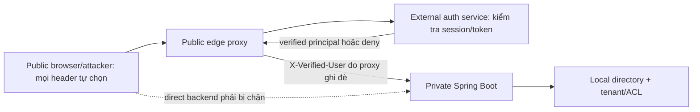

# Xóa header danh tính do máy khách gửi trước khi proxy thiết lập giá trị tin cậy

## 1. Bài toán và nguyên tắc cốt lõi

Trong kiến trúc **xác thực qua reverse proxy**, một web application có thể nhận kết quả đăng nhập từ gateway thay vì tự xử lý SAML/OIDC/Kerberos. Gateway xác minh phiên đăng nhập rồi truyền danh tính qua HTTP request header như `X-Verified-User`.

Ví dụ:

```http
GET /internal/me HTTP/1.1
Host: app.example.test
X-Verified-User: alice@example.test
```

Header này **không tự có bằng chứng xác thực**. Mọi browser, curl hoặc HTTP client đều có thể gửi chuỗi `X-Verified-User: admin@example.test`. Nếu proxy chỉ forward nguyên dữ liệu, hoặc dùng `setifempty`/`append` thay vì ghi đè, Spring Security pre-authentication có thể chấp nhận tên user do attacker tự chọn.

**Quy tắc bắt buộc: trước khi proxy thiết lập danh tính đáng tin, phải loại bỏ các identity headers do máy khách cung cấp; sau khi external authentication thành công mới đặt một canonical header bằng giá trị lấy từ kết quả xác minh của proxy.** Backend chỉ được tin header đó khi **mọi đường truy cập trực tiếp** đã bị chặn và kết nối proxy → backend được kiểm soát.

Bài học thuộc nhóm **Xác thực qua proxy** của Spring Security federation. Cấu hình minh họa NGINX, Apache và Java 17/Spring Boot 3/Spring Security 6.x. Các hostname `example.test`, user và IP chỉ mang tính giả định.

### Mục tiêu

1. Giải thích trust boundary giữa browser, proxy, authentication service và backend.
2. Phân biệt `unset`, `set`, `append` và `setifempty`.
3. Xây NGINX `auth_request` / `auth_request_set` và ghi đè header bằng verified principal.
4. Chặn đường truy cập trực tiếp vào backend.
5. Chặn identity header spoofing với tên khác hoa/thường, underscore, aliases, duplicate.
6. Hiểu `RequestHeaderAuthenticationFilter` chỉ đọc header, không xác minh user.
7. Cấu hình Spring Security pre-auth và phân quyền local user/tenant/role.
8. Kiểm thử end-to-end các tình huống fail-open, identity switching, auth-service outage.
9. Phân biệt identity headers với `Forwarded`/`X-Forwarded-*` và OAuth Bearer token.
10. Bảo vệ session, CSRF, login callbacks và log/trace.

## 2. Mô hình threat và câu hỏi “ai phát hành user?”



Có hai request trông gần giống nhau:

```http
# UNTRUSTED: người gọi gửi trực tiếp
X-Verified-User: admin@example.test

# TRUSTED CHỈ KHI: proxy đã xác minh Alice và tạo mới
X-Verified-User: alice@example.test
```

Hai chuỗi có thể cùng cú pháp nhưng **khác hoàn toàn nguồn gốc**. Backend không thể xác minh “tên header đáng tin” nếu kết nối trực tiếp vẫn mở hoặc proxy không ghi đè.

| Điều kiện | Nếu thiếu |
| --- | --- |
| Edge strip identity headers từ inbound client | Attacker tự khai identity |
| Proxy xác thực thật trước khi set | Anyone becomes authenticated |
| Proxy set từ **auth response**, không lấy từ request | Reflected spoofed header |
| Backend chỉ reachable từ trusted proxy | Direct request bỏ qua auth |
| Backend tin đúng một canonical header | Legacy aliases bypass |
| Spring local directory/policy check | Bất kỳ tên user/role tự khai được cấp quyền |
| Auth outage fail-closed | Availability failure thành privilege escalation |

**Không coi HTTPS là bằng chứng header thuộc proxy.** Kết nối client → proxy qua HTTPS vẫn cho phép client chọn header. TLS chỉ bảo vệ transport, không chứng minh danh tính chuỗi do client tự gửi.

## 3. Inventory các header thường bị nhầm là danh tính

| Header | Nguồn có thể có | Mức tin cậy |
| --- | --- | --- |
| `X-Verified-User` | Proxy-authenticated principal hoặc client giả | Chỉ tin nếu strip/rewrite + trusted channel |
| `X-Authenticated-User` | Gateway, SSO plugin, client tự gửi | Không tự tin |
| `X-Auth-Request-User` | Response của auth service hoặc client request | Phải phân biệt hướng request/response |
| `X-Forwarded-User` | Legacy SSO hoặc client tự gửi | Không tự tin |
| `X-Remote-User` / `Remote-User` | CGI/Apache legacy hoặc client | Không tự tin |
| `SM_USER` | SiteMinder/legacy reverse proxy | Không tự tin nếu chưa xác minh origin |
| `X-User-Roles` / `X-Groups` | Attributes hoặc client | Không tự cấp authorities |
| `X-Verified-Email` | IdP/proxy user attributes | Cần contract email verification |
| `X-Tenant` | Router/IdP/proxy/client | Không thay tenant membership/ACL |
| `Authorization: Bearer` | OAuth client | API phải verify token, không biến thành plain user header |
| `Forwarded`/`X-Forwarded-For`/`X-Forwarded-Proto` | Routing/network metadata | Không phải user identity |

**Kiểm kê không được giới hạn trong tài liệu hiện tại.** Hãy tìm những gì backend thực sự đọc: Spring Security pre-auth filter, `HttpServletRequest.getHeader` ở controller, old SSO adapters, API gateway plugins và middleware. Nếu Spring đọc `SM_USER` nhưng NGINX chỉ xóa `X-Verified-User`, attacker vẫn có đường gửi `SM_USER`.

## 4. Giai đoạn strip → authenticate → overwrite

Luồng chuẩn:

```text
Public HTTP request
  |
  v
[1] Strip/deny client-controlled identity headers
  |
  v
[2] External authentication: cookie, OIDC, SAML, mTLS, Kerberos...
  |-- failure/timeout --> deny (không forward tới backend)
  |
  v
[3] Normalize user ID từ verified authentication result
  |
  v
[4] Set/overwrite X-Verified-User duy nhất
  |
  v
[5] Forward trên kênh proxy -> backend được bảo vệ
  |
  v
[6] Spring pre-auth lấy tên user, local IAM cấp quyền
```

Có proxy hỗ trợ viết lại cùng một header theo semantics “set” mà về mặt nội bộ đã thay giá trị cũ; cũng có proxy/adapter giữ duplicate hoặc aliases. **Hãy kiểm tra bản cấu hình sinh ra và request thực tế nhận ở backend**. Câu nói “đã có một dòng set header” chưa đủ chứng minh strip đúng.

### Các phương thức khác nhau

| Hành động | Diễn giải | Phù hợp identity? |
| --- | --- | --- |
| `unset` / remove | Xóa header có sẵn | Có, giai đoạn xóa |
| `set` / replace | Thay bằng verified value | Có, nếu thực sự overwrite |
| `append` / `add` | Giữ cũ + thêm giá trị mới | **Không**, dễ duplicate |
| `setifempty` | Giữ giá trị client nếu đã tồn tại | **Không** |
| `pass-through` | Forward header client | **Không** |
| `rename` | Đổi nhãn header client | **Không**, không thêm trust |

Anti-pattern:

```text
Client: X-Verified-User=admin
Proxy: append X-Verified-User=alice
Backend: getHeader("X-Verified-User") có thể là admin
```

Một backend chọn “giá trị đầu” hay “giá trị cuối” đều là thiết kế không đáng tin khi có nhiều parser/hop.

## 5. NGINX proxy_set_header: điều cần biết chính xác

Tài liệu NGINX xác nhận: `proxy_set_header` đặt header gửi đến upstream; **giá trị rỗng làm header không được gửi**:

```nginx
proxy_set_header X-Verified-User "";
proxy_set_header X-Forwarded-User "";
```

Sau khi đã xác thực, đặt giá trị mới:

```nginx
proxy_set_header X-Verified-User $trusted_user;
```

Đây là **hai giai đoạn khái niệm**, không phải khuyên viết hai directives cùng tên trong cùng block. Với cấu hình triển khai, chỉ cần directive cuối **đặt canonical header từ một biến verified** và explicit strip các aliases.

Ngược lại, cách sau **không an toàn**:

```nginx
# $http_x_verified_user là input của client!
proxy_set_header X-Verified-User $http_x_verified_user;
```

Điểm khó: `proxy_pass_request_headers` thường bật, nên NGINX có thể forward các header không được nêu trong `proxy_set_header`. Ghi đè `X-Verified-User` **không xóa** `X-User-Roles` hoặc `SM_USER`. Cần kiểm kê và deny/strip toàn bộ reserved names mà backend/hệ thống phụ đọc.

`proxy_set_header` chỉ được kế thừa từ cấp trên nếu **không** có directive cùng họ tại cấp hiện tại. Cần xem kết quả `nginx -T` để phát hiện route thiếu `Host`, sai forward-proto hoặc bị override bởi location khác.

## 6. NGINX auth_request và auth_request_set: end-to-end

Ví dụ NGINX chạy cùng network namespace với external auth service tại `http://127.0.0.1:4180/auth` và Spring Boot backend `http://127.0.0.1:8080`. Auth service đã được cấu hình xác thực SSO thật, không phản chiếu headers từ browser.

Khi authenticated Alice, auth service trả:

```http
HTTP/1.1 200 OK
X-Auth-Request-User: alice@example.test
```

Khi anonymous, bị từ chối hoặc hệ thống lỗi, nó **không trả 2xx có user giả**.

Mẫu NGINX:

```nginx
# Trích đoạn cấu hình server. Bổ sung TLS, logs và upstreams
# theo môi trường thực tế trước khi dùng production.
server {
    listen 443 ssl;
    server_name app.example.test;
    ssl_certificate     /etc/nginx/tls/fullchain.pem;
    ssl_certificate_key /etc/nginx/tls/private.key;

    location = /_edge_auth {
        internal;
        proxy_pass http://127.0.0.1:4180/auth;
        proxy_pass_request_body off;
        proxy_set_header Content-Length "";
        proxy_set_header X-Original-URI $request_uri;

        # Xóa các identity aliases trước auth service.
        proxy_set_header X-Verified-User "";
        proxy_set_header X-Authenticated-User "";
        proxy_set_header X-Forwarded-User "";
        proxy_set_header X-Remote-User "";
        proxy_set_header X-Auth-Request-User "";
        proxy_set_header X-User-Roles "";
    }

    location /internal/ {
        # NGINX auth_request: 2xx cho qua, 401/403 chặn;
        # lỗi khác không cho phép bỏ qua authorization.
        auth_request /_edge_auth;

        # Đọc RESPONSE của auth service, KHÔNG đọc
        # $http_x_auth_request_user của client.
        auth_request_set $trusted_user $upstream_http_x_auth_request_user;

        proxy_set_header X-Verified-User $trusted_user;

        # Client không được gửi các aliases này tới app.
        proxy_set_header X-Authenticated-User "";
        proxy_set_header X-Forwarded-User "";
        proxy_set_header X-Remote-User "";
        proxy_set_header X-Auth-Request-User "";
        proxy_set_header X-User-Roles "";

        # Chỉ khi backend này KHÔNG làm Bearer token auth:
        proxy_set_header Authorization "";

        proxy_set_header Host $host;
        proxy_set_header X-Forwarded-Proto https;
        proxy_pass http://127.0.0.1:8080;
    }
}
```

Đây là **cấu hình minh họa theo contract**. Không thể chạy với nguyên hostname và chứng chỉ ví dụ; muốn vận hành cần NGINX hỗ trợ `ngx_http_auth_request_module`, auth service thực sự xác thực user, TCP/upstream/mTLS policy, log redaction và fail-closed backend.

### Từng bước hoạt động

1. Browser gửi `GET /internal/me`, có thể kèm `X-Verified-User: admin`.
2. NGINX gọi `/_edge_auth` nội bộ. Các identity headers đã liệt kê bị loại khỏi subrequest.
3. Auth service kiểm tra cookie hoặc credentials **được thiết kế cho nó**, trả `2xx + X-Auth-Request-User` khi user hợp lệ.
4. `auth_request_set` lấy giá trị **từ HTTP response của auth subrequest** và lưu `$trusted_user`.
5. NGINX set `X-Verified-User` gửi tới backend bằng `$trusted_user`.
6. NGINX loại bỏ những header identity aliases và credentials client không cần chuyển.
7. Backend pre-auth chỉ đọc `X-Verified-User` được proxy đặt.
8. Backend tra local user và quyền để cho phép hoặc từ chối.

Nếu auth service trả `401`, request bị deny/challenge; `403` bị deny; response lỗi khác không trở thành quyền truy cập. Nếu auth service vô tình trả 200 nhưng thiếu user, `$trusted_user` rỗng và NGINX có thể bỏ header — backend phải **deny**. Contract đúng hơn là auth service trả 401/403 nếu không thể xác định principal.

### Không nhầm hai loại biến NGINX

```nginx
# UNTRUSTED: header của request từ browser.
$http_x_auth_request_user

# TRUSTED CÓ ĐIỀU KIỆN: header từ RESPONSE của auth subrequest.
$upstream_http_x_auth_request_user
```

Ngay cả biến thứ hai chỉ đáng tin khi auth service thực sự xác minh request và được proxy gọi qua kênh/endpoint đã phê duyệt. Một auth service tự echo `X-Auth-Request-User` của browser về response sẽ làm mất toàn bộ lợi ích.

## 7. NGINX: fail-closed và các lỗi pha xử lý

NGINX `auth_request` có semantics theo documentation: **2xx cho phép**, **401 hoặc 403 từ chối**, response khác thường được xem là lỗi. **Không** đặt `error_page 500 =200` hay fallback `auth_request off` khi external auth service không sẵn sàng.

Một số trường hợp:

| Auth result | Gateway nên làm gì? | Backend |
| --- | --- | --- |
| 200 + Alice verified | Set Alice và forward | Authentication + ACL |
| 200 nhưng không có identity | Coi là contract violation | Không cho anonymous thành user |
| 401 | Challenge/login | Không forward vào protected app |
| 403 | Deny | Không forward |
| 500/timeout | Fail closed, alert | Không cấp quyền |
| Header duplicate/malformed | Deny/normalize theo chính sách | Không chọn user tùy ý |
| Đã login Alice nhưng browser gửi `admin` | Forward **Alice**, không admin | Quyền Alice |

**Cảnh báo:** không viết một kiểm tra `if ($trusted_user = "") { return 403; }` trong NGINX rewrite phase và mặc định nghĩ biến đã được tính sau `auth_request`. Các phase của NGINX có thể chạy theo thứ tự khác dự đoán. Để thiết kế đúng, auth service **không được 2xx khi thiếu identity**, backend từ chối header rỗng, và test bằng integration.

`proxy_set_header Authorization ""` chỉ thích hợp nếu backend route này **không cần tự xác minh OAuth Bearer**. Nếu API có `oauth2ResourceServer`, phải có route/filter chain riêng và không xóa Bearer header của API đó một cách máy móc.

## 8. Apache httpd 2.4: unset, set, và điều kiện phase

Apache `mod_headers` có hai directive khác nhau:

- `Header` thao tác **HTTP response**.
- `RequestHeader` thao tác **HTTP request** trước khi module proxy chuyển lên backend.

Xóa identity headers do client gửi:

```apache
RequestHeader unset X-Verified-User
RequestHeader unset X-Authenticated-User
RequestHeader unset X-Forwarded-User
RequestHeader unset X-Remote-User
RequestHeader unset X-User-Roles
```

Sau khi xác thực bằng module như `mod_auth_openidc`, Apache có thể có server-side `REMOTE_USER`. Mảnh minh họa:

```apache
<Location "/internal/">
    AuthType openid-connect
    Require valid-user

    RequestHeader unset X-Verified-User
    RequestHeader unset X-Authenticated-User
    RequestHeader unset X-Forwarded-User

    # Chỉ set từ REMOTE_USER do Apache auth module tạo.
    # Kiểm thử phase ordering của modules trong deployment.
    RequestHeader set X-Verified-User "expr=%{REMOTE_USER}"
</Location>
```

Mảnh này **không hoàn chỉnh**: cần `mod_auth_openidc`, provider/client registration, TLS/proxy routes, log redaction, backend isolation và kiểm thử phase `REMOTE_USER`. Nếu `REMOTE_USER` chưa được thiết lập ở thời điểm expression đánh giá, header rỗng hoặc sai; phải sửa bằng module configuration/workflow đã xác minh, **không fallback dùng client header**.

Theo Apache documentation:

- `RequestHeader unset` xóa mọi giá trị header cùng tên.
- `RequestHeader set` thay giá trị cũ.
- `RequestHeader append` / `add` có thể tạo nhiều values.
- `RequestHeader setifempty` giữ nguyên client value nếu header đã có.

**Không dùng `append` hoặc `setifempty` cho identity.** Cũng đừng chỉ xóa `X-Verified-User` trong một `Location` mà quên một `ProxyPass` hay virtual host khác dẫn tới cùng backend.

## 9. Ingress-nginx, Gateway API và route bypass

Một ingress-nginx deployment có thể dùng external auth annotations:

```yaml
apiVersion: networking.k8s.io/v1
kind: Ingress
metadata:
  name: portal-edge
  annotations:
    nginx.ingress.kubernetes.io/auth-url: "https://auth.example.test/auth"
    nginx.ingress.kubernetes.io/auth-signin: "https://auth.example.test/start"
    nginx.ingress.kubernetes.io/auth-response-headers: "X-Auth-Request-User"
spec:
  ingressClassName: nginx
  rules:
    - host: app.example.test
      http:
        paths:
          - path: /internal/
            pathType: Prefix
            backend:
              service:
                name: backend-app
                port:
                  number: 8080
```

**Đây là manifest minh họa chưa đầy đủ**, thiếu TLS, secrets, network policies, controller-specific header strip/overwrite, auth service thật. Annotation `auth-response-headers` chỉ định headers lấy từ **response của authentication service** để chuyển upstream; **không nên suy ra tự động rằng mọi client-controlled identity aliases đã được xóa**.

Checklist ingress:

1. Kiểm tra generated NGINX configuration (cách controller triển khai annotation) theo version.
2. Xác định một canonical header backend đọc; không có controller khác làm fallback.
3. Đảm bảo client header `X-Auth-Request-User` không được giữ như input tin cậy.
4. Kiểm tra cả default ingress, canary, regex paths, path rewrites, wildcard host, internal ingress, mesh ingress và Gateway API HTTPRoute.
5. Đảm bảo external auth lỗi thì request **không** forward.
6. Kiểm tra auth cache key ràng buộc user/session/credential và tenant.
7. Không bật `configuration-snippet` hoặc `auth-snippet` không kiểm soát cho mọi namespace: các snippet này có thể cấu hình NGINX ngoài ranh giới của một tenant.
8. Tách rõ **community ingress-nginx** và **NGINX Inc. Ingress Controller**; annotation của chúng không luôn giống nhau.

`NetworkPolicy` là lớp bảo vệ bắt buộc thêm, không phải thay thế strip/overwrite.

## 10. Envoy/ext_authz và việc ghi đè header

Với Envoy external authorization, auth service có thể trả một `OkHttpResponse` và một tập headers muốn thêm/ghi đè trước khi chuyển request upstream. API còn có `headers_to_remove`.

Mô hình:

```text
CLIENT:
    X-Verified-User: admin
    X-Forwarded-User: root

ENVOY ext_authz:
    external auth verifies Alice
    removes client identity headers
    sets X-Verified-User: alice
    append=false / overwrite semantics

BACKEND:
    sees only X-Verified-User: alice
```

Đây là **pseudocode**, không phải YAML Envoy chạy được. Với header dành cho identity, **không append** vào client value; cần kiểm tra allowlist cho headers mà auth service được phép inject, matcher/order của `ext_authz` và phiên bản Envoy đang chạy.

Trong service mesh, mTLS workload identity chứng minh **proxy/service nào kết nối**, còn HTTP user identity có thể đến từ JWT verified, external auth hoặc session — **không phải một khái niệm**. Backend phải có policy tách hai thứ.

## 11. Proxy nhiều tầng phải giữ bất biến

Hệ thống thường không chỉ có một proxy:

```text
Browser → CDN/LB → WAF → identity gateway → mesh proxy → backend
```

Một hop có thể xóa header, nhưng hop sau có thể vô tình thêm lại giá trị gốc từ `X-Original-User` hay `X-Forwarded-User`. Đừng chỉ kiểm tra request của **edge thứ nhất**. Hãy xác nhận **request thực sự đến servlet container** sau toàn bộ proxy chain.

| Hop | Quyền liên quan identity |
| --- | --- |
| Public CDN/LB | Routing/TLS, không mặc nhiên xác thực user |
| Identity gateway | Xác thực, loại client identity và đặt canonical principal |
| Internal mesh | Xác minh workload identity, bảo vệ/kế thừa canonical principal |
| Spring Boot | Tin đúng một header qua trusted transport, tra local user/ACL |
| Downstream service | Không mặc nhiên tin header hop trước nếu không có contract |

Khi user logout hoặc đổi tài khoản, identity phải theo **request hiện tại**. Không cho một cache/session ở mesh giữ user A khi request mới của user B hoặc anonymous đến.

## 12. Header normalization: case và underscore

HTTP header names không phân biệt hoa/thường. Một số proxy/framework chuyển dấu underscore thành dash, hoặc dùng CGI/WSGI environment variables gây đụng tên.

Những biến thể phải test:

```http
X-Verified-User: admin
x-verified-user: admin
X_VERIFIED_USER: admin
X-Verified_User: admin
X-VERIFIED_USER: admin
```

Theo HTTP grammar, underscore và dash là ký tự khác; nhưng **hệ thống nhiều lớp** có thể diễn giải khác do normalization. Một advisory của oauth2-proxy đã mô tả nguy cơ header smuggling khi kẻ tấn công lợi dụng underscore-versus-dash mà proxy và backend xử lý không thống nhất.

Biện pháp:

1. Ở edge, chuẩn hóa/so sánh reserved header names theo chính sách phù hợp cả chuỗi hạ tầng.
2. Chặn các biến thể chưa được phép trước khi chúng qua nhiều parsers.
3. Bắt buộc một header canonical và một verified identity value.
4. Kiểm thử case-insensitive, underscore, mixed separators, HTTP/2 → HTTP/1.1.
5. Không dựa hoàn toàn vào default `underscores_in_headers off` của một bản NGINX khi hệ thống còn Apache, ingress-nginx, application server hoặc CGI bridge.
6. Đánh giá và cập nhật security patches của gateway/controller.

Chỉ so tên bằng `String.equalsIgnoreCase` ở Java controller **không đủ**, vì Servlet container có thể đã nhận dữ liệu sau bước normalize/merge của proxy.

## 13. Duplicate headers và giá trị ghép dấu phẩy

Một request có thể chứa:

```http
X-Verified-User: admin
x-verified-user: alice
```

Hoặc:

```http
X-Verified-User: admin,alice
```

Các lớp có thể trả giá trị đầu, giá trị cuối, hoặc một chuỗi ghép. Trong identity, đó là **request mơ hồ** và không được xử lý bằng “chọn phần đầu”.

- Edge nên strip/reject duplicates thuộc reserved identity names.
- Gateway set một header với một verified value canonical.
- Auth service không nên trả multiple principals hoặc comma-separated identities nếu contract chỉ có một user.
- Backend có thể kiểm tra header count/format như defense-in-depth nhưng không thể khôi phục các variants đã mất qua parser.
- Không dùng Apache `RequestHeader append` hoặc Envoy append cho identity.
- Ghi log loại anomaly và correlation ID, không in toàn bộ giá trị chứa PII.

**Một header tên `X-User-Roles` còn sót có thể nguy hiểm dù `X-Verified-User` đã được ghi đè đúng**, nếu business code vô tình sử dụng role header đó.

## 14. HTTP request smuggling và parser mismatch

Request smuggling là khi frontend/backend disagree về **ranh giới HTTP request**, ví dụ khác biệt trong `Content-Length`, `Transfer-Encoding` hoặc downgrade HTTP/2 → HTTP/1.1. Điều này có thể làm request được backend xử lý **khác với request mà edge đã kiểm tra**.

Nó không đồng nghĩa header spoofing thông thường, nhưng cả hai đều cho thấy điều nguy hiểm: **một trust decision ở proxy không được gắn với đúng request/headers backend nhận**.

Cần:

- Cập nhật proxy, web server và gateway; dùng parser strictness.
- Reject malformed headers, conflict framing, CRLF injection và các tên header ambiguity.
- Test giao thức thực sự dùng: HTTP/1.1, HTTP/2, HTTP/2→1.1, service mesh hops.
- Không forward request mà các hop diễn giải khác nhau.
- Bảo vệ internal backend path ngay cả khi parser edge bị bypass.

OWASP Web Security Testing Guide có hướng dẫn đánh giá request smuggling trong môi trường được ủy quyền; không thử payload vào hệ thống không thuộc phạm vi kiểm thử.

## 15. Spring Security pre-authentication: làm đúng trách nhiệm

Spring Security có:

- `RequestHeaderAuthenticationFilter`: mặc định đọc `SM_USER`, có `setPrincipalRequestHeader("X-Verified-User")`.
- `AbstractPreAuthenticatedProcessingFilter`: đọc principal và đưa `PreAuthenticatedAuthenticationToken` cho authentication manager.
- `PreAuthenticatedAuthenticationProvider`: xử lý **principal đã giả định được xác thực bên ngoài**, tra local user details.
- `UserDetailsByNameServiceWrapper`: nối provider với `UserDetailsService`.
- `SecurityContextRepository`: quyết định có giữ Authentication cho request sau hay không.
- `SecurityFilterChain`: quy định endpoint nào áp dụng pre-auth, session/csrf/fallback policy.

Theo chính Javadoc Spring Security, `RequestHeaderAuthenticationFilter` **không xác thực header**, và nếu attacker có thể forge header thì họ có thể chọn bất kỳ username nào. Đây là cơ chế đúng **chỉ trong mạng tin cậy với external authentication được bảo vệ**, không phải API public Internet.

Mẫu sai:

```java
String user = request.getHeader("X-Verified-User");
return "Hello " + user; // không có validation/trust boundary
```

Ngay cả nếu controller được bảo vệ bằng `hasRole("USER")`, nếu roles cũng lấy từ một header do client gửi, vấn đề vẫn chưa được giải quyết.

## 16. Spring Boot 3 / Java 17: class pre-auth độc lập về mặt wiring

Demo một ứng dụng Spring Boot Servlet với **một filter chain cho `/internal/**` và deny-all fallback**. Chỉ deploy phía sau proxy có strip/overwrite, network ACL và workload protection đã xác minh.

Dependencies cho dự án đã có Spring Boot plugins/BOM/Java 17+:

```groovy
dependencies {
    implementation "org.springframework.boot:spring-boot-starter-web"
    implementation "org.springframework.boot:spring-boot-starter-security"
    testImplementation "org.springframework.boot:spring-boot-starter-test"
    testImplementation "org.springframework.security:spring-security-test"
}
```

Đây là **mảnh `build.gradle`**, không phải file build hoàn chỉnh.

Lưu `src/main/java/demo/preauth/ProxyPreauthApplication.java`:

```java
package demo.preauth;

import java.util.Map;
import java.util.Set;
import java.util.UUID;

import org.springframework.boot.SpringApplication;
import org.springframework.boot.autoconfigure.SpringBootApplication;
import org.springframework.context.annotation.Bean;
import org.springframework.core.annotation.Order;
import org.springframework.http.HttpMethod;
import org.springframework.http.HttpStatus;
import org.springframework.security.authentication.ProviderManager;
import org.springframework.security.config.annotation.web.builders.HttpSecurity;
import org.springframework.security.config.annotation.web.configurers.AbstractHttpConfigurer;
import org.springframework.security.config.http.SessionCreationPolicy;
import org.springframework.security.core.Authentication;
import org.springframework.security.core.userdetails.User;
import org.springframework.security.core.userdetails.UserDetailsByNameServiceWrapper;
import org.springframework.security.core.userdetails.UserDetailsService;
import org.springframework.security.core.userdetails.UsernameNotFoundException;
import org.springframework.security.web.SecurityFilterChain;
import org.springframework.security.web.authentication.HttpStatusEntryPoint;
import org.springframework.security.web.authentication.UsernamePasswordAuthenticationFilter;
import org.springframework.security.web.authentication.preauth.PreAuthenticatedAuthenticationProvider;
import org.springframework.security.web.authentication.preauth.PreAuthenticatedAuthenticationToken;
import org.springframework.security.web.authentication.preauth.RequestHeaderAuthenticationFilter;
import org.springframework.security.web.context.NullSecurityContextRepository;
import org.springframework.web.bind.annotation.GetMapping;
import org.springframework.web.bind.annotation.PathVariable;
import org.springframework.web.bind.annotation.RestController;
import org.springframework.web.server.ResponseStatusException;

@SpringBootApplication
@RestController
public class ProxyPreauthApplication {

    private static final Map<String, String> TENANT = Map.of(
            "alice@example.test", "north",
            "ops@example.test", "north",
            "bob@example.test", "south");

    private static final Map<String, Set<String>> ROLES = Map.of(
            "alice@example.test", Set.of("ROLE_EMPLOYEE"),
            "ops@example.test", Set.of("ROLE_EMPLOYEE", "ROLE_ADMIN"),
            "bob@example.test", Set.of("ROLE_EMPLOYEE"));

    public static void main(String[] args) {
        SpringApplication.run(ProxyPreauthApplication.class, args);
    }

    @Bean
    UserDetailsService localDirectory() {
        return name -> {
            Set<String> roles = ROLES.get(name);
            if (roles == null) {
                throw new UsernameNotFoundException(
                        "Local identity not provisioned");
            }
            // Password KHÔNG dùng trong pre-auth; chain không có form login.
            return User.withUsername(name)
                    .password("{noop}" + UUID.randomUUID())
                    .authorities(roles.toArray(String[]::new))
                    .build();
        };
    }

    @Bean
    @Order(1)
    SecurityFilterChain trustedGateway(
            HttpSecurity http, UserDetailsService localDirectory)
            throws Exception {

        PreAuthenticatedAuthenticationProvider provider =
                new PreAuthenticatedAuthenticationProvider();
        provider.setPreAuthenticatedUserDetailsService(
                new UserDetailsByNameServiceWrapper
                        <PreAuthenticatedAuthenticationToken>(
                                localDirectory));

        RequestHeaderAuthenticationFilter filter =
                new RequestHeaderAuthenticationFilter();
        filter.setPrincipalRequestHeader("X-Verified-User");
        filter.setAuthenticationManager(new ProviderManager(provider));

        // Missing header -> no principal; authenticated() denies.
        filter.setExceptionIfHeaderMissing(false);

        // Stateless per-request preauth: không giữ user của request cũ.
        filter.setSecurityContextRepository(
                new NullSecurityContextRepository());

        return http
                .securityMatcher("/internal/**")
                .securityContext(sc -> sc.securityContextRepository(
                        new NullSecurityContextRepository()))
                .sessionManagement(sm -> sm.sessionCreationPolicy(
                        SessionCreationPolicy.STATELESS))
                // CHỈ nếu đây là gateway-only API không dùng cookie auth.
                .csrf(AbstractHttpConfigurer::disable)
                .exceptionHandling(ex -> ex.authenticationEntryPoint(
                        new HttpStatusEntryPoint(HttpStatus.UNAUTHORIZED)))
                .authorizeHttpRequests(auth -> auth
                        .requestMatchers(HttpMethod.GET, "/internal/admin")
                            .hasRole("ADMIN")
                        .requestMatchers(HttpMethod.GET, "/internal/**")
                            .authenticated()
                        .anyRequest().denyAll())
                .authenticationProvider(provider)
                .addFilterBefore(
                        filter, UsernamePasswordAuthenticationFilter.class)
                .build();
    }

    @Bean
    @Order(2)
    SecurityFilterChain denyEverythingElse(HttpSecurity http)
            throws Exception {
        return http
                .authorizeHttpRequests(auth -> auth
                        .requestMatchers("/health").permitAll()
                        .anyRequest().denyAll())
                .build();
    }

    @GetMapping("/health")
    public String health() {
        return "up";
    }

    @GetMapping("/internal/me")
    public Map<String, String> me(Authentication principal) {
        return Map.of("user", principal.getName(),
                      "status", "authenticated-by-proxy");
    }

    @GetMapping("/internal/admin")
    public String admin(Authentication principal) {
        return "admin " + principal.getName();
    }

    @GetMapping("/internal/tenant/{tenant}")
    public Map<String, String> byTenant(
            @PathVariable String tenant, Authentication principal) {
        if (!tenant.equals(TENANT.get(principal.getName()))) {
            throw new ResponseStatusException(HttpStatus.FORBIDDEN);
        }
        return Map.of("tenant", tenant, "status", "authorized");
    }
}
```

### Diễn giải bảo mật

- Chỉ đọc `X-Verified-User`. Không đọc `X-Forwarded-User`, `SM_USER` hoặc `X-User-Roles`.
- `PreAuthenticatedAuthenticationProvider`/`UserDetailsService` tra local account/authorities; **không tự verify OIDC/SAML token**.
- Unknown user bị từ chối; `hasRole("ADMIN")` cần local `ROLE_ADMIN`.
- `NullSecurityContextRepository` tránh dùng session cũ khi request mới không có verified header.
- `setExceptionIfHeaderMissing(false)` **không mở anonymous access**: `authenticated()` vẫn bảo vệ toàn bộ `/internal/**`.
- Filter không được khai `@Bean` riêng để Boot tự đăng ký thành servlet filter ngoài Spring Security chain; tạo trực tiếp trong chain.
- Fallback chain không để routes khác public ngoài `/health`.
- Chỉ tắt CSRF trên **gateway-only stateless route** nếu không dùng cookie/session làm credentials. Với web session/SAML/OIDC, giữ CSRF protection.
- `/internal/tenant/{tenant}` kiểm tra local tenant sau khi authentication; client tự đổi path không được cấp quyền tenant khác.

**Cảnh báo cực kỳ quan trọng:** nếu attacker **có thể gửi request trực tiếp vào backend port** với `X-Verified-User: ops@example.test`, demo sẽ coi đó là Ops. Đây là giới hạn cố hữu của pre-auth header, không phải lỗi Java. Lớp bảo vệ mạng/gateway là **điều kiện bắt buộc**, không phải tối ưu tùy chọn.

### Ví dụ kết quả khi đã có gateway đúng

Auth service xác minh Alice; backend nhận:

```http
GET /internal/me HTTP/1.1
X-Verified-User: alice@example.test
```

Response body:

```json
{"user":"alice@example.test","status":"authenticated-by-proxy"}
```

Nếu Alice truy cập `/internal/admin` thì bị 403. Nếu unknown principal thì không được cấp authentication. Không có stdout login cố định do gateway, SSO infrastructure và local directory phải hoạt động.

## 17. Local role, tenant và identity link không được lấy từ input

Trong `UserDetailsService` thật, user identifier từ gateway cần ánh xạ thành **local immutable user ID** qua bảng identity link được quản trị:

```text
verified proxy subject
    -> identity issuer/tenant namespace
    -> local account link
    -> active/disabled status
    -> local roles/tenant memberships
    -> resource ACL/ownership
    -> allow/deny
```

Không dùng email như khóa liên kết duy nhất xuyên nhiều OIDC/SAML issuers: email có thể đổi hoặc tái cấp. Không cấp quyền admin từ `X-Groups: admins` nếu proxy/IdP không được ủy quyền quản lý đúng group đó và backend không có mapping chính thức.

Một user đã authenticated ở proxy chỉ có quyền truy cập **theo local policy**. Các API nhạy cảm còn cần object-level authorization: tenant, account status, document owner, action và MFA/freshness nếu yêu cầu.

## 18. Session và đổi danh tính: tránh SecurityContext cũ

`AbstractPreAuthenticatedProcessingFilter` có thể bỏ qua việc lấy header lại nếu `SecurityContext` đã có Authentication. Trong web app stateful, điều này có thể khiến:

- Gateway đã logout Alice nhưng backend session còn Alice.
- Gateway đổi sang Bob nhưng backend vẫn dùng SecurityContext của Alice.
- Request mới thiếu header nhưng cookie phiên backend còn tồn tại.
- Role/tenant đã bị thu hồi nhưng cached session chưa cập nhật.

Chọn rõ:

1. **Stateless pre-auth:** verified header phải có mỗi request, dùng `NullSecurityContextRepository` và deny missing identity (mục 16).
2. **Stateful:** đồng bộ session lifecycle với gateway; dùng `setCheckForPrincipalChanges(true)`, `setInvalidateSessionOnPrincipalChange(true)` khi đúng use case, và kiểm tra logout/revocation.
3. **Signed access token end-to-end:** API verify JWT audience/issuer/time/scope hoặc introspection theo AS config thay vì nhận username plain header.

Không trộn `oauth2Login`, `saml2Login`, form login, Bearer và header pre-auth trên toàn bộ app khi chưa xác định rõ routes/chains. Đặc biệt, SAML ACS hoặc OIDC callback **không tự động có trusted proxy username**; chúng có validators/correlation riêng.

## 19. Hạn chế đường trực tiếp vào backend

Một request từ Internet bỏ qua proxy sẽ bỏ qua strip/overwrite:

```text
Internet -> Trusted edge -> Backend :8080   (đường hợp lệ)
Internet ----------------> Backend :8080   (phải chặn)
```

Các lớp cần phối hợp:

- Không expose backend qua public LoadBalancer/NodePort/hostPort/debug endpoint.
- Firewall/NSG/security groups chỉ cho trusted proxy identity/IP/workload tới backend.
- Kubernetes NetworkPolicy để deny untrusted pods/namespaces vào backend port khi CNI hỗ trợ enforcement.
- TLS/mTLS giữa proxy và backend khi risk model đòi hỏi; xác minh client certificate/workload identity của proxy.
- Với mesh, ngoài `PeerAuthentication STRICT` còn cần `AuthorizationPolicy` chỉ cho nguồn proxy được phép.
- Với cloud, private subnets, không tự công bố private backend qua tunnel/secondary ingress.
- Không coi một static `X-Proxy-Secret` là biện pháp duy nhất: secret có thể leak/replay, không bảo vệ request semantics.

Ví dụ NetworkPolicy hạn chế backend:

```yaml
apiVersion: networking.k8s.io/v1
kind: NetworkPolicy
metadata:
  name: backend-from-edge-only
  namespace: app-space
spec:
  podSelector:
    matchLabels:
      app: backend
  policyTypes:
    - Ingress
  ingress:
    - from:
        - namespaceSelector:
            matchLabels:
              kubernetes.io/metadata.name: ingress-space
          podSelector:
            matchLabels:
              app: edge-proxy
      ports:
        - protocol: TCP
          port: 8080
```

Đây là **mẫu ý tưởng**: label/controller/CNI/mesh phải phù hợp cluster thật. Nó không thay proxy header sanitization hoặc OIDC/SAML auth checks.

## 20. Forwarded headers không phải identity

`Forwarded`, `X-Forwarded-For`, `X-Forwarded-Host`, `X-Forwarded-Proto` mô tả route, IP và public URL; chúng **không chứng minh user**.

```http
Forwarded: for=203.0.113.7;proto=https;host=app.example.test
X-Forwarded-For: 203.0.113.7
X-Forwarded-Proto: https
```

Spring Boot có `server.forward-headers-strategy=framework` cho deployment sau proxy. Nhưng chỉ bật khi **proxy đã loại/ghi đè Forwarded và X-Forwarded-* từ client**, nếu không attacker có thể poison host/scheme/redirect/ACS. Không lấy IP từ `X-Forwarded-For` để tự kết luận user Alice.

Nếu dùng Spring SAML/OIDC, public base URL/ACS/redirect URI phải được suy ra từ **trusted proxy headers** hoặc pinned config; không vô hiệu hóa `Destination`, `Recipient`, OAuth state/nonce hoặc issuer validation để che lỗi host.

## 21. CSRF, cookie và OAuth Bearer: chọn đúng filter chain

Header pre-auth phù hợp khi gateway xác thực user cho mọi request. Nhưng nếu browser dùng session cookie, còn phải xét CSRF:

- Với session cookie auth, browser **tự động gửi cookie**, nên POST/PUT/DELETE cần CSRF policy.
- Với `/internal/**` stateless chỉ nhận gateway-verified identity và không dựa vào cookie browser, có thể có policy khác như demo.
- Nếu API nhận Bearer token từ client, dùng `oauth2ResourceServer().jwt()`/`opaqueToken()` để verify AS issuer/audience/scope; đừng tin `X-Verified-User` ở đường API public.
- OIDC `/login/oauth2/code/{registrationId}` và SAML `/login/saml2/sso/{registrationId}` phải vào **web login chain** với validation protocol riêng.
- Không xóa `Authorization: Bearer` trên đường API nếu API cần verify token; chỉ strip tại route mà gateway đã xử lý credential và backend dùng pre-auth.
- `SameSite` của session cookie không thay vai trò strip identity header. Với cross-site SAML HTTP-POST, có thể cần cấu hình cookie session phù hợp nhưng vẫn phải validate SAML.

**Không tắt CSRF toàn ứng dụng vì pre-auth header**. Nếu user browser có thể gọi state-changing endpoint và proxy xác thực dựa trên cookie SSO, endpoint vẫn có thể bị CSRF ngay cả khi backend gọi nó là “stateless”.

## 22. Java 17 độc lập: mô phỏng strip rồi overwrite

Chương trình sau chỉ minh họa **bất biến dữ liệu**, không phải HTTP parser/proxy thật. Nó không xử lý duplicate headers, HTTP/2, TLS hoặc external authentication. `Optional<String> verifiedUser` giả định đã được xác minh từ một auth service độc lập, **không lấy từ request headers**.

Lưu file `HeaderSanitizationDemo.java`:

```java
import java.util.LinkedHashMap;
import java.util.Locale;
import java.util.Map;
import java.util.Optional;
import java.util.Set;

public final class HeaderSanitizationDemo {

    private static final Set<String> RESERVED = Set.of(
            "x-verified-user",
            "x-authenticated-user",
            "x-auth-request-user",
            "x-forwarded-user",
            "x-remote-user",
            "x-user-roles"
    );

    private static String canonical(String name) {
        return name.toLowerCase(Locale.ROOT).replace('_', '-');
    }

    static Map<String, String> forward(
            Map<String, String> clientHeaders,
            Optional<String> verifiedUser) {

        Map<String, String> result = new LinkedHashMap<>();
        clientHeaders.forEach((name, value) -> {
            if (!RESERVED.contains(canonical(name))) {
                result.put(name, value);
            }
        });

        // Chỉ sử dụng principal từ kết quả authentication đã tin.
        verifiedUser
                .filter(user -> user.matches("[A-Za-z0-9._@-]{1,128}"))
                .ifPresent(user -> result.put("X-Verified-User", user));

        return Map.copyOf(result);
    }

    public static void main(String[] args) {
        Map<String, String> forged = Map.of(
                "X-Verified-User", "admin@example.test",
                "X_Verified_User", "root@example.test",
                "X-User-Roles", "ROLE_ADMIN",
                "Accept", "application/json");

        Map<String, String> alice = forward(
                forged, Optional.of("alice@example.test"));
        Map<String, String> noLogin = forward(
                forged, Optional.empty());

        System.out.println("forwardedUser="
                + alice.get("X-Verified-User"));
        System.out.println("spoofedAdminAccepted="
                + "admin@example.test".equals(
                        alice.get("X-Verified-User")));
        System.out.println("underscoreAliasRemoved="
                + !alice.containsKey("X_Verified_User"));
        System.out.println("forgedRolesRemoved="
                + !alice.containsKey("X-User-Roles"));
        System.out.println("anonymousGetsIdentity="
                + noLogin.containsKey("X-Verified-User"));
        System.out.println("acceptHeaderPreserved="
                + "application/json".equals(alice.get("Accept")));
    }
}
```

Chạy Java 17+:

```bash
javac HeaderSanitizationDemo.java
java HeaderSanitizationDemo
```

Stdout **chính xác**:

```text
forwardedUser=alice@example.test
spoofedAdminAccepted=false
underscoreAliasRemoved=true
forgedRolesRemoved=true
anonymousGetsIdentity=false
acceptHeaderPreserved=true
```

Trong production, đừng tự viết proxy bằng `Map`: Java Map không biểu diễn duplicate headers, và các HTTP stacks có canonicalization riêng. Quan trọng nhất là **danh tính tin cậy phải đến từ external auth result**, không từ client.

## 23. Kiểm thử end-to-end từ public entry

MockMvc gửi trực tiếp header:

```java
mvc.perform(get("/internal/me")
        .header("X-Verified-User", "alice@example.test"))
        .andExpect(status().isOk());
```

Chỉ chứng minh backend chấp nhận pre-auth header **khi header đã đến được backend**. Nó **không** chứng minh gateway strip/overwrite an toàn. Cần chạy tests qua **public gateway** và kiểm tra request nhận ở backend.

### Test anonymous spoof

```bash
curl -i \
  -H "X-Verified-User: admin@example.test" \
  -H "X-User-Roles: ROLE_ADMIN" \
  https://app.example.test/internal/me
```

Kỳ vọng: gateway reject/challenge (401/403/redirect theo policy), không chuyển request vào protected backend.

### Test user Alice giả admin

Với một browser/test session Alice đã được xác thực trên staging, gửi thêm header giả:

```bash
# Chỉ dùng fixture/test harness được phép, không lộ cookie thật.
curl -i \
  -H "X-Verified-User: admin@example.test" \
  -H "X-Forwarded-User: root" \
  -H "X-User-Roles: ROLE_ADMIN" \
  -H "Cookie: REDACTED_TEST_SESSION" \
  https://app.example.test/internal/me
```

Kỳ vọng: backend thấy **Alice** (nếu test cookie hợp lệ), không phải admin/root; không cấp ROLE_ADMIN từ client.

### Test direct backend

```bash
# Chỉ từ một test pod/network segment được ủy quyền:
curl -i \
  -H "X-Verified-User: admin@example.test" \
  http://backend.app-space.svc.cluster.local:8080/internal/me
```

Kỳ vọng: **network connection bị chặn** đối với nguồn không phải proxy. Nếu direct path hoạt động, Java pre-auth header **có thể bị bypass** bất kể NGINX công khai cấu hình đúng.

### Test auth service outage

Tạm mô phỏng `401`, `403`, `503` hoặc timeout của external auth trong staging. Kỳ vọng: không có request trái phép được forward; hệ thống fail-closed và có alert đúng, không chuyển timeout thành 2xx.

## 24. Ma trận kiểm thử bảo mật

| Trường hợp | Kỳ vọng |
| --- | --- |
| Anonymous đặt `X-Verified-User=admin` | Gateway deny |
| Alice đăng nhập, đặt `X-Verified-User=admin` | Backend vẫn thấy Alice |
| Alice đặt `X-User-Roles=ADMIN` | Không cấp local ROLE_ADMIN |
| Client đặt `X-Authenticated-User` / `SM_USER` | Alias bị xóa, không được app đọc |
| Client dùng `x-verified-user` lowercase | Không bypass |
| Client dùng `X_Verified_User` underscore | Bị reject/strip trước normalization |
| Client gửi duplicate identity headers | Reject/overwrite thành một canonical value |
| Client gửi `X-Verified-User: admin,alice` | Không tự chọn user |
| Auth service 200 thiếu principal | Backend deny, contract error |
| Auth service 401 hoặc 403 | Không forward protected request |
| Auth service 500/timeout | Fail-closed |
| Auth cache keyed chỉ bằng URL | Bị phát hiện/reject trong test cross-user |
| Direct backend NodePort/port | Network deny |
| Ingress canary/default route thiếu auth | Bị chặn/không được expose |
| Proxy A strip, proxy B khôi phục raw header | Bị phát hiện tại backend capture |
| HTTP/2 → HTTP/1.1 normalization | Identity không đổi nguồn |
| OAuth Bearer API ở route riêng | Verify token riêng, không tin username header |
| OIDC/SAML callback | Đi đúng chain của protocol |
| Local account disabled | Không được cấp Authentication |
| Cross-tenant URL/path | Local ACL deny |
| Backend context giữ user cũ sau logout | Stateless/revalidation/session policy xử lý |
| `X-Forwarded-Host` giả | Không đổi identity/redirect policy |
| Invalid control chars/CRLF | Parser/gateway reject |
| Key/policy/proxy upgrade | Regression tests vẫn đạt |

Chỉ test “Alice đăng nhập thành công” là chưa đủ. Nguy cơ chủ yếu ở **negative tests**: người dùng chưa login, user đổi danh tính, một hop thiếu chính sách, hoặc backend direct.

## 25. Chẩn đoán lỗi khi triển khai

| Triệu chứng | Nguyên nhân | Kiểm tra |
| --- | --- | --- |
| Header user không tới backend | auth response không có user, `auth_request_set` sai biến | Phân biệt `$upstream_http_*` với `$http_*` |
| Anonymous vẫn xem được profile | Protected route thiếu auth hoặc fallback permitAll | NGINX location, Spring filter chain |
| Client tự chọn admin | Pass-through/append/setifempty/direct backend | Strip/overwrite và network boundary |
| Alice có hai username values | Duplicate/alias normalization | Headers tại từng hop, parser behavior |
| Auth service trả 200 khi chưa login | Lỗi contract auth gateway | Deny khi thiếu principal |
| Auth outage nhưng request qua | Fail-open config | Auth request status mapping |
| Backend toàn 401 | Missing header hoặc Spring UserDetails unknown | Generated proxy headers, local directory |
| Backend 403 dù user đúng | Thiếu local role/tenant/ACL | Authorization policy |
| Proxy chạy đúng nhưng user của request trước còn lại | Stateful SecurityContext/cache | NullSecurityContextRepository / session invalidation |
| `X-Forwarded-Host` gây sai redirect | Client forwarded headers chưa strip | Trusted ingress and Boot forwarding |
| NGINX thêm header làm sai Host | `proxy_set_header` inheritance đổi | `nginx -T` / generated config |
| Ingress annotation không hoạt động | Sai controller hoặc version | Kiểm tra community ingress-nginx vs NGINX Inc |
| API Bearer token bị mất | Authorization bị xóa sai route | Tách gateway-only vs Bearer API |
| Phát hiện request smuggling | HTTP parser mismatch | Vá proxy, reject ambiguous requests |
| JWT/SAMLResponse/cookie bị log | Header dumps không redact | Logging configuration và observability |

Không sửa bằng cách `anyRequest().permitAll()`, tắt Spring Security hoặc tin `X-User-Roles` để “đỡ lỗi”. Những cách đó đổi vấn đề cấu hình thành lỗ hổng xác thực.

## 26. Quan sát và audit

Metrics hữu ích:

- `edge_auth_allow` / `edge_auth_deny` / `edge_auth_error`.
- `edge_identity_header_stripped` theo nhóm tên, không lưu giá trị user raw.
- `edge_auth_missing_subject` khi external auth 2xx nhưng thiếu identity.
- `backend_preauth_unknown_user`.
- `backend_tenant_access_denied`.
- `direct_backend_denied` theo policy firewall/service mesh.
- `identity_header_duplicate_rejected` và `header_normalization_anomaly`.

Những thứ cần **redact** khỏi logs: session cookies, Authorization Bearer, OIDC ID Tokens, SAMLResponse, Kerberos Negotiate tokens, raw identity headers nếu không thật sự cần, client secrets và các credentials khác.

Nếu xảy ra sự cố:

1. Xác định request đi qua proxy nào và có bypass path không.
2. Đối chiếu verified user ở auth service với identity backend thực nhận.
3. Kiểm tra generated gateway config tại thời điểm sự cố, không chỉ Git template.
4. Khóa backend direct access nếu có.
5. Thu hồi sessions/tokens bị ảnh hưởng theo chính sách.
6. Tìm các actions/tenant resources đã truy cập trái phép.
7. Thêm negative test để chống tái diễn.

## 27. Anti-patterns phải loại bỏ

| Sai | Vì sao nguy hiểm | Thay bằng |
| --- | --- | --- |
| `proxy_set_header X-Verified-User $http_x_verified_user` | User do client tự khai | Auth service verified result |
| `RequestHeader setifempty` | Attacker set trước | Unset/overwrite |
| `RequestHeader append` | Duplicate identity | Single canonical value |
| Chỉ xóa một header, bỏ qua aliases | Legacy adapter bypass | Inventory mọi identity headers |
| Tin username header qua Internet direct | Giả mạo admin | Backend isolation + workload auth |
| Thấy `X-User-Roles=ADMIN` thì cấp admin | Role escalation | Local IAM roles |
| External auth 503 thì cho qua | Fail open | Deny + alert |
| Mọi OIDC/SAML users tự có local user | Cross-tenant mapping risk | Provisioning/account link |
| App lưu SecurityContext cũ khi gateway logout | Stale principal | Stateless/revalidation policy |
| Bỏ CSRF cho web cookie session | CSRF | CSRF protection phù hợp |
| Dùng mTLS giữa proxies nhưng header vẫn lấy từ client | Workload authentication khác user authentication | Signed/verified identity contract |
| Tin `X-Forwarded-For` là danh tính | Routing metadata giả mạo được | Dùng IAM/auth service |
| Test MockMvc gửi X-Verified-User để chứng minh gateway an toàn | Không test proxy | E2E qua edge và direct-path deny |
| Dùng auth-response-headers annotation như bằng chứng mọi spoof đã xóa | Ingress behavior tùy controller | Inspect generated config/test |
| Bỏ audience/issuer checks OAuth vì proxy có header | Token audience confusion | Resource Server validators |
| Copy một “secret header” cố định làm trust duy nhất | Header có thể leak/replay | Network/mTLS + auth protocol |

## 28. Checklist trước production

- [ ] Danh sách public ingress, internal ingress, LoadBalancer, NodePort, admin/debug routes đã được kiểm kê.
- [ ] Chỉ có một **canonical identity header** backend tin và đọc.
- [ ] Mọi client-controlled identity header/aliases đã bị strip/overwrite.
- [ ] Không có `setifempty`/`append` cho username/role/tenant.
- [ ] NGINX `auth_request_set` lấy từ verified auth **response**, không từ `$http_x_*`.
- [ ] Auth service không trả 2xx thiếu verified user; outage fail-closed.
- [ ] Generated proxy config (NGINX/Ingress/Apache/Envoy) đã kiểm tra.
- [ ] Case, underscore/dash aliases, duplicates, malformed values và HTTP protocol downgrades được test.
- [ ] Backend không reachable từ Internet/unknown pods; NetworkPolicy/firewall/mesh thực sự enforced.
- [ ] Proxy-to-backend TLS/mTLS/workload identity phù hợp trust model.
- [ ] Spring `RequestHeaderAuthenticationFilter` không được coi là verifier của ID Token/JWT/SAML.
- [ ] Spring preauth provider tra active user/role từ local directory.
- [ ] SecurityFilterChain chỉ áp dụng đúng routes, fallback deny-by-default.
- [ ] Session persistence/identity switching/logout policy rõ ràng.
- [ ] CSRF vẫn được bảo vệ với session-based browser endpoints.
- [ ] OIDC/SAML callbacks và OAuth Bearer APIs có chain/protocol validation riêng.
- [ ] Role/tenant/resource ACL được kiểm tra sau authentication.
- [ ] Auth cache key/TTL/revocation xử lý đúng user/session/tenant.
- [ ] Negative tests: anonymous spoof, Alice giả admin, no user response, outage, direct backend, aliases, stale session, cross-tenant.
- [ ] Observability/audit không ghi raw identity/tokens/cookies hoặc secrets.
- [ ] Có quy trình regression test sau gateway/controller/JVM/Spring Security upgrade.

## 29. Câu hỏi tự đánh giá

**1. `X-Verified-User` có đáng tin chỉ vì tên nó chứa Verified không?**  
Không. Client tự tạo được header; cần gateway xác thực/ghi đè và backend cô lập.

**2. Vì sao `setifempty` không dùng cho identity?**  
Nó có thể giữ header đã được client gửi trước, cho phép giả tên user.

**3. `$http_x_auth_request_user` khác `$upstream_http_x_auth_request_user` thế nào?**  
Giá trị đầu từ client request; giá trị thứ hai từ **response của auth subrequest** (chỉ đáng tin khi auth service được cấu hình đúng).

**4. Cấu hình strip thành công ở proxy có đủ nếu backend direct port public không?**  
Không. Attacker có thể bỏ qua proxy và gửi header trực tiếp.

**5. Spring `RequestHeaderAuthenticationFilter` có verify SAML Assertion hoặc JWT signature không?**  
Không. Nó chỉ trích username; external auth system chịu trách nhiệm xác minh.

**6. Nếu auth service trả 503 thì gateway làm gì?**  
Fail-closed; không forward request như người dùng authenticated.

**7. Anonymous client gửi `X-Verified-User: admin` phải nhận được gì?**  
Denial/login challenge ở public edge; không được xem data admin.

**8. User Alice đăng nhập nhưng gửi `X-Verified-User: admin` có thay quyền không?**  
Không. Backend phải nhận Alice từ auth result và local roles của Alice.

**9. Vì sao phải test `X_Verified_User`?**  
Một số proxy/backend chuẩn hóa dấu underscore và dash khác nhau, có thể gây header smuggling.

**10. Có nên tin `X-User-Roles: ADMIN` từ browser không?**  
Không. Role phải từ local IAM hoặc nguồn claims đã kiểm chứng và ủy quyền.

**11. Vì sao mô hình stateless cần `NullSecurityContextRepository`?**  
Để request mới thiếu verified header không dùng lại `Authentication` lưu trong session trước đó.

**12. Khi nào API nên dùng Bearer token thay username header?**  
Khi API được gọi end-to-end bởi client có access token; Resource Server phải verify issuer/audience/signature/scope theo trust contract.

**13. Header `X-Forwarded-For` có phải bằng chứng user identity không?**  
Không. Nó là routing/client IP metadata, không thay authentication.

**14. Test nào chứng minh an toàn nhất?**  
Kết hợp anonymous spoof bị deny, Alice giả admin vẫn là Alice, backend direct bị network deny, auth service lỗi fail-closed, cross-tenant/role tests.

## 30. Tài liệu chính thức và nghiên cứu bảo mật

- [Spring Security 6.5 — Pre-Authentication Scenarios](https://docs.spring.io/spring-security/reference/6.5/servlet/authentication/preauth.html): cảnh báo về request-header authentication và trách nhiệm external system.
- [Spring Security 6.5 — RequestHeaderAuthenticationFilter API](https://docs.spring.io/spring-security/reference/6.5/api/java/org/springframework/security/web/authentication/preauth/RequestHeaderAuthenticationFilter.html): `principalRequestHeader`, `exceptionIfHeaderMissing`, `SM_USER` mặc định.
- [Spring Security 6.5 — AbstractPreAuthenticatedProcessingFilter API](https://docs.spring.io/spring-security/reference/6.5/api/java/org/springframework/security/web/authentication/preauth/AbstractPreAuthenticatedProcessingFilter.html): preauth context persistence và principal changes.
- [Spring Security — Authentication Persistence](https://docs.spring.io/spring-security/reference/6.5/servlet/authentication/persistence.html): `SecurityContextRepository` và stateless context.
- [NGINX — ngx_http_proxy_module](https://nginx.org/en/docs/http/ngx_http_proxy_module.html#proxy_set_header): empty value, request header overwrite và inheritance.
- [NGINX — ngx_http_auth_request_module](https://nginx.org/en/docs/http/ngx_http_auth_request_module.html): auth_request status và `auth_request_set`.
- [Apache HTTP Server 2.4 — mod_headers](https://httpd.apache.org/docs/2.4/mod/mod_headers.html): RequestHeader unset/set/append/setifempty.
- [Kubernetes ingress-nginx — Authentication Annotations](https://kubernetes.github.io/ingress-nginx/user-guide/nginx-configuration/annotations/): auth-url, auth-response-headers và các giới hạn controller.
- [Kubernetes — NetworkPolicy](https://kubernetes.io/docs/concepts/services-networking/network-policies/): chặn các network ingress paths không tin.
- [Envoy — External Authorization API](https://www.envoyproxy.io/docs/envoy/latest/api-v3/service/auth/v3/external_auth.proto): response header overwrite và headers_to_remove.
- [OWASP — HTTP Request Smuggling Testing](https://owasp.org/www-project-web-security-testing-guide/latest/4-Web_Application_Security_Testing/07_Input_Validation_Testing/16-Testing_for_HTTP_Request_Smuggling): parser differentials.
- [oauth2-proxy — Header Smuggling Advisory GHSA-vjrc-mh2v-45x6](https://github.com/oauth2-proxy/oauth2-proxy/security/advisories/GHSA-vjrc-mh2v-45x6): alias underscore-dash bypass và bản vá.
- [OWASP — Authentication Cheat Sheet](https://cheatsheetseries.owasp.org/cheatsheets/Authentication_Cheat_Sheet.html): ranh giới xác thực.
- [OWASP — Authorization Cheat Sheet](https://cheatsheetseries.owasp.org/cheatsheets/Authorization_Cheat_Sheet.html): deny by default, least privilege và resource ACL.
