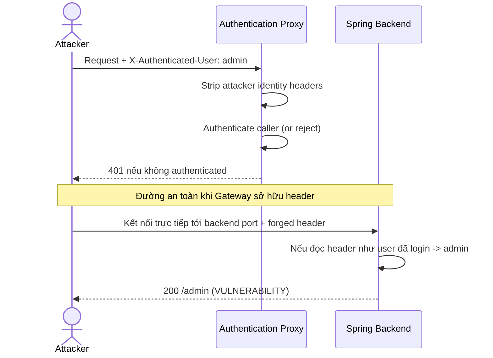
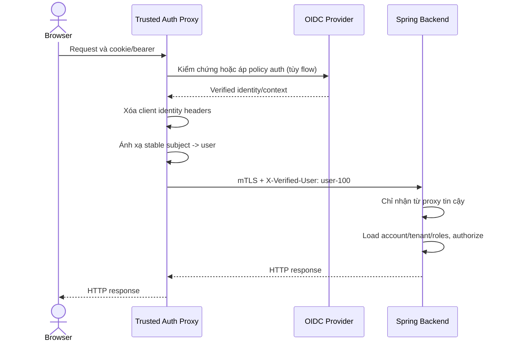
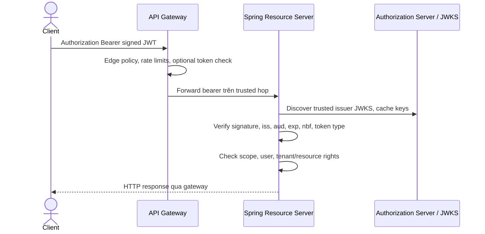

# Phân biệt header danh tính với assertion hoặc token có chữ ký

**Học phần:** Spring Security – federation → Xác thực qua proxy.

**Mục tiêu:** phân biệt **HTTP identity header** do reverse proxy/API gateway đưa vào request với **assertion hoặc token có chữ ký mật mã** (SAML Assertion, JWT/JWS, OIDC ID Token, OAuth2 JWT Access Token), hiểu đúng ranh giới tin cậy, khả năng chống giả mạo, replay, token substitution, mapping danh tính và cách tích hợp Spring Security một cách fail-closed.

**Ý chính:** một header như `X-Authenticated-User: alice` chỉ là một **chuỗi HTTP**. Bản thân header đó **không có chữ ký và không chứng minh Alice vừa đăng nhập**. Nó chỉ đáng tin khi ứng dụng nhận request **duy nhất từ proxy đã xác thực người dùng và có đường truyền/kiểm soát mạng đáng tin**; proxy đã xóa giá trị header do client gửi và **ghi đè** bằng kết quả xác thực thực tế. Trong khi đó, một **signed assertion/token** mang bằng chứng toàn vẹn từ một issuer/ký bằng key được tin cậy; phía nhận vẫn phải **verify chữ ký và các claim/điều kiện liên quan**. Chữ ký hợp lệ **không tự cấp quyền** và không chứng minh token được phát hành cho ứng dụng hoặc API đang nhận.

**Phân biệt ngôn ngữ:** “nằm trong HTTP header” không có nghĩa “header trần”. Ví dụ `Authorization: Bearer <signed-JWT>` là **một header dùng để vận chuyển token có chữ ký**. Đối tượng được xác minh là **token bên trong**, chứ không phải độ tin cậy mặc định của HTTP header. Ngược lại `X-Authenticated-User: alice` có thể được proxy cấp sau một luồng OIDC hợp lệ, nhưng chính chuỗi `alice` vẫn không có chữ ký end-to-end trừ khi có một cơ chế chứng thực khác bảo vệ nó.

Tài liệu dùng Java 17+, Spring Security Servlet, reverse proxy và ví dụ issuer/URL giả. Nội dung về mã ký ở phần Java là **mô phỏng học thuật**, không phải thư viện JWT, SAML hay HTTP Message Signatures dùng production.

## 1. Bối cảnh: proxy xác thực thay ứng dụng

Một ứng dụng legacy hoặc hệ thống microservices có thể đặt **Identity-Aware Proxy (IAP)**, gateway, SSO middleware hoặc reverse proxy phía trước:

```text
+------------------+
| Browser / Client |
+---------+--------+
          | HTTPS, session cookie / OAuth2 / OIDC
          v
+--------------------------+
| Authentication Proxy     |
| - login OIDC/SAML/SPNEGO |
| - validate session/token |
| - derive trusted user    |
| - enforce edge policies  |
+------------+-------------+
             | internal hop: user header hoặc signed token
             v
+--------------------------+
| Spring Security app/API  |
| - trust boundary checks  |
| - Authentication object  |
| - authorization          |
| - business resource      |
+--------------------------+
```

**Có hai kiểu bàn giao danh tính quan trọng:**

1. **Header-based pre-authentication:** proxy đã xác thực user, chuyển một identity string cho backend, ví dụ `X-Authenticated-User: alice`. Backend **không kiểm chứng chữ ký trên header này**; backend tin một *mối quan hệ vận hành*: chỉ proxy đáng tin được gọi backend và header không bị client giả mạo.
2. **Signed-token/assertion verification:** backend nhận một SAML Assertion/JWT/JWS do issuer tin cậy phát, tự verify chữ ký, issuer, audience, thời hạn, subject và giao thức. Bằng chứng được ràng buộc bằng mật mã; vẫn cần bảo vệ bearer token và authorization.

Hai mô hình **có thể cùng tồn tại**: proxy kiểm chứng OIDC ID Token rồi đặt raw header cho backend; hoặc proxy phát một **JWT riêng, có chữ ký và audience dành cho backend**; hoặc proxy xác thực và backend đồng thời nhận token. Nhưng phải chỉ rõ **ai xác thực ở mỗi hop** và **ai được phép phát biểu user identity**.

## 2. Bảng so sánh bản chất và sức mạnh bằng chứng

| Tiêu chí | Header danh tính trần | JWT/JWS có chữ ký | SAML Assertion có chữ ký |
| --- | --- | --- | --- |
| Ví dụ | `X-Authenticated-User: alice` | JWT chứa `sub/iss/aud/exp` và chữ ký | XML `Assertion` và `ds:Signature` |
| Vị trí truyền | HTTP request header | Thường `Authorization: Bearer`, cookie hoặc body theo protocol | Thường `SAMLResponse` qua browser POST/Redirect binding |
| Bảo vệ toàn vẹn ngay trên dữ liệu | **Không có sẵn** | Có, **khi** JWS signature được verify | Có, trên XML element được ký, khi XMLDSig verify đúng |
| Xác định bên phát hành | Chỉ từ **trust của proxy/hop** | `iss` phải kiểm tra và key phải thuộc issuer tin cậy | SAML `Issuer` và signing certificate/trust |
| Xác định bên nhận | Tự quy định qua proxy routing/policy | `aud` phải chứa app/resource server | `AudienceRestriction`, Recipient, Destination/ACS |
| Thời hạn | Không có nếu chỉ username; phụ thuộc proxy session | `exp`, `nbf`, `iat` theo profile | `Conditions NotBefore/NotOnOrAfter`, SubjectConfirmationData |
| Chống replay | Phụ thuộc proxy session/transport | Bearer token **vẫn replay được** nếu bị lấy cắp, cần TTL/PoP/revocation tùy threat model | `InResponseTo`, one-time use/replay store, conditions |
| Giới hạn quyền | Header role có thể bị spoof nếu boundary yếu | Claim scopes/roles chỉ theo issuer/policy hợp lệ | AttributeStatement/assurance được kiểm tra nhưng không tự cấp role |
| Triển khai | Đơn giản, nhưng đòi network trust tuyệt đối | Tốn key/JWKS/validation vận hành; tự verify ở nhiều services | Tốn metadata/cert/XMLSig/protocol validation |
| Nguy cơ chính | Header spoofing, proxy bypass, multi-hop confusion | Token substitution, alg/key confusion, stolen bearer | XML signature wrapping, replay, audience/recipient sai |
| Tiêu chí quan trọng nhất | **Ai có thể gửi header đến backend?** | **Issuer ký cho ai, khi nào và loại token nào?** | **Đúng assertion/recipient/request được issuer đáng tin ký?** |

**Chữ ký bảo vệ integrity/authenticity của những trường đã ký, không tự mã hóa nội dung.** JWT/JWS và SAML Assertion ký có thể bị đọc bởi bên nhận/các hop nếu không có bảo vệ confidentiality; cần TLS, và khi có yêu cầu bảo mật dữ liệu, JWE hoặc SAML encryption theo profile. Ngược lại, TLS giữa proxy và backend bảo vệ **một hop**, không biến một chuỗi header thành assertion có chữ ký mà backend có thể xác minh độc lập với proxy.

## 3. Identity header là gì và không phải gì?

Các tên header thường gặp (không có một tiêu chuẩn chung bắt buộc):

```http
X-Authenticated-User: alice
X-Auth-Request-User: alice
X-Forwarded-User: alice
Remote-User: alice
SM_USER: alice
X-Authenticated-Email: alice@example.com
X-Authenticated-Groups: report-viewer
```

**Cảnh báo:** tên header giống một sản phẩm SSO nổi tiếng **không tạo niềm tin**. Header thường do bất kỳ HTTP client nào đặt được, trừ khi hạ tầng đã chặn/ghi đè. Ví dụ:

```bash
curl https://portal.example.com/private \
  -H 'X-Authenticated-User: admin'
```

Lệnh trên là **test spoofing** chỉ nên chạy trên môi trường được phép. Nếu ứng dụng nhận và tạo session admin chỉ vì header hiện diện, hệ thống có **authentication bypass**. Việc header chứa email công ty, chữ “verified” hay một username hợp lệ không cải thiện độ tin cậy.

### 3.1. Cách header có thể đáng tin mà không được ký

Một kiến trúc pre-auth header hợp lệ cần **đồng thời**:

1. **Proxy xác thực user thật** (OIDC/SAML/SPNEGO/session validation hoặc hệ thống đã được duyệt) **trước** khi tạo header.
2. **Chỉ proxy có quyền kết nối backend**: backend không được public/exposed NodePort/LoadBalancer, ingress khác, service mesh route phụ hoặc debug port có thể bypass.
3. **Xác thực danh tính của proxy** ở hop backend nếu có thể: mTLS với service identity riêng, network policies + firewall và routing ownership.
4. **Xóa/từ chối mọi client-supplied identity headers** tại edge, kể cả aliases, header trùng, biến thể chữ hoa, dấu gạch nối/underscore do proxy/framework normalize, và các header role/tenant.
5. **Chỉ proxy tạo header mới** từ kết quả authentication đã verify; giá trị phải là **stable subject/internal ID** có namespace, không lấy từ query/body.
6. **Backend chỉ đọc giá trị sau trust boundary**, fail closed nếu thiếu hoặc không hợp lệ; không có alternate route cho phép client tự cung cấp header.
7. **Authorization tại backend** được tính từ source tin cậy (database/group mapping có policy), không tin tất cả roles/tenant strings do upstream chuyển.

Khi mọi điều kiện này đúng, header đóng vai trò **assertion vận hành** của gateway: tin proxy là authoritative authentication component. Đây là mô hình thực tế nhưng **không tương đương** signature-verifiable token end-to-end; thay đổi topology hoặc misconfiguration có thể phá an toàn mà không cần phá mật mã.

### 3.2. `X-Forwarded-*` khác header danh tính

Headers như `Forwarded`, `X-Forwarded-For`, `X-Forwarded-Proto` và `X-Forwarded-Host` thường dùng để mô tả IP/scheme/host của request trước proxy. **Chúng không phải bằng chứng danh tính đã xác thực**. Một client có thể tự tạo `X-Forwarded-For: 127.0.0.1` nếu edge không strip/reset; không bao giờ sử dụng chúng như security credentials.

**Mục tiêu khác nhau:**
- `X-Forwarded-For` cho proxy chain/network attribution theo trusted-proxy logic.
- `X-Authenticated-User` cho pre-auth identity nếu đã kiểm soát nghiêm ngặt đường nhận.
- `Authorization: Bearer ...` chứa một credential mà backend có thể validate.
- `X-Verified-JWT` có thể chứa JWS/JWT; chỉ đáng tin nếu verifier xác thực token và authority theo contract.

## 4. Mô hình tấn công: bypass proxy bằng header giả



Lỗi ở đây không phải “header truyền bị biến đổi” mà là **client bypass được authentication boundary**. Spring `RequestHeaderAuthenticationFilter` chỉ trích username từ request header. Tài liệu chính thức Spring Security nhấn mạnh filter này **không tự kiểm chứng người dùng**: nếu client giả được header, họ có thể chọn bất kỳ username.

### 4.1. Những đường bypass thường bị bỏ sót

- Kubernetes Service `NodePort` hoặc pod IP accessible qua mạng không kiểm soát.
- Một ingress thứ hai trỏ thẳng backend nhưng không bật auth middleware.
- Internal API gateway route bỏ qua `auth_request` ở một số paths.
- Health/debug/admin endpoint cho phép đọc cùng auth header mà không kiểm nguồn.
- Service mesh policy chỉ áp dụng một namespace, còn jobs/sidecars có thể gửi HTTP trực tiếp.
- Proxy A xác thực request, proxy B append/merge header làm giá trị attacker sống sót.
- Spring app bật cùng header preauth và form login fallback không có routing/flow separation.
- Public test environment dùng config header auth giống production nhưng không có proxy.

**Defense in depth:** network policy/mTLS nhận diện gateway, path-level authentication coverage, header sanitation và integration tests phải bao phủ **toàn bộ entry points**, không chỉ login URL.

## 5. Header injection, duplicate headers và normalization

HTTP field names là **case-insensitive**: `X-Authenticated-User` và `x-authenticated-user` được xem cùng một header về mặt tên. Một số proxy và frameworks còn normalize dấu gạch dưới, ghép các giá trị trùng hoặc chọn first/last occurrence khác nhau. Vì thế có thể xảy ra:

```http
X-Authenticated-User: attacker
x-authenticated-user: alice
X_Authenticated_User: admin
```

**Không nên cố “sanitize” bằng một regex duy nhất trên chuỗi header đầu vào rồi append header khác.** Cần:
- Edge **remove/overwrite**, không **append**, các trường protected identity và aliases.
- Mọi downstream hop nhất quán cách xử lý duplicate/case/underscore.
- Không dùng tùy ý nhiều headers cùng nghĩa (email, username, groups, tenant, role) nếu chưa có contract/canonicalization.
- Không giải mã nhiều lần hoặc parse comma-separated usernames như một danh sách user hợp lệ.
- Nếu một framework nhận nhiều values cho protected header, thường **reject** thay vì tự chọn một user.
- Không chấp nhận carriage return/line feed hoặc giá trị không hợp lệ làm principal; ứng dụng/proxy phải dựa trên HTTP parser bảo mật chuẩn.

**Identity confusion** cũng xuất hiện khi user bị rename/email reassignment. Ưu tiên một **stable immutable subject ID** từ authority đã verify, ánh xạ sang internal user ID; không lấy email tự nhập hoặc header display name làm khóa identity duy nhất.

## 6. Signed JWT/JWS: chữ ký đem lại bằng chứng gì?

**JWT (JSON Web Token)** là một định dạng claims. Một JWT có thể là **JWS được ký**, hoặc JWE được mã hóa; không tự động có chữ ký chỉ vì có ba đoạn base64url. JWS compact thông dụng:

```text
BASE64URL(protected-header).BASE64URL(payload).BASE64URL(signature)
```

Header JWS ví dụ:

```json
{
  "alg": "RS256",
  "typ": "at+jwt",
  "kid": "key-2026-11"
}
```

Payload **minh họa** của OAuth2 JWT access token:

```json
{
  "iss": "https://login.example.com/realms/partners",
  "sub": "user-100",
  "aud": "api://reports",
  "exp": 2000000000,
  "iat": 1999999700,
  "jti": "opaque-token-id",
  "scope": "reports:read",
  "tenant_id": "partner-a"
}
```

- `alg` xác định thuật toán đã dùng; validator phải có **algorithm allowlist** và key đúng loại. **Không tin** giá trị attacker gửi để tự chọn cách verify hoặc chấp nhận `alg=none` không phù hợp profile.
- `kid` là chỉ dẫn **chọn khóa trong tập khóa tin cậy**, không phải URL/đường dẫn do attacker tự chỉ để fetch key; không tin `jku`/`x5u` tùy tiện.
- `iss` là issuer; recipient phải có expected issuer cố định và resolve keys từ trust config/JWKS phù hợp.
- `sub` là subject trong namespace issuer; map sang internal user ID đã cho phép.
- `aud` phải chứa resource/API hoặc client đích. Token phát cho **API A** không mặc nhiên hợp lệ tại **API B**.
- `exp`/`nbf`, clock skew nhỏ và `iat`/max age nếu profile yêu cầu; không tin token hết hạn.
- `scope`/`roles`/`tenant_id` mang thông tin dùng cho **authorization**, nhưng chỉ tin khi issuer có authority và đã map policy.
- `typ=at+jwt` giúp phân biệt loại token theo RFC 9068, nhưng cần validator enforce loại token; **typ tự ghi trong payload/header không chứng minh token đúng loại nếu không có signature/type validation**.

**Ví dụ này không phải JWT có thể dùng thật**: JSON payload chỉ giải thích claims, không có signature và public key đi kèm. Không copy sang production để làm bearer token.

### 6.1. Cần kiểm tra gì trước khi coi user authenticated?

Quy trình kiểm chứng signed JWT dùng cho API:

1. Parser token bằng JOSE/JWT library được duy trì; giới hạn kích thước input và format.
2. Kiểm **signature** bằng key thuộc issuer tin cậy, thuật toán được cho phép; không cho header chưa verify điều khiển SSRF hoặc key load từ internet tùy ý.
3. Kiểm **issuer `iss`** đúng trust contract, kể cả khi key xuất hiện trong một JWKS cache.
4. Kiểm **audience `aud`** đúng API. Không chấp nhận ID Token `aud=web-client` để gọi backend API.
5. Kiểm **time claims** `exp`, `nbf` và optional max-age/`iat` theo contract.
6. Kiểm **token type/purpose**: OAuth2 access token cho resource server, OIDC ID Token cho relying party, logout token hay refresh token không được dùng thay thế lẫn nhau.
7. Kiểm **subject/tenant/scopes/roles** theo resource, app policy, account state và provenance.
8. Kiểm replay/PoP/revocation khi cần: signed bearer token bị đánh cắp **vẫn có thể được gửi lại** trước hạn, trừ khi có cơ chế hạn chế riêng.

**Chữ ký hợp lệ không đồng nghĩa token còn hạn hoặc đúng audience.** Nếu service chỉ kiểm `Signature.valid == true`, một JWT ký đúng issuer nhưng phát cho app khác có thể bị dùng làm **token substitution**.

### 6.2. Signed JWT vs opaque token

OAuth2 access token **không bắt buộc là JWT**. Một access token dạng opaque/reference string có thể được backend xác minh qua **introspection endpoint** hoặc một cơ chế server-side tin cậy. Đừng xem mọi bearer token không có ba đoạn là không hợp lệ; loại token phụ thuộc authorization server contract.

Tương tự, **cookie phiên** của gateway có thể là opaque session ID; backend chỉ thấy header user đã được proxy xác thực. Một chuỗi như `session=abc` không tự chứng minh danh tính khi không có session store/verification.

### 6.3. Ký bằng private/public key và ký bằng HMAC khác nhau

- **RS256/PS256/ES256** là kiểu chữ ký bất đối xứng: issuer ký bằng **private key**, các resource servers verify bằng **public key**. Tránh chia sẻ signing secret tới nhiều services.
- **HS256** là MAC dùng shared secret: mỗi verifier giữ cùng secret có thể về mặt kỹ thuật **tạo** token, nên ranh giới issuer/verifier khác. Không lấy secret ngắn/hardcode.
- **TLS/mTLS** xác thực và bảo vệ **connection hop**, không phải chữ ký end-to-end của một JWT/HTTP message.
- Chữ ký không bảo đảm confidentiality; nội dung JWT thường đọc được bởi bên nắm token. Dùng TLS và giảm PII trong claims.

## 7. SAML Assertion có chữ ký: cùng ý tưởng, khác protocol

SAML2 Assertion là XML được Identity Provider tạo để xác thực subject cho Service Provider (SP). Ví dụ XML **rút gọn, không phải SAMLResponse hợp lệ**:

```xml
<saml:Assertion
    xmlns:saml="urn:oasis:names:tc:SAML:2.0:assertion"
    ID="_assertion123"
    Version="2.0"
    IssueInstant="2026-11-07T03:00:00Z">
  <saml:Issuer>https://idp.partner.example/saml</saml:Issuer>
  <saml:Subject>
    <saml:NameID>opaque-user-100</saml:NameID>
  </saml:Subject>
  <saml:Conditions NotBefore="2026-11-07T02:59:00Z"
                   NotOnOrAfter="2026-11-07T03:04:00Z">
    <saml:AudienceRestriction>
      <saml:Audience>https://portal.example.com/saml2/sp</saml:Audience>
    </saml:AudienceRestriction>
  </saml:Conditions>
  <!-- Signature/SubjectConfirmation/AuthnStatement not shown -->
</saml:Assertion>
```

Dấu `<!-- ... -->` trong ví dụ là chú thích về những phần **được lược bỏ**; **XML này không được dùng để authenticate**.

Một SP phải:
- Xác minh XML signature của **đúng Response hoặc Assertion đã ký** theo profile; trust certificate từ metadata/trust config, không nhận certificate tùy ý trong message như authority.
- Chống XML Signature Wrapping: không chỉ lấy element có `NameID` dễ thấy và dùng nó trong khi signature tham chiếu một element khác.
- Xác minh `Issuer`, audience, Recipient/ACS, Destination, `InResponseTo` với pending AuthnRequest và response correlation.
- Kiểm `Conditions`, `SubjectConfirmationData`, NotBefore/NotOnOrAfter với clock skew hợp lý.
- Chống replay qua Assertion ID/Response ID và one-time request correlation theo protocol.
- Map verified NameID/issuer tới **cùng internal identity**; `email` hay attributes không tự là role.
- Kiểm `AuthnStatement`/`AuthnContext` nếu hành động cần MFA/assurance/freshness.

**Không forwarding Assertion ký cho SP A sang API B rồi coi B là audience hợp lệ.** Nếu API B cần token riêng, dùng token exchange hoặc broker-issued token có audience và trust đúng; không sửa XML rồi giữ chữ ký cũ.

**SAML encryption và SAML signature là hai chức năng riêng:** một Assertion được ký nhưng không mã hóa có thể lộ nội dung cho một hop nhìn thấy XML, còn một Assertion mã hóa cần được giải mã đúng key và vẫn phải thỏa xác thực/validation. Đừng disable signature validation chỉ vì metadata/certificate rotation.

## 8. Vị trí vận chuyển không phải mức độ tin cậy

Cần nhìn hai trục độc lập:

| Container/transport | Dữ liệu | Mức tin cậy thật |
| --- | --- | --- |
| `X-User: alice` | Raw string | Chỉ trusted khi boundary proxy→backend được bảo vệ |
| `Authorization: Bearer <JWT>` | Signed JWT bearer | Backend verify signature + claims + type; bearer vẫn replay |
| `X-Verified-Identity: <JWS>` | JWS trong custom header | Backend **phải verify JWS**, không auto trust vì header tên verified |
| Cookie `gateway_session=...` | Opaque session ID | Gateway/session store phải validate |
| `SAMLResponse` trong POST body | XML response/Assertion | SP verify SAML signature và conditions/protocol |
| `X-Client-Cert: ...` | Chuỗi chứa cert, nếu proxy đặt | Không tự là mTLS; chỉ trusted nếu proxy verify TLS client certificate và strip spoofed inputs |
| mTLS peer cert ở backend TLS handshake | Certificate + proof of key | Backend kiểm certificate chain, SAN/URI identity và authorization |
| `Signature-Input`/`Signature` của RFC 9421 | HTTP Message Signature | Verify key, covered components, freshness/nonce theo policy |
| `X-Forwarded-For: 1.2.3.4` | IP qua proxy hops | Không phải user credential |

**Không có quy tắc “headers không tin, body có thể tin”.** Header hoặc body là nơi vận chuyển dữ liệu. **Bằng chứng xác thực** nằm ở signature/MAC được kiểm chứng hoặc ở trust boundary có kiểm soát, không phải vị trí JSON/XML/header.

## 9. Trường hợp 1: proxy gửi raw user header

### 9.1. Luồng an toàn khi proxy là authentication authority



**Header của proxy không tự chứa bằng chứng** mà backend có thể verify theo issuer key. Backend đang **ủy thác authentication** cho proxy dựa trên việc nó có thể xác thực nguồn kết nối proxy và không có alternate path.

### 9.2. NGINX `auth_request` minh họa

Một thiết kế sử dụng `ngx_http_auth_request_module` có thể như sau (rút gọn cho **môi trường kiểm thử**, chưa đủ production; tên upstream chỉ ví dụ):

```nginx
server {
    listen 443 ssl;
    server_name portal.example.com;

    # TLS certificates, access controls and hardening omitted.

    location = /_auth {
        internal;
        proxy_pass http://auth-service:4180/verify;
        proxy_pass_request_body off;
        proxy_set_header Content-Length "";
        proxy_set_header X-Original-URI $request_uri;
    }

    location /private/ {
        auth_request /_auth;

        # Giá trị lấy từ auth subrequest response của service tin cậy.
        auth_request_set $verified_user
            $upstream_http_x_auth_request_user;

        # GHI ĐÈ incoming header, không forward giá trị client.
        proxy_set_header X-Verified-User $verified_user;
        proxy_set_header X-Authenticated-Role "";
        proxy_set_header X-Forwarded-Proto https;

        proxy_pass http://backend-service:8080;
    }
}
```

**Các điều kiện phải bổ sung trước production**:
- `auth-service` phải thực sự validate session/token/signature, chỉ cấp `2xx` khi authenticated và trả **canonical user ID**; đường `/_auth` là internal, không public.
- Nếu auth-service trả `2xx` nhưng **không trả user ID** hoặc trả giá trị không hợp lệ, backend/gateway phải **deny**, không coi empty string là authenticated.
- Cấu hình NGINX `auth_request` phải bảo phủ **tất cả protected locations**, không có `location` ưu tiên khác bỏ auth.
- `proxy_set_header X-Verified-User` ghi đè một trường; cần thiết kế sanitation **toàn bộ identity header aliases/duplicates** tại mọi proxy hop và kiểm thử parser differences.
- Backend phải **không** có đường truy cập không qua proxy; thêm service-to-service mTLS nếu trust model yêu cầu.
- Ví dụ gửi `proxy_pass http://backend...` chỉ để mô tả routing. Production cần kênh proxy→backend được bảo vệ (mTLS/TLS hoặc network enforcement nghiêm ngặt theo threat model); không sao chép `http` vào mạng không tin.
- Không forward raw OIDC ID Token hoặc SAML Assertion nếu không cần, không ghi session/identity secrets vào access logs.

**Nếu gateway chỉ gửi `X-Verified-User` mà backend còn public, đây vẫn là lỗ hổng.** Việc backend có thể đọc header không có nghĩa nó kiểm nguồn phát header.

### 9.3. Trust boundary với ingress/service mesh

Một mTLS sidecar chỉ chứng minh peer service đã được cấp certificate/identity theo PKI của mesh. Backend phải đảm bảo:
- Policy chỉ cho đúng identity của auth gateway được gửi protected identity headers.
- Services khác trong cluster **không được** gọi backend bằng cùng port và tự đặt headers.
- mTLS bắt buộc, không bật permissive mode dẫn tới plaintext path.
- Ingress strips client-provided identity headers cả khi client dùng HTTP/2/3 qua edge.
- Gateway cert/keys bị revoke/rotate đúng hạn.
- Auditing phân biệt authenticated user với calling service identity; hai identity khác nhau.

**mTLS không ký riêng một value `alice`.** Nó xác thực đường truyền; chỉ khi caller identity **được phép phát identity header** theo policy thì backend mới có thể tin giá trị. Vì vậy dù dùng mTLS vẫn phải hạn chế service principals được phép gửi user assertion.

## 10. Trường hợp 2: backend tự xác minh signed access token

Với backend có thể hoạt động như **OAuth2 Resource Server**, dùng token được phát cho backend cụ thể thay vì phụ thuộc raw header.



Đây là **defense in depth**: gateway có thể xác thực trước, nhưng API còn tự chứng minh token hợp lệ **cho chính nó**. API không cần tin raw `X-User` từ đường ingress khi bảo vệ resource bằng signature validation đúng.

**Giới hạn:** một signed bearer JWT vẫn bị đánh cắp/replay nếu ai đó lấy được. Với rủi ro cao, dùng TTL ngắn, revocation/introspection, mTLS certificate-bound tokens (RFC 8705), DPoP (RFC 9449) khi được hỗ trợ, hoặc proof-of-possession/transaction binding phù hợp. Không mặc định các cơ chế trên được bật chỉ vì JWT có chữ ký.

### 10.1. Spring Security Servlet Resource Server

Mảnh `application.yml` của ứng dụng API (issuer và audience chỉ là ví dụ):

```yaml
spring:
  security:
    oauth2:
      resourceserver:
        jwt:
          issuer-uri: https://login.example.com/realms/partners
          audiences:
            - api://reports
```

Spring Security/Boot dùng issuer metadata/JWKS được cấu hình để xác minh chữ ký. `issuer-uri` kiểm `iss`, `audiences` kiểm `aud`; các timestamp chuẩn được kiểm theo profile. Đảm bảo authorization server **thật sự** phát **JWT access token cho `api://reports`**, không dùng OIDC ID Token có `aud=portal-web`.

`SecurityConfig.java` (mảnh class trong Spring Boot Servlet với resource-server/Jose modules phù hợp):

```java
package com.example.reports;

import org.springframework.context.annotation.Bean;
import org.springframework.context.annotation.Configuration;
import org.springframework.security.config.Customizer;
import org.springframework.security.config.annotation.web.builders.HttpSecurity;
import org.springframework.security.web.SecurityFilterChain;

@Configuration
public class SecurityConfig {
    @Bean
    SecurityFilterChain apiSecurity(HttpSecurity http) throws Exception {
        http.authorizeHttpRequests(auth -> auth
                    .requestMatchers("/public/**").permitAll()
                    .anyRequest().authenticated())
            .oauth2ResourceServer(oauth2 ->
                    oauth2.jwt(Customizer.withDefaults()));
        return http.build();
    }
}
```

**Mã Spring là mảnh cấu hình**, cần dependency Spring Boot/Web/Security/OAuth2 Resource Server/JOSE, ứng dụng main, issuer/JWKS thật, token phù hợp và resource authorization. Mẫu không triển khai endpoint/business logic, vì thế không chạy độc lập bằng `javac`. Khi API sử dụng session cookie và browser actions, xem xét CSRF/session policy; không tắt CSRF toàn hệ thống chỉ vì có JWT ở một route.

### 10.2. Token validation không thay business authorization

Một signed token `scope=reports:read` chỉ có nghĩa issuer đã cấp scope đó **trong phạm vi trust contract**. Trước khi trả `GET /reports/42`, API còn phải kiểm:
- User có account nội bộ active.
- Token issuer/subject ánh xạ đúng tenant.
- `report 42` thuộc tenant và user được phép xem.
- Chỉ chấp nhận role từ issuer được phê duyệt; không map mọi claim `admin=true` thành `ROLE_ADMIN`.
- Nếu quyền thay đổi nhanh, TTL/revocation/permission query phù hợp.
- Audit user subject, client ID, scope, resource và decision đã che PII.

**Một JWT có signature hợp lệ dành cho user hợp lệ vẫn có thể không đủ quyền**. Authentication và authorization là hai bước khác nhau.

## 11. Spring Security Pre-Authentication: cách đọc header và cảnh báo

Spring Security cung cấp `RequestHeaderAuthenticationFilter` cho các tình huống **bên ngoài đã xác thực user**, ví dụ CA Siteminder hoặc proxy đã kiểm chứng người dùng. Đây **không phải cryptographic verifier**.

Mảnh Java minh họa thành phần filter (chỉ đặt bên sau gateway đã được chứng minh an toàn, không phải full app runnable):

```java
import org.springframework.context.annotation.Bean;
import org.springframework.context.annotation.Configuration;
import org.springframework.security.authentication.AuthenticationManager;
import org.springframework.security.web.authentication.preauth
        .RequestHeaderAuthenticationFilter;

@Configuration
class PreAuthHeaderComponents {
    @Bean
    RequestHeaderAuthenticationFilter requestHeaderAuthenticationFilter(
            AuthenticationManager manager) {
        RequestHeaderAuthenticationFilter filter =
                new RequestHeaderAuthenticationFilter();
        filter.setPrincipalRequestHeader("X-Verified-User");
        filter.setExceptionIfHeaderMissing(true);
        filter.setAuthenticationManager(manager);
        return filter;
    }
}
```

**Đoạn này chưa có `AuthenticationManager`/`PreAuthenticatedAuthenticationProvider`, user details/authorization mapping, SecurityFilterChain và gateway enforcement.** Không copy vào một app public rồi cho tất cả request qua `.authenticated()`: attacker có thể tự gửi `X-Verified-User` và giả danh user.

Đúng thiết kế:
- Filter chạy **chỉ** trên những paths/ports/network đã kiểm soát proxy.
- `AuthenticationManager` dùng pre-auth provider để load user theo stable ID và authority từ nguồn tin cậy.
- Khi header thiếu/sai, **reject**; không tạo `anonymous` rồi cho protected resource.
- Không trộn pre-auth với các login mechanisms khác trên cùng path theo cách tạo bypass.
- Nếu hỗ trợ nhiều proxy/tenants, xác thực service identity của proxy và mapping policy per proxy.
- Không lấy `X-Verified-Roles` từ input tùy ý để cấp admin; roles do app/security authority quản lý.

Tài liệu Spring Security về `RequestHeaderAuthenticationFilter` nêu rõ: lớp này **chỉ trích username từ header và không kiểm chứng authentication**. Bảo vệ header/bypass là trách nhiệm của hệ thống bên ngoài.

### 11.1. Một yêu cầu với cả JWT và identity header phải xử lý thế nào?

Ví dụ:

```http
GET /reports/42 HTTP/1.1
Authorization: Bearer eyJ...signed...
X-Verified-User: admin
```

Nếu API đã thiết kế để xác thực bearer JWT, thì **JWT được kiểm chứng** là source of truth; raw user header **không được phép ghi đè** `JwtAuthenticationToken.getName()`. Một user có thể gửi thêm header admin nhằm làm sai mapping. API nên reject hoặc ignore protected raw headers theo routing policy. Với proxy preauth, ngược lại, phải từ chối direct bearer/header sources mà gateway không kiểm soát.

**Đừng hợp nhất hai principals bằng logic “lấy cái nào có role cao hơn”.** Nếu dùng nhiều cơ chế, mỗi route/security filter chain cần chính sách độc lập, xử lý conflicts rõ (thường fail closed) và audit đầy đủ.

## 12. Tại sao có JWT/JWS trong header vẫn cần tin issuer?

Một attacker cũng có thể **tự tạo** JWT với private key của họ, gắn:
- `iss=https://evil.example`;
- `sub=admin`;
- `aud=api://reports`;
- `role=admin`;
- chữ ký RS256 đúng **theo public key của attacker**.

Nếu API chỉ verify “signature hợp lệ với public key có trong token/JWKS URL do token chỉ định”, attacker vẫn có thể được chấp nhận. Điều cần thiết là **binding giữa issuer tin cậy và key tin cậy**, không chỉ phép toán mật mã thành công.

### 12.1. Algorithm/key confusion

Các lỗi:
- Tin `alg` từ token để chọn HS256 với một RSA public key như secret (classic algorithm confusion).
- Chấp nhận `alg=none` không thuộc profile.
- Fetch `jku` hoặc `x5u` từ URL attacker chọn (SSRF/key injection).
- Chọn key chỉ bằng `kid` mà không giới hạn trong JWKS của issuer được cấu hình.
- Dùng cùng key/trust cho ID Token và API access token mà không check audience/type.
- Tin claim `iss` chưa verify để tự đổi tenant/config source.

**Biện pháp:** allowlist thuật toán, issuer → keyset được cấu hình, JWK rotation hợp lệ, JWT BCP RFC 8725, validation rules tách biệt cho từng token type và audience.

### 12.2. Cross-token substitution

| Token hợp lệ | Phát cho | Được dùng để |
| --- | --- | --- |
| OIDC ID Token | `portal-web` | OIDC RP xác thực login |
| OAuth2 access token | `api://reports` | Reports API sau verify issuer/audience/scopes |
| OAuth2 access token | `api://payroll` | Payroll API, không tự hợp lệ cho reports |
| SAML Assertion | `https://portal.example.com/saml2/sp` | SAML SP portal theo profile |
| Gateway-signed identity assertion | `backend-service-id` | Backend được nêu trong audience/contract |
| Raw `X-Verified-User` | Không có audience được ký | Chỉ dựa trên proxy trust/routing |

**Một chữ ký đúng không biến một token dành cho app A thành vé cho app B.** Nếu proxy muốn tạo token mới dành cho B, nó cần được **ủy quyền làm issuer** hoặc dùng authorization server/token exchange đúng contract, ký bằng key đã đăng ký và đặt audience của B. Backend phải tin đúng issuer đó. Đừng lấy upstream token có `aud=proxy-client` rồi chuyển nguyên cho mọi API.

## 13. Đường trust ở proxy: ký identity statement riêng có tác dụng gì?

Một gateway có thể xác thực OIDC/SAML user rồi phát một **backend-specific signed identity statement** (JWS/JWT). So với raw header:

```text
Mô hình 1 – raw preauth:
  Gateway --mTLS--> Backend
           X-Verified-User: user-100
  Backend tin Gateway hop + header sanitization.

Mô hình 2 – gateway-signed token:
  Gateway --TLS--> Backend
           Authorization: Bearer <gateway-issued-JWS>
  Backend verify Gateway issuer signature, audience, expiry, subject.

Mô hình 3 – upstream JWT pass-through:
  Client --> Gateway --> Backend
           Authorization: Bearer <AS-issued-access-token>
  Backend verify AS signature, issuer, audience, expiry.
```

**Mô hình 2** có thể giúp backend verify identity proof độc lập với hop, kể cả khi có thêm proxy trung gian. Nhưng phải quản lý signing keys, JWKS, audience, TTL, issuer, token type và trust chính thức. **Gateway ký claim không làm claim tự trở nên đúng**: nếu gateway lấy raw `X-User` do attacker gửi rồi ký nó, backend sẽ nhận một assertion có chữ ký **nhưng nguồn claim đã sai**. Tính đúng đắn của issuer authentication vẫn là điều kiện tiên quyết.

### 13.1. Các thông tin nên có trong identity statement

Tùy profile, có thể có:

```json
{
  "iss": "https://gateway.example.com",
  "sub": "user-100",
  "aud": "api://reports",
  "iat": 1999999700,
  "exp": 2000000000,
  "jti": "event-or-token-id",
  "auth_source": "oidc-partner-a",
  "tenant_id": "partner-a"
}
```

Đây là **claim example**, không phải JWT hoàn chỉnh. Trường `auth_source` và `tenant_id` là custom claims; phải có policy issuer/tenant/subject rõ. Nếu cần bảo đảm request integrity ở level **HTTP method/path/body**, chỉ JWT identity không ký các request bytes đó. Xem **RFC 9421 HTTP Message Signatures** hoặc PoP/transaction signing phù hợp; xác định các covered components và replay/freshness.

### 13.2. Ký payload không có nghĩa ký cả HTTP request

Một JWS trong `Authorization` bảo vệ token claims. Attacker có token hợp lệ có thể gửi nó kèm **một HTTP request khác** nếu token không bị bind tới method/path/client hoặc resource authorization không chặn. Với request nhạy cảm:
- CSRF nếu dùng cookie ambient browser credentials.
- Scope/resource/ownership checks, idempotency.
- Nonce/challenge/one-time proof khi xác nhận giao dịch.
- DPoP/mTLS-bound access tokens nếu API cần chống replay/credential theft.
- HTTP Message Signatures chỉ khi hai bên thống nhất canonicalization, key và những thành phần phải ký.
- Không hứa token signature là bằng chứng user đã xác nhận đúng số tiền/địa chỉ ví.

## 14. Java 17 độc lập: header giả mạo vs statement có MAC

Bài tập sau dùng **JDK 17** để minh họa rằng:
1. Raw header `X-User` không có proof: client có thể nhập `admin`.
2. Statement được bảo vệ bằng HMAC trên `issuer/subject/audience/expiry` không thể đổi subject hoặc audience mà giữ MAC hợp lệ.
3. Hết hạn thì statement bị từ chối ngay cả khi MAC đúng.

**CẢNH BÁO:** đây là **demo HMAC** với key hardcode cố ý để stdout cố định; **không phải JWT/JWS validator**, không bảo vệ HTTP request, không có key rotation, nonce/replay store, algorithm negotiation, TLS hay user authorization. Production phải dùng Spring Security/Nimbus/Jose, trust config và key management phù hợp; tuyệt đối không mang key/code này vào dịch vụ thật.

File `SignedIdentityDemo.java`:

```java
import java.nio.charset.StandardCharsets;
import java.security.MessageDigest;
import java.time.Instant;
import java.util.Base64;
import javax.crypto.Mac;
import javax.crypto.spec.SecretKeySpec;

public class SignedIdentityDemo {

    private static final byte[] DEMO_KEY =
            "not-for-production-shared-key-only-for-learning"
                    .getBytes(StandardCharsets.UTF_8);

    record Claims(String issuer, String subject,
                  String audience, long expiresEpochSeconds) {}

    record SignedStatement(Claims claims, String mac) {}

    static String canonical(Claims c) {
        return c.issuer() + "\n" + c.subject() + "\n"
                + c.audience() + "\n" + c.expiresEpochSeconds();
    }

    static byte[] signature(Claims c) throws Exception {
        Mac mac = Mac.getInstance("HmacSHA256");
        mac.init(new SecretKeySpec(DEMO_KEY, "HmacSHA256"));
        return mac.doFinal(
                canonical(c).getBytes(StandardCharsets.UTF_8));
    }

    static SignedStatement issue(Claims c) throws Exception {
        String encoded = Base64.getUrlEncoder()
                .withoutPadding().encodeToString(signature(c));
        return new SignedStatement(c, encoded);
    }

    static boolean verify(SignedStatement statement, Instant now)
            throws Exception {
        if (statement == null || statement.claims() == null
                || statement.mac() == null) {
            return false;
        }

        Claims c = statement.claims();
        if (!"https://gateway.example.com".equals(c.issuer())
                || !"api://reports".equals(c.audience())
                || c.subject() == null || c.subject().isBlank()
                || c.expiresEpochSeconds() <= now.getEpochSecond()) {
            return false;
        }

        byte[] received;
        try {
            received = Base64.getUrlDecoder().decode(statement.mac());
        } catch (IllegalArgumentException ex) {
            return false;
        }

        return MessageDigest.isEqual(received, signature(c));
    }

    public static void main(String[] args) throws Exception {
        String untrustedHeader = "admin";
        System.out.println("Raw header can claim admin: "
                + "admin".equals(untrustedHeader));

        Claims good = new Claims(
                "https://gateway.example.com",
                "user-100", "api://reports", 2_000_000_000L);
        SignedStatement valid = issue(good);
        Instant now = Instant.ofEpochSecond(1_900_000_000L);

        System.out.println("Signed statement valid: "
                + verify(valid, now));

        Claims changedUser = new Claims(
                good.issuer(), "admin",
                good.audience(), good.expiresEpochSeconds());
        SignedStatement tampered =
                new SignedStatement(changedUser, valid.mac());
        System.out.println("Tampered subject rejected: "
                + !verify(tampered, now));

        Claims changedAudience = new Claims(
                good.issuer(), good.subject(),
                "api://payroll", good.expiresEpochSeconds());
        SignedStatement wrongTarget =
                new SignedStatement(changedAudience, valid.mac());
        System.out.println("Wrong audience rejected: "
                + !verify(wrongTarget, now));

        Instant afterExpiration =
                Instant.ofEpochSecond(2_000_000_000L);
        System.out.println("Expired statement rejected: "
                + !verify(valid, afterExpiration));
    }
}
```

Chạy trong thư mục có file:

```bash
javac SignedIdentityDemo.java
java SignedIdentityDemo
```

**Stdout chính xác:**

```text
Raw header can claim admin: true
Signed statement valid: true
Tampered subject rejected: true
Wrong audience rejected: true
Expired statement rejected: true
```

**Giải thích cơ chế:**
- Raw header có thể do người gọi tự điền. Trong demo, biểu thức đầu chỉ chứng minh **khả năng khai báo chuỗi**; một backend an toàn phải **không dùng nó làm authentication** nếu không qua trusted proxy.
- `canonical` ràng buộc đầy đủ `iss/sub/aud/exp` vào HMAC; đổi `sub` hoặc `aud` nhưng giữ MAC cũ sẽ bị `MessageDigest.isEqual` từ chối.
- `verify` còn kiểm expected issuer/audience và thời hạn hiện tại. Ký đúng nhưng hết hạn vẫn thất bại.
- Dùng HMAC shared secret khác với chữ ký bất đối xứng thường dùng cho JWT/OIDC (RS/ES/PS). Mọi verifier có shared key cũng có khả năng tạo MAC; vì vậy demo **không mô phỏng quyền hạn public-key verification giữa các tổ chức**.
- Không dùng tự chế định dạng newline-canonicalized cho production: bài không xử lý escaping/newline injection, replay, token type, security headers, mTLS, request signature hoặc key rotation. Sử dụng thư viện chuẩn để phát/verify JWT/JWS.
- Không biến kết quả `verify=true` thành việc user chắc chắn có quyền truy cập resource; business authorization nằm ở tầng khác.

## 15. Ranh giới signed assertion và khả năng replay

**Signature kiểm integrity, không tự chống replay.**

Một attacker có signed bearer token thật (lấy qua log, URL, browser storage hoặc TLS termination bị compromise) có thể gửi lại trước khi `exp` hết hạn. Một SAML Assertion được ký vẫn có thể bị replay nếu SP không lưu used assertion IDs hoặc bỏ `InResponseTo`. Một header pre-auth có thể bị replay hoặc spoof nếu attacker gọi thẳng backend.

| Bối cảnh | Cơ chế cần thêm ngoài authentication |
| --- | --- |
| Raw proxy header | Trusted source, strip/overwrite, mTLS/network isolation, session policy |
| OAuth2 signed bearer access token | Short TTL, revocation, audience/scope, TLS, PoP nếu cần |
| SAML browser SSO | InResponseTo, Recipient, Assertion ID replay cache, time constraints |
| HTTP message signature | Verify covered method/path/content digest, creation/expires, nonce/replay policy |
| Account linking | Explicit confirmation và subject continuity, không chỉ email |
| Banking/approve action | Fresh reauth/step-up, transaction binding, one-time proof, idempotency |
| Service-to-service mTLS | Peer identity/SAN authorization, credential rotation, routing boundaries |

Nếu một user đã xác thực ở proxy và backend chỉ nhận header, khả năng revocation phụ thuộc proxy session và backend session. Nếu backend tự xác minh JWT, signature còn hợp lệ sau user disable cho tới khi token hết hạn/trạng thái được kiểm tra thêm. Đừng hứa “có JWT thì revoke tức thì”.

## 16. Identity mapping: header, `sub`, NameID, email

Trong federated login, nhiều nguồn identity có thể phát cùng một username/email. Hãy tách:

1. **External identity:** trusted issuer + subject (`iss,sub` trong OIDC/JWT; `SAML Issuer + NameID` theo SAML contract).
2. **Proxy/gateway principal:** identity đã được verify rồi ánh xạ sang stable ID; không dùng raw email làm unique user ID nếu có thể tái sử dụng.
3. **Internal user ID:** khóa của ứng dụng, liên kết tới external identities qua một quy trình được duyệt.
4. **Tenant membership/roles:** quyền do hệ thống có authority quản lý, không tự suy từ profile attribute.
5. **Authentication assurance:** thông tin MFA/freshness nếu có chứng cứ đáng tin từ issuer/proxy, không tự gán.

Ví dụ sai:

```java
String user = request.getHeader("X-Authenticated-Email");
if (user.endsWith("@company.example")) {
    grantAdmin();
}
```

Đây là **anti-pattern**, không phải code dùng thật. Nó bị bypass nếu request không qua proxy hoặc email là self-asserted; ngay cả email verified cũng **không tự là admin**. Thay bằng:
- Stable internal user ID sau verified trust boundary.
- Lookup account `ACTIVE` và tenant membership.
- Resource ownership/role được quản lý trong application IAM.
- Step-up/MFA policy riêng cho thao tác nhạy cảm.
- Audit các quyết định permission và nguồn authentication.

## 17. Khi nào nên dùng header và khi nào nên dùng signed token?

| Tình huống | Hướng đáng cân nhắc | Lý do |
| --- | --- | --- |
| Ứng dụng legacy không thể xử lý OIDC/SAML/JWT | Trusted proxy + pre-auth header | Ít sửa code; nhưng phải kiểm network/proxy ownership cực nghiêm |
| Modern API/resource server có thể verify JWT | Signed OAuth2 access token đúng issuer/audience | Backend tự xác minh trust, giảm phụ thuộc raw header |
| Browser web dùng OIDC login + local session | `oauth2Login` tại app/BFF hoặc proxy SSO rõ trust boundary | ID Token dùng cho RP login; không dùng làm API access token |
| API ở sau nhiều trung gian không cùng trust domain | Backend-issued/gateway-issued signed statement đúng audience | Integrity độc lập giữa các hops khi issuer được tin |
| B2B SAML Federation | Signed SAML Response/Assertion đến đúng SP | Cần strict XMLDSig, audience, recipient/correlation |
| Opaque OAuth token | Resource server introspection | Không yêu cầu JWT signature nhưng vẫn có validation authority |
| Workload identity giữa services | mTLS workload identity + authorization | Xác thực peer service, không tự là user delegation |
| Tác vụ giao dịch cần bằng chứng request cụ thể | PoP/message signature/transaction proof theo profile | JWT identity chung không bind method/body |
| Hệ thống chưa thể ngăn direct backend access | **Không dùng raw header làm authentication** | Bypass là nguy cơ trực tiếp |

**Không có câu trả lời “token luôn an toàn hơn header” trong mọi thiết kế.** Một JWT được verify sai issuer/aud/alg vẫn nguy hiểm; một header preauth được proxy chặn/ghi đè và mạng mTLS khóa đúng có thể là lựa chọn hợp lệ cho legacy. Điểm mấu chốt là **khả năng chứng minh và enforce trust boundary**.

## 18. Kiểm thử header spoofing, token forgery và proxy bypass

| Case | Request/điều kiện | Kỳ vọng |
| --- | --- | --- |
| Client gửi `X-Verified-User: admin` tới public proxy | Chưa login | Proxy 401, không forward admin |
| Client gửi header admin nhưng login user thường | Gateway auth thành công user thường | Backend chỉ thấy stable ID của user thật |
| HTTP header name khác case | `x-verified-user` | Strip/overwrite cùng policy |
| Duplicate identity headers | Header lặp và giá trị khác | Không chọn attacker principal; reject/overwrite rõ |
| Header với underscore alias | `X_Verified_User` | Không bypass parser normalization |
| Client tự set `X-Verified-Roles` | `admin` | Backend không cấp admin từ untrusted field |
| Client bypass proxy gọi pod IP | Direct internal service | Kết nối bị chặn/mTLS deny |
| Tạo service mesh peer khác gateway | Tự gắn identity header | Deny theo service identity ACL |
| Gateway auth trả `2xx` nhưng thiếu user ID | Missing identity | Fail closed |
| Gateway auth trả `401/403` | Auth failure | Không truy cập protected backend |
| Gateway auth timeout | 502/504 | Fail closed, không chuyển cho backend |
| Alternate route thiếu `auth_request` | Public ingress khác | Không đạt access, test config coverage |
| JWT signature sai | Tamper JWT payload | Resource server 401 |
| JWT signed bởi attacker key | `iss`/JWKS không tin | Deny, không dynamic key injection |
| JWT `alg=none` | Token tự phát | Deny |
| JWT khác issuer | Token IdP B tại service tin IdP A | Deny |
| JWT đúng issuer nhưng sai audience | Token cho `api://payroll` gọi reports | Deny |
| OIDC ID Token dùng làm API bearer | `aud=portal-web` | Deny theo token type/audience |
| Expired JWT | `exp` đã qua | Deny kể cả signature đúng |
| JWT chưa có hiệu lực | `nbf` tương lai quá skew | Deny |
| Signed JWT bị replay trước expiry | Copy bearer đã cấp | Cần TTL/PoP/revocation theo threat model |
| User bị khóa tại broker | JWT còn thời hạn | Policy revocation/authorization cập nhật được áp |
| SAML Response ký sai | Signed by unknown cert | SP reject |
| SAML Assertion dành cho SP A đưa tới B | Audience/recipient sai | SP B reject |
| SAML XML wrapping | Signed element khác element đọc user | Reject bằng SAML library bảo mật |
| SAML unsolicited reply trên flow yêu cầu correlation | Thiếu InResponseTo | Reject theo policy |
| Proxy ký token lấy subject từ raw user header | Upstream spoofed | Security test phát hiện issuer claim contamination |
| Token ở custom header với tên “signed” | Không có verifier | Không tự authenticate |
| mTLS peer certificate hợp lệ nhưng service không authorized | Wrong workload identity | Deny |
| Reports token có `reports:read` nhưng user khác tenant | Resource ownership sai | 403 |
| Browser cookie session CSRF | POST business action | CSRF defense/idempotency hoạt động |
| Multi-hop reverse proxy | Identity headers qua hai proxies | Không giữ client header và không trộn claims |
| Token/header vào access log | Inspect sanitized logs | Không lộ credentials/PII |

**Kiểm thử ở nhiều tầng:**
- Unit: mapping stable subject, deny missing headers, token claim validators, role policies.
- Integration: NGINX/ingress auth_request, header stripping, backend network policy/mTLS, Spring pre-auth provider và JWT decoder.
- End-to-end: browser/curl login, alternate ingress routes, expired/replayed tokens, cluster failover và key rotation.
- Security negative: direct port access, crafted headers, duplicate/case variants, alg/key confusion, wrong `iss/aud`, SAML wrapping/replay, header-to-token signing contamination.

**Không chỉ test `@WithMockUser`**: mock security context có thể làm mọi API tests pass mà không đi qua proxy hoặc token validator thực. Cần các tests bên ngoài với gateway/issuer fixtures hợp lệ và các mẫu tấn công có kiểm soát.

## 19. Vận hành và phòng vệ theo lớp

### 19.1. Key management cho signed tokens

- Signing private key ở vault/HSM/secure KMS; không hardcode hoặc log.
- Public JWKS được publish qua trusted issuer endpoints; key rotation có overlap/caching phù hợp.
- Khi lộ signing key: incident response, revoke/rotate, thay trust anchors và xem token đã cấp.
- Không tin `kid`/`jku` từ token như URL tải key tùy ý.
- Tách keys/issuers/token types theo security domain khi thích hợp.
- Kiểm signature algorithms được duyệt, loại bỏ yếu/`none` ngoài profile.
- Nếu dùng HMAC giữa nhiều services, mỗi verifier nắm shared secret có thể phát MAC; cân nhắc chuyển sang asymmetric signing khi trust boundary yêu cầu.

### 19.2. Proxy boundary management

- Inventory tất cả ingress, load balancers, sidecars và reverse proxies có khả năng đi tới backend.
- Rà soát header names/aliases được tin, cách strip/overwrite và path coverage.
- Firewall/Kubernetes NetworkPolicy + mTLS; chỉ service identities đã duyệt được quyền gọi protected paths.
- Proxy config được review, tested-as-code; chặn direct backend ports/debug endpoints.
- Giám sát auth errors, wrong upstream service identity, spoofed-header test failures.
- Quan sát version/plugin behavior khi nâng ingress/nginx, HTTP/2/3 normalization.
- Không để một proxy chỉ forwarding user header sau khi session đã hết hạn/revoked.
- Backend fail closed khi không nhận authenticated identity hoặc issuer evidence hợp lệ.

### 19.3. Logging và bảo vệ dữ liệu

Log nên chứa:
- Correlation/request ID không thể dùng làm credential.
- Issuer trust profile/registration ID, hashed/opaque internal subject.
- Auth mechanism (proxy-preauth/JWT/SAML/mTLS), decision, HTTP status, TTL bucket (nếu cần).
- Expected audience và token validation failure code, không in raw JWT.
- Peer workload identity mTLS khi cần audit gateway.

**Không log** `Authorization`, bearer JWT, SAMLResponse, session cookies, raw identity assertions, private keys hoặc PII nhạy cảm. Header pre-auth dù không có chữ ký vẫn là thông tin cá nhân và có thể gây credential confusion trong log/screenshot.

## 20. Runbook khi cần quyết định kiến trúc

**Nếu chọn pre-auth headers:**

1. Chỉ rõ gateway nào **thực sự xác thực** user và nguồn IdP/session.
2. Chỉ rõ protected header names; gateway xóa mọi client values và tạo **một** canonical identity.
3. Backend không có direct/public path; thiết lập mTLS hoặc trust boundary mạng có thể kiểm chứng.
4. Spring `RequestHeaderAuthenticationFilter` chỉ chạy trên một security filter chain được chặn đường bypass.
5. Mapping identity stable, tenant/authorization và logout/session policy kiểm soát riêng.
6. Test spoofing trực tiếp, duplicate/underscore headers, alternate ingress và cluster routes.
7. Khi thiếu header, peer identity sai hoặc gateway auth fail, **deny**.

**Nếu chọn signed-token approach:**

1. Chốt issuer, token type, resource audience, signing algorithm/JWKS và key rotation.
2. Client/gateway chỉ chuyển token theo OAuth2/OIDC/SAML profile được thiết kế.
3. Spring Resource Server/SAML SP tự verify đầy đủ signature/trust, issuer, audience/recipient, thời hạn, request correlation/replay.
4. Không dùng ID Token cho API hoặc SAML Assertion cho SP khác.
5. Map claims đã verify → internal subject/tenant, áp business authorization.
6. Dùng TTL ngắn/revocation/PoP nếu cần; xem rủi ro token bị lộ.
7. Test invalid signature, wrong issuer/audience/type, expired token, key rotation, and missing key failures.

**Nếu dùng kết hợp:** ghi rõ ở mỗi hop dữ liệu nào đã được verify, bên nào phát và tin nó, scope/audience tương ứng; không cho raw header override principal từ signed token.

## 21. Câu hỏi tự kiểm tra

**Q1. Một request có `X-Authenticated-User: alice` đã chứng minh Alice xác thực chưa?**  
Chưa. Header là chuỗi input. Chỉ có thể sử dụng khi proxy tin cậy đã xác thực Alice, strip/ghi đè header, và backend không thể bị client gọi bỏ qua proxy.

**Q2. `Authorization: Bearer <JWT>` cũng là header; vậy có khác header danh tính không?**  
Có. Vị trí vận chuyển đều là header, nhưng JWT/JWS chứa signature/claims để **backend xác minh riêng**. Chỉ đọc header Bearer mà không verify JWT cũng nguy hiểm như tin raw identity.

**Q3. JWT signed hợp lệ có đủ để truy cập mọi API không?**  
Không. Cần issuer, audience, token type, thời hạn, subject và scope/permissions. Token cho API A không mặc nhiên hợp lệ tại API B.

**Q4. mTLS giữa proxy/backend có làm header `X-User` có chữ ký không?**  
Không. mTLS xác thực peer và bảo vệ kết nối; raw header được tin nhờ chỉ cho peer đã cấp quyền gửi, không nhờ signature riêng trên value.

**Q5. Proxy có thể ký JWT để biến user email từ request thành trusted identity không?**  
Không. Nếu proxy chưa xác thực nguồn email, token có chữ ký chỉ làm claim sai trở thành một phát biểu có chữ ký. Security of issuer **phụ thuộc authentication trước khi phát token**.

**Q6. SAML Assertion ký đúng nhưng audience khác có chấp nhận không?**  
Không. SP phải verify audience/recipient/InResponseTo và mọi conditions; signature hợp lệ một mình không đủ.

**Q7. Signed JWT có ngăn replay tuyệt đối không?**  
Không. Bearer JWT có thể được replay trước expiry nếu bị đánh cắp; cần TTL, revocation và PoP/nonce/transaction binding theo threat model.

**Q8. Tại sao không map `X-Verified-Groups: admin` thành ROLE_ADMIN?**  
Vì nếu header bị spoof hoặc gateway không có authority cho ứng dụng đó, attacker leo thang quyền. App phải có trusted role mapping và business authorization.

## 22. Tài liệu chuẩn, triển khai và security references

1. [Spring Security – Pre-Authentication Scenarios](https://docs.spring.io/spring-security/reference/servlet/authentication/preauth.html): `RequestHeaderAuthenticationFilter` chỉ trích username từ header, không tự authenticate; trust do external system cung cấp.
2. [Spring Security – RequestHeaderAuthenticationFilter JavaDoc](https://www.springframework.org/spring-security/reference/7.0/api/java/org/springframework/security/web/authentication/preauth/RequestHeaderAuthenticationFilter.html): cách đọc principal header và cảnh báo rủi ro header forgery.
3. [Spring Security – OAuth2 Resource Server JWT](https://docs.spring.io/spring-security/reference/servlet/oauth2/resource-server/jwt.html): `iss`, `aud`, JWKS, expiry, signature, JWT validators.
4. [Spring Boot – OAuth2 Resource Server Configuration](https://docs.spring.io/spring-boot/reference/security/oauth2.html): `issuer-uri`/`audiences` và opaque token introspection.
5. [RFC 7519 – JSON Web Token (JWT)](https://www.rfc-editor.org/rfc/rfc7519): claims như `iss/sub/aud/exp/nbf`.
6. [RFC 7515 – JSON Web Signature (JWS)](https://www.rfc-editor.org/rfc/rfc7515): JWS protected header, signature và signing input.
7. [RFC 8725 – JWT Best Current Practices](https://www.rfc-editor.org/rfc/rfc8725): chống alg/key confusion, issuer/audience binding, cross-token substitution.
8. [RFC 9068 – JWT Profile for OAuth2 Access Tokens](https://www.rfc-editor.org/rfc/rfc9068): `typ=at+jwt` và validation dành cho JWT access tokens.
9. [RFC 9421 – HTTP Message Signatures](https://www.rfc-editor.org/rfc/rfc9421): ký các components của HTTP request, khác JWT claims và TLS hop.
10. [RFC 8705 – OAuth2 Mutual-TLS](https://www.rfc-editor.org/rfc/rfc8705) và [RFC 9449 – DPoP](https://www.rfc-editor.org/rfc/rfc9449): sender-constrained/PoP access tokens.
11. [OASIS – SAML 2.0 Core](https://docs.oasis-open.org/security/saml/v2.0/saml-core-2.0-os.pdf) và [SAML 2.0 Profiles](https://docs.oasis-open.org/security/saml/v2.0/saml-profiles-2.0-os.pdf): XML signature, issuer, audience, recipient, correlation.
12. [OWASP – SAML Security Cheat Sheet](https://cheatsheetseries.owasp.org/cheatsheets/SAML_Security_Cheat_Sheet.html): signature wrapping, replay, strict validation.
13. [OWASP – JSON Web Token Cheat Sheet](https://cheatsheetseries.owasp.org/cheatsheets/JSON_Web_Token_for_Java_Cheat_Sheet.html): JWT signing, token theft, validation và revocation.
14. [NGINX – auth_request module](https://nginx.org/en/docs/http/ngx_http_auth_request_module.html): gateway pre-auth subrequest và `auth_request_set`.
15. [NGINX – proxy_set_header](https://nginx.org/en/docs/http/ngx_http_proxy_module.html#proxy_set_header): kiểm soát các headers gửi đến upstream.

**Kết luận:** sự khác nhau quan trọng **không phải nằm ở vị trí header hay body**, mà ở **bằng chứng và ranh giới tin cậy**. Raw identity header chỉ đáng tin nếu proxy là authentication authority được bảo vệ chặt chẽ và backend không có đường bypass. Signed assertion/token có thể cho backend tự kiểm chứng integrity và issuer, nhưng phải validate đúng **audience, thời hạn, loại token, subject, replay/authorization**; chữ ký không tự mã hóa dữ liệu hay biến claims sai thành sự thật. Với Spring Security, chỉ dùng `RequestHeaderAuthenticationFilter` sau trusted proxy boundary; khi API có signed access token đúng contract, ưu tiên `oauth2ResourceServer().jwt()` để backend tự xác minh và vẫn kiểm quyền nghiệp vụ.