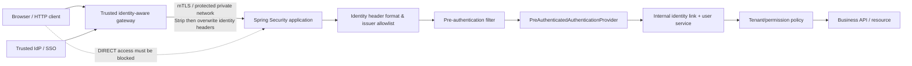

# Chuẩn hóa principal và tải quyền nội bộ bằng dịch vụ người dùng

## Mục tiêu học tập

Sau bài học, bạn có thể:

1. Phân biệt **xác thực ở reverse proxy/identity-aware gateway** với **chuẩn hóa danh tính và phân quyền ở Spring Security**; biết vì sao một header username không tự trở thành bằng chứng an toàn.
2. Hiểu các API Spring Security 6: `RequestHeaderAuthenticationFilter`, `RequestAttributeAuthenticationFilter`, `AbstractPreAuthenticatedProcessingFilter`, `PreAuthenticatedAuthenticationToken`, `PreAuthenticatedAuthenticationProvider`, `AuthenticationUserDetailsService`, `UserDetailsByNameServiceWrapper`, `UserDetailsService` và `GrantedAuthority`.
3. Thiết kế ánh xạ **(trusted issuer, stable external subject) → internal account ID → tenant membership → approved permissions**; không gộp tài khoản theo email, display name hay username thiếu namespace.
4. Định nghĩa chính sách chuẩn hóa có kiểm soát: kiểm nguồn/định dạng, Unicode/case/realm/alias, chống collision và ambiguities, không tự động `trim()`/`toLowerCase()`/loại domain đối với opaque subject.
5. Xây ví dụ Spring Boot 3 / Spring Security 6 / Java 17+ dùng **proxy tin cậy**, lọc các header không hợp lệ, tạo principal key nhất quán và nạp quyền từ **dịch vụ người dùng nội bộ**, không tin role header do browser kiểm soát.
6. Hiểu hai mô hình **pre-auth mỗi request** và **lưu SecurityContext trong HttpSession**, cũng như stale privileges, session fixation, logout, identity change, proxy SSO expiry và quyền cần thu hồi ngay.
7. Kiểm thử an ninh: bypass proxy, duplicate/comma-injected headers, sai issuer, cùng subject ở hai IdP, account disable, role escalation, tenant mix-up, stale role cache và request đến node khác.
8. Chạy chương trình **Java 17+ độc lập** mô phỏng canonical external identity, mapping tường minh sang account cục bộ và kiểm quyền, có stdout xác định; không dùng chương trình này để thay authentication thật.

## 1. Bối cảnh: proxy đã biết người dùng, ứng dụng vẫn phải quyết định quyền

Giả sử tổ chức có một cổng `https://portal.example.org` nằm sau **Identity-Aware Reverse Proxy**. Proxy thực hiện OIDC/SAML/Kerberos/mTLS authentication và chỉ chuyển request về Spring Boot khi đã xác minh user. Proxy có thể gửi các header nội bộ:

```http
GET /app/reports HTTP/1.1
Host: portal.example.org
X-Verified-Issuer: https://idp.alpha.example
X-Verified-Subject: sub-001
```

**Các header trên là một HỢP ĐỒNG nội bộ, không phải chuẩn HTTP authentication có thể tin mặc định.** Nếu máy khách ngoài Internet truy cập thẳng Spring Boot và tự gửi `X-Verified-Subject: administrator`, ứng dụng sẽ bị giả mạo nếu chỉ đọc header rồi cấp quyền.

Bài toán có hai lớp tách biệt:

- **Lớp 1 – External authentication:** proxy xác minh identity từ IdP/KDC/certificate, kiểm token/chữ ký/issuer/audience/expiry/nonce hoặc cơ chế tương ứng, giữ session của proxy, ngăn client viết đè header nội bộ.
- **Lớp 2 – Internal account/authorization:** Spring Security xác định **đúng external identity đã được tin**, ánh xạ tới account/tenant cục bộ, kiểm account active, lấy roles/permissions từ nguồn nội bộ và bảo vệ từng hành động.

Cổng xác thực proxy có thể tin chắc user là `sub-001` ở issuer Alpha, nhưng **không** vì thế mà biết user có `REPORT_READ` tại tenant `tenant-alpha`. Quyền này thuộc **dịch vụ người dùng/quyền nội bộ**.

### 1.1. Các định danh cần phân biệt

| Trường | Ví dụ | Có dùng làm khóa account không? |
| --- | --- | --- |
| Proxy `X-Verified-Issuer` | `https://idp.alpha.example` | Dùng như **namespace** sau khi kiểm nguồn tin cậy |
| Proxy `X-Verified-Subject` | `sub-001` | Dùng kết hợp issuer; phải hiểu tính ổn định của IdP |
| Email | `alex@example.org` | Không tự động: có thể đổi/trùng/chưa được xác minh |
| `preferred_username` | `alex` | Thường chỉ để hiển thị hoặc tìm kiếm |
| Display name | `Alex Nguyen` | Không: không duy nhất, dễ đổi/Unicode confusables |
| Proxy group | `Administrators` | Không tự cấp quyền admin ứng dụng nếu chưa có hợp đồng trust và mapping được duyệt |
| Canonical external key | Mã hóa không nhập nhằng của `(issuer, subject)` | Dùng làm **khóa liên kết federation** trong DB |
| Internal account ID | `acct-1007` | Khóa bất biến/opaque nội bộ; nên là khóa chính cho nghiệp vụ |
| Tenant ID | `tenant-alpha` | Phạm vi sở hữu dữ liệu và authorization |
| Local authority | `REPORT_READ` | Quyền được nguồn nội bộ cấp, cần xét tài nguyên/tenant |

**Ba câu hỏi khác nhau:**
1. *Người này là ai trong hệ thống IdP?* → issuer + subject từ proxy đáng tin.
2. *Tài khoản nội bộ nào gắn với identity đó?* → external identity link table, có chính sách linking/migration.
3. *Tài khoản này được làm gì với tài nguyên nào?* → permissions/roles, tenant membership, object ownership và các điều kiện thời điểm thực thi.

## 2. Ranh giới tin cậy: header chỉ an toàn khi proxy đảm bảo

Spring Security documentation nói rõ `RequestHeaderAuthenticationFilter` **không tự xác thực** người dùng; nó chỉ lấy username từ header. Vì vậy kiến trúc phải xác minh **nguồn tạo header** trước khi Spring Security tin nó.

### 2.1. Cấu trúc triển khai khuyến nghị



Các điều kiện **bắt buộc từ hạ tầng**, không được thay bằng Java regex:

1. **Origin app không thể truy cập trực tiếp** từ Internet hoặc các mạng không được phép. Dùng private ingress, security groups/firewall và network policies.
2. Kết nối proxy → app có **mTLS/service identity**, ACL hoặc một kênh xác thực mạnh thích hợp; không xem IP header do client tự khai là bằng chứng.
3. Proxy **xóa toàn bộ** header định danh do client gửi (`X-Verified-Issuer`, `X-Verified-Subject`, `X-User`, `Remote-User`, `X-Forwarded-User`...) trước khi **đặt lại** giá trị sau authentication.
4. Proxy không cho request **chưa authenticated** đến protected backend bằng cùng route với header tin cậy; health/readiness paths phải tách.
5. Không có một URL/pod/admin port/fallback route nào bypass proxy và tới ứng dụng được cấu hình header preauth.
6. Proxy và app thống nhất **tên header, cardinality, encoding, issuer aliases, maximum length và logout/freshness policy**.
7. Các header `Forwarded`/`X-Forwarded-For`/`X-Forwarded-Host` cũng cần xử lý tại trusted ingress; không dùng chúng để quyết định user identity.
8. Nếu không đảm bảo được các điều kiện này, **không sử dụng RequestHeaderAuthenticationFilter như một cơ chế đăng nhập**. Thay bằng xác minh token/mTLS tại application hoặc một assertion từ gateway có chữ ký và kiểm audience/expiry.

### 2.2. Lỗ hổng giả mạo header

**Tình huống nguy hiểm** nếu app mở cổng nội bộ ra mạng không tin cậy:

```http
GET /app/admin HTTP/1.1
Host: origin-app.example.net
X-Verified-Issuer: https://idp.alpha.example
X-Verified-Subject: admin-subject
```

Nếu app chỉ dùng `request.getHeader(...)` rồi tin rằng proxy đã xác thực, attacker có thể chọn account bất kỳ mà lookup có thể tìm thấy. **Việc Spring Security gọi lớp đó là “pre-authentication” không xác minh header thực sự đến từ proxy.**

Ngay cả khi đã có gateway, cần test:
- Client gửi trước cùng tên header; gateway phải xóa và ghi đè.
- Gateway nhận hai header trùng tên, header viết hoa/thường khác nhau hoặc comma-joined values; backend không được chọn tùy ý một giá trị không được kiểm.
- Trực tiếp từ internal VLAN/pod khác tới app; network policy phải deny nếu không phải proxy identity.
- Request thiếu header qua một route fallback; app phải fail closed, không rơi sang một account mặc định.
- Proxy chỉ chuyển `X-Verified-Subject` mà không có issuer; account collision giữa các IdP phải được ngăn.

**Không dùng `X-Forwarded-For` như chứng minh proxy đã gửi request**: nó có thể bị spoof nếu ingress không chuẩn hóa và xác thực các bước trung gian.

## 3. Chuẩn hóa principal: định nghĩa “đúng một người” trước khi chuyển kiểu dữ liệu

### 3.1. Đầu vào đã được xác thực vẫn có thể mơ hồ

Ví dụ hai IdP phát:

```text
Issuer Alpha: https://idp.alpha.example  subject: sub-001
Issuer Beta:  https://idp.beta.example   subject: sub-001
```

Nếu ứng dụng chỉ `loadUserByUsername("sub-001")`, hai identity độc lập có thể bị liên kết vào **cùng account nội bộ**. Nếu user Beta được nhầm thành tài khoản Alpha có quyền quản trị, đây là **account takeover/tenant mix-up**.

Một khóa liên kết có ít nhất hai phần:

```text
External identity = (verified issuer, stable external subject)

lookup (issuer, subject)
  -> identity_link row
  -> immutable internal_account_id
  -> tenant memberships + user status + permissions
```

Ở OIDC, cặp `(iss, sub)` là cơ sở đúng cho identity mapping. Nếu proxy xác thực Kerberos/SAML thay vì OIDC, phải định nghĩa **namespace được phê duyệt tương ứng**: ví dụ `(Kerberos realm, full principal)` hoặc `(SAML IdP entityID, persistent NameID + NameID format/profile)`. Không giả định các loại subject tương đương nhau.

### 3.2. Phân biệt canonicalization với biến đổi danh tính tùy tiện

**Canonicalization đúng** là xác lập một biểu diễn ổn định theo **hợp đồng định danh** đã được hai bên thỏa thuận, đồng thời không làm hai chủ thể khác nhau trở thành một.

**Biến đổi nguy hiểm** thường gặp:

```java
// KHÔNG dùng làm canonical identity mặc định.
String key = externalSubject.trim().toLowerCase();
String username = externalSubject.split("@")[0];
String guessedAccount = email.toLowerCase();
```

Vì:
- Một số IdP coi `SUB-1` và `sub-1` là **hai subject khác nhau**.
- `alice@REALM-A` và `alice@REALM-B` có thể là hai người.
- `alice+sales@example.org` và `alice@example.org` không nhất thiết cùng account.
- Email có thể thay đổi khi đổi tên, chuyển domain, tái sử dụng mailbox; verified email không tự động là stable subject.
- Unicode có nhiều cách biểu diễn ký tự trông tương tự, nhưng **NFC/NFKC hoặc case-fold không tự nhiên bảo toàn identity** nếu IdP không định nghĩa như vậy.
- Xóa khoảng trắng hoặc cắt bớt độ dài có thể khiến hai IDs khác nhau bị gộp.

**Quy tắc:** với `sub` opaque của IdP, **giữ nguyên dữ liệu subject đã được xác minh** và áp dụng policy định dạng/ràng buộc chiều dài theo hợp đồng; không tự lower-case, transliterate, trim hay normalize Unicode cho mục đích so sánh nếu upstream không cam kết. Nếu thực sự cần xử lý UPN/email case-insensitive, có migration/collision detection và nghiệp vụ phê duyệt riêng.

### 3.3. Các mức chuẩn hóa

| Mức | Việc nên làm | Điều phải tránh |
| --- | --- | --- |
| Transport | Chỉ nhận header do proxy xác thực; giới hạn size, cardinality, encoding, CRLF | Tin header từ public client |
| Source namespace | Kiểm issuer/realm trong allowlist exact đã phê duyệt | Tự tin mọi domain hoặc unknown issuer |
| Subject | Kiểm không null/trống, format/length theo contract | Tùy tiện lower-case/strip realm trên opaque ID |
| Canonical key | Mã hóa `issuer` và `subject` không nhập nhằng | Ghép chuỗi có delimiter mà hai field có thể chứa |
| Identity linking | Lookup bảng có unique constraint trên cặp nguồn | Auto-link theo email/display name |
| Internal identity | Dùng account ID bất biến, không dùng login alias làm PK | Lấy email làm primary key |
| Authorization | Nạp roles/tenant entitlements từ store nội bộ | Copy role header không được duyệt |
| Session | Xác định freshness/revocation/identity change | Giữ stale privileges không thời hạn |

### 3.4. Mã hóa composite key không bị delimiter collision

Cách ghép thô:

```text
issuer + "|" + subject
```

có thể gây nhầm nếu một field được phép chứa `|`. Thay vào đó:

- Lưu **hai cột riêng** `(issuer, subject)` và đánh unique ở DB (ưu tiên).
- Hoặc dùng length-prefix có quy tắc rõ.
- Hoặc mã hóa từng thành phần **Base64URL UTF-8 không padding**, ghép bằng delimiter `.` không thuộc alphabet Base64URL, có version prefix.

Ví dụ key dạng:

```text
v1.<base64url(issuer UTF-8)>.<base64url(subject UTF-8)>
```

Base64URL ở đây **chỉ là representation**, không mã hóa bảo mật và **không chứng minh xác thực**. Nó giúp không nhập nhằng khi truyền qua API `UserDetailsService.loadUserByUsername(String)`; nguồn xác thực vẫn phải nằm ở proxy được tin.

### 3.5. Case/Unicode/IDN: hợp đồng quyết định

- Issuer URL/OIDC `iss` nên so với **giá trị issuer đã cấu hình/được xác minh**; không tự rewrite URL theo lowercase toàn chuỗi, bỏ slash, sửa port/path hoặc chuyển host IDN mà không có hợp đồng.
- SAML IdP `entityID` cũng là định danh chuỗi, không phải host bất kỳ để tự chuẩn hóa.
- Kerberos principal/UPN có thể có quy tắc case/realm do môi trường thiết lập; phải kiểm chính sách KDC/AD thực tế.
- Subject có Unicode: dùng UTF-8 và giữ nguyên bytes/string semantics từ nguồn, tránh NFKC ngầm, cắt code points giữa surrogate pairs hoặc regex “chỉ chữ cái Latin” nếu nguồn không cam kết.
- Display name/email dành cho UI: có thể cần Unicode NFC/sanitization để trình bày, **không dùng cùng hàm đó làm identity matching**.
- Tên miền IDNA và case-insensitive host chỉ được normalize **ở lớp xác minh issuer có chính sách**, không đổi tùy ý issuer string và bất ngờ liên kết identity.
- Nếu thay đổi canonicalization version, phải có migration trên `identity_link`, collision report và rollback, không rewrite hàng loạt bằng một lệnh `UPDATE ... LOWER(subject)` không kiểm.

## 4. Mô hình dữ liệu liên kết external identity với tài khoản nội bộ

Một thiết kế đơn giản:

```text
external_identity_link
  link_id                   UUID / bigint internal
  source_type               OIDC / SAML2 / KERBEROS / GATEWAY
  trusted_issuer            exact verified namespace
  external_subject          stable opaque subject
  internal_account_id       immutable local FK
  linked_by                 actor/workflow
  linked_at, unlinked_at
  status                    ACTIVE / SUSPENDED / REVOKED
  UNIQUE(source_type, trusted_issuer, external_subject)
       |
       v
account
  id                        internal opaque ID
  lifecycle_status          ACTIVE / DISABLED / DELETED
  owner_tenant_id
  authz_revision
       |
       v
tenant_membership
  account_id, tenant_id, status
       |
       v
permission_grant
  account_id, tenant_id, permission, resource_scope, expiry, source
```

**Cần thêm các bất biến:**

1. Một external identity ACTIVE chỉ map tới **một account nội bộ** tại thời điểm login, trừ khi business model có cơ chế đặc biệt được thiết kế rõ.
2. Không tự tạo user khi không thấy mapping (“JIT provisioning”) nếu chưa có workflow đã phê duyệt, tenant assignment và anti-takeover controls.
3. Một account có thể liên kết **nhiều external identities** theo quy trình linking riêng; khi unlink, identity cũ phải mất quyền đăng nhập.
4. Một identity không được tự “chuyển” sang account admin chỉ vì email trùng; linking/migration cần user proof/owner approval.
5. Key của identity link và internalAccountId ổn định ngay cả khi display name/email/UPN đổi.
6. Khi account/tenant membership bị disable, user **không được tiếp tục** có quyền chỉ vì header proxy vẫn nói authenticated.
7. Không lấy `roles` từ proxy làm authority nội bộ nếu không có hợp đồng nguồn/allowlist. Nếu cần nhập nhóm từ IdP, phải kiểm issuer, group IDs ổn định và mapping role explicit.
8. Không làm tài khoản liên kết từ realm A hưởng quyền tenant B do dùng một `Map<String,User>` keyed by short username.

### 4.1. Ví dụ hai subject giống nhau, hai accounts khác nhau

| Issuer | Subject | Internal account | Tenant | Quyền |
| --- | --- | --- | --- | --- |
| Alpha | `sub-001` | `acct-1007` | `tenant-alpha` | `REPORT_READ` |
| Beta | `sub-001` | `acct-2088` | `tenant-beta` | `REPORT_READ` |
| Alpha | `sub-admin` | `acct-1001` | `tenant-alpha` | `TENANT_ADMIN` |

Khi Beta gửi `sub-001`, ứng dụng **không được** lấy `acct-1007` của Alpha. Khi Beta gửi email giống account Alpha, điều đó cũng không thay quy tắc. Một account disable phải được từ chối bất kể upstream SSO đang có session.

## 5. Spring Security xử lý pre-authentication ra sao?

Spring Security Servlet có nhóm class tại `org.springframework.security.web.authentication.preauth`.

### 5.1. Luồng từ proxy đến authorities

```mermaid
sequenceDiagram
    actor B as Browser
    participant G as Trusted Gateway
    participant Gate as Header Gate
    participant F as PreAuth Filter
    participant AM as AuthenticationManager
    participant P as PreAuthenticatedAuthenticationProvider
    participant U as Internal UserDetailsService
    participant Z as Authorization Policy
    B->>G: GET /app/tenants/tenant-alpha/reports
    G->>G: Verify external login / token
    G->>G: Strip client identity headers and inject verified fields
    G->>Gate: Trusted request with issuer, subject
    Gate->>Gate: Validate cardinality/issuer/format, canonical key
    Gate->>F: Request attribute: canonical external key
    F->>AM: PreAuthenticatedAuthenticationToken(request)
    AM->>P: authenticate
    P->>U: loadUserByUsername(canonicalKey)
    U->>U: Lookup identity link -> account -> tenant grants
    U-->>P: UserDetails with app-only authorities
    P-->>F: authenticated PreAuthenticatedAuthenticationToken
    F->>Z: SecurityContext carries local account identity
    Z->>Z: Check tenant, action, account enabled
    Z-->>B: 200 or 403; no automatic ROLE_ADMIN
```

Các lớp framework:

- **`AbstractPreAuthenticatedProcessingFilter`**: lấy principal/credentials từ request, tạo `PreAuthenticatedAuthenticationToken` và gọi `AuthenticationManager`. Nó **giả định** external authentication đã an toàn.
- **`RequestHeaderAuthenticationFilter`**: implementation đọc một header, mặc định `SM_USER` để tương thích Siteminder. Nó **không** tự kiểm TLS, proxy origin, issuer signature hoặc token.
- **`RequestAttributeAuthenticationFilter`**: đọc principal từ **servlet request attribute** đã được một filter/gateway adapter đáng tin đặt; phù hợp khi ta muốn kiểm hai fields rồi hợp thành canonical key trước khi pre-auth.
- **`PreAuthenticatedAuthenticationProvider`**: sau khi nhận token preauth, chủ yếu yêu cầu `AuthenticationUserDetailsService` tải user details và local authorities; không tự xác minh IdP/proxy.
- **`UserDetailsByNameServiceWrapper`**: nối `AuthenticationUserDetailsService<PreAuthenticatedAuthenticationToken>` tới `UserDetailsService.loadUserByUsername(String)`.
- **`PreAuthenticatedGrantedAuthoritiesUserDetailsService`**: xây UserDetails dựa trên authorities có sẵn trong token/details; **không ưu tiên** khi business yêu cầu quyền cục bộ và proxy group chưa được thẩm định.
- **`Http403ForbiddenEntryPoint`**: thường dùng trong ứng dụng chỉ chấp nhận external preauth, không tự chuyển browser sang một form login của app.
- **`SecurityContextRepository`**: giữ authentication cho current request hoặc cho nhiều requests nếu dùng HttpSession, độc lập với nguồn authority.

### 5.2. Hai loại UserDetailsService

**`UserDetailsService`** nhận một `String username` và trả `UserDetails` hoặc ném `UsernameNotFoundException`. Khi dùng preauth, username có thể là **canonical external identity key**.

**`AuthenticationUserDetailsService<PreAuthenticatedAuthenticationToken>`** nhận toàn token, hữu ích khi cần xem metadata đã xác thực đi kèm. `UserDetailsByNameServiceWrapper` là adapter đơn giản: lấy `authentication.getName()` rồi gọi `UserDetailsService`.

Nếu nguồn external identity có issuer/tenant quá phức tạp, có thể viết **AuthenticationUserDetailsService** riêng đọc một immutable identity object đã được adapter xác minh. Nhưng không dùng unverified `authentication.getDetails()` từ browser như bằng chứng roles/tenant.

### 5.3. Không nhầm preauth provider với DaoAuthenticationProvider

- `DaoAuthenticationProvider` được thiết kế cho username/password trong Spring Security, gọi `UserDetailsService` rồi kiểm credentials bằng `PasswordEncoder`.
- `PreAuthenticatedAuthenticationProvider` tin external auth đã diễn ra và chỉ nạp UserDetails/account state. Nó **không kiểm mật khẩu**.
- Đặt một dummy `"N/A"` ở credential slot của preauth token **không** biến header thành password hợp lệ.
- Một public endpoint `/login?username=admin` không được tự đẩy username vào preauth provider rồi cho rằng nó đã xác thực.

### 5.4. Những defaults phải hiểu

Trong Spring Security 6.5:

| Chức năng | Behavior cần lưu ý | Hệ quả |
| --- | --- | --- |
| Missing header với `RequestHeaderAuthenticationFilter` | Mặc định `exceptionIfHeaderMissing=true` | Có thể phát lỗi khi gateway không gửi header |
| Missing request attribute với `RequestAttributeAuthenticationFilter` | Có tùy chọn `setExceptionIfVariableMissing` | Kết hợp health route cần thiết kế rõ |
| Preauth filter đã có authenticated context | Mặc định **không tái xác thực** | Quyền trong HttpSession có thể stale |
| `setCheckForPrincipalChanges(true)` | So current principal với identity request mới | Cần ánh xạ principal ổn định và xử lý session identity switch |
| `setInvalidateSessionOnPrincipalChange(true)` | Khi detect change, có thể invalidate session | Không phải tất cả apps nên tự bật nếu không kiểm SSO semantics |
| `setContinueFilterChainOnUnsuccessfulAuthentication(true)` | Mặc định cho phép cơ chế khác thử xử lý | Với proxy-only, không tạo fallback bypass; route phải fail closed |
| `PreAuthenticatedAuthenticationProvider` | Không verify external credentials | Hạ tầng trusted proxy là điều kiện tiên quyết |
| `SecurityContextRepository` | Có thể giữ context qua request/session | Mô hình stateful/stateless ảnh hưởng freshness và revocation |

**Đặc biệt quan trọng:** nếu current `Authentication.getName()` là `acct-1007` nhưng header principal là một external string, framework có thể coi principal đã thay đổi **ở mọi request** khi bật `checkForPrincipalChanges`. Hãy giữ canonical name cho `UserDetails.getUsername()` hoặc viết comparator được kiểm thử; internal account ID nên là field riêng trong principal.

## 6. Hai kiến trúc tải quyền: mỗi request hay theo session

### 6.1. Pre-auth lại và tải quyền mỗi request

**Hướng phù hợp khi gateway xác thực request/SSO mỗi lượt** và app không cần session login riêng:

- Gateway xác nhận cookie/token phía mình và inject header tin cậy **trên mỗi protected request**.
- App lấy canonical principal và gọi internal `UserDetailsService` mỗi request.
- `SecurityContext` chỉ có tuổi thọ request, không lưu browser-auth session vào `HttpSession`.
- Quyền/disabled status có thể được cập nhật ngay tại request mới nếu backend authorization store thấy thay đổi (phụ thuộc cache/consistency).
- Dùng `SessionCreationPolicy.STATELESS` và request-scoped repository thích hợp.

Ưu điểm: đơn giản hóa logout/identity switch ở app, tránh giữ roles quá lâu, dễ test. Hạn chế: DB/IAM lookups mỗi request có thể tốn tài nguyên; cần cache được kiểm soát, giới hạn latency và fail-closed khi quyền không rõ. **CSRF vẫn phải được threat-model** nếu browser tự động gửi gateway SSO cookies dù app không tự tạo session.

### 6.2. Stateful app session sau lần pre-auth đầu

Nếu app giữ `HttpSession`:

- Sau preauth success, lưu `SecurityContext` bằng `HttpSessionSecurityContextRepository` hoặc `DelegatingSecurityContextRepository`.
- Request tiếp theo có thể lấy roles/authorities cũ từ session **mà không gọi `UserDetailsService` lại**.
- Nếu proxy session hết hạn mà app còn session, user có thể vẫn truy cập qua direct route hoặc backend không kiểm header; **proxy phải gate mọi request**.
- Khi user đổi identity ở proxy nhưng giữ browser session, `checkForPrincipalChanges` và invalidation/reauth policy phải được thiết kế.
- Khi permissions bị revoke, có thể phải xóa app sessions theo account, cập nhật authz version, đọc fresh permissions trên high-risk actions hoặc giảm TTL.
- Session fixation protection phải được cấu hình trên flow preauth phù hợp; không giả định custom preauth filter tự gọi mọi `SessionAuthenticationStrategy` của form login.
- Với nhiều nodes, shared session store và serialization/rolling upgrade cần test.

**Mẫu code ở phần tiếp theo chọn stateless request-scoped pre-auth** nhằm bảo đảm quyền cục bộ được nạp ở mỗi request và tránh ambiguity session freshness. Không tự chuyển nó thành stateful bằng cách thay một dòng `STATELESS` sang `IF_REQUIRED` mà chưa xem lại session lifecycle.

## 7. Ví dụ Spring Boot 3 / Spring Security 6: gateway xác thực, app tải quyền

**Phạm vi:** Java 17+, Spring Boot 3.x tương thích Spring Security 6.x, Servlet stack. Ví dụ sử dụng **hai verified headers** như một hợp đồng giữa gateway và app:

```text
X-Verified-Issuer:  https://idp.alpha.example
X-Verified-Subject: sub-001
```

**Giả định ngoài mã Java:** gateway đã hoàn tất authentication mạnh và **strip/overwrite** các headers; app origin chỉ accessible từ gateway đã xác thực (mTLS/private network); mọi protected request đều đi qua gateway. Nếu giả định này sai, **mã bên dưới KHÔNG an toàn để deploy**. Java gate kiểm syntax/allowlist nhưng **không xác thực gateway bằng phép màu**.

### 7.1. Dependencies

Trong dự án có Spring Boot plugin/BOM thích hợp, `build.gradle` có thể chứa:

```groovy
dependencies {
    implementation 'org.springframework.boot:spring-boot-starter-web'
    implementation 'org.springframework.boot:spring-boot-starter-security'

    testImplementation 'org.springframework.boot:spring-boot-starter-test'
    testImplementation 'org.springframework.security:spring-security-test'
}
```

Pre-auth classes đã thuộc `spring-security-web`/`spring-security-core`, không cần CAS/SAML dependencies chỉ để đọc header từ proxy. Các versions do Spring Boot dependency management kiểm soát; không lấy Spring Security 7 APIs cho project 6.x nếu chưa migrate.

### 7.2. Tệp `ExternalPrincipalKey.java`: một quy tắc canonical tường minh

```java
package com.example.proxy;

import java.nio.charset.StandardCharsets;
import java.util.Base64;
import java.util.Set;

public final class ExternalPrincipalKey {
    private static final Set<String> ALLOWED_ISSUERS = Set.of(
            "https://idp.alpha.example",
            "https://idp.beta.example"
    );

    private ExternalPrincipalKey() {}

    public static String of(String issuer, String subject) {
        // Địa chỉ IdP là một namespace từ hợp đồng đã duyệt.
        if (issuer == null || !ALLOWED_ISSUERS.contains(issuer)) {
            throw new IllegalArgumentException("Unknown issuer");
        }
        // DEMO: hai IdP thỏa thuận subject là opaque ASCII.
        // Không áp dụng regex này cho tất cả IdP/Unicode identities.
        if (subject == null || !subject.matches("[A-Za-z0-9_-]{1,128}")) {
            throw new IllegalArgumentException("Invalid subject");
        }

        return "v1." + enc(issuer) + "." + enc(subject);
    }

    private static String enc(String value) {
        return Base64.getUrlEncoder().withoutPadding().encodeToString(
                value.getBytes(StandardCharsets.UTF_8));
    }
}
```

**Giải thích:**

- `issuer` phải khớp **exact** một cấu hình đã approved. Production dùng registry/versioned metadata, không hard-code hai URLs vào nhiều services.
- Regex subject ở đây là **mô hình dữ liệu ví dụ**: IdP đã cam kết opaque IDs ASCII (chữ/số/underscore/hyphen, tối đa 128). Với IdP có Unicode hoặc identifiers khác, thay validation theo hợp đồng, **không tự truncate/lowercase**.
- Key `v1.base64url(issuer).base64url(subject)` không nhập nhằng và đủ ổn định để `UserDetailsService` lookup, nhưng không mã hóa bí mật và không chứng minh identity.
- Cặp issuer+subject được giữ nguyên case. Nếu muốn đổi quy tắc normalization, phải version/migrate identity links thay vì làm âm thầm.
- Java helper **không** tự biết headers đến từ trusted proxy. Trust boundary nằm ở ingress.

### 7.3. Tệp `VerifiedProxyHeaderGate.java`: kiểm header trước preauth

```java
package com.example.proxy;

import java.io.IOException;
import java.util.Enumeration;

import jakarta.servlet.FilterChain;
import jakarta.servlet.ServletException;
import jakarta.servlet.http.HttpServletRequest;
import jakarta.servlet.http.HttpServletResponse;

import org.springframework.web.filter.OncePerRequestFilter;

public final class VerifiedProxyHeaderGate extends OncePerRequestFilter {
    public static final String PRINCIPAL_ATTRIBUTE =
            "verified.proxy.principal";

    @Override
    protected boolean shouldNotFilter(HttpServletRequest request) {
        // Health endpoint phải được network-gate riêng ở ingress.
        return "/healthz".equals(request.getServletPath());
    }

    @Override
    protected void doFilterInternal(
            HttpServletRequest request,
            HttpServletResponse response,
            FilterChain chain) throws ServletException, IOException {

        try {
            String issuer = singleHeader(request, "X-Verified-Issuer");
            String subject = singleHeader(request, "X-Verified-Subject");

            // Request attribute chỉ do server code này ghi, không lấy từ body.
            request.setAttribute(PRINCIPAL_ATTRIBUTE,
                    ExternalPrincipalKey.of(issuer, subject));
        } catch (IllegalArgumentException invalid) {
            // Không lộ unknown issuer hay account lookup result ra browser.
            response.sendError(HttpServletResponse.SC_UNAUTHORIZED);
            return;
        }

        chain.doFilter(request, response);
    }

    private static String singleHeader(
            HttpServletRequest request, String name) {
        Enumeration<String> values = request.getHeaders(name);
        if (values == null || !values.hasMoreElements()) {
            throw new IllegalArgumentException("Header missing");
        }
        String first = values.nextElement();
        if (values.hasMoreElements() || first == null || first.isBlank()) {
            throw new IllegalArgumentException("Duplicate or blank header");
        }
        return first;
    }
}
```

**Điểm an ninh:**

- Thiếu header/duplicate header/issuer lạ/subject sai format → **401** ngay, không đoán user.
- Kiểm duplicate **không thay thế** canonicalization tại gateway: một proxy có thể gộp hai header thành một chuỗi `a,b`; trong ví dụ, issuer exact allowlist và subject regex loại bỏ comma.
- Không dùng `getHeader("X-Verified-Role")` để tạo role; quyền từ account service ở bước sau.
- Đường `/healthz` được bỏ qua cho phép health probe không có identity, nhưng hạ tầng phải **không cho public health route truy cập app/private data**. Các non-health routes đều yêu cầu headers.
- **Mã Java không kiểm peer mTLS certificate**. Phải thực thi mTLS/network restriction tại sidecar/ingress/server; nếu request có thể đi trực tiếp và điền hai header, attacker vẫn giả mạo. Đây là điều kiện triển khai bắt buộc.
- Không đăng ký `VerifiedProxyHeaderGate` vừa là global Servlet Filter bean vừa trong Spring Security chain; ví dụ tạo instance trực tiếp trong `SecurityFilterChain`.
- Với application nhiều bộ filter chains/route matchers, gate phải áp dụng **mọi protected path**. Không cho một chain khác bypass nó.

### 7.4. Tệp `AccountUserDetails.java`: local account ID nằm riêng

```java
package com.example.proxy;

import java.util.Collection;
import java.util.Set;

import org.springframework.security.core.GrantedAuthority;
import org.springframework.security.core.authority.SimpleGrantedAuthority;
import org.springframework.security.core.userdetails.UserDetails;

public record AccountUserDetails(
        String username,
        String internalAccountId,
        String tenantId,
        boolean enabled,
        Set<String> permissionNames) implements UserDetails {

    @Override
    public Collection<? extends GrantedAuthority> getAuthorities() {
        return permissionNames.stream()
                .map(SimpleGrantedAuthority::new)
                .toList();
    }

    @Override
    public String getPassword() {
        // Preauth KHÔNG xác thực bằng mật khẩu cục bộ.
        return "N/A";
    }

    @Override
    public boolean isAccountNonExpired() {
        return enabled;
    }

    @Override
    public boolean isAccountNonLocked() {
        return enabled;
    }

    @Override
    public boolean isCredentialsNonExpired() {
        return true;
    }

    @Override
    public boolean isEnabled() {
        return enabled;
    }
}
```

Ở đây `username` là **canonical external key** để `Authentication.getName()` thống nhất với principal mà preauth filter đọc. `internalAccountId` là khóa nghiệp vụ ứng dụng; `tenantId` là tenant đã được mapping, **không** lấy từ URL/query do browser tự khai.

Class là Java `record` nên cần Java 17+; `UserDetails` trong Spring Security hỗ trợ các phương thức này. Khi cần session serialization, mọi nested value phải serializable; `Set<String>` minh họa đơn giản, nhưng cách lưu context và đổi phiên bản class cần được xem xét riêng.

### 7.5. Tệp `LocalAccountDirectory.java`: UserDetailsService nạp quyền nội bộ

```java
package com.example.proxy;

import java.util.Map;
import java.util.Set;

import org.springframework.security.core.userdetails.UserDetails;
import org.springframework.security.core.userdetails.UserDetailsService;
import org.springframework.security.core.userdetails.UsernameNotFoundException;
import org.springframework.stereotype.Service;

@Service
public final class LocalAccountDirectory implements UserDetailsService {

    record LocalAccount(
            String id,
            String tenantId,
            boolean active,
            Set<String> permissions) {}

    // DEMO ONLY. Production: database/IAM API + unique identity link.
    private final Map<String, LocalAccount> links = Map.of(
            ExternalPrincipalKey.of("https://idp.alpha.example", "sub-001"),
            new LocalAccount("acct-1007", "tenant-alpha", true,
                    Set.of("REPORT_READ")),
            ExternalPrincipalKey.of("https://idp.beta.example", "sub-001"),
            new LocalAccount("acct-2088", "tenant-beta", true,
                    Set.of("REPORT_READ")),
            ExternalPrincipalKey.of("https://idp.alpha.example", "sub-admin"),
            new LocalAccount("acct-1001", "tenant-alpha", true,
                    Set.of("TENANT_ADMIN"))
    );

    @Override
    public UserDetails loadUserByUsername(String canonicalExternalKey)
            throws UsernameNotFoundException {

        LocalAccount row = links.get(canonicalExternalKey);
        if (row == null) {
            throw new UsernameNotFoundException(
                    "No approved internal account link");
        }
        return new AccountUserDetails(
                canonicalExternalKey,
                row.id(),
                row.tenantId(),
                row.active(),
                row.permissions());
    }

    // Ví dụ recheck từ directory; production phải đọc state hiệu lực
    // và cập nhật cache/invalidation khi account/permissions thay đổi.
    public boolean canRead(String internalAccountId, String tenantId) {
        return links.values().stream()
                .anyMatch(row -> row.id().equals(internalAccountId)
                        && row.tenantId().equals(tenantId)
                        && row.active()
                        && row.permissions().contains("REPORT_READ"));
    }
}
```

**Giới hạn và ranh giới:**

- Các rows ở đây là **fixtures cho lớp học**, không phản ánh dữ liệu công ty thật.
- Cặp Alpha/Beta cùng `sub-001` được map tới **hai account IDs khác nhau**.
- `UserDetailsService` **không kiểm lại OIDC/SAML signature**: điều đó là trách nhiệm gateway. Nó chỉ nhận canonical key và trả local account/permissions đã được duyệt.
- Unknown link → `UsernameNotFoundException`, disabled user → `UserDetails.isEnabled=false`, provider có checker để không cấp authentication.
- **Không auto-provision** tài khoản với role mặc định chỉ vì proxy đã xác thực unknown subject; nếu sản phẩm cần JIT provisioning, phải có policy/owner/tenant mapping được kiểm duyệt.
- `links.values().stream()` là mô phỏng in-memory; production phải có primary/unique indexes, tenant scoping, transaction, cache invalidation, auditing và performance plan.
- Trong ứng dụng nhiều tenant một account có thể thuộc nhiều tenant; demo một `tenantId` chỉ để minh họa. Thiết kế thực dùng bảng membership/grants theo resource.
- Không cho requester chọn internal ID trực tiếp rồi bypass external identity link.

### 7.6. Tệp `ProxySecurityConfig.java`: nối preauth filter với UserDetailsService

```java
package com.example.proxy;

import org.springframework.context.annotation.Bean;
import org.springframework.context.annotation.Configuration;
import org.springframework.security.authentication.AuthenticationManager;
import org.springframework.security.authentication.ProviderManager;
import org.springframework.security.config.annotation.method.configuration.EnableMethodSecurity;
import org.springframework.security.config.annotation.web.builders.HttpSecurity;
import org.springframework.security.config.http.SessionCreationPolicy;
import org.springframework.security.core.userdetails.UserDetailsByNameServiceWrapper;
import org.springframework.security.web.SecurityFilterChain;
import org.springframework.security.web.authentication.Http403ForbiddenEntryPoint;
import org.springframework.security.web.authentication.preauth.AbstractPreAuthenticatedProcessingFilter;
import org.springframework.security.web.authentication.preauth.PreAuthenticatedAuthenticationProvider;
import org.springframework.security.web.authentication.preauth.PreAuthenticatedAuthenticationToken;
import org.springframework.security.web.authentication.preauth.RequestAttributeAuthenticationFilter;
import org.springframework.security.web.context.RequestAttributeSecurityContextRepository;
import org.springframework.security.web.context.SecurityContextRepository;

@Configuration
@EnableMethodSecurity
public class ProxySecurityConfig {

    @Bean
    SecurityFilterChain proxyAuthenticatedChain(
            HttpSecurity http,
            LocalAccountDirectory accountDirectory) throws Exception {

        PreAuthenticatedAuthenticationProvider provider =
                new PreAuthenticatedAuthenticationProvider();
        provider.setPreAuthenticatedUserDetailsService(
                new UserDetailsByNameServiceWrapper<
                        PreAuthenticatedAuthenticationToken>(
                        accountDirectory));

        AuthenticationManager manager = new ProviderManager(provider);
        SecurityContextRepository repository =
                new RequestAttributeSecurityContextRepository();

        RequestAttributeAuthenticationFilter preauth =
                new RequestAttributeAuthenticationFilter();
        preauth.setPrincipalEnvironmentVariable(
                VerifiedProxyHeaderGate.PRINCIPAL_ATTRIBUTE);
        // Missing attribute only allowed on /healthz after gate skip;
        // all protected paths are gated first.
        preauth.setExceptionIfVariableMissing(false);
        preauth.setAuthenticationManager(manager);
        preauth.setSecurityContextRepository(repository);

        http.securityContext(sc ->
                    sc.securityContextRepository(repository))
                .sessionManagement(session ->
                    session.sessionCreationPolicy(
                            SessionCreationPolicy.STATELESS))
                .exceptionHandling(ex ->
                    ex.authenticationEntryPoint(
                            new Http403ForbiddenEntryPoint()))
                .authorizeHttpRequests(auth -> auth
                    .requestMatchers("/healthz").permitAll()
                    .requestMatchers("/app/admin/**")
                        .hasAuthority("TENANT_ADMIN")
                    .requestMatchers("/app/**").authenticated()
                    .anyRequest().denyAll());

        // Gate chạy TRƯỚC preauth; cả hai nằm trong Spring chain.
        http.addFilterBefore(
                new VerifiedProxyHeaderGate(),
                AbstractPreAuthenticatedProcessingFilter.class);
        http.addFilterAt(
                preauth, AbstractPreAuthenticatedProcessingFilter.class);

        return http.build();
    }
}
```

**Giải thích hoạt động của bộ lọc:**

1. `VerifiedProxyHeaderGate` kiểm hai verified headers và đặt **canonical key** vào servlet attribute chỉ server code điều khiển. Mất/giả header → trả 401, không tạo principal.
2. `RequestAttributeAuthenticationFilter` lấy attribute, tạo `PreAuthenticatedAuthenticationToken` và gửi tới `ProviderManager`.
3. `PreAuthenticatedAuthenticationProvider` gọi `UserDetailsByNameServiceWrapper` để chuyển tới `LocalAccountDirectory.loadUserByUsername`.
4. `AccountUserDetails.getAuthorities()` cung cấp `REPORT_READ`/`TENANT_ADMIN` **từ map nội bộ**, không copy group/role do proxy/client gửi.
5. `SecurityContextRepository` là **RequestAttribute**; `SessionCreationPolicy.STATELESS` phù hợp ví dụ xác thực ở gateway mỗi request. Không dùng cookie app để tự duy trì preauth lâu hơn gateway.
6. `Http403ForbiddenEntryPoint` trả 403 cho trường hợp không có authenticated user khi protected resource yêu cầu; gate riêng có thể trả 401 cho thiếu header. **403 không có nghĩa app đã thực hiện xác thực mạnh**; điều đó phụ thuộc proxy.
7. Chỉ có một `SecurityFilterChain` áp dụng, các paths ngoài allowlist bị deny. Không bật `formLogin`/`httpBasic`/untrusted login fallback để bypass proxy.
8. `setExceptionIfVariableMissing(false)` là vì health route; gate chặn missing headers trên **mọi non-health route**. Nếu đổi route matchers/health, kiểm lại invariant. Nếu không có health bypass, có thể đặt `true` và xử lý missing securely.
9. Không tạo các filters bằng Spring `@Bean` riêng khiến Boot auto-register làm global Servlet Filter thêm lần hai.
10. `PreAuthenticatedAuthenticationProvider` tin rằng input đã external-authenticated; **nó không xác minh mTLS** và không thể bù đắp một origin public.

**Lưu ý về lỗi preauth:** `AbstractPreAuthenticatedProcessingFilter` mặc định có thể cho filter chain tiếp tục khi provider ném `AuthenticationException` để authentication mechanism khác xử lý. Ví dụ **không** cấu hình các mechanisms khác và các protected routes yêu cầu authenticated/denyAll, nên một local account không hợp lệ không được truy cập. Trong môi trường có OAuth/form/API khác, cần chia chains hoặc explicit failure policy; không để preauth fail rồi tự rơi sang một cơ chế yếu hơn.

### 7.7. Tệp `PortalApplication.java`

```java
package com.example.proxy;

import org.springframework.boot.SpringApplication;
import org.springframework.boot.autoconfigure.SpringBootApplication;

@SpringBootApplication
public class PortalApplication {
    public static void main(String[] args) {
        SpringApplication.run(PortalApplication.class, args);
    }
}
```

Main class cùng package `com.example.proxy` để Spring Boot component-scan services và configuration.

### 7.8. Controller và policy kiểm quyền theo tenant

`LocalAccountDirectory` chứa role chung, nhưng endpoints có `tenantId` cần **object/tenant authorization**. Ví dụ:

Tệp `TenantAccessPolicy.java`:

```java
package com.example.proxy;

import org.springframework.security.core.Authentication;
import org.springframework.stereotype.Component;

@Component("tenantAccess")
public final class TenantAccessPolicy {
    private final LocalAccountDirectory directory;

    public TenantAccessPolicy(LocalAccountDirectory directory) {
        this.directory = directory;
    }

    public boolean canRead(Authentication authentication, String tenantId) {
        if (authentication == null
                || !(authentication.getPrincipal()
                        instanceof AccountUserDetails user)) {
            return false;
        }
        return user.isEnabled()
                && user.tenantId().equals(tenantId)
                && user.permissionNames().contains("REPORT_READ")
                && directory.canRead(
                        user.internalAccountId(), tenantId);
    }
}
```

Tệp `ReportService.java`:

```java
package com.example.proxy;

import org.springframework.security.access.prepost.PreAuthorize;
import org.springframework.stereotype.Service;

@Service
public class ReportService {

    @PreAuthorize("@tenantAccess.canRead(authentication, #p0)")
    public String readTenantReport(String tenantId) {
        return "Report for " + tenantId;
    }
}
```

Tệp `AppController.java`:

```java
package com.example.proxy;

import org.springframework.security.core.Authentication;
import org.springframework.web.bind.annotation.GetMapping;
import org.springframework.web.bind.annotation.PathVariable;
import org.springframework.web.bind.annotation.RestController;

@RestController
public class AppController {
    private final ReportService reports;

    public AppController(ReportService reports) {
        this.reports = reports;
    }

    @GetMapping("/healthz")
    public String health() {
        return "ok";
    }

    @GetMapping("/app/me")
    public String me(Authentication authentication) {
        return authentication.getName();
    }

    @GetMapping("/app/tenants/{tenantId}/reports")
    public String report(@PathVariable String tenantId) {
        return reports.readTenantReport(tenantId);
    }
}
```

**Phạm vi:** câu trả lời `Report for tenant-alpha` chỉ là minh họa sau khi authentication, local mapping, `REPORT_READ` và tenant policy đều cho phép. Với user Beta xin tenant Alpha, `canRead` trả false → 403. Với Alpha user chỉ có `REPORT_READ`, `/app/admin/**` cũng không được truy cập.

Trong production, **không trả raw canonical key** trong `/app/me` nếu nó giúp lộ/ghép identifiers không cần thiết; API nên trả internal account ID/fields đã được cho phép và có privacy controls. `healthz` chỉ là ví dụ liveness; không expose diagnostics hoặc nội dung database.

### 7.9. Khi nào không nên dùng ví dụ này?

- Nếu request có thể truy cập Spring Boot **không qua proxy đã xác thực**.
- Nếu proxy không strip/overwrite đầy đủ identity headers.
- Nếu phải xác minh raw JWT/OIDC/SAML token ở chính ứng dụng; lúc ấy dùng các provider/filter tương ứng thay preauth header.
- Nếu nguồn external subject không đáp ứng ASCII opaque ID fixture; cần thiết kế parser theo contract, không copy regex làm mất user hợp lệ.
- Nếu app có nhiều tenants/permissions phức tạp mà `Map` in-memory không đại diện đúng; dùng DB/IAM/permission service có row-level policies.
- Nếu một app browser cần HttpSession riêng; sample `STATELESS` cần được thay bằng thiết kế session/revocation có kiểm thử.
- Nếu gateway tự cấp role/admin trong header và app tin luôn; yêu cầu bài này là **tải quyền nội bộ**.

## 8. Java 17+ độc lập: canonical identity và lookup quyền nội bộ

Chương trình sau là **Java thuần**, không cần Spring, proxy, IdP hoặc kết nối mạng. Nó minh họa tính chất quan trọng: **cùng subject khác issuer không tự gộp account**, case-sensitive opaque subject được giữ nguyên và quyền được lấy từ **bảng nội bộ**. Không tự coi input của chương trình là identity đã authenticated trong production.

Tệp `ExternalPrincipalDemo.java`:

```java
import java.nio.charset.StandardCharsets;
import java.util.Base64;
import java.util.Map;
import java.util.Set;

public final class ExternalPrincipalDemo {
    private static final Set<String> TRUSTED_ISSUERS = Set.of(
            "https://idp.alpha.example",
            "https://idp.beta.example");

    record Account(
            String internalId,
            String tenantId,
            boolean active,
            Set<String> permissions) {}

    static String key(String issuer, String subject) {
        if (issuer == null || !TRUSTED_ISSUERS.contains(issuer)) {
            throw new IllegalArgumentException("issuer");
        }
        if (subject == null || !subject.matches("[A-Za-z0-9_-]{1,128}")) {
            throw new IllegalArgumentException("subject");
        }
        return "v1." + enc(issuer) + "." + enc(subject);
    }

    static String enc(String part) {
        return Base64.getUrlEncoder().withoutPadding()
                .encodeToString(part.getBytes(StandardCharsets.UTF_8));
    }

    static final Map<String, Account> LINKS = Map.of(
            key("https://idp.alpha.example", "sub-001"),
            new Account("acct-1007", "tenant-alpha", true,
                    Set.of("REPORT_READ")),
            key("https://idp.beta.example", "sub-001"),
            new Account("acct-2088", "tenant-beta", true,
                    Set.of("REPORT_READ")),
            key("https://idp.alpha.example", "sub-002"),
            new Account("acct-1010", "tenant-alpha", false,
                    Set.of("REPORT_READ"))
    );

    static String account(String issuer, String subject) {
        try {
            Account account = LINKS.get(key(issuer, subject));
            return account == null || !account.active()
                    ? "DENY" : account.internalId();
        } catch (IllegalArgumentException ignored) {
            return "DENY";
        }
    }

    static boolean allowed(
            String issuer, String subject,
            String tenant, String permission) {
        try {
            Account account = LINKS.get(key(issuer, subject));
            return account != null
                    && account.active()
                    && account.tenantId().equals(tenant)
                    && account.permissions().contains(permission);
        } catch (IllegalArgumentException ignored) {
            return false;
        }
    }

    public static void main(String[] args) {
        String alpha = "https://idp.alpha.example";
        String beta = "https://idp.beta.example";

        System.out.println("Alpha: " + account(alpha, "sub-001"));
        System.out.println("Beta: " + account(beta, "sub-001"));
        System.out.println("Different issuers: "
                + !key(alpha, "sub-001").equals(key(beta, "sub-001")));
        System.out.println("Case changed: " + account(alpha, "SUB-001"));
        System.out.println("Unknown issuer: "
                + account("https://evil.example", "sub-001"));
        System.out.println("Disabled: " + account(alpha, "sub-002"));
        System.out.println("Alpha read own tenant: "
                + allowed(alpha, "sub-001",
                        "tenant-alpha", "REPORT_READ"));
        System.out.println("Beta read Alpha tenant: "
                + allowed(beta, "sub-001",
                        "tenant-alpha", "REPORT_READ"));
        System.out.println("Alpha admin: "
                + allowed(alpha, "sub-001",
                        "tenant-alpha", "TENANT_ADMIN"));
    }
}
```

Biên dịch và chạy bằng JDK 17+:

```bash
javac ExternalPrincipalDemo.java
java ExternalPrincipalDemo
```

**Stdout chính xác:**

```text
Alpha: acct-1007
Beta: acct-2088
Different issuers: true
Case changed: DENY
Unknown issuer: DENY
Disabled: DENY
Alpha read own tenant: true
Beta read Alpha tenant: false
Alpha admin: false
```

**Giải thích:**

- `sub-001` ở Alpha và Beta có thể là hai người khác nhau; hai issuer tạo **hai canonical keys**, tra ra accounts khác nhau.
- `SUB-001` không bị tự lower-case thành `sub-001` vì contract ở ví dụ quy định opaque subject case-sensitive.
- Unknown issuer và disabled account bị từ chối; không tạo tài khoản mới theo “best guess”.
- Quyền `REPORT_READ` được lấy từ `LINKS` cục bộ, không có trường role từ proxy.
- User Beta không thể lấy quyền đọc tenant Alpha chỉ bằng thay URL path; user Alpha cũng không tự có `TENANT_ADMIN`.
- `Base64URL` chỉ để tạo key không nhập nhằng. Nó **không xác minh danh tính, không mã hóa bí mật và không ký assertion**.
- `Map` in-memory demo không chứa database transaction, concurrency/revocation, session, proxy mTLS hay kiểm token IdP. **Không biến `key(...)` thành login bypass từ một form public.**

## 9. Khi quyền thay đổi: role freshness, cache và thu hồi

Một user đã được proxy xác thực có thể bị thay đổi quyền tại app:

- Bị khóa tài khoản cục bộ.
- Rời tenant Alpha, vẫn còn SSO session ở IdP.
- `REPORT_READ` bị revoke, `TENANT_ADMIN` bị hạ.
- Được chuyển sang department mới hoặc group cũ bị xóa.
- External identity bị unlinked khỏi internal account.

**Nếu `UserDetailsService` chỉ gọi một lần khi app tạo `HttpSession`**, `Authentication.getAuthorities()` trong session có thể **cũ**. Ngay cả khi proxy tiếp tục gửi subject hợp lệ, Spring filter có thể bỏ qua xác thực lại vì đã có authentication trong context.

### 9.1. Các lựa chọn làm mới quyền

| Lựa chọn | Lợi ích | Hạn chế |
| --- | --- | --- |
| Preauth **mỗi request**, tải directory mỗi lần | Quyền mới áp dụng ở request sau khi data source cập nhật | Tốn DB/IAM calls, cần rate limit/cache |
| Cache quyền với TTL ngắn + event invalidation | Giảm tải, freshness có mục tiêu | TTL không đủ cho emergency revocation |
| Authz revision/epoch trong account/session | Kiểm quyền có bị thay đổi kể từ login | Cần phiên bản/sự kiện nhất quán |
| Session index theo account/tenant và revoke khi đổi quyền | Thu hồi browser sessions đã cấp | Cần shared store, coverage mọi node/device |
| Policy service kiểm quyền ở từng action nhạy cảm | Không hoàn toàn tin authorities snapshot cũ | Phụ thuộc HA/latency của policy service |
| Bắt buộc reauth/step-up cho admin operations | Tăng assurance cho thao tác nhạy cảm | Phải định nghĩa freshness và user experience |

**Policy fail-closed:** nếu backend user/entitlement service không trả được trạng thái **đối với hành động nhạy cảm**, không mặc nhiên dùng role admin cũ từ cache. Có thể cho public read tùy hệ thống, nhưng **không cho phép thao tác ghi/privilege escalation khi không xác minh được quyền**.

### 9.2. Dùng internal account ID cho kiểm quyền khi thao tác

Một preauthenticated `Authentication` có thể giữ `AccountUserDetails` với:

- `username` là canonical key dùng cho federation mapping.
- `internalAccountId` là khóa nghiệp vụ không đổi.
- `tenantId` và authorities đã được duyệt.
- `enabled` thể hiện account active tại lần lookup.

Ở action high-risk, service lấy `internalAccountId` từ principal **đã được Spring Security xác thực**, sau đó kiểm lại entitlement từ authoritative store. **Không lấy accountId từ query string** để làm chủ thể thực thi.

### 9.3. Khi mất kết nối user service

Không nên:

```java
// SAI: lỗi directory -> mặc định cho toàn quyền để tránh downtime.
catch (RuntimeException ex) {
    return User.withUsername(principal)
            .password("N/A")
            .authorities("ROLE_ADMIN")
            .build();
}
```

Thay vào đó, phân loại lỗi nguồn quyền và áp fail-closed policy. `UsernameNotFoundException` hoặc account disabled phải là từ chối; network timeout có thể cần retry có giới hạn/circuit breaker nhưng **không** tự cấp quyền. Ghi metric/outage alert và tránh trả lỗi cho browser lộ tồn tại account hay details của internal IAM.

## 10. Identity switching, logout và session lifecycle

### 10.1. Browser đổi user tại proxy nhưng app còn session cũ

Một browser có thể logout khỏi IdP A rồi login IdP B trong cùng tab, trong khi app `HttpSession` vẫn chứa authentication của A. Nếu ứng dụng stateful không so identity headers mới và không invalidate session, user có thể **tiếp tục dưới quyền user cũ**.

Các lựa chọn:

1. Preauth lại mỗi request theo kiến trúc stateless (demo), và gateway cấp fresh trusted headers.
2. Với stateful, bật `checkForPrincipalChanges=true` và session invalidation khi principal thay đổi, **chỉ khi internal `Authentication.getName()` và incoming canonical key có cùng semantics**.
3. Kết nối IdP/gateway logout event tới app session revocation; không coi logout gateway là auto logout app.
4. Không dùng username ngắn để so principal khi đổi issuer/tenant, vì có thể không phát hiện identity switch.
5. Đối với tab đồng thời hay session fixation, test behavior và account linking từng trường hợp.

### 10.2. Khi proxy logout

Proxy logout có thể xóa cookie/session ở gateway. Nhưng nếu app có session riêng và route bypass proxy, nó có thể vẫn cho user cũ vào. Do đó:

- Mọi protected request phải đi qua gateway hoặc có một independent token validation guard.
- Nếu stateful, phối hợp logout/session revocation và kiểm account active/revocation state.
- Cấm direct origin URL, internal debug/actuator routes bypass identity policy.
- Nếu IdP yêu cầu “logout everywhere”, phải kiểm app sessions/tokens ở mọi nodes; proxy logout không tự revoke tất cả sessions.
- Đừng clear mỗi `SecurityContextHolder` của callback mà cho rằng mọi session đã bị xóa khỏi Redis.
- Khi cần buộc reauth cho hành động nhạy cảm, dùng một flow với authenticator assurance/freshness rõ ràng, không chỉ đọc lại username header.

### 10.3. MFA và độ tin cậy authentication

Có thể gateway gửi `X-Verified-Amr`, `X-Verified-Acr` hoặc session auth time. **Chỉ tin** khi gateway thực sự xác minh claim trong assertion và hợp đồng bảo vệ header đó. Ứng dụng không nên biến một string `mfa` do browser gửi thành bằng chứng step-up.

Một trusted identity có thể có mức authentication assurance khác nhau; privileges nhạy cảm cần policy kiểm **freshness/strength** và local entitlement. Dù role nội bộ `TENANT_ADMIN` tồn tại, vẫn có thể đòi MFA mới trong N phút.

## 11. Những nhầm lẫn về quyền và nhóm external

### 11.1. Có nên lấy groups từ proxy?

Một số gateways gửi `X-Verified-Groups`, thậm chí danh sách rất dài. Nếu hệ thống yêu cầu **tải quyền nội bộ**, mặc định không gán groups đó trực tiếp vào `GrantedAuthority`.

Nếu nghiệp vụ cho phép map groups:
- Trust gateway và nguồn xác thực từng group.
- Dùng **group object ID** ổn định, không display name.
- Explicit allowlist mapping `(issuer, groupId, tenant) → local permission`.
- Chặn overage/truncation/partial groups và duplicate/encoding ambiguity.
- Kiểm role lifecycle, thu hồi khi group membership đổi.
- Không để group `Administrators` ở tenant B trở thành `ROLE_ADMIN` tenant A.

Cơ chế `PreAuthenticatedGrantedAuthoritiesUserDetailsService` thuận tiện khi external authority đã đáng tin, nhưng **không phù hợp như lựa chọn mặc định khi quyền cần do internal user service quyết định**. Trong bài này dùng `UserDetailsByNameServiceWrapper` để tải roles từ nội bộ.

### 11.2. Role, authority, permission và tenant không giống nhau

| Khái niệm | Ví dụ | Phạm vi |
| --- | --- | --- |
| Spring `GrantedAuthority` | `REPORT_READ` | Điều kiện kiểm chung hoặc đầu vào của authorization policy |
| Role nội bộ | `TENANT_ANALYST` | Tập quyền theo tenant; có thể được expand |
| Permission | `REPORT_EXPORT` | Hành động cụ thể |
| Tenant membership | `tenant-alpha` active | Phạm vi tổ chức của account |
| Resource scope | `report:quarterly:*` | Ràng buộc object-level/attribute-based access |
| Gateway identity | `(iss, sub)` | Bằng chứng danh tính, không tự là grant |

`hasAuthority("REPORT_READ")` có thể đủ cho endpoint chỉ có một tenant/resource mặc định đã kiểm. Với `/app/tenants/{tenantId}/reports`, phải kiểm **cả tenant**. Có thể dùng `@PreAuthorize("@tenantAccess.canRead(authentication, #p0)")` như ví dụ, và policy service phải lấy account từ principal tin cậy.

### 11.3. Roles trong session có thể stale

Nếu `UserDetailsService` trả `REPORT_READ` lúc 09:00 nhưng 09:05 user bị revoke, một `SecurityContext` trong `HttpSession` có thể vẫn giữ permission cũ. Với preauth-per-request, user service có thể trả mới lúc 09:05; với cache, phải có invalidation/TTL và emergency deny.

**Không hứa “role thay đổi ở DB có hiệu lực ngay” nếu triển khai có TTL/cache hoặc stateful sessions.** Cần đo và định nghĩa revocation SLO theo mức rủi ro.

## 12. Testing: từ header transport đến authorization

### 12.1. Ma trận tests cần có

| Kịch bản | Kết quả kỳ vọng |
| --- | --- |
| Request đi qua gateway, đúng issuer+subject | Canonical key xác định duy nhất; load approved account |
| App origin bị gọi trực tiếp | **Network/TLS policy deny**, không đạt Java preauth |
| Client giả `X-Verified-Subject: admin` tới gateway | Proxy strip/overwrite sau auth, app không nhận giá trị giả |
| Thiếu issuer | 401/403, không dùng default issuer |
| Thiếu subject | 401/403 |
| Duplicate issuer/subject headers | Deny; không chọn giá trị đầu/đuôi tùy tiện |
| Comma-injected/folded identity header | Deny theo transport contract |
| Unknown issuer | Deny, không auto-register |
| Subject đúng format nhưng unknown link | `UsernameNotFoundException`/deny |
| Disabled local account | Deny ngay cả proxy xác thực hợp lệ |
| Alpha/Beta cùng `sub-001` | Hai account links riêng, không trộn |
| `SUB-001` thay cho `sub-001` | Không tự case-fold ở opaque ID fixture |
| Email trùng giữa IdPs | Không auto-link |
| Alpha user truy cập tenant Beta | 403 theo local tenant policy |
| Beta gửi role header `TENANT_ADMIN` | Không tăng local authorities |
| Alpha `REPORT_READ` truy cập `/app/admin` | 403 |
| Đổi permission trong local directory | Request mới nhìn thấy update theo cache/revocation policy |
| User service timeout | Không tự cấp quyền mặc định |
| Gateway logout nhưng app stateful session còn | Protected access bị gate/revoke, không bypass |
| Gateway identity đổi user giữa hai requests | Không dùng authentication của user cũ |
| Session cache stale sau account disable | Deny high-risk action/explicit revoke |
| Multiple security filter chains | Không route nào bypass identity gate |
| Untrusted `X-Forwarded-For` | Không dùng làm proof identity |
| Health endpoint không header | Chỉ trả health tối thiểu, không lộ app data |
| Multi-node | Cùng identity link/permissions/deny policy trên mọi nodes |

### 12.2. Kiểm khác biệt giữa unit test và integration test

**Unit tests** cho `ExternalPrincipalKey`, `LocalAccountDirectory` và `TenantAccessPolicy` chỉ chứng minh code của ứng dụng; không chứng minh gateway thật sự strip headers hoặc origin bị chặn.

**Spring filter integration tests** với `MockMvc` có thể xác nhận header/attribute path, provider rejection, authorities và route access. Nhưng nếu MockMvc trực tiếp gửi fake headers thì nó **bỏ qua proxy**; không dùng kết quả đó làm chứng cứ hạ tầng an toàn.

**Infrastructure end-to-end tests** mới kiểm:
- Request từ browser không thể chạm app origin trực tiếp.
- Proxy xác minh IdP token/SSO, strip/overwrite identity headers.
- Duplicate/case-sensitivity/header smuggling được xử lý nhất quán qua CDN, ingress, sidecar và servlet container.
- Only approved issuer/subject reaches app.
- User disabled/unlinked không còn authorization sau thời gian cam kết.
- Session logout/identity switch và các node đều chặn access sai.

### 12.3. Mẫu kiểm thử các tình huống quan trọng

**A. Header spoofing:**

```text
Client:
  X-Verified-Issuer: https://idp.alpha.example
  X-Verified-Subject: sub-admin

Proxy:
  - xóa/ghi đè mọi X-Verified-* của client
  - verify session thật của client là Beta/sub-001
  - gửi app headers Beta/sub-001

App:
  - external key Beta/sub-001
  - local account acct-2088, không phải Alpha admin
```

**B. Unauthorized tenant:**

```text
Verified:
  issuer  = https://idp.beta.example
  subject = sub-001

GET /app/tenants/tenant-alpha/reports
  -> Spring preauth thành công: acct-2088 (tenant-beta)
  -> TenantAccessPolicy.canRead = false
  -> HTTP 403
```

**C. Disabled account:**

```text
Gateway:
  external login still valid (IdP session active)

Directory:
  identity link exists
  internal account disabled

Provider/UserDetails checker:
  reject or authorization denies
  -> no app access
```

**D. External identity switch:**

```text
Request 1: Alpha/sub-001 -> acct-1007
Request 2: Beta/sub-001  -> acct-2088

Stateless request-scoped preauth:
  Request 2 obtains Beta account independently
  NEVER carries Alpha SecurityContext across request boundary
```

### 12.4. Test code và build

Trong dự án Spring Boot/Gradle có wrapper:

```bash
./gradlew dependencyInsight --configuration runtimeClasspath --dependency spring-security-web
./gradlew compileJava
./gradlew test
```

Windows dùng `.\gradlew.bat`. Build/test ở đây cần môi trường dependency thực; bài không tuyên bố đã kết nối gateway hay DB production. Chương trình `ExternalPrincipalDemo` ở mục 8 có thể chạy độc lập với JDK 17 để tự kiểm logic mapping.

## 13. Chẩn đoán lỗi thường gặp

| Triệu chứng | Nguyên nhân khả dĩ | Bước xử lý |
| --- | --- | --- |
| App 401 dù user login SSO | Gateway không gửi identity header, request bypass route, header bị xóa | Kiểm gateway policy/proxy-to-app headers, không bật public bypass |
| App 403 dù proxy xác thực thành công | Local account unknown/disabled hoặc thiếu quyền | Kiểm identity link + tenant grants, không tự cấp role |
| Hai users vào cùng một tài khoản | Lookup chỉ theo subject/email/short name | Dùng `(issuer, stable subject)` + unique constraint |
| User không được tìm thấy vì case | App tự lowercase/strip trong khi upstream subject case-sensitive | Định nghĩa canonical contract, migration có kiểm tra |
| Tài khoản bị gộp sau Unicode normalization | NFKC/casefold không theo issuer contract | Preserve opaque IDs, collision audit |
| Có account nhưng role luôn rỗng | `UserDetailsService` chưa tải local grants | Kiểm DB query, mapping và `GrantedAuthority` |
| User có role ở DB mà vẫn 403 | Tenant/resource scope không phù hợp hoặc cache stale | Kiểm tenant policy, authz revision, grant expiry |
| Role đã revoke nhưng session vẫn có | Stateful SecurityContext lưu authorities cũ | Revoke session/refresh authority/check current entitlement |
| Proxy 401 nhưng app vẫn cho vào | Direct origin path hoặc other auth mechanism bypass | Network segmentation, no fallback, negative tests |
| Admin header giả từ browser được nhận | Proxy không strip/overwrite | Sửa ingress, không hạ Java checks để “cho login” |
| Có hai header identity và app chọn một | Duplicate/header canonicalization khác nhau giữa hops | Reject duplicates, define header contract |
| `getUserPrincipal` là user cũ sau identity switch | Stateful context không revalidate / names khác semantics | Re-auth/invalidate, canonical key comparison |
| User service outage gây 500 | Backend unavailable, không có error mapping | Fail closed, generic client message, alert/retry bounded |
| Mất roles sau deploy node mới | Config/DB cache/issuer allowlist lệch nhau | Revision/digest, shared source, parity tests |
| Session cookie hết hạn | Tầng app session hoặc gateway cookie khác TTL | Kiểm hai lớp, logout/revocation đúng |
| `@PreAuthorize` không chạy | Không bật method security hoặc self-invocation | `@EnableMethodSecurity`, gọi service qua Spring proxy |
| `X-Forwarded-Host` làm đổi tenant | Tin forwarded host không được proxy chuẩn hóa | Trusted ingress, allowlist host và tenant resolver |
| Lộ identities trong log | In raw headers/Authentication.toString | Redact, dùng server correlation ID và retention policy |

### 13.1. Quy trình debug ít gây lộ thông tin

1. Xác nhận **network path** có đi qua trusted gateway không, origin đã bị khóa direct access chưa.
2. Xác nhận gateway authentication thành công, issuer và subject được lấy **từ token đã verify**, không phải browser header.
3. Kiểm gateway strip/overwrite identity headers, xử lý duplicates/comma-joined fields; chỉ log present/valid flags, không log raw identifiers.
4. Trên app, kiểm identity gate đã đặt request attribute canonical key đúng và đúng filter chain.
5. Kiểm `PreAuthenticatedAuthenticationProvider` thực sự gọi `UserDetailsService`, không có Dao/password fallback sai.
6. Kiểm unique identity link trong DB: source type, issuer exact, subject case/encoding, active/unlinked state.
7. Kiểm local account enabled, tenant membership, role/permission grant expiry/revision.
8. Nếu có authentication nhưng 403, kiểm **business authorization**: tenant, resource, action.
9. Nếu role không cập nhật, kiểm cache/session/policy freshness, không chỉ restart ứng dụng.
10. Kiểm nhiều nodes/restarts, metrics và audit không lộ PII.

## 14. Onboarding, migration và unlink danh tính

### 14.1. Onboard external identity

Quy trình:

1. IAM/Security xác minh issuer/realm và trust gateway; ghi hợp đồng `subject` stability/format.
2. Owner phê duyệt tenant và internal account được phép liên kết.
3. Lưu identity link với unique constraint và audit người thao tác, thời gian, nguồn xác thực.
4. Nạp/mapping local roles theo least privilege; không lấy claims admin từ browser hay gateway tự động.
5. Test login, wrong issuer, unknown link, disabled account, tenant crossing và user display/email changes.
6. Chỉ ACTIVE khi tất cả negative tests quan trọng pass và gateway route đã khóa direct origin.

### 14.2. Khi IdP đổi subject hoặc issuer

Một external subject có thể đổi sau directory migration, pairwise subject policy thay đổi, hoặc issuer chuyển từ môi trường cũ sang mới. Đây là **identity migration**, không thể xử lý bằng `toLowerCase`/bỏ realm:

- Đối chiếu old and new identifiers bằng nguồn đáng tin và user/owner proof.
- Lập mapping tạm thời có thời hạn và audit; không tạo auto-link dựa trên email.
- Nếu collisions, dừng migration cho records đó để review.
- Cân nhắc sessions và tokens đã tạo từ old identity; revoke/migrate theo policy.
- Chỉ remove old link sau khi test và thống nhất retention/rollback.
- Khi issuer mất trust/đối tác retired, không tự reuse old link để cấp quyền lại.

### 14.3. Unlink/disable/retire

Khi user rời doanh nghiệp hoặc đối tác bị ngừng:

1. Disable identity link và account/membership/grants theo phạm vi.
2. Cưỡng chế deny tại app dù gateway còn SSO cookie.
3. Revoke active sessions/API credentials nếu có, kiểm cả các pods.
4. Xác minh các request mới/đang chạy nhạy cảm không tiếp tục có quyền.
5. Ghi audit (không lộ raw subject/tokens ngoài kho được bảo vệ).
6. Re-onboarding phải qua review, không tự khôi phục quyền `TENANT_ADMIN` cũ chỉ nhờ email match.

## 15. Checklist bảo mật và triển khai

### Trusted proxy boundary

- [ ] App origin inaccessible trực tiếp; gateway → app có mTLS/network ACL và identity contract.
- [ ] Gateway xác thực token/session thật, issuer/audience/expiry/nonce theo protocol.
- [ ] Gateway xóa toàn bộ client identity headers rồi đặt lại chính xác một giá trị mỗi field.
- [ ] Duplicate/folded/comma-injected identity headers bị chặn; không chọn first/last tùy tiện.
- [ ] Thiếu/unknown issuer hay subject invalid → fail closed.
- [ ] Không dùng `Forwarded`/`X-Forwarded-For` hoặc self-asserted header làm bằng chứng user.
- [ ] Mọi protected routes/filter chains đều đi qua gate; health route được giới hạn riêng.

### Principal canonicalization

- [ ] External key gồm trusted issuer + stable subject, không chỉ username/email.
- [ ] Giữ opaque subject theo contract; không tự `trim`/`lowercase`/NFKC/strip realm.
- [ ] Unique constraint trên external identity tuple trong DB.
- [ ] External identity linking có approval, audit và anti-takeover checks.
- [ ] Unknown/unlinked/disabled identities bị từ chối; không auto-provision admin.
- [ ] InternalAccountId/tenant do DB cấp, không do client truyền qua query.
- [ ] Migrations phát hiện collisions và không hồi sinh old accounts/grants.

### Loading internal rights

- [ ] Preauth provider dùng `UserDetailsService` hoặc internal policy service.
- [ ] Authorities đến từ local entitlements/approved mappings, không từ unverified proxy role header.
- [ ] Disabled/locked account và membership inactive bị deny.
- [ ] Object/tenant authorization kiểm ở business boundary, không chỉ URL hidden.
- [ ] Có role cache TTL/invalidation và emergency revocation policy rõ ràng.
- [ ] Không dùng stale admin permissions khi user service outage.
- [ ] Login/authorization audit không lộ raw tokens/headers/PII.

### Session và vận hành

- [ ] Chọn per-request preauth vs HttpSession một cách có chủ đích.
- [ ] Nếu stateful, xử lý principal changes, session fixation, logout, TTL và permission freshness.
- [ ] Nếu stateless, gateway xác minh request/SSO cho **mỗi** protected request.
- [ ] Session/authorization checks đồng nhất trên mọi nodes.
- [ ] Có test bypass proxy, duplicate headers, cross-issuer, role revocation và tenant crossing.
- [ ] Integration test IdP→gateway→app chứ không chỉ gửi fake header qua MockMvc.
- [ ] Canary/rolling deploy giữ cùng phiên bản issuer registry, mapping và permission policy.

## 16. Những sai lầm phổ biến

| Sai lầm | Vì sao sai? | Cách đúng |
| --- | --- | --- |
| “Có header `X-Verified-User` nghĩa là đã xác thực.” | Client có thể giả nếu bypass hoặc proxy không strip | Trusted proxy origin + overwrite |
| “RequestHeaderAuthenticationFilter tự verify JWT/mTLS.” | Nó chỉ lấy string header | Gateway thực hiện xác minh; app kiểm trust boundary |
| “Chỉ `sub` là khóa duy nhất trên mọi IdP.” | Subject uniqueness thuộc namespace issuer | `(issuer, subject)` |
| “Email đã verified thì auto-link được.” | Email có thể đổi/trùng/tái sử dụng | Explicit account linking proof |
| “Lowercase mọi external IDs cho dễ.” | Case-sensitive subject collision | Preserve opaque subject |
| “Xóa `@REALM` khỏi Kerberos name không ảnh hưởng gì.” | Có thể trùng user hai realms | Giữ source realm, linking rõ ràng |
| “Unicode NFKC luôn an toàn cho identity.” | Có thể hợp nhất IDs khác nhau | Theo source contract, collision check |
| “Proxy group Administrators = `ROLE_ADMIN`.” | Group có thể khác issuer/tenant/namespace | Local permission allowlist |
| “Đăng nhập SSO hợp lệ thì user có quyền mọi tenant.” | Authentication không phải authorization | Check tenant/resource/action |
| “Preauth provider xác minh password.” | Provider chỉ tin external auth và load user details | Không bypass trust boundary |
| “Dùng `UserDetailsService` nghĩa không cần cập nhật role cache.” | UserDetails có thể nằm trong session/cache | Revocation/TTL/refresh policy |
| “Khi account bị disabled, proxy logout là đủ.” | App sessions hoặc tokens có thể còn | Deny local + revoke sessions |
| “Fail user service thì cấp role default để tránh downtime.” | Fail-open/privilege escalation | Fail closed, alert |
| “Chỉ một security filter chain được bảo vệ là đủ.” | Route khác có thể bypass | Audit mọi routes/ports |
| “Header duplicate được servlet tự chọn đúng.” | Different proxies may merge differently | Cardinality validation + strict contract |
| “MockMvc với fake header chứng minh proxy secure.” | Không kiểm ingress/mTLS/network path | End-to-end infrastructure test |

## 17. Câu hỏi tự kiểm tra

**1. Trong mô hình xác thực qua proxy, ai thực hiện authentication thật?**

Trusted gateway/identity-aware proxy verify credentials, tokens hoặc SSO session. Spring Security preauth filter chỉ đọc **kết quả đã được tin** và chuyển thành local `Authentication` sau khi user/account mapping hợp lệ.

**2. Vì sao `RequestHeaderAuthenticationFilter` không tự an toàn khi app origin public?**

Bởi vì nó lấy username từ HTTP header mà client có thể tự gửi. Nếu không kiểm nguồn hoặc không strip headers, attacker có thể giả bất kỳ user.

**3. Vì sao cùng `sub-001` từ Alpha/Beta không được map về một account?**

`sub` chỉ unique trong issuer/source namespace. Canonical identity phải gồm `(verified issuer, stable subject)` và link tới internal account theo DB.

**4. Có nên dùng email hoặc display name để tự tìm account đã tồn tại và auto-link không?**

Không. Chúng có thể thay đổi, trùng nhau hoặc không đủ bảo đảm; linking cần proof và approval riêng.

**5. `UserDetailsByNameServiceWrapper` có vai trò gì?**

Nó chuyển một `Authentication` preauth sang `UserDetailsService.loadUserByUsername(authentication.getName())` để tải account state/authorities từ nguồn nội bộ.

**6. `PreAuthenticatedGrantedAuthoritiesUserDetailsService` có luôn phù hợp không?**

Không. Nó hữu ích khi external authorities đã đáng tin. Nếu yêu cầu là **tải quyền nội bộ**, nên dùng UserDetailsService/approved policy mapping để tránh tin group/role header chưa được duyệt.

**7. Vì sao không tự lower-case opaque subject?**

IdP có thể coi `ABC` và `abc` là hai chủ thể khác nhau; lower-case gây collision và account takeover.

**8. Internal account ID khác canonical external key thế nào?**

External key định danh quan hệ federation theo issuer+subject; internal ID là khóa nghiệp vụ không đổi của account và quyền/tenant trong ứng dụng.

**9. Vì sao `hasAuthority("REPORT_READ")` chưa đủ cho URL có `tenantId`?**

Nó chưa chứng minh user có quyền trên tenant/resource mà URL đề cập. Cần object/tenant authorization server-side.

**10. App chọn `SessionCreationPolicy.STATELESS` để làm gì trong ví dụ?**

Để xác thực qua proxy và tải local UserDetails ở mỗi protected request, tránh giữ SecurityContext/role snapshot qua app HttpSession. Gateway phải xác thực mọi request.

**11. Nếu dùng HttpSession thì tại sao quyền vừa revoke có thể vẫn hoạt động?**

Authentication trong session có thể chứa authorities cũ. Phải refresh entitlement/revoke session/kiểm authz version ở action nhạy cảm.

**12. Một người đổi từ IdP Alpha sang Beta trong cùng browser thì cần chú ý gì?**

Principal change detection/session invalidation, unique issuer+subject key và không dùng authentication cũ của Alpha cho request Beta.

**13. Vì sao một header role do proxy truyền không nên tự trở thành `ROLE_ADMIN`?**

Vì role ở proxy/IdP không nhất thiết là quyền ứng dụng, có nguy cơ group name collision và cross-tenant privilege escalation. Cần mapping đã phê duyệt và local entitlements.

**14. Nếu UserDetailsService không kết nối được DB, có nên cấp quyền tạm để tránh gián đoạn không?**

Không cho sensitive actions. Fail closed, retry bounded/alert, và chỉ áp business fallback được review rõ ràng cho tài nguyên không nhạy cảm.

**15. Tests nào xác nhận protected origin không bị header spoofing?**

Integration/network tests gửi forged headers từ browser/direct origin, kiểm gateway strip/overwrite, mTLS/ACL, và thử mọi ingress/ports/alternate routes. Unit test riêng chỉ kiểm app code.

**16. Vì sao Base64URL trong canonical key không phải authentication?**

Nó chỉ mã hóa representation của issuer+subject; bất kỳ ai biết cặp có thể tạo cùng key. Trust đến từ proxy và account linking/authorization.

## Ghi nhớ

**Xác thực qua proxy là mô hình chia trách nhiệm, không phải cách bỏ qua xác thực.** Proxy xác minh user và bảo vệ nguồn headers; Spring Security chuẩn hóa danh tính và tải local authorities; business service kiểm quyền theo tenant/resource.

Chuỗi nên nhớ:

**IdP/SSO → trusted gateway verify → strip + overwrite verified identity headers → canonical `(issuer,subject)` → `PreAuthenticatedAuthenticationToken` → `PreAuthenticatedAuthenticationProvider` → `UserDetailsService` → internal account ID + active status + local permissions → `SecurityContext` → object/tenant authorization.**

Bốn nguyên tắc then chốt:

1. **Trust boundary trước normalization:** Java không thể tin header nếu app origin hoặc proxy có thể bị bypass.
2. **Canonical identity không phải email:** dùng issuer/realm namespace và stable subject, không tự gộp bằng lowercase/alias.
3. **External authentication không cấp local admin:** quyền lấy từ internal directory/approved mapping, kiểm cả tenant/action/resource.
4. **Authentication/permissions có lifecycle:** lựa chọn session hay per-request và cơ chế role freshness/revocation rõ ràng.

### Tài liệu tham khảo

- [Spring Security 6.5 – Pre-Authentication Scenarios](https://docs.spring.io/spring-security/reference/6.5/servlet/authentication/preauth.html)
- [Spring Security 6.5 – AbstractPreAuthenticatedProcessingFilter API](https://docs.spring.io/spring-security/reference/6.5/api/java/org/springframework/security/web/authentication/preauth/AbstractPreAuthenticatedProcessingFilter.html)
- [Spring Security 6.5 – RequestHeaderAuthenticationFilter API](https://docs.spring.io/spring-security/site/docs/6.5.x/api/org/springframework/security/web/authentication/preauth/RequestHeaderAuthenticationFilter.html)
- [Spring Security 6.5 – RequestAttributeAuthenticationFilter API](https://docs.spring.io/spring-security/site/docs/6.5.x/api/org/springframework/security/web/authentication/preauth/RequestAttributeAuthenticationFilter.html)
- [Spring Security 6.5 – PreAuthenticatedAuthenticationProvider API](https://docs.spring.io/spring-security/reference/6.5/api/java/org/springframework/security/web/authentication/preauth/PreAuthenticatedAuthenticationProvider.html)
- [Spring Security 6.5 – UserDetailsByNameServiceWrapper API](https://docs.spring.io/spring-security/site/docs/6.5.x/api/org/springframework/security/core/userdetails/UserDetailsByNameServiceWrapper.html)
- [Spring Security 6.5 – Authentication Persistence and Sessions](https://docs.spring.io/spring-security/reference/6.5/servlet/authentication/session-management.html)
- [OWASP – Authentication Cheat Sheet, Secure Federated Account Linking](https://cheatsheetseries.owasp.org/cheatsheets/Authentication_Cheat_Sheet.html)
- [OWASP – Authorization Cheat Sheet](https://cheatsheetseries.owasp.org/cheatsheets/Authorization_Cheat_Sheet.html)
- [OWASP – HTTP Headers / Reverse Proxy Security Guidance](https://cheatsheetseries.owasp.org/cheatsheets/HTTP_Headers_Cheat_Sheet.html)
