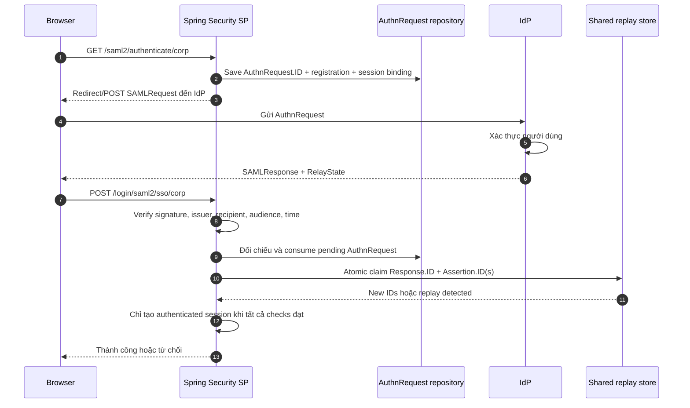
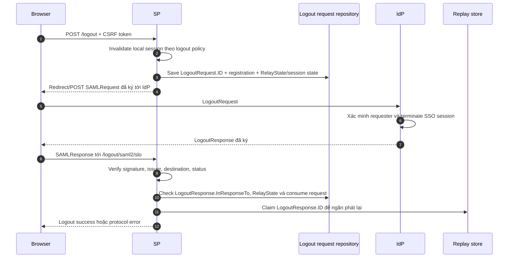

# Chống phát lại assertion, Response và thông điệp đăng xuất trong SAML 2.0

## 1. Vấn đề: chữ ký hợp lệ không đồng nghĩa thông điệp còn mới

Một Service Provider (SP) dùng Spring Security SAML 2.0 có thể xác minh đúng chữ ký của Identity Provider (IdP), xác định đúng người dùng và tạo phiên đăng nhập. Tuy nhiên, **cùng một thông điệp SAML hợp lệ nếu bị thu thập và gửi lại** có thể gây hậu quả khác: tạo phiên đăng nhập trái ý muốn, lợi dụng khoảng hiệu lực của assertion, lặp thao tác đăng xuất hoặc làm sai trạng thái phiên trong một hệ thống nhiều replica.

Đây là **replay attack — tấn công phát lại**. Đối tượng bị phát lại có thể là:

- Một `<saml:Assertion>`: assertion đã được IdP ký và có `ID` riêng.
- Một `<samlp:Response>` tại Assertion Consumer Service (ACS): thông điệp chứa một hoặc nhiều assertions.
- Một `<samlp:LogoutRequest>`: yêu cầu Single Logout (SLO), có `ID` và có thể có `SessionIndex`.
- Một `<samlp:LogoutResponse>`: phản hồi một yêu cầu logout, có `ID` và `InResponseTo`.
- Trong kiến trúc nhiều SP/IdP, một assertion từ tenant/issuer này có thể bị thử ở một registration khác, kể cả khi cùng dùng một IdP.

**Nguyên tắc bảo mật:** chỉ chấp nhận thông điệp *đã được xác minh* khi nó đúng issuer, đúng service, đúng transaction/phiên, còn thời hạn và **chưa được xử lý trước đó trong cửa sổ replay được bảo vệ**. Signature verification, timestamp checks, request correlation và replay cache **bổ sung cho nhau**; không biện pháp nào thay toàn bộ các biện pháp còn lại.

Bài thuộc nhóm **Gia cố an toàn** của module **Spring Security – federation**, tập trung vào SAML 2.0 Web Browser SSO và Single Logout trong Spring Boot 3.x/Spring Security 6.x, đồng thời chỉ ra những khác biệt cần lưu ý khi nâng phiên bản. Ví dụ dùng Java 17+. Các tên miền `example.test`, IDs và thời gian chỉ là giả định, **không phải thông điệp SAML được ký hợp lệ**.

### Kết quả học tập

1. Phân biệt replay của **Assertion**, **Response**, **LogoutRequest**, **LogoutResponse**.
2. Hiểu `ID`, `InResponseTo`, `IssueInstant`, `NotBefore`, `NotOnOrAfter`, `OneTimeUse`, `Recipient`, `Destination`, `AudienceRestriction` và `SessionIndex`.
3. Thiết kế **request correlation + replay detection** ở SP-initiated SSO.
4. Nêu rõ rủi ro IdP-initiated/unsolicited SSO khi không có AuthnRequest.
5. Chặn phát lại SLO nhưng vẫn xử lý các thông điệp trùng lặp **idempotently** theo hợp đồng.
6. Lưu trạng thái replay dùng chung nhiều replica, TTL và thao tác check-and-insert **atomic**.
7. Gắn replay guard sau cryptographic/protocol validation và trước side effects.
8. Cấu hình Spring Security `saml2Login`, `saml2Logout` và các request repositories đúng vai trò.
9. Biết ranh giới giữa Spring Security/OpenSAML validators và **replay policy riêng** do triển khai kiểm chứng.
10. Viết unit/integration/negative tests và vận hành tránh rò rỉ dữ liệu SAML.

## 2. Vì sao HTTPS, XML Signature hay mã hóa không tự chặn replay?

Một kẻ tấn công không nhất thiết sửa nội dung assertion. Nếu họ có bản sao của một SAMLResponse trong browser, log, reverse proxy hoặc một thành phần bị xâm nhập, họ có thể thử POST lại **nguyên các byte đã được ký**. Chữ ký vẫn có thể xác minh đúng vì nội dung **không thay đổi**.

| Cơ chế | Câu hỏi được trả lời | Chưa giải quyết |
| --- | --- | --- |
| HTTPS/TLS | Dữ liệu trên kết nối có bí mật và toàn vẹn không? | Một bên đã nhận/giữ thông điệp vẫn có thể gửi lại |
| XML Signature/JWS tương ứng binding | Thông điệp/phần assertion có đến từ key IdP đã tin không? | Nó đã được xử lý trước đó chưa? |
| XML Encryption | Bên ngoài có đọc nội dung assertion không? | Ciphertext có thể bị gửi lại nguyên trạng |
| `IssueInstant`/`NotOnOrAfter` | Thông điệp còn nằm trong thời gian được phép không? | Nhiều lần gửi **trong cùng cửa sổ thời gian** |
| `InResponseTo` | Có khớp yêu cầu SP đã phát ra không? | Yêu cầu đó đã được consume chưa, response/assertion có trùng không? |
| `OneTimeUse` | IdP yêu cầu assertion chỉ dùng ngay, không giữ để tái sử dụng | Cần **thực thi** thông qua replay tracking ở SP |
| Atomic replay cache | ID đã được xử lý trong phạm vi/TTL này chưa? | Không thay chữ ký, issuer, audience, subject confirmation, request state |

Tài liệu **OASIS SAML 2.0 Security Considerations** nhấn mạnh rằng mã hóa thông điệp **không tự chống replay**; có thể sử dụng message identifier/IssueInstant cùng chính sách kiểm tra. Vì vậy không sửa lỗi replay bằng “bắt IdP ký mạnh hơn” hoặc “thêm XML Encryption” rồi bỏ các kiểm tra một-lần.

## 3. Những ID cần kiểm tra độc lập

SAML có **nhiều tầng ID**. Nhầm các tầng dễ để lọt một dạng replay:

| Đối tượng | Định danh | Vai trò |
| --- | --- | --- |
| SP phát `AuthnRequest` | `AuthnRequest.ID` | Yêu cầu đã gửi, dùng cho `InResponseTo` |
| IdP trả `Response` | `Response.ID` | Định danh một protocol response |
| IdP phát `Assertion` | `Assertion.ID` | Định danh assertion được dùng để tạo principal |
| IdP/AP gửi `LogoutRequest` | `LogoutRequest.ID` | Định danh thao tác SLO inbound |
| SP/AP gửi `LogoutResponse` | `LogoutResponse.ID` | Định danh một protocol response SLO |
| SP phát yêu cầu SLO | `LogoutRequest.ID` của outbound request | Dùng đối chiếu `LogoutResponse.InResponseTo` |
| `AuthnStatement.SessionIndex` | `SessionIndex` | Tham chiếu **phiên SAML** cho Single Logout, **không phải message ID** |
| `RelayState` | Opaque binding state | Giúp liên hệ transaction/return URL; bản thân không phải chữ ký hoặc replay ledger |

Cần theo dõi **Response.ID và Assertion.ID**, không chỉ một trong hai. Ví dụ một assertion cũ có thể bị đặt vào một Response mới: `Response.ID` khác, nhưng `Assertion.ID` trùng. Ngược lại, replay nguyên response giữ cả hai IDs; guard ở Response sẽ từ chối.

**Không dùng NameID, email, SessionIndex hay timestamp làm replay key thay cho ID của thông điệp**. Một người dùng có thể đăng nhập nhiều lần hợp lệ. Replay key không phải khóa duy nhất của người dùng.

### Phân vùng key theo nguồn tin cậy

Một key có thể gồm:

```text
saml-replay:
  environment:
  relyingPartyRegistrationId:
  verifiedIssuerEntityId:
  messageType:
  verifiedMessageOrAssertionId:
```

Trong đó `messageType` có thể là `RESPONSE`, `ASSERTION`, `LOGOUT_REQUEST` hoặc `LOGOUT_RESPONSE`. Chỉ lấy `verifiedIssuerEntityId` từ kết quả validation tin cậy; **Issuer text chưa verify không tạo trust**.

Nếu hai SP registrations cùng chung IdP nhưng có audience/ACS khác, phân vùng theo registration giúp tránh va chạm giữa các trust domains, còn **audience validation** vẫn bắt buộc. Nếu cùng một assertion có khả năng được dùng lại giữa nhiều registrations mà policy không cho phép, thiết kế khóa/ledger cần phản ánh phạm vi cấm replay rộng hơn thay vì cho phép theo registration một cách vô tình.

## 4. Đường đăng nhập SAML: AuthnRequest → Response → Assertion



Sơ đồ là **trình tự trách nhiệm kiến trúc**, không cam kết thứ tự callback/hook nội bộ của mọi Spring Security release. Điều phải đúng: **không tạo authenticated session trước khi hoàn tất các kiểm tra cần thiết**, trong đó các ID đã được đánh dấu nguyên tử theo chính sách anti-replay. Giữ lifecycle của `AuthnRequest` và replay ledger nhất quán, tránh request bị consume trong khi ID guard bị lỗi không được xử lý.

Luồng SP-initiated có lợi thế: **SP đã phát một request cụ thể** và có thể so sánh `InResponseTo` với ID đang chờ, gắn với đúng browser session.

## 5. Những trường XML then chốt trong Response

Một ví dụ cấu trúc **rút gọn, chưa ký nên không đăng nhập được**:

```xml
<samlp:Response
    xmlns:samlp="urn:oasis:names:tc:SAML:2.0:protocol"
    xmlns:saml="urn:oasis:names:tc:SAML:2.0:assertion"
    ID="_response-101"
    Version="2.0"
    IssueInstant="2026-11-07T09:00:00Z"
    InResponseTo="_authnrequest-55"
    Destination="https://sp.example.test/login/saml2/sso/corp">
  <saml:Issuer>https://idp.example.test/entity</saml:Issuer>
  <samlp:Status>
    <samlp:StatusCode
      Value="urn:oasis:names:tc:SAML:2.0:status:Success"/>
  </samlp:Status>
  <saml:Assertion
      ID="_assertion-900" Version="2.0"
      IssueInstant="2026-11-07T09:00:00Z">
    <saml:Issuer>https://idp.example.test/entity</saml:Issuer>
    <saml:Subject>
      <saml:NameID>opaque-user-123</saml:NameID>
      <saml:SubjectConfirmation
        Method="urn:oasis:names:tc:SAML:2.0:cm:bearer">
        <saml:SubjectConfirmationData
          InResponseTo="_authnrequest-55"
          Recipient="https://sp.example.test/login/saml2/sso/corp"
          NotOnOrAfter="2026-11-07T09:05:00Z"/>
      </saml:SubjectConfirmation>
    </saml:Subject>
    <saml:Conditions
        NotBefore="2026-11-07T08:59:00Z"
        NotOnOrAfter="2026-11-07T09:05:00Z">
      <saml:AudienceRestriction>
        <saml:Audience>https://sp.example.test/saml2/metadata/corp</saml:Audience>
      </saml:AudienceRestriction>
      <saml:OneTimeUse/>
    </saml:Conditions>
  </saml:Assertion>
</samlp:Response>
```

Lưu ý:

- `Response.ID` là `_response-101`.
- `Assertion.ID` là `_assertion-900` — **không trùng Response.ID**.
- `InResponseTo` phải khớp request đã được SP tạo và còn pending.
- `Recipient` là ACS URL; `Audience` là SP Entity ID theo registration.
- `SubjectConfirmationData.NotOnOrAfter` giới hạn thời điểm bearer assertion được trình tới SP.
- `Conditions.NotOnOrAfter` giới hạn hiệu lực assertion nói chung.
- `<OneTimeUse/>` yêu cầu assertion không bị giữ để dùng sau, và triển khai phải có chính sách theo dõi.
- Signature có thể nằm trên Response hoặc Assertion theo profile và yêu cầu trust; XML mẫu bỏ signature nên **không đủ để xác thực**.

Đừng dùng chính XML này làm test fixture “signature valid”. Integration tests cần IdP sandbox hoặc OpenSAML test keys/fixtures đã được ký đúng và được xác nhận bằng validator thật.

## 6. Chặn replay của Response.ID

**Replay nguyên response** thường giữ lại cùng `Response.ID`, ký và assertion. Khi response đầu đã được xử lý thành công, lần sau phải bị từ chối, ngay cả khi chữ ký và timestamps vẫn còn hợp lệ.

Pseudo-policy:

```text
afterTrustedSamlValidation(response):
    key = namespace(registration, verifiedIssuer, "RESPONSE", response.ID)
    if not replayStore.claimAtomically(key, expiry):
        reject("RESPONSE_REPLAY")
    continueOnlyIfOtherReplayChecksAndCorrelationPass()
```

**Không tạo replay key từ Base64-encoded SAMLResponse toàn bộ** làm biện pháp chính: các HTTP wrappers/encoding/whitespace hoặc wrapping khác có thể thay đổi trong khi định danh protocol vẫn là một Response ID. Sử dụng **ID của node đã được xác minh đúng chữ ký/cấu trúc**.

Cần từ chối hoặc xử lý đặc biệt khi `Response.ID` rỗng, malformed, trùng node IDs trong cùng XML hoặc không tuân schema/protocol. **Không tin giá trị ID có trong một XML node bị attacker chèn** khác với node OpenSAML validator thật sự sử dụng.

## 7. Chặn replay của Assertion.ID

Một Response mới có thể mang một assertion cũ, ví dụ:

```text
SAMLResponse A: Response.ID=_r1
                Assertion.ID=_a1

SAMLResponse B: Response.ID=_r2
                Assertion.ID=_a1    <- assertion đã từng được xử lý
```

Nếu ứng dụng chỉ lưu `Response.ID` thì `_r2` có vẻ mới. Vì vậy **phải theo dõi Assertion.ID độc lập** đối với từng assertion có thể được dùng để xác thực hoặc cấp quyền.

Với nhiều assertions trong cùng một Response:

- Xác minh **tất cả assertions mà ứng dụng dự định tin/tiêu thụ**.
- Kiểm tra ID uniqueness trong XML và signed-node binding.
- Kiểm tra issuer, subject confirmation, audience, time, conditions trên **assertion thực tế dùng**.
- Xử lý replay guard cho **toàn bộ tập ID liên quan** trước khi tạo principal hoặc side effects.
- Nếu một assertion đã được xử lý trước đó, **fail closed** thay vì bỏ qua assertion trùng và tiếp tục lấy role từ assertion khác.
- Khi có encrypted assertions, chỉ trích ID sau decrypt/verification bằng trusted OpenSAML pipeline; không tự parse/trust ciphertext wrapper ID.

**Không dùng việc Response signature hợp lệ để bỏ qua Assertion replay check.** Hai điều kiện chống hai kiểu khai thác khác nhau.

## 8. InResponseTo và transaction binding: phòng tuyến quan trọng nhất cho SP-initiated

Trong SP-initiated Web SSO, SP lưu `AuthnRequest.ID` khi đưa browser tới IdP. Response và bearer `SubjectConfirmationData.InResponseTo` của assertion phải tương ứng request đó.

Một mapping an toàn cần biết:

```text
pending request:
  requestId = _authnrequest-55
  registrationId = corp
  browserSessionBinding = opaque session state
  issuedAt = 2026-11-07T09:00:00Z
  expiresAt = short bounded time
  relayState = unpredictable correlation value if used
  consumed = false
```

**Không chỉ so chuỗi `InResponseTo` với một requestId global trong cache**. Attacker có thể gửi Response của phiên A sang browser phiên B nếu cache chỉ khóa bằng ID và không biết request thuộc browser/transaction nào. Session-bound request repository giúp giảm login-CSRF/login fixation.

Khi response đến:

1. Tìm đúng pending AuthnRequest cho browser/transaction.
2. Kiểm tra registration/IdP/ACS/Request ID/RelayState theo policy.
3. Chỉ chấp nhận `InResponseTo` trùng.
4. Consume/đánh dấu request **không dùng lần thứ hai**, xử lý concurrency.
5. Đồng thời kiểm tra replay IDs của Response và Assertion.
6. Không tái lập pending request đã consume chỉ vì browser refresh.

Spring Security Servlet có `Saml2AuthenticationRequestRepository` và `HttpSessionSaml2AuthenticationRequestRepository`; triển khai cache-based cũng có trong các release. **RelayState và InResponseTo từ browser không tự chứng minh request thuộc browser đó**: nếu tách session, phải bảo vệ binding bằng thiết kế khác.

## 9. RelayState không phải replay cache hoặc chữ ký

`RelayState` phục vụ giữ trạng thái trong SAML binding (ví dụ khớp transaction/return URL). Nó có thể được giữ qua browser và có thể bị thao túng tùy binding/triển khai.

- HTTP-Redirect binding có cơ chế chữ ký trên các query parameters theo profile khi sử dụng URL signature, trong đó có `RelayState` nếu hiện diện; vẫn phải verify binding signature đúng cách.
- HTTP-POST binding không có nghĩa mọi `RelayState` được ký trong XML Signature; **đừng coi nó bất biến** nếu không có bảo vệ riêng.
- Một RelayState dài/ngẫu nhiên không tự thay thế session binding.
- Không dùng RelayState là local user ID, role, tenant grant, URL redirect tùy ý hoặc proof “user này đang đăng nhập”.
- Không tin RelayState để bỏ qua `InResponseTo` hay OneTimeUse.
- Có thể dùng RelayState làm khóa lookup với **one-time consume + đủ entropy + session binding/bảo vệ** theo thiết kế.

Chống replay cần ledger theo `Response.ID` và `Assertion.ID`; một RelayState mới **không làm assertion cũ trở thành mới**.

## 10. NotBefore, NotOnOrAfter và clock skew

Các timestamp thường xuất hiện ở nhiều lớp:

| Trường | Ý nghĩa | Kiểm tra |
| --- | --- | --- |
| `Response.IssueInstant` | Thời điểm Response được phát | Chặn message quá cũ/tương lai theo policy |
| `Assertion.IssueInstant` | Thời điểm assertion phát | Plausibility, max age khi policy yêu cầu |
| `Conditions.NotBefore` | Assertion chưa hợp lệ trước thời điểm này | Đồng hồ hiện tại + skew phải đạt |
| `Conditions.NotOnOrAfter` | Assertion không được chấp nhận từ thời điểm này trở đi | So với now và skew được cấu hình |
| `SubjectConfirmationData.NotOnOrAfter` | Giới hạn bearer assertion delivery | Phải kiểm tra riêng cho subject confirmation |
| `LogoutRequest.NotOnOrAfter` | Optional thời điểm logout request hết hạn | Nếu hiện diện thì áp dụng và có max-age policy |
| `LogoutRequest/Response.IssueInstant` | Thời điểm SLO message phát | Cần giới hạn tuổi/thời gian tương lai khi policy yêu cầu |
| `LogoutResponse.InResponseTo` | Tương quan với pending logout request | Không thay temporal checks |

**NotOnOrAfter mang nghĩa “không được dùng ở thời điểm bằng hoặc sau mốc đó”** theo SAML validity semantics; clock-skew tolerance phải được quản lý nhất quán. Không kéo dài clock skew quá lớn để “chữa” vấn đề NTP hay callback chậm: làm rộng cửa sổ replay.

Ví dụ policy **minh họa**, không phải giá trị mặc định Spring/OASIS: chấp nhận assertion trong tối đa 3 phút, skew tối đa ±60 giây, cache replay cho ít nhất toàn bộ cửa sổ mà SP có thể chấp nhận message. Giá trị thực phải dựa vào IdP, thời gian mạng, KDC/NTP và risk model.

## 11. OneTimeUse là điều kiện sử dụng, không phải tự động xóa assertion

OASIS SAML Core `2.5.1.5` định nghĩa `<OneTimeUse/>` là điều kiện cho biết assertion nên được dùng ngay và **không được giữ lại để dùng trong tương lai**. Relying party muốn tuân thủ phải theo dõi assertions đã xử lý để ngăn reuse.

Ví dụ:

```xml
<saml:Conditions
    xmlns:saml="urn:oasis:names:tc:SAML:2.0:assertion"
    NotBefore="2026-11-07T09:00:00Z"
    NotOnOrAfter="2026-11-07T09:04:00Z">
  <saml:AudienceRestriction>
    <saml:Audience>https://sp.example.test/saml2/metadata/corp</saml:Audience>
  </saml:AudienceRestriction>
  <saml:OneTimeUse/>
</saml:Conditions>
```

**Điểm cần nhớ:**

1. `OneTimeUse` không phải một loại chữ ký.
2. Nó không tự tạo replay cache ở SP; implementation phải biết assertion nào đã sử dụng.
3. Nó **độc lập với `NotBefore`/`NotOnOrAfter`**: một assertion còn thời gian nhưng đã dùng phải bị từ chối.
4. Một assertion không có `OneTimeUse` cũng **có thể bị SP chặn reuse theo chính sách bảo mật bearer SSO**; đừng mặc định “không có OneTimeUse tức được replay vô hạn”.
5. OpenSAML có `OneTimeUseConditionValidator` và `ReplayCache`; **việc chúng có được bật và kết nối đúng với Spring Security provider hay không phải kiểm chứng trên release/deployment thực tế**.
6. Đừng đặt OneTimeUse vào assertion rồi tuyên bố đã có global anti-replay nếu không có state storage thực.

Theo OASIS, `OneTimeUse` không tự làm `Conditions` “invalid” theo kiểu timestamp; nó là **constraint về cách assertion được sử dụng**. Vì vậy phải thực hiện replay policy ở điểm SP quyết định chấp nhận assertion.

## 12. IdP-initiated/unsolicited SSO: không có AuthnRequest để correlate

Trong **IdP-initiated SSO**, IdP có thể gửi Response đến ACS mà SP **không tạo AuthnRequest trước đó**. Vì thế `InResponseTo` có thể vắng mặt, và session-bound request correlation không bảo vệ flow.

Rủi ro:

- Một Response hợp lệ nhưng bị capture có thể được gửi lại trong cửa sổ ngắn nếu không có global replay ledger.
- Login CSRF/session swapping: một browser nhận phiên danh tính không phải phiên mà người dùng chủ động yêu cầu.
- Một Response dành cho SP/tenant khác có thể bị thử ở ACS này.
- Kẻ tấn công có thể dùng các thông điệp thật nhưng đi vào flow không đúng context.

Thiết kế nên:

1. **Tắt unsolicited SSO nếu sản phẩm không cần** và kiểm thử rằng ACS không nhận response thiếu pending request.
2. Nếu cần hỗ trợ, cấu hình **cho từng IdP/registration** có approval, không fallback khi session bị mất.
3. Bắt buộc signature, issuer, audience, destination, recipient, temporal rules và replay cache **Assertion/Response IDs**.
4. Có chiến lược chống login CSRF/session confusion riêng, user confirmation hoặc strict session handling theo use case.
5. Không tự chuyển một SP-initiated response mất cookie (do SameSite/session timeout) thành unsolicited flow hợp lệ.
6. Kiểm tra consent/local account linking/tenant authorization sau authentication.

**Replay cache là cần thiết nhưng không tự thay bảo vệ login CSRF.** Một Response chưa từng được xử lý có thể vẫn là login không được người dùng trong browser mong muốn.

## 13. SLO: logout cũng là thông điệp có thể bị phát lại

Single Logout có hai hướng chính:

- **RP-initiated:** user gửi `POST /logout` tới SP; Spring Security phát `LogoutRequest` đến IdP và sau đó nhận `LogoutResponse`.
- **AP/IdP-initiated:** IdP gửi `LogoutRequest` trực tiếp tới SP; SP xác minh và logout phiên phù hợp rồi gửi `LogoutResponse`.

**Hai đối tượng replay khác nhau:**

- Phát lại `LogoutRequest` cũ có thể tạo hành động logout lặp, nhắm vào phiên mới nếu ứng dụng chỉ match NameID rộng.
- Phát lại `LogoutResponse` cũ có thể làm ứng dụng hiểu sai rằng một logout transaction mới đã hoàn tất, nếu không kiểm tra `InResponseTo` và pending request state.

Một logout hợp lệ có thể được xử lý **idempotently** — yêu cầu lần hai không làm trạng thái tệ hơn — nhưng **idempotency không đồng nghĩa chấp nhận replay như thông điệp mới**. Phải phân biệt “duplicate đã xử lý” và “fresh authenticated logout”.

## 14. Luồng RP-initiated LogoutRequest và LogoutResponse



Spring Security 6.5 mô tả việc **lưu outbound LogoutRequest trong session** để kiểm tra `RelayState` và `LogoutResponse.InResponseTo`. Với nhiều replica hoặc cookie/session constraints, có thể tùy biến repository nhưng phải giữ **one-time consume và session binding**.

Ví dụ LogoutResponse:

```xml
<samlp:LogoutResponse
    xmlns:samlp="urn:oasis:names:tc:SAML:2.0:protocol"
    xmlns:saml="urn:oasis:names:tc:SAML:2.0:assertion"
    ID="_logout-response-77"
    Version="2.0"
    InResponseTo="_logout-request-10"
    IssueInstant="2026-11-07T09:02:00Z"
    Destination="https://sp.example.test/logout/saml2/slo">
  <saml:Issuer>https://idp.example.test/entity</saml:Issuer>
  <samlp:Status>
    <samlp:StatusCode
      Value="urn:oasis:names:tc:SAML:2.0:status:Success"/>
  </samlp:Status>
</samlp:LogoutResponse>
```

Đây là **XML rút gọn, chưa ký và không phải thông điệp hợp lệ cho production**. SP phải xác minh Response từ đúng IdP, đúng request đang chờ, trạng thái mong đợi và ID chưa được dùng.

### Vì sao không chỉ kiểm tra Status=Success?

Một `LogoutResponse` có `Status=Success` từ quá khứ có thể được attacker gửi lại. Nếu RP không giữ pending request và chỉ nhìn Status, nó có thể đánh dấu một logout mới là hoàn tất dù IdP chưa thực hiện hành động tương ứng.

**Chính sách:** không có pending matching request, hoặc `InResponseTo` sai, hoặc `LogoutResponse.ID` trùng ⇒ từ chối như một SLO response mới. Nếu user đã logout local rồi, không khôi phục phiên hay mở rộng quyền vì nhận thông điệp không hợp lệ.

## 15. AP/IdP-initiated LogoutRequest: kiểm soát replay trước khi xóa phiên

Trong flow IdP-initiated, SP nhận `LogoutRequest` từ IdP trên `/logout/saml2/slo`. Theo SAML Core, một yêu cầu logout có các trường:

- `ID` và `IssueInstant` trên protocol request base type.
- `Issuer` xác định sender.
- `Destination` endpoint nhận request.
- `NameID` hoặc tương đương xác định principal.
- `SessionIndex` **optional**, có thể chứa nhiều giá trị.
- `NotOnOrAfter` **optional**, giới hạn thời điểm request còn hiệu lực.
- `Reason` tùy chọn.

Ví dụ:

```xml
<samlp:LogoutRequest
    xmlns:samlp="urn:oasis:names:tc:SAML:2.0:protocol"
    xmlns:saml="urn:oasis:names:tc:SAML:2.0:assertion"
    ID="_idp-logout-request-42"
    Version="2.0"
    IssueInstant="2026-11-07T09:03:00Z"
    NotOnOrAfter="2026-11-07T09:05:00Z"
    Destination="https://sp.example.test/logout/saml2/slo">
  <saml:Issuer>https://idp.example.test/entity</saml:Issuer>
  <saml:NameID>opaque-user-123</saml:NameID>
  <samlp:SessionIndex>_session-abc</samlp:SessionIndex>
</samlp:LogoutRequest>
```

Message này **chỉ minh họa**, chưa có chữ ký. Với deployment production, IdP-initiated SLO phải được xác thực/bảo vệ toàn vẹn theo profile/binding và policy, nên SP yêu cầu chữ ký hợp lệ của IdP được provision là lựa chọn phù hợp.

### Quy trình inbound LogoutRequest

1. Resolve đúng `RelyingPartyRegistration` trong approved catalog.
2. Verify binding/XML signature với IdP trusted key; verify issuer/destination.
3. Kiểm tra `IssueInstant` không quá cũ/tương lai; `NotOnOrAfter` nếu có; áp một max-age riêng nếu field optional.
4. Kiểm tra `NameID`/qualifiers và `SessionIndex` khớp **đúng local session(s)** theo IdP/registration.
5. Kiểm tra `LogoutRequest.ID` chưa nằm trong replay store; **atomic claim trước khi mutate session**.
6. Chỉ terminate session được policy cho phép; không mặc định logout toàn bộ accounts có cùng email.
7. Trả `LogoutResponse` đã ký/đúng protocol theo policy, giữ idempotency cho duplicate requests mà không lặp side effect.

**Nguy cơ đặc biệt:** một LogoutRequest đã được ký nhưng cũ, chứa NameID chung, nếu được xử lý lần nữa **không kiểm tra SessionIndex** có thể chấm dứt một phiên **mới** của cùng user. Vì vậy replay guard và session scoping đều cần.

## 16. SessionIndex không phải LogoutRequest.ID

Hai chuỗi dùng cho mục đích khác:

| Trường | Dùng để | Không dùng để |
| --- | --- | --- |
| `LogoutRequest.ID` | Xác định một request cụ thể, phát hiện replay | Tìm local session theo người dùng |
| `LogoutRequest.SessionIndex` | Xác định phiên SAML mà IdP muốn logout | Duy nhất hóa mỗi logout message |
| `AuthnStatement.SessionIndex` | Gắn một SAML authentication với session ở IdP | Thay `Assertion.ID` |
| `LogoutResponse.InResponseTo` | Khớp outbound LogoutRequest | Chứng minh response còn mới nếu repo đã consume |
| `NameID` | Định danh principal trong profile | Tự quyết định xóa mọi phiên có email giống nhau |

Theo SAML Core, `SessionIndex` trong LogoutRequest là **optional**. Nếu IdP gửi không có index, hãy có **policy rõ**: cho phép logout những sessions nào, dựa trên NameID/issuer/tenant/registration/assurance? Với hệ thống đa tenant hoặc nhiều phiên đồng thời, nên áp scope bảo thủ thay vì hủy tất cả sessions của user theo email.

**Không giả định SessionIndex là secret.** Nó là correlation identifier, không phải token cho phép logout khi thiếu signed LogoutRequest.

## 17. HTTP-Redirect và HTTP-POST binding trong SLO

SAML SLO có thể dùng HTTP-Redirect hoặc HTTP-POST binding. Chúng không có cùng biểu diễn chữ ký:

- **HTTP-Redirect:** chữ ký có thể nằm ở query parameters `SigAlg`, `Signature` (và `RelayState` theo quy tắc binding), gắn với request parameters đã mã hóa/deflate.
- **HTTP-POST:** thường dùng XML Signature trong payload SAML được browser POST.
- Hai binding đều phải kiểm tra **cryptographic integrity**, destination, issuer, thời gian, ID và replay theo profile của IdP/SP.
- **Đừng dùng một generic HTTP request hash** để chống replay vì encoding/deflate/parameter order có thể thay đổi trong khi protocol message ID vẫn giữ nguyên.
- Không ghi raw `SAMLRequest`, `SAMLResponse`, `SigAlg` hoặc `Signature` vào URL access logs, traces hoặc analytics khi không cần thiết.
- POST SAML callback dùng cơ chế CSRF/protocol validation đặc thù; không đồng nghĩa mọi web POST được tắt CSRF.

Nếu một đối tác chỉ gửi SLO không ký hoặc dùng thuật toán yếu, phải **đánh giá và phê duyệt trust policy**; không bật acceptance không xác minh chỉ để logout “chạy được”.

## 18. Thiết kế ReplayCache: phân vùng, TTL, atomicity

Một anti-replay store thực sự cần nhiều thứ hơn `HashSet<String>`:

```text
Key:   saml:{env}:{registrationId}:{verifiedIssuer}:{type}:{verifiedID}
Value: consumed marker + timestamp/policy version (không chứa assertion XML)
TTL:   ít nhất hết cửa sổ mà receiver còn chấp nhận message
Write: atomic "insert only if absent" trên mọi replica
Read:  shared and consistent
Fail:  deny if durable replay check is unavailable for protected action
```

### Vì sao phải dùng composite key?

- `_id123` có thể xuất hiện ở nhiều issuers mà không có quan hệ gì nhau.
- `Response` và `Assertion` là các namespace khác nhau.
- IdP A và IdP B có trust anchors khác.
- Tenant North và South có resource/registration policies khác.
- Môi trường test và production không dùng chung replay ledger.

Nếu policy muốn **chặn cùng assertion xuyên nhiều registrations** của cùng IdP thì replay namespace assertion cần đặt ở phạm vi bao trùm (ví dụ per trusted IdP + SP entity) để không có “lỗ” chỉ do đổi registration. **Không tự động cho phép assertion cũ vì nó xuất hiện dưới một registration khác**: audience/recipient cũng phải chặn.

### Atomic check-and-insert

Sai:

```text
if (!store.contains(key)):
    store.put(key)
    accept()
```

Hai requests vào hai pods có thể cùng đọc “chưa có” rồi cùng accept. Đúng là một thao tác **atomic insert-if-absent**; ví dụ Redis:

```redis
SET saml:prod:corp:issuer-hash:ASSERTION:id-hash 1 NX PX 300000
```

Nếu Redis trả `OK`, insertion thành công; nếu trả null/nil, key đã tồn tại và message phải bị từ chối. Ở production, TTL 300000ms chỉ là **ví dụ**, không phải giá trị đủ cho mọi IdP. Key thực tế nên dùng hash/HMAC của identifiers để giảm lộ PII, tránh user-controlled key explosion và giữ format ổn định.

**Không dùng Redis GET rồi SET riêng biệt**, không dùng cache chỉ local pod trong cluster, không chấp nhận replay khi Redis timeout hoặc failover chưa nhất quán.

## 19. Nhiều IDs trong một Response: yêu cầu atomic toàn nhóm

Giả sử Response có:

```text
Response.ID = _r21
Assertion IDs = [_a4, _a5]
```

Nếu SP claim `_r21` thành công nhưng claim `_a4` thất bại vì đã được dùng, Response phải bị từ chối. Nhưng một phần các keys đã được ghi có thể làm transaction hợp lệ khác bị lỗi hoặc tạo cơ hội DoS.

Một thiết kế tốt dùng **atomic claim-all**:

```text
keys = [
  REPLAY_RESPONSE(issuer, responseId),
  REPLAY_ASSERTION(issuer, assertionId1),
  REPLAY_ASSERTION(issuer, assertionId2)
]
if any key exists: reject
else write all keys with TTL atomically, then proceed
```

Với Redis, có thể dùng Lua script/transaction phù hợp để kiểm tra và insert **trong cùng một atomic operation** khi keys cùng shard/slot; Redis Cluster yêu cầu thiết kế hash tags hoặc backend hỗ trợ atomic multi-key. Nếu không hỗ trợ, cần **một lưu trữ/transaction manager** tương đương hoặc quy tắc fail-closed đã phân tích.

**Tránh áp marker quá sớm:** một attacker có thể gửi XML **chưa ký/sai signature** tự khai `Assertion.ID` của một bản hợp lệ; nếu replay cache ghi trước khi verify, attacker có thể “đầu độc” cache và chặn user thật. Vì vậy phải verify cryptographic/protocol trước khi claim IDs.

**Tránh áp marker quá muộn:** nếu session đã được tạo hoặc logout đã xóa session trước khi atomic claim, hai requests đua nhau có thể tạo side effect hai lần.

## 20. Replay TTL và valid-until phải có chính sách hữu hạn

Replay cache cần giữ marker **chừng nào receiver còn có thể chấp nhận thông điệp**. Đừng chọn TTL 60 giây tùy tiện nếu assertion có thể được chấp nhận 5 phút cộng skew.

Một khung thiết kế:

```text
maxAcceptanceEnd =
    min(relevant SAML expiry bounds if present,
        issueInstant + configuredMaximumAge if enforced)
    + boundedClockSkew

replayMarkerTTL =
    maxAcceptanceEnd - now + smallOperationalMargin
```

Đây là **pseudocode policy**, không phải công thức bắt buộc của mọi SAML profile. Với assertion, các bounds của Conditions và SubjectConfirmationData thường khác nhau; cần xác định **giới hạn cuối cùng mà verifier thực sự có thể chấp nhận** (bao gồm các confirmation paths) rồi giữ cache ít nhất tới thời điểm đó. Không đơn giản lấy NotOnOrAfter của một node rồi quên bound khác.

Với **LogoutRequest**, `NotOnOrAfter` optional; nếu vắng mặt, receiver phải tự định nghĩa `maxAgeSinceIssueInstant` hữu hạn và **giới hạn clock skew**. Với **LogoutResponse**, gắn vào pending request TTL và một max message age để tránh giữ marker vô hạn.

Khi nâng clock-skew tolerance, phải **nâng tương ứng replay retention** nếu cửa sổ acceptance tăng. Nếu marker bị evict sớm hơn acceptance window, một message cũ có thể qua lại. Nếu cache outage/eviction/memory pressure, không được im lặng bật “best effort, cứ cho login”.

### Khóa tăng trưởng cache

Đặt giới hạn kích thước message/XML, maximum ID length và quota/rate limits trước khi ghi state. Untrusted IDs dài và nhiều requests lỗi có thể gây memory exhaustion. Nên chỉ claim IDs **sau khi** signature và protocol validation thành công, dùng bounded TTL, metrics cardinality và hashed keys khi cần.

## 21. Spring Security 6.x: phần framework thực sự hỗ trợ

Trong Spring Security SAML2 Servlet:

- `Saml2WebSsoAuthenticationRequestFilter` tạo `AuthnRequest`.
- `Saml2AuthenticationRequestRepository` lưu pending request; `HttpSessionSaml2AuthenticationRequestRepository` là implementation session-based.
- `Saml2WebSsoAuthenticationFilter` nhận `SAMLResponse` tại ACS.
- `Saml2AuthenticationTokenConverter` xây `Saml2AuthenticationToken` và resolve `RelyingPartyRegistration`.
- OpenSAML-backed authentication provider xác minh signature, issuer, destination, assertion conditions và subject confirmation theo configuration.
- `Saml2LogoutRequestFilter` xử lý AP-initiated `LogoutRequest`.
- `Saml2LogoutResponseFilter` xử lý `LogoutResponse`.
- `Saml2LogoutRequestValidator` và `Saml2LogoutResponseValidator` là hooks để tùy biến SLO validation.
- `Saml2LogoutRequestRepository` (trong DSL SLO) quản lý outbound request state dùng cho `InResponseTo` và RelayState.

**Điểm không được suy đoán:** chỉ bật `.saml2Login()` hay `.saml2Logout()` chưa đủ để khẳng định deployment có **shared atomic replay cache** cho mọi Response.ID, Assertion.ID, LogoutRequest.ID, LogoutResponse.ID qua nhiều pods. Khả năng replay check của OpenSAML/Spring, `OneTimeUseConditionValidator`, TTL và lưu trữ phải được kiểm tra theo **BOM/version và integration tests**.

Spring Security 6.5 và Spring Security 7.x khác nhau ở API OpenSAML4/OpenSAML5 và các validator hook. Không copy code `OpenSaml4AuthenticationProvider` vào project chỉ có `OpenSaml5AuthenticationProvider` mà chưa đối chiếu chính xác release.

## 22. Cấu hình cơ sở Spring Boot 3.x cho SAML Login và SLO

Trong `build.gradle` của dự án Boot có plugin Java, dependency management và repository phù hợp:

```groovy
repositories {
    mavenCentral()
    // Một số tổ hợp OpenSAML yêu cầu repository Shibboleth.
    maven { url "https://build.shibboleth.net/maven/releases/" }
}

dependencies {
    implementation "org.springframework.boot:spring-boot-starter-web"
    implementation "org.springframework.boot:spring-boot-starter-security"
    implementation "org.springframework.security:spring-security-saml2-service-provider"
}
```

Mảnh `application.yml` minh họa một RP:

```yaml
spring:
  security:
    saml2:
      relyingparty:
        registration:
          corp:
            entity-id: "https://sp.example.test/saml2/metadata/corp"
            acs:
              location: "https://sp.example.test/login/saml2/sso/corp"
            signing:
              credentials:
                - private-key-location: "file:/run/secrets/saml/sp.key"
                  certificate-location: "file:/run/secrets/saml/sp.crt"
            singlelogout:
              url: "https://sp.example.test/logout/saml2/slo"
            assertingparty:
              metadata-uri: "https://idp.example.test/metadata"
```

Đây là các **giá trị minh họa**, không triển khai được khi chưa có IdP, SP signing key/cert thực, metadata đáng tin, cấu hình SLO và proxy HTTPS. Đừng đưa private key vào JAR/Git; dùng secret manager/volume read-only và rotation policy.

**Chú ý:** các cấu hình trên **không tự cài một replay ledger phân tán**; chúng tạo baseline SAML login/logout. Anti-replay cần xác minh hoặc tích hợp thêm theo threat model. Nếu IdP yêu cầu Response/Assertion signatures khác, phải cấu hình rõ theo metadata/trust contract, không bỏ validators để “chạy được”.

### Spring SecurityFilterChain mẫu

Lưu `src/main/java/demo/samlreplay/SamlReplayApplication.java`:

```java
package demo.samlreplay;

import org.springframework.boot.SpringApplication;
import org.springframework.boot.autoconfigure.SpringBootApplication;
import org.springframework.context.annotation.Bean;
import org.springframework.security.config.Customizer;
import org.springframework.security.config.annotation.web.builders.HttpSecurity;
import org.springframework.security.core.Authentication;
import org.springframework.security.web.SecurityFilterChain;
import org.springframework.web.bind.annotation.GetMapping;
import org.springframework.web.bind.annotation.RestController;

@SpringBootApplication
@RestController
public class SamlReplayApplication {

    public static void main(String[] args) {
        SpringApplication.run(SamlReplayApplication.class, args);
    }

    @Bean
    SecurityFilterChain samlSecurity(HttpSecurity http) throws Exception {
        return http
                .authorizeHttpRequests(auth -> auth
                        .requestMatchers("/", "/error").permitAll()
                        .anyRequest().authenticated())
                .saml2Login(Customizer.withDefaults())
                .saml2Logout(Customizer.withDefaults())
                .build();
    }

    @GetMapping("/")
    public String home() {
        return "SAML2 login and SLO example";
    }

    @GetMapping("/secure/whoami")
    public String whoami(Authentication authentication) {
        return authentication.getName();
    }
}
```

Đây là class Java 17+ có Spring Boot/Security dependencies; để **login và logout thành công** phải kết nối IdP thực, có certificate/metadata/keys phù hợp. **Class này chỉ cho thấy framework baseline**, không tự chứa atomic anti-replay integration. Không tuyên bố `/secure/whoami` trả HTTP 200 nếu chưa cấu hình IdP.

Khi app dùng browser session, giữ Spring Security CSRF protections cho `POST /logout`. SAML ACS/SLO protocol callbacks được filters xử lý theo đúng bindings; **không tắt CSRF toàn web app** để giải quyết lỗi callback mà không hiểu cơ chế framework.

## 23. Tùy biến Spring Security: nơi gắn replay guard

Cần giữ các **default SAML validators** và bổ sung guard ở vị trí đúng. Một cách tư duy:

```text
Saml2WebSsoAuthenticationFilter
 -> trusted RelyingPartyRegistration
 -> OpenSAML: secure parse + signature verify
 -> issuer/destination/audience/recipient/time/subject checks
 -> correlate with pending AuthnRequest and session
 -> anti-replay: atomic claim Response + all consumed Assertion IDs
 -> create Authentication + session

Saml2LogoutRequestFilter
 -> verify signed LogoutRequest issuer/destination/time/session
 -> anti-replay: atomic claim LogoutRequest.ID
 -> invalidate only matching local sessions, respond

Saml2LogoutResponseFilter
 -> verify signed LogoutResponse issuer/destination/status
 -> correlate InResponseTo + pending logout request
 -> anti-replay: atomic claim LogoutResponse.ID
 -> complete logout response handling
```

Đây là **mô hình kiến trúc**, không phải call order chính xác của mọi provider. Khi triển khai, tận dụng extension points do phiên bản Spring Security cung cấp:

- Ở Spring Security 6.x, `OpenSaml4AuthenticationProvider` hoặc `OpenSaml5AuthenticationProvider` tùy release có `ResponseValidator`/`AssertionValidator` customization, nơi có thể **delegate default validators** rồi áp policy bổ sung.
- Với SLO có `Saml2LogoutRequestValidator` / `Saml2LogoutResponseValidator` thông qua DSL `saml2Logout`; cần delegate default implementation trước khi kiểm tra ID.
- Dùng `Saml2AuthenticationRequestRepository`/`Saml2LogoutRequestRepository` cho transaction state; không thay chúng bằng một global HashMap thiếu browser/session binding.
- Có thể tạo một adapter quanh **đã xác minh OpenSAML objects** và cache service, nhưng phải đảm bảo replay marker được ghi **trước khi side effects** và **sau khi signature/conditions**.
- Khi custom validator trả lỗi, trả `Saml2Error`/`Saml2ResponseValidatorResult` hoặc `Saml2LogoutValidatorResult` đúng contract của release; không tự nuốt exception rồi tiếp tục login/logout.

**Không viết code parse Base64/XML trực tiếp trong controller để so ID** nếu không bảo đảm signed-node selection, XXE/DTD protection, XML Signature Wrapping prevention và đúng đối tượng mà Spring provider dùng. Một ID chưa verify không nên trở thành marker đã consume.

Vì chữ ký/validation extension points khác nhau giữa Security 6.5/7.0/7.1, các đoạn `ResponseValidator`/`AssertionValidator` dưới đây chỉ nên được triển khai sau khi xem Javadoc **đúng BOM**. Không bịa một `spring.security.saml2.replay-cache.enabled=true`: Spring Boot không có một property universal bảo đảm distributed replay checks cho cả bốn loại message.

## 24. Repository lưu AuthnRequest không phải replay ledger toàn cục

`HttpSessionSaml2AuthenticationRequestRepository` lưu request theo browser session. Với SP-initiated SSO nó giúp kiểm tra `InResponseTo`, nhưng **không tự thay việc ghi lịch sử mọi Assertion.ID trên mọi browser/pod**.

Phân biệt:

| Store | Khóa/trạng thái | Mục đích |
| --- | --- | --- |
| `Saml2AuthenticationRequestRepository` | Pending AuthnRequest + RelayState/session | Correlation login transaction, consume request |
| `Saml2LogoutRequestRepository` | Outbound LogoutRequest pending | Correlation `LogoutResponse.InResponseTo`/RelayState |
| **Replay store** | Used Response/Assertion/Logout Request/Response IDs | Chặn message reuse giữa các requests/replicas |
| Local session repository | Browser Authentication/SecurityContext | Duy trì login state |
| SLO session index mapping | Issuer/NameID/SessionIndex ↔ local sessions | Logout **đúng phiên** |
| Local user/tenant directory | Subject → local roles/ACL | Authorization nghiệp vụ |

Nếu session store là Redis thì **không tự** có anti-replay markers. Cần dữ liệu, TTL và thao tác insert-if-absent riêng.

Nếu application dùng `SameSite=Strict` và mất browser session trên cross-site SAML POST, **không tự hạ cấp** từ SP-initiated thành unsolicited SSO để vượt mất `InResponseTo`. Sửa cookie/session binding hoặc dùng repository có cơ chế bảo vệ transaction an toàn khác.

## 25. Multi-replica, Redis và tác vụ logout side effects

Với nhiều pods:

```text
IdP
  |
  +--> SP pod A: thấy Response.ID=_r77
  |
  +--> SP pod B: cũng thấy Response.ID=_r77

Local HashSet A: chưa thấy -> accept
Local HashSet B: chưa thấy -> accept

Shared atomic cache:
  pod A SET NX -> OK
  pod B SET NX -> nil
  chỉ một request được claim
```

Cần cân nhắc:

- **Durability/consistency:** Redis failover có thể mất marker vừa ghi nếu replication async; phải chọn consistency có thể chấp nhận theo risk model, hoặc dùng datastore có transactional guarantees.
- **Atomic multi-key:** nếu check Response.ID + N Assertion.IDs, cần claim-all trong một transaction/script tương ứng.
- **Failure policy:** cache outage phải từ chối protected authentication/logout; không “temporarily disable replay protection”.
- **TTL:** giữ marker ít nhất đến khi message không còn có thể được chấp nhận.
- **Namespace:** environment, IdP issuer, RP registration, message type và ID.
- **Scale:** giới hạn XML size, số assertions, ID lengths, log cardinality, replay metrics.
- **Rollback:** một marker đã claim nhưng downstream handler fail có thể khiến retry bị từ chối; chấp nhận **fail closed** và khởi tạo một transaction mới thay vì tự động xóa marker của message đã nhìn thấy.

Một cách tối thiểu ở Redis dùng `SET ... NX PX` cho một ID. Với multi-ID/correlated state, triển khai atomic group contract bằng Lua script/transaction hoặc strong transactional DB. Đừng dùng `GET` rồi `SET` hoặc các cache local theo pod.

### Không cache raw SAML

Replay store thường chỉ cần hashed IDs, thời gian và policy context; không cần lưu raw `SAMLResponse`/XML Assertions/NameID. Nếu cần forensic, dùng event IDs và metadata đã redact; lưu raw authentication material làm tăng rủi ro lộ danh tính và replay.

## 26. Java 17 chạy độc lập: replay guard cho bốn loại message

Chương trình sau minh họa **một cửa sổ replay trong bộ nhớ** bằng `ConcurrentHashMap.compute` để check-and-insert nguyên tử trên **một ID**. Nó có key theo issuer + SP registration + message type + ID; **không kiểm tra chữ ký, XML, SessionIndex hoặc bảo vệ nhiều pods**. Trong hệ thống thật chỉ gọi `claim` **sau khi validator SAML đã xác minh** và đặt valid-until theo policy.

Lưu file `SamlReplayGuardDemo.java`:

```java
import java.time.Clock;
import java.time.Instant;
import java.time.ZoneOffset;
import java.util.concurrent.ConcurrentHashMap;
import java.util.concurrent.atomic.AtomicBoolean;

public final class SamlReplayGuardDemo {

    enum Kind {
        RESPONSE, ASSERTION, LOGOUT_REQUEST, LOGOUT_RESPONSE
    }

    record Key(String issuer, String registration, Kind kind, String id) {
    }

    static final class ReplayGuard {
        private final ConcurrentHashMap<Key, Instant> seen =
                new ConcurrentHashMap<>();
        private final Clock clock;

        ReplayGuard(Clock clock) {
            this.clock = clock;
        }

        boolean claim(String issuer, String registration,
                Kind kind, String verifiedId, Instant validUntil) {

            if (issuer == null || issuer.isBlank()
                    || registration == null || registration.isBlank()
                    || kind == null
                    || verifiedId == null || verifiedId.isBlank()
                    || validUntil == null) {
                return false;
            }

            Instant now = clock.instant();
            if (!validUntil.isAfter(now)) {
                return false;
            }

            Key key = new Key(issuer, registration, kind, verifiedId);
            AtomicBoolean firstUse = new AtomicBoolean(false);

            seen.compute(key, (ignored, priorExpiry) -> {
                if (priorExpiry == null || !priorExpiry.isAfter(now)) {
                    firstUse.set(true);
                    return validUntil;
                }
                return priorExpiry;
            });
            return firstUse.get();
        }
    }

    public static void main(String[] args) {
        Instant now = Instant.parse("2026-11-07T09:00:00Z");
        ReplayGuard guard = new ReplayGuard(
                Clock.fixed(now, ZoneOffset.UTC));
        Instant end = now.plusSeconds(300);
        String issuer = "https://idp.example.test/entity";
        String rp = "corp";

        System.out.println("responseFirst="
                + guard.claim(issuer, rp, Kind.RESPONSE, "_r1", end));
        System.out.println("responseReplay="
                + guard.claim(issuer, rp, Kind.RESPONSE, "_r1", end));

        System.out.println("assertionFirst="
                + guard.claim(issuer, rp, Kind.ASSERTION, "_a1", end));
        System.out.println("assertionReused="
                + guard.claim(issuer, rp, Kind.ASSERTION, "_a1", end));

        System.out.println("logoutRequestFirst="
                + guard.claim(issuer, rp, Kind.LOGOUT_REQUEST, "_l1", end));
        System.out.println("logoutRequestReplay="
                + guard.claim(issuer, rp, Kind.LOGOUT_REQUEST, "_l1", end));

        System.out.println("logoutResponseFirst="
                + guard.claim(issuer, rp, Kind.LOGOUT_RESPONSE, "_lr1", end));
        System.out.println("logoutResponseReplay="
                + guard.claim(issuer, rp, Kind.LOGOUT_RESPONSE, "_lr1", end));

        System.out.println("otherRegistration="
                + guard.claim(issuer, "other", Kind.RESPONSE, "_r1", end));
        System.out.println("expiredRejected="
                + guard.claim(issuer, rp, Kind.ASSERTION,
                        "_expired", now.minusSeconds(1)));
    }
}
```

Chạy bằng JDK 17+:

```bash
javac SamlReplayGuardDemo.java
java SamlReplayGuardDemo
```

**Stdout chính xác:**

```text
responseFirst=true
responseReplay=false
assertionFirst=true
assertionReused=false
logoutRequestFirst=true
logoutRequestReplay=false
logoutResponseFirst=true
logoutResponseReplay=false
otherRegistration=true
expiredRejected=false
```

Giải thích:

- `responseReplay=false`: một Response ID đã claim không thể được nhận lại trong cùng scope.
- `assertionReused=false`: Assertion ID bị từ chối dù nó có thể xuất hiện trong Response ID khác.
- `logoutRequestReplay=false` / `logoutResponseReplay=false`: cùng SLO ID không được dùng lại như message mới.
- `otherRegistration=true`: key có scope theo registration; **production vẫn phải kiểm tra audience/recipient** và có thể cần shared assertion scope chặt hơn.
- `expiredRejected=false`: một message hết thời hạn không được claim.
- `AtomicBoolean` chỉ dùng để nhận kết quả của `compute` một-key; không thực hiện transaction nhiều IDs.

**Giới hạn:** không có TTL eviction job, không có signature validation, không kiểm tra SP session, không shared cache, không tránh crash/failover, không atomic claim-all. Vì vậy đây là **unit demonstration**, tuyệt đối không copy làm replay protection production.

## 27. Logging, metrics và incident response

Khi phát hiện replay, cần đủ dữ liệu để phân tích nhưng không làm lộ nguyên SAML message:

```text
event = saml_replay_detected
messageType = ASSERTION
registrationId = corp
issuerAlias = verified_idp_1
messageIdHash = 7f8e...  (HMAC/truncated hash, không raw)
correlationId = internal_request_id
decision = DENY
```

Mức log nên phân biệt:

- Signature invalid.
- Issuer/registration invalid.
- Audience/Recipient/Destination mismatch.
- Expired/not-yet-valid.
- Missing/mismatched `InResponseTo`.
- AuthnRequest hoặc SLO request đã consume.
- Replay Response ID.
- Replay Assertion ID.
- Replay LogoutRequest ID.
- Replay LogoutResponse ID.
- Replay store unavailable/atomic claim failed.
- Logout session target not found hoặc SessionIndex mismatch.

**Không log raw `SAMLResponse`, `SAMLRequest`, `RelayState`, assertion XML, NameID/email, cookies, signing keys hoặc valid signatures** vào hệ thống logs công khai. Một bản sao SAML còn trong cửa sổ hiệu lực là material có nguy cơ bị phát lại.

### Metrics đúng

Tách `saml_authentication_success` khỏi `saml_response_replay_rejected`. Tách `saml_logout_request_received` khỏi `saml_logout_session_invalidated` để tránh báo cáo “logout thành công nhiều lần” do retries/replays. Không dùng raw `Response.ID` hoặc `NameID` làm metric label có cardinality vô hạn.

## 28. Negative tests cho Response/Assertion

| Test | Mục tiêu | Kỳ vọng |
| --- | --- | --- |
| 1. Một Response đã xử lý được POST lại nguyên bản | Response replay | Reject |
| 2. Assertion ID cũ nằm trong Response ID mới | Assertion replay | Reject |
| 3. Response ID cũ nhưng assertion ID mới | Response replay | Reject |
| 4. Response signature invalid nhưng ID giống message thật | Cache poisoning | Reject signature **không ghi marker** |
| 5. `InResponseTo` khớp request đã consume | Transaction replay | Reject |
| 6. `InResponseTo` thuộc browser session khác | Login CSRF/fixation | Reject |
| 7. Mất session cookie sau IdP POST | Missing pending request | Không tự downgrade unsolicited |
| 8. Assertion `OneTimeUse` được gửi lại trong thời gian còn hạn | Condition enforcement | Reject |
| 9. Assertion không `OneTimeUse` nhưng bearer đã xử lý | SP anti-replay policy | Reject theo policy |
| 10. `SubjectConfirmationData.NotOnOrAfter` quá hạn | Temporal invalidity | Reject |
| 11. `Conditions.NotBefore` tương lai | Temporal invalidity | Reject |
| 12. Issuer được đổi nhưng signature không khớp | Trust boundary | Reject |
| 13. Audience thuộc SP khác | Cross-service replay | Reject |
| 14. Recipient/Destination khác ACS | ACS mismatch | Reject |
| 15. Một Response có hai assertions cùng ID | XML ambiguity | Reject |
| 16. Signed valid assertion nhưng một node bị XML Signature Wrapping | Signed-node selection | Reject hoặc chỉ dùng đúng signed node |
| 17. Hai POST đồng thời vào hai pods cùng Response.ID | Race | Chỉ một atomic claim thành công |
| 18. Redis outage/failover | Cache availability | Fail-closed |
| 19. Marker TTL ngắn hơn acceptance window | Replay window | Test phát hiện policy sai |
| 20. IdP-initiated request không được phê duyệt | Unsolicited SSO | Reject |
| 21. IdP-initiated được phép nhưng replay Response/Assertion | Unsolicited replay | Reject |
| 22. Token/claim lấy từ unverified XML | Parser bypass | Không tạo authenticated principal |
| 23. Valid signed Response có expired assertion | Check toàn pipeline | Reject |
| 24. Duplicate/overlapping multi-assertion check | Atomicity | Reject toàn nhóm, không dùng assertion partial |

Dùng test IdP và signing keys sandbox; test `@WithMockUser` **không chạy XML Signature/OpenSAML validation**. Cần thực sự gửi signed SAMLResponse qua ACS trong integration test.

## 29. Negative tests cho LogoutRequest/LogoutResponse

| Test | Kiểm tra | Kỳ vọng |
| --- | --- | --- |
| A. Signed IdP LogoutRequest được replay cùng ID | AP-initiated SLO replay | Không logout lại như fresh message |
| B. LogoutRequest cũ sau user re-login | New session protection | Không logout phiên mới sai SessionIndex |
| C. LogoutRequest chưa ký/unknown issuer | Signature/issuer trust | Reject |
| D. LogoutRequest quá cũ nhưng không có NotOnOrAfter | Max message age | Reject theo policy |
| E. LogoutRequest có NotOnOrAfter quá hạn | Expiry | Reject |
| F. LogoutRequest có SessionIndex của tenant khác | Session scope | Không logout chéo tenant |
| G. LogoutRequest chỉ có NameID, không SessionIndex | Broad logout risk | Áp policy explicit, không xóa vô điều kiện |
| H. LogoutResponse từ LogoutRequest đã consume | Response replay | Reject như fresh response |
| I. LogoutResponse ID cũ, InResponseTo mới | Replay/transaction mismatch | Reject |
| J. LogoutResponse mới nhưng InResponseTo sai | Correlation failure | Reject |
| K. LogoutResponse signature đúng IdP B nhưng RP đang đợi IdP A | Issuer/registration mismatch | Reject |
| L. LogoutResponse Status error | Protocol result | Không gắn nhãn global success |
| M. LogoutResponse nhận khi không có pending SLO request | Unsolicited response | Reject |
| N. Duplicate SLO qua hai pods | Atomicity + idempotency | Không invalidate rộng/lặp side effects |
| O. Replay cache offline khi inbound logout | Fail closed | Không cho message tạo side effects |
| P. LogoutRequest hợp lệ nhưng local session không còn | Idempotency | Trả kết quả phù hợp mà không tái tạo session |
| Q. SLO message sai Destination | Endpoint binding | Reject |
| R. HTTP-Redirect signature không verify | Binding signature | Reject |
| S. Replay SLO ở môi trường khác | Namespace | Không làm thay đổi session môi trường này |
| T. Logout local xong browser còn IdP session | Logout semantics | Không giả định global SLO thành công |

Cần kiểm thử cả **RP-initiated** và **AP-initiated** flows, không chỉ một nút Logout UI. Nếu đối tác gửi unsigned SLO trên binding khác, phải xác nhận chính sách security/trust trước khi mở nhận.

## 30. Lỗi triển khai phổ biến và cách xử lý

| Anti-pattern | Vì sao nguy hiểm | Thiết kế đúng |
| --- | --- | --- |
| “Response đã ký nên không thể replay” | Chữ ký còn hợp lệ khi message được gửi lại | Signature + IDs + expiry + correlation |
| Chỉ lưu Response.ID | Assertion cũ có thể nằm trong Response mới | Lưu cả Assertion.ID |
| Chỉ lưu Assertion.ID | Nguyên protocol Response có thể được xử lý lại tùy flow | Kiểm tra cả Response.ID |
| Bỏ `InResponseTo` khi session mất | Login CSRF/fixation và replay | Sửa cookie/repository |
| Chỉ dùng RelayState làm session proof | Browser có thể mang state từ flow khác | Session binding + one-time consume |
| Không có cache vì `OneTimeUse` trong XML | Condition không tự enforce | Replay ledger |
| GET rồi SET Redis | Race giữa replicas | Atomic `SET NX`/transaction |
| HashSet trong một pod | Pod khác không thấy marker | Shared store |
| TTL 30s nhưng assertion accepted 5 phút | Replay sau marker eviction | TTL bám acceptance window |
| Ghi ID vào cache trước signature validation | Cache poisoning/DoS | Verify rồi claim |
| Session đã tạo trước claim | Race tạo nhiều phiên | Gate trước side effects |
| LogoutRequest cũ vẫn logout phiên mới | Không kiểm tra SessionIndex/replay | Session-specific signed SLO |
| Chỉ kiểm tra NameID trong SLO | Logout nhiều sessions/tenant không đúng | Issuer + SessionIndex + local mapping |
| LogoutResponse chỉ có Status Success | Trả lời cũ dùng cho request mới | Pending request + InResponseTo + replay ID |
| SLO một lần lỗi nên tự bỏ validation | Mất trust boundary | Giữ validator, sửa IdP/metadata |
| Tắt CSRF toàn web vì SAML POST | Browser form/session mất CSRF protection | Cấu hình callback đúng |
| Log SAML XML để debug | Lộ bearer assertion/PII | Redaction + hashed IDs |
| Mỗi pod có đồng hồ lệch nhiều phút | Thời hạn khó dự đoán | NTP, skew nhỏ, metrics |
| Mặc định tin OpenSAML auto-enforce OneTimeUse | Cấu hình/version khác nhau | Kiểm tra bằng integration test |
| User logout local nhưng IdP session vẫn sống | Không phải global SLO | Mô tả RP/AP SLO và kiểm tra kết quả |

## 31. Chẩn đoán Spring Security trong thực tế

| Triệu chứng | Khả năng | Cách xử lý |
| --- | --- | --- |
| SAMLResponse thứ hai vẫn được tạo session | Thiếu global replay guard | Kiểm tra Response/Assertion ID tests |
| Trùng response chỉ bị reject trên một pod | Cache local/không shared | Dùng atomic shared store |
| Assertion mới vẫn bị coi là replay | Key scope sai, TTL quá dài hoặc ID provider trùng bất thường | Xem issuer/registration namespace, IdP uniqueness |
| Message đầu bị reject replay | Cache bị poison do ghi trước signature validation | Sửa integration order |
| Valid login mất `InResponseTo` | SameSite/cookie/session store/replicas | Kiểm tra browser POST và request repository |
| User bị logout khi IdP gửi request cũ | SLO replay/session scoping thiếu | Kiểm tra SessionIndex và ID ledger |
| RP-initiated SLO luôn “success” dù IdP chưa logout | Bỏ pending InResponseTo/Status validation | Đối chiếu logout request repository |
| Signature check fail sau IdP key rotation | Verification cert metadata stale | Sửa trusted key rotation, không tắt signature |
| Assertion hết hạn dù relógio lệch | NTP/clock skew | Đồng bộ giờ, không nới skew vô hạn |
| Redis failover khiến replay marker biến mất | Asynchronous replication/consistency | Chọn đúng storage guarantees, test failover |
| 400 tại `/logout/saml2/slo` | Invalid signed message, issuer, destination hoặc state | Đọc error category đã redact |
| Session bị tạo rồi app trả 500 | Replay guard đặt sau authentication side effects | Đưa gating trước session creation |
| Replay store tăng RAM liên tục | TTL không được áp hoặc raw IDs dài | Bounds/TTL/hashed keys |
| XML parser không cho Signature | WAF/parser/rewrite sai | Đối chiếu binding/crypto, không parse lại không an toàn |

**Không bật `permitAll` cho ACS/SLO rồi tự nhận raw XML làm authenticated user.** Endpoint có thể cần nhận HTTP request không kèm session, nhưng **SAML validation phải quyết định kết quả**, không phải có controller public là được tin.

## 32. Checklist hardening trước production

- [ ] Đã xác định rõ SAML RP, IdP, RelyingPartyRegistration, ACS, Entity ID và SLO endpoints.
- [ ] Mọi signing/verification credentials lấy từ trusted configuration/metadata đã phê duyệt.
- [ ] Signature của Response/Assertion/Logout được kiểm tra theo đúng binding/profile.
- [ ] Kiểm tra Issuer, Destination, Recipient, Audience, Conditions, SubjectConfirmation.
- [ ] SP-initiated Response phải khớp pending `AuthnRequest.ID`/`InResponseTo` và browser binding.
- [ ] Pending AuthnRequest được consume một lần, có TTL và bảo vệ concurrency.
- [ ] RelayState không dùng như permission hoặc bằng chứng độc lập cho request session.
- [ ] Response.ID và mọi Assertion.ID được kiểm tra replay, kể cả OneTimeUse.
- [ ] Assertion OneTimeUse được enforce, không chỉ parse mà bỏ qua.
- [ ] IdP-initiated/unsolicited SSO có explicit policy hoặc bị disable.
- [ ] Replay cache dùng chung các replicas; claim ID atomic.
- [ ] Một Response nhiều assertions được claim theo một atomic nhóm khi cần.
- [ ] Markers chỉ được claim **sau validation** và **trước side effects**.
- [ ] Cache TTL bao phủ acceptance windows + clock skew, không bị evict sớm.
- [ ] Cache outage/failover theo chính sách fail-closed, có observability.
- [ ] SP/AP-initiated LogoutRequest chỉ được xử lý khi issuer/signature/time/ID hợp lệ.
- [ ] LogoutRequest.ID có anti-replay guard.
- [ ] NameID/SessionIndex được đối chiếu đúng local sessions theo IdP và tenant.
- [ ] LogoutResponse.InResponseTo đối chiếu pending outbound LogoutRequest và repository consume.
- [ ] LogoutResponse.ID được chống replay, Status được kiểm tra theo giao thức.
- [ ] Duplicate logout không tái tạo session hoặc lặp side effects ngoài ý muốn.
- [ ] App dùng HTTP/Redirect hay POST binding đúng signatures, không trộn.
- [ ] Web CSRF/session cookie/SameSite được cấu hình tương thích SAML nhưng không tắt bảo mật toàn cục.
- [ ] Unit tests, integration tests, multi-pod concurrency và key rotation đã chạy.
- [ ] Logs/metrics không chứa raw assertions, SAML messages, NameID, cookies hoặc secrets.
- [ ] NTP và monitoring clock skew hoạt động.
- [ ] Chính sách migration từ Spring Security 6.x/OpenSAML4 sang 7.x/OpenSAML5 được kiểm tra bằng API của release thực tế.

## 33. Câu hỏi tự đánh giá

**1. Vì sao signed SAMLResponse vẫn có thể bị replay?**  
Vì attacker có thể gửi lại đúng nội dung đã ký; chữ ký chứng minh nguồn/toàn vẹn, không chứng minh một-lần.

**2. Response.ID và Assertion.ID có cùng vai trò không?**  
Không. Response.ID định danh protocol message; Assertion.ID định danh assertion. Cần theo dõi cả hai.

**3. `OneTimeUse` có tự bật Redis cache ở Spring Security không?**  
Không thể suy ra như vậy. Phải kiểm tra validator/configuration và replay storage trên release thực.

**4. `InResponseTo` giải quyết vấn đề gì?**  
Liên hệ Response với AuthnRequest do SP phát. Phải gắn với browser/transaction và consume một lần.

**5. Replay cache có thay `InResponseTo` được không?**  
Không. Một response mới nhưng từ một flow không mong muốn vẫn có thể gây login CSRF.

**6. Vì sao `GET` + `SET` Redis không an toàn?**  
Hai pods có thể đồng thời đọc chưa có rồi cùng ghi; cần atomic check-and-insert.

**7. TTL replay marker cần dài bao nhiêu?**  
Ít nhất đến khi message không thể được SP chấp nhận nữa, bao gồm temporal policy và clock skew, theo trust/profile.

**8. Có nên ghi một ID chưa verify vào replay cache không?**  
Không. Attacker có thể đầu độc marker và gây denial-of-service cho bản hợp lệ.

**9. SLO inbound yêu cầu gì ngoài signature?**  
Issuer/destination/time, message ID mới, đúng NameID/SessionIndex và local session scope.

**10. Tại sao LogoutResponse.Status Success chưa đủ?**  
Phải đối chiếu `InResponseTo` với pending LogoutRequest và kiểm tra LogoutResponse.ID, issuer, signature.

**11. Nếu LogoutRequest không có SessionIndex thì sao?**  
Đặc tả cho phép optional; ứng dụng phải có chính sách logout scope rõ, không tự hủy mọi phiên cùng email.

**12. Có nên cache raw SAMLResponse để chống replay không?**  
Không cần; ưu tiên hashed IDs và expiry. Raw SAML mang danh tính/credential nhạy cảm.

**13. Vì sao caching chỉ trên một pod không đủ?**  
Một replay gửi đến pod khác sẽ không có marker; cần shared consistent store.

**14. Một LogoutRequest đến lần thứ hai có cần logout user lần nữa không?**  
Không xử lý như thông điệp mới. Hãy từ chối duplicate hoặc thực hiện idempotent response theo hợp đồng nhưng không lặp side effects.

**15. Test nào quan trọng nhất để chứng minh anti-replay?**  
Signed response được gửi lại; assertion ID cũ trong response mới; two-pod concurrency; logout request cũ sau re-login; logout response sai `InResponseTo`; replay store outage.

## 34. Tài liệu tham khảo chính thức

- [OASIS — SAML 2.0 Core](https://docs.oasis-open.org/security/saml/v2.0/saml-core-2.0-os.pdf): `Assertion.ID`, `Response.ID`, `OneTimeUse` (mục 2.5.1.5), `LogoutRequest`/`LogoutResponse` (mục 3.7), `SessionIndex`.
- [OASIS — SAML 2.0 Profiles](https://docs.oasis-open.org/security/saml/v2.0/saml-profiles-2.0-os.pdf): Web Browser SSO, bearer `SubjectConfirmationData`, `InResponseTo` và Single Logout profiles.
- [OASIS — SAML 2.0 Security Considerations](https://docs.oasis-open.org/security/saml/v2.0/saml-sec-consider-2.0-os.pdf): replay, message ID và lý do encryption không thay chống phát lại.
- [OASIS — SAML 2.0 Approved Errata 05](https://docs.oasis-open.org/security/saml/v2.0/errata05/os/saml-v2.0-errata05-os.html): profile sửa lỗi liên quan bearer SubjectConfirmationData và InResponseTo.
- [Spring Security 6.5 — SAML 2.0 Login Overview](https://docs.spring.io/spring-security/reference/6.5/servlet/saml2/login/overview.html): filters/provider và validation.
- [Spring Security 6.5 — SAML Authentication Requests](https://docs.spring.io/spring-security/reference/6.5/servlet/saml2/login/authentication-requests.html): request repositories, session binding, RelayState/cache caveat.
- [Spring Security 6.5 — SAML Authentication Responses](https://docs.spring.io/spring-security/reference/6.5/servlet/saml2/login/authentication.html): default validators và extension points.
- [Spring Security 6.5 — SAML Single Logout](https://docs.spring.io/spring-security/reference/6.5/servlet/saml2/logout.html): RP/AP-initiated SLO, validator hooks, logout request repository và `InResponseTo`.
- [Spring Security 6.5 API — HttpSessionSaml2AuthenticationRequestRepository](https://docs.spring.io/spring-security/reference/6.5/api/java/org/springframework/security/saml2/provider/service/web/HttpSessionSaml2AuthenticationRequestRepository.html): save/load/remove pending AuthnRequest.
- [OpenSAML 5 — OneTimeUseConditionValidator](https://shibboleth.net/api/java-opensaml/5.2.2/org/opensaml/saml/saml2/assertion/impl/OneTimeUseConditionValidator.html): OneTimeUse validation cần `ReplayCache`.
- [OpenSAML 4 — ReplayCache](https://shibboleth.net/api/java-opensaml/4.3.0/org/opensaml/storage/ReplayCache.html): theo dõi non-replayable message identifiers.
- [OWASP — SAML Security Cheat Sheet](https://cheatsheetseries.owasp.org/cheatsheets/SAML_Security_Cheat_Sheet.html): chống replay, XML Signature Wrapping và SAML trust boundary.
- [OWASP — Session Management Cheat Sheet](https://cheatsheetseries.owasp.org/cheatsheets/Session_Management_Cheat_Sheet.html): session fixation, cookie, expiry và logout lifecycle.
