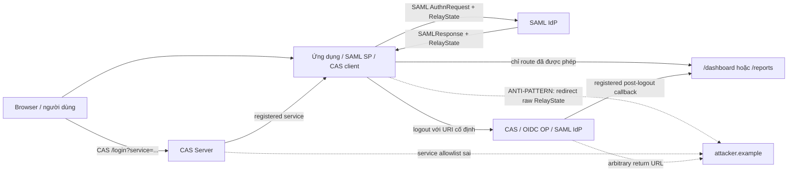
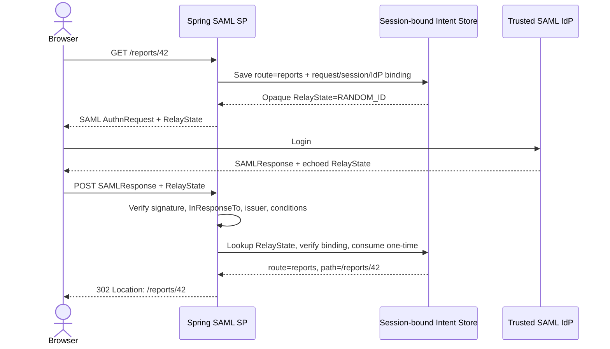

# Open redirect qua RelayState, service URL và địa chỉ sau đăng xuất

**Học phần:** Spring Security – federation → Gia cố an toàn.

**Mục tiêu:** nhận diện và ngăn **open redirect / unvalidated redirect (CWE-601)** tại những điểm chuyển hướng của hệ thống đăng nhập liên kết: SAML 2.0 `RelayState`, CAS `service` URL, ứng dụng sử dụng `next/returnUrl` sau SSO, và đích chuyển hướng sau logout ở CAS/OIDC/SAML/Spring Security. Người học cần hiểu ranh giới tin cậy, có thể thiết kế whitelist đích, trạng thái một lần gắn phiên, cấu hình SSO/logout an toàn, viết Java 17 demo và xây dựng bộ kiểm thử chống redirect abuse.

**Quy tắc nền tảng:** không bao giờ lấy URL từ `RelayState`, `service`, `returnUrl`, `next`, `redirect`, `continue`, `post_logout_redirect_uri`, `Referer` hoặc `Host/X-Forwarded-Host` do request cung cấp rồi đưa trực tiếp vào HTTP `Location`. **Một giao dịch xác thực thành công không biến URL chuyển hướng chưa kiểm tra thành đáng tin cậy.** Ưu tiên **mã đích đến (route ID) do server ánh xạ tới URL/path cố định**, và dùng **state ngẫu nhiên một lần, ngắn hạn, ràng buộc phiên** để giữ ngữ cảnh cần thiết xuyên qua IdP.

> Ba biên giới cần phân biệt: **(1) IdP/CAS được phép chuyển browser đến service nào; (2) SP/ứng dụng được phép chuyển browser đến trang nào sau xác thực; (3) ứng dụng/IdP được phép chuyển browser đi đâu sau đăng xuất.** Mỗi nơi là một chính sách độc lập. CAS service registry đúng không có nghĩa code redirect sau login của ứng dụng cũng đúng; SAML Assertion ký đúng không làm `RelayState` trở thành safe URL; session đã logout không tự cho phép bất kỳ `returnTo` nào.

## 1. Open redirect là gì và tại sao đặc biệt nguy hiểm quanh SSO?

Một **open redirect** xảy ra khi endpoint thuộc domain đáng tin trả HTTP 3xx với `Location` có thể bị người dùng hoặc attacker điều khiển để điều hướng tới một domain ngoài danh sách cho phép.

**Ví dụ lỗi tại ứng dụng:**

```http
GET /login/success?next=https%3A%2F%2Fevil.example%2Flanding HTTP/1.1
Host: portal.example.com
```

Một implementation dễ bị lỗi:

```java
// ANTI-PATTERN: không sử dụng trong production.
String next = request.getParameter("next");
response.sendRedirect(next);
```

HTTP response nếu không kiểm tra:

```http
HTTP/1.1 302 Found
Location: https://evil.example/landing
```

Nạn nhân nhìn thấy liên kết bắt đầu bằng domain hợp pháp `portal.example.com`, nhưng sau một bước browser bị đưa sang attacker domain. Trong thực tế hậu quả có thể gồm:
- **Phishing với uy tín domain SSO:** URL đầu tiên thuộc website được tin.
- **Lạm dụng callback/return endpoint:** attacker gắn `next` rồi dùng domain thật làm bước trung chuyển.
- **Rò rỉ dữ liệu trong URL:** nếu token, SAMLResponse, CAS ST, OAuth code, user profile hoặc state bị đưa vào `Location`, Referer/log/redirect có thể lộ dữ liệu nhạy cảm.
- **Kết hợp với token theft hoặc CSRF:** open redirect có thể góp phần vào luồng tấn công phức hợp nếu một bước khác đính credentials vào URL.
- **Logout phishing:** sau trang “Bạn đã đăng xuất”, browser chuyển ngay đến trang giả đăng nhập của attacker.
- **Policy bypass:** URL allowlist hoặc kiểm tra “cùng domain” tại một layer nhưng layer khác redirect tiếp ra ngoài.

**Không khẳng định mọi open redirect luôn làm lộ token.** Hậu quả phụ thuộc token nằm ở đâu, binding, query, Referer policy, browser behavior và luồng ứng dụng. Nhưng open redirect trong hệ thống SSO làm tăng đáng kể rủi ro vì nó xảy ra gần các bước người dùng tin IdP và chuyển trạng thái xác thực.

### 1.1. Dữ liệu từ browser và IdP là gì?

Trong SSO có nhiều biến thường bị gán sai mức độ tin cậy:

| Dữ liệu | Ai có thể ảnh hưởng? | Có phải chứng cứ cho redirect? |
| --- | --- | --- |
| `?next=/reports` | Browser/client nếu ứng dụng nhận | **Không**, phải map/validate |
| `RelayState` của SAML Response | Có thể bị giữ nguyên từ request, bị can thiệp tùy binding, hoặc do IdP-initiated flow cung cấp | **Không**, phải correlate và kiểm destination |
| `SAMLResponse` có chữ ký đúng | IdP ký assertions/response theo profile | Xác thực danh tính sau validate; **không tự xác thực arbitrary return URL** |
| CAS `service` | Client có thể chỉ định ở `/login`/`/logout` | CAS phải kiểm registered service và chính sách redirect |
| `returnTo` phía portal | App/client có thể cung cấp | **Không**, chưa đủ để redirect |
| OIDC `post_logout_redirect_uri` | RP gửi cho OpenID Provider | OP **phải khớp URI đã đăng ký chính xác** |
| OIDC logout `state` | RP khởi tạo và OP echo theo protocol | Giá trị opaque để correlate, **không phải URL tự thân** |
| Spring SavedRequest | Framework lưu request ban đầu | Chỉ an toàn khi request/target không bị pollution bởi custom code hoặc upstream trust sai |
| `Host` / `X-Forwarded-Host` | Có thể bị client spoof nếu proxy không strip | **Không** tự là trusted origin |
| HTTP `Location` | Server phát về browser | **Đích cuối phải được quyết định sau kiểm tra**, không copy raw input |

Điểm cốt lõi: **authentication validity, message integrity và redirect target authorization là ba phép kiểm tra riêng**.

## 2. Bản đồ ba cửa chuyển hướng chính



| Điểm | Trường hợp bình thường | Lỗi open redirect khi nào? |
| --- | --- | --- |
| SAML login | SP lưu request context, gửi opaque `RelayState`, kiểm Response và đưa về route đã lưu | SP gọi `sendRedirect(RelayState)` hoặc giải mã RelayState thành raw external URL |
| CAS login | Client dùng canonical `service` URL, CAS kiểm registered services rồi redirect ST | CAS mở service registry quá rộng, hoặc app tạo `service` từ URL client tùy ý |
| Sau login ở app | App dùng saved local path/route từ server-side state | Custom success handler lấy raw `next`/`Referer`/saved input rồi redirect |
| CAS logout | CAS hủy TGT và chỉ cho return `service` đã được đăng ký nếu tính năng bật | CAS follow redirects tới serviceId wildcard hoặc redirect setting từ request |
| OIDC logout | OP kiểm `post_logout_redirect_uri` **khớp chính xác** URI đã đăng ký | OP bỏ kiểm, RP tạo URL từ `returnTo`/Host header không tin |
| SAML logout | SP/IdP dùng SLO endpoint metadata/trust đúng; local success path cố định | App chuyển theo SAML logout `RelayState`/`returnUrl` không được kiểm tra |

**Rủi ro không kết thúc tại IdP**. Ngay cả khi CAS/OP chỉ redirect về một service hợp lệ `https://portal.example.com/login/cas`, callback của portal có thể đọc `next=https://evil.example` rồi redirect nạn nhân khỏi portal. Do đó phải test **toàn bộ chuỗi redirect 3xx**, không chỉ một response.

## 3. SAML 2.0 RelayState: dữ liệu điều hướng, không phải quyền chuyển hướng

### 3.1. RelayState làm gì?

Trong SAML2 browser SSO, SP có thể gửi:

```text
GET https://idp.example.com/sso?
    SAMLRequest=<encoded-authn-request>
    &RelayState=<opaque-context-id>
```

IdP trả về SAMLResponse kèm RelayState theo binding:

```http
POST /login/saml2/sso/corp HTTP/1.1
Host: portal.example.com
Content-Type: application/x-www-form-urlencoded

SAMLResponse=<encoded-saml-response>&RelayState=<opaque-context-id>
```

Các trường trong ví dụ là **ký hiệu**, không phải token/message có thể dùng thật. `RelayState` giúp SP nối câu trả lời với context ban đầu như “trở về báo cáo” hoặc request ID. **Nó không phải user identity, không phải quyền truy cập và không nên chứa raw target URL**.

Trong SAML bindings có những quy tắc quan trọng:
- `RelayState` theo HTTP Redirect/POST bindings SAML 2.0 có giới hạn **không quá 80 bytes** theo đặc tả. Đếm **bytes**, không phải “80 ký tự Unicode”.
- IdP thường cần **echo đúng giá trị RelayState** đã nhận theo binding, nhưng echo không phải phép đánh giá đích có an toàn hay không.
- Theo errata SAML, trong **HTTP Redirect Binding**, RelayState có thể được bao phủ bởi **chữ ký query string** khi sử dụng binding signature; với HTTP POST Binding cần bảo vệ integrity theo đặc tả/bảo vệ độc lập nếu không có coverage phù hợp. **Không nói RelayState luôn unsigned**.
- Kể cả một RelayState nguyên vẹn, đã được bên phát bảo vệ, nó vẫn **không chứng minh URL bên trong được phép cho ứng dụng**.
- Cần kiểm SAML `InResponseTo`, issuer, audience, destination/recipient, signature, conditions/time và replay; `RelayState` **không thay** các phép kiểm đó.

### 3.2. Anti-pattern: để RelayState chứa URL tự do

```java
// ANTI-PATTERN: SAML Response đã verified vẫn không đủ.
String relayState = request.getParameter("RelayState");
response.sendRedirect(relayState);
```

Nếu attacker làm nạn nhân đi qua flow có `RelayState=https://evil.example/landing`, ứng dụng có thể redirect ra ngoài sau SSO. Lỗi trở nên khó nhận ra vì phần SAML signature verification vẫn PASS.

Một anti-pattern khác:

```java
// ANTI-PATTERN: Base64 decode không phải xác minh integrity.
String target = new String(
    java.util.Base64.getUrlDecoder().decode(relayState),
    java.nio.charset.StandardCharsets.UTF_8);
response.sendRedirect(target);
```

**Base64, URL encoding và encryption không thay chính sách allowlist**. Ngay cả một chuỗi được mã hóa/giải mã đúng cũng có thể mang URL attacker nếu app đã cho attacker quyết định đích lúc tạo token.

### 3.3. Thiết kế đúng: opaque random RelayState → server-side intent

Khi user vào `/reports/42` trước login:

1. Ứng dụng xác định **route key** nội bộ, ví dụ `reports`, kèm resource ID đã xác thực/canonicalize.
2. App tạo một `LoginIntent` server-side gắn với **phiên browser đang bắt đầu SAML**, `registrationId`, expected IdP, AuthnRequest ID, route key và TTL ngắn.
3. App phát **opaque random token** làm `RelayState`, ví dụ 24–48 ký tự base64url; không đưa URL, token đăng nhập, session ID hoặc PII vào RelayState.
4. Sau nhận SAMLResponse, Spring/SAML library kiểm chữ ký, issuer, audience, recipient, `InResponseTo`, time và replay theo protocol.
5. App tra `RelayState` từ storage, kiểm request/session correlation, expected IdP/registration, TTL và consume **một lần**.
6. App chỉ chọn đích từ **server-side map** `reports → /reports/42` hoặc một local route đã duyệt; nếu thất bại, trả trang lỗi/đích local an toàn, không redirect raw input.



**Không chỉ có một Redis key `RelayState → route` công khai** nếu nó không được ràng buộc với original browser session: attacker có thể tạo request của chính họ rồi cố ghép SAMLResponse/RelayState vào phiên nạn nhân (login CSRF/login fixation). Một signed RelayState không gắn session cũng chưa đủ ngăn mọi tình huống. Phải bảo đảm **chính phiên đã khởi tạo** là phiên được phép hoàn tất.

### 3.4. Spring Security và request repository

Tài liệu Spring Security SAML2 mô tả:
- `Saml2WebSsoAuthenticationRequestFilter` tạo và lưu `AuthnRequest` trước khi gửi IdP.
- `Saml2AuthenticationRequestRepository` dùng để lưu/tra `AbstractSaml2AuthenticationRequest`.
- Mặc định `HttpSessionSaml2AuthenticationRequestRepository` lưu trong `HttpSession`, mang lại lợi ích ràng buộc phiên và phòng ngừa login fixation.
- `CacheSaml2AuthenticationRequestRepository` hỗ trợ lưu bằng cache phân tán khi cần, nhưng **không tự chứng minh browser đã khởi tạo request** nếu chỉ tin `RelayState` hoặc `InResponseTo` do callback cung cấp.

Cấu hình tối thiểu minh họa Spring Security SAML SP:

```java
import org.springframework.context.annotation.Bean;
import org.springframework.context.annotation.Configuration;
import org.springframework.security.config.Customizer;
import org.springframework.security.config.annotation.web.builders.HttpSecurity;
import org.springframework.security.web.SecurityFilterChain;

@Configuration
public class SamlSecurityConfig {
    @Bean
    SecurityFilterChain samlChain(HttpSecurity http) throws Exception {
        http
            .authorizeHttpRequests(auth -> auth
                .requestMatchers("/", "/signed-out", "/error")
                    .permitAll()
                .anyRequest().authenticated())
            .saml2Login(Customizer.withDefaults());

        return http.build();
    }
}
```

**Mã trên là mảnh cấu hình, không phải ứng dụng runnable một mình.** Còn cần `spring-security-saml2-service-provider` cùng dependencies, `RelyingPartyRegistration`/metadata, main app, user mapping và cấu hình session. Nó **không cung cấp custom redirect handler** và không có dòng nào chuyển theo raw RelayState. Nếu cần trở về màn hình nghiệp vụ, dùng saved request được framework quản lý hoặc custom success handler tra **safe route ID server-side** sau mọi validation.

### 3.5. IdP-initiated SSO và RelayState không có request trước

Với IdP-initiated SAML SSO, response có thể không có `InResponseTo` và không có SP-created login intent. Nếu hệ thống cho phép flow này vì hợp đồng với IdP:
- Chỉ tin các trusted IdP đã đăng ký, verify đúng Response/Assertion, audience/recipient/time/replay.
- **Không** dùng raw RelayState do IdP/browser cung cấp làm external redirect.
- Nếu không có state hợp lệ, dùng **một route mặc định cố định** như `/dashboard`.
- Không giả tạo một request correlation đã không tồn tại; bật unsolicited flow phải có security review riêng.
- Tránh dùng flow này cho các thao tác account linking, thay đổi quyền hoặc hành động nhạy cảm yêu cầu user-initiated intent.

**RelayState và SAMLResponse thuộc hai vùng kiểm tra khác nhau:** verify SAML assertions là cần thiết nhưng không thay việc kiểm destination của redirect cuối.

## 4. CAS `service`: đích sau đăng nhập phải nằm trong service registry

CAS là ticket-based SSO. Browser truy cập CAS:

```text
https://sso.example.com/cas/login
  ?service=https%3A%2F%2Fportal.example.com%2Flogin%2Fcas
```

Sau login, CAS phát Service Ticket dành cho `service` và redirect về URL đã được duyệt:

```http
HTTP/1.1 302 Found
Location: https://portal.example.com/login/cas?ticket=ST-example
```

CAS client phải validate ticket với **cùng canonical service URL**, qua `/serviceValidate` hoặc `/p3/serviceValidate` theo protocol. Một ST chỉ được phát cho service cụ thể, thường dùng một lần. **`service` không phải một URL tự do nên được tin mặc định chỉ vì user đã đăng nhập CAS.**

### 4.1. Rủi ro open service registry

Nếu CAS Server chấp nhận service URL tùy ý (open mode hoặc regex serviceId quá rộng), attacker có thể dùng hostname CAS đáng tin làm bước redirect về site của attacker. Các cấu hình không an toàn:

```text
serviceId = ".*"
serviceId = "^https?://.*"
serviceId = "^https://.*example.com.*"
```

Đặc biệt biểu thức `.*example.com` có thể match host ngoài ý muốn như `notexample.com`; biểu thức chỉ kiểm prefix cũng có thể cho qua subdomain giả hoặc userinfo trong URL.

Thiết kế service registry theo **registered logical service** được admin duyệt, URL scheme/host/path cụ thể. Ví dụ ý tưởng:

```json
{
  "@class": "org.apereo.cas.services.CasRegisteredService",
  "serviceId": "^https://portal[.]example[.]com/login/cas$",
  "name": "Portal CAS callback",
  "id": 421
}
```

**Đây là mảnh minh họa**, không phải JSON CAS service registration dùng trực tiếp trên mọi CAS version/store. CAS service registry schema/regex matching và context path phụ thuộc version và ứng dụng; cần validate bằng CAS service management trên staging. Nếu ứng dụng thực cần nhiều callback URLs, đăng ký từng URL/pattern có scope rõ, không đổi thành `^https://.*$` chỉ vì cấu hình khó.

### 4.2. Không tạo CAS `service` từ `next` do browser đưa vào

Anti-pattern ở app A:

```java
// ANTI-PATTERN: biến client-controlled URL thành CAS service.
String service = request.getParameter("next");
String login = "https://sso.example.com/cas/login?service=" +
        java.net.URLEncoder.encode(
                service, java.nio.charset.StandardCharsets.UTF_8);
response.sendRedirect(login);
```

Ngay cả CAS registry bị cấu hình rộng cũng không nên dựa vào nó như biện pháp duy nhất. App phải dùng **service URL canonical cố định**, ví dụ:

```text
CAS login base:
  https://sso.example.com/cas/login

Fixed CAS service:
  https://portal.example.com/login/cas

Internal business destination:
  routeKey=reports  →  /reports
```

Flow đúng:
1. App lưu `routeKey=reports` ở server-side state/saved request gắn phiên.
2. Redirect CAS `/login?service=<fixed-app-callback>`.
3. CAS login → callback fixed service với ST.
4. App validate ST bằng **đúng service identifier**.
5. App đưa user về `/reports`, không đọc raw URL từ query/RelayState.

### 4.3. Sự khác biệt giữa registered service URL và internal return route

Giả sử CAS đã đăng ký:

```text
https://portal.example.com/login/cas
```

Người dùng muốn mở `https://portal.example.com/reports/42`. Không cần mỗi lần đổi `service` thành đường resource. Ứng dụng có thể giữ saved request/route ở app session và dùng một callback fixed; điều này vừa đơn giản hóa service registry vừa hạn chế attack surface.

Nếu thiết kế CAS client dùng request URL làm service, vẫn phải **định nghĩa rõ canonical service URLs và bảo đảm registered service regex** không mở quá rộng. Đừng tự thay `/login/cas` bằng raw `Referer`, `Host`, `next` từ client.

### 4.4. Proxy/reverse proxy và Host header injection

Ở sau load balancer, app có thể tính `service` từ:

```java
// ANTI-PATTERN khi request Host/X-Forwarded-Host không đáng tin.
String service = request.getScheme() + "://"
        + request.getServerName()
        + "/login/cas";
```

Nếu ingress cho client điều khiển `Host`/`X-Forwarded-Host` và ứng dụng tin chúng, app có thể dựng callback/redirect tới domain attacker. Với CAS/OIDC/SAML, các URL này còn có thể tác động vào metadata, ACS, logout callback, cookie domain và xác thực ticket.

Khuyến nghị:
- Cấu hình public base URL/ACS/service URL **cố định từ trusted server configuration**.
- Ingress **strip/rewrite** forwarded headers do client gửi; chỉ tin reverse proxies đã được đăng ký.
- Hạn chế ingress hosts theo exact FQDN và TLS certificate SAN.
- Không dựng logout/authorization callback từ `request.getHeader("Host")`.
- Trong Spring Boot, kiểm cẩn thận `server.forward-headers-strategy` và proxy trust; framework dùng forwarded headers không tự làm source hợp lệ khi edge misconfigured.
- Test malicious Host headers trên môi trường được phép mà không để hệ thống phát absolute `Location` tới attacker domain.

## 5. CAS logout `service` và redirect sau đăng xuất

**CAS SSO logout** và **app local logout** là hai sự kiện độc lập. CAS có endpoint `/logout` để kết thúc CAS SSO session. Trong Apereo CAS có thể cung cấp một redirect trở về service qua tham số `service`, **nhưng phải đáp ứng service registry và tính năng follow redirects được cho phép**.

### 5.1. Đừng nhầm ba loại logout

| Loại | Điều gì bị kết thúc? | Đích/response |
| --- | --- | --- |
| **Local app logout** | HttpSession/SecurityContext của portal | Route cố định như `/signed-out` |
| **CAS logout** | Phiên SSO TGT/TGC tại CAS | CAS logout page, hoặc redirect về registered service nếu policy cho phép |
| **CAS Single Logout (SLO)** | CAS gửi logout notifications tới các service dựa trên session mapping | Thường front/back-channel; không nhất thiết là một browser return URL |

CAS SLO **không tự bảo đảm mọi app session đều bị hủy**, bởi thông điệp logout có thể thất bại hoặc đến trễ. Không dùng việc browser đã về `/signed-out` như bằng chứng tất cả downstream sessions đều kết thúc.

### 5.2. Tham số `service` tại CAS logout

Ví dụ có policy cho phép:

```text
https://sso.example.com/cas/logout
  ?service=https%3A%2F%2Fportal.example.com%2Fsigned-out
```

Tài liệu Apereo CAS 8.x nêu:
- Return `service` phải là **registered service** được chấp nhận.
- CAS phải cho phép follow-service redirects.
- `cas.logout.follow-service-redirects` có giá trị mặc định **false** trong cấu hình tài liệu đã tra cứu.
- `cas.logout.redirect-parameter` có thể cấu hình tên tham số; mặc định trong logic là `service`.
- `cas.logout.redirect-url` có thể cấu hình URL redirect cố định sau logout trong trường hợp có yêu cầu vận hành.

Không bật tùy tiện:

```properties
# Chỉ bật sau khi đã kiểm registered service allowlist và threat model.
cas.logout.follow-service-redirects=true
```

Một cách giảm nguy cơ open redirect là giữ follow redirects tắt và dùng **logout page cố định**. Nếu business cần quay về app, đăng ký **chính xác** `https://portal.example.com/signed-out` hoặc đích đã quản trị phê duyệt, kiểm đường redirect thực tế, không mở service registry chỉ để phục vụ return URL.

### 5.3. CAS 2.0 `url` khác CAS 3.0 `service`

Một số bài hướng dẫn CAS cũ dùng:

```text
/cas/logout?url=https://portal.example.com
```

Theo CAS 2.0, `url` truyền thống có thể là **liên kết hiển thị sau logout**, **không nhất thiết là HTTP 302 tự động**. Trong đặc tả CAS3, `service` là tham số logout return URL và phải được kiểm dịch vụ đăng ký. Apereo CAS thực tế có settings riêng điều khiển redirect. **Đừng sửa lỗi bằng cách thử hàng loạt `url`/`service` và coi mọi phiên bản đều tự redirect**: kiểm tài liệu đúng server/version và chính sách bảo mật.

### 5.4. Redirect sau logout không nên có “next hop” nguy hiểm

Ngay cả khi CAS `/logout?service=https://portal.example.com/signed-out` được duyệt, trang `/signed-out` có thể bị lạm dụng nếu nó tiếp tục:

```text
https://portal.example.com/signed-out
  ?next=https://evil.example/fake-login
```

CAS kiểm đích đầu tiên không kiểm logic redirect tiếp theo trong ứng dụng. **Kiểm toàn bộ redirect chain** và cấm raw `next` tại chính trang sau logout. Các logout success pages nên là **terminal/safe local destination** hoặc chọn route ID trong allowlist.

## 6. OIDC `post_logout_redirect_uri`: đăng ký và so sánh chính xác

OpenID Connect RP-Initiated Logout 1.0 có các tham số:
- `id_token_hint` – ID Token đã phát trước đó, được **khuyến nghị** làm gợi ý về client/user session.
- `post_logout_redirect_uri` – URI RP muốn OP chuyển browser đến sau khi đăng xuất.
- `state` – opaque value để duy trì state/correlation giữa logout request và callback.
- `client_id`/`logout_hint` trong các trường hợp mà profile/OP hỗ trợ.

Theo đặc tả OIDC, giá trị `post_logout_redirect_uri` **phải đã được đăng ký** với OP, và OP **không được thực hiện redirect nếu URI cung cấp không khớp chính xác** một URI đã đăng ký. Nếu không có `id_token_hint`, OP còn phải có phương tiện khác xác minh tính hợp lệ đích redirect nếu muốn thực hiện redirect. **Không biến `post_logout_redirect_uri` thành wildcard theo request.**

### 6.1. Ví dụ hợp đồng đúng

```text
OIDC OP:
  https://login.example.com

RP client_id:
  portal-web

Registered post_logout_redirect_uris:
  https://portal.example.com/signed-out

RP sends:
  post_logout_redirect_uri=https://portal.example.com/signed-out
  state=<opaque-random-nonce>

Expected:
  OP kiểm client + exact registered URI, logout rồi redirect về RP.
```

Các giá trị trên là hợp đồng minh họa. OP có thể yêu cầu HTTPS và thêm chính sách confirm logout/id_token_hint; phải test theo provider thực tế.

### 6.2. Sai khi lấy `post_logout_redirect_uri` từ user

```java
// ANTI-PATTERN: không dùng browser query làm URI gửi cho OP.
String returnTo = request.getParameter("returnTo");
String postLogoutRedirectUri = returnTo;
```

Nếu OP kiểm kém hoặc client registration được mở wildcard, browser có thể được chuyển sang phishing domain sau logout. Nếu OP kiểm đúng, sẽ reject URI; nhưng **RP cũng phải tự chọn destination có kiểm soát**, không “để OP lo hết”.

### 6.3. OIDC `state` không phải redirect URL

Một RP có thể gửi `state=<random>`, OP echo lại `state`. RP nên tra **server-side logout intent** với TTL, issuer/client registration và browser correlation, rồi hiển thị safe logout status. Không xem `state` như base64 của URL hoặc để client đổi state thành `https://evil.example` rồi redirect.

**OIDC logout state và OAuth2 login state khác mục đích**: cả hai là correlation mechanisms, nhưng không nên tái sử dụng chung transaction/nonce hoặc lẫn login callback với logout callback. Với login, `state` là thành phần chống CSRF/mix-up theo flow; với RP-initiated logout, `state` dùng để nối logout response với request đã phát.

## 7. SAML SLO: xác minh LogoutRequest/LogoutResponse và đích trở về

SAML Single Logout (SLO) dùng `LogoutRequest`/`LogoutResponse` giữa SP và IdP, thường theo metadata `SingleLogoutService`. Spring Security hỗ trợ:
- **RP-initiated SLO:** portal POST `/logout` (theo cấu hình), hủy phiên local rồi gửi signed logout message tới IdP; nếu IdP trả `LogoutResponse` phù hợp, SP verify rồi trả trang/safe route đã cấu hình.
- **IdP-initiated SLO:** IdP gửi signed `LogoutRequest`, SP verify, hủy phiên local rồi gửi signed response về IdP; trong một số flow browser do IdP điều khiển nên SP không có quyền tự chọn browser destination.

Các điều kiện bắt buộc:
1. **SLO destination** phải đến từ trusted `RelyingPartyRegistration`/IdP metadata và signature/trust policy, không lấy URL từ raw request.
2. Validate `Issuer`, `Destination`, signature, message ID, `InResponseTo` (nếu response), recipient/binding, time/replay theo profile.
3. `RelayState` của logout nếu tồn tại phải được dùng để correlate flow, **không làm Location tuyệt đối**.
4. App local redirect sau logout nên là `/signed-out` hoặc route đã đăng ký, không theo raw `returnUrl`.
5. Ghi nhận SLO là **best effort phụ thuộc thông điệp**, không chỉ dựa vào browser đã quay về trang của RP.

### 7.1. Spring Security cấu hình riêng SAML SLO

```java
// MẢNH CẤU HÌNH, cần RelyingPartyRegistration và signing credentials
http
    .saml2Login(org.springframework.security.config.Customizer.withDefaults())
    .saml2Logout(org.springframework.security.config.Customizer.withDefaults());
```

Chỉ bật khi asserting party metadata có `SingleLogoutService` và ứng dụng có signing/verification credentials đúng; không mặc định mọi SAML deployment đều hỗ trợ SLO. Trong Spring, default SAML logout request/response processing sử dụng các endpoints và validators chuyên biệt. Đừng tự redirect browser theo `RelayState` ở callback `/logout/saml2/slo` sau khi thư viện xử lý assertion/message.

**Local logout** và **federated logout** không đồng nghĩa: nếu chỉ muốn xóa phiên ứng dụng, có thể dùng route local riêng và không gọi IdP. Cần thống nhất UX với tổ chức (đặc biệt khi user còn các app sessions khác).

## 8. Spring Security: redirect local an toàn sau login/logout

### 8.1. Sau login: không dùng request parameter làm target tùy ý

Một mẫu cấu hình login an toàn có thể để Spring xử lý default saved request hoặc **chỉ redirect về local route cố định**. Khi custom success handler, đừng làm:

```java
// ANTI-PATTERN: cookie, query và Referer đều không là redirect allowlist.
String next = request.getParameter("next");
String referer = request.getHeader("Referer");
response.sendRedirect(next != null ? next : referer);
```

Nếu nghiệp vụ chỉ có các điểm trở về `dashboard`, `reports`, `settings`, hãy map chúng server-side:

```java
static final java.util.Map<String, String> ROUTES = java.util.Map.of(
    "dashboard", "/dashboard",
    "reports", "/reports",
    "settings", "/settings"
);

// Chỉ dùng ROUTES.get(serverStoredRouteKey) sau correlation.
// Không lấy key hoặc target từ unauthenticated callback mà chưa verify.
```

**Spring SavedRequest:** `SavedRequestAwareAuthenticationSuccessHandler` mặc định có thể trả người dùng về protected resource họ đã yêu cầu. Framework không đồng nghĩa mặc định bị open redirect; nguy cơ thường xuất hiện khi custom handler nhận `targetUrlParameter`, `Referer` hoặc request cache bị pollution do cách app xây URL. Bảo vệ bằng trusted host, request cache scope và server-side allowlist đối với return targets đã tùy biến.

### 8.2. Logout cục bộ: dùng URI cố định

Mảnh `SecurityFilterChain` minh họa Spring Security Servlet (không tự tạo IdP/SAML/CAS config):

```java
import org.springframework.context.annotation.Bean;
import org.springframework.context.annotation.Configuration;
import org.springframework.security.config.Customizer;
import org.springframework.security.config.annotation.web.builders.HttpSecurity;
import org.springframework.security.web.SecurityFilterChain;

@Configuration
public class LocalLogoutSecurity {
    @Bean
    SecurityFilterChain webSecurity(HttpSecurity http) throws Exception {
        http
            .authorizeHttpRequests(auth -> auth
                .requestMatchers("/", "/signed-out", "/error").permitAll()
                .anyRequest().authenticated())
            .saml2Login(Customizer.withDefaults())
            .logout(logout -> logout
                .logoutUrl("/logout")
                .logoutSuccessUrl("/signed-out")
                .invalidateHttpSession(true)
                .clearAuthentication(true));

        return http.build();
    }
}
```

**Đây là ví dụ local logout.** Cần SAML registration/IdP thực, dependencies, app main và CSRF configuration phù hợp; `.logoutSuccessUrl("/signed-out")` là fixed internal location. Trong Spring Security, `POST /logout` là mặc định thông dụng khi CSRF được bật; tránh tạo `GET /logout?returnTo=...` kích hoạt side effect do link ngoài. Nếu triển khai SAML SLO, handler riêng xử lý đường đi IdP; không cho local logout success URL override các phép kiểm SLO.

### 8.3. OIDC RP-Initiated Logout Success Handler

Spring Security có `OidcClientInitiatedLogoutSuccessHandler`. Mảnh cấu hình cho ứng dụng OIDC (không phải SAML-only):

```java
import org.springframework.security.oauth2.client.registration
        .ClientRegistrationRepository;
import org.springframework.security.oauth2.client.oidc.web.logout
        .OidcClientInitiatedLogoutSuccessHandler;
import org.springframework.security.web.authentication.logout.LogoutSuccessHandler;

public final class LogoutHandlers {
    public static LogoutSuccessHandler oidcLogout(
            ClientRegistrationRepository registrations) {
        var handler =
                new OidcClientInitiatedLogoutSuccessHandler(registrations);
        handler.setPostLogoutRedirectUri(
                "https://portal.example.com/signed-out");
        return handler;
    }
}
```

Ứng dụng tích hợp:

```java
// Tại HttpSecurity của OIDC client app đã cấu hình:
http.logout(logout ->
    logout.logoutSuccessHandler(
        LogoutHandlers.oidcLogout(clientRegistrationRepository)));
```

**Điều kiện:** `https://portal.example.com/signed-out` phải được đăng ký tại OP dưới `post_logout_redirect_uris` cho client cụ thể. Đừng lấy URI này từ `?returnTo`. Handler cũng hỗ trợ mẫu `{baseUrl}`, nhưng **base URL phải đến từ request/proxy được tin**; khi ingress có Host header injection, một fixed absolute URI được cấu hình rõ giúp tránh tin hostname request.

Đây là **mảnh cấu hình**, không phải chương trình `javac` chạy riêng: cần `oauth2Login`, client registration, runtime Spring Security OIDC và OP hỗ trợ `end_session_endpoint`. Kiểm tra đúng Spring Security version/Javadoc khi tích hợp.

### 8.4. Không dựa vào `Referer` làm redirect sau logout

`Referer` có thể vắng mặt, bị cắt theo browser policy hoặc do attacker kiểm soát trong một số flow. Dùng nó làm địa chỉ sau logout có thể đưa người dùng về trang attacker. **Sau logout nên đến landing page tĩnh hoặc route ID** do app chọn, không phụ thuộc `Referer`.

### 8.5. Các header chuyển tiếp và sai public base URL

Nếu ứng dụng cấu hình `{baseUrl}`, proxy có thể cung cấp `Forwarded`/`X-Forwarded-Host`/`X-Forwarded-Proto` để dựng URL public. Nếu edge không filter giá trị do client nhập, bạn có thể phát `post_logout_redirect_uri` sai host. Kiểm:
- Trusted reverse proxy chains.
- Exact allowed Host headers và ingress host routing.
- TLS hostname và scheme.
- Application public base URL được cấu hình cố định trong môi trường production.
- Không ghi credentials/state vào absolute redirects hoặc logs.

## 9. Một cơ chế an toàn chung: route ID + state ngẫu nhiên + ràng buộc phiên

Ba luồng SAML RelayState, CAS post-login saved request và OIDC logout state đều có thể dùng một nguyên tắc:

1. **Browser chỉ chọn một hành động có tên hữu hạn** hoặc truy cập URL nghiệp vụ đã được ứng dụng định tuyến.
2. Server quyết định **route key** và dữ liệu resource đã được xác minh, không nhận raw external URL.
3. Server tạo **opaque random state** có entropy mạnh (ví dụ 128+ bits) và TTL ngắn, gắn với original session, protocol, expected IdP, request ID/flow type, route.
4. Khi callback đến, server **xác minh giao thức** (SAMLResponse/CAS ST/OIDC response), sau đó tra state đúng phiên/flow, consume atomic.
5. Dịch route key bằng **fixed server-side map**; có thể thêm resource path segment sau khi kiểm kiểu, giới hạn độ dài và quyền.
6. Nếu state không tồn tại, đã consume, không khớp session/issuer hoặc expired → reject/đưa về safe local error; **không fallback sang raw URL**.
7. **Authentication/authorization** được quyết định độc lập; một redirect route đã allowlist không tự cấp quyền đọc resource bên trong.

| Loại state | Có thể chứa gì trên server? | Không nên mang trong browser-visible state |
| --- | --- | --- |
| SAML RelayState | request ID, session binding, relying-party registration, route key | Raw full return URL, username, ticket, SAML Assertion, session ID |
| CAS app SavedRequest | app session ID mapping, local route, callback binding | CAS ST/TGC, external URL, arbitrary `next` |
| OIDC logout state | original logout transaction, client registration, safe landing route | ID Token nguyên văn, raw `returnTo`, access token |
| OAuth login state | request/PKCE/nonce/issuer binding, local return route | URL unvalidated, user PII, token |
| Generic redirect state | one-time route key và subject/session provenance | Arbitrary URI làm `Location` |

### 9.1. Không xem mã route như một permission

Ví dụ route key `admin` chỉ được map sang `/admin` nếu hệ thống cho phép navigate đến route đó, nhưng **route protected vẫn phải kiểm RBAC/ABAC**. Nếu attacker đoán được route ID và được redirect về `/admin`, hệ thống không nên cấp data chỉ vì bước redirect thành công. Bảo mật redirect và bảo mật tài nguyên là hai chính sách riêng.

### 9.2. TTL, one-time và distributed cache

Khi app có nhiều pods, pending redirect/login state có thể lưu ở một shared store:
- Key đủ entropy, không enumerate.
- TTL ngắn, automatic cleanup.
- Correlation với original session/browser and expected provider.
- Atomic consume/`GETDEL` hoặc transaction/CAS operation để chống replay.
- Store không trả arbitrary external URL, chỉ safe route key.
- Session cookie `Secure`/`HttpOnly`/SameSite theo SAML POST/redirect flow; kiểm cross-site callback thực tế.
- Không log raw state nếu nó là security-relevant secret; nên dùng correlation hash.
- Khi callback vào pod khác, store có thể đọc được và giữ session binding.
- Phân biệt namespace cho login state và logout state; không dùng chung token giữa các loại transaction.

## 10. Java 17 chạy độc lập: chặn URL giả và replay state

Bài tập sau chỉ dùng **JDK 17**, không cần Maven/Spring/IdP. Nó mô phỏng một **server-side route registry** và **opaque state** dành cho callback:
- User chọn **route ID**, không chọn URL.
- State được tạo bằng `SecureRandom` và base64url, không chứa raw URL.
- Trả kết quả chỉ khi state tồn tại và session ID đúng; consume một lần.
- State đã dùng hoặc không đúng phiên trả **`/signed-out`** (safe local fallback).
- Raw `https://evil.example` không phải route ID và bị từ chối ngay từ lúc khởi tạo.

**Giới hạn:** đây là demo in-memory, không có TTL/DB transaction, CSRF, identity provider verification, network/HTTP, session authentication, issuer binding, logout notification hoặc authorization. Các session IDs trong test là chuỗi giả do chương trình đặt. **Không dùng trực tiếp bộ nhớ/map này làm SAML/AuthN Request Repository trong production.**

Tệp `SafeRedirectStateDemo.java`:

```java
import java.security.SecureRandom;
import java.util.Base64;
import java.util.HashMap;
import java.util.Map;
import java.util.Objects;

public class SafeRedirectStateDemo {
    private static final Map<String, String> ROUTES = Map.of(
            "home", "/home",
            "reports", "/reports",
            "signed-out", "/signed-out");

    record Pending(String sessionId, String routeKey) {}

    static final class Store {
        private final SecureRandom random = new SecureRandom();
        private final Map<String, Pending> pending = new HashMap<>();

        String begin(String sessionId, String routeKey) {
            if (sessionId == null || sessionId.isBlank()) {
                throw new IllegalArgumentException("Session required");
            }
            if (!ROUTES.containsKey(routeKey)) {
                throw new IllegalArgumentException("Unknown route ID");
            }
            byte[] nonce = new byte[24]; // 192 bits, URL-safe token.
            String token;
            do {
                random.nextBytes(nonce);
                token = Base64.getUrlEncoder().withoutPadding()
                        .encodeToString(nonce);
            } while (pending.containsKey(token));

            pending.put(token, new Pending(sessionId, routeKey));
            return token;
        }

        String complete(String sessionId, String relayState) {
            Pending value = pending.get(relayState);
            if (value == null
                    || !Objects.equals(value.sessionId(), sessionId)) {
                return "/signed-out";
            }
            if (!pending.remove(relayState, value)) {
                return "/signed-out";
            }
            return ROUTES.get(value.routeKey());
        }
    }

    public static void main(String[] args) {
        Store store = new Store();

        String first = store.begin("session-A", "reports");
        System.out.println("Valid callback: "
                + store.complete("session-A", first));
        System.out.println("Replay falls back: "
                + store.complete("session-A", first));

        String second = store.begin("session-A", "home");
        System.out.println("Wrong session falls back: "
                + store.complete("session-B", second));
        System.out.println("Original session still valid: "
                + store.complete("session-A", second));

        boolean blocked;
        try {
            store.begin("session-A", "https://evil.example/landing");
            blocked = false;
        } catch (IllegalArgumentException ex) {
            blocked = true;
        }
        System.out.println("External URL rejected: " + blocked);
    }
}
```

Chạy:

```bash
javac SafeRedirectStateDemo.java
java SafeRedirectStateDemo
```

**Stdout chính xác:**

```text
Valid callback: /reports
Replay falls back: /signed-out
Wrong session falls back: /signed-out
Original session still valid: /home
External URL rejected: true
```

**Điều gì được chứng minh?**
- State chỉ chứa nonce; server quyết định target URL từ map.
- Không thể biến `RelayState=https://evil.example` thành redirect vì raw URL không phải route ID.
- Sai session không được redirect đến route đã lưu.
- Replay không phát lại redirect protected context.

**Điều gì chưa được chứng minh?**
- Java map không lưu TTL và không thread-safe/multi-node; production phải dùng shared store với atomic consume, expiration và session-bound state.
- Token random chỉ ràng buộc **bài tập**, chưa chứng minh SAMLResponse hoặc CAS ST valid. Giao thức xác thực phải được verify **trước** khi app xử lý redirect state.
- Session ID chuỗi giả không phải bằng chứng authentication; các HTTP sessions thật phải do framework quản lý và chống fixation.
- Redirect về `/reports` không có nghĩa user có quyền đọc dữ liệu; authorization ở endpoint riêng.
- Token có 192-bit entropy không tự bảo đảm chống replay, nên vẫn phải consume và có TTL.
- SAML RelayState trong browser-visible URL/form không nên chứa secrets; dùng opaque token như trên với limit binding 80 bytes.

## 11. Vì sao lọc string bằng `startsWith` không an toàn?

Các URL nguy hiểm có thể đánh lừa kiểm tra chuỗi thô:

| Input attacker-controlled | Vì sao nguy hiểm/không nên chấp nhận? |
| --- | --- |
| `https://evil.example/login` | Absolute external URL |
| `//evil.example/login` | Network-path reference; browser dùng scheme hiện tại và host attacker |
| `https://portal.example.com.evil.example/x` | Prefix host nhìn giống portal nhưng host thật khác |
| `https://portal.example.com@evil.example/x` | URL `userinfo` làm host thật là `evil.example` |
| `https://evil.example@portal.example.com/x` | Tên trong userinfo gây nhầm source; nên reject userinfo dù host hợp lệ |
| `/\\evil.example/path` | Browser/proxy có thể canonicalize dấu backslash không như server |
| `%2F%2Fevil.example/x` | Encoding có thể được decode trước bước redirect |
| `%252F%252Fevil.example` | Double decoding ở multi-hop có thể tạo network-path reference |
| `javascript:alert(1)` | Scheme không dành cho HTTP redirect; cần deny |
| `data:text/html,...` | Non-web scheme không có trong allowlist |
| `https://portal.example.com:4443/x` | Port khác port đã duyệt |
| `https://portal.example.com/redirect?to=evil` | “Redirect chain”: first-hop allowlisted nhưng endpoint tự chuyển ra ngoài |
| `https://portal.example.com//evil.example` | Dễ bị normalize không thống nhất nếu code thay path thủ công |
| `https://portal.example.com/%5c%5cevil` | Encoded backslashes có thể bị biến đổi qua proxy/framework |
| `https://portal.example.com/%0d%0aLocation:%20...` | Encoded control characters/response-splitting risk nếu chèn raw vào header |

**Giải pháp tốt nhất:** không nhận URL làm target. Chọn một **destination ID trong allowlist server-side**. Nếu một ứng dụng thật sự phải hỗ trợ external URLs vì business requirement, dùng URL parser chuẩn tương thích với browser và redirect API, kiểm scheme/hostname canonical/port/path/userinfo, áp allowlist chính xác và **không biến đổi chuỗi sau khi đã validate**. Đồng thời kiểm các endpoints allowlisted không tạo redirect vòng hai ra ngoài.

### 11.1. Chỉ chấp nhận local path khi thật sự cần

Với “quay về trang vừa xem”, lựa chọn an toàn nhất là route ID như `reports`. Nếu cần lưu local path động:
- Đường phải bắt đầu bằng **một dấu `/` duy nhất**, không phải `//`.
- Reject dấu `\\`, CR/LF/control chars, URL có scheme/userinfo/authority.
- Hạn chế prefix/path tới routes được phép và normalize bằng framework/URI parser; tránh double encoding.
- Không cho app callback hoặc logout endpoint dùng `/redirect?url=...` làm safe local path.
- Gắn resource IDs đã kiểm tra kiểu và authorization sau login.
- Lưu trong server-side state; không dùng raw query/payload ở callback.

Đừng dựa vào regex `^/.*` một mình. Nó cũng nhận `//evil.example` – có thể bị browser hiểu là external host.

### 11.2. Khi bắt buộc cho external redirect

Ví dụ một portal cần redirect sang ba đối tác có hợp đồng, có thể có:

```text
destination_id = partner-a → https://login.partner-a.example/finished
destination_id = partner-b → https://account.partner-b.example/finished
destination_id = home      → /home
```

Destination IDs là **do server quản lý**. Việc thay URL chỉ do configuration/change approval, không phải người dùng cấp runtime. Nếu có route từ khách hàng nhập, server cần ràng buộc tenant, service permissions, exact host/path/scheme, redirect depth và TTL. External redirect có thể hiển thị trang thông báo “Bạn sắp rời website” kèm hostname đã kiểm chứng, nhưng trang thông báo **không thay thế allowlist**.

## 12. Attack chain riêng tại từng giao thức

### 12.1. SAML RelayState injection

```text
1. Client bắt đầu login SAML và đưa RelayState bằng raw URL.
2. IdP chứng thực người dùng và trả SAMLResponse đã ký.
3. SP verify signature nhưng gọi sendRedirect(RelayState).
4. Browser bị chuyển sang external site.
```

Điểm sửa không phải “tắt signature verification” mà là **giữ SAML validation và thay redirect logic**: opaque state + session correlation + allowlisted route.

### 12.2. CAS service URL poisoning

```text
1. CAS cho phép serviceId regex quá rộng hoặc open mode.
2. Request tới /cas/login?service=https://evil.example/...
3. Sau login CAS chuyển browser tới service attacker chọn.
4. Thương hiệu CAS được dùng làm redirector.
```

Điểm sửa ở **CAS service registry**, không phải chỉ UI login. Đồng thời app A phải dùng fixed `service` và không tự chuyển tiếp `next` chưa duyệt.

### 12.3. CAS app second-hop redirect

```text
1. CAS kiểm và redirect về registered:
   https://portal.example.com/login/cas
2. Callback portal xác minh ST thành công.
3. Custom success handler đọc:
   ?next=https://evil.example/landing
4. Portal gửi Location ra ngoài.
```

CAS đã làm đúng việc của mình; lỗi nằm ở **portal post-login handler**. Cần scan cả các chained redirects.

### 12.4. Open redirect sau CAS logout

```text
1. Portal logout, gửi /cas/logout?service=<configured-return>.
2. CAS kiểm follow redirects + registered service.
3. Trở lại portal/signed-out.
4. Portal nhận ?returnTo=<attacker-url> và redirect tiếp.
```

Bảo vệ cả CAS config và portal logout landing. Từ chối các đích logout do attacker tự chọn.

### 12.5. OIDC logout return URI poisoning

```text
1. RP nhận ?logoutReturn=https://evil.example/...
2. RP gửi URI đó cho OP như post_logout_redirect_uri.
3. OP kiểm kém/registration quá rộng, chấp nhận.
4. Browser rời OP tới attacker domain.
```

Sửa ở cả hai phía: **OP exact registered URI match** và **RP chọn fixed/allowlisted URI**. Nếu OP đã kiểm đúng, request phải fail thay vì silent redirect.

### 12.6. Reverse proxy Host header poisoning

```text
1. Attacker gửi Host/X-Forwarded-Host không được ingress lọc.
2. App dựng {baseUrl} hoặc service callback từ host attacker.
3. App gửi redirect hay metadata với absolute URL sai.
```

Chặn host tại edge, strip forwarded headers, cấu hình public canonical base URL cố định và kiểm redirects trong integration test.

## 13. Logout CSRF và sự khác biệt giữa redirect an toàn với logout đúng

Một HTTP endpoint có redirect target an toàn vẫn có thể **logout CSRF** nếu client bên ngoài kích hoạt logout trái ý user bằng GET. Với Spring Security Servlet khi CSRF được bật, logout thường sử dụng **POST /logout** kèm CSRF token; đừng bật GET logout một cách tùy tiện để xây một link “sign out”.

Đồng thời:
- App local logout phải clear `SecurityContext`/session/cookies theo chính sách.
- CAS/OIDC/SAML federation logout cần protocol handling riêng; không hứa rằng local session logout = IdP SSO logout.
- OIDC `post_logout_redirect_uri` chỉ là **navigation** sau logout, không phải bằng chứng logout đã được hoàn tất ở mọi dịch vụ.
- SAML `LogoutResponse` cần verify issuer/signature/request correlation; redirect đến success page không tự là bằng chứng nếu callback chưa validate.
- Khi logout gặp lỗi, chọn safe local error page, không fallback raw `returnUrl`.
- Không đặt access token, ID Token, refresh token hoặc SAMLResponse trong URL của landing page.

**Tránh phụ thuộc `Referer`:** khi logout, Referer có thể bị thiếu, bị attacker ảnh hưởng hoặc chỉ ra một external domain. Một route `/signed-out` cố định là phương án dễ kiểm và giảm rủi ro phishing.

## 14. Trường hợp SPA, BFF và mobile deep links

### 14.1. SPA dùng OIDC

SPA có thể có return route như `/app/settings`, nhưng không nên cấp `post_logout_redirect_uri` tùy biến theo mọi route. Thường đăng ký **một logout callback chính xác**, ví dụ `https://portal.example.com/signed-out`, rồi SPA tự chọn **local route allowlisted** dựa trên state đã được xác minh. Cẩn thận lịch sử browser, fragments và URL query: fragment không được server nhìn thấy khi HTTP request, và fragment chứa tokens có thể lộ nếu SPA redirect không an toàn.

### 14.2. BFF / reverse proxy đăng nhập thay SPA

Trong mô hình Backend-for-Frontend:
- BFF sở hữu OIDC client, session cookie và logout.
- Browser chỉ nhận session cookie/CSRF protection, không cần lưu ID Token hoặc refresh token trong localStorage.
- BFF redirect OP với fixed post-logout callback.
- BFF phải kiểm `returnTo` do browser gửi, không forward tới OP.
- Logout callback phải xóa session/cookies và không tin browser gửi raw auth user headers.

### 14.3. Native/mobile custom schemes

OIDC có thể cho phép một số custom URI schemes hoặc loopback redirect theo profile; đây là các ngoại lệ đặc thù, **không phải lý do cho phép `javascript:`/`data:` trong web redirect**. Đối với web RP, ưu tiên HTTPS registered logout URI. Với mobile app, dùng quy tắc scheme/ownership/registration của nền tảng và không mở wildcard custom schemes.

## 15. Multi-tenant: mỗi tenant một bộ redirect allowlist

Một ứng dụng phục vụ nhiều tổ chức có thể có:
- `tenant-a.portal.example.com`;
- `tenant-b.portal.example.com`;
- một số IdP registrations và logout endpoints khác nhau.

**Không lấy domain từ `tenant` query unchecked**. Cần xác định tenant từ authenticated app context hoặc trusted server-side host mapping, sau đó chọn **tenant-specific allowed callback/return URIs**:

```text
Tenant A:
  SAML SP entity/ACS: https://tenant-a.portal.example.com/login/saml2/sso/corp
  Logout success:     https://tenant-a.portal.example.com/signed-out

Tenant B:
  SAML SP entity/ACS: https://tenant-b.portal.example.com/login/saml2/sso/partner
  Logout success:     https://tenant-b.portal.example.com/signed-out
```

- Tenant A không được yêu cầu redirect tới Tenant B chỉ vì có cùng parent domain.
- App phải verify SAML `Audience/Recipient/Destination` và correct relying-party registration per tenant.
- CAS registered service regex không nên wildcard `*.portal.example.com` nếu tenant có quyền khác nhau và có thể tạo subdomains.
- OIDC post-logout URIs cần đăng ký chính xác theo client/tenant và kiểm issuer/client ID.
- Dù hai hosts cùng eTLD+1, cookies/session scopes và tenant authorization cần kiểm riêng.
- User input không được phép tự đặt `issuer-uri`, SAML metadata URL hay CAS serviceId.

## 16. Monitoring: đừng log credentials và đừng nhầm 3xx với thành công

Mỗi lần đăng nhập/đăng xuất có thể chứa nhiều 302 và callback. Logs nên đủ để điều tra nhưng **không lưu raw tokens/cookies**.

Nên ghi:
- Event type: `SAML_LOGIN_START`/`LOGIN_SUCCESS`/`CAS_LOGOUT`/`OIDC_LOGOUT_RETURN`.
- Server-owned route key, target allowlist rule ID và decision `ALLOW/DENY`.
- Protocol, issuer/IdP registration hoặc CAS service registration đã xác minh.
- Opaque correlation ID **đã che/hash**, không phải RelayState/CSRF token nguyên văn.
- Expected vs actual host/scheme (đã sanitize), nguồn từ trusted config hay request.
- Request ID, tenant ID, time, HTTP 3xx/status và failure reason.
- Redirect chain depth/host transitions trong test/monitoring.
- Các trường hợp `UNREGISTERED_RETURN_URI`, `INVALID_RELAY_STATE`, `SERVICE_NOT_ALLOWED`.

Không ghi:
- Raw `SAMLResponse`, `SAMLRequest` nếu chứa PII/credentials.
- CAS ST/TGT/TGC/PT/PGT.
- Raw OIDC `id_token_hint`, access/refresh tokens.
- Session cookies, state/nonce/PKCE secrets.
- Full `Location` nếu chứa sensitive query; chỉ log destination category hoặc origin/path đã loại secrets.

**Mẫu alert:** lượng 302 sang host ngoài allowlist, đăng nhập SAML thiếu state/session binding, CAS request service unregistered, OP từ chối `post_logout_redirect_uri`, nhiều requests với encoded/obfuscated redirect values.

## 17. Bảng sự cố và cách xử lý

| Triệu chứng | Nguyên nhân có thể | Cách xử lý |
| --- | --- | --- |
| Sau SAML login browser sang domain lạ | Success handler dùng raw RelayState | Opaque state + safe route mapping, kiểm SAML signature tiếp tục |
| SAML SSO thành công nhưng lost original page | Session/saved request bị mất, SameSite hoặc cache handling | Kiểm session-bound repo, cookie SameSite, distributed store |
| Spring dùng custom cache, login fixation risk | Chỉ tra request theo RelayState/InResponseTo không ràng buộc browser | Bind original session/browser/issuer và one-time state |
| `RelayState` dài, IdP reject | Vượt giới hạn 80 bytes binding | Dùng short random opaque state, data ở server |
| SAML Response valid nhưng `RelayState` giả | State không được bảo vệ theo flow | Reject, không trust callback destination |
| CAS `/login` trả service unauthorized | URL không khớp registry | Cố định callback, sửa registry hẹp theo yêu cầu |
| CAS login redirect tới attacker site | Registry open/regex rộng | Disable open mode, restrict serviceId, audit đăng ký |
| CAS success rồi portal redirect ngoài | Callback custom `next` unvalidated | Sửa success handler, route allowlist |
| CAS ST validation `INVALID_SERVICE` | App gửi service khác với service phát ticket | Public canonical service URL và consistent encoding |
| CAS logout không redirect | `follow-service-redirects` đang false | Đó có thể là mặc định an toàn; bật chỉ với allowlist |
| CAS2 `url` có link chứ không 302 | Version/protocol khác `service` | Kiểm CAS spec và đúng server config |
| OIDC logout bị OP từ chối URI | `post_logout_redirect_uri` không đăng ký chính xác | Dùng registered fixed URI |
| OIDC logout trả đúng nhưng redirect về wrong host | `{baseUrl}` phụ thuộc untrusted Host/X-Forwarded-* | Fixed public callback và proxy trust |
| SAML SLO kết thúc nhưng app chưa logout | LogoutRequest/Response endpoint hoặc session mapping lỗi | Kiểm signature, protocol flow và SLO delivery |
| `//evil.example` đi qua local-path regex | Regex chỉ kiểm `^/` | Chặn network-path references, ưu tiên route IDs |
| Prefix check cho phép `portal.example.com.evil.example` | Compare string thay vì canonical hostname | Exact parsed hostname/port/path allowlist |
| 302 first-hop hợp lệ nhưng next hop độc hại | Đường allowlisted tự redirect theo `to` | Kiểm full chain và loại open redirect tại endpoint nội bộ |
| Logout link làm user bị log out trái ý | GET logout/CSRF disabled | POST + CSRF, thông báo phù hợp |
| Chỉ lỗi trên reverse proxy | Host rewriting, forwarded headers/trailing slash | Chốt public base URL, ingress tests |
| Browser thấy logout page nhưng phiên khác còn | Local logout vs CAS/OIDC/SAML SLO khác nhau | Không dùng redirect như chứng cứ global logout |

**Đừng “fix” bằng cách tắt SAML signature, mở CAS registered services regex, tắt OP exact URI check, tin tất cả forwarded headers hoặc cho phép mọi `returnTo`.** Những thay đổi đó biến lỗi cấu hình thành lỗ hổng security.

## 18. Bộ kiểm thử bảo mật trước release

| Test case | Mẫu vào/điều kiện | Kỳ vọng |
| --- | --- | --- |
| SAML RelayState là opaque token hợp lệ | Đúng session, request, IdP, chưa consume | Verified SAML → safe local route |
| RelayState là absolute external URL | `https://evil.example` | Không chuyển ra ngoài |
| RelayState là protocol-relative URL | `//evil.example` | Từ chối/không dùng làm Location |
| RelayState bị sửa sau start | Khác token đã lưu | Reject; không tạo login fixation |
| RelayState từ session A dùng ở B | Cùng IdP/cùng token | Reject, không ghép SAMLResponse |
| RelayState đã consume | Callback lặp | Reject/landing safe; không tái sử dụng |
| RelayState hết TTL | Delayed callback | Reject và cleanup |
| RelayState vượt 80 bytes | SAML binding HTTP POST/Redirect | Protocol-compliant handling; dùng opaque short key |
| SAML Response invalid signature | RelayState valid | Không authenticate/redirect như success |
| SAML Response wrong audience/recipient | Signed bởi IdP khác/đích khác | Reject |
| SAML unsolicited response | Không có AuthnRequest | Reject nếu policy yêu cầu SP-initiated; nếu allowed, safe default route |
| SAML SLO forged LogoutResponse | Signature/`InResponseTo` sai | Reject, không redirect raw state |
| CAS `service` registered exact | Fixed callback portal | CAS redirect đúng, ST validate đúng |
| CAS service attacker domain | `https://evil.example` | CAS từ chối |
| CAS serviceId wildcard | Test registry regex | QA FAIL; thu hẹp allowlist |
| CAS client `next` external | `next=https://evil.example` | Internal route policy chặn |
| CAS login second-hop redirect | Registered callback có `?to=...` | Không external redirect |
| CAS logout `service` không registered | URI attacker | CAS deny/no redirect |
| CAS logout redirects disabled | `follow-service-redirects=false` | CAS logout page/no arbitrary 302 |
| CAS logout redirects enabled/allowed | Registered fixed `/signed-out` | Redirect đúng URI, không second-hop |
| CAS2 `url` behavior | Legacy CAS protocol | Không giả định automatic redirect |
| OIDC post logout registered exact | `https://portal.example.com/signed-out` | OP accept nếu other checks pass |
| OIDC post logout wrong path | `/signed-out/` | OP reject nếu chưa đăng ký |
| OIDC post logout wrong port | `:4443` | OP reject |
| OIDC post logout attacker hostname | `portal.example.com.evil.example` | OP reject |
| OIDC logout state wrong/replay | Opaque state không khớp | RP không trust callback |
| OIDC logout without id_token_hint | OP required identification policy | Không redirect nếu không đủ chứng cứ |
| Spring local logout | POST với CSRF hợp lệ | Clear session và fixed local URL |
| Spring GET logout | CSRF enabled | Không kích hoạt destructive logout qua link ngoài |
| Spring logout raw Referer | External origin | Không dùng Referer làm target |
| Spring SavedRequest | Legitimate protected local route | Trở về local URL |
| Spring custom success handler | `next=//evil.example` | Reject/route ID |
| Host header spoof | `Host: attacker.example` | App/ingress reject; Location không bị đổi |
| X-Forwarded-Host spoof | `X-Forwarded-Host: attacker.example` | Proxy strip, app dùng trusted public URL |
| Userinfo/prefix URL | `portal.example.com@evil.example` | Reject |
| Double-encoded slashes | `%252f%252fevil.example` | Không tạo external destination |
| Control characters | `%0d%0aLocation: ...` | Reject/malformed, không header injection |
| Redirect chain | 3xx → allowlisted → external | QA FAIL, chặn second-hop |
| Tenant isolation | Tenant A chọn URI Tenant B | Reject |
| Proxy alternate ingress | Bypass same-host policy | Không có open redirect path |
| Logs | Invalid state/URI | Không lộ SAMLResponse, ticket, JWT, cookie |
| Authorization | Safe route tới `/admin` nhưng user thiếu quyền | 403, không dùng redirect thay authorization |

**Test thực tế cần đủ ba tầng:** unit tests policy/route resolver; integration tests với Spring Security/SAML IdP/CAS Server/OIDC OP sandbox; browser E2E kiểm toàn bộ redirect chain, cookies, SameSite/CSRF, reverse proxy Host behavior và SLO. `@WithMockUser` hoặc chỉ test `302 Location` ở controller **không chứng minh** toàn bộ federation response/issuer đã được verify.

### 18.1. Kiểm tra bằng các câu hỏi QA ngắn

- Redirect target có được chọn từ **server-owned configuration** hoặc state đã ràng buộc phiên không?
- Mọi query/cookie/RelayState/Referer/Host inputs chưa tin có bị cấm trở thành raw `Location` không?
- CAS service registry có match đúng service URL; logout redirect feature có chính sách riêng?
- OIDC RP/OP có dùng đúng registered post-logout callback và logout state?
- SAML Response và LogoutResponse có được verify đúng signature/issuer/correlation?
- Khi state mất/hết hạn, có **fail closed** không?
- Khi user đã authenticated, app còn kiểm role/resource ở route cuối không?
- Có thể redirect qua một allowlisted endpoint nhưng endpoint đó tự redirect ra ngoài không?
- Multiple tenants/domains đã được phân ranh rõ?
- Proxy headers có bị client spoof không?
- Bản log/screenshot/telemetry có lộ ticket/token/SAMLResponse không?

## 19. Quy trình rà soát hệ thống đang chạy

**Bước 1 – Inventory tất cả redirect sinks.** Tìm trong code: `sendRedirect`, `RedirectView`, `return "redirect:"`, `DefaultRedirectStrategy`, `SavedRequestAwareAuthenticationSuccessHandler` tùy biến, `logoutSuccessUrl`, `LogoutSuccessHandler`, `RelayState`, `service`, `next`, `returnTo`, `continue`, CAS logout/oidc logout/SAML SLO handlers. Đừng kết luận có lỗ hổng chỉ vì thấy tên hàm; kiểm **tainted input → Location**.

**Bước 2 – Trace nguồn URL.** Dữ liệu có đến từ query/body/cookie/Referer/Host/forwarded headers, hay từ server config/trusted metadata? Nếu đã nằm trong session, **ai có thể ghi vào session** và có validate trước khi lưu không?

**Bước 3 – Tách login và logout policy.** Liệt kê registered CAS services và logout return links; OIDC registered post-logout URIs; SAML SP ACS/SLO metadata; local post-login safe routes. Kiểm điểm cấu hình per tenant.

**Bước 4 – Thay raw URLs bằng route IDs.** Chỉ dùng fixed mapping; với RelayState dùng random opaque reference, session-bound. Mọi external links được phê duyệt bằng exact allowlist.

**Bước 5 – Bật negative tests.** Bao phủ scheme-relative, encoded/double-encoded, userinfo, prefix host, wrong port, Host poisoning, login/logout replay, wrong tenant và second-hop.

**Bước 6 – Rollout an toàn.** Thử staging federation, canary tenant, metrics denied redirects; không mở registry khi có client bị lỗi. Nếu có legacy deep links, migrate chúng sang local route mapping có quản trị.

**Bước 7 – Giám sát liên tục.** CAS service registry drift, OP registered URIs, Spring Security upgrades, ingress policies và signed/correlated SAML requests; cảnh báo redirects ra host chưa được duyệt.

## 20. Câu hỏi tự kiểm tra

**Q1. SAML Assertion có chữ ký hợp lệ có nghĩa `RelayState` được phép làm redirect URL không?**  
Không. Authentication proof và redirect authorization tách biệt. RelayState có thể được integrity-protected trong một số binding nhưng vẫn không là allowlist destination.

**Q2. RelayState có thể chứa full URL không?**  
Có implementation dùng URL, nhưng đó không phải thiết kế mặc định an toàn. SAML HTTP Redirect/POST bindings giới hạn 80 bytes và rủi ro tampering/XSS/CSRF. Ưu tiên **opaque short random state** map tới server-side route.

**Q3. CAS registry đã chặn `https://evil.example`; portal còn cần kiểm `next` không?**  
Có. CAS có thể redirect về registered portal callback, nhưng portal tự redirect tiếp từ `next`, tạo second-hop open redirect.

**Q4. Dùng `service` trong CAS logout có luôn redirect browser không?**  
Không. Apereo CAS có policy `cas.logout.follow-service-redirects` mặc định false theo tài liệu CAS 8.x, và return service còn phải registered/allowed.

**Q5. OIDC `post_logout_redirect_uri` có thể là URL bất kỳ do RP gửi?**  
Không. OIDC RP-Initiated Logout yêu cầu URI **đã đăng ký và khớp chính xác**; OP phải kiểm legitimacy, RP cũng phải không nhận arbitrary `returnTo`.

**Q6. Chỉ cho redirect về hostname kết thúc `example.com` có đủ an toàn không?**  
Không. String suffix/prefix dễ bị spoof bởi subdomains, userinfo và path/port trick. Dùng exact allowed origins/paths hoặc route IDs.

**Q7. `//evil.example` có phải local path vì bắt đầu bằng `/`?**  
Không. Đó là **network-path reference**; browser có thể chuyển sang attacker host với scheme hiện tại.

**Q8. Redirect về `/admin` từ một state hợp lệ có tự cấp quyền admin không?**  
Không. Redirect policy và resource authorization khác nhau; `/admin` còn phải kiểm quyền.

**Q9. Sau khi logout, có thể lấy `Referer` để quay về trang trước không?**  
Không nên. Referer không phải trustworthy allowlist và có thể dẫn tới external domain; dùng local route cố định.

**Q10. Tại sao nên test full redirect chain?**  
Vì first-hop đã được CAS/OP kiểm có thể dẫn tới **một app endpoint có open redirect** ở hop tiếp theo.

## 21. Tài liệu tham khảo chính thức

1. [OWASP – Unvalidated Redirects and Forwards Cheat Sheet](https://cheatsheetseries.owasp.org/cheatsheets/Unvalidated_Redirects_and_Forwards_Cheat_Sheet.html): ưu tiên không nhận arbitrary URL, dùng short IDs và exact allowlists; tránh raw prefix/suffix matching.
2. [CWE-601 – URL Redirection to Untrusted Site](https://cwe.mitre.org/data/definitions/601.html): mô hình và hậu quả open redirect.
3. [OASIS SAML 2.0 Approved Errata](https://docs.oasis-open.org/security/saml/v2.0/errata05/csprd01/saml-v2.0-errata05-csprd01.html): RelayState trong HTTP Redirect binding có thể nằm trong chữ ký query; cảnh báo redirect/CSRF/XSS khi dùng RelayState.
4. [OASIS SAML 2.0 Bindings](https://docs.oasis-open.org/security/saml/v2.0/saml-bindings-2.0-os.pdf): giới hạn RelayState 80 bytes, redirect/POST binding và bảo vệ integrity.
5. [Spring Security – Producing SAML2 AuthnRequests](https://docs.spring.io/spring-security/reference/servlet/saml2/login/authentication-requests.html): `HttpSessionSaml2AuthenticationRequestRepository` và `CacheSaml2AuthenticationRequestRepository`, lưu ý login fixation.
6. [Spring Security – Performing SAML2 Single Logout](https://docs.spring.io/spring-security/reference/servlet/saml2/logout.html): RP/AP initiated SLO, `LogoutRequest/LogoutResponse`, verification và success handling.
7. [Apereo CAS – CAS Protocol Specification](https://apereo.github.io/cas/development/protocol/CAS-Protocol-Specification.html): `service`, registered services, ticket validation, logout behavior.
8. [Apereo CAS – Service Management](https://apereo.github.io/cas/development/services/): registered services và `serviceId` regex.
9. [Apereo CAS – Logout & Single Logout](https://apereo.github.io/cas/8.0.x/installation/Logout-Single-Signout.html): CAS logout `service`, `follow-service-redirects` và SLO.
10. [OpenID Connect RP-Initiated Logout 1.0](https://openid.net/specs/openid-connect-rpinitiated-1_0.html): `id_token_hint`, `post_logout_redirect_uri`, exact registered match và `state`.
11. [Spring Security – OIDC Client-Initiated Logout Success Handler](https://docs.spring.io/spring-security/reference/api/java/org/springframework/security/oauth2/client/oidc/web/logout/OidcClientInitiatedLogoutSuccessHandler.html): fixed/template `post_logout_redirect_uri` support.
12. [OWASP – CSRF Prevention Cheat Sheet](https://cheatsheetseries.owasp.org/cheatsheets/Cross-Site_Request_Forgery_Prevention_Cheat_Sheet.html): bảo vệ logout/side-effect requests và login CSRF.
13. [RFC 9700 – OAuth2 Security Best Current Practice](https://www.rfc-editor.org/rfc/rfc9700.html): redirect URI validation, PKCE và browser OAuth security boundaries.

**Kết luận:** đối với **SAML RelayState**, dùng opaque short state lưu ở server và gắn phiên; đối với **CAS service URL**, dùng callback canonical và CAS registered-service allowlist; đối với **CAS/OIDC/SAML logout**, chỉ cho phép redirect về các địa chỉ đã cấu hình/đăng ký và kiểm đúng giao thức. Mỗi bước phải tránh raw `Location` từ client, kiểm session/request correlation, không để second-hop redirect thoát allowlist và không nhầm “đã đăng nhập/đã đăng xuất” với “URL đích đã an toàn”.