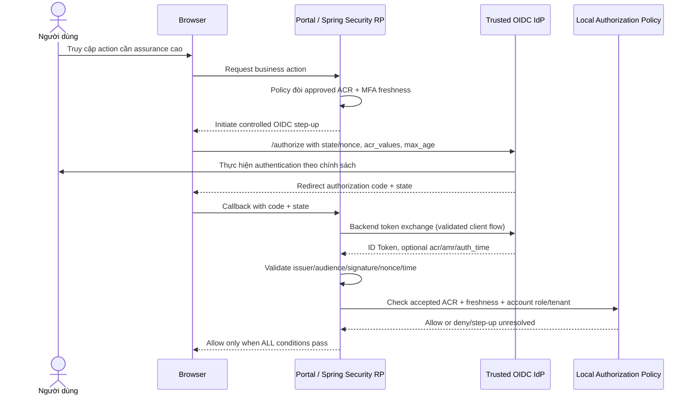

# Phân biệt tín hiệu MFA do IdP xác nhận với giá trị thuộc tính tự khai báo

## Mục tiêu học tập

Sau bài này, bạn có thể:

1. Phân biệt **MFA đã thực sự diễn ra và được nhà cung cấp danh tính (IdP) xác nhận** với các dữ liệu như `mfa=true`, `mfa_enabled`, `has_2fa`, `amr` do browser, user profile hoặc một hệ thống trung gian chưa đáng tin khai báo.
2. Hiểu các khái niệm **yếu tố xác thực**, **phương thức xác thực**, **mức bảo đảm xác thực (authentication assurance)**, **độ mới của lần xác thực (freshness)** và **quyền truy cập (authorization)**; không đánh đồng chúng.
3. Diễn giải chính xác các claims OIDC `acr`, `amr`, `auth_time`, `iss`, `sub`, `aud`, `nonce`, `exp` và tham số request `acr_values`, `max_age`; biết trường nào là yêu cầu của RP, trường nào là kết quả của OP.
4. Đọc bằng chứng từ **ID Token đã được Spring Security/OIDC client xác minh** thay vì lấy raw JSON, UserInfo tổng hợp, query, form, cookie, localStorage hoặc header tự khai.
5. Hiểu với SAML2 phải xét **`AuthnContextClassRef` của `AuthnStatement` trong response/assertion đã được xác minh**, không tự đổi một `Attribute name="mfa"` thành bằng chứng MFA.
6. Thiết kế hợp đồng bảo đảm xác thực **theo issuer và ứng dụng**: exact ACR allowlist, ý nghĩa phương thức, tính chống phishing, thời điểm step-up, IdP policy, nguồn assertions và cách kiểm thử.
7. Cấu hình Spring Boot 3/Spring Security 6/Java 17+ kiểm **OIDC assurance AND local role AND tenant** ở method boundary; thiếu claims hoặc sai issuer/ACR/freshness thì **deny**, không tự gán `ROLE_ADMIN`.
8. Hiểu step-up authentication cho nghiệp vụ nhạy cảm và phân biệt OIDC browser login với OAuth2 resource server theo **RFC 9470**; không gửi ID token làm Bearer access token.
9. Chạy **demo Java 17+ độc lập** kiểm source, issuer, ACR, thời điểm, local roles; thấy rõ self-declared `mfa=true` bị từ chối dù chứa chuỗi “MFA”.
10. Viết ma trận kiểm thử trước/sau step-up, fake headers, signed token của sai issuer, sai audience, replay, role thiếu, SSO session cũ, multi-tenant và multi-node.

## 1. MFA trong hệ thống federation là một tuyên bố cần có nguồn tin cậy

**MFA – Multi-Factor Authentication** yêu cầu người dùng chứng minh quyền kiểm soát các yếu tố xác thực khác loại. Khi ứng dụng dựa vào IdP để đăng nhập OIDC, SAML2, CAS hoặc proxy, ứng dụng **không trực tiếp thấy** người dùng đã nhập mật khẩu, sử dụng thiết bị hay thực hiện WebAuthn như thế nào. Nó chỉ nhận **assertion/claims** từ bên có trách nhiệm xác thực.

Một browser có thể gửi:

```http
POST /tenants/finance/approve HTTP/1.1
Host: portal.example.org
Content-Type: application/json

{"mfa":true,"mfaMethod":"fido2","role":"ADMIN"}
```

**Đây không phải bằng chứng MFA**. Người dùng có thể chỉnh JSON; không thể dựa vào đó để duyệt thanh toán. Tương tự, một đối tượng profile `{"mfa_enabled":true}` có thể chỉ nói tài khoản **đã đăng ký** một yếu tố bổ sung, không nói **lần đăng nhập hiện tại** đã dùng nó.

Ngược lại, khi ứng dụng là OIDC Relying Party (RP), một **ID Token đã được xác minh theo IdP được phê duyệt** có thể mang thông tin `acr`, `amr` và `auth_time`. Những thông tin ấy có ý nghĩa bảo mật **sau khi** xác minh nguồn, chữ ký/thuật toán và các ràng buộc token, **đồng thời** biết hợp đồng của IdP định nghĩa các giá trị ra sao.

### 1.1. Phân biệt bốn tầng

| Tầng | Ví dụ | Điều có thể kết luận | Điều không tự kết luận |
| --- | --- | --- | --- |
| **Enrollment/đăng ký** | User profile `mfaRegistered=true` | Một phương thức đã được ghi nhận ở tài khoản | Phương thức đó vừa được dùng |
| **Tín hiệu tự khai** | Header `X-MFA: true` từ browser, JSON `mfa=true` | Client muốn truyền một giá trị | MFA đã thành công |
| **IdP-asserted authentication context** | OIDC `acr`/`amr`/`auth_time` trong ID Token verified hoặc SAML AuthnContext verified | IdP tuyên bố kết quả của một sự kiện xác thực | Luôn đạt chính sách của RP, bất kể IdP nào |
| **Local authorization** | Tài khoản có `PAYMENT_APPROVE` của tenant A | Account có grant được ứng dụng cho phép | Lần xác thực đủ mới/mạnh cho một giao dịch cụ thể |

Công thức đúng khi thực hiện hành động rủi ro cao thường là:

**verified identity + accepted authentication assurance + freshness + active local account + required permission + resource/tenant policy = ALLOW**.

Thiếu một điều kiện phải xử lý theo deny/step-up policy, **không** dùng một flag của frontend để điền vào.

### 1.2. Một giá trị giống nhau không có cùng mức tin cậy

Xét cùng chuỗi `"mfa"` xuất hiện trong ba nguồn:

```json
{
  "requestBody": {"amr": ["mfa"]},
  "editableUserProfile": {"authLevel": "mfa"},
  "idTokenClaimsAfterVerification": {
    "iss": "https://idp.example.org/realms/corp",
    "sub": "user-001",
    "acr": "urn:example:assurance:phishing-resistant-mfa",
    "amr": ["hwk", "user"],
    "auth_time": 1794045600
  }
}
```

Đây là **JSON minh họa**, không phải một ID Token thật. Đặc biệt, `idTokenClaimsAfterVerification` là nhãn giải thích **giả định** token đã được một OIDC client đáng tin validate. Bản JSON tự viết không hề có chữ ký và không có bằng chứng xác minh.

- `requestBody.amr`: người gửi tự chọn, **UNTRUSTED**.
- `editableUserProfile.authLevel`: thuộc tính profile, có thể thay đổi/không gắn sự kiện xác thực, **NOT AUTHENTICATION EVIDENCE**.
- `acr/amr/auth_time` từ **verified ID Token**: có thể là bằng chứng theo IdP đã được tin, **còn phải kiểm chính sách và freshness**.

## 2. MFA không phải một checkbox hay hai bước nhập bất kỳ

### 2.1. Các nhóm yếu tố

| Nhóm yếu tố | Bản chất | Ví dụ | Ghi chú |
| --- | --- | --- | --- |
| **Something you know** | Bí mật đã biết | Mật khẩu, PIN | Mật khẩu + PIN thường vẫn là hai knowledge secrets, không tự là hai yếu tố khác loại |
| **Something you have** | Chứng minh kiểm soát vật/khóa | Security key, thiết bị ký challenge, OTP authenticator theo đúng loại | SMS OTP có rủi ro SIM-swap/phishing; không tự bảo đảm phishing-resistant |
| **Something you are** | Đặc điểm sinh trắc | Vân tay/khuôn mặt làm authenticator activation | Cần cơ chế thiết bị/verifier hỗ trợ; ảnh chụp hay profile “có Face ID” không tự chứng minh |
| **Context/risk signals** | Điều kiện hỗ trợ | IP, địa lý, device posture, hành vi | Không tự là yếu tố MFA theo nghĩa possession/knowledge/inherence |

**Hai bước không đồng nghĩa hai yếu tố**. Ví dụ nhập mật khẩu rồi câu hỏi bí mật đều là knowledge. Ngược lại, một authenticator đa yếu tố như thiết bị cryptographic key + local PIN/biometric activation có thể chứng minh hai yếu tố trong một thao tác, nếu IdP và thiết bị thực thi và chứng nhận đúng profile.

### 2.2. Tại sao “MFA đã bật” chưa đủ?

| Giá trị | Câu hỏi nó trả lời | Có chứng minh MFA của lần đăng nhập? |
| --- | --- | --- |
| `mfa_enabled=true` | Account có cấu hình bật MFA? | **Không** |
| `has_totp_device=true` | Đã đăng ký TOTP? | **Không** |
| `webauthn_credentials_count=2` | Có bao nhiêu authenticators? | **Không** |
| `risk_score=low` | Risk engine đánh giá thế nào? | **Không** |
| `auth_time=...` | User đã xác thực lúc nào? | **Không**, thiếu phương thức/assurance |
| `amr=["pwd"]` | IdP nói dùng password? | Chỉ một phương thức, chưa MFA |
| `amr=["pwd","otp"]` | IdP nói dùng password và OTP? | Có thể hỗ trợ MFA nếu đúng IdP contract và sự kiện; không tự xác minh bằng cách đọc JSON |
| `acr="...mfa..."` | IdP nói đạt context class nào? | **Có điều kiện**, giá trị phải được định nghĩa/kiểm bằng issuer contract |
| `amr=["mfa"]` trong signed verified ID Token | IdP tuyên bố tham chiếu phương thức MFA | **Có điều kiện**, cần semantic agreement; không chứng minh phishing-resistant |

### 2.3. NIST AAL và chống phishing

NIST SP 800-63B-4 (bản cuối 2025) mô tả AAL2 cần dùng **hai yếu tố khác loại** theo cơ chế xác thực an toàn, hoặc một multi-factor authenticator. AAL3 có yêu cầu cao hơn, trong đó có khả năng chống phishing và các điều kiện kỹ thuật khác.

**Không tự gán AAL2/AAL3 chỉ từ chữ `acr="aal2"`** hoặc một `amr=["mfa"]`. Để tuyên bố theo NIST, cần đối chiếu chính xác profile IdP, authenticator classes, protocol, replay resistance, phishing resistance và các yêu cầu vận hành theo bản tiêu chuẩn áp dụng.

Lưu ý:
- OTP phải nhập thủ công có thể đáp ứng MFA theo profile nhưng **không tự là phishing-resistant**.
- WebAuthn/FIDO2 có thể hỗ trợ cơ chế chống phishing; một passkey không mặc nhiên chứng minh **hai yếu tố** nếu chưa biết `userVerification`, loại authenticator và IdP assurance policy.
- Device remembered, network trusted hoặc VPN không tự chứng minh lần đăng nhập có MFA; có thể là risk signals hay exception có policy riêng.
- Cần lưu ý nhóm yếu tố độc lập và rủi ro cùng thiết bị khi xác định assurance, không chỉ đếm hai string khác nhau.

## 3. OIDC: `acr`, `amr`, `auth_time` và nguồn gốc ID Token

Theo OpenID Connect Core 1.0, các claims liên quan:

| Claim | Dạng | Ý nghĩa theo OIDC | Lưu ý |
| --- | --- | --- | --- |
| `iss` | String | Issuer định danh OP | Exact issuer phải nằm trong trust config; không nhận issuer client tự chọn |
| `sub` | String | Subject định danh user tại issuer | Dùng cặp `(iss,sub)` làm federation identity; không dùng email |
| `aud` | String hoặc array | Client(s) mà ID Token dành cho | RP phải validate client ID; sai audience = không tin |
| `exp` | Number | ID Token expiration | Không sử dụng token hết hạn |
| `iat` | Number | Thời điểm **ID Token được phát hành** | Không đồng nghĩa user vừa thực hiện MFA |
| `nonce` | String nếu đã request | Bind response với client session/request, chống replay | RP phải kiểm theo flow/nonce đã phát |
| `azp` | String trong trường hợp áp dụng | Authorized party | Validate khi có yêu cầu; không đổi nghĩa thành MFA |
| **`acr`** | String, optional | **Authentication Context Class Reference** mà authentication đạt | Ý nghĩa do OP/RP thống nhất, case-sensitive |
| **`amr`** | Array of strings, optional | **Authentication Methods References** mà OP báo đã dùng | Chuỗi không mặc nhiên có cùng nghĩa ở mọi IdP |
| **`auth_time`** | Number, optional trừ khi bị yêu cầu theo quy tắc OIDC | Thời điểm end-user authentication xảy ra | Không tự là thời điểm MFA cụ thể, cần contract nếu dùng cho MFA freshness |

**Ba nhóm khác nhau:**
- **Identity/token validity:** `iss`, `aud`, `sub`, `exp`, `nonce`, signature, authorized party khi áp dụng.
- **Assurance:** `acr` (ngữ cảnh đáp ứng), `amr` (tham chiếu phương thức).
- **Freshness:** `auth_time` (thời điểm user authentication), không lấy `iat` hay session start thay thế.

### 3.1. Ví dụ signed ID Token được IdP xác nhận

Ví dụ **decoded claims để đọc**, không phải token JWT hợp lệ vì không bao gồm JOSE signature:

```json
{
  "iss": "https://idp.example.org/realms/corp",
  "sub": "user-001",
  "aud": "portal-web",
  "exp": 1794049200,
  "iat": 1794045600,
  "auth_time": 1794045500,
  "acr": "urn:example:assurance:phishing-resistant-mfa",
  "amr": ["hwk", "user"]
}
```

`urn:example:assurance:phishing-resistant-mfa` là **giá trị giả định trong một hợp đồng riêng với IdP của ví dụ**, **không phải URN tiêu chuẩn mà mọi IdP hỗ trợ**. Nó chỉ đủ cho policy khi IAM đã kiểm chứng IdP thực sự chỉ phát đúng `acr` này **sau một sự kiện xác thực đáp ứng profile ấy**, có log/test/điều khoản liên thông.

Nếu IdP phát `acr="urn:example:assurance:password-only"`, user có thể đã đăng nhập thành công nhưng **không** đủ điều kiện duyệt chuyển tiền. Một phiên SSO có thể hợp lệ để đọc dashboard nhưng chưa đạt assurance cao cho hành động nhạy cảm.

### 3.2. `acr` không phải magic string

OIDC định nghĩa `acr` là **authentication context class** và để ý nghĩa các giá trị cụ thể cho chính sách/hợp đồng. Ví dụ:

- IdP A định nghĩa `urn:example:assurance:phishing-resistant-mfa` chỉ cho WebAuthn với user verification (theo contract riêng).
- IdP B có `urn:vendor:mfa` nhưng chính sách chỉ yêu cầu bất kỳ OTP, không bảo đảm phishing-resistant.
- IdP C không phát `acr`, dù người dùng có thực hiện hai bước.

**Không** viết `acr.contains("mfa")`, `acr.endsWith("2")` hoặc `acr.compareTo("...") >= 0`. Các URNs/strings **không có thứ tự mạnh-yếu phổ quát**. Chỉ dùng **exact accepted values theo issuer/trust policy** và phiên bản mapping được quản lý.

### 3.3. `amr` là phương thức được dùng, không phải quyền app

OIDC `amr` là array of method references. RFC 8176 định nghĩa nhiều giá trị như:

| `amr` | Ý nghĩa tham khảo | Không được tự suy |
| --- | --- | --- |
| `pwd` | Password authentication | Có MFA |
| `otp` | One-time password | OTP là phishing-resistant |
| `hwk` | Proof of possession của hardware-secured key | Chắc chắn người dùng có biometric hoặc hai yếu tố |
| `swk` | Proof of possession của software-secured key | Tự đạt AAL cao |
| `fpt`, `face` | Fingerprint/facial biometric | IdP đã kiểm đúng session/tài khoản nếu nhận từ user profile |
| `mfa` | Multiple-factor authentication (method reference) | Mọi IdP dùng một chính sách MFA giống nhau |
| `user` | User presence | Bằng chứng user verification đủ cho chính sách MFA cao |

Các giá trị đến từ **RFC 8176 hoặc registry hợp lệ**, và IdP có thể định nghĩa giá trị riêng. Kết hợp `amr` phải theo **semantic contract**: một hệ chỉ có `["pwd","otp"]` từ verified ID Token có thể đáp ứng policy “password + approved OTP”; nhưng không tự nâng thành “phishing-resistant MFA”. Ngược lại `amr=["hwk"]` không tự bằng hai factors.

**Không gán `GrantedAuthority("ROLE_ADMIN")` nếu `amr` chứa `mfa`.** `amr` thể hiện authentication method, không phải entitlement.

### 3.4. `auth_time` là freshness, không phải `iat`

- `iat`: thời điểm phát hành **ID Token**.
- `auth_time`: thời điểm end-user authentication theo OP.
- `now - auth_time`: có thể dùng xác định user authentication gần đây, với độ lệch đồng hồ hợp lý.
- `now - iat`: **không chứng minh user vừa đăng nhập**. Token mới có thể được cấp từ SSO session đã tồn tại.
- `sessionCreationTime` của Portal cũng **không chứng minh MFA mới**.

Nếu nghiệp vụ cần “MFA trong vòng 10 phút”, phải có hợp đồng IdP bảo đảm `auth_time` và `acr` phản ánh **một sự kiện thỏa điều kiện MFA với độ mới phù hợp**, chứ không phải OP tái sử dụng `acr` từ một MFA nhiều giờ trước rồi cập nhật `auth_time` do silent refresh. **Không phải mọi OP định nghĩa freshness của MFA bằng `auth_time`**. Nếu không có hợp đồng đáp ứng, RP phải triển khai step-up có kiểm chứng hoặc cơ chế assurance-specific timestamp từ OP.

### 3.5. `acr_values` và `max_age` là REQUEST, không phải bằng chứng

Một Authorization Request có thể chứa:

```http
GET /authorize?response_type=code&client_id=portal-web&scope=openid&redirect_uri=https%3A%2F%2Fportal.example.org%2Flogin%2Foauth2%2Fcode%2Fcorp&acr_values=urn%3Aexample%3Aassurance%3Aphishing-resistant-mfa&max_age=600&state=OPAQUE_STATE HTTP/1.1
Host: idp.example.org
```

Đây là **minh họa** (không có các trường/nonce/PKCE security bắt buộc của flow production đầy đủ). `acr_values` yêu cầu OP ưu tiên một authentication context; `max_age` yêu cầu giới hạn tuổi user authentication theo OIDC.

**Sai lầm:** “Client đã gửi `acr_values=mfa`, vậy phiên sau redirect là MFA.” Không đúng. **RP phải kiểm `acr`/**`auth_time` được OP trả trong ID Token đã validated và so với policy.

Theo OIDC Core, `acr_values` là yêu cầu **voluntary**; OP có thể không đáp ứng và không buộc gửi đúng `acr`. Có thể yêu cầu `acr` là **Essential Claim** qua `claims` parameter khi OP hỗ trợ. Dù dùng Essential Claim, RP vẫn phải verify response, không chỉ tin thông số đã gửi.

### 3.6. ID Token và UserInfo không có cùng ngữ cảnh trust

Trong Spring Security OIDC, `OidcUser.getClaims()` có thể là tập claims **hợp nhất từ ID Token và UserInfo**, trong khi `OidcUser.getIdToken()` cho truy cập **chính ID Token**.

Đối với policy phụ thuộc **xác thực mạnh được OP xác nhận trong ID Token**, ưu tiên:

```java
OidcIdToken idToken = oidcUser.getIdToken();
String acr = idToken.getAuthenticationContextClass();
List<String> amr = idToken.getAuthenticationMethods();
Instant authTime = idToken.getAuthenticatedAt();
```

Đây là trích đoạn **trong ứng dụng đã đăng nhập OIDC**, không phải file Java độc lập. UserInfo là endpoint khác, có thể chứa profile claims/attributes được tổng hợp. Một trường `mfa_enabled` ở UserInfo **không bằng** `acr` của authentication event. Nếu trust contract của OP dùng một distributed claim hoặc response khác, cần xác định rõ kiểu assertion, bảo vệ và validation của nó; không tự gom mọi thuộc tính thành `mfaPassed`.

## 4. Đường tin cậy OIDC: ai xác nhận claim, xác nhận điều gì?

### 4.1. Luồng tiêu chuẩn



**Bước bảo mật quan trọng:**

1. RP có **ClientRegistration** trỏ tới OP đã cấu hình trước; không lấy issuer từ request `?issuer=...` rồi tự trust.
2. OP thực hiện authentication và phát ID Token gắn với client, subject, thời hạn và nonce/flow tương ứng.
3. Spring Security OIDC client kiểm các yêu cầu về token validity theo flow được hỗ trợ (khóa ký/JWKS, issuer, audience, expiry, nonce khi áp dụng).
4. Code nghiệp vụ **chỉ** đọc claims từ authenticated principal do client tạo sau validation.
5. Code kiểm **ACR exact** được hợp đồng IdP đảm bảo, `auth_time` và entitlements cục bộ.
6. Khi thiếu dữ liệu hoặc claim không đạt, **không** tự thêm `"mfa"` vào Spring Authentication; thực hiện step-up/deny.

### 4.2. Những điều kiện cần khi xem ID Token là trusted

| Điều kiện | Tác dụng |
| --- | --- |
| Trusted issuer `iss` exact | Không tin token ký bởi một IdP/realm khác |
| Correct audience `aud` / client ID | Ngăn token phát cho client khác bị mang sang Portal |
| Approved signature algorithm/key | Không chỉ Base64-decode; không tự chấp nhận `alg=none` hoặc khóa từ token-supplied URL |
| `exp`/`iat` and clock skew | Loại token hết hạn/thời gian bất thường |
| `nonce`/`state` validation của OIDC flow | Chặn login CSRF/replay và response mix-up |
| `azp` khi cần | Ràng buộc authorized party trong multi-audience cases |
| PKCE và authorization code callback protection | Giảm code interception và mix-up tùy flow |
| Bound client registration/session | Không thay một OP/callback từ user input |
| Approved assurance contract | Xác định `acr/amr` có ý nghĩa gì và khi nào IdP phát |
| Local role/resource policy | Đảm bảo MFA không tự cấp quyền |

**Một JSON Web Token có chữ ký hợp lệ của kẻ tấn công không thể là IdP assertion đáng tin.** Chữ ký có ích chỉ khi key có nguồn tin cậy, issuer/audience được kiểm và token đúng loại cho mục đích. Không tự viết JWT parser `String.split(".")` để quyết định MFA.

### 4.3. Claim tự khai trong token do hệ thống khác tự phát

Nếu một microservice tùy ý tạo JWT riêng với `{"mfa":true}`, điều đó **không** thành MFA của IdP chỉ vì JWT được ký. Cần biết:

- Ai phát hành token? Đúng trusted OP hay một dịch vụ app khác?
- Token dành cho RP/resource server nào? Có đúng audience không?
- Dịch vụ phát token có bằng chứng step-up IdP hay chỉ copy một request header?
- Claim có ràng buộc với **cùng subject/session** hay có thể bị token substitution?
- Hợp đồng có nêu thời điểm/phương thức assurance và revocation behavior không?

Nếu cần **token exchange**, phải carry-forward assurance theo policy với provenance rõ ràng, không cho service tự “upgrade” authentication level.

## 5. SAML2: AuthnContextClassRef khác một Attribute tên “MFA”

SAML2 có thể diễn đạt authentication context bằng `AuthnStatement/AuthnContext/AuthnContextClassRef`. Đây là nội dung assertion liên quan **sự kiện xác thực**, không giống một SAML Attribute tùy ý.

### 5.1. Ví dụ SAML đã được giải thích về mặt cấu trúc

```xml
<saml:Assertion
    xmlns:saml="urn:oasis:names:tc:SAML:2.0:assertion"
    ID="_example-assertion"
    IssueInstant="2026-11-07T10:00:00Z"
    Version="2.0">
  <!-- Còn thiếu Signature, Subject, Conditions, AudienceRestrictions,
       Issuer và nhiều trường cần cho một assertion hợp lệ! -->
  <saml:AuthnStatement AuthnInstant="2026-11-07T09:58:00Z">
    <saml:AuthnContext>
      <saml:AuthnContextClassRef>
        urn:example:assurance:phishing-resistant-mfa
      </saml:AuthnContextClassRef>
    </saml:AuthnContext>
  </saml:AuthnStatement>
  <saml:AttributeStatement>
    <saml:Attribute Name="mfa_enabled">
      <saml:AttributeValue
        xmlns:xsi="http://www.w3.org/2001/XMLSchema-instance"
        xsi:type="xs:boolean"
        xmlns:xs="http://www.w3.org/2001/XMLSchema">true</saml:AttributeValue>
    </saml:Attribute>
  </saml:AttributeStatement>
</saml:Assertion>
```

**Chỉ là XML minh họa để phân biệt vị trí trường**, không phải một SAML Response có thể dùng để đăng nhập; thiếu nhiều thành phần quan trọng và chữ ký. Không copy đoạn này vào một test rồi coi là signed assertion.

Khác biệt:
- `AuthnContextClassRef` trong `AuthnStatement`: trường chứa reference tới authentication context theo SAML.
- `AuthnInstant`: thời điểm xác thực theo IdP, cần liên hệ với chính sách freshness.
- `Attribute Name="mfa_enabled"`: có thể chỉ biểu thị user đã enroll một authenticator, không chứng minh authentication event dùng MFA.
- `Attribute Name="mfa"` do một IdP tùy biến phát: có thể có nghĩa riêng, **chỉ có thể tin khi đã được ký/bảo vệ và hợp đồng nói rõ nó đại diện event assurance**; không tương đương mặc định với `AuthnContextClassRef`.
- `RequestedAuthnContext` trong AuthnRequest: **yêu cầu**, còn response/verified assertion phải được kiểm để biết IdP đáp ứng hay không.

### 5.2. Đường kiểm chứng SAML2

Spring Security SAML2 sử dụng `RelyingPartyRegistration` (entity IDs, ACS, IdP signing credentials và metadata). Provider xác minh signature/trust và nhiều conditions, gồm issuer, destination, subject, audience, expiry và correlation theo flow.

**Không parse raw XML từ `SAMLResponse` query/form rồi tìm regex `<AuthnContextClassRef>.*mfa.*` để cấp quyền.** XML có thể bị sửa, replay, signature wrapping hoặc chứa nhiều assertions/statements khác nhau; một đoạn text không chứng minh phần đó đã được xác nhận bằng chữ ký đúng.

Nếu policy cần authentication context trong SAML:

1. Yêu cầu IdP gửi context phù hợp qua AuthnRequest/profile đã thống nhất.
2. **Để SAML provider validate response/assertion trước**, bao gồm signature, conditions, audience, subject, time và request correlation.
3. Trích authentication context từ **đúng AuthnStatement thuộc assertion đã được provider xác thực**, không phải text XML bất kỳ.
4. Gắn immutable assurance result vào authentication principal/session thuộc **đúng subject**.
5. Kiểm exact AuthnContextClassRef allowlist theo **IdP entityID**, ý nghĩa/trust contract và freshness.
6. Kiểm local account/role/tenant/resource, không biến `FACTOR_SAML_RESPONSE` hay `ROLE_USER` thành bằng chứng MFA.
7. Khi library không expose AuthnContext trực tiếp qua `Saml2AuthenticatedPrincipal`, dùng documented provider customization hoặc một trust-preserving adapter **sau validation**; không tự đọc raw response trước trust boundary.

### 5.3. Ví dụ những kết luận sai

| Dữ liệu được thấy | Kết luận sai | Cách hiểu đúng |
| --- | --- | --- |
| SAML attribute `mfa=true` | User vừa MFA | Có thể là profile flag; xem contract/source |
| `AuthnContextClassRef=PasswordProtectedTransport` | MFA đã xảy ra | Thường biểu thị password qua protected transport, không tự có hai factors |
| `AuthnContextClassRef` có chữ “2” | AAL2 | Không có ranking universal cho class strings |
| AuthnRequest có `RequestedAuthnContext` | IdP chắc chắn đã step-up | Cần kiểm response context đã xác minh |
| SAMLResponse có chữ ký nhưng wrong issuer/audience | Đủ tin | Phải validate **toàn bộ** protocol bindings/conditions |
| SP đã lưu `Saml2Authentication` | User luôn còn MFA tới khi logout | Session/freshness có vòng đời khác IdP event |
| IdP vừa cấp assertion | AuthnInstant mới | Assertion issuance và authentication time có thể khác nhau |

## 6. CAS, Kerberos, proxy và microservices: nguồn assurance khác nhau

### 6.1. CAS

CAS Server có thể tích hợp MFA và phát thông tin về authentication context theo protocol/attributes riêng. Tuy nhiên một **CAS Service Ticket hợp lệ** chỉ bảo đảm CAS Server đã xác thực user theo policy, **không tự bảo đảm MFA đã thực hiện**.

Nếu CAS Server đưa một attribute `mfa=true` vào assertion:

- Có phải attribute do CAS Server tính từ kết quả MFA, hay chỉ lấy từ directory/user profile?
- Có được đưa qua CAS protocol response đã validate service/ticket, TLS và client trust?
- Có chứng minh thời điểm/freshness và chính service này yêu cầu assurance đó?
- Nếu CAS SSO dùng lại TGT, có step-up mới cho action rủi ro cao không?
- Mapping `(CAS service, requiredAuthContext)` và role/tenant policy do ai quản lý?

**Không coi tên attribute “mfa” là bằng chứng mặc định**. CAS implementation/profile khác OIDC/SAML2 và cần hợp đồng riêng.

### 6.2. Kerberos/SPNEGO

Kerberos service ticket chứng minh client có credential phù hợp service principal qua GSS mechanism. **Kerberos authentication thông thường không tự đồng nghĩa MFA**. Việc OS user login bằng smart card có thể có assurance riêng, nhưng Spring SPNEGO filter chỉ nhìn ticket và verified principal, thường không có claim MFA chuẩn như OIDC `acr`.

Đừng suy rằng:
- User `alice@REALM` có service ticket → tự đạt MFA.
- Request có `Authorization: Negotiate` → đã dùng biometric/OTP.
- Keytab/SPN đúng → biết thiết bị người dùng có user verification.

Nếu yêu cầu mức assurance cao, cần một **trusted IdP/gateway** cung cấp assertion về factor/freshness, hoặc một step-up mechanism mà hệ thống có thể kiểm chứng.

### 6.3. Reverse proxy pre-authentication

Một gateway có thể xác thực IdP và gửi:

```http
GET /app/transfer HTTP/1.1
Host: portal.example.org
X-Verified-Subject: user-001
X-Verified-Assurance: urn:example:assurance:phishing-resistant-mfa
X-Verified-Auth-Time: 2026-11-07T09:58:00Z
```

**Ba header đó chỉ đáng tin nếu**:
- Origin app không thể nhận trực tiếp traffic từ browser/untrusted network.
- Gateway xác minh IdP assertion thật, **không** lấy `X-Verified-Assurance` từ browser rồi echo.
- Gateway strip mọi identity/assurance header client gửi trước khi set lại chính nó.
- Gateway → app qua authenticated channel (mTLS/ingress ACL/private identity), có invariant về header cardinality/case/size và host routing.
- Mapping gateway claim → assurance được kiểm theo source IdP/issuer, đúng subject, auth time và policy.
- Khi gateway session đổi user/giảm assurance, app không tiếp tục dùng context cũ.

Nếu không có trust boundary này, `X-MFA: true` chỉ là string do attacker có thể tự đưa vào HTTP request.

### 6.4. Các hệ không có assurance claim tiêu chuẩn

Trong một số môi trường legacy, IdP chỉ đưa username và group. Lựa chọn an toàn:

1. **Không mặc định suy MFA từ group `MFA_USERS`** – nhóm đó có thể chỉ nói đã enroll.
2. Dùng IdP-specific SDK/protocol extension khi đã xác định nguồn và semantics.
3. Yêu cầu IdP cung cấp standard `acr/amr/auth_time` hoặc verified AuthnContext theo hợp đồng.
4. Nếu cần dùng service-side cache về assurance, cache phải được tạo từ **verified login event**, bind subject/session/issuer và có expiry.
5. Nếu không chứng minh được, **không cho action đòi MFA**, dẫn qua step-up hoặc trả lỗi rõ ràng cho user.
6. Không yêu cầu user tự đánh dấu ô “Tôi đã bật MFA” để vượt chính sách.

## 7. Thiết kế chính sách IdP assurance cho từng hành động

### 7.1. Authorization và assurance là hai trục độc lập

Ví dụ hệ thống Finance:

| Hành động | Local permission | Authentication assurance | Freshness |
| --- | --- | --- | --- |
| Xem trang cá nhân | Authenticated local account | Basic trusted login | Theo session policy |
| Xem báo cáo | `REPORT_READ` đúng tenant | Trusted authentication | Theo policy |
| Xuất báo cáo nhạy cảm | `REPORT_EXPORT` đúng tenant | MFA level do IdP bảo đảm | Ví dụ xác thực trong 30 phút |
| Duyệt chuyển tiền | `PAYMENT_APPROVE` đúng tenant | **Phishing-resistant MFA** từ approved issuer/profile | Ví dụ trong 10 phút |
| Thay người nhận tiền / cấp admin | Quyền đặc biệt + SoD | Step-up mạnh, approval, risk checks | Freshness ngắn hoặc reauth cho mỗi action |

**Các ngưỡng 30 phút/10 phút là thông số minh họa, không phải mặc định của NIST, OIDC hoặc Spring Security.** IAM/Security và business owner định nghĩa theo threat model.

### 7.2. Hợp đồng cần viết giữa RP và IdP

| Thông tin | Câu hỏi cần xác nhận |
| --- | --- |
| Trusted issuer | Exact issuer URL/entityID/realm nào được dùng? |
| Supported assurance classes | Giá trị `acr`/SAML AuthnContext nào thực sự được cấp? |
| Meanings | IdP làm gì mới phát giá trị ấy? Có hai factors độc lập không? |
| Phishing resistance | Chứng thực dựa trên WebAuthn/FIDO2/cryptographic authenticator hay OTP dễ phishing? |
| Authentication time | `auth_time`/`AuthnInstant` đo event nào? MFA step-up time có cập nhật không? |
| Existing SSO session | OP có reuse session cũ và giữ ACR mạnh sau bao lâu? |
| Requested vs returned | `acr_values`/essential claims/RequestedAuthnContext có được enforce? |
| Error when unmet | OP trả lỗi/ACR thấp nếu user không làm MFA, hay silent fallback? |
| Device remembered | Có thể bỏ qua factor theo policy? Có được vẫn claim strong assurance không? |
| Recovery account flow | Password reset/recovery có hạ assurance? |
| Authenticator change | Enroll/delete MFA factor có yêu cầu assurance/approval? |
| User/tenant binding | Assertion gắn đúng subject, client, audience và resource nào? |
| Auditability | Có event logs/metadata đủ để đối chiếu policy không, không lộ secrets? |
| Versioning | Policy thay đổi làm `acr` giữ nguyên nhưng semantics khác không? Có change control? |
| Revocation | IdP/portal xử lý MFA compromise/session theft/logout như thế nào? |

**Không áp một ACR string của IdP A cho IdP B nếu chưa có mapping do hai bên và IAM duyệt.** Có thể cùng chữ `"mfa"` nhưng rủi ro khác nhau.

### 7.3. Một policy quyết định rõ ràng

```text
function mayApprovePayment(authentication, tenant, payment):
    require authentication created by configured trusted mechanism
    require issuer == expected trusted issuer
    require subject stable and linked to ACTIVE local account
    require authentication proof validated for this client/session
    require returned ACR is in issuer-specific APPROVED_STRONG_ACR set
    require verified authTime exists and is within policy window
    require authTime not implausibly in the future
    require local permission PAYMENT_APPROVE for this tenant/payment
    require separation-of-duties and payment risk checks
    return ALLOW
on missing/unknown/mismatch/stale:
    return DENY or initiate controlled STEP_UP
```

Đây là **pseudocode**, không phải built-in Spring Security API. Trọng tâm là **tín hiệu và nguồn xác nhận**, không phải ghi thêm `ROLE_MFA` vào mọi user khi có một header.

### 7.4. Mức bằng chứng và cách xử lý

| Bằng chứng ứng dụng nhận | Quyết định cho action đòi MFA |
| --- | --- |
| `mfa=true` từ body/query/localStorage | Deny |
| `mfaEnabled` do user tự sửa trong profile | Deny |
| `X-MFA: true` qua public origin | Deny |
| `amr` đọc từ JSON tự decode chưa validate | Deny |
| OIDC ID Token signed nhưng sai issuer | Deny |
| OIDC ID Token issuer đúng nhưng `aud` là client khác | Deny |
| OIDC token hợp lệ nhưng thiếu `acr`/`auth_time` cần thiết | Deny/step-up |
| OIDC token hợp lệ, `acr` là mức password-only | Deny/step-up |
| OIDC token hợp lệ, `acr` approved nhưng `auth_time` quá cũ | Deny/step-up |
| OIDC token hợp lệ, `acr` approved/fresh nhưng user không có local role | Deny |
| SAML signed response/verified assertion có approved context, subject và freshness đúng | Có thể allow **sau** local authz checks |
| Trusted proxy truyền context có nguồn IdP verified và ràng buộc end-to-end | Có thể allow theo policy, không tin vì header name |
| TOTP user tự nhập ở frontend nhưng backend không verify | Deny |

## 8. Spring Boot 3 + Spring Security 6: ví dụ kiểm MFA từ OIDC ID Token

Ví dụ này dùng **Spring Boot 3.x, Spring Security 6.x, Java 17+**, Servlet web application và OAuth2/OIDC Authorization Code login. Nó không triển khai IdP thật. Muốn chạy end-to-end cần một **OIDC Provider được duyệt**, client registration/secret hợp lệ, public HTTPS redirect, IdP phát `acr`/`auth_time` theo hợp đồng và business data store.

Ví dụ giả định:

- OIDC issuer: `https://idp.example.org/realms/corp`.
- Client ID: `portal-web`.
- Approved assurance class: `urn:example:assurance:phishing-resistant-mfa` (**hợp đồng minh họa**, không phải chuỗi chuẩn chung).
- Quyền local: `PAYMENT_APPROVE` trong `tenant-finance`.
- Freshness: **10 phút** kể từ `auth_time`, sai số đồng hồ tương lai tối đa **30 giây**.
- Spring Authentication phải là `OAuth2AuthenticationToken` cho client registration `corp`, principal là `OidcUser` đã được Spring Security OIDC flow tạo.
- Code demo từ chối nếu thiếu/sai `acr`, `auth_time`, issuer, local account hoặc permission.

### 8.1. build.gradle

Trong dự án Spring Boot 3 đã có plugin và dependency management/BOM:

```groovy
dependencies {
    implementation 'org.springframework.boot:spring-boot-starter-web'
    implementation 'org.springframework.boot:spring-boot-starter-security'
    implementation 'org.springframework.boot:spring-boot-starter-oauth2-client'
    testImplementation 'org.springframework.boot:spring-boot-starter-test'
    testImplementation 'org.springframework.security:spring-security-test'
}
```

Dùng tương thích Spring Security 6.x với Spring Boot 3.x; **không** dùng API khác version mà không chạy compile/tests. Không cần tự thêm JSON Web Token parser để kiểm ID Token của OIDC login.

### 8.2. application.yml

Tệp `src/main/resources/application.yml`:

```yaml
spring:
  security:
    oauth2:
      client:
        registration:
          corp:
            provider: corp
            client-id: "${OIDC_CLIENT_ID}"
            client-secret: "${OIDC_CLIENT_SECRET}"
            authorization-grant-type: authorization_code
            scope: openid,profile
            redirect-uri: "{baseUrl}/login/oauth2/code/{registrationId}"
        provider:
          corp:
            issuer-uri: https://idp.example.org/realms/corp
server:
  servlet:
    session:
      cookie:
        secure: true
        http-only: true
        same-site: lax
```

**Giải thích:** Spring dùng issuer metadata từ provider đã cấu hình để discovery các endpoints/JWKS theo cơ chế OIDC client. Client secret phải đến từ **environment/secret manager**, không commit vào Git. Redirect URI phải được đăng ký tại IdP và bảo vệ HTTPS. Nếu issuer trong token không khớp provider, flow OIDC phải thất bại trước khi business policy được gọi.

Tệp trên không tự bắt IdP phát `acr`. IdP cần cấu hình assurance mapping, step-up flow và trả claims; ứng dụng phải kiểm.

### 8.3. Main application

Tệp `src/main/java/com/example/mfa/PortalApplication.java`:

```java
package com.example.mfa;

import org.springframework.boot.SpringApplication;
import org.springframework.boot.autoconfigure.SpringBootApplication;

@SpringBootApplication
public class PortalApplication {
    public static void main(String[] args) {
        SpringApplication.run(PortalApplication.class, args);
    }
}
```

### 8.4. SecurityFilterChain và method security

Tệp `src/main/java/com/example/mfa/WebSecurityConfig.java`:

```java
package com.example.mfa;

import java.time.Clock;
import org.springframework.context.annotation.Bean;
import org.springframework.context.annotation.Configuration;
import org.springframework.security.config.Customizer;
import org.springframework.security.config.annotation.method.configuration.EnableMethodSecurity;
import org.springframework.security.config.annotation.web.builders.HttpSecurity;
import org.springframework.security.web.SecurityFilterChain;

@Configuration
@EnableMethodSecurity
public class WebSecurityConfig {

    @Bean
    Clock systemClock() {
        return Clock.systemUTC();
    }

    @Bean
    SecurityFilterChain webSecurity(HttpSecurity http) throws Exception {
        return http
                .authorizeHttpRequests(auth -> auth
                    .requestMatchers("/", "/error").permitAll()
                    .anyRequest().authenticated())
                .oauth2Login(Customizer.withDefaults())
                .build();
    }
}
```

**Không disable CSRF cho browser app.** Trong ví dụ, hành động duyệt dùng HTTP POST và Spring Security CSRF protection mặc định. Với AJAX cần cung cấp CSRF token qua cơ chế bảo mật thích hợp; không sửa thành GET để dễ gọi trong demo.

### 8.5. LocalAccountService: tách quyền ứng dụng khỏi MFA

Tệp `src/main/java/com/example/mfa/LocalAccountService.java`:

```java
package com.example.mfa;

import java.util.Map;
import java.util.Set;
import org.springframework.stereotype.Service;

@Service
public final class LocalAccountService {
    private record Key(String issuer, String subject) {}

    private record Account(
            boolean active, Map<String, Set<String>> tenantPermissions) {}

    // DEMO ONLY. Production đọc IAM/DB/policy service được kiểm soát,
    // không dùng Map in-memory làm nguồn quyền thật.
    private final Map<Key, Account> data = Map.of(
            new Key("https://idp.example.org/realms/corp", "user-001"),
            new Account(true, Map.of(
                    "tenant-finance", Set.of("PAYMENT_APPROVE"))),
            new Key("https://idp.example.org/realms/corp", "user-002"),
            new Account(true, Map.of(
                    "tenant-finance", Set.of("REPORT_READ"))),
            new Key("https://idp.example.org/realms/corp", "user-003"),
            new Account(false, Map.of(
                    "tenant-finance", Set.of("PAYMENT_APPROVE")))
    );

    public boolean canApprove(
            String issuer, String subject, String tenantId) {
        Account account = data.get(new Key(issuer, subject));
        return account != null
                && account.active()
                && account.tenantPermissions()
                        .getOrDefault(tenantId, Set.of())
                        .contains("PAYMENT_APPROVE");
    }
}
```

**Ba kiểm tra khác nhau:**
- `user-001` đúng issuer, tenant finance, có local permission → đạt điều kiện **quyền**, chưa kết luận MFA.
- `user-002` có ID Token MFA hợp lệ nhưng thiếu `PAYMENT_APPROVE` → vẫn 403.
- `user-003` từng có permission nhưng account DISABLED → vẫn 403.

Các account là dữ liệu **minh họa**, không phải users thật. Trong production, dùng unique mapping `(iss,sub) → internalAccountId`, tenant memberships, object/resource authorization, SoD, expiration, account status và role revocation.

### 8.6. MfaPolicy: chỉ tin claim trong OidcIdToken đã xác minh

Tệp `src/main/java/com/example/mfa/MfaPolicy.java`:

```java
package com.example.mfa;

import java.net.URL;
import java.time.Clock;
import java.time.Duration;
import java.time.Instant;
import java.util.Set;

import org.springframework.security.core.Authentication;
import org.springframework.security.oauth2.client.authentication.OAuth2AuthenticationToken;
import org.springframework.security.oauth2.core.oidc.OidcIdToken;
import org.springframework.security.oauth2.core.oidc.user.OidcUser;
import org.springframework.stereotype.Component;

@Component("mfaPolicy")
public final class MfaPolicy {
    private static final String TRUSTED_REGISTRATION = "corp";
    private static final String TRUSTED_ISSUER =
            "https://idp.example.org/realms/corp";
    private static final Set<String> APPROVED_ACR = Set.of(
            // Chỉ dùng nếu IdP/IAM đã xác nhận semantics của class này.
            "urn:example:assurance:phishing-resistant-mfa"
    );
    private static final Duration MAX_AUTH_AGE =
            Duration.ofMinutes(10);
    private static final Duration FUTURE_SKEW =
            Duration.ofSeconds(30);

    private final LocalAccountService accounts;
    private final Clock clock;

    public MfaPolicy(LocalAccountService accounts, Clock clock) {
        this.accounts = accounts;
        this.clock = clock;
    }

    public boolean canApprove(
            Authentication authentication, String tenantId) {

        if (!(authentication instanceof OAuth2AuthenticationToken oauth)
                || !authentication.isAuthenticated()
                || !TRUSTED_REGISTRATION.equals(
                        oauth.getAuthorizedClientRegistrationId())
                || !(oauth.getPrincipal() instanceof OidcUser oidc)) {
            return false;
        }

        // Chỉ đọc ID Token từ principal do OIDC login đã verify,
        // KHÔNG lấy request.getParameter("mfa") hay UserInfo profile flag.
        OidcIdToken token = oidc.getIdToken();
        if (token == null) {
            return false;
        }

        URL issuerUrl = token.getIssuer();
        String issuer =
                issuerUrl == null ? null : issuerUrl.toString();
        String subject = token.getSubject();
        String acr = token.getAuthenticationContextClass();
        Instant authTime = token.getAuthenticatedAt();

        if (!TRUSTED_ISSUER.equals(issuer)
                || subject == null || subject.isBlank()
                || !APPROVED_ACR.contains(acr)
                || authTime == null) {
            return false;
        }

        Instant now = clock.instant();
        if (authTime.isBefore(now.minus(MAX_AUTH_AGE))
                || authTime.isAfter(now.plus(FUTURE_SKEW))) {
            return false;
        }

        // MFA vẫn KHÔNG cho phép thanh toán nếu thiếu local permission.
        return accounts.canApprove(issuer, subject, tenantId);
    }
}
```

**Những gì đoạn code chứng minh:**

1. Không chấp nhận một `Authentication` tùy ý với principal string “admin”; cần đúng `OAuth2AuthenticationToken`, đúng registered client `corp` và `OidcUser`.
2. **Spring Security OIDC** tạo `OidcUser` sau khi OIDC flow đã validate ID Token. Đoạn policy chỉ sử dụng result ấy, không nhận một raw JWT do request tự đưa vào; nếu ứng dụng thêm cơ chế đăng nhập giả hoặc tự dựng `OidcUser` từ body thì trust boundary bị phá.
3. `TRUSTED_ISSUER` là exact allowlist; token của IdP khác không đủ.
4. `APPROVED_ACR` là exact set do **IdP assurance contract** xác nhận. Không suy từ substring `"mfa"`.
5. `authTime` thiếu, quá 10 phút hoặc vô lý trong tương lai → DENY.
6. `LocalAccountService.canApprove` kiểm permission đúng tenant và account active; MFA không thêm quyền `PAYMENT_APPROVE`.
7. `OidcIdToken.getAuthenticationContextClass()` / `getAuthenticatedAt()` là API thực của Spring Security 6.5. `getAuthenticationMethods()` cũng có sẵn nếu policy phải đánh giá `amr`; ví dụ dùng ACR làm assurance primary theo hợp đồng đã thỏa thuận, **không** tự yêu cầu `amr` có string tùy ý.
8. Đây là **một phép đánh giá thời điểm authentication được OP báo**. Nếu OP có behavior silent reauthentication hoặc gán ACR từ phiên cũ, kiểm riêng contract về *thời điểm factor mạnh được thực hiện*, không dựa vào time field một cách mù quáng.
9. Không log token, raw claims hay email. Đối với quyết định bảo mật, log metadata không nhạy cảm như approved/denied reason code và correlation ID.
10. Một ID Token đã expired sau khi được dùng lúc login **không tự làm invalid app HttpSession**. Spring Security giữ principal trong session cho đến khi policy/session bị revoke. Đoạn code kiểm auth_time nhưng **không tự revalidate chữ ký/expiry ở mỗi request**; session lifecycle/revocation phải được thiết kế độc lập.

**Giới hạn cần ghi rõ:** `issuer` trong Java là `URL` accessor của Spring Security 6.5. Với IdP nhiều issuers, chọn mapping `(clientRegistration, exact issuer) → allowed ACR values` và local account store; đừng copy một ACR allowlist cho mọi tenant/IdP.

### 8.7. ReportService dùng `@PreAuthorize`

Tệp `src/main/java/com/example/mfa/PaymentApprovalService.java`:

```java
package com.example.mfa;

import org.springframework.security.access.prepost.PreAuthorize;
import org.springframework.stereotype.Service;

@Service
public class PaymentApprovalService {

    @PreAuthorize("@mfaPolicy.canApprove(authentication, #p0)")
    public String approve(String tenantId, String paymentId) {
        // DEMO: production phải kiểm paymentId thuộc tenantId,
        // payment risk, SoD, optimistic locking và audit approval.
        return "Approved " + paymentId;
    }
}
```

Tệp `src/main/java/com/example/mfa/ApprovalController.java`:

```java
package com.example.mfa;

import org.springframework.web.bind.annotation.PathVariable;
import org.springframework.web.bind.annotation.PostMapping;
import org.springframework.web.bind.annotation.RestController;

@RestController
public class ApprovalController {
    private final PaymentApprovalService payments;

    public ApprovalController(PaymentApprovalService payments) {
        this.payments = payments;
    }

    @PostMapping("/tenants/{tenantId}/payments/{paymentId}/approve")
    public String approve(
            @PathVariable String tenantId,
            @PathVariable String paymentId) {
        return payments.approve(tenantId, paymentId);
    }
}
```

**Quan trọng:** `@PreAuthorize` trong ví dụ kiểm user/tenant permission và MFA assurance nhưng method body là mô phỏng, **chưa kiểm paymentId thuộc tenantId, amount limit, maker-checker SoD hoặc idempotency**. Production phải thêm business-level object authorization và transaction checks. Không copy endpoint trả “Approved” rồi dùng như hệ thống thanh toán thật.

### 8.8. Lệnh build và yêu cầu thử end-to-end

Với Gradle wrapper:

```bash
./gradlew dependencyInsight --configuration runtimeClasspath --dependency spring-security-oauth2-client
./gradlew compileJava
./gradlew test
```

Windows: `.\gradlew.bat`. Lệnh build không chứng minh IdP thực thi MFA policy; đó là phần kiểm tích hợp với OIDC test IdP đã cấu hình.

Ứng dụng web chạy thật cần:
- OIDC issuer có metadata/JWKS hợp lệ và đăng ký client `portal-web`.
- Redirect URI HTTPS đã được IdP cho phép.
- OP thực sự phát `acr`/`auth_time` theo hợp đồng.
- Session/CSRF/cookie cấu hình phù hợp.
- IAM cung cấp local accounts/permissions thay cho fixtures.
- Integration tests với low/high-assurance sessions, identity change, role revocation, step-up, clock skew và browser cookie cũ.

## 9. Demo Java 17+ độc lập: cùng chuỗi “MFA” nhưng nguồn khác thì kết quả khác

Chương trình này chỉ mô phỏng **decision policy**, **không xác minh JWT signature** và không liên lạc IdP. Biến `verified` ở đây là một dữ kiện test nội bộ, **không bao giờ được đọc từ body/header của user trong production**.

Tệp `MfaEvidenceDemo.java`:

```java
import java.time.Duration;
import java.time.Instant;
import java.util.Map;
import java.util.Set;

public final class MfaEvidenceDemo {
    enum Source {
        VERIFIED_ID_TOKEN,
        USER_PROFILE,
        REQUEST_BODY,
        REQUEST_HEADER
    }

    record Evidence(
            Source source,
            boolean verifiedByTrustedOidcClient,
            String issuer,
            String subject,
            String acr,
            Instant authTime) {}

    record Identity(String issuer, String subject) {}

    private static final String ISSUER =
            "https://idp.example.org/realms/corp";
    private static final String STRONG =
            "urn:example:assurance:phishing-resistant-mfa";
    private static final Instant NOW =
            Instant.parse("2026-11-07T10:00:00Z");

    private static final Map<Identity, Set<String>> PERMISSIONS =
            Map.of(new Identity(ISSUER, "user-001"),
                   Set.of("PAYMENT_APPROVE"));

    static String assess(Evidence e) {
        if (e.source() != Source.VERIFIED_ID_TOKEN
                || !e.verifiedByTrustedOidcClient()) {
            return "DENY_UNTRUSTED";
        }
        if (!ISSUER.equals(e.issuer())) {
            return "DENY_ISSUER";
        }
        if (!STRONG.equals(e.acr())) {
            return "DENY_ASSURANCE";
        }
        if (e.authTime() == null
                || e.authTime().isBefore(NOW.minus(Duration.ofMinutes(10)))
                || e.authTime().isAfter(NOW.plusSeconds(30))) {
            return "DENY_STALE";
        }
        if (!PERMISSIONS.getOrDefault(
                new Identity(e.issuer(), e.subject()), Set.of())
                .contains("PAYMENT_APPROVE")) {
            return "DENY_ROLE";
        }
        return "ALLOW";
    }

    public static void main(String[] args) {
        Evidence good = new Evidence(
                Source.VERIFIED_ID_TOKEN, true, ISSUER,
                "user-001", STRONG, NOW.minusSeconds(120));

        System.out.println("Verified fresh: " + assess(good));

        System.out.println("Profile says MFA: " +
                assess(new Evidence(
                        Source.USER_PROFILE, false, ISSUER,
                        "user-001", STRONG, NOW.minusSeconds(120))));

        System.out.println("Request says MFA: " +
                assess(new Evidence(
                        Source.REQUEST_BODY, false, ISSUER,
                        "user-001", STRONG, NOW.minusSeconds(120))));

        System.out.println("Unverified JWT: " +
                assess(new Evidence(
                        Source.VERIFIED_ID_TOKEN, false, ISSUER,
                        "user-001", STRONG, NOW.minusSeconds(120))));

        System.out.println("Wrong issuer: " +
                assess(new Evidence(
                        Source.VERIFIED_ID_TOKEN, true, "https://other-idp.example",
                        "user-001", STRONG, NOW.minusSeconds(120))));

        System.out.println("Weak ACR: " +
                assess(new Evidence(
                        Source.VERIFIED_ID_TOKEN, true, ISSUER,
                        "user-001", "urn:example:assurance:password-only",
                        NOW.minusSeconds(120))));

        System.out.println("Stale strong ACR: " +
                assess(new Evidence(
                        Source.VERIFIED_ID_TOKEN, true, ISSUER,
                        "user-001", STRONG, NOW.minus(Duration.ofHours(2)))));

        System.out.println("Strong MFA without role: " +
                assess(new Evidence(
                        Source.VERIFIED_ID_TOKEN, true, ISSUER,
                        "user-002", STRONG, NOW.minusSeconds(120))));
    }
}
```

Biên dịch và chạy JDK 17+:

```bash
javac MfaEvidenceDemo.java
java MfaEvidenceDemo
```

**Stdout chính xác:**

```text
Verified fresh: ALLOW
Profile says MFA: DENY_UNTRUSTED
Request says MFA: DENY_UNTRUSTED
Unverified JWT: DENY_UNTRUSTED
Wrong issuer: DENY_ISSUER
Weak ACR: DENY_ASSURANCE
Stale strong ACR: DENY_STALE
Strong MFA without role: DENY_ROLE
```

**Phân tích kết quả:**

1. `Verified fresh`: test fixture giả định OIDC client đã kiểm chứng assertion, exact issuer và strong ACR đúng, thời gian mới và local permission hợp lệ.
2. `Profile says MFA`: dù có cùng chữ `STRONG`, user profile không chứng minh một event đã xác thực.
3. `Request says MFA`: browser có thể khai báo bất kỳ, không được dùng.
4. `Unverified JWT`: JSON có trường issuer/acr hợp lệ về mặt text nhưng chưa xác minh signature/trust, phải deny.
5. `Wrong issuer`: một IdP khác không thể tự dùng assurance namespace của issuer được tin.
6. `Weak ACR`: user authenticated nhưng chưa đạt assurance rủi ro cao.
7. `Stale strong ACR`: event mạnh đã quá thời hạn.
8. `Strong MFA without role`: **MFA không cấp quyền** của account khác.

**Giới hạn demo:** enum `VERIFIED_ID_TOKEN` và boolean `verifiedByTrustedOidcClient` là dữ liệu test do code tạo, không có mật mã. Production **không** nhận một trường `verified:true` từ client. Để thật sự kiểm OIDC login, dùng Spring Security OAuth2/OIDC flow và verified principal; để kiểm resource-server JWT, dùng JwtDecoder + issuer/audience validation riêng.

## 10. Step-up authentication: khi độ bảo đảm hiện tại chưa đủ

Người dùng có thể đăng nhập bằng SSO hợp lệ nhưng assurance chưa đủ để thay đổi quyền admin, duyệt lệnh chuyển tiền hoặc xuất dữ liệu nhạy cảm. **Step-up** là yêu cầu họ thực hiện authentication ở cấp độ/phương thức mạnh hơn hoặc gần đây hơn.

### 10.1. Phân biệt ba loại tình huống

| Trạng thái | Ứng dụng cần làm |
| --- | --- |
| User **chưa authenticated** | Chuyển đến OIDC/SAML login theo flow |
| User authenticated nhưng `acr` yếu/thiếu | Khởi tạo **controlled step-up**, không cho action ngay |
| User có approved `acr` nhưng `auth_time` quá cũ | Yêu cầu freshness/reauth theo IdP contract |
| User có strong/fresh authentication nhưng không có local permission | **403/deny**, MFA mới không tự cấp role |
| IdP không hỗ trợ required assurance class | Fail closed/hiển thị yêu cầu hỗ trợ; không silent downgrade |
| User đổi issuer/subject trong step-up | Không tự gắn assurance mới vào account cũ; kiểm identity continuity |
| User chọn cancel MFA | Không tiếp tục action nhạy cảm; không giữ success flag cũ |

### 10.2. OIDC step-up phải là một flow có state

Một RP có thể gửi `acr_values` và `max_age` hoặc yêu cầu `acr` là Essential Claim (khi OP hỗ trợ). Cần:

1. Giữ user hiện tại, intended action, tenant/resource và nonce/`state` trong **server-trusted transaction context** có TTL.
2. Điều hướng người dùng đến đúng trusted IdP/client registration; không cho arbitrary redirect URLs.
3. Yêu cầu assurance và freshness theo contract; không dùng `?mfa=true` hay `?stepup=passed`.
4. Nhận authorization code, validate callback `state`/nonce, đổi code qua backend theo flow OIDC chuẩn.
5. Kiểm response `iss`, `aud`, `sub` và returned `acr`/`auth_time`.
6. Bảo đảm **subject sau step-up là cùng account/link** hoặc xử lý identity switch theo policy; không cho user A step-up rồi user B dùng kết quả.
7. Chỉ hoàn tất business action sau một **lần đánh giá policy mới**, gồm local permissions và object authorization.
8. Nếu action tạo giao dịch tài chính, cần transaction integrity / approval record và idempotency; MFA không thay checks này.
9. Khi response không đạt hoặc flow timeout, deny và không tạo “assurance success” từ một saved request.
10. Giới hạn attempt loops, replay và step-up session lifetime.

### 10.3. Request OIDC “fresh” không chứng minh factor mạnh

Ví dụ:
- `prompt=login` có thể yêu cầu OP đưa user qua login UI, nhưng **không đồng nghĩa MFA** nếu OP chỉ yêu cầu password.
- `max_age=0` yêu cầu authentication mới theo OIDC, nhưng **không tự đồng nghĩa phishing-resistant**.
- `acr_values=mfa` chỉ là một yêu cầu context không phổ quát; cần IdP-specific approved string.
- `auth_time` mới mà `acr` thiếu/yếu → vẫn không đủ cho high-assurance route.
- `acr` mạnh mà `auth_time` quá cũ → cần step-up lại theo business freshness policy.
- `amr=["mfa"]` có thể là evidence theo hợp đồng; nếu IdP không định nghĩa/phát đúng thì không coi nó là pass.

**Nguyên tắc:** request parameters chỉ là “tôi muốn”, **verified returned context** mới là “IdP tuyên bố đã làm” và **RP policy** mới quyết định có được dùng hay không.

### 10.4. OAuth2 resource server theo RFC 9470

Một API gọi bằng **Bearer access token** khác với browser OIDC client có ID Token. Theo RFC 9470, khi access token có đủ quyền scope nhưng người dùng chưa đáp ứng mức authentication, resource server có thể trả một challenge kiểu:

```http
HTTP/1.1 401 Unauthorized
WWW-Authenticate: Bearer error="insufficient_user_authentication", acr_values="urn:example:assurance:phishing-resistant-mfa", max_age="600"
Cache-Control: no-store
```

Đây là **ví dụ cú pháp tương thích ý tưởng RFC 9470**; token thực và server/client cần hỗ trợ profile này. Client nhận yêu cầu và quay lại Authorization Server để lấy **access token mới** đáp ứng assurance. Resource server **không** nhận một trường JSON “MFA=true” trong API request làm bằng chứng.

Quan trọng:
- Resource server kiểm **access token** đúng issuer/audience/scope/expiry/signature (nếu JWT) hoặc introspection theo policy.
- Claims assurance trong access token/introspection phải do **Authorization Server đáng tin xác nhận** theo cơ chế đã thỏa thuận.
- **Không gửi ID Token làm Bearer access token** đến API. ID Token hướng tới OIDC client và có audience semantics khác.
- Không mặc định mọi OAuth2 server phát `acr`/`auth_time` trong access token; đây là profile cần được hỗ trợ và kiểm thử.
- Challenge là cách yêu cầu step-up, **không phải kết quả step-up**.
- Tài nguyên vẫn phải kiểm authorization/tenant/object sau khi assurance đạt.

## 11. Authentication assurance phải gắn với một phiên, subject và phạm vi

### 11.1. Tránh assurance laundering

**Assurance laundering** là khi hệ thống yếu biến một dữ liệu chưa đủ trust thành “MFA đã qua”. Ví dụ:

```text
Browser sends ?mfa=true
    -> Gateway maps it to X-Verified-MFA: true
    -> Portal creates ROLE_MFA
    -> Payment endpoint sees ROLE_MFA
    -> Unauthorized approval
```

Lỗi xảy ra ở **trust boundary**: gateway không xác minh từ IdP mà chỉ chuyển/mang nhãn mới cho user input. Giải pháp không phải đổi tên header thành `X-Identity-Assurance-Signed`; phải có issuer proof và kiểm subject/time/context.

Một ví dụ khác:

```text
Authenticated OIDC user A at low assurance
    -> Local app records "MFA complete" boolean in shared session
    -> Browser switches to user B / another tenant
    -> Old MFA flag reused
    -> High-risk action incorrectly allowed
```

Nếu ứng dụng cache assurance thì record phải ràng buộc **source issuer, exact subject, client/session, authenticated-at, level, policy version, TTL và revocation status**, không phải một boolean toàn cục.

### 11.2. Authentication context thay đổi theo thời gian

- Khi account đổi MFA authenticator, cũ bị compromise hoặc IdP policy bị hạ, session cũ có thể cần revoke.
- Khi IdP phát access/ID token mới từ SSO session cũ, không suy rằng user vừa thực hiện factor mạnh.
- Khi local account bị disable, assurance mạnh không được hồi sinh quyền.
- Khi role/tenant bị revoke, `Authentication.getAuthorities()` trong session có thể stale.
- Khi browser/session ID bị steal, `acr` cao của quá khứ không bảo đảm request hiện tại do chủ tài khoản hợp pháp phát; cần session protection, MFA-bound step-up/re-auth cho actions rủi ro cao.
- Với multi-node, assurance cache/deny status phải nhất quán trong cụm; không mỗi pod tự giữ một boolean `mfaPassed` không có TTL.

### 11.3. Freshness phải đánh giá tại thời điểm action

Một user hoàn thành MFA lúc 09:50, mở trang duyệt tiền lúc 09:55 và bấm Approve lúc 10:05. Nếu policy cho tối đa 10 phút, **lúc bấm Approve** đã quá hạn dù UI đã load lúc 09:55.

- Kiểm ở backend request/method authorization, **không chỉ khi render nút**.
- Dùng server clock/Instant và clock skew có giới hạn.
- Tránh kiểm `iat` thay `auth_time`.
- Đối với một approval flow nhiều bước, xem xét transaction timeout và idempotency, không tái sử dụng confirmation từ session khác.
- Nếu cần chứng minh user xác nhận **chính giao dịch** (amount/payee), MFA chung có thể không đủ; cần transaction binding/dynamic linking theo chính sách.
- Đừng cho phép nhấn lại link callback step-up để replay một quyết định đã dùng.

## 12. Bảng rủi ro và anti-patterns

| Anti-pattern | Lý do sai | Cách đúng |
| --- | --- | --- |
| `if (request.getParameter("mfa").equals("true")) allow` | User tự thay query | Chỉ dùng verified IdP assertion + policy |
| `if (userProfile.mfaEnabled) allow` | Enrollment khác authentication event | Dùng returned authentication context |
| `if (email.endsWith("@company")) assumeMfa` | Domain email khác phương thức xác thực | OIDC/SAML trust + exact assurance |
| `if (session.getAttribute("MFA")==true) allow` | Boolean có thể stale/khác subject/issuer | Bind verified event, subject, auth time, TTL |
| `if (acr.contains("mfa")) allow` | String không có semantics phổ quát | Allowlist exact per issuer contract |
| `if (amr.contains("otp")) phishingResistant=true` | OTP không tự chống phishing | Enforce authenticator profile đã kiểm |
| `if (jwtHasClaim("mfa")) allow` | Parse JSON không verify signature/aud/iss | Dùng framework token validation |
| `if (token.alg=="RS256") allow` | Algorithm string không chứng minh trust key | Configured issuer/JWKS/crypto checks |
| `if (auth_time != null) allow` | Freshness không chứng minh phương thức | Freshness **AND** approved assurance |
| `if (iat < 10min) allow` | Token mới có thể dùng login SSO cũ | Dùng auth_time + policy |
| `if (requestedAcrValues) allow` | Request không bằng result | Kiểm returned verified ACR |
| `if (UserInfo.mfa=="true") allow` | UserInfo/profile claims có provenance khác | ID Token verified / explicit event assertion contract |
| `if (SAMLAttribute.mfa=="true") allow` | Attribute có thể là enrollment | Validated AuthnContext theo IdP contract |
| `if (SAMLResponse contains "MFA") allow` | Không XML signature/conditions checks | SAML provider verified assertion |
| `if (CAS ticket valid) assume MFA` | Ticket chỉ xác minh CAS protocol | CAS MFA assurance từ trusted event policy |
| `if (SPNEGO ticket valid) assume MFA` | Kerberos principal không tự chứng minh factor thứ hai | Trusted assurance attestation/step-up |
| `if (X-Verified-MFA) allow` qua direct origin | Browser spoof header | mTLS/ingress strip/overwrite/trusted issuer |
| `if (mfa) ROLE_ADMIN` | MFA không phải authorization | Local permission + SoD/tenant checks |
| `if (MFA once) forever` | Authentication assurance hết freshness, revocation | Bounded TTL, step-up per risky action |

## 13. Kiểm thử để phân biệt tín hiệu đáng tin và tự khai

### 13.1. Ma trận tích hợp

| Kịch bản | Kỳ vọng cho action đòi strong MFA |
| --- | --- |
| Browser gửi `mfa=true` trong POST | Deny/ignore |
| Browser gửi header `X-MFA: true` | Deny/ignore |
| User edit profile `mfaEnabled` | Deny/ignore cho action |
| User đã enroll TOTP nhưng login bằng password-only | Deny/step-up |
| OIDC ID Token thiếu `acr` | Deny/step-up |
| OIDC ID Token thiếu `auth_time` khi freshness required | Deny/step-up |
| OIDC ID Token có `amr=["pwd"]` | Không tự đủ MFA |
| OIDC ID Token có `amr=["pwd","otp"]` từ approved issuer | Theo contract (không tự phishing-resistant) |
| OIDC token có `acr` strong nhưng sai issuer | Deny |
| Token signed đúng key của IdP khác | Deny |
| Token có wrong audience/client ID | OIDC token validation fails |
| Token expired/nonce mismatch | OIDC validation fails |
| Browser gửi raw decoded JSON giống verified ID Token | Deny |
| Correct token issuer/aud + password-only ACR | Deny/step-up |
| Correct strong ACR nhưng auth_time 2 giờ trước | Deny/step-up |
| Correct strong/fresh ACR nhưng local role thiếu | Deny |
| Correct strong/fresh ACR, user disabled | Deny |
| Correct strong/fresh ACR, tenant khác | Deny |
| Correct strong/fresh ACR, approved role, tenant, valid subject | Allow theo object policy |
| Step-up requested bằng `acr_values`, OP trả weak ACR | Deny |
| Step-up requested, OP không phát ACR | Deny |
| Step-up callback dùng subject khác | Deny/switch flow, không kế thừa quyền A |
| Cancel step-up rồi gọi action lại | Deny |
| IdP `acr` policy đổi semantics nhưng string giữ nguyên | Contract review, fail closed/rotation |
| SAML signed message có only profile `mfaEnabled` | Không coi là verified authentication context |
| SAML verified AuthnContext mạnh nhưng AuthnInstant quá cũ | Deny/step-up |
| CAS ST hợp lệ nhưng CAS MFA không xác nhận | Deny/step-up |
| Kerberos ticket hợp lệ không có assurance profile | Không suy MFA |
| Gateway bị bypass bằng direct origin + forged header | Origin phải chặn ở network layer |
| MFA role/cached Boolean còn khi user đổi subject | Deny/session invalidation |
| Same user sau logout app nhưng IdP SSO cũ | Cần kiểm assurance/freshness lại theo policy |
| API nhận ID Token thay access token | Reject (audience/token type mismatch) |
| RFC9470 challenge nhận nhưng client không step-up | Action vẫn deny |
| Multi-node: node A approved nhưng node B stale account disabled | Node B phải deny theo shared state |

### 13.2. Các nhóm test nên tách

**A. Unit policy tests:** gọi `MfaPolicy.canApprove(...)` với `Authentication` fixture từ Spring Security test infrastructure:
- đúng/sai issuer, ACR, `auth_time` null/stale/future;
- đúng/sai client registration;
- đúng/sai `OidcUser` type;
- role/tenant/user disabled;
- `amr` present/missing không được tự cấp permission.

**B. OIDC client integration tests:** dùng mock/test IdP có verified signatures và JWKS:
- ID Token issuer/audience/nonce/expiry/azp validation;
- approved vs weak ACR;
- `auth_time` theo login/step-up event;
- auth request `acr_values`/`max_age` và response OP thực sự trả gì;
- browser state/CSRF, callback replay, identity switch.

**C. SAML2 integration tests:** IdP test certificates/metadata; ký response/assertion, validate trust/conditions, thẩm định AuthnContext của **validated assertion**, thử forged Attribute `mfa=true` không tạo assurance.

**D. Gateway/infra tests:** gắn fake `X-Verified-Assurance` từ browser, bypass origin, duplicate headers, gateway mTLS, stale identity switch.

**E. Business E2E tests:** user có `PAYMENT_APPROVE` nhưng yếu → deny; step-up mạnh/fresh → allow đúng tenant/payment; user mất role giữa flow → deny; token/session bị revoke → deny.

### 13.3. Vì sao test mock user chưa đủ?

`@WithMockUser(roles="ADMIN")` hoặc `SecurityMockMvcRequestPostProcessors.user("alice")` có thể rất hữu ích để test **authorization branch**, nhưng không chứng minh người dùng thực sự MFA ở IdP. Một mock `OidcUser` do test dựng cũng chỉ là fixture.

**Kết luận “MFA verified” phải dựa vào ít nhất hai lớp kiểm chứng:** token/assertion validation của IdP theo protocol và policy local về exact assurance+freshness+role. Không mark PASS dựa trên một JSON `mfa:true` hay một `@WithMockUser`.

## 14. Debug và vận hành khi MFA claim bất thường

| Triệu chứng | Khả năng | Bước kiểm |
| --- | --- | --- |
| IdP log nói đã MFA nhưng ID Token không có `acr` | OP không configured phát claim hoặc flow không yêu cầu | Kiểm contract, OP app/client policy, ID Token claims |
| `acr` luôn “password-only” dù đã request `acr_values` | Request voluntary, OP không enforce | Essential claim / IdP step-up policy, validate response |
| `auth_time` cũ sau OP token refresh | Issuance time mới, auth event cũ | Dùng auth_time, step-up khi cần |
| MFA pass ở Portal nhưng API resource server không nhận | API nhận access token không chứa assurance | RFC9470/AS access-token claim policy, không gửi ID Token |
| SAML Attribute `mfa_enabled=true` nhưng AuthnContext password | Enrollment flag khác event assurance | Dùng verified AuthnContext/IdP contract |
| Gateway gửi `X-MFA: true` nhưng app không tin | Chưa có trusted ingress contract | Kiểm mTLS/strip/overwrite và verified source |
| Strong ACR approved nhưng action trả 403 | Thiếu local role/tenant/status/SoD | Kiểm permission store, không sửa ACR |
| User mạnh nhưng callback có `sub` khác | Session mix-up/login CSRF/identity switch | Đối chiếu state/nonce/subject/client |
| Một node cho qua, node khác deny | Assurance/role cache khác version | Shared policy/TTL/cache invalidation |
| User disable tại IdP nhưng app session vẫn active | Local session chưa revoke | Session/token policy, current-state guard |
| User dùng same ACR từ IdP mới | Issuer-specific mapping thiếu | Require issuer+ACR allowlist, không substring |
| IdP đổi mapping của ACR không thông báo | Semantics drift | Contract version, canary/test, pause high-risk actions |
| Source claims bị ghi vào support logs | Privacy/security leak | Redact, secret handling, retention policy |
| Trình duyệt liên tục bị step-up loop | OP không đáp ứng ACR/freshness, session/cookie issues | Kiểm OP response và stop retry khi unmet, UX thông báo |

### 14.1. Quan sát an toàn

Các metrics có thể dùng:

- `mfa_assurance_policy_allow_total{actionClass}`.
- `mfa_assurance_policy_deny_total{reason}` với reason enum (untrusted, wrong_issuer, weak_acr, stale, no_local_role).
- `oidc_step_up_requested_total{clientRegistration}`.
- `oidc_step_up_unmet_total{clientRegistration}`.
- `saml_authncontext_unrecognized_total{trustedIdp}`.
- `mfa_auth_time_missing_total`.
- `mfa_policy_version{service}`.
- `session_authorization_revoked_total`.

Không ghi raw ID/access tokens, SAMLResponse, OTP, assertion XML có PII, `JSESSIONID`, WebAuthn attestation binary, email/name/subject làm metric labels. Trong log cần correlation ID server-generated và reason categories, có ACL/retention theo chính sách.

### 14.2. Chính sách khẩn cấp khi IdP bị nghi lỗi MFA

Nếu phát hiện IdP đã phát ACR mạnh sai chính sách hoặc một endpoint token validation bị bypass:

1. Ngừng cho phép hành động high-risk dựa trên ACR/profile bị ảnh hưởng (deny/step-up alternate approved IdP) theo incident runbook.
2. Xác định client registrations, tenants, accounts/sessions và khoảng thời gian bị ảnh hưởng; không công khai raw tokens.
3. Revoke/expire relevant sessions/grants/tokens nếu cần; không đợi user tự logout.
4. Kiểm thay đổi OP MFA policy, JWKS/trust config, proxy header rewriting và claims transformer.
5. Khôi phục chỉ khi IdP chứng minh issuer assurance contract lại đúng và negative tests pass.
6. Audit các approvals/transactions đã thực thi khi bằng chứng không chắc chắn, theo quy trình SOC/compliance.

**Không “chữa sự cố” bằng cách tin tạm `mfa_enabled` để ứng dụng tiếp tục vận hành** khi action chứa dữ liệu hoặc quyền nhạy cảm.

## 15. Checklist kiểm soát trước production

### IdP và protocol trust

- [ ] Issuer/entityID được allowlist exact, discovery/JWKS/certificates được quản lý.
- [ ] OIDC ID Token được library xác minh signature/algorithm, issuer, audience, time, nonce/state; không tự parse Base64.
- [ ] SAML assertion/response được verify signature, recipient/destination, issuer, subject, audience, conditions và correlation.
- [ ] Không nhầm client-side request parameters với IdP-returned results.
- [ ] Không lấy claim tự khai từ browser, editable profile, query, untrusted header hay unsigned JSON làm MFA.
- [ ] Khi dùng trusted proxy, có mTLS/network isolation, header stripping/overwriting, source attestation và end-to-end testing.
- [ ] Token types và audience được tách OIDC client vs OAuth2 API resource server.

### Assurance policy và freshness

- [ ] IAM đã viết/duyệt exact `(issuer, ACR)` mapping và authenticator semantics.
- [ ] Có nghĩa chính xác cho `amr` khi cần, không tự suy từ `["mfa"]`/`["otp"]`.
- [ ] Đã phân biệt enrolled MFA với successful MFA event.
- [ ] Có yêu cầu `auth_time` và độ mới theo action, cùng clock skew giới hạn.
- [ ] Đã xác minh IdP cập nhật `auth_time` đúng semantics khi step-up, không chỉ `iat`.
- [ ] Có controlled step-up khi assurance thấp; không silent downgrade.
- [ ] Có policy xử lý IdP/issuer không phát required claims: fail closed.
- [ ] Có contract change management khi ACR values giữ nguyên nhưng meaning đổi.
- [ ] Phân biệt AAL2/AAL3 và phishing resistance theo tiêu chuẩn, không gán AAL qua regex.

### Authorization và session

- [ ] MFA không tự cấp `ROLE_ADMIN` hoặc permission cho tenant khác.
- [ ] Local account active, role grant, tenant/object policy, SoD được kiểm ở business boundary.
- [ ] Không lưu global `mfaPassed` boolean độc lập subject/session/issuer.
- [ ] Session MFA freshness được kiểm **tại thời điểm action**, không chỉ khi render UI.
- [ ] Session/tokens được revoke khi user/account/IdP compromise hoặc role revoke.
- [ ] Shared policy/cache đồng nhất trên mọi nodes; test stale session/browser cookie.
- [ ] CSRF, session fixation, redirect allowlist, replay protection và secure cookie/TLS vẫn bật.

### QA

- [ ] Fake body/header/profile `mfa=true` không bypass được.
- [ ] Wrong issuer/audience, expired/unsigned token và SAML untrusted XML bị reject.
- [ ] Weak/missing ACR, stale/missing auth_time, role missing đều deny.
- [ ] Step-up thành công chỉ khi returned verified context đạt policy và đúng subject.
- [ ] Multi-tenant, multi-IdP, user switch, logout, multi-node đều có tests.
- [ ] Không log secrets hoặc raw authentication assertions.

## 16. Câu hỏi tự kiểm tra

**1. `mfa_enabled=true` của user profile có chứng minh lần đăng nhập gần nhất đã dùng MFA không?**

Không. Nó có thể là trạng thái enrollment/setting, không phải attestation của authentication event.

**2. Một browser POST `{"mfa":true}` thì có nên cho duyệt thanh toán?**

Không. Browser kiểm soát JSON; phải dùng claim/statement do trusted IdP xác nhận và local authorization.

**3. OIDC `acr` đại diện cho điều gì?**

Authentication Context Class Reference mà OP tuyên bố authentication đã đạt. Ý nghĩa class do OP/RP thỏa thuận; không có thứ tự strong/weak universal.

**4. OIDC `amr` có giống `acr` không?**

Không. `amr` mô tả authentication methods, `acr` là context class/assurance. `amr` có thể bổ trợ, nhưng không tự thành policy permission.

**5. Vì sao `amr=["otp"]` chưa chắc phishing-resistant?**

OTP nhập thủ công có thể bị phishing/relay; phishing resistance cần authenticator/protocol đáp ứng yêu cầu phù hợp.

**6. `auth_time` và `iat` khác nhau thế nào?**

`auth_time` là thời điểm end-user authentication theo OP; `iat` là thời điểm ID Token phát hành. ID Token mới không chứng minh MFA vừa thực hiện.

**7. Nếu RP gửi `acr_values` trong authorization request, có chắc đã MFA không?**

Không. Đó là yêu cầu; OP có thể không đáp ứng theo OIDC semantics. RP phải kiểm claim được trả về và validation/contract.

**8. Nếu ID Token có `acr` mạnh nhưng sai `aud`, có thể tin không?**

Không. ID Token phải dành đúng client; token issued to another RP không được dùng cho Portal.

**9. Nếu JWT có chữ ký nhưng issuer không phải IdP trusted thì sao?**

Không được tin. Signature không chứng minh nó từ IdP được chấp nhận nếu signer/key/issuer khác trust configuration.

**10. Vì sao dùng `oidcUser.getIdToken()` thay vì body/header request?**

Vì principal OIDC do Spring Security client tạo sau protocol validation; request body/header có thể do browser tự đặt.

**11. Vì sao `OidcUser.getClaims()` cần chú ý khi kiểm assurance?**

Nó có thể tổng hợp ID Token và UserInfo claims. Với policy yêu cầu ID Token attestation, đọc chính `getIdToken()`, không lấy profile flag rồi tự nâng thành MFA event.

**12. `AuthnContextClassRef` của SAML2 có ý nghĩa gì?**

Nó nằm trong `AuthnContext` thuộc `AuthnStatement`, mô tả authentication context theo IdP. Chỉ tin khi thuộc assertion/response đã được SAML provider xác minh và contract cho biết ý nghĩa.

**13. Vì sao `SAML Attribute Name="mfa_enabled"` không tương đương AuthnContext?**

Nó có thể chỉ nói tài khoản đã enroll factor, không nói event authentication hiện tại đã thực hiện factor ấy.

**14. Có thể coi Kerberos SPNEGO ticket hợp lệ là MFA không?**

Không mặc nhiên. Service ticket chứng minh Kerberos identity, không mang một assurance claim MFA tiêu chuẩn cho Spring SPNEGO filter.

**15. Có thể tin `X-Verified-MFA: true` từ gateway không?**

Chỉ khi gateway thực sự verify upstream IdP evidence, strip/overwrite headers, app origin không bị bypass và kênh proxy→app được xác thực; tên header một mình không đủ.

**16. Khi `acr` mạnh/fresh nhưng user không có `PAYMENT_APPROVE` thì sao?**

Deny. Authentication assurance không cấp local role, tenant grant hay object-level authorization.

**17. `prompt=login` có chắc đạt MFA không?**

Không. Nó yêu cầu login UI/reauth, nhưng OP có thể dùng password-only; RP phải kiểm verified returned assurance.

**18. Một session đã MFA một lần có thể dùng cho mọi action mãi mãi không?**

Không. Freshness, subject binding, session theft, revocation, step-up và risk policy là những điều kiện riêng.

**19. RFC 9470 dùng để làm gì?**

Cho phép OAuth2 resource server yêu cầu client thực hiện step-up authentication khi access token chưa đạt strength/freshness, ví dụ qua `insufficient_user_authentication` challenge.

**20. Vì sao không gửi ID Token làm Bearer access token tới API?**

ID Token được phát cho OIDC client và có token audience/semantics khác. API cần validate access token phù hợp resource server.

**21. Nếu MFA claim thiếu dù IdP admin console nói “MFA enabled”, nên làm gì?**

Kiểm IdP assurance contract, claims release policy và actual login/step-up event; **không** tự cấp MFA vì console flag.

**22. Điều quan trọng nhất khi kiểm chứng MFA từ federation?**

Không xét riêng tên/giá trị thuộc tính. Phải xác minh **ai đã phát, có thực sự xác thực hay không, claim gắn sự kiện/subject nào, ý nghĩa theo policy là gì, còn đủ mới không và user có quyền nội bộ không**.

## Ghi nhớ

**MFA là một thuộc tính của sự kiện xác thực được chứng minh, không phải một thuộc tính văn bản mà người dùng có thể tự đặt.**

Chuỗi bảo mật:

**Trusted IdP thực hiện authentication → OP/SP ký/phát assertion có context → Spring Security xác minh issuer/key/signature/audience/time/nonce/conditions → ứng dụng đọc returned `acr`/`amr`/`auth_time` hoặc verified SAML AuthnContext → đối chiếu hợp đồng assurance theo issuer → kiểm freshness → kiểm local account + permission + tenant/resource → ALLOW hoặc DENY/STEP_UP.**

Bốn nguyên tắc then chốt:

1. **Nguồn trước giá trị:** `mfa=true` từ body/profile/header không biến thành bằng chứng dù string giống claim của IdP.
2. **Yêu cầu khác kết quả:** `acr_values`/`RequestedAuthnContext` là yêu cầu; phải kiểm returned verified context.
3. **MFA khác quyền:** IdP chỉ xác nhận phương thức/mức xác thực, ứng dụng quyết định entitlement và resource authorization.
4. **Có thời hạn và phạm vi:** assurance gắn issuer, subject, client/session, thời điểm và policy; không là cờ vĩnh viễn.

### Tài liệu tham khảo

- [OpenID Connect Core 1.0 – ID Token, acr/amr/auth_time, Essential Claims và acr_values](https://openid.net/specs/openid-connect-core-1_0.html)
- [RFC 8176 – Authentication Method Reference Values (amr)](https://www.rfc-editor.org/rfc/rfc8176)
- [RFC 9470 – OAuth 2.0 Step Up Authentication Challenge Protocol](https://www.rfc-editor.org/rfc/rfc9470)
- [Spring Security 6.5 – IdTokenClaimAccessor API](https://docs.spring.io/spring-security/reference/6.5/api/java/org/springframework/security/oauth2/core/oidc/IdTokenClaimAccessor.html)
- [Spring Security – OAuth 2.0 Login](https://docs.spring.io/spring-security/reference/6.5/servlet/oauth2/login/core.html)
- [Spring Security – SAML2 Login Overview](https://docs.spring.io/spring-security/reference/6.5/servlet/saml2/login/overview.html)
- [Spring Security – Method Security](https://docs.spring.io/spring-security/reference/6.5/servlet/authorization/method-security.html)
- [NIST SP 800-63B-4 (July 2025) – Authentication and Authenticator Management](https://pages.nist.gov/800-63-4/sp800-63b.html)
- [OWASP – Authentication Cheat Sheet](https://cheatsheetseries.owasp.org/cheatsheets/Authentication_Cheat_Sheet.html)
- [OWASP – Multifactor Authentication Cheat Sheet](https://cheatsheetseries.owasp.org/cheatsheets/Multifactor_Authentication_Cheat_Sheet.html)
- [Microsoft Entra – MFA assertions from federated IdP](https://learn.microsoft.com/en-us/entra/identity/authentication/how-to-mfa-expected-inbound-assertions)
