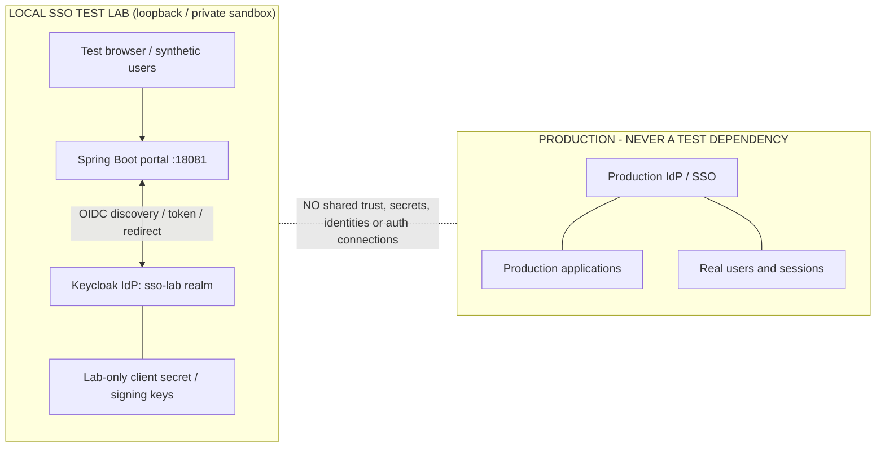
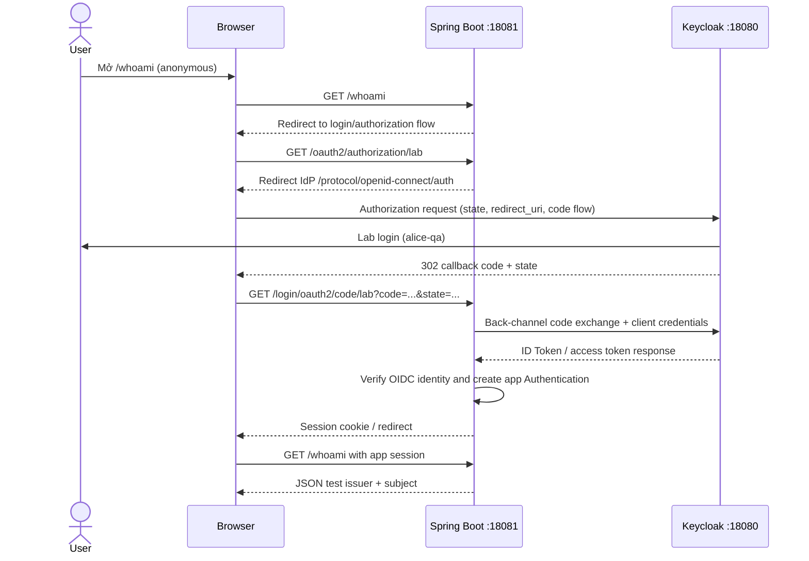
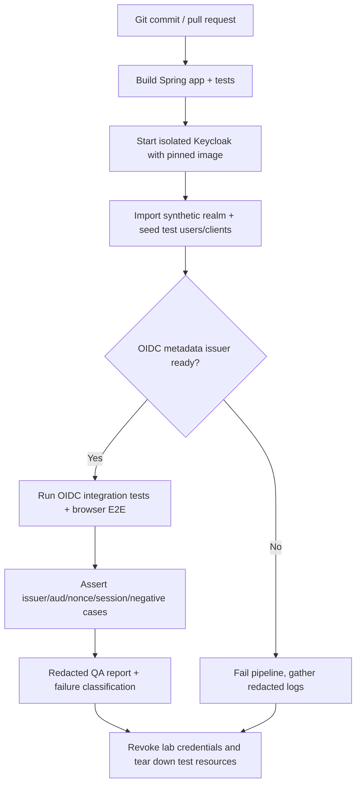

# Dựng IdP hoặc máy chủ SSO thử nghiệm tách biệt với môi trường thật

## Mục tiêu học tập

Sau bài này, bạn có thể:

1. Giải thích vì sao kiểm thử SSO cần **Identity Provider (IdP)/máy chủ SSO thử nghiệm độc lập** thay vì dùng ngay tài khoản, client registration, signing key hoặc phiên đăng nhập production.
2. Thiết kế ranh giới tách biệt ở **danh tính, trust configuration, dữ liệu, secrets, mạng, domain/cookie, callback URLs, logs và vòng đời môi trường**; phân biệt realm riêng trong cùng máy chủ với một hệ thống thật sự cô lập.
3. Dựng một **Keycloak OIDC IdP local** bằng Docker Compose, giới hạn cổng ở `127.0.0.1`, pin phiên bản container, dùng mật khẩu quản trị riêng và import realm không chứa người dùng thật.
4. Đăng ký OIDC client theo chuẩn Authorization Code, cấu hình redirect URI chính xác, tạo test users giả, kiểm issuer và metadata từ `.well-known/openid-configuration`.
5. Kết nối **Spring Boot 3 / Spring Security 6 / Java 17+** với test IdP bằng `oauth2Login`, `ClientRegistration`, `issuer-uri` và secret riêng; quan sát xác thực thành công, từ chối và logout.
6. Phân biệt **MockMvc `oidcLogin()` mock**, **integration test với IdP thật**, **end-to-end browser SSO** và **kiểm thử bảo mật/failure injection**. Biết test nào chứng minh chữ ký, issuer, audience, state/nonce và session.
7. Tạo ma trận các luồng SSO: first login, app-session reuse, IdP SSO reuse, two clients, user switching, logout, disabled user, redirect mismatch, wrong issuer, expired token, role/tenant mapping và MFA step-up.
8. Biết các giới hạn khi dùng test IdP OIDC cho **SAML2, CAS hoặc Kerberos/SPNEGO**; chọn đúng loại máy chủ/protocol thay vì nhầm Keycloak OIDC thành CAS Server hoặc KDC.
9. Chạy **Java 17+ độc lập** mô phỏng chính sách cấu hình lab an toàn, có stdout xác định; hiểu rằng kiểm config chỉ là một lớp và không thay kiểm soát mạng/IAM thật.
10. Vận hành lab trong máy cá nhân, CI hoặc staging một cách có kiểm soát: seed dữ liệu giả, clean up containers, thu hồi secrets, giảm log chứa tokens và tránh tin nhầm vào môi trường production.

## 1. Bài toán: cần thử SSO như thật nhưng không gây ảnh hưởng thật

SSO (Single Sign-On) là khả năng một người dùng đã được xác thực tại một hệ thống tin cậy (ví dụ OIDC Provider, SAML2 Identity Provider, CAS Server hoặc KDC) sử dụng nhiều ứng dụng theo những ràng buộc tương ứng mà không phải nhập lại toàn bộ credentials ở mỗi nơi.

Khi xây ứng dụng Spring Security, nhóm phát triển thường cần kiểm:

- Browser chưa đăng nhập đi tới IdP thế nào?
- IdP trả authorization code, SAMLResponse hoặc CAS Service Ticket ra sao?
- Spring Security xác minh issuer, signature, audience, state/nonce, recipient, ticket hoặc Kerberos service principal thế nào?
- Hai ứng dụng có chia sẻ **IdP session** nhưng vẫn có app sessions riêng không?
- Khi tài khoản bị disable hoặc permission đổi, request cũ có còn được phép không?
- Logout local khác global logout thế nào?
- Nếu token/signing key sai, callback thất bại có an toàn không?
- Các luồng tự động trong CI có tạo hoặc xóa user thật không?

**Không nên giải các câu hỏi này bằng cách thử trên IdP production không có kiểm soát.** Một dòng script provisioning sai, client wildcard redirect, trust nhầm signing certificate hoặc “test logout all” có thể làm hỏng truy cập của người dùng thật, lộ tokens hoặc tạo rủi ro bảo mật.

### 1.1. Sơ đồ một lab tách biệt



Phạm vi ví dụ: Keycloak chạy trên máy developer, chỉ được truy cập qua `http://localhost:18080`; Spring Boot test app chạy trên `http://localhost:18081`. Các cổng HTTP này **chỉ phù hợp cho thử nghiệm trên loopback**; với staging chia sẻ nhiều người, sử dụng HTTPS/TLS, domain/DNS và hạ tầng riêng có kiểm soát.

### 1.2. IdP, RP, SP và CAS Server

| Giao thức | Bên xác thực/chủ trì | Bên ứng dụng sử dụng danh tính | Dữ liệu quan trọng |
| --- | --- | --- | --- |
| **OIDC** | OpenID Provider (OP)/IdP, ví dụ Keycloak | Relying Party (RP), Spring `oauth2Login` | `iss`, `sub`, `aud`, ID Token, code, nonce/state |
| **SAML2** | SAML Identity Provider | Service Provider (SP), Spring `saml2Login` | EntityID, ACS, metadata, SAMLResponse, signature |
| **CAS** | Apereo CAS Server | CAS Client/Service, Spring Security CAS integration | CAS login, `service`, ST, validation, SLO |
| **Kerberos/SPNEGO** | KDC/AD realm và Kerberos service acceptor | Browser + Spring Kerberos client/service | TGT/TGS, SPN, keytab, GSS token |

Một **Keycloak realm OIDC** là lựa chọn nhanh để thử OIDC browser SSO; nó cũng hỗ trợ SAML2. **Keycloak không mặc nhiên là CAS Server native** và **không thay Kerberos KDC**. Nếu đề kiểm thử dùng CAS hoặc SPNEGO thật, cần dựng đúng server/protocol riêng.

## 2. Ranh giới tách biệt: tránh “lab trên giấy, production trong thực tế”

Có thể chia hệ thống thành local, CI, staging và production. Trong cùng một máy chủ IdP, việc tạo **realm test** giúp tách user/clients theo logical namespace, nhưng **không phải cách ly hoàn toàn** nếu vẫn chung admin quyền cao, network, backing DB, master realm, keys hoặc failure domain. Với kiểm thử nhạy cảm, triển khai một **IdP instance/cluster riêng**, với toàn bộ trust và dữ liệu riêng.

### 2.1. Ma trận cách ly

| Thành phần | Lab local/CI được phép | Không được sử dụng trong lab |
| --- | --- | --- |
| IdP URL | `http://localhost:18080/realms/sso-lab`, hoặc HTTPS test hostname riêng | `https://login.company.example/realms/prod` |
| Realm/tenant | `sso-lab` hoặc `qa-*` riêng | Realm production dùng chung |
| Users | `alice-qa`, `bob-qa`, `disabled-qa` giả | Nhân viên thật, đối tác thật, account admin production |
| Signing keys | Key được IdP test sinh riêng và rotate/test tự do | Private signing key, cert/keystore/keytab thật |
| OIDC clients | `spring-portal` tạo cho lab, redirect loopback | Production client ID/secret/redirect URIs |
| SAML trust | Lab IdP signing cert và lab SP entity ID | Production federation metadata/cert/trust |
| CAS config | CAS test Server/Service registry riêng | CAS production server, TGT registry/tickets |
| Kerberos | Realm/KDC test, `HTTP/lab-host` + keytab test | Real AD domain hoặc production service keytab |
| Sessions/cookies | Browser profile riêng, loopback/test domain | Browser production session/cookies |
| DB/directory | Test accounts và fixture data | Real customer/HR/LDAP/P-II data |
| Network | Loopback, private network, ACL, outbound restrictions | Production IdP connector, webhook, SMTP, LDAP, SCIM write access |
| Logs | Redacted test activity, short retention | Raw ID/access/refresh tokens, passwords |
| Notifications | Mail sink/webhook stub, fake addresses | Email/SMS/OTP tới người dùng thật |
| Cleanup | Dễ xóa và tái tạo, owner+TTL | Phụ thuộc hoặc tác động tới production |

**Chỉ đổi tên realm `prod` thành `test` không tách được hệ thống** nếu lab vẫn dùng client secret production hoặc kết nối AD/LDAP thực. Phải kiểm trust, khả năng write, network và dữ liệu.

### 2.2. Bốn lớp cách ly tối thiểu

**Lớp 1 – Identity/data:** synthetic accounts, riêng subject/issuer, không import bản dump production chứa tokens, email, số điện thoại hay PII. Dùng dữ liệu giả không có khả năng gửi notification tới người thật.

**Lớp 2 – Trust/credentials:** riêng signing keys, OIDC client credentials, SAML certificates, CAS service configuration, token issuer và trusted JWKS; ứng dụng test chỉ tin lab issuer, ứng dụng production không tin lab issuer.

**Lớp 3 – Network/domain:** không publish IdP development mode ra internet; giới hạn loopback/firewall, private DNS, egress allowlist, không nối test network với production identity backends. Domain/cookie separation ngăn session collision và login nhầm.

**Lớp 4 – Lifecycle/operations:** CI tài nguyên riêng có TTL, hạn chế admin, không commit secrets, log redaction, teardown và kiểm không còn forwarding/port mapping sang production.

### 2.3. Trường hợp ngoại lệ “staging dùng IdP production”

Đôi khi tổ chức yêu cầu test integration với IdP production bằng một **ứng dụng thử nghiệm và tài khoản được phê duyệt**. Đây **không phải lab tách biệt hoàn toàn**. Nếu thực sự bắt buộc, cần security/IAM approval, client registration riêng, callback allowlist, read-only scopes, hạn chế đối tượng và guardrails production. Bài này tập trung giải pháp **độc lập**, không coi ngoại lệ đó là mặc định.

## 3. Kiến trúc lab được dùng xuyên suốt bài

Các giá trị **minh họa cố định**:

| Tham số | Giá trị |
| --- | --- |
| IdP image | `quay.io/keycloak/keycloak:26.8.2` (phiên bản pin theo tài liệu Keycloak được đối chiếu khi viết) |
| IdP host listener | `127.0.0.1:18080`, container port `8080` |
| IdP public URL | `http://localhost:18080` |
| Realm test | `sso-lab` |
| OIDC issuer | `http://localhost:18080/realms/sso-lab` |
| OIDC discovery | `http://localhost:18080/realms/sso-lab/.well-known/openid-configuration` |
| Application port | `18081` |
| Spring registration ID | `lab` |
| OIDC client ID | `spring-portal` |
| Callback | `http://localhost:18081/login/oauth2/code/lab` |
| Authorization start | `http://localhost:18081/oauth2/authorization/lab` |
| Login test user | `alice-qa` / `bob-qa` / `disabled-qa` |
| Public root | `http://localhost:18081/` |
| Protected test page | `http://localhost:18081/whoami` |

**Không thay một URL trong bảng mà quên thay những URL liên quan**. OIDC `issuer` trong metadata và ID Token phải chính xác theo provider config. Browser redirect URI phải khớp chính xác entry trong Keycloak. Nếu dùng 127.0.0.1 thay localhost, hoặc app chạy trong container thay host, cần đồng bộ lại URLs/issuer/redirect và thử cả browser-to-IdP lẫn app-to-token-endpoint.

### 3.1. Vì sao chọn Keycloak?

- Có khả năng đóng vai trò OpenID Provider cho **Authorization Code + OIDC**.
- Có test realm, users, clients, signing keys và metadata/JWKS để kiểm Spring `oauth2Login` thực tế.
- Có SAML2 client để test SP flow khác.
- Có Docker image chính thức và `start-dev` đơn giản cho **loopback-only**.
- Hỗ trợ kiểm first login, IdP SSO session reuse, multiple RP clients, wrong redirects, signing key rollover, account disabled, logout tùy cấu hình.

**Nhưng:** `start-dev` có cấu hình phục vụ phát triển và **không được dùng ở production**. Không đưa image `latest` vào pipeline cần tái lập; pin phiên bản đã test hoặc image digest được phê duyệt. Một phiên bản cụ thể trong bài có thể bị thay thế bởi bản vá sau này; khi nâng cấp, kiểm lại changelog và test matrix.

## 4. Chuẩn bị công cụ và thư mục làm việc

Yêu cầu:

- Máy development có Docker Engine + Docker Compose v2 (lệnh `docker compose`).
- JDK 17+ cho Spring Boot 3/Java demo.
- Gradle Wrapper hoặc Maven Wrapper trong dự án Spring Boot.
- Terminal, browser riêng profile test, HTTP client như `curl`.
- Không chạy với production credentials hoặc cloud network tunnel.
- Cổng local `18080` và `18081` chưa được service khác dùng.
- Quyền truy cập Docker/network đã được cấp theo chính sách máy.
- Dung lượng máy đủ cho Keycloak, ảnh container và IDE; tăng memory nếu container bị OOM.

Thư mục minh họa:

```text
sso-lab/
├── compose.yaml
├── realm-import/
│   └── sso-lab-realm.json
├── .gitignore
└── portal/
    ├── build.gradle
    └── src/main/
        ├── java/com/example/ssolab/
        │   ├── SsoLabApplication.java
        │   ├── LabSecurityConfig.java
        │   └── LabController.java
        └── resources/application.yml
```

Không tạo file cấu hình ngoài vùng bài học Google Sheet khi thực hiện nhiệm vụ này; cấu trúc trên mô tả **các file người học tự tạo trong một workspace lab được phép**.

### 4.1. Không đưa mật khẩu và secrets vào Git

Ví dụ `.gitignore`:

```gitignore
.env
.env.*
!.env.example
*.keytab
*.p12
*.pfx
*.jks
*.pem
*.key
secrets/
logs/
build/
.gradle/
```

**Đây chỉ là guardrail**: nếu secret từng commit rồi, thêm `.gitignore` không xóa khỏi Git history. Phải rotate credential và xử lý lịch sử theo incident policy. Có những file PEM certificate công khai không cần coi như secret, nhưng tránh commit private key và test identity data vô tình.

### 4.2. Tạo admin password test độc lập

Compose dưới đây yêu cầu biến môi trường `SSO_LAB_ADMIN_PASSWORD`. Hãy sinh một mật khẩu mạnh **chỉ dùng cho lab**, lưu trong local secret manager hoặc terminal environment bảo vệ, không viết literal vào code/repo.

Trên bash/zsh, có thể nhập không echo:

```bash
read -r -s -p "Lab admin password: " SSO_LAB_ADMIN_PASSWORD
printf '\n'
export SSO_LAB_ADMIN_PASSWORD
```

Tùy shell, `read -p`/`-s` không tương thích mọi hệ; dùng phương pháp quản lý secret được tổ chức hỗ trợ. Biến môi trường không phải secret vault hoàn hảo: người có quyền đủ cao vào máy/engine có thể xem cấu hình container; **không dùng production credentials** trong biến này. Trên Windows PowerShell, dùng cơ chế secure prompt/secret manager thay vì đặt password trực tiếp trên command line lưu trong history.

## 5. Dựng Keycloak IdP local bằng Docker Compose

### 5.1. Tệp compose.yaml

```yaml
name: sso-lab

services:
  idp:
    image: quay.io/keycloak/keycloak:26.8.2
    command:
      - start-dev
      - --import-realm
      - --hostname=http://localhost:18080
    ports:
      - "127.0.0.1:18080:8080"
    environment:
      KC_BOOTSTRAP_ADMIN_USERNAME: lab-admin
      KC_BOOTSTRAP_ADMIN_PASSWORD: "${SSO_LAB_ADMIN_PASSWORD:?Set_SSO_LAB_ADMIN_PASSWORD}"
    volumes:
      - ./realm-import:/opt/keycloak/data/import:ro
```

**Giải thích từng quyết định:**

1. `name: sso-lab` giúp namespace Compose nhất quán; không đặt project name trùng stack production.
2. Image version **pin**; không dùng `latest` cho reproducible test.
3. `start-dev` chỉ dành cho **local**. Nó bật cấu hình development không đủ yêu cầu production; phải chắc không public expose.
4. Binding `127.0.0.1:18080:8080` giới hạn host listener vào loopback IPv4. **Không thay bằng `18080:8080` hoặc `0.0.0.0:18080:8080`** nếu không có network security review.
5. `--hostname=http://localhost:18080` làm IdP công bố các URLs/issuer theo địa chỉ browser và Spring client thực sự dùng, thay vì trộn container port 8080 với host port 18080.
6. `KC_BOOTSTRAP_ADMIN_*` tạo tài khoản bootstrap admin riêng. Mật khẩu được cung cấp ngoài repo qua biến môi trường, không dùng ví dụ `admin/admin` ở hạ tầng chia sẻ.
7. `./realm-import` mounted read-only và dùng `--import-realm`; không mount dữ liệu thật hoặc export production.
8. Không thêm LDAP federation, SMTP production, outbound webhooks, SCIM connectors, identity brokers đến production.
9. Đây là **HTTP plaintext trên loopback** chỉ để học; môi trường staging có nhiều người dùng phải dùng `start`/production-mode config với HTTPS, trusted certs, quản lý DB và secret khác.
10. Nếu Docker daemon hoặc container networking trên thiết bị có cấu hình đặc biệt, binding loopback phải được **kiểm tra thực tế từ máy khác**. Đừng tin một dòng YAML đủ chứng minh container không thể bị truy cập bên ngoài.

### 5.2. Tệp realm-import/sso-lab-realm.json

```json
{
  "realm": "sso-lab",
  "enabled": true,
  "displayName": "Isolated Local SSO Lab"
}
```

Đây là **realm fixture tối thiểu**, chỉ tạo một realm đã được bật. Không chứa users/clients/secrets. Tạo clients và users bằng Admin Console ở bước sau để tránh commit client secret/test user password.

Keycloak nhập realm từ `/opt/keycloak/data/import` khi khởi động với `--import-realm`. File phải có extension `.json`; **nếu realm đã tồn tại**, startup import thường **bỏ qua**, không cập nhật đè realm đang có. Muốn reset fixture phải có kế hoạch dừng/xóa riêng môi trường lab, không dùng giả định rằng import tự ghi đè.

### 5.3. Chạy và kiểm Keycloak

```bash
docker compose up -d
docker compose ps
docker compose logs --tail 120 idp
```

Lệnh trên phải chạy trong thư mục chứa `compose.yaml` và sau khi cung cấp biến `SSO_LAB_ADMIN_PASSWORD`. Nếu không có realm import hoặc password, Compose sẽ không có cấu hình đầy đủ.

Đến khi log cho thấy Keycloak đang sẵn sàng, mở:

- `http://localhost:18080/admin/` – Keycloak Admin Console.
- `http://localhost:18080/realms/sso-lab/.well-known/openid-configuration` – OIDC discovery JSON.

Kiểm discovery bằng:

```bash
curl --fail --silent --show-error \
  http://localhost:18080/realms/sso-lab/.well-known/openid-configuration
```

**Không có stdout cố định**; server trả metadata JSON gồm `issuer`, `authorization_endpoint`, `token_endpoint`, `jwks_uri` và các thuộc tính khác. Giá trị quan trọng cần đối chiếu:

```text
issuer = http://localhost:18080/realms/sso-lab
```

Nếu `issuer` hiện `http://localhost:8080/realms/sso-lab` hoặc hostname khác, phải sửa hostname/port config **trong lab** trước khi cấu hình Spring; đừng cố sửa token issuer bằng một custom string replacement trong Java.

### 5.4. Bảo vệ admin console

- Admin account lab chỉ tồn tại trong instance lab, mật khẩu riêng.
- Không cho internet hoặc mạng nội bộ không được phép truy cập `/admin`.
- Không tạo chung admin user/password với production.
- Không cấp quyền admin test cho user app chỉ để thuận tiện thử SSO.
- Khi có nhiều developer, dùng staging Keycloak instance với HTTPS/ACL/individual admin accounts và audit, không share cùng local password qua chat.
- Không log admin token, cookies hoặc chụp màn hình chứa client credentials.

## 6. Cấu hình realm, OIDC client và tài khoản thử nghiệm

Trong Admin Console, chọn **realm `sso-lab`**, không nhầm `master` hay một realm production được import nhầm.

### 6.1. Tạo OIDC client `spring-portal`

Các mục UI có thể thay đổi theo phiên bản Keycloak; ý nghĩa cấu hình cần đúng:

| Trường | Giá trị test | Ý nghĩa |
| --- | --- | --- |
| Client type/protocol | `OpenID Connect` | Spring `oauth2Login` dùng OIDC |
| Client ID | `spring-portal` | Tương ứng `client-id` trong Spring |
| Client authentication | **ON** | Confidential server-side client có client secret |
| Standard flow | **ON** | OIDC Authorization Code |
| Direct access grants/password grant | **OFF** | Không thử password grant thay browser code flow |
| Service accounts | OFF nếu không cần | Không cấp M2M grants vô ích |
| Valid redirect URIs | `http://localhost:18081/login/oauth2/code/lab` | Không wildcard `*` |
| Valid post-logout redirect URIs | Theo flow/logout cần test, exact URL | Không mở redirect bất kỳ |
| Web origins | Chỉ origin cần thiết, ví dụ `http://localhost:18081` | Không dùng `*` nếu không cần |
| Client scopes | `openid`, `profile` trong client request | Có ID Token OIDC |

**Lưu ý:** Spring Security mặc định dùng callback dạng `{baseUrl}/login/oauth2/code/{registrationId}`; registration ID ở đây là `lab`, **không phải** `spring-portal`. Vì vậy redirect URL phải có đuôi `/lab`.

Trong **Credentials** của client confidential, lấy secret của **lab client** và cung cấp cho Spring qua `SSO_LAB_CLIENT_SECRET` ở môi trường. Không ghi secret vào README, Git hoặc log. Nếu UI cho phép rotate secret, thử sau khi kết nối hoạt động.

**Không bật wildcard redirect** hoặc redirect sang domain production. Nếu app chạy `http://127.0.0.1:18081` trong browser nhưng cấu hình redirect `localhost`, client validation có thể từ chối vì URLs không khớp; dùng nhất quán host/port/redirect.

### 6.2. Tạo synthetic users

Đề xuất ít nhất bốn test users, tất cả đều **không phải người thật**:

| User | Trạng thái | Kịch bản |
| --- | --- | --- |
| `alice-qa` | Enabled | Happy path login, claims, app session |
| `bob-qa` | Enabled | Account switch, principal separation, different role |
| `disabled-qa` | Disabled | Login mới bị chặn, kiểm app session đã có theo policy |
| `mfa-qa` | Enabled, test authenticator đã enroll | MFA/step-up negative & positive cases **nếu thật sự cấu hình IdP authentication flow** |

Cách thiết lập qua Admin Console:
1. Mở `Users → Create new user` trong realm `sso-lab`.
2. Chọn username synthetic. Không dùng email thật; dùng test-only mailbox/sink nếu IdP cần email.
3. Đặt Enabled theo kịch bản, dùng temporary password riêng tạo trong secret manager/test harness.
4. Với user enabled, chọn `Credentials` để thiết lập password test; không copy password thành fixture chung trong source.
5. Với `mfa-qa`, cần cấu hình authentication flow/required actions/TOTP/WebAuthn theo môi trường; **chỉ đặt tên `mfa-qa` không chứng minh đã thực hiện MFA**.
6. Nếu muốn kiểm local authorization, tạo mapper/role contract rõ ràng; **Keycloak realm role không tự thành `ROLE_ADMIN` của Spring**.
7. Ghi nhận `sub` (thường là opaque ID/UUID) thực sự của từng user khi login; đừng suy `sub == username`.

### 6.3. Seed dữ liệu có thể tái lập

Để CI dựng lab mỗi lần mà không phụ thuộc thao tác tay, có thể dùng:
- Realm import JSON chứa **chỉ client/role/fixture không nhạy cảm**, không commit secret.
- Keycloak Admin API được gọi bằng **ephemeral admin credentials** hoặc một test provisioning identity có scopes hẹp.
- Script tạo synthetic users, đặt password từ runtime secret và ghi lại internal test IDs.
- Script idempotent: kiểm user/client tồn tại và có tên/scope mong đợi trước khi cập nhật, không tạo trùng.
- Cleanup theo unique run ID, không search/delete tất cả users trong realm/instance chung.
- Lưu fixture version, image digest và schema version, không dùng export production làm “dataset gốc”.

Trong bài sử dụng Admin UI cho sự minh bạch. Pipeline nâng cao có thể tự động hóa sau khi negative tests về scope/namespace và deletion pass.

## 7. Kết nối ứng dụng Spring Security OIDC với lab

**Phạm vi:** Spring Boot 3.x, Spring Security 6.x, Java 17+, Servlet MVC. Code dưới đây là **ứng dụng Spring Boot trong một project**, không phải một file Java thuần có thể chạy chỉ bằng `javac`. Cần Keycloak test đang chạy và client secret test hợp lệ.

### 7.1. Gradle dependencies

Trong project đã có Spring Boot plugin, dependency management/BOM và wrapper tương thích:

```groovy
dependencies {
    implementation 'org.springframework.boot:spring-boot-starter-web'
    implementation 'org.springframework.boot:spring-boot-starter-security'
    implementation 'org.springframework.boot:spring-boot-starter-oauth2-client'

    testImplementation 'org.springframework.boot:spring-boot-starter-test'
    testImplementation 'org.springframework.security:spring-security-test'
}
```

**Không cần tự viết JWT signature verification cho OIDC login.** Spring Security OAuth2 Client/OIDC sẽ xử lý cơ chế protocol khi được cấu hình đúng. Tuy nhiên policy nghiệp vụ vẫn phải kiểm account active, roles, tenant và authorization riêng.

### 7.2. application.yml

Tệp `portal/src/main/resources/application.yml`:

```yaml
server:
  port: 18081

spring:
  security:
    oauth2:
      client:
        registration:
          lab:
            provider: lab-oidc
            client-id: spring-portal
            client-secret: "${SSO_LAB_CLIENT_SECRET}"
            authorization-grant-type: authorization_code
            redirect-uri: "{baseUrl}/login/oauth2/code/{registrationId}"
            scope: openid,profile
        provider:
          lab-oidc:
            issuer-uri: http://localhost:18080/realms/sso-lab
```

**Cách đọc:**
- `registration.lab` là registration ID; Spring tạo login initiation URL `/oauth2/authorization/lab` và callback URL `/login/oauth2/code/lab`.
- `provider.lab-oidc.issuer-uri` cho phép discovery OIDC metadata, và issuer của token phải phù hợp trusted provider.
- `client-secret` lấy từ biến môi trường `SSO_LAB_CLIENT_SECRET`. Phải tạo trong realm lab, không dùng secret của ứng dụng thật.
- Scope `openid` yêu cầu OIDC (ID Token); `profile` để kiểm các test profile claims nếu cần.
- `{baseUrl}` dựa trên URL app nhận qua browser/proxy; nếu có reverse proxy, kiểm cấu hình forwarded headers và hostname trust.
- **HTTP chỉ trên local loopback**, không deploy config này lên internet/staging nhiều người dùng.

### 7.3. Main class

Tệp `portal/src/main/java/com/example/ssolab/SsoLabApplication.java`:

```java
package com.example.ssolab;

import org.springframework.boot.SpringApplication;
import org.springframework.boot.autoconfigure.SpringBootApplication;

@SpringBootApplication
public class SsoLabApplication {
    public static void main(String[] args) {
        SpringApplication.run(SsoLabApplication.class, args);
    }
}
```

### 7.4. SecurityFilterChain

Tệp `LabSecurityConfig.java`:

```java
package com.example.ssolab;

import org.springframework.context.annotation.Bean;
import org.springframework.context.annotation.Configuration;
import org.springframework.security.config.Customizer;
import org.springframework.security.config.annotation.web.builders.HttpSecurity;
import org.springframework.security.web.SecurityFilterChain;

@Configuration
public class LabSecurityConfig {

    @Bean
    SecurityFilterChain security(HttpSecurity http) throws Exception {
        return http
                .authorizeHttpRequests(auth -> auth
                    .requestMatchers("/", "/error").permitAll()
                    .requestMatchers("/whoami").authenticated()
                    .anyRequest().denyAll())
                .oauth2Login(Customizer.withDefaults())
                .logout(logout -> logout.logoutSuccessUrl("/"))
                .build();
    }
}
```

Giải thích:
1. `/` là trang public; `/whoami` yêu cầu authenticated user từ OIDC login.
2. `oauth2Login` dùng configured OIDC client `lab`; app sẽ chuyển browser tới IdP khi login cần thiết.
3. Không bật `formLogin` hoặc `httpBasic` làm fallback trùng lặp trừ khi test plan yêu cầu.
4. `logoutSuccessUrl("/")` ở đây chủ yếu **logout app session**; **không chứng minh Keycloak SSO session/TGT đã bị hủy**. Browser vẫn có IdP cookie có thể SSO ngay lập tức ở lần vào tiếp.
5. CSRF protection mặc định vẫn bật; thực hiện logout POST theo CSRF flow chính xác của ứng dụng. Không dùng GET `/logout` làm kết luận chung.
6. `denyAll` trên các routes ngoài danh sách tránh vô tình mở debug endpoints.
7. Cấu hình lab không có role mapping từ IdP; **đăng nhập không tự cấp quyền admin**.

### 7.5. Controller quan sát verified principal

Tệp `LabController.java`:

```java
package com.example.ssolab;

import java.util.Map;

import org.springframework.security.core.annotation.AuthenticationPrincipal;
import org.springframework.security.oauth2.core.oidc.user.OidcUser;
import org.springframework.web.bind.annotation.GetMapping;
import org.springframework.web.bind.annotation.RestController;

@RestController
public class LabController {

    @GetMapping("/")
    public String home() {
        return "SSO lab is running";
    }

    @GetMapping("/whoami")
    public Map<String, String> whoami(
            @AuthenticationPrincipal OidcUser user) {
        return Map.of(
                "issuer", user.getIdToken().getIssuer().toString(),
                "subject", user.getSubject(),
                "mode", "LAB_ONLY");
    }
}
```

Ở request `/whoami` sau login, `OidcUser` đến từ Spring Security OIDC flow đã xác minh. Controller trả **issuer**, **subject** và nhãn lab; test-only response này giúp xác nhận không nhầm issuer/identity.

**Trong production** không đưa raw subject, token, email hoặc claim PII ra public UI nếu không cần. Không trả `id_token`, `access_token`, `refresh_token`, `Authentication.toString()` hoặc client secret trong response/log.

### 7.6. Chạy ứng dụng

Khởi động IdP trước, copy lab client secret vào biến môi trường `SSO_LAB_CLIENT_SECRET` tại máy app (không commit). Sau đó trong thư mục dự án Spring:

```bash
./gradlew bootRun
```

Trên Windows dùng `.\gradlew.bat bootRun`. Nếu chưa có Boot plugin/wrapper/Java 17 hoặc không có secret, cần chuẩn bị project trước. Spring OIDC metadata discovery từ `issuer-uri` có thể cần IdP reachable **khi app startup**, nên nếu Keycloak chưa chạy có thể lỗi tạo `ClientRegistrationRepository`.

Mở:
- `http://localhost:18081/` → response public text.
- `http://localhost:18081/whoami` → nếu chưa có session, Spring có thể chuyển browser qua trang login/authorization URL; bấm login `lab`.
- `http://localhost:18081/oauth2/authorization/lab` → chủ động bắt đầu authorization flow.
- Sau đăng nhập `alice-qa`, `/whoami` cho JSON với issuer của test realm và subject của user **do Keycloak cấp**, không có giá trị subject cố định trong tài liệu.

**Không tự bịa stdout/JSON `sub`**: mỗi realm/user fixture có internal ID riêng. Dấu hiệu đúng là issuer **exact** và subject thuộc test user đã tạo, không phải account production.

## 8. Quan sát toàn bộ OIDC login bằng browser và HTTP traces

### 8.1. Trình tự cần nhìn thấy



**Hai lượt HTTP không giống nhau:**

- **Front channel**: browser redirect giữa Portal và Keycloak. Có `state`, code và IdP/browser cookies; không xuất client secret ra browser.
- **Back channel**: Portal server gọi token endpoint để đổi code thành tokens, xác thực confidential client theo config. Nếu Portal container không reach được Keycloak issuer/token endpoint, front channel có thể đến trang login nhưng callback sẽ fail.

**Không in authorization code, ID Token, access/refresh tokens hay cookies đầy đủ vào CI logs hoặc bug report**. Có thể quan sát *có/không*, endpoint, status và issuer được redacted.

### 8.2. Kiểm OIDC discovery và issuer

Một OIDC Provider công bố metadata, ví dụ:

```text
http://localhost:18080/realms/sso-lab/.well-known/openid-configuration
```

Các fields cần đối chiếu:
- `issuer` phải đúng `http://localhost:18080/realms/sso-lab`.
- `authorization_endpoint` là URL browser đi tới.
- `token_endpoint` là URL app dùng khi callback.
- `jwks_uri` trả public keys tương ứng realm lab, không phải JWKS production.
- `end_session_endpoint` nếu IdP hỗ trợ cần cấu hình riêng cho logout; **không phải mọi OIDC Provider có cùng logout features**.
- `response_types_supported`/`grant_types_supported` liên quan flow; không bật một grant yếu nếu không cần.

Đối với ID Token sau xác minh:
- `iss` tương ứng issuer lab.
- `aud` chứa `spring-portal`/client ID theo OIDC validation.
- `sub` là user fixture hiện tại.
- `exp`/`iat` hợp lệ; `nonce`/`state` được client flow bảo vệ theo profile.
- Chữ ký được xác minh với signing key/JWKS **của lab realm**.
- `amr`/`acr` chỉ có nếu IdP được cấu hình phát; **không giả định MFA từ tên account hay request param**.

### 8.3. Ba cookie/phiên khác nhau

| Thành phần | Cookie hoặc trạng thái | Khi xóa sẽ ảnh hưởng |
| --- | --- | --- |
| Keycloak IdP | IdP browser SSO session/cookies | Có thể buộc login lại tại IdP, nhưng app session có thể còn |
| Portal Spring Boot | App `HttpSession` / `JSESSIONID` | Portal session bị xóa; IdP session có thể còn |
| Browser test profile | Cookies cả hai origins và lưu trữ site | Có thể reset trạng thái browser, không revoke server-side sessions cho mọi thiết bị |

Thử login/SSO trong **hai browser profiles hoặc incognito sessions riêng** để tránh bị cookie cũ đánh lừa. Browser cookies có domain/path/SameSite semantics; localhost có các đặc thù khi nhiều services trên khác port. Không dùng chính profile đang đăng nhập production để test.

## 9. Kiểm thử SSO qua hai ứng dụng riêng

Một ứng dụng login thành công chỉ chứng minh **federated login**, chưa kiểm đầy đủ **Single Sign-On** qua hai relying parties.

### 9.1. Dựng thêm RP thứ hai

Trong cùng realm test, tạo:
- OIDC client `spring-reports`, confidential, own client secret.
- Spring app thứ hai chạy ví dụ trên `localhost:18082`.
- Exact callback `http://localhost:18082/login/oauth2/code/reports`.
- Registration `reports` trong app thứ hai.
- Signing keys thuộc **lab IdP** vẫn chung realm, nhưng **client ID/secret/app session** riêng từng RP.

Không dùng một client secret chung cho cả hai RP nếu cần test client isolation/credential rotation. Không đăng ký callback của Reports vào client Portal tùy tiện.

### 9.2. Luồng SSO mong đợi

1. Browser mới, chưa login ở hai apps.
2. Mở Portal RP-A, login tại Keycloak với `alice-qa`.
3. Portal tạo session A, subject tương ứng user fixture.
4. Mở Reports RP-B cùng browser profile, bắt đầu `/oauth2/authorization/reports`.
5. Nếu Keycloak SSO session vẫn hợp lệ và policy không yêu cầu reauth, browser có thể **không cần nhập lại password**.
6. Reports tạo **session B riêng**. Hai RP có thể nhìn cùng `sub`, nhưng không share `JSESSIONID`/local role store.
7. Logout chỉ tại Portal và xem Reports vẫn có session/IdP SSO theo thiết kế; không kết luận logout toàn cục đã hoạt động.
8. Cấu hình và test global SSO logout/back-channel/front-channel theo profile IdP và từng RP nếu yêu cầu; kiểm **old cookie** của cả hai apps sau logout.

**Cần test chính sách IdP:** một số flow sẽ buộc user chọn account hoặc reauthenticate dù SSO session tồn tại (ví dụ `prompt=login`, MFA step-up, session max age). Không hứa “không cần nhập lại password” trong mọi tình huống.

## 10. Phân biệt mock test, integration test và end-to-end

### 10.1. Bốn lớp kiểm thử

| Lớp | Công cụ | Kiểm được | Không chứng minh |
| --- | --- | --- | --- |
| **Unit/policy** | JUnit + Mockito | Role/tenant rules, mapping, error handling | Token signature, redirect, IdP |
| **MockMvc OIDC** | `spring-security-test` `oidcLogin()` | App controller/filter/method authorization với principal giả | Real OAuth2 Authorization Code flow/JWKS |
| **Integration IdP** | Keycloak local container + Spring test app | Discovery, code exchange, real ID Token, issuer/JWKS/audience | Browser cookie/redirect behavior trong mọi browser nếu chỉ HTTP mock |
| **Browser E2E** | Browser automation/manual, test users | First login, SSO reuse, cookie session, logout, MFA UX | Security controls ngoài lab nếu network/staging không giống production |

**Đừng đánh dấu “SSO end-to-end PASS” chỉ vì một test `.with(oidcLogin())` trả 200.** Test ấy không gọi Keycloak.

### 10.2. Ví dụ MockMvc OIDC test (chỉ fragment)

```java
// Trong test đã có MockMvc mvc và spring-security-test:
// Đây là principal giả do test tự dựng, KHÔNG phải token từ Keycloak.
mvc.perform(get("/whoami")
        .with(oidcLogin().idToken(token -> token
            .claim("iss", "http://localhost:18080/realms/sso-lab")
            .claim("sub", "test-subject"))))
    .andExpect(status().isOk())
    .andExpect(jsonPath("$.subject").value("test-subject"));
```

Các static imports điển hình trong test class:

```java
import static org.springframework.security.test.web.servlet.request.SecurityMockMvcRequestPostProcessors.oidcLogin;
import static org.springframework.test.web.servlet.request.MockMvcRequestBuilders.get;
import static org.springframework.test.web.servlet.result.MockMvcResultMatchers.jsonPath;
import static org.springframework.test.web.servlet.result.MockMvcResultMatchers.status;
```

Code được đặt **bên trong JUnit test method** có `MockMvc` đã inject. Nó kiểm controller đọc principal và SecurityMockMvc support; **không chứng minh ID Token đã được IdP ký hoặc client secret/issuer/JWKS cấu hình đúng**.

Nếu cần integration test thật, **không** chỉ mock issuer/claims; phải chạy test IdP phát token thật và Spring Security thực hiện OIDC login flow với validated callback.

### 10.3. Test negative quan trọng

- IdP signing key sai hoặc JWKS không khớp.
- ID Token `iss` của realm khác.
- ID Token `aud` không dành cho client `spring-portal`.
- Authorization code replay/đổi cho client khác.
- `state`/`nonce` sai hoặc thiếu theo flow.
- Token expired/clock skew bất thường.
- Callback `redirect_uri` sai host/port/path.
- User disabled/account deleted giữa các bước.
- Local entitlement bị revoke sau login.
- Browser giữ app session sau IdP logout nếu app chưa xử lý single logout.
- Dùng client secret của Reports cho Portal.
- Log/proxy vô tình ghi raw token trong trace.

**Không cần tạo token giả có chữ ký đúng để thử mọi case**. Dùng test issuer/client fixtures, instrumentation và approved test setup để điều khiển trường hợp lỗi, không đưa unsigned tokens vào môi trường production.

## 11. Ma trận smoke test theo thứ tự

| Test | Chuẩn bị | Hành động | Kết quả mong đợi |
| --- | --- | --- | --- |
| 1. Discovery | IdP đã chạy | GET `.well-known/openid-configuration` | HTTP 200, exact lab issuer |
| 2. Public page | App đã chạy | GET `/` | 200, không cần auth |
| 3. Protected anonymous | Browser mới | GET `/whoami` | Redirect tới login, không xem dữ liệu trước auth |
| 4. Happy OIDC | `alice-qa` enabled | Authorization Code login | Spring tạo authenticated app session |
| 5. Identity | Login thành công | GET `/whoami` | Issuer lab, subject của `alice-qa` |
| 6. Browser cookie reuse | Portal app cookie còn | GET `/whoami` lần 2 | App session được dùng lại nếu chưa hết hạn |
| 7. Wrong password | Test credential sai | Login tại IdP | Deny/IdP error, không tạo authenticated app session |
| 8. Disabled account | `disabled-qa` disabled | Fresh login | Deny; không provision local quyền |
| 9. Wrong redirect | Sửa callback URL fixture | Authorization flow | IdP từ chối redirect không được đăng ký |
| 10. Wrong client ID/secret | App dùng secret khác | Code exchange | Authentication fails, không tạo session |
| 11. Wrong issuer | Provider chỉ tin lab, token từ realm khác | Login/token validation | Reject |
| 12. Different user | Browser profile khác | Login `bob-qa` | Subject riêng, không lấy session của Alice |
| 13. Two RP SSO | A đã login, B chưa login | Mở Reports B | IdP SSO có thể reuse, B tạo app session riêng |
| 14. Local logout A | A/B đã login | POST logout A có CSRF | A session bị invalidate; B/IdP tùy config |
| 15. Global logout | Thiết kế SLO của IdP/RPs đã bật | Logout tại IdP | Bảo đảm expected RP session behavior, test cookies cũ |
| 16. Role revoke | Alice có grant test | Revoke local permission | Action cũ bị deny theo policy/SLA |
| 17. MFA step-up | IdP có flow đã cấu hình | Bắt buộc strong assurance | RP kiểm verified `acr/amr/auth_time` |
| 18. Invalid MFA flag | Browser gửi `mfa=true` | Gọi action high-risk | Không tự nâng assurance |
| 19. Signing key rotation | Keycloak test realm | Rotate keys theo test workflow | Token mới đúng key pass, old policy được định nghĩa |
| 20. Clock drift | Chỉ trong fixture/test harness | Điều chỉnh token/clock | Validation phù hợp skew policy |
| 21. Multi-node app | Session store/test nodes | Login A, GET B | Session/issuer đồng nhất theo kiến trúc |
| 22. IdP unavailable | Dừng Keycloak test | Login mới/code exchange | Fail safe; không login mặc định |
| 23. Direct app port from another host | Lab được giới hạn loopback | Gọi `:18080` từ máy khác | Không kết nối IdP local |
| 24. Egress to prod blocked | Network/ACL policy | Test service access prod IdP | Request bị chặn, không phát token thật |

Các kết quả **phụ thuộc lab config**, đặc biệt SLO/MFA/multi-node. Không tuyên bố test #15/#17 pass chỉ vì Keycloak đã khởi động; cần cấu hình protocol/flows và kiểm session access thực tế.

### 11.1. Test case bằng request sau logout

Một testcase an ninh phải kiểm **resource access sau logout**, không chỉ HTTP 200 từ một callback:
1. Browser login test account, giữ cookie Portal.
2. Xác nhận `GET /whoami` authenticated.
3. Thực hiện logout theo flow đã chọn (local app, IdP global, back-channel SLO...).
4. Dùng **cookie cũ** gửi request tới Portal bằng browser test.
5. Kỳ vọng kết quả theo chính sách: anonymous/redirect login/401, **không** còn access khi flow yêu cầu app-session revoke.
6. Nếu IdP session vẫn tồn tại sau local logout, browser có thể reauthenticate SSO và được vào lại; cần phân biệt **old app session invalid** với **new login thành công**.
7. Nếu hai RP, lặp lại với cookie của từng RP.
8. Kiểm session key bị xóa/revoked nếu dùng shared store, không chỉ xem UI đã logout.

### 11.2. Kiểm refresh/access token và API

Ứng dụng Spring `oauth2Login` là **OIDC Client**, không tự là OAuth2 Resource Server. Nếu có API dùng Bearer access token:
- Dựng resource server test với `issuer-uri`/`jwk-set-uri` trỏ **lab issuer** và validate audience.
- Phân biệt `id_token` hướng đến OIDC client với `access_token` gửi API.
- Thử wrong audience, expired token, wrong signature, missing scope/tenant.
- Test refresh token revocation, token endpoint auth và logout/deny strategy riêng.
- Không đánh đồng xóa Portal `HttpSession` với revoke tất cả JWT access tokens.

## 12. Keycloak SAML2 lab: dùng khi ứng dụng là SAML Service Provider

**Đây là nhánh thay thế của lab**, không đồng nghĩa ứng dụng OIDC phía trên tự hỗ trợ SAML2. Keycloak hỗ trợ SAML2 clients; Spring Security `saml2Login` cần một `RelyingPartyRegistration` tin IdP signing cert đúng.

### 12.1. Cách triển khai khái quát

1. Trong realm `sso-lab`, tạo **SAML client** dành riêng cho SP, có entityID test, ACS exact và binding đã chọn.
2. Cấu hình signing/encryption theo yêu cầu lab, dùng **lab-only cert/key**.
3. Lấy metadata IdP test, ví dụ Keycloak có endpoint kiểu `/realms/sso-lab/protocol/saml/descriptor`; kiểm endpoint từ **phiên bản đang chạy**.
4. Trong Spring Security, cấu hình `RelyingPartyRegistration` qua metadata hoặc credentials test đã pin và `saml2Login`.
5. Test **SP-initiated login**: SP phát AuthnRequest, IdP tạo SAMLResponse, SP chỉ cho authentication sau khi validate issuer/destination/audience/signature/conditions/inResponseTo theo cấu hình.
6. Test **SAML AuthnContext/MFA** bằng assertion **được IdP ký/xác minh**, không chỉ một `Attribute mfa=true` do browser tự gửi.
7. Test replay SAMLResponse, expired `NotOnOrAfter`, mismatched `Recipient`/`Destination`, wrong audience và IdP cert rotation.
8. Nếu cần Single Logout, cấu hình/cấp trust riêng và kiểm SP sessions sau khi logout; không mặc định SAML login tự SLO toàn cụm.

### 12.2. Những thứ phải tách khỏi production

- **SAML IdP entityID** khác, SP entityID và ACS test không trùng production.
- Lab signing certificate/key khác production; không copy private key thật.
- Không nhập production metadata và tự coi nó là trust test nếu không được phép; test metadata chỉ từ lab IdP.
- Đăng ký recipient/ACS exact, không mở wildcard cho endpoint của prod.
- Dữ liệu test và NameID stable subject riêng, không dùng email nhân viên thật.
- Clock/trust changes trong lab không được làm ảnh hưởng SAML live federation.

**SAML2 metadata là cấu hình trust rất quan trọng.** Nếu test và prod cùng tin một signing key/issuer hoặc một SP callback, “lab” có thể mở đường token/assertion confusion.

## 13. Khi cần CAS Server thử nghiệm: không thay bằng OIDC

Trong module federation, nhiều hệ thống cũ sử dụng **Apereo CAS protocol** (browser redirect có `service`/`ticket` và CAS ticket validation). Keycloak OIDC không thể đóng vai CAS native endpoint chỉ bằng đổi URL.

### 13.1. Hướng dựng một CAS sandbox riêng

- Chọn bản Apereo CAS Server **được hỗ trợ và tương thích Java/Spring** cho môi trường tổ chức; tránh tự ghép version giữa CAS client và server.
- Có thể bắt đầu từ **CAS Initializr / CAS WAR Overlay Template** tương ứng version đã chọn. Template upstream ở thời điểm khác có thể nhắm JDK mới; đừng dùng wrapper của template hiện hành rồi giả định Java 17 luôn đủ.
- Triển khai CAS test trên private/test hostname, TLS certificate lab và một **test-only credential repository** hoặc directory giả.
- Cấu hình **service registry** chỉ cho các ứng dụng test, ví dụ `https://portal.sso-lab.test/login/cas`, không cho mọi `service` URL.
- Tạo ticket registry/session storage test, credentials signing/encryption riêng, không dùng TGT/ST của CAS production.
- Test `/login?service=...`, CAS validation endpoint tương ứng client, ticket one-time use, service mismatch, expiry và Single Logout khi bật.
- Nếu test CAS SLO multi-node, kiểm ticket/SessionIndex→app session mapping và shared session deletion; local HashMap ở một JVM có thể bỏ sót logout nếu callback đến node khác.
- Mọi callbacks URLs phải thuộc lab/staging private domain và certificates đã test; không đưa production SLO endpoint vào service registry thử.

**Không dựng CAS bằng một hard-coded “valid ticket” REST endpoint rồi đánh dấu CAS integration PASS**. Mock endpoint có thể phục vụ unit test về parse JSON/XML, nhưng không kiểm protocol redirects, ticket validation, service binding, one-time ticket semantics và SLO.

### 13.2. So sánh CAS mock với CAS Server thật

| Môi trường | Kiểm được | Không kiểm được |
| --- | --- | --- |
| Fake `/serviceValidate` trả XML cố định | Client parsing/error handling | Ticket issuance, CAS login, signed trust/registry thật |
| Embedded mock HTTP server | Retry/timeouts, response codes | Full CAS SSO session và cross-service logout |
| Apereo CAS Server test | Real ticket issuance/validation, SLO profiles theo cấu hình | Production scaling/latency nếu topology khác |
| Production CAS | Hành vi thực tế | Không phải nơi mặc định để destructive tests |

Với test CAS, phải phân biệt **local app logout**, **CAS TGT logout** và **client SLO session revocation**. Một CAS Server test tách biệt giúp chạy negative cases mà không động vào người dùng thật.

## 14. Khi cần Kerberos/SPNEGO thử nghiệm

**Keycloak không phải KDC**. Nếu Spring Security dùng `SpnegoAuthenticationProcessingFilter` với Kerberos, phải có:
- **Test realm/KDC** riêng (ví dụ MIT Kerberos test realm hoặc AD forest test theo IAM policy).
- Service principal test như `HTTP/portal.sso-lab.test@SSOLAB.TEST`.
- Keytab test do KDC test cấp, khác production.
- DNS/realm mapping và đồng bộ thời gian phù hợp.
- Browser hoặc GSS-API client test có TGT test, không dùng cache vé của tài khoản thật.
- Service acceptor keytab có đúng SPN/kvno/enctype, reverse proxy không xóa `Authorization: Negotiate`.
- Test valid AP-REQ, wrong SPN, wrong keytab, clock skew, replay và fallback NTLM theo chính sách.

**Không đăng ký SPN test vào production AD bằng cách tình cờ**. AD SPN, keytab và service account là các đối tượng security nhạy cảm, phải được quản lý trong domain/realm test. Nếu chỉ cần unit test cách Spring xử lý `KerberosServiceRequestToken`, mock `AuthenticationManager` có thể đủ nhưng **không chứng minh** GSS/KDC xác thực thật.

## 15. MFA và mức bảo đảm xác thực trong lab

MFA tests thường bị hiểu sai vì IdP test có thể cho phép password-only.

### 15.1. Điều cần chứng minh

- **Enrollment:** user đã đăng ký TOTP/WebAuthn/OTP test.
- **Authentication event:** IdP thực sự yêu cầu và xác minh yếu tố ở **lần đăng nhập/step-up**.
- **Protocol assertion:** Keycloak/test IdP phát assurance context phù hợp (`acr`/`amr`/`auth_time` theo OIDC hoặc `AuthnContextClassRef` SAML2).
- **RP policy:** Spring ứng dụng đọc claims từ **verified assertion**, đối chiếu exact issuer/ACR mapping và freshness.
- **Authorization:** user vẫn phải có local role/tenant/resource permission; MFA không cấp `ROLE_ADMIN` tự động.

`mfa_enabled=true` trong test profile, tên user `mfa-qa` hoặc request `acr_values=...` **không tự chứng minh** IdP đã thực hiện MFA. Test phải có cả flow thành công, hủy prompt, factor chưa enroll, ACR không đạt và token/attribute do browser tự khai.

### 15.2. Không gửi OTP tới hệ thống thật

- Dùng test-only authenticator hoặc mailbox/sink theo chính sách test.
- Không gửi SMS OTP tới số điện thoại của nhân viên/khách hàng.
- Không cấu hình SMTP server production như một bước mặc định của test realm.
- Không log OTP, recovery codes, authenticator seeds, WebAuthn private keys.
- Không copy authenticator credential từ user thật vào lab.
- Với phishing-resistant testing, dùng FIDO/WebAuthn test environment và IdP assurance contract được kiểm, không suy từ hai string `pwd` và `otp`.

## 16. Lab trong CI/CD: có thể tái tạo mà không phá môi trường khác

### 16.1. Luồng pipeline nên có



**Một pipeline an toàn** cần dừng ngay nếu issuer/JWKS/callback có dấu hiệu trỏ production. Không “fallback sang prod IdP” khi Keycloak local chưa start — đó là anti-pattern nghiêm trọng.

### 16.2. Tách CI runs

- Pin image tag/digest và lưu tested version vào build metadata.
- Mỗi run dùng unique namespace, ports/network/realm hoặc container instances riêng; đừng để parallel jobs dùng chung admin account khiến test race.
- Timeouts/health readiness thay vì `sleep 30` cố định; nếu metadata chưa sẵn sàng, fail có reason.
- Secrets lấy từ CI secret store **dành cho lab**, không reuse prod cloud/OIDC client credentials.
- Không cấp CI runner quyền write lên production identity management/SCIM/LDAP.
- Có egress ACL/chặn DNS/hosts hoặc policy controls tới production authentication endpoints khi có thể.
- Không lấy real user dumps làm test fixtures; seed deterministic synthetic identities.
- Ghi logs đã redacted; không upload browser storage state chứa tokens/cookies làm public test artifacts.
- Teardown trong `finally`/always step để tránh orphan stacks, nhưng chỉ xóa resources thuộc **đúng run/project**.
- Thử incident/negative cases không phá IdP staging đang được đội khác dùng.

### 16.3. Hai địa chỉ nhìn thấy từ hai môi trường

Một vấn đề CI phổ biến:

```text
Browser on CI host:
  http://localhost:18080/realms/sso-lab

Spring app INSIDE a different Docker container:
  "localhost" means this app container, NOT the Keycloak container

IdP discovery published issuer:
  http://localhost:18080/realms/sso-lab
```

Nếu app chạy trong container, nó có thể không reach được `localhost:18080`. Sửa bằng một địa chỉ **có thể truy cập và có issuer thống nhất ở browser, app và IdP**, với TLS/test DNS hoặc mạng CI được cấu hình đúng. **Không đổi issuer tùy tiện theo nơi gọi**, vì OIDC yêu cầu token `iss` khớp provider config.

Các lựa chọn thực tế:
- Chạy Spring app và browser trên host với Keycloak host port như ví dụ.
- Hoặc chạy toàn bộ trong một test network có hostname/DNS routable cho cả browser container và app, đồng thời cấu hình `KC_HOSTNAME`/redirect URI tương ứng.
- Hoặc dùng reverse proxy test và DNS tên riêng, HTTPS cert hợp lệ với môi trường.
- Trong Testcontainers, quản lý dynamic ports/issuer metadata theo lifecycle; một mapped port không đồng nghĩa IdP tự phát issuer đúng nếu hostname config chưa được điều chỉnh.

**Không dùng `spring.security.oauth2.client.provider.lab-oidc.issuer-uri` trỏ production làm “tạm chữa” lỗi DNS lab**.

## 17. Java 17+ độc lập: kiểm chính sách cấu hình local SSO lab

Đây là chương trình **thuần Java 17**, không cần Docker, Spring, internet hoặc Keycloak. Nó minh họa một **policy check cục bộ** trước khi chạy lab: không dùng production trust, người dùng thật, public listener, issuer/redirect sai.

Nó **không thực sự scan firewall, xác minh JWT hoặc chứng minh container bind đúng**. Trong production/staging, những thuộc tính như `prodTrust` phải được inventory bằng công cụ IAM/infra đáng tin, không chấp nhận boolean do một người dùng tự gửi.

Tệp `SsoLabIsolationDemo.java`:

```java
public final class SsoLabIsolationDemo {
    private static final String LAB_ISSUER =
            "http://localhost:18080/realms/sso-lab";
    private static final String LAB_REDIRECT =
            "http://localhost:18081/login/oauth2/code/lab";

    record Lab(
            String issuer,
            String redirectUri,
            boolean trustsProduction,
            boolean usesRealUsers,
            boolean publicListener) {}

    static String assess(Lab lab) {
        if (lab.trustsProduction() || lab.usesRealUsers()) {
            return "DENY_PRODUCTION_DEPENDENCY";
        }
        if (lab.publicListener()) {
            return "DENY_PUBLIC_LISTENER";
        }
        if (!LAB_ISSUER.equals(lab.issuer())) {
            return "DENY_ISSUER";
        }
        if (!LAB_REDIRECT.equals(lab.redirectUri())) {
            return "DENY_REDIRECT";
        }
        return "ALLOW_LOCAL_LAB";
    }

    public static void main(String[] args) {
        Lab safe = new Lab(LAB_ISSUER, LAB_REDIRECT,
                false, false, false);

        System.out.println("Local isolated: " + assess(safe));

        System.out.println("Production trust: " +
                assess(new Lab(LAB_ISSUER, LAB_REDIRECT,
                        true, false, false)));

        System.out.println("Public port: " +
                assess(new Lab(LAB_ISSUER, LAB_REDIRECT,
                        false, false, true)));

        System.out.println("Wrong issuer: " +
                assess(new Lab("https://login.prod.example/realms/prod",
                        LAB_REDIRECT, false, false, false)));

        System.out.println("Wrong redirect: " +
                assess(new Lab(LAB_ISSUER,
                        "http://localhost:18081/other-callback",
                        false, false, false)));

        System.out.println("Real users: " +
                assess(new Lab(LAB_ISSUER, LAB_REDIRECT,
                        false, true, false)));
    }
}
```

Chạy:

```bash
javac SsoLabIsolationDemo.java
java SsoLabIsolationDemo
```

**Stdout chính xác:**

```text
Local isolated: ALLOW_LOCAL_LAB
Production trust: DENY_PRODUCTION_DEPENDENCY
Public port: DENY_PUBLIC_LISTENER
Wrong issuer: DENY_ISSUER
Wrong redirect: DENY_REDIRECT
Real users: DENY_PRODUCTION_DEPENDENCY
```

**Điều rút ra:**

1. Local lab được chấp nhận **chỉ khi toàn bộ các điều kiện cấu hình giả lập cùng đạt**.
2. Production trust hoặc real users phải bị từ chối, dù issuer string nhìn giống lab.
3. Public listener bị deny, nhắc rằng `start-dev` không dành cho public internet.
4. Issuer/redirect khác exact allowlist bị deny; có thể tránh accidental wrong-environment login.
5. Đây là **policy simulation**, không là chương trình chứng minh mạng thực tế. Đối tượng `Lab` được main tự tạo và có thể bị người dùng thay đổi trong code; không sử dụng nó làm security boundary.
6. Các controls thật cần có: firewall/network ACL, IdP trust inventory, separate client credentials, secret management, HTTPS ở staging, negative integration tests.
7. Không kết luận một lab an toàn chỉ vì chương trình in `ALLOW_LOCAL_LAB`; nó không kiểm trực tiếp Docker, DNS, browser cookie hoặc bên phát signing keys.

## 18. Vận hành, cleanup và khôi phục

### 18.1. Dừng Keycloak test đúng phạm vi

Trong thư mục Compose **của lab**:

```bash
docker compose ps
docker compose down
```

Lệnh `down` dừng/xóa resources thuộc Compose project hiện tại. **Kiểm project và thư mục trước khi chạy**; không dùng lệnh xóa toàn bộ Docker containers, networks, volumes hoặc shared Keycloak staging.

Nếu lab có dữ liệu/volumes riêng và bạn muốn xóa toàn bộ, phải xác nhận ownership/retention rồi mới dùng thao tác remove volumes ở đúng Compose project. Không áp `docker volume prune` hoặc `docker system prune -a` mù trên máy có resources khác.

### 18.2. Thu hồi secret và dữ liệu test

- Xóa lab admin/client credentials khỏi shell environment, CI secrets nếu hết vòng đời, rotate nếu lộ.
- Không lưu response token/cookies/authorization codes trong browser automation artifacts công khai.
- Xóa synthetic users/realm sau test theo retention và owner, **không xóa users trên shared/prod realm**.
- Xóa test DB/realm imports có dữ liệu nhạy cảm theo policy; nếu snapshot/backup, kiểm TTL/ACL.
- Nếu từng cấu hình email/SMS/webhooks, xác minh không còn scheduled callbacks tới hệ thật.
- Xóa browser test profile/cookies; chú ý xóa browser cookies **không tự revoke** tokens đã cấp từ IdP server.
- Đóng loopback port forwarding, test reverse proxy tunnels, không để URL test vô tình được public.
- Ghi lại image version, test matrix, thất bại còn tồn và state cleanup (không include secrets).

### 18.3. Vận hành staging nhiều người dùng

Một staging IdP có nhiều nhóm truy cập cần:
- **HTTPS/mTLS** phù hợp, managed certificates.
- Private DNS/ingress ACL, access control tới Admin Console.
- Separate database, signing keys, client secrets và audit.
- Resource isolation/quotas và backup nếu cần.
- Cơ chế tạo/xóa test user có approvals và expiry.
- Test IdP instance/realm không shared production LDAP/SCIM write access.
- Change control khi quay vòng keys, cập nhật version và policy.
- Người chịu trách nhiệm lab và runbook khi signing key bị lộ.

**Không nâng `start-dev` local Compose thành staging internet-facing bằng cách đổi một dòng `ports`**. Chế độ vận hành production của Keycloak cần cấu hình khác, theo tài liệu chính thức và threat model.

## 19. Sự cố phổ biến khi dựng IdP test

| Triệu chứng | Nguyên nhân khả dĩ | Cách xử lý |
| --- | --- | --- |
| Docker không start | Thiếu `SSO_LAB_ADMIN_PASSWORD`, cổng trùng, RAM thấp | Kiểm env/compose/port/log, không dùng prod secret |
| Keycloak admin login không được | Bootstrap account đã tồn tại, password khác, realm nhầm | Kiểm startup state/realm, không reset production IdP |
| `.well-known` 404 | Realm chưa import hoặc path/hostname sai | Kiểm `sso-lab`, mount import, startup logs |
| Import file thay đổi nhưng UI không cập nhật | Keycloak skip realm đã tồn tại | Reset/re-import lab có chủ đích, không trông chờ auto-overwrite |
| Discovery issuer báo `localhost:8080` | Hostname config không đúng public port | Chỉnh `--hostname`, test metadata, không replace `iss` thủ công |
| Spring startup fail khi Keycloak tắt | `issuer-uri` discovery không reach | Start lab IdP/readiness trước app |
| Browser login được, callback fail | Redirect mismatch, state lost, code exchange không reach, client secret sai | Kiểm redirect exact và IdP token endpoint/back-channel |
| `invalid_redirect_uri` | URI chưa được đăng ký chính xác | Đối chiếu `{baseUrl}`, scheme, port, path |
| `invalid_client` | Sai ID/secret hoặc client authentication settings | Regenerate lab client secret, kiểm confidential client |
| Spring báo issuer mismatch | Token `iss` khác configured provider | Kiểm hostname/realm/metadata, không nới trust |
| Browser lại login khi đã có SSO session | Cookie profile khác, prompt/step-up/session policy | Kiểm IdP cookie và auth request |
| Browser không được hỏi password sau app logout | Keycloak SSO session còn | Phân biệt local app vs IdP logout |
| Second RP login cùng user nhưng app permissions khác | Local grants của hai apps khác nhau | Test role mapping độc lập |
| User disabled nhưng app session vẫn truy cập | Spring session còn, local policy không check status | Session revoke/current-state guard |
| Unit test `oidcLogin()` pass nhưng E2E fail | Mock không đụng IdP/signatures | Chạy integration/browser E2E thật |
| 401/403 sau IdP MFA | IdP chưa release ACR hoặc app local role thiếu | Kiểm verified claims và business authz riêng |
| App trong Docker không gọi được localhost IdP | Container localhost khác host | Thiết kế routable issuer/DNS đồng nhất |
| SAML test pass nhưng CAS client fail | SAML IdP không phải CAS protocol | Dựng CAS Server test đúng giao thức |
| SPNEGO test dùng Keycloak OIDC không có ticket | Thiếu KDC/SPN/keytab | Dựng test KDC/realm riêng |
| Token xuất hiện trong CI logs | Verbose HTTP trace/debug | Redact, revoke lab secrets, sửa logging |
| Test user nhận email thật | Cấu hình SMTP/webhook thật | Dùng mail sink/test domain, cắt egress |
| Môi trường test ảnh hưởng prod | Reuse secrets, federation trust, directory connector, shared issuer | Dừng test, rotate/revoke, audit theo incident response |

## 20. Checklist trước khi coi lab “sẵn sàng”

### Tách biệt môi trường

- [ ] Lab có IdP/realm/directory instance và credentials riêng, không lẫn với production.
- [ ] Test users synthetic, không dùng email/phone/PII của người thật.
- [ ] Không tin hoặc import production issuer/JWKS/SAML signing keys/private keys.
- [ ] Mọi OIDC/SAML clients dùng unique test client ID/entityID và exact callback URIs.
- [ ] Mạng/egress tới production identity providers/SCIM/webhooks bị chặn hoặc được kiểm soát; không có destructive access.
- [ ] Local `start-dev` chỉ bind loopback, không public expose.
- [ ] Staging nhiều người dùng dùng HTTPS và production-mode IdP settings đã review.
- [ ] Browser profile/cookies tách; không tạo production session trong test.
- [ ] CI secrets, logging, notifications và retention được quản lý riêng.

### IdP hoạt động đúng

- [ ] Keycloak image version pin; container start ổn định.
- [ ] Realm import đúng `sso-lab`, không sửa master/prod realm.
- [ ] `.well-known/openid-configuration` có exact lab issuer/URLs.
- [ ] OIDC client `spring-portal` confidential, standard code flow, direct grant OFF.
- [ ] Redirect URI đúng `/login/oauth2/code/lab`; không wildcard.
- [ ] Synthetic users enabled/disabled phục vụ test, không phải nhân viên thật.
- [ ] Signing keys/JWKS thuộc lab; key rotation test có version/test plan.
- [ ] Spring `issuer-uri` và client secret chỉ trỏ lab.

### Test thực tế

- [ ] First login với test user được xác nhận qua browser/Keycloak.
- [ ] Spring nhận đúng test issuer/sub, không in token/secret.
- [ ] Anonymous/wrong password/disabled/wrong redirect/wrong issuer bị deny.
- [ ] OIDC code, state/nonce, audience, signature, expiry checks đã được thử ở integration level.
- [ ] Two RP apps chứng minh IdP SSO reuse và sessions độc lập.
- [ ] Local logout khác global/SLO được ghi rõ và test bằng cookie cũ.
- [ ] Local role/tenant/object authorization không bị thay bằng việc “IdP login thành công”.
- [ ] MFA evidence chỉ lấy từ verified assurance claim, không từ profile flag.
- [ ] MockMvc `oidcLogin()` không được báo là end-to-end.
- [ ] Nếu kiểm CAS, có CAS Server thật; nếu Kerberos, có KDC/realm thật; SAML2 dùng SAML trust riêng.
- [ ] Teardown, secret revocation và orphan resource checks được thực hiện sau test.

## 21. Câu hỏi tự kiểm tra

**1. Vì sao không nên test SSO bằng tài khoản và client secret production?**

Vì test flows có thể tạo/xóa identities, đổi trust, logout sessions, expose callback/tokens hoặc gây truy cập sai. Lab phải có identity, keys, client registrations và network riêng.

**2. Realm test trong cùng Keycloak production có phải tách biệt hoàn toàn không?**

Không. Realm là logical isolation; cùng máy chủ có thể dùng chung admin/sự cố hạ tầng/DB hoặc connectors. Với negative/destructive tests, ưu tiên IdP instance riêng.

**3. Vì sao `start-dev` chỉ phù hợp trên localhost?**

Keycloak development mode có các defaults phục vụ thử nghiệm không đủ tiêu chuẩn production. Không public expose qua internet; dùng `start`/TLS/hardening cho staging/prod theo docs.

**4. Trong Compose, `127.0.0.1:18080:8080` có ý nghĩa gì?**

Bind host port 18080 chỉ trên loopback IPv4, chuyển đến container port 8080. Không tự bảo đảm mọi Docker/host policy; cần kiểm reachability ngoài máy.

**5. `KC_HOSTNAME` được dùng làm gì trong lab này?**

Định nghĩa public-facing URL mà Keycloak công bố; issuer, redirect/metadata phải nhất quán với URL browser và Spring dùng.

**6. OIDC `issuer-uri` trong Spring cấu hình giá trị nào?**

`http://localhost:18080/realms/sso-lab`, không phải Admin Console URL hoặc base root `http://localhost:18080`.

**7. Tại sao redirect URI của Keycloak kết thúc bằng `/lab`?**

Vì Spring registration ID là `lab` và template mặc định `{baseUrl}/login/oauth2/code/{registrationId}`. Client ID `spring-portal` không quyết định segment callback.

**8. Vì sao không bật `Direct access grants` mặc định để dễ test?**

Bài kiểm browser Authorization Code/OIDC SSO; password/direct grant là flow khác, có threat model khác và không kiểm login redirects/cookies.

**9. Khi login thành công, `sub` có bằng username `alice-qa` không?**

Không mặc nhiên. Keycloak/OIDC dùng stable subject ID do provider cấp; cần kiểm trong verified ID Token.

**10. Vì sao local logout Portal không chắc logout khỏi Keycloak?**

Portal và IdP giữ các sessions khác nhau. Logout app có thể xóa `JSESSIONID` nhưng IdP SSO session cookie vẫn còn, browser có thể login lại qua SSO.

**11. Hai RP cùng dùng IdP có share app HttpSession không?**

Không mặc nhiên. Chúng có thể reuse IdP SSO session, nhưng mỗi RP có client registration, local session và authorization riêng.

**12. Test `.with(oidcLogin())` chứng minh điều gì?**

Nó tạo mock `OidcUser` trong Spring MVC test; kiểm app behavior/authorization branch, không chứng minh Keycloak phát/đã ký ID Token.

**13. Keycloak test có thay Apereo CAS Server không?**

Không. CAS protocol có service ticket, validation endpoint và SLO riêng; Keycloak OIDC/SAML không tự là CAS native server.

**14. Để kiểm Spring SPNEGO, có đủ một Keycloak realm không?**

Không. Cần KDC/realm, service principal, keytab và GSS/Kerberos tickets test; Keycloak không phải KDC.

**15. User `mfa-qa` có chắc đã MFA không?**

Không. Phải thiết lập flow/required action thực và kiểm IdP xác minh factor cũng như assurance context trả cho RP.

**16. Nếu Spring app chạy trong Docker, vì sao issuer localhost có thể không hoạt động?**

Vì `localhost` bên trong app container trỏ chính container đó. Browser, app và IdP cần một issuer URL nhất quán, thực sự routable từ tất cả actors.

**17. Vì sao không import user database production vào Keycloak test?**

Có thể lộ PII, identifiers, secrets và gây notification/authorization nhầm. Dùng synthetic fixtures có thể reset.

**18. Nếu Keycloak realm đã tồn tại, `--import-realm` có ghi đè không?**

Thông thường không; server skip existing realm. Reset/migration trong lab phải có thao tác riêng có kiểm soát.

**19. Tại sao test disabled user mới chưa chứng minh session revocation?**

Vì user có thể đã authenticated ở Portal trước khi disable. Phải thử **old app cookie** và token đã cấp, không chỉ fresh login.

**20. Vì sao phải pin image và test signing key rotation?**

Pin image cho reproducibility và thay đổi kiểm soát; signing key rotation giúp xác minh client trust/JWKS behavior, không cần động vào production key.

**21. Làm thế nào biết test không phụ thuộc production?**

Kiểm inventory trust/secret, issuer/client ID, DNS/network egress, directory/email/SCIM connectors, test negative production calls bị chặn và audit environment.

**22. Khi nào dừng thử nghiệm và báo incident?**

Khi phát hiện test app nhận production token, có production signing/secret material, test notifications gửi thật hoặc CI script có quyền mutate production identities. Dừng, cô lập và xử lý theo quy trình security, không tiếp tục coi đó là lab.

## Ghi nhớ

**Kiểm thử SSO đáng tin cần một IdP/SSO sandbox đủ giống giao thức thật nhưng không chia sẻ trust và khả năng gây tác động với môi trường thật.**

Luồng học tập OIDC:

**Docker Keycloak (loopback, realm `sso-lab`, test signing keys) → synthetic users + confidential test client → exact OIDC issuer/redirect → Spring Boot `oauth2Login` → browser Authorization Code login → validated ID Token → local SecurityContext → kiểm request, SSO reuse, logout và negative cases → cleanup.**

Năm nguyên tắc quan trọng:

1. **Tách môi trường toàn diện:** riêng users, realms, clients, certificates, secrets, network, data, callback và vận hành; không chỉ đổi tên.
2. **Kiểm protocol thật:** MockMvc giúp unit tests nhưng không thay IdP ký tokens, discovery, redirects, browser cookies và SLO.
3. **Không tự suy SSO/MFA:** một app login được chưa chứng minh reuse giữa hai RPs, và test account “mfa” chưa chứng minh phương thức xác thực mạnh.
4. **Dùng đúng server:** Keycloak OIDC/SAML; CAS cần CAS Server, Kerberos cần KDC/SPN/keytab.
5. **Cleanup và revocation là một phần test:** chứng minh old sessions/tokens bị từ chối theo policy, đóng ports, hủy lab secrets và không làm phiền production.

### Tài liệu tham khảo

- [Keycloak – Getting Started on Docker (current pinned example)](https://www.keycloak.org/getting-started/getting-started-docker)
- [Keycloak – Running Keycloak in a Container](https://www.keycloak.org/server/containers)
- [Keycloak – Configuring Hostname](https://www.keycloak.org/server/hostname)
- [Keycloak – Importing and Exporting Realms](https://www.keycloak.org/server/importExport)
- [Keycloak – Server Administration Guide](https://www.keycloak.org/docs/latest/server_admin/)
- [Spring Security 6.5 – OAuth 2.0 Client and Login](https://docs.spring.io/spring-security/reference/6.5/servlet/oauth2/login/core.html)
- [Spring Security – Testing OAuth2/OIDC with MockMvc](https://docs.spring.io/spring-security/reference/servlet/test/mockmvc/oauth2.html)
- [Spring Security – SAML2 Login](https://docs.spring.io/spring-security/reference/6.5/servlet/saml2/login/index.html)
- [Apereo CAS WAR Overlay Template](https://github.com/apereo/cas-overlay-template)
- [OpenID Connect Core 1.0](https://openid.net/specs/openid-connect-core-1_0.html)
- [RFC 6749 – OAuth 2.0 Authorization Framework](https://www.rfc-editor.org/rfc/rfc6749)
- [RFC 7636 – Proof Key for Code Exchange (PKCE)](https://www.rfc-editor.org/rfc/rfc7636)
- [OWASP – OAuth 2.0 Cheat Sheet](https://cheatsheetseries.owasp.org/cheatsheets/OAuth2_Cheat_Sheet.html)
- [OWASP – Authentication Cheat Sheet](https://cheatsheetseries.owasp.org/cheatsheets/Authentication_Cheat_Sheet.html)
