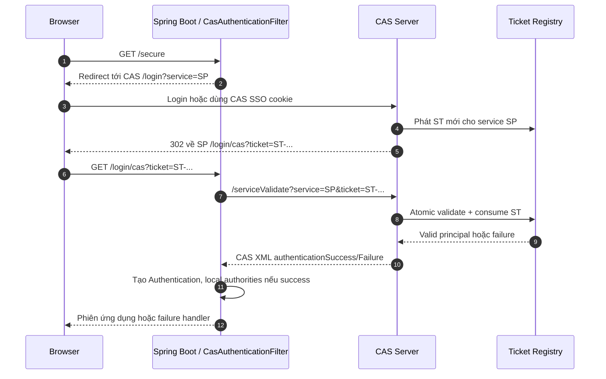

# Kiểm thử CAS với Service Ticket hợp lệ, hết hạn, dùng lại và sai service

## 1. Mục tiêu và phạm vi

**Central Authentication Service (CAS)** cấp **Service Ticket (ST)** cho một ứng dụng sau khi người dùng xác thực tại CAS Server. Ứng dụng Spring Security nhận `ticket` từ trình duyệt rồi gọi CAS để xác minh ticket trước khi tạo `Authentication` và phiên web. Mỗi bước có thể chạy đúng trong tình huống tích cực nhưng vẫn mắc lỗi bảo mật nếu ứng dụng tin ticket quá hạn, chấp nhận ticket đã dùng hoặc cho một ticket phát cho dịch vụ A được dùng tại dịch vụ B.

Bài học thuộc nhóm **Kiểm thử SSO**, tập trung bốn tình huống:

1. **Service Ticket hợp lệ:** đúng `service`, còn hạn, chưa từng được xác minh.
2. **Service Ticket hết hạn:** chưa dùng nhưng đã qua thời gian được CAS cho phép.
3. **Service Ticket dùng lại:** cùng ticket bị trình CAS lần thứ hai sau một validation attempt.
4. **Service Ticket sai service:** ST được cấp cho service A nhưng được trình xác minh với service B.

Bài đưa ra nguyên tắc theo CAS Protocol 2.0, các HTTP request/response, cấu hình Spring Security CAS client, test bằng Java 17, một ví dụ JUnit/WireMock ở tầng client, chiến lược kiểm thử CAS Server sandbox và ma trận lỗi. Các URLs `example.test` và IDs `ST-...` chỉ để học, không phải credential dùng được. Không sử dụng ticket, cookies, mật khẩu hoặc thông tin người dùng production để tạo test fixtures.

**Quy tắc quan trọng nhất trong đặc tả CAS 2.0: ST chỉ hợp lệ cho đúng _một lần thử xác minh_; dù validation thành công hay thất bại, CAS phải vô hiệu hóa ticket.** Đặc biệt, nếu lần đầu gửi sai `service` và nhận `INVALID_SERVICE`, ST đó **không còn có thể được cứu bằng cách gửi lại với service đúng**.

### Sau bài học cần làm được

- Phân biệt Service Ticket, Ticket Granting Ticket, Ticket Granting Cookie và Proxy Ticket.
- Gọi đúng `/serviceValidate` với `service` và `ticket`; đọc đúng XML success/failure.
- Viết test bốn tình huống **mỗi tình huống dùng ticket mới**, không tái sử dụng fixture ngoài mục tiêu replay.
- Hiểu vì sao hết hạn thường báo `INVALID_TICKET` và sai service báo `INVALID_SERVICE` trong CAS 2.0.
- Test boundary time với `Clock` cố định hoặc CAS sandbox có expiry policy kiểm soát, không dựa vào `Thread.sleep`.
- Chứng minh một ST không được xác minh đồng thời thành công tại hai CAS nodes.
- Kiểm tra `CasAuthenticationFilter`/`CasAuthenticationProvider` không tạo authenticated principal khi CAS từ chối ticket.
- Chẩn đoán sai URL dịch vụ sau reverse proxy/TLS termination.
- Bảo vệ ticket khỏi access logs, redirects, tracing, browser history và leak qua query.
- Tách test client stub khỏi test CAS Server thật để tránh một bộ test xanh giả.

## 2. Các thực thể và điểm xác minh trong CAS SSO

| Thành phần | Ở đâu? | Công dụng | Không được nhầm |
| --- | --- | --- | --- |
| **CAS Server** | Identity service tập trung | Đăng nhập, phát và xác minh tickets | Không phải local controller |
| **TGT – Ticket Granting Ticket** | CAS ticket registry | Đại diện phiên SSO phía CAS | Không phải ST và không đưa TGT trực tiếp cho SP |
| **TGC – Ticket Granting Cookie** | Browser cookie của CAS | Liên hệ browser với CAS SSO session | Không phải authentication cookie của Spring app |
| **ST – Service Ticket** | Browser chuyển đến application | Credential một lần dành cho `service` cụ thể | Không phải long-lived session token |
| **SP/service** | Spring Security CAS client | Gọi CAS validate rồi tạo local `Authentication` | Không được tự giải mã hoặc tự xác nhận ST |
| **PT – Proxy Ticket** | Backend proxy scenario | Ticket một-lần dành cho `targetService` | `/serviceValidate` không chấp nhận PT |
| **PGT – Proxy Granting Ticket** | Proxying service server-side | Xin nhiều PT khi được ủy quyền | Không phải ST |
| **`CasAuthenticationToken`** | Spring SecurityContext sau khi xác thực | Principal và local authorities | Chỉ được tạo sau CAS validation thành công |

**ST thường bắt đầu bằng `ST-`**, nhưng prefix chỉ là một quy ước định dạng. Không xem `startsWith("ST-")` là xác minh. Ticket opaque: CAS Server phải tra ticket registry, kiểm tra service, lifecycle, policy và thời hạn. Không suy đoán username, issuer hay thời điểm hết hạn bằng cách cắt ticket string.

### Luồng bình thường



CAS Server chịu trách nhiệm **single-use, expiry và service binding**; Spring Security CAS client phải **ủy thác xác minh cho CAS trên kênh HTTPS đáng tin**, không coi query parameter là bằng chứng đăng nhập.

## 3. Hợp đồng CAS 2.0 cho bốn trường hợp

Theo đặc tả CAS 2.0:

- **Service binding:** ticket chỉ hợp lệ cho service identifier đã được gửi trong `/login?service=...` khi CAS phát ticket.
- **Single-use:** ticket chỉ hợp lệ cho **một validation attempt**, không chỉ “một lần validation thành công”.
- **Expiry:** CAS **nên** hết hạn ST chưa được xác minh sau một khoảng thời gian hợp lý. Đặc tả **khuyến nghị thời hạn không quá năm phút** nhưng deployment có thể có policy riêng. **Năm phút không phải hằng số bất biến cho mọi CAS Server**.
- **Invalidation on mismatch:** nếu ticket còn hợp lệ nhưng `service` không trùng, CAS trả `INVALID_SERVICE` và **vô hiệu hóa** ST đó.
- **Expired/unknown/reused:** phải bị từ chối. CAS 2.0 thường dùng `INVALID_TICKET`; nội dung body có thể mô tả chi tiết hơn, tùy implementation.
- **Không tin HTTP 200 là login thành công**: `/serviceValidate` có thể trả **XML `authenticationFailure` trong HTTP 200**.

| Case | Trạng thái ST trước request | Service trình CAS | Kết quả mong đợi tại CAS | Hệ quả |
| --- | --- | --- | --- | --- |
| Hợp lệ | Mới, còn hạn | Đúng service A | `authenticationSuccess` | ST bị consume |
| Hết hạn | Chưa dùng, quá hạn | Đúng A | `authenticationFailure`, thường `INVALID_TICKET` | ST không được nhận |
| Dùng lại | Đã xác minh lần đầu | Đúng A | `authenticationFailure`, `INVALID_TICKET` | Không tạo authentication mới |
| Sai service | Mới, còn hạn, cấp cho A | Service B | `authenticationFailure code="INVALID_SERVICE"` | ST A bị consume dù thất bại |
| Sai service rồi sửa A | ST từ hàng trên | Đúng A | `INVALID_TICKET` | Không thể retry cùng ST |

Đối với **CAS 1.0** endpoint `/validate`, kết quả là `yes`/`no` theo dòng văn bản, không phải CAS 2.0 XML. Đối với **CAS 3.x** endpoint `/p3/serviceValidate`, response có thể thêm attributes. Bài tập này dùng **CAS 2.0 `/serviceValidate`** để giữ semantics XML và failure codes nhất quán.

## 4. URL, query parameters và service identifier

Giả sử CAS Server:

```text
https://cas.example.test/cas
```

và ứng dụng có public CAS login processing URL:

```text
https://portal.example.test/login/cas
```

Spring Security CAS sẽ dùng một `ServiceProperties.service` bằng **đúng service URL đã được đăng ký**. Browser bắt đầu flow:

```http
GET /cas/login?service=https%3A%2F%2Fportal.example.test%2Flogin%2Fcas HTTP/1.1
Host: cas.example.test
```

Sau khi user đã xác thực, CAS trả:

```http
HTTP/1.1 302 Found
Location: https://portal.example.test/login/cas?ticket=ST-NEW-EXAMPLE
```

Ứng dụng nhận ticket trên URL của **SP**, sau đó **server-to-server** gọi CAS:

```http
GET /cas/serviceValidate?service=https%3A%2F%2Fportal.example.test%2Flogin%2Fcas&ticket=ST-NEW-EXAMPLE HTTP/1.1
Host: cas.example.test
```

Cần phân biệt:

- `/cas/login` và `/cas/serviceValidate` là **CAS Server endpoints**.
- `/login/cas` là endpoint **Spring Security CAS client** nhận ticket từ browser.
- `service` là URL của **SP được CAS phát ticket cho**, không phải URL trang trước login như `/secure`.
- `ticket` là credential opaque; mã hóa URL đúng cách khi tạo request, không double-encode hoặc tự decode rồi ghép tay.
- Public URL sau HTTPS termination có thể khác URL nội bộ container. **CAS nhận service URL theo public contract**, không phải `http://localhost:8080/login/cas`.

Một cấu hình service URL khác nhau về scheme, hostname, port, path, trailing slash hoặc encoding có thể dẫn đến `INVALID_SERVICE` tùy canonicalization/registry policy. Test phải khẳng định đúng service identifier **được phát và được validate**, thay vì đoán rằng CAS luôn chuẩn hóa mọi biến thể giống browser.

## 5. Response thành công: không chỉ nhìn code HTTP

CAS 2.0 trả XML:

```xml
<cas:serviceResponse xmlns:cas="http://www.yale.edu/tp/cas">
  <cas:authenticationSuccess>
    <cas:user>alice</cas:user>
  </cas:authenticationSuccess>
</cas:serviceResponse>
```

Đây là **ví dụ response body**, chỉ thực sự có giá trị khi được nhận từ **CAS Server tin cậy qua TLS đã xác minh** sau khi gửi một ST hợp lệ. CAS có thể trả `<cas:attributes>` theo extension CAS 3.x; role/business ACL **không tự được cấp** vì có user trong XML.

Kỳ vọng end-to-end:

1. CAS nhận ST mới gắn service đúng.
2. CAS xác minh và consume ticket.
3. Java CAS Client parse `authenticationSuccess`, lấy principal.
4. `CasAuthenticationProvider` dùng `UserDetailsService`/`AuthenticationUserDetailsService` lấy local authorities.
5. Spring Security tạo `CasAuthenticationToken` được xác thực.
6. Browser nhận local session theo cấu hình và truy cập resource đã được authorization cho phép.
7. Cùng ST không thể xác minh lại tại CAS.

**Không kiểm tra chỉ `HTTP 200`**; một response `authenticationFailure` trong HTTP 200 phải được coi là authentication failure.

## 6. Trường hợp ST hết hạn

Một ST có thể được cấp rồi browser không quay lại SP ngay vì:

- User để lâu ở một trang trung gian.
- Redirect qua nhiều reverse proxies bị chậm hoặc bị giữ trong cache.
- Test client giữ ticket và chờ lâu.
- Kết nối CAS/SP xảy ra sự cố.
- Clock hoặc policy kiểm tra không nhất quán giữa nodes.
- Ticket được phát trước lúc một service registration bị thay đổi.

Ví dụ validation request:

```http
GET /cas/serviceValidate?service=https%3A%2F%2Fportal.example.test%2Flogin%2Fcas&ticket=ST-EXPIRED-EXAMPLE HTTP/1.1
Host: cas.example.test
```

Response lỗi ví dụ:

```xml
<cas:serviceResponse xmlns:cas="http://www.yale.edu/tp/cas">
  <cas:authenticationFailure code="INVALID_TICKET">
    Ticket expired or not recognized
  </cas:authenticationFailure>
</cas:serviceResponse>
```

Hệ thống phải từ chối tạo `Authentication` mới. CAS 2.0 không bắt buộc một error code riêng tên `EXPIRED_TICKET`. Đừng kiểm tra exact text “expired” trong production integration tests vì thông điệp có thể được cấu hình, quốc tế hóa hoặc bị tổng quát thành “ticket not recognized”.

### Test thời hạn deterministic

**Không ưu tiên `Thread.sleep(5 * 60_000)`**: test chậm, dễ lỗi CI, không phản ánh policy nếu CAS TTL khác năm phút. Tốt hơn:

- **Unit/model:** inject `Clock.fixed` và tiến clock đến trước/bằng/sau expiry.
- **CAS Server sandbox:** đặt ticket expiration policy riêng chỉ trong profile test; dùng fake clock/time control của server nếu release hỗ trợ, hoặc TTL ngắn với bounded test harness.
- **Deployment thật:** phát ticket và validate sau TTL được xác định; giữ test riêng, không dùng production accounts.

Một test ở đúng mốc `expiresAt` phải coi ST **hết hạn**, nhưng hành vi biên chính xác phải bám implementation và clock skew policy đã phê duyệt. Không “chữa lỗi” bằng cách tăng TTL vô hạn.

## 7. Trường hợp ST bị dùng lại (replay)

Sau validation thành công đầu tiên:

```text
ST-ONE-123 + service=A -> authenticationSuccess
ST-ONE-123 + service=A -> authenticationFailure INVALID_TICKET
```

CAS Server phải bảo đảm **một validation attempt** duy nhất trên mọi node. “Browser refresh login callback” hoặc user copy URL chứa `ticket` không được tạo một session CAS-authenticated mới bằng chính ticket cũ.

**Điểm dễ nhầm:** nếu browser đã có một **ứng dụng HTTP session** sau login, request tiếp theo đến `/secure` vẫn có thể thành công vì `SecurityContext` của **session đã authenticated**, không phải CAS đã chấp nhận lại ST. Test replay cần gọi **CAS validation endpoint** hoặc xóa/tách local session rồi gửi lại ticket theo một luồng được kiểm soát. Nếu không, test sẽ nhầm “giữ phiên hợp lệ” với “ticket có thể dùng nhiều lần”.

### Kỳ vọng

- Response từ CAS lần đầu: `authenticationSuccess`.
- Response CAS lần hai với cùng ST: `authenticationFailure`, thường `INVALID_TICKET`.
- Spring Client không tạo authentication mới dựa trên response lần hai.
- Nếu app dùng một custom stateless cache để bỏ qua CAS validation thì phải đánh giá riêng; không được gọi hành vi đó là CAS ST nhiều-lần theo protocol.

## 8. Trường hợp ST được xác minh với sai service

CAS cấp ST cho:

```text
service A = https://portal.example.test/login/cas
```

Attacker hoặc test gửi:

```http
GET /cas/serviceValidate?service=https%3A%2F%2Fpayments.example.test%2Flogin%2Fcas&ticket=ST-FOR-PORTAL HTTP/1.1
Host: cas.example.test
```

Nếu ST còn hợp lệ nhưng service B khác service đã cấp, theo CAS 2.0 phải báo:

```xml
<cas:serviceResponse xmlns:cas="http://www.yale.edu/tp/cas">
  <cas:authenticationFailure code="INVALID_SERVICE">
    Ticket was issued for a different service
  </cas:authenticationFailure>
</cas:serviceResponse>
```

**Quan trọng:** CAS **phải consume ticket ở lần validation sai service**. Do đó bước tiếp theo:

```http
GET /cas/serviceValidate?service=https%3A%2F%2Fportal.example.test%2Flogin%2Fcas&ticket=ST-FOR-PORTAL HTTP/1.1
Host: cas.example.test
```

phải thất bại, thường với `INVALID_TICKET`. Không viết test “sai service -> sửa URL đúng -> thành công” với cùng ticket.

### Test thêm các biến thể service URL

- HTTP so với HTTPS.
- `portal.example.test` so với `portal.internal`.
- Port 443 ngầm so với 8443.
- `/login/cas` so với `/app/login/cas`.
- Thêm hoặc thiếu slash cuối.
- Chèn thêm query không thuộc service contract.
- URL encode một lần so với hai lần.
- Proxy gửi `Host`/`X-Forwarded-Proto` không khớp public URL.
- Một URL service có pattern/regex quá rộng trong CAS service registry.

**Không giả định tất cả các biến thể này luôn trả `INVALID_SERVICE`**: server có thể normalize hoặc service registry có matching policy riêng. Test phải ghi rõ exact identifier/canonicalization contract và khẳng định cross-service **không được phép**. Đừng để một allowlist regex `.*` khiến security test “đúng service” giả do match quá rộng.

## 9. Tại sao “sai service rồi thử lại” cũng phải thất bại?

Một sai lầm phổ biến trong test:

```text
Arrange: phát ST-1 cho service A
Act 1: validate với B -> INVALID_SERVICE
Act 2: validate lại ST-1 với A -> kỳ vọng SUCCESS    // SAI
```

CAS 2.0 yêu cầu **one validation attempt**, dù thành công hay thất bại. Sau `Act 1`, `ST-1` đã bị invalidate.

Test đúng:

```text
ST-A1 -> validate(B) -> INVALID_SERVICE
ST-A1 -> validate(A) -> INVALID_TICKET   // ticket đã bị consume

ST-A2 -> validate(A) -> SUCCESS          // ticket MỚI
```

Vì thế nếu test nhiều case bằng một ST duy nhất, case sau có thể đều trả `INVALID_TICKET` dù code service matching đúng. Mỗi case độc lập cần ticket mới; chỉ trong test **replay/invalidation** mới cố ý dùng lại cùng ticket.

### Tính atomic của validate-and-consume

Hai request có cùng ST đến CAS cùng lúc:

```text
Pod A -> CAS node 1: validate(ST-X)
Pod B -> CAS node 2: validate(ST-X)
```

**Chỉ một attempt được phép thành công**. CAS ticket registry/lifecycle cần thực hiện validation + consumption với consistency/atomicity phù hợp. Cần test concurrency khi CAS Server chạy cluster; không thay bằng một `HashSet` local trên SP.

## 10. renew=true cũng có thể khiến một ST bị từ chối

CAS 2.0 hỗ trợ `renew` trên `/login` và `/serviceValidate`:

- `renew=true` tại login yêu cầu người dùng xác thực lại bằng primary credentials thay vì chỉ dùng SSO cookie.
- `renew=true` tại validation yêu cầu ST được phát **như kết quả của việc trình primary credentials**, không chỉ từ phiên SSO có sẵn.
- Khi điều kiện này không đạt, CAS có thể trả `INVALID_TICKET` dù ticket mới, đúng service và chưa hết hạn.

Ví dụ:

```http
GET /cas/serviceValidate?service=https%3A%2F%2Fportal.example.test%2Flogin%2Fcas&ticket=ST-FROM-SSO&renew=true HTTP/1.1
Host: cas.example.test
```

Không dùng một ST đã bị từ chối vì `renew` để thử lại với `renew=false` và kỳ vọng success: quy tắc single-attempt vẫn được áp dụng. Test `renew` **ngoài bốn tình huống chính**, để tránh nhầm failure code với expired/reused.

Spring Security có `ServiceProperties.setSendRenew(true)`; khi bật sẽ yêu cầu chính sách renew ở login và validation tương ứng. Không bật `renew` tùy tiện chỉ để sửa một test.

## 11. Đọc CAS XML và mã lỗi cho đúng

Cùng một HTTP status có thể chứa hai body:

```xml
<cas:serviceResponse xmlns:cas="http://www.yale.edu/tp/cas">
  <cas:authenticationSuccess>
    <cas:user>alice</cas:user>
  </cas:authenticationSuccess>
</cas:serviceResponse>
```

```xml
<cas:serviceResponse xmlns:cas="http://www.yale.edu/tp/cas">
  <cas:authenticationFailure code="INVALID_TICKET">
    Ticket not recognized
  </cas:authenticationFailure>
</cas:serviceResponse>
```

Các mã CAS 2.0 tối thiểu:

| Mã | Ý nghĩa | Ứng dụng |
| --- | --- | --- |
| `INVALID_REQUEST` | Thiếu tham số bắt buộc | Không authenticate, sửa client config |
| `INVALID_TICKET` | ST sai, không tồn tại, đã dùng, hết hạn hoặc `renew` mismatch | Không tạo user; yêu cầu ST mới qua login flow |
| `INVALID_SERVICE` | ST hợp lệ nhưng service validate không khớp service được cấp | Không authenticate; ticket phải bị consume |
| `INTERNAL_ERROR` | CAS gặp lỗi xử lý | Fail closed; alert/khôi phục hạ tầng |
| Mã khác do implementation cung cấp | Extension tùy server release | Log error category, không bypass validation |

Một số Java CAS clients ném `TicketValidationException` cho `authenticationFailure`. Test phải assert failure **không tạo principal**, không chỉ so exception message. Text body là thông tin chẩn đoán, có thể thay theo locale/server version.

### XML parser security

Không tự parse XML bằng regex, không dùng DOM parser bật external entities, và không tin `<cas:user>` từ request do browser cung cấp. Dùng CAS client library, pin CAS Server HTTPS URL, certificate trust và check error semantics. XML response chỉ đáng tin khi đến từ CAS Server đúng trust boundary.

## 12. Tách trách nhiệm CAS Server và Spring Security client

| Trách nhiệm | CAS Server | Spring Security + Apereo CAS Java Client |
| --- | --- | --- |
| Phát ST cho `service` | **Có** | Redirect browser và nhận ST |
| Check ticket tồn tại | **Có** | Trình CAS để xác minh |
| Check ticket expired | **Có** | Tin kết quả và fail-closed |
| Atomically consume ST | **Có** | Không tự coi ST là reusable |
| Check service binding | **Có** | Phải truyền đúng `service` |
| Tạo authentication success/failure XML | **Có** | Parse và ánh xạ lỗi |
| Load local roles/tenant | Không mặc nhiên | **Ứng dụng** quyết định |
| Local HTTP session/SecurityContext | Không | **Ứng dụng** |
| Test expiry/one-time ở cluster CAS | Nơi phù hợp | Có thể test qua CAS sandbox |
| Xử lý credential leak trong app logs | — | **Ứng dụng/proxy** |

Một unit test chỉ mock `TicketValidator` trả assertion thành công sẽ không xác minh CAS Server thật có single-use hay expiry. Ngược lại, một protocol test của CAS Server trả failure XML không tự chứng minh Spring filter đã xoá SecurityContext/không tạo local session: cần test client behavior nữa.

## 13. Spring Security CAS architecture và đúng filter URL

Spring Security CAS tích hợp qua các class:

- `CasAuthenticationEntryPoint`: redirect browser đến CAS `/login` cùng `service`.
- `ServiceProperties`: `service` URL, `sendRenew`, `authenticateAllArtifacts`.
- `CasAuthenticationFilter`: mặc định xử lý browser ST tại `/login/cas`, lấy query `ticket` và gọi `AuthenticationManager`.
- `CasAuthenticationProvider`: gọi `TicketValidator`, nhận principal, load local authorities.
- `Cas20ServiceTicketValidator`: CAS Java Client gọi `/serviceValidate` và parse CAS XML.
- `CasAuthenticationToken`: kết quả Spring Security Authentication sau validation.
- `UserDetailsService` / `AuthenticationUserDetailsService`: local account và GrantedAuthorities.
- `Cas20ProxyTicketValidator`: dùng nếu ứng dụng cần xác minh **Proxy Tickets**, không phải bốn test ST thông thường.

**Không có DSL `http.casLogin()` tiêu chuẩn tương đương `oauth2Login()` để thay hoàn toàn cấu hình client CAS trong các release đang xét.** Spring Security CAS thường cần manual beans/filter wiring.

Quan trọng: `ServiceProperties.service` phải khớp **đúng login processing URL của CasAuthenticationFilter trên public host**, không phải một protected page tùy ý. Ví dụ:

```text
CasAuthenticationFilter processes /login/cas
ServiceProperties.service =
    https://portal.example.test/login/cas
CAS /login service parameter = same URL
CAS /serviceValidate service parameter = same URL
```

Nếu reverse proxy chuyển HTTPS thành HTTP ở pod nội bộ, không tạo `service` dựa trên raw container host. Cấu hình pinned public URL hoặc trusted forwarded headers đã được strip/normalize.

## 14. Dependency ví dụ cho Spring Boot 3 / Java 17

Một dự án Spring Boot 3.x dùng Spring Security 6.x cần **CAS module** và CAS Java Client tương thích, không chỉ `spring-boot-starter-security`. Với Gradle và Spring Boot BOM đã có:

```groovy
dependencies {
    implementation "org.springframework.boot:spring-boot-starter-web"
    implementation "org.springframework.boot:spring-boot-starter-security"
    implementation "org.springframework.security:spring-security-cas"

    // Kiểm tra phiên bản Apereo CAS Client do security-cas kéo vào.
    // Chỉ khai báo trực tiếp nếu cần pin version đã được phê duyệt.
    // implementation "org.apereo.cas.client:cas-client-core:<approved>"

    testImplementation "org.springframework.boot:spring-boot-starter-test"
    testImplementation "org.springframework.security:spring-security-test"
    // Nếu chọn mock HTTP endpoint:
    // testImplementation "org.wiremock:wiremock:3.x.y"
}
```

Đây là **mảnh `build.gradle`**, không phải project hoàn chỉnh. Spring Security 6.x sử dụng `jakarta.servlet` trên Boot 3; không trộn CAS client đời cũ phụ thuộc `javax.servlet` nếu dự án đang dùng Jakarta.

Kiểm tra resolved dependencies:

```bash
./gradlew dependencyInsight \
  --dependency spring-security-cas \
  --configuration runtimeClasspath

./gradlew dependencyInsight \
  --dependency cas-client-core \
  --configuration runtimeClasspath

./gradlew dependencyInsight \
  --dependency spring-security-test \
  --configuration testRuntimeClasspath
```

Tọa độ CAS Java Client hiện đại là `org.apereo.cas.client:cas-client-core`. Chọn bản tương thích theo Spring BOM và CVE/security review, không ép các versions từ ví dụ lịch sử. Phần test WireMock nếu dùng phải kiểm tra artifact/version trên Maven Central của tổ chức.

## 15. JavaConfig: wiring CAS client, không tạo success giả

Ví dụ **trích đoạn cấu hình** (cần package/imports, HTTPS certificate, CAS server thật và app context):

```java
@Bean
ServiceProperties casServiceProperties() {
    ServiceProperties properties = new ServiceProperties();
    properties.setService("https://portal.example.test/login/cas");
    properties.setSendRenew(false);
    return properties;
}

@Bean
Cas20ServiceTicketValidator casTicketValidator() {
    return new Cas20ServiceTicketValidator(
            "https://cas.example.test/cas");
}

@Bean
CasAuthenticationProvider casProvider(
        ServiceProperties properties,
        Cas20ServiceTicketValidator validator,
        UserDetailsService localUsers) {
    CasAuthenticationProvider provider = new CasAuthenticationProvider();
    provider.setServiceProperties(properties);
    provider.setTicketValidator(validator);
    provider.setAuthenticationUserDetailsService(
            new UserDetailsByNameServiceWrapper<>(localUsers));
    provider.setKey("portal-cas-provider");
    return provider;
}

@Bean
CasAuthenticationEntryPoint casEntryPoint(
        ServiceProperties properties) {
    CasAuthenticationEntryPoint entry =
            new CasAuthenticationEntryPoint();
    entry.setLoginUrl("https://cas.example.test/cas/login");
    entry.setServiceProperties(properties);
    return entry;
}
```

Ví dụ cần `CasAuthenticationFilter` cùng `AuthenticationManager`/`SecurityFilterChain`:

```java
@Bean
SecurityFilterChain casSecurity(HttpSecurity http,
        ServiceProperties properties,
        CasAuthenticationProvider provider,
        CasAuthenticationEntryPoint entry) throws Exception {

    CasAuthenticationFilter filter = new CasAuthenticationFilter();
    filter.setServiceProperties(properties);
    filter.setAuthenticationManager(new ProviderManager(provider));

    return http
            .authorizeHttpRequests(auth -> auth
                    .requestMatchers("/", "/health").permitAll()
                    .anyRequest().authenticated())
            .exceptionHandling(ex -> ex.authenticationEntryPoint(entry))
            .authenticationProvider(provider)
            .addFilterAt(filter, CasAuthenticationFilter.class)
            .build();
}
```

Đây là **các mảnh Spring JavaConfig** cần imports và phiên bản dependency thực tế; không phải chương trình `javac` độc lập. Khi nối filter vào Spring Security, tạo filter một lần trong chain; tránh cũng khai `@Bean CasAuthenticationFilter` để Boot tự đăng ký thành servlet filter ngoài Security chain.

**Luồng bảo mật:**

- ST hợp lệ ⇒ provider tạo authenticated token và load local roles.
- ST hết hạn/dùng lại/sai service ⇒ validator báo failure, provider/filter không tạo authenticated principal mới.
- Local HTTP session đã authenticated trước đó có thể tiếp tục hợp lệ; test mới phải tách cookie/session để tránh hiểu nhầm.
- Nếu CAS server không reachable, validation lỗi phải **fail closed**, không sử dụng username từ `?ticket=` hay query `user=` làm fallback.
- Dùng HTTPS tới CAS Server và verify certificate/hostname; không tắt TLS validation vì sandbox dùng self-signed cert — hãy cấp truststore test hợp lệ.

## 16. Chiến lược kiểm thử ba tầng

### Tầng A — Java model/unit tests

Tạo fake ticket registry với `Clock` inject và trạng thái tiêu thụ nguyên tử. Tầng này kiểm tra **policy và test logic** một cách deterministic, không cần IdP/CAS Server. Nó **không chứng minh CAS deployment thật** tuân thủ protocol.

### Tầng B — CAS client contract tests

Đặt một HTTP stub ở `/cas/serviceValidate` và cho `Cas20ServiceTicketValidator` gọi nó. Kiểm tra client:

- Parse `authenticationSuccess` thành principal.
- Ném `TicketValidationException` khi XML báo `authenticationFailure`.
- Không coi HTTP 200 là authentication success.
- Dùng service URL đã cấu hình.
- Phản hồi lỗi phải không tạo `CasAuthenticationToken` có quyền.

**Một static HTTP stub tự trả 200 success mãi không kiểm tra single-use.** Muốn test parser của client, stub là đủ; muốn test lifecycle thì stub cần stateful scenario hoặc phải gọi CAS Server sandbox thật.

### Tầng C — CAS Server sandbox / SP end-to-end

Khởi tạo CAS test realm với account/service registry, ticket expiration, ticket registry và SP thật. Phát **ST mới riêng cho từng scenario**, kiểm tra HTTP/XML và Spring client/session. Đây là tầng chứng minh **CAS Server** đang deploy có one-time/expiry/service matching đúng, kể cả nhiều nodes.

| Tầng | Có thể test expiry? | Có thể test service bind? | Chứng minh CAS Server thật? |
| --- | --- | --- | --- |
| Java model | Có, với fixed Clock | Có | Không |
| CAS client stub | Client phản ứng đúng với failure XML | Client truyền service string đúng | Không |
| CAS sandbox | **Có** | **Có** | Có, ở test deployment |
| SP browser E2E | Có bằng delayed callback | Có qua public URLs | Có, kèm HTTP session/proxy |

## 17. Java 17 độc lập: mô phỏng ST hợp lệ/hết hạn/replay/sai service

Chương trình sau **biên dịch/chạy bằng JDK 17** và cho kết quả deterministic. Nó cố ý mô hình hóa các điều kiện quan trọng của CAS Protocol 2.0:

- ST gắn `service` tại lúc phát.
- Mỗi validation attempt làm ST bị consume **ngay cả khi validation sai service, renew mismatch hoặc hết hạn**.
- ST hết hạn tại thời điểm `now >= issuedAt + ttl`.
- `ConcurrentHashMap.compute` giúp validate-and-consume **nguyên tử cho một ticket trong cùng JVM**.
- Có test concurrency để một ticket không được chấp nhận hai lần trên hai threads.

**Cảnh báo:** đây là fake CAS Ticket Registry dùng cho học tập, **không phải CAS Server thật**. Nó không cấp random ticket crypto-secure, không có TGT/session, không dùng distributed persistence, không xác minh HTTP/TLS, không phát protocol XML. Không copy code này thay CAS Server production.

Lưu `CasServiceTicketModelDemo.java`:

```java
import java.time.Clock;
import java.time.Duration;
import java.time.Instant;
import java.time.ZoneOffset;
import java.util.List;
import java.util.Map;
import java.util.concurrent.Callable;
import java.util.concurrent.ConcurrentHashMap;
import java.util.concurrent.CyclicBarrier;
import java.util.concurrent.ExecutorService;
import java.util.concurrent.Executors;
import java.util.concurrent.Future;

public final class CasServiceTicketModelDemo {

    enum Code {
        SUCCESS, INVALID_TICKET, INVALID_SERVICE, INVALID_REQUEST
    }

    record Ticket(
            String user,
            String issuedForService,
            Instant issuedAt,
            boolean issuedAfterPrimaryCredentials) {
    }

    record Result(Code code, String user) {
    }

    static final class CasModel {
        private final ConcurrentHashMap<String, Ticket> registry =
                new ConcurrentHashMap<>();
        private final Clock clock;
        private final Duration ttl;

        CasModel(Clock clock, Duration ttl) {
            this.clock = clock;
            this.ttl = ttl;
        }

        void issue(String ticketId, String user, String service,
                Instant issuedAt, boolean primaryCredentials) {
            if (registry.putIfAbsent(ticketId, new Ticket(
                    user, service, issuedAt, primaryCredentials)) != null) {
                throw new IllegalStateException("Duplicate ticket ID");
            }
        }

        Result validate(String ticketId, String service, boolean renew) {
            if (ticketId == null || ticketId.isBlank()
                    || service == null || service.isBlank()) {
                return new Result(Code.INVALID_REQUEST, null);
            }

            Result[] outcome = {
                    new Result(Code.INVALID_TICKET, null)
            };

            // Atomic check-and-remove for the SAME ticket ID.
            registry.compute(ticketId, (ignored, ticket) -> {
                if (ticket == null) {
                    return null;
                }

                Instant expiry = ticket.issuedAt().plus(ttl);
                if (!clock.instant().isBefore(expiry)) {
                    outcome[0] = new Result(Code.INVALID_TICKET, null);
                } else if (!ticket.issuedForService().equals(service)) {
                    outcome[0] = new Result(Code.INVALID_SERVICE, null);
                } else if (renew
                        && !ticket.issuedAfterPrimaryCredentials()) {
                    outcome[0] = new Result(Code.INVALID_TICKET, null);
                } else {
                    outcome[0] = new Result(
                            Code.SUCCESS, ticket.user());
                }
                return null; // Consume after ANY validation attempt.
            });

            return outcome[0];
        }
    }

    public static void main(String[] args) throws Exception {
        Instant now = Instant.parse("2026-11-07T10:00:00Z");
        Clock clock = Clock.fixed(now, ZoneOffset.UTC);
        CasModel cas = new CasModel(clock, Duration.ofMinutes(5));

        String portal = "https://portal.example.test/login/cas";
        String payments = "https://payments.example.test/login/cas";

        cas.issue("ST-VALID", "alice", portal, now, true);
        Result valid = cas.validate("ST-VALID", portal, false);
        System.out.println("valid=" + valid.code() + ":" + valid.user());
        System.out.println("validAgain="
                + cas.validate("ST-VALID", portal, false).code());

        cas.issue("ST-EXPIRED", "alice",
                portal, now.minusSeconds(301), true);
        System.out.println("expired="
                + cas.validate("ST-EXPIRED", portal, false).code());

        cas.issue("ST-WRONG", "alice", portal, now, true);
        System.out.println("wrongService="
                + cas.validate("ST-WRONG", payments, false).code());
        System.out.println("wrongThenCorrect="
                + cas.validate("ST-WRONG", portal, false).code());

        cas.issue("ST-RENEW", "alice", portal, now, false);
        System.out.println("renewMismatch="
                + cas.validate("ST-RENEW", portal, true).code());
        System.out.println("unknown="
                + cas.validate("ST-NO-SUCH-TICKET", portal, false).code());

        cas.issue("ST-RACE", "alice", portal, now, true);
        ExecutorService pool = Executors.newFixedThreadPool(2);
        CyclicBarrier start = new CyclicBarrier(2);

        Callable<Result> competing = () -> {
            start.await();
            return cas.validate("ST-RACE", portal, false);
        };

        Future<Result> first = pool.submit(competing);
        Future<Result> second = pool.submit(competing);
        List<Result> race = List.of(first.get(), second.get());
        pool.shutdown();

        long successes = race.stream()
                .filter(r -> r.code() == Code.SUCCESS).count();
        long failures = race.stream()
                .filter(r -> r.code() == Code.INVALID_TICKET).count();

        System.out.println("raceSuccessCount=" + successes);
        System.out.println("raceInvalidCount=" + failures);
    }
}
```

Chạy:

```bash
javac CasServiceTicketModelDemo.java
java CasServiceTicketModelDemo
```

**Stdout chính xác** với chương trình trên:

```text
valid=SUCCESS:alice
validAgain=INVALID_TICKET
expired=INVALID_TICKET
wrongService=INVALID_SERVICE
wrongThenCorrect=INVALID_TICKET
renewMismatch=INVALID_TICKET
unknown=INVALID_TICKET
raceSuccessCount=1
raceInvalidCount=1
```

### Giải thích từng dòng

- `valid=SUCCESS:alice`: ST mới, đúng service và còn hạn.
- `validAgain=INVALID_TICKET`: ST đã bị consume sau thành công.
- `expired=INVALID_TICKET`: ticket đã quá TTL; từ chối.
- `wrongService=INVALID_SERVICE`: ST còn hợp lệ nhưng được trình cho B thay vì A.
- `wrongThenCorrect=INVALID_TICKET`: lần thất bại với B **đã consume ST**.
- `renewMismatch=INVALID_TICKET`: `renew=true` không chấp nhận ticket phát từ SSO session-only trong fake model.
- `unknown=INVALID_TICKET`: ID chưa từng được phát.
- `raceSuccessCount=1` và `raceInvalidCount=1`: trong cùng JVM, atomic `compute` chỉ cho một thread thắng.

**Giới hạn mô hình:** CAS deployment thật có expiry policy/ticket registry/cluster khác. Với CAS Server thật, không được kiểm thử single-use chỉ bằng `ConcurrentHashMap` này. Nó dùng fixed Clock để loại bỏ test flakiness, không chứng minh KDC/SSO session hoặc Java CAS client.

## 18. Phân biệt model test và integration test có assertion thật

Nếu test ở mục 17 pass, chỉ có nghĩa là **mô hình test mà chúng ta đã viết** tuân quy tắc. Nó chưa kiểm tra:

- CAS Server có lưu ST trong Redis/Hazelcast/JDBC ticket registry hay không.
- ST đã expired có bị thu hồi ở đúng thời điểm theo CAS Server release không.
- CAS `/serviceValidate` trả CAS XML chính xác hay không.
- TLS trust/hostname được Java CAS client xác minh đúng không.
- Spring CAS filter có nhận query `ticket` và gọi đúng `TicketValidator` không.
- CAS Server cluster có atomic consumption xuyên node không.
- Local Spring SecurityContext có bị cấp quyền dù CAS validation fail không.
- `ServiceProperties.service` có đúng public URL ở môi trường reverse proxy không.

Vì vậy, **hai bài test phải tồn tại song song**: unit/model policy và integration với real ticket validation. “Test giả lập passes” không phải bằng chứng CAS Server production được cấu hình an toàn.

## 19. JUnit 5 + WireMock: test Java CAS client parse success/failure

Có thể dùng **WireMock** làm HTTP stub `/cas/serviceValidate` để test `Cas20ServiceTicketValidator`. Ví dụ dưới đây là **class test** dành cho project Java 17 với dependencies `spring-security-cas` hoặc `cas-client-core`, `org.wiremock:wiremock` (3.x), JUnit Jupiter và test runner.

Mẫu **không kiểm thử CAS Server thật**; WireMock phát XML định sẵn. Vì vậy, test này xác minh **client xử lý XML success/failure**, còn ST single-use/expiry thật phải kiểm tra ở CAS Server sandbox.

Lưu `src/test/java/demo/cas/CasTicketValidatorContractTest.java`:

```java
package demo.cas;

import com.github.tomakehurst.wiremock.WireMockServer;
import org.apereo.cas.client.validation.Cas20ServiceTicketValidator;
import org.apereo.cas.client.validation.TicketValidationException;
import org.junit.jupiter.api.AfterEach;
import org.junit.jupiter.api.BeforeEach;
import org.junit.jupiter.api.Test;

import static com.github.tomakehurst.wiremock.core.WireMockConfiguration.options;
import static com.github.tomakehurst.wiremock.client.WireMock.aResponse;
import static com.github.tomakehurst.wiremock.client.WireMock.equalTo;
import static com.github.tomakehurst.wiremock.client.WireMock.get;
import static com.github.tomakehurst.wiremock.client.WireMock.urlPathEqualTo;
import static org.junit.jupiter.api.Assertions.assertEquals;
import static org.junit.jupiter.api.Assertions.assertThrows;

class CasTicketValidatorContractTest {

    static final String SERVICE =
            "https://portal.example.test/login/cas";

    WireMockServer fakeCas;
    Cas20ServiceTicketValidator validator;

    @BeforeEach
    void start() {
        fakeCas = new WireMockServer(options().dynamicPort());
        fakeCas.start();
        validator = new Cas20ServiceTicketValidator(
                "http://127.0.0.1:" + fakeCas.port() + "/cas");
    }

    @AfterEach
    void stop() {
        fakeCas.stop();
    }

    static String okXml() {
        return """
                <cas:serviceResponse xmlns:cas="http://www.yale.edu/tp/cas">
                  <cas:authenticationSuccess>
                    <cas:user>alice</cas:user>
                  </cas:authenticationSuccess>
                </cas:serviceResponse>
                """;
    }

    static String errorXml(String code) {
        return """
                <cas:serviceResponse xmlns:cas="http://www.yale.edu/tp/cas">
                  <cas:authenticationFailure code="%s">
                    Denied by CAS test stub
                  </cas:authenticationFailure>
                </cas:serviceResponse>
                """.formatted(code);
    }

    void stub(String ticket, String service, String xml) {
        fakeCas.stubFor(get(urlPathEqualTo("/cas/serviceValidate"))
                .withQueryParam("ticket", equalTo(ticket))
                .withQueryParam("service", equalTo(service))
                .willReturn(aResponse().withStatus(200)
                        .withHeader("Content-Type", "text/xml")
                        .withBody(xml)));
    }

    @Test
    void validTicketGivesPrincipal() throws Exception {
        stub("ST-VALID", SERVICE, okXml());

        String principal = validator
                .validate("ST-VALID", SERVICE)
                .getPrincipal().getName();

        assertEquals("alice", principal);
    }

    @Test
    void expiredTicketFailureIsNotLogin() {
        stub("ST-EXPIRED", SERVICE, errorXml("INVALID_TICKET"));

        assertThrows(TicketValidationException.class,
                () -> validator.validate("ST-EXPIRED", SERVICE));
    }

    @Test
    void reusedTicketFailureIsNotLogin() {
        // Stub mô phỏng response sau khi CAS Server tiêu thụ ST.
        stub("ST-REPLAY", SERVICE, errorXml("INVALID_TICKET"));

        assertThrows(TicketValidationException.class,
                () -> validator.validate("ST-REPLAY", SERVICE));
    }

    @Test
    void wrongServiceFailureIsNotLogin() {
        String wrong =
                "https://payments.example.test/login/cas";
        stub("ST-WRONG", wrong, errorXml("INVALID_SERVICE"));

        assertThrows(TicketValidationException.class,
                () -> validator.validate("ST-WRONG", wrong));
    }
}
```

**Chú ý kỹ khi đọc kết quả:**

- `validTicketGivesPrincipal` chỉ chứng minh client parse `authenticationSuccess` đúng.
- `expiredTicketFailureIsNotLogin` kiểm tra client reject `INVALID_TICKET`; **không tự tạo ticket thật đã quá hạn**.
- `reusedTicketFailureIsNotLogin` cũng chỉ kiểm tra failure XML, **không chứng minh một stub tự consume ticket**.
- `wrongServiceFailureIsNotLogin` xác minh client reject `INVALID_SERVICE`; server side service binding cần test riêng.
- HTTP test ở `127.0.0.1` dùng **HTTP chỉ cho WireMock local test**. Ở production, CAS Server URL phải HTTPS, certificate chain và hostname trust hợp lệ.
- `@AfterEach` dừng WireMock server để không ảnh hưởng tests khác.
- Không assert exact error message của `TicketValidationException`, vì wording phụ thuộc CAS Java Client version/response.
- Để test lifecycle tại stub, có thể dùng WireMock **Scenario** đổi state từ STARTED sang USED và sau đó trả `INVALID_TICKET`, nhưng đó vẫn là hành vi **do test định nghĩa**, không phải bằng chứng CAS thật.

Nếu CAS Java Client đã được cấu hình qua Spring Boot BOM hoặc Spring Security 7, kiểm tra version/package của `Cas20ServiceTicketValidator` trong dependency tree; code trên nhắm API `org.apereo.cas.client.validation` của Apereo CAS Client 4.x.

## 20. Test Spring Security CAS filter chứ không chỉ TicketValidator

Một lớp test khác cần khẳng định `CasAuthenticationFilter`/`CasAuthenticationProvider` xử lý result đúng:

- Request anonymous tới `/secure` ⇒ `CasAuthenticationEntryPoint` đưa browser về CAS login (thường HTTP 302).
- `GET /login/cas?ticket=ST-NEW` với validation success ⇒ Spring principal và authorities được tạo, sau đó redirect/session theo success handler.
- `GET /login/cas?ticket=ST-EXPIRED` với `INVALID_TICKET` ⇒ authentication failure; **không** cấp session authenticated.
- Ticket đã dùng lần hai trong **một browser context mới** ⇒ failure.
- Sai `service` ⇒ failure; sửa service nhưng dùng **ST cũ** ⇒ vẫn failure.
- Missing `ticket` hoặc malformed parameters ⇒ không tự tạo authenticated principal.
- CAS Server timeout/certificate invalid ⇒ không fallback sang `permitAll`.

Khi dùng MockMvc, lưu ý **browser session đang tồn tại**: nếu đã login thành công ở bước trước, `GET /secure` vẫn có thể 200 vì HttpSession cũ. Vì vậy mỗi negative case nên dùng một **MockHttpSession mới/không có** hoặc explicit logout, không chia sẻ SecurityContext với successful case.

Một mảnh MockMvc test **không độc lập** (cần `@SpringBootTest`, `@AutoConfigureMockMvc`, test CAS config và test HTTP CAS Server):

```java
// Test dùng local test CAS endpoint, không dùng CAS production.
mvc.perform(get("/login/cas")
        .param("ticket", expiredTicket))
    .andExpect(status().is3xxRedirection());

// Đừng kết luận 302 = ticket invalid:
// phải assert redirect trỏ đến failure URL và context không authenticated.
```

HTTP 302 trong CAS filter có thể là **success redirect** hoặc **failure redirect** tùy handlers. Test cần kiểm tra target URL, event, SecurityContext/session, số lần gọi fake CAS validator và local role mapping.

### Vì sao @WithMockUser không đủ?

`@WithMockUser` tạo Spring Security Authentication giả, bỏ qua `Cas20ServiceTicketValidator` và CAS Server. Nó hữu ích cho authorization/controller tests nhưng **không** thể chứng minh ST expired/replay/service binding. Tương tự, gọi `CasAuthenticationToken` fixture trực tiếp mà không qua provider không phải ticket validation test.

## 21. End-to-end với CAS Server sandbox: tạo ST thật

Một bộ integration test protocol cần một **CAS Server test deployment** và **SP đã đăng ký**. Đừng dùng tài khoản/Service Ticket/SSO cookies của production trong CI.

### Setup sandbox

1. CAS Server test có login policy/IdP test hoặc tài khoản fixture được cấp quyền.
2. CAS service registry đăng ký **hai services khác nhau**, ví dụ A và B.
3. CAS ticket registry có cơ chế hết hạn và **cluster shared state** nếu thử distributed behavior.
4. TLS certificate/hostname trust đúng với URL CAS test.
5. Có cách phát ST mới sau login/gateway theo chính sách test (UI/browser automation được phê duyệt hoặc fixture setup qua API của test CAS).
6. Tài khoản `alice` test có local SP user/role hợp lệ.
7. Có quyền kiểm soát thời gian hoặc ticket expiration policy **chỉ ở môi trường sandbox**.
8. Test runner ghi sanitized failure codes, không lưu raw ticket vào artifacts.

**Một ST cho mỗi test case**, trừ case cố tình replay. CAS Server có thể dùng SSO TGC để phát nhiều ST liên tiếp trong cùng phiên user, nhưng mỗi ST vẫn mới và dùng một lần.

### Case A — hợp lệ

```text
Given: CAS đã cấp ST-A1 cho service A
When:  /serviceValidate(ticket=ST-A1, service=A)
Then:  authenticationSuccess + principal=alice
And:   không có authenticationFailure
```

Dùng một ST khác cho test khác. Nếu validator gọi CAS hai lần do retry HTTP client, test sẽ thấy ST bị consume ở lần đầu; tránh tự động retry validation vì timeout/connection abort có thể làm thất bại không thể khôi phục.

### Case B — hết hạn

```text
Given: CAS phát ST-B1 cho A, để quá expiry policy có kiểm soát
When:  /serviceValidate(ticket=ST-B1, service=A)
Then:  authenticationFailure, thường INVALID_TICKET
And:   SP không tạo Authentication mới
```

Không bắt buộc status body chứa từ “expired”; chỉ assert category và fail-closed.

### Case C — replay

```text
Given: CAS phát ST-C1 cho A
When1: /serviceValidate(ticket=ST-C1, service=A)
Then1: success
When2: /serviceValidate(ticket=ST-C1, service=A)
Then2: INVALID_TICKET
```

Nếu muốn chứng minh ở Spring client, dùng **hai HTTP sessions tách biệt**, không dùng session đã login thành công để che lần hai.

### Case D — sai service

```text
Given: CAS phát ST-D1 cho service A
When1: /serviceValidate(ticket=ST-D1, service=B)
Then1: INVALID_SERVICE
When2: /serviceValidate(ticket=ST-D1, service=A)
Then2: INVALID_TICKET (ticket đã bị consume)
```

Dùng ST-A2 mới để chứng minh service A vẫn hoạt động đúng sau khi test lỗi B, không tái sử dụng ST-D1.

## 22. Replay test phải kiểm tra toàn bộ lifecycle

CAS ST và local application session là **hai vòng đời**:

```text
ST lifecycle tại CAS:
  ISSUED -> FIRST VALIDATION ATTEMPT -> CONSUMED
       \\-> EXPIRY -> INVALID

HTTP session lifecycle tại SP:
  ANONYMOUS -> CAS SUCCESS -> AUTHENTICATED
                               |
                               +-> protected requests vẫn có thể dùng session
                               +-> logout/timeout -> anonymous
```

Điều quan trọng:

- ST được tiêu thụ **không tự logout user khỏi application session**.
- CAS TGT/TGC có thể tiếp tục sống và phát **ST mới** cho service A trong một SSO session; đó là hành vi SSO bình thường.
- Một ST đã dùng không thể được dùng để **mở session mới**.
- Test `/secure` sau login 200 là test local session, **không phải ST replay acceptance**.
- CAS logout/TGT invalidation là một cơ chế khác; không đổi ST thành reusable.
- Các kết nối server-to-server ở CAS validation phải giữ TLS trust, không cho browser gọi validator URL rồi sử dụng response XML như bằng chứng tự khai.

## 23. Kiểm thử boundary time và các clock khác nhau

Một test tốt có các mốc:

| Thời điểm test | Ví dụ TTL test 5 phút | Mong đợi model |
| --- | --- | --- |
| Tạo ST | `T0` | Mới, chưa dùng |
| `T0 + 299s` | Còn 1 giây | Có thể hợp lệ nếu đúng service |
| `T0 + 300s` | Đúng expiry | Hết hạn theo model `now >= expiresAt` |
| `T0 + 301s` | Quá hạn | INVALID_TICKET |
| `T0 - 1s` | Đồng hồ lùi | Phải kiểm tra chính sách không mở replay window |
| CAS node A vs B skew | NTP lệch | Không được accept ST đã hết hạn do node lệch vượt policy |

**Năm phút ở đây chỉ là TTL ví dụ**, được CAS 2.0 **khuyến nghị tối đa cho unvalidated ST**, không phải giá trị chắc chắn ở CAS Server deployment. Trong Apereo CAS, ticket expiration policy có thể thay đổi theo release/service/global configuration.

Không dùng `System.currentTimeMillis()` rải rác ở unit tests: inject `java.time.Clock`. Nếu cần test CAS Server, dùng container test với cấu hình TTL ngắn hoặc clock injection được server release hỗ trợ. Không thay đổi NTP máy production để test.

### Khi validation timeout

Một HTTP client có thể gửi request tới CAS, CAS đã consume ST nhưng response bị mất do timeout. Retry bằng cùng ST sẽ thất bại, và đó là hành vi phù hợp single-use. Ứng dụng nên **quay lại login flow để nhận ST mới** (nếu người dùng còn SSO session) thay vì disable validation hay cache “thành công giả” theo timeout.

## 24. Kiểm thử service matching sau reverse proxy

Một nguồn lỗi `INVALID_SERVICE` phổ biến không phải attacker mà là cấu hình URL sai:

```text
Browser public URL:  https://portal.example.test/login/cas
Nginx to app:       http://portal-pod:8080/login/cas
Spring service:     http://portal-pod:8080/login/cas  <- SAI
CAS ticket issued:  https://portal.example.test/login/cas
```

Nếu Spring client dùng URL nội bộ khi validate, CAS có thể từ chối. Với `ServiceProperties`, cách dễ kiểm chứng là cấu hình **public service URL cố định** đúng registered service.

Test bằng:

1. Kiểm tra `Location` do CAS `/login` trả về.
2. Kiểm tra `service` được CAS client gửi tới `/serviceValidate`.
3. So hai giá trị sau URL decoding đúng một lần.
4. Kiểm tra TLS termination và những `Forwarded`/`X-Forwarded-*` mà ứng dụng có quyền tin.
5. Kiểm tra CAS service registry matching rules, path, port và redirects.
6. Khẳng định ticket cấp cho service B **không hợp lệ** ở service A, kể cả cùng domain hay cùng user.

Không cho browser gửi `X-Forwarded-Proto: https` rồi tin đó là public URL; public edge phải strip/overwrite forwarding headers, hoặc app pin service URL, tránh open redirect/misvalidation.

## 25. Cạnh tranh hai validation attempts: concurrency test

ST single-use phải đúng **cả khi hai requests đến gần như đồng thời**. Những lỗi hay bị che:

- Registry dùng `get` rồi `remove` không atomic.
- CAS Server có nhiều nodes và ticket store mỗi node riêng.
- Cache replication async làm node B không thấy marker đã consume trên A.
- Hai HTTP requests được reverse proxy gửi tới hai CAS nodes.
- CAS Server failover rollback ticket deletion.
- Java CAS client tự retry request sau timeout, tạo lỗi thứ hai.
- Test assertions chỉ đếm HTTP 200 thay vì đọc XML.

Test race:

```text
Arrange: phát ST-RACE cho A, còn hạn

Barrier:
  Thread 1 -> CAS node A: validate(ST-RACE, A)
  Thread 2 -> CAS node B: validate(ST-RACE, A)

Assert:
  count(authenticationSuccess) == 1
  count(authenticationFailure) == 1
  no second local authenticated session created solely from same ST
```

**Bài demo Java17 mục 17 chỉ kiểm tra atomicity trong cùng process**, vì `ConcurrentHashMap.compute` khóa theo key. CAS deployment cluster cần test real ticket registry/consistency. Không khẳng định một cache local trên mỗi node là đáp ứng giao thức.

## 26. Phân biệt ST với Proxy Ticket và stateless ticket cache

Đề bài nói **Service Ticket**, không phải Proxy Ticket. Cả hai là CAS tickets một-lần tại CAS Server nhưng endpoints khác nhau:

| Loại ticket | Phát hành | Endpoint validate | Đặc tính |
| --- | --- | --- | --- |
| ST | CAS `/login?service=A` | `/serviceValidate` | Chỉ cho service A, một lần attempt |
| PT | CAS `/proxy?pgt=...&targetService=B` | `/proxyValidate` | Cho backend B, một lần attempt |
| PGT | CAS cấp khi service được quyền proxy | Dùng để gọi `/proxy` | Có thể xin nhiều PT, không là ST |

`/serviceValidate` **không** được trả success nếu nhận **PT**. `/proxyValidate` có thể nhận cả ST/PT theo CAS 2.0, nhưng dùng đúng validator/configuration cho use case.

Spring Security CAS docs có `StatelessTicketCache` để **cache kết quả authentication của PT** trong một số stateless remoting flows. Điều này **không thay quy tắc CAS Server là ST/PT chỉ validate một lần**: nếu backend cache `CasAuthenticationToken`, request thứ hai có thể không gọi CAS. Cần kiểm tra TTL/revocation/replay risk; không áp một PT cache workaround cho test Service Ticket rồi tuyên bố CAS one-time không quan trọng.

## 27. Bảo mật ticket trong HTTP, logs và CI

CAS ST thường đi qua query string `?ticket=ST-...` ở browser redirect:

- Browser history.
- Reverse proxy access logs.
- APM traces, URL metrics và analytics.
- Server request dump.
- Referrer khi trang có resources bên thứ ba.
- Screenshots/HAR và issue tracker.
- Retry/load balancer logs.

Vì ST là bearer credential một-lần, phải:

1. **HTTPS** ở browser → SP và SP → CAS validation.
2. Verify CAS server TLS certificate/hostname, không `trustAll`.
3. Không ghi raw `ticket` vào logs, tracing spans hoặc support tickets.
4. Dùng `Referrer-Policy` và chính sách redirects phù hợp để tránh leak URL nhạy cảm.
5. Không forward CAS ticket qua backend URLs không liên quan.
6. Không lưu ST trong localStorage hoặc frontend state lâu dài.
7. Sau login, redirect browser về URL sạch không còn `ticket` theo handler chuẩn.
8. Dùng test IDs và test CAS realm, không lấy ticket production để replay.
9. Khi debug, log result category (`VALID`, `INVALID_TICKET`, `INVALID_SERVICE`), service alias và correlation ID; hạn chế PII.
10. Không cấu hình client bỏ xác minh CAS khi endpoint timeout.

Không xây custom filter “nếu ticket bắt đầu bằng ST- thì set SecurityContext” hoặc tự parse string để tìm username. CAS Server là **nguồn xác minh ticket**.

## 28. Ma trận kiểm thử chính thức: four cases và mở rộng

| ID | Tình huống | Chuẩn bị | CAS expected | SP expected |
| --- | --- | --- | --- | --- |
| ST01 | ST mới, đúng service | ST-A1 cấp cho A | Success Alice | Authenticated nếu local policy cho |
| ST02 | ST mới, hết hạn | ST-A2 quá TTL | INVALID_TICKET | Không tạo principal |
| ST03 | ST đã dùng thành công | Validate ST-A3 hai lần | Success, sau đó INVALID_TICKET | Không tạo login mới ở lần hai |
| ST04 | ST cấp A, validate bằng B | ST-A4 mới | INVALID_SERVICE | B không authenticate |
| ST05 | ST-A4 sau lỗi ST04 thử lại A | Không phát ST khác | INVALID_TICKET | A không authenticate |
| ST06 | ST không có trong registry | Opaque ID giả | INVALID_TICKET | Không authenticate |
| ST07 | Missing `ticket` | Param thiếu | INVALID_REQUEST tùy endpoint | Không authenticate |
| ST08 | Missing `service` | Param thiếu | INVALID_REQUEST | Không authenticate |
| ST09 | ST chưa dùng, `renew=true` nhưng SSO-only | Ticket từ TGC | INVALID_TICKET | Không authenticate |
| ST10 | ST mới sau explicit primary login, renew true | Test CAS cấp thích hợp | Success nếu policy cho | Login hợp lệ |
| ST11 | Two concurrent validations ST | 2 nodes/threads, một ST | Tối đa 1 success | Không cấp 2 logins từ ST |
| ST12 | ST expired ở đúng boundary | Controlled clock/TTL | Failure | Không authenticate |
| ST13 | ST issued for HTTP A, validated HTTPS A | Hai service identifiers | Chỉ success nếu đúng matching contract | Không bỏ guard |
| ST14 | ST issued for /login/cas, validated /login/cas/ | Trailing slash mismatch | Theo CAS service matching policy | Không silently rewrite |
| ST15 | ST issued for tenant A, validate tenant B | Separate registration | Failure | Không cross-tenant |
| ST16 | CAS HTTP 200 + authenticationFailure | Stub XML failure | Failure | Không coi HTTP 200 là success |
| ST17 | CAS Server timeout sau consume | Network failure | Retry ST có thể invalid | Fail closed, xin ST mới |
| ST18 | TLS certificate CAS invalid | Truststore test sai | Không thể verify CAS | Fail closed |
| ST19 | CAS service registry cho phép URL quá rộng | Config error | Có nguy cơ cross-service accept | Security review/fail test |
| ST20 | Local Alice disabled dù CAS success | Directory policy | CAS success | SP từ chối local authorization/auth |
| ST21 | ST success nhưng no local role admin | Alice employee | CAS success | 403 admin |
| ST22 | CAS trả malformed XML | Parser error | Không có valid assertion | Fail closed |
| ST23 | CAS trả PT trên /serviceValidate | PT fixture | Failure | Không nhận như ST |
| ST24 | Valid application session sau ST consumed | Browser còn JSESSIONID | CAS không được gọi lại | App session vẫn có thể 200 |
| ST25 | Browser refresh /login/cas?ticket=ST | Cùng ST | INVALID_TICKET nếu validate lại | Không tạo session mới |
| ST26 | Cache/registry CAS failover | Two nodes | Single-use vẫn đúng | Không accept replay |
| ST27 | Service URL từ client-forged forwarded headers | Proxy không sanitize | Cần phát hiện cấu hình sai | Không tin request header user |
| ST28 | Ticket quá dài/malformed | Invalid input | Không được làm server crash | Deny/rate-limit |
| ST29 | CAS serviceValidate wrong target host | Validator URL sai | Không nhận trusted CAS XML | TLS fail-closed |
| ST30 | Unknown authenticationFailure code | CAS extension | Failure | Không login mặc dù error code lạ |

Tất cả **positive/negative ST tests phải dùng một fixture ST riêng**. Chỉ ST03/ST05/ST11/ST25 cố ý tạo các requests cạnh tranh/dùng lại.

## 29. Dàn test suite được khuyến nghị

Một cấu trúc dễ duy trì:

```text
src/test/java/
  demo/cas/
    CasServiceTicketModelDemoTest.java
    CasTicketValidatorContractTest.java
    CasAuthenticationFilterTest.java
    CasServiceUrlContractTest.java
    CasTicketExpiryIntegrationTest.java
    CasTicketReplayIntegrationTest.java
    CasTicketWrongServiceIntegrationTest.java
    CasTicketClusterRaceIntegrationTest.java

src/test/resources/
  cas-test/
    cas20-success.xml
    cas20-invalid-ticket.xml
    cas20-invalid-service.xml
    service-registry-test.yaml
```

Đây là **đề xuất cấu trúc**, không phải khẳng định các file đã tồn tại hay tự chạy. Chỉ thêm classes tương ứng với tầng test được nhóm hỗ trợ; không ép luôn có server cluster trong unit pipeline.

### Phân nhóm build

- **Fast unit suite:** Fake CAS model, URL contract/canonicalization, role mapping.
- **Client contract suite:** WireMock protocol success/failure, parser, fail-closed behavior.
- **Spring integration suite:** CasAuthenticationFilter/Provider + test CAS endpoint và session behavior.
- **CAS sandbox suite:** ST issuance, TTL, replay, wrong service, logout/session.
- **Cluster security suite:** Concurrency, failover và consistency của CAS registry, chạy ở môi trường test được phê duyệt.

Chỉ nên gắn nhãn “CAS ST security QA passed” khi suite phù hợp với **môi trường thực đang deploy** đã chạy, không chỉ khi mock handler trả XML đẹp.

## 30. Các anti-pattern cần tránh

| Anti-pattern | Vì sao sai | Cách đúng |
| --- | --- | --- |
| “Mọi ticket ST-* đều là valid” | Prefix có thể giả | CAS TicketValidator |
| Dùng HTTP 200 thay `authenticationSuccess` | Failure XML thường HTTP 200 | Parse CAS protocol |
| Dùng cùng ST cho tất cả 4 cases | Ticket đã consume | ST mới mỗi case |
| Sai service rồi retry cùng ticket | Sai quy tắc single-attempt | Expect INVALID_TICKET lần sau |
| Dùng `Thread.sleep(300000)` cho unit expiry | Test chậm/flaky | Inject Clock/controlled policy |
| Cố định TTL=5 phút trong mọi production test | CAS 2.0 chỉ khuyến nghị | Đọc policy thực và test hợp đồng |
| CAS Server không atomic consume ST | Race replay trên cluster | Shared consistent ticket registry |
| CAS client validate ST bằng logic local substring | Không có trust | CAS `/serviceValidate` |
| Dùng `/proxyValidate`/PT thay test ST | Đổi phạm vi/binding | Đúng endpoint/ticket type |
| `ServiceProperties.service` là internal HTTP URL | Public CAS URL khác | Pin trusted public service URL |
| Nếu CAS timeout thì tự tạo `Authentication` | Fail-open | Fail-closed, bắt đầu flow mới |
| Mock `TicketValidator` luôn success rồi claim CAS production secure | Không chạy lifecycle CAS | Sandbox integration |
| @WithMockUser và gọi đó là CAS ticket test | Bypass validation | Integration đúng filter/provider |
| Local session 200 sau login và coi là ST replay | Session khác ticket | Tách cookie khi replay |
| In raw ticket trong logs | Rò bearer credential | Redact, correlation ID |
| Không kiểm tra local disabled user | Identity khác authorization | Local account policy |
| Disable TLS hostname verification khi test | Có thể tin CAS giả | Cấp truststore test |
| CAS error code lạ thì coi như success | Fail-open | Mọi authenticationFailure đều deny |
| Cho client truyền arbitrary `service` URL | Cross-service confusion | Approved service registry và cố định config |
| Retry validation tự động sau timeout | Ticket có thể đã consume | Fresh ST/login flow |

## 31. Troubleshooting trong môi trường thật

| Triệu chứng | Nguyên nhân khả dĩ | Cách kiểm tra |
| --- | --- | --- |
| Login redirect vòng lặp | ST hết hạn/invalid hoặc service mismatch | CAS XML code, service URL, TLS |
| CAS báo `INVALID_SERVICE` | Public URL không trùng issued service | `/login` service và `/serviceValidate` service |
| Lần đầu success, lần hai fail | Hành vi ST one-time đúng | Test lại bằng ST mới |
| Mọi tests sau test sai service đều INVALID_TICKET | Tái sử dụng ST trong fixtures | Isolate ticket issuance |
| `INVALID_TICKET` ngay lần đầu | Ticket expired/unknown/consumed/renew mismatch | CAS registry/time policy, renew param |
| Test client HTTP 200 vẫn login | Parse XML sai hoặc dùng stub giả | CAS XML authenticationFailure handling |
| Spring 302 ngay cả khi CAS failure | Có failure redirect | Kiểm tra Location và SecurityContext |
| Spring request /secure vẫn 200 sau replay | Session cũ vẫn authenticated | Test với fresh session |
| App tạo principal anonymous thành user | Fail-open custom handler | Deny on validator exception |
| App chỉ fail ở Kubernetes | Service URL/Host/proxy khác | ServiceProperties, forwarded trust |
| Expiry test chỉ flaky trên CI | Sleep/NTP/timing skew | Fixed Clock ở unit, policy sandbox |
| CAS Node A/B đều accept cùng ST | Ticket registry không nhất quán | Cluster atomic validation test |
| CAS Server cert bị reject | Truststore/SAN/expiry sai | Sửa TLS, không trust-all |
| `/serviceValidate` trả HTML | Sai endpoint, redirect SSO/login hoặc proxy | Kiểm tra CAS base path/TLS |
| `/serviceValidate` trả `INVALID_REQUEST` | Thiếu `service`/`ticket` | Client URL encoding |
| CAS có cấu hình proxy ticket nhưng test ST fail | Validator endpoint/type nhầm | Cas20ServiceTicketValidator vs ProxyTicketValidator |
| Unknown user khi CAS success | Local directory chưa provision | UserDetailsService và role policies |
| HTTP client retry tạo INVALID_TICKET | Lần đầu đã consume ở CAS | Tránh automatic retry validation |
| Ticket xuất hiện trong traces | Log raw query URLs | Redact ticket và cookie |

**Không “sửa” bằng cách bỏ CAS validation, bật `permitAll` cho protected resources, đặt session trực tiếp bằng username query, hay vô hiệu HTTPS trust**.

## 32. Quan sát, metrics và bảo vệ dữ liệu kiểm thử

Nên đo bằng metrics có cardinality thấp:

```text
cas_st_validation_total{result="success"}
cas_st_validation_total{result="invalid_ticket"}
cas_st_validation_total{result="invalid_service"}
cas_st_validation_total{result="internal_error"}
cas_st_validation_latency_seconds
cas_sp_authentication_failure_total
cas_service_url_mismatch_total
```

Không dùng raw ticket ID, tên người dùng, toàn bộ `service` query URL động hoặc browser session cookie làm Prometheus label. Thay bằng **service alias/registered ID** và correlation IDs đã redact.

Khi điều tra lỗi, lưu:

- Test ID (ST01...ST30).
- CAS release, client library version và policy expiry được áp dụng.
- Service alias (A/B), không nhất thiết full user-entered URL.
- CAS result code (không log ticket).
- SP outcome (authenticated/anonymous/403).
- Browser session ID **đã hash/ẩn**, hoặc correlation ID.
- CAS Server node/ticket registry mode nếu test cluster.
- Timestamp/NTP drift và route qua reverse proxies.

**Không lưu** raw `ticket=ST-...` trong CI artifacts, screenshots, HAR, issue comments hoặc test logs. Không chia sẻ keytab, passwords hay cookies production.

## 33. Checklist QA trước khi phát hành

- [ ] CAS server/test realm và approved service registry A/B được xác định.
- [ ] Test đang dùng đúng `/serviceValidate` cho ST (không dùng PT).
- [ ] Service URL ở CAS login, Spring `ServiceProperties.service` và validation request thống nhất.
- [ ] ST mới đúng service, còn hạn trả authenticationSuccess.
- [ ] ST expired trả failure; test sử dụng policy TTL thực chứ không hardcode 5 phút.
- [ ] ST dùng lại sau validation success trả INVALID_TICKET.
- [ ] ST sai service trả INVALID_SERVICE và **được consume**.
- [ ] ST sai service sau đó thử lại đúng service vẫn INVALID_TICKET.
- [ ] Mỗi independent case phát ST riêng, không reuse data không chủ đích.
- [ ] Có test missing/unknown ticket, renew mismatch và malformed XML.
- [ ] Có test concurrency hai attempts vào cùng ST, với CAS cluster khi có.
- [ ] CAS Client parse success/failure XML đúng, không dựa HTTP 200.
- [ ] Spring filter/provider tạo Authenticated token chỉ khi validation thành công.
- [ ] Negative cases dùng fresh browser session, không bị session cũ làm nhiễu.
- [ ] Local user active/roles/tenant được check sau CAS validation.
- [ ] CAS timeout/TLS failure được xử lý fail-closed.
- [ ] URL public HTTPS và reverse proxy forwarding được kiểm tra.
- [ ] Không có arbitrary service URLs/lenient registry regex mở cross-service binding.
- [ ] Test thời hạn dùng fixed Clock hoặc CAS sandbox controlled expiry.
- [ ] CAS Server registry/replication có consistency đáp ứng one-time.
- [ ] Không log ST, TGC, TGT, username secrets hoặc raw CAS XML chứa PII.
- [ ] Các negative tests (replay, wrong service, expired) chạy thật trên CAS sandbox.
- [ ] Test suite ghi rõ đâu là fake model, HTTP stub và actual server integration.

## 34. Câu hỏi tự đánh giá

**1. Service Ticket có dùng lại được sau khi CAS trả authenticationSuccess không?**  
Không. CAS 2.0 yêu cầu ticket chỉ hợp lệ cho một validation attempt.

**2. CAS trả gì khi ST còn hợp lệ nhưng request chỉ định sai service?**  
`INVALID_SERVICE` và ticket phải bị consume.

**3. Sau INVALID_SERVICE, gửi lại cùng ST với service đúng có thành công không?**  
Không; ticket đã bị vô hiệu hóa, lần sau thường nhận `INVALID_TICKET`.

**4. CAS 2.0 có bắt mọi ST đều hết hạn chính xác sau 5 phút không?**  
Không. Đặc tả **khuyến nghị** ST chưa validate có tuổi không quá 5 phút; kiểm tra expiration policy của CAS deployment thật.

**5. Vì sao HTTP 200 không đủ để coi validation thành công?**  
CAS `/serviceValidate` trả XML có thể chứa `authenticationFailure` dù HTTP status 200.

**6. ST hết hạn và ST bị replay có luôn khác error code không?**  
Không. Cả hai thường là `INVALID_TICKET`. Đừng dựa vào error body để suy ra tuyệt đối nguyên nhân.

**7. Khi browser đã có local session, trang /secure vẫn 200 dù ST đã tiêu thụ là lỗi không?**  
Không mặc định. Đó có thể là local SecurityContext/HttpSession đã authenticated. Test ST replay phải dùng fresh session hoặc gọi CAS validation trực tiếp.

**8. `ServiceProperties.service` phải trùng gì?**  
Public CAS login processing URL của SP, ví dụ `https://portal.example.test/login/cas`, được dùng tại CAS login và serviceValidate.

**9. Nếu Java client gặp `TicketValidationException`, có nên tạo principal theo query username không?**  
Không. Fail closed và bắt đầu login flow mới nếu phù hợp.

**10. `renew=true` làm thay đổi điều gì?**  
Yêu cầu ticket được phát dựa trên explicit primary authentication, không chỉ CAS SSO session. Sai điều kiện dẫn tới failure.

**11. Vì sao dùng WireMock chỉ test được parser chứ không chứng minh server single-use?**  
Vì stub XML được lập trình theo test; chỉ CAS Server thật mới chứng minh ticket registry thực sự consume.

**12. Làm sao test race hai requests cùng ST?**  
Gửi hai validate đồng thời đến CAS sandbox/cluster, assert chỉ một success; Java demo trong cùng JVM chỉ kiểm tra mô hình atomic.

**13. Ticket từ CAS có phải local role ADMIN không?**  
Không. CAS xác thực principal, ứng dụng phải áp local UserDetails/authorization.

**14. Tại sao không log ticket trong URL?**  
ST là bearer credential ngắn hạn có thể bị gửi lại trong cửa sổ hợp lệ; logs tạo thêm bề mặt rò rỉ.

**15. CAS one-time token có giống OAuth2 access token hay SAML Assertion không?**  
Không. Họ có protocol, lifecycle và validation rules khác nhau. Không gửi ST vào OAuth Bearer API hoặc coi nó là signed JWT.

## 35. Tài liệu tham khảo

- [Apereo CAS — CAS Protocol 2.0 Specification](https://apereo.github.io/cas/8.0.x/protocol/CAS-Protocol-V2-Specification.html): mục `2.5 /serviceValidate`, `2.5.3` failure codes, `3.1` ST binding, expiry và **single-use kể cả thất bại**.
- [Apereo CAS — CAS Protocol Specification](https://apereo.github.io/cas/development/protocol/CAS-Protocol-Specification.html): phiên bản phát triển và CAS extension behaviors; đối chiếu với server release.
- [Apereo CAS — CAS Protocol Overview](https://apereo.github.io/cas/development/protocol/CAS-Protocol.html): các protocol versions/validation endpoints.
- [Apereo CAS — Troubleshooting Guide](https://apereo.github.io/cas/development/installation/Troubleshooting-Guide.html): `INVALID_TICKET`, expired CAS tickets, service registry URL problems.
- [Spring Security — CAS Authentication](https://docs.spring.io/spring-security/reference/6.5/servlet/authentication/cas.html): `ServiceProperties`, `CasAuthenticationFilter`, `CasAuthenticationProvider`, client flow, stateless cache nuance.
- [Spring Security 6.5 — CasAuthenticationFilter API](https://docs.spring.io/spring-security/reference/6.5/api/java/org/springframework/security/cas/web/CasAuthenticationFilter.html): default `/login/cas`, ticket query param, stateful/stateless behavior.
- [Spring Security 6.5 — ServiceProperties API](https://docs.spring.io/spring-security/reference/6.5/api/java/org/springframework/security/cas/ServiceProperties.html): service URL, `sendRenew`, artifact configuration.
- [Spring Security 6.5 — CasAuthenticationProvider API](https://docs.spring.io/spring-security/reference/6.5/api/java/org/springframework/security/cas/authentication/CasAuthenticationProvider.html): AuthenticationProvider và ticket validation.
- [Spring Security — Project Modules](https://docs.spring.io/spring-security/reference/6.5/modules.html): module `spring-security-cas` và `spring-security-test`.
- [Apereo Java CAS Client](https://github.com/apereo/java-cas-client): `Cas20ServiceTicketValidator`, `TicketValidator.validate(ticket, service)`, exceptions.
- [WireMock — Plain Java Usage](https://wiremock.org/docs/java-usage/): dynamic port, request stubbing và JUnit test setup.
- [JUnit 5 User Guide](https://junit.org/junit5/docs/current/user-guide/): JUnit Jupiter lifecycle, assertions và test structure.
- [OWASP — Authentication Cheat Sheet](https://cheatsheetseries.owasp.org/cheatsheets/Authentication_Cheat_Sheet.html): fail-closed và authentication trust boundary.
- [OWASP — Session Management Cheat Sheet](https://cheatsheetseries.owasp.org/cheatsheets/Session_Management_Cheat_Sheet.html): local session lifecycle khác one-time authentication credential.
