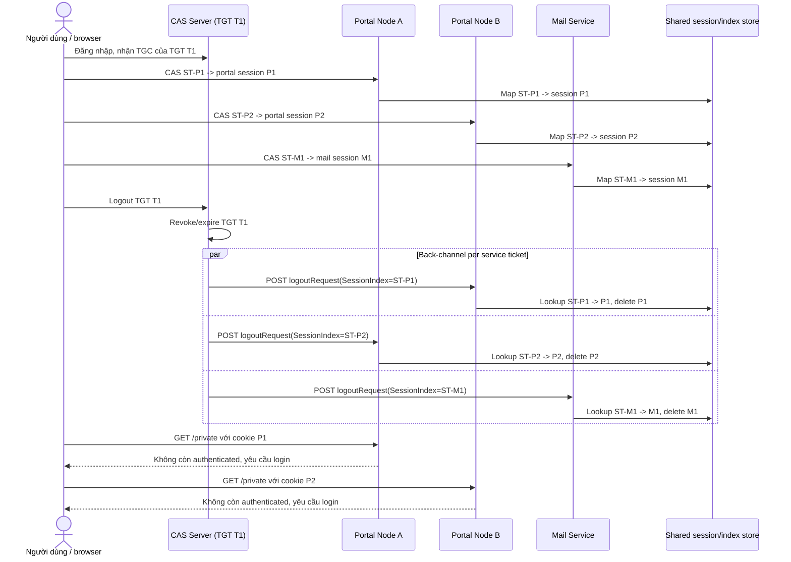

# Kiểm thử CAS Single Sign-Out trên nhiều phiên và nhiều nút

**Học phần:** Spring Security – federation → Kiểm thử SSO.

**Mục tiêu:** kiểm thử **CAS Single Sign-Out (SLO)** từ lúc người dùng kết thúc phiên SSO tại CAS Server, CAS phát thông báo đến những dịch vụ đã tham gia SSO, từng CAS client xác định **đúng service ticket và ứng dụng session** để hủy, đến khi request tiếp theo tại **mọi ứng dụng và mọi node** không còn sử dụng được phiên cũ. Bài tập trung vào tình huống **một TGT tạo nhiều service tickets, nhiều app sessions, nhiều ứng dụng, nhiều node sau load balancer, cache/Redis/Spring Session, callback mất/đến trùng, session fixation và sự khác biệt giữa logout cục bộ với logout toàn hệ**.

**Điểm mấu chốt:** CAS Server quản lý **TGT/TGC** và các service tickets gắn phiên SSO; ứng dụng Java/Spring Security quản lý **HttpSession/SecurityContext**. CAS SLO là một **thông báo best-effort** yêu cầu các dịch vụ vô hiệu hóa phiên của họ, **không phải lệnh thần kỳ tự xóa HttpSession ở mọi JVM**. Để đạt PASS phải chứng minh các service sessions đã bị vô hiệu hóa tại đúng ứng dụng, kể cả khi SLO callback được gửi đến **node khác node đã tạo phiên**; HTTP 200 từ callback hoặc chỉ mất TGC chưa đủ. CAS **không phải shared session manager của các ứng dụng**.

Bài dùng các tên miền `example.test`, service tickets `ST-...` và session IDs giả để giải thích; không đưa TGT/TGC/ST, session cookie, user data hay raw `logoutRequest` thật lên logs, Git hoặc công cụ online. Các mã Spring/CAS filter là **mảnh cấu hình phụ thuộc phiên bản**; chương trình Java 17 chạy độc lập ở phần thực hành mô phỏng ánh xạ tickets → sessions và có stdout xác định.

## 1. Ba lớp phiên mà đội kiểm thử phải phân biệt

| Thành phần | Thuộc về | Tác dụng | Khi nào hết hiệu lực? |
| --- | --- | --- | --- |
| **Ticket-Granting Ticket (TGT)** | CAS Server | Phiên SSO trung tâm; có thể cấp nhiều ST | CAS logout, expiry, revoke theo CAS policy |
| **Ticket-Granting Cookie (TGC)** | Browser ↔ CAS domain | Browser trình TGT/session reference khi liên hệ CAS | CAS logout/cookie expiry; không phải app session cookie |
| **Service Ticket (ST)** | CAS phát cho service URL | Dùng để client service xác thực một lượt với CAS | Thường dùng một lần khi `/serviceValidate`, nhưng ST ID vẫn được ghi nhận cho **SLO correlation** |
| **HttpSession / JSESSIONID** | Từng ứng dụng CAS client | Giữ Spring SecurityContext và state của ứng dụng | Local logout, timeout, CAS SLO khi client invalidate, policy riêng |
| **SessionMappingStorage** | CAS Java client hoặc custom adapter | Liên kết ST ID với HttpSession/session ID | Sau logout, session destroy/expiry/cleanup |
| **Spring Session (Redis/JDBC)** | Ứng dụng nhiều nodes | Lưu HttpSession ở shared repository | Repository delete/expiry, app logout; **không tự biết CAS ST** |
| **SecurityContext** | Spring Security | Principal, authorities và authentication trong app | Được xóa/vô hiệu khi local session thực sự mất hoặc bị revoke |

Một người dùng `alice` có thể có **hai TGT khác nhau** ở hai browser profiles. SLO của **TGT thứ nhất** thông thường nhắm tới các sessions/service tickets thuộc TGT đó, **không mặc nhiên đăng xuất mọi phiên của username alice trong toàn tổ chức**. Nếu yêu cầu “global logout of all sessions for user”, đó là chính sách revoke-all khác, phải định nghĩa rõ; không đánh tráo với cơ chế SLO theo TGT.

### 1.1. Tabs, browser contexts và app sessions

- Hai tab cùng một browser profile thường chia sẻ **cùng app session cookie**: **hai tab không đương nhiên là hai phiên ứng dụng**.
- Hai browser profiles/incognito contexts riêng thường có app sessions riêng; chúng cũng có thể có **TGT riêng**.
- Để kiểm chính xác **nhiều app sessions phát sinh từ một TGT**, test sandbox cần tạo nhiều ST gắn **cùng TGT** và ánh xạ chúng tới hai app sessions khác nhau (bằng controlled browser/cookie fixture hoặc test harness của CAS, không sao chép production TGC).
- Cùng `principal=alice` ở hai phiên khác TGT phải được thử như **negative case**: logout TGT-A không tùy tiện hủy phiên từ TGT-B.
- Một app có **2 nodes** không nhất thiết có **2 sessions**; “node” là JVM/pod xử lý request, còn “session” là identity được ứng dụng theo dõi.

**Khóa để test:** **TGT → các ST đã phát → từng service app session**, không phải “username → mọi sessions” và không phải “ST → chính TGT”.

## 2. CAS SLO hoạt động như thế nào?

Apereo CAS mô tả sự khác biệt:
1. **Application logout** chỉ kết thúc một session tại ứng dụng.
2. **CAS logout** kết thúc phiên SSO TGT/TGC trung tâm.
3. **CAS Single Logout** cố gắng thông báo tới **các service applications đã tham gia SSO** để client hủy các phiên local của họ.

CAS 8.x nêu SLO cho **CAS protocol** có thể được bật mặc định; mỗi registered service có `logoutType` (ví dụ `BACK_CHANNEL`, `FRONT_CHANNEL` hoặc không tham gia). **Back-channel** là mặc định per-service và thông báo có thể được gửi bất đồng bộ, **best-effort**. Front-channel phụ thuộc browser/JavaScript và khả năng client nhận thông báo. Các protocol khác (SAML SLO/OIDC logout) có behavior và yêu cầu khác, **không được đồng nhất** với CAS protocol SLO chỉ vì XML có namespace `samlp`.



**Điểm cần chú ý:** callback `ST-P1` đến **Portal Node B**, nhưng session P1 đã được tạo qua Node A. Nếu mapping chỉ là một `static Map` trong JVM A, B có thể không tìm thấy ST-P1 và **không hủy được phiên**. Một load balancer có sticky sessions cho browser **không đảm bảo** callback server-to-server từ CAS có cùng cookie/pinning và đi vào đúng node. Muốn PASS đa nút cần thiết kế session/index phân tán hoặc chuyển thông báo có xác thực tới node giữ phiên.

## 3. Thông báo back-channel: CAS đang gửi gì?

CAS protocol SLO điển hình dùng server-to-server **HTTP POST** đến service endpoint. Một payload minh họa:

```http
POST /login/cas HTTP/1.1
Host: portal.example.test
Content-Type: application/x-www-form-urlencoded

logoutRequest=<URL-encoded-SAML-like-LogoutRequest>
```

XML **rút gọn để giải thích**, không dùng làm message đã xác thực:

```xml
<samlp:LogoutRequest
    xmlns:samlp="urn:oasis:names:tc:SAML:2.0:protocol"
    xmlns:saml="urn:oasis:names:tc:SAML:2.0:assertion"
    ID="_logout_request_1"
    Version="2.0"
    IssueInstant="2026-11-07T03:00:00Z">
    <saml:NameID>alice</saml:NameID>
    <samlp:SessionIndex>ST-P1</samlp:SessionIndex>
</samlp:LogoutRequest>
```

**Ý nghĩa đặc biệt quan trọng:**
- `SessionIndex` trong CAS SLO message theo tài liệu Apereo CAS thường mang **ID của CAS Service Ticket** đã dùng để authentication ở service.
- `SessionIndex` **không phải** `JSESSIONID`, **không phải** `TGT` và **không phải** username.
- `NameID` là principal info trong message; **không được xóa tất cả phiên mang username đó** chỉ vì có trường NameID.
- Service CAS client tìm trong map `ST ID → HttpSession/session ID` để invalidate đúng phiên.
- Các message thật có thể có format/encoding thay đổi theo CAS server/client version; phải kiểm service's `logoutType` và docs tương ứng.
- XML namespace `samlp` ở đây không có nghĩa CAS protocol callback được bảo vệ giống **SAML2 SP/IdP SingleLogoutService**. Phải đánh giá cơ chế xác thực nguồn và integrity của CAS SLO callback **riêng**.

### 3.1. Tại sao dùng đúng ST thay vì username?

Ví dụ:

```text
CAS TGT T1 (alice):
    ST-P1 -> Portal HttpSession P1
    ST-P2 -> Portal HttpSession P2
    ST-M1 -> Mail HttpSession M1

CAS TGT T2 (alice, browser session khác):
    ST-P3 -> Portal HttpSession P3

Khi T1 logout:
    Portal nhận logout ST-P1 và ST-P2
    Mail nhận logout ST-M1

Đúng:
    invalidate P1, P2, M1
    giữ P3 nếu policy SLO chỉ áp vào T1.

Sai:
    invalidateAllSessionsByUsername("alice")
    -> P3 cũng bị hủy dù thuộc T2.
```

Một implementation “invalidate theo principal” có thể vô tình gây **denial-of-service** cho mọi phiên khác của người dùng hoặc phá isolation giữa tenants. Trong test cần lưu rõ mapping từ **mỗi ST** sang **mỗi app session**, và một TGT → **danh sách ST** chỉ có ở CAS/test harness, không phải một payload mà portal có thể tùy ý tin.

### 3.2. Ticket đã dùng một lần vẫn cần nhớ để logout

Sau khi CAS client validate ST tại `/serviceValidate`:
- ST thường không còn giá trị để **đăng nhập lần nữa**.
- CAS và CAS client vẫn cần **ST ID như một correlation key** cho SLO sau này.
- Client nên lưu `ST → application session ID` ngay sau authentication thành công và sau khi session ID được rotate theo session fixation policy.
- Nếu session bị tạo mới/đổi ID trong khi map còn ID cũ, SLO sẽ lookup session sai hoặc không tồn tại.
- Client nên xóa map khi session hủy/expire và giữ TTL/lifecycle phù hợp để tránh memory leak.
- Không log raw ST hoặc đưa ST trở lại query redirect sau khi xử lý ticket.

**Ticket dùng một lần ≠ không cần lưu SLO mapping.** Việc đăng xuất sử dụng ticket ID làm tham chiếu; nó không cần redeem ST lại để xác thực.

## 4. Front-channel CAS SLO và khác biệt với back-channel

Apereo CAS cũng mô tả **front-channel** callback gửi qua browser, với cơ chế AJAX/JSONP hoặc iframe theo cấu hình. Dạng minh họa:

```text
GET https://portal.example.test/slo
    ?callback=<jsonp-callback>
    &logoutRequest=<base64-encoded-request>
    &_=<cache-buster>
```

**Đặc điểm:**
- Browser đóng vai trò truyền/gửi callback; có thể bị ad blocker/CSP/tracking prevention/cookie SameSite/chính sách third-party contexts ảnh hưởng.
- Không phải CAS client nào cũng hỗ trợ mọi front-channel shape, cần kiểm version và service registry.
- Nếu client chỉ xử lý back-channel POST, một `GET` JSONP có thể bị bỏ qua: CAS có thể vẫn hiển thị logout page nhưng app session còn.
- Iframe/AJAX có thể hoàn tất sau khi trang logout render, callback có thể fail vì network hoặc browser đã đóng tab.
- Đừng tùy tiện bật CORS wildcard hoặc tạo endpoint GET có thể bị user/attacker gọi để invalidate session tùy ý.
- Đường xác thực nguồn và correlation với ST phải được kiểm theo đúng CAS deployment, không chỉ dựa vào việc request chứa `logoutRequest`.

**Ưu tiên cho kiến trúc microservice/session cluster:** back-channel có network ACL/mTLS và shared session store thường dễ kiểm định hơn; nếu dùng front-channel phải có test browser thực với cross-origin restrictions và recovery/revocation strategy khi callback bị mất.

### 4.1. Bảng so sánh

| Tiêu chí | Back-channel | Front-channel |
| --- | --- | --- |
| Người gửi callback | CAS Server → app HTTP endpoint | Browser/AJAX/iframe tới app |
| HTTP shape thường gặp | POST form field `logoutRequest` | GET với encoded `logoutRequest` và callback |
| Phụ thuộc browser mở trang | Ít hơn | Nhiều hơn |
| Phụ thuộc cookie của user | Không nên cần user cookie | Có thể bị tác động bởi browser cookie policies |
| Vượt load balancer | CAS kết nối bất kỳ node | Browser có thể bị route theo cookie/cùng origin |
| Yêu cầu tin cậy | Xác thực CAS service callback, TLS, route ACL, XML hardening | Nguồn/correlation khó hơn, không dựa vào cookie đơn thuần |
| Khi callback thất bại | CAS SLO vẫn best-effort | Cũng best-effort, còn dễ bị browser ngắt |
| Cần shared ST→session index | **Có** nếu nhiều pods | **Có** nếu callback có thể tới node khác |
| Khuyến nghị | Kiểm thử với HTTP callback thật và cluster | Chỉ dùng khi client/browser support được chứng minh |

## 5. SLO registration trên CAS Server

Trong Apereo CAS 8.x, một registered service có thể định nghĩa:

```json
{
  "@class": "org.apereo.cas.services.CasRegisteredService",
  "serviceId": "^https://portal[.]example[.]test/login/cas$",
  "name": "Portal sandbox",
  "id": 1201,
  "logoutType": "BACK_CHANNEL",
  "logoutUrl": "https://portal.example.test/cas/slo"
}
```

**Chỉ là ví dụ cấu hình ý tưởng**, không đảm bảo JSON class/service registry schema giống nhau trên mọi Apereo CAS release/store. Kiểm metadata hiện hành và triển khai qua môi trường staging. Trường `logoutUrl` nếu có cho phép đặt **endpoint SLO riêng** thay vì POST vào chính callback `service` ban đầu.

Điều phải test trong service registry:
- Service `serviceId` đăng ký chính xác, không mở regex `.*` hoặc nhiều host tùy ý.
- `logoutType=BACK_CHANNEL` cho Portal/Mail nếu callback dùng POST. Chỉ dùng `FRONT_CHANNEL` khi client support.
- `logoutUrl` là endpoint ứng dụng nhận thật, accessible **từ CAS Server** (DNS, TLS, firewall), không chỉ accessible từ browser.
- Registry enable SLO đúng service và không vô tình tắt bởi profile/env-specific overrides.
- Không để user dùng tham số `service` để chỉ định SLO target attacker-controlled.
- Authenticated CAS callbacks phải được allowlist/restricted theo đúng protocol và trust boundary.
- CAS SLO settings như `cas.slo.asynchronous` có thể tạo callback không đồng bộ; test không lấy thời điểm browser logout 200 làm đồng hồ cho session invalidation.

### 5.1. CAS logout khác việc redirect browser

`GET /cas/logout` làm CAS SSO TGT hết hiệu lực, có thể tùy policy redirect browser đến một registered service bằng `service`. Nhưng **browser được redirect về `/signed-out` không có nghĩa mọi SLO messages đã được xử lý**. Theo Apereo CAS, `cas.logout.follow-service-redirects` có thể tắt mặc định; không nên bật/mở service registry chỉ để “test logout page”.

**Đánh giá đúng:** trước khi bắt đầu, chốt deadline **eventual invalidation** phù hợp SLO SLA (ví dụ “dưới 5 giây trong staging” là SLA tự thiết kế, **không phải CAS bảo đảm 5 giây**). Test phải chờ bằng bounded polling và xác minh response của **các app sessions**, không chờ một thời gian cố định rồi đoán.

## 6. Apereo Java CAS Client: SingleSignOutFilter và listener

Tài liệu **Spring Security CAS Authentication** và **Apereo Java CAS Client** mô tả cơ chế:
- `org.apereo.cas.client.session.SingleSignOutFilter` chặn nhận `logoutRequest` và liên hệ mapping ticket→session để vô hiệu hóa `HttpSession`.
- `org.apereo.cas.client.session.SingleSignOutHttpSessionListener` dọn mappings khi session bị hủy/expire.
- `SingleSignOutFilter` phải chạy đúng filter order (được tài liệu CAS client khuyến cáo **trước những CAS client filters khác**).
- Spring Security ví dụ cấu hình `singleLogoutFilter` trước `CAS_FILTER`; logout cục bộ và SLO callback là hai filter behaviors khác nhau.
- Một số ví dụ Spring Security mô tả mapping trong **static Map trong JVM**. Đây **không phải distributed session mapping mặc định**.

Ví dụ khai báo Java web filter (theo tài liệu Apereo Java CAS Client, **chưa gồm Spring Security filter chain**):

```xml
<filter>
  <filter-name>CasSingleSignOut</filter-name>
  <filter-class>
    org.apereo.cas.client.session.SingleSignOutFilter
  </filter-class>
</filter>
<filter-mapping>
  <filter-name>CasSingleSignOut</filter-name>
  <url-pattern>/*</url-pattern>
</filter-mapping>

<listener>
  <listener-class>
    org.apereo.cas.client.session.SingleSignOutHttpSessionListener
  </listener-class>
</listener>
```

**Version warning:** Web.xml snippet chỉ dùng nếu CAS Java Client artifact phiên bản đó tương thích **Servlet API** của runtime. Spring Boot 3/4 dùng `jakarta.servlet`, còn CAS client bản cũ có thể biên dịch theo `javax.servlet`. **Không copy filter JAR cũ vào Boot 4 rồi bỏ qua binary incompatibility.** Kiểm Maven dependency tree/Jakarta support, Spring Security major và Java version; riêng Spring Security CAS docs còn có một số ví dụ XML cổ điển, phải dịch đúng sang `SecurityFilterChain` hiện tại.

### 6.1. Filter order là bài test, không phải giả định

Một sơ đồ tổng quát:

```text
HTTP request
  ↓
Encoding / request security filters (nếu có)
  ↓
CAS SingleSignOutFilter: nhận logoutRequest, map ST → session
  ↓
CAS Authentication/Validation filters (login ticket)
  ↓
Spring SecurityFilterChain: SecurityContext/authorization
  ↓
Controller
```

Filter thực tế có thể được đăng ký ở servlet container **ngoài** `FilterChainProxy` hoặc bên trong Spring Security chain, tùy framework configuration. **Không đăng ký cùng filter hai lần** qua `@Bean Filter` và `FilterRegistrationBean` vô tình, vì một request có thể bị xử lý hai lần hoặc sai order. Test bằng trace request/filter chain trong sandbox, không chỉ nhìn cấu hình.

Tại CAS SLO callback, không để application's login entrypoint:
- Redirect callback về CAS login (vòng lặp).
- Chặn vì callback không có browser session cookie.
- Bị Spring CSRF chặn mặc dù POST là server-to-server (cần **exemption rất hẹp** cho endpoint SLO và kiểm alternative trust).
- Bị API gateway cố kiểm `Authorization: Bearer` của browser.
- Đọc form parameter sau khi body đã bị consume bởi filter khác.

**Không tắt CSRF toàn ứng dụng chỉ để callback SLO chạy.** Với back-channel, giới hạn exemption đúng path/method và yêu cầu mTLS/source identity hoặc CAS-specific validation đã được thiết kế.

### 6.2. Vì sao `SingleSignOutHttpSessionListener` quan trọng?

Khi user tự logout cục bộ hoặc session hết hạn:
- ST→session mapping cũ nên được cleanup, tránh leak bộ nhớ.
- SLO callback trễ nên xử lý idempotent, không làm hỏng session mới.
- Nếu session ID bị rotate, mapping phải trỏ **phiên hiện hành**.
- Nếu app chạy nhiều nodes, listener phải cleanup **distributed index**, không chỉ local map.

Không giả định listener xóa mọi mapping ở shared Redis: phải kiểm CAS client/custom adapter đã được tích hợp store đó. Spring Session expiration events có thể cần Redis Keyspace notifications và repository variant phù hợp nếu rely trên event-driven cleanup; **thiếu event cleanup không được làm session cũ “sống lại”**.

## 7. Cluster hazard: local static Map không đủ

Thiết kế lỗi:

```text
    CAS login ST-P1 ------> Node A
                             localMap[ST-P1] = P1
                             localSession[P1] authenticated

    CAS SLO logout ST-P1 -> Node B
                             localMap does NOT contain ST-P1
                             Node B cannot invalidate P1

    Browser GET with P1 ---> Node A
                             SecurityContext still authenticated
                             SLO FAILED
```

**Sticky session không giải quyết chắc chắn**: browser có app cookie, nhưng CAS server back-channel POST **không có browser's JSESSIONID** và LB có thể chọn node B. Test phải cố ý gửi callback khác node để lộ lỗi.

### 7.1. Một thiết kế production có thể kiểm chứng

```text
                    +---------------------------+
                    | Redis/JDBC Shared Storage |
                    | Map ST -> current sess ID |
                    | HttpSession repository    |
                    | Revocation/tombstone TTL  |
                    +------------+--------------+
                                 |
                 +---------------+---------------+
                 |                               |
             Portal Pod A                    Portal Pod B
             Login P1                        SLO callback ST-P1
                 |                               |
           index ST-P1 -> P1                lookup ST-P1 -> P1
                 |                               |
           save Session P1                  delete P1 in shared store
                 |                               |
                 +-------------------------------+
                             |
                  GET /private with old P1
                     must be unauthenticated
```

**Hai repositories có trách nhiệm khác nhau:**
1. **SessionRepository:** `sessionId → authenticated session data`, có thể là Spring Session Redis/JDBC.
2. **CAS Ticket Session Index:** `(service/tenant namespace, hashed or secret-protected ST ID) → current sessionId`; phải cập nhật đúng khi login và session ID rotation.

Spring Session **không tự sinh ST→session index** chỉ vì được bật; CAS client default local `Map` cũng không tự biết Redis sessions. Cần viết/custom adapter hoặc lựa chọn thư viện/phiên bản hỗ trợ distributed mapping thực sự, có integration tests chứng minh.

### 7.2. Spring Session cung cấp phần nào?

Spring Session `SessionRepository` hỗ trợ đọc/xóa session theo ID. Với indexed repository, `FindByIndexNameSessionRepository` có thể truy vấn các sessions theo principal, nhưng **không nên dùng “find all sessions by username” để thay SLO per-ticket**. Cụ thể:
- Dùng ST index để tìm **đúng** session ID.
- Gọi `SessionRepository.deleteById(sessionId)` để revoke current app session trong shared store.
- Khi cần server-side revocation chắc chắn trên concurrent requests, kiểm request racing/tombstone/revocation epoch.
- Xóa ST mapping/lưu processed notice theo idempotency semantics.
- Dọn old mappings/expired sessions và gắn namespace per application/tenant.
- Cấu hình Redis repository/index/events theo Spring Session version: không mặc định mọi repository đều có principal indexing/event propagation như nhau.

**Cảnh báo xóa map trước session:** nếu lấy `GETDEL(ST)` rồi process crash trước khi `deleteById`, mapping biến mất trong khi session vẫn active. Quy trình bền vững nên đảm bảo **session revocation trước acknowledgment/cleanup** và hỗ trợ retry; nếu cần bảo đảm cao, dùng transaction/outbox, event consumer retry hoặc revocation marker theo kiến trúc. Không trả “SLO completed” chỉ vì đã remove ticket key.

### 7.3. Login session fixation và ST mapping

Spring Security có session fixation protection; ID có thể thay đổi khi authentication success. Ví dụ:

```text
Before CAS ticket validation:  HttpSession OLD-123
After CAS authentication:      HttpSession NEW-456

WRONG mapping:
    ST-P1 -> OLD-123

RIGHT mapping:
    ST-P1 -> NEW-456
```

Đối với client CAS filter, xác minh **lúc nào** mapping được thêm, có được cập nhật khi session ID change và `HttpSessionIdListener`/Spring Session event handling có sync đúng không. Nếu CAS client lưu tham chiếu trực tiếp tới `HttpSession` local, hành vi có thể khác với shared session repository; **đừng giả định wrapper/proxy HttpSession reference tồn tại xuyên nodes**.

### 7.4. Hai loại race cần mô phỏng

**Race A – logout trong khi browser login:**
1. CAS phát ST và app bắt đầu validate.
2. CAS SSO logout/TGT expired và SLO notice đến.
3. App chưa kịp tạo ST→session mapping.
4. Callback “ST unknown” được bỏ qua.
5. App tạo session sau notice, session sống dù TGT đã logout.

Mitigation: atomic association/negative tombstone/event holdback, state fencing, hoặc CAS ticket validation/login finalization kiểm SSO revocation theo thiết kế. Với best-effort protocol, không thể chỉ dựa vào ordering của network; test stress timing và fail-closed khi trễ.

**Race B – revoke session trong khi request đang chạy:**
1. Request R1 đã load SecurityContext từ shared session.
2. CAS SLO xóa session trong Redis.
3. R1 tiếp tục xử lý hoặc ghi session state khi kết thúc.
4. Request sau có thể tái tạo session/side effects nếu không có revocation check/lifecycle strategy.

Mitigation tùy threat model: short-lived privileges, revocation epoch, authorization check trước sensitive side effects, session repository handling, optimistic concurrency, invalidation event và browser isolation. **Không hứa deleteById có thể thu hồi một HTTP response đã được tạo trong request đang chạy.**

## 8. Mảnh tích hợp Spring Session: sau khi đã xác thực callback CAS

Đây là **mảnh architecture code**, không phải controller tự xác minh CAS logoutRequest. Một lớp adapter bên ngoài phải:
- Chỉ nhận callback CAS Server tin cậy sau network/mTLS/authentication policy.
- Parse `logoutRequest` XML an toàn, extract CAS ST `SessionIndex` theo đúng CAS protocol/version.
- Validate context/issuer/message freshness nếu triển khai profile có khả năng kiểm; không tin raw `NameID`/query làm user ID.
- Chỉ khi kết luận `VerifiedCasLogoutNotice` mới gọi service dưới đây.

```java
package com.example.portal.slo;

import org.springframework.session.Session;
import org.springframework.session.SessionRepository;
import org.springframework.stereotype.Service;

@Service
public final class CasSessionRevoker {
    private final SessionRepository<? extends Session> sessions;
    private final CasTicketIndex ticketIndex;

    public CasSessionRevoker(
            SessionRepository<? extends Session> sessions,
            CasTicketIndex ticketIndex) {
        this.sessions = sessions;
        this.ticketIndex = ticketIndex;
    }

    public boolean invalidateVerifiedTicket(
            String verifiedCasServiceTicket) {
        // CHỈ gọi sau khi callback đã qua trust checks/parse.
        String sessionId =
                ticketIndex.findSessionId(verifiedCasServiceTicket);
        if (sessionId == null) {
            return false;
        }

        // Revocation trước; mapping cleanup sau.
        sessions.deleteById(sessionId);
        ticketIndex.removeIfMappedTo(
                verifiedCasServiceTicket, sessionId);
        return true;
    }
}
```

Interface để triển khai bằng Redis/JDBC theo yêu cầu hệ thống:

```java
package com.example.portal.slo;

public interface CasTicketIndex {
    String findSessionId(String serviceTicket);
    boolean removeIfMappedTo(String serviceTicket, String sessionId);
}
```

**Các mảnh trên chưa phải production SLO handler và chưa chạy độc lập**: cần Spring Session dependencies, repository bean, implementation của `CasTicketIndex`, authenticated CAS SLO ingress, session ID rotation integration, retries/TTL, idempotency store và test atomicity/races. Service này chỉ dùng ST để lookup một session; không dùng username.

Nếu lưu raw ST ở Redis:
- Phải giới hạn quyền Redis/DB, encryption và log access.
- Cân nhắc **HMAC-based index key** của ST với key riêng của app để giảm lộ opaque ticket (đảm bảo CAS callback tính ra cùng key).
- Xác định TTL index không thấp hơn lifetime phiên app cần SLO mà chưa có cleanup khác; vẫn nên dọn khi session expires.
- Namespace key theo **CAS client application, realm/tenant/trust config** để tránh collision và cross-application access.
- Không đặt user email hay nhóm quyền trực tiếp làm index key.

**Không triển khai controller raw XML theo kiểu `String ticket = request.getParameter("logoutRequest")` rồi `findByPrincipalName(name).deleteAll()`**. Điều đó vừa dễ giả mạo, vừa phá semantics per-ticket và thiếu XML hardening.

## 9. Bảo mật endpoint nhận CAS SLO

CAS protocol back-channel logout XML **không được giả định** luôn có chữ ký XMLDSig như SAML2 Single Logout. Một số CAS installations dùng HTTP POST với `logoutRequest` **unsigned** theo CAS client protocol. Phải xây trust boundary phù hợp CAS version/config:
- TLS hợp lệ, tránh downgrade/HTTPS bypass.
- Chỉ CAS Server/CAS outbound egress identity được gọi SLO endpoint qua **mTLS, authenticated gateway, network policy/firewall/service mesh** theo thiết kế.
- Nếu có signed notification/profile, verify signature và trusted keys đúng, không dùng certificate do request tự gửi làm authority.
- Giới hạn HTTP method, exact path, body size, content type, request rate và timeout.
- Parse XML với secure parser (disable DTD/external entities; chặn XXE, entity expansion, XML bombs).
- Kiểm message format có đúng CAS logout message, `SessionIndex` hợp lệ, không chấp nhận request tùy ý có session ID nội bộ.
- Nếu hỗ trợ ID/time/replay checks, dùng server time và idempotency store; không coi message ID duy nhất tự xác minh nguồn.
- **Không dùng `X-Forwarded-For` làm bằng chứng duy nhất** vì header có thể bị giả nếu ingress không strip.
- Callback không cần browser session cookie; không dựa vào cookie của user để xác thực nguồn server-to-server.
- Cấu hình **CSRF exemption đúng SLO POST endpoint**, không disable toàn web app. CSRF của browser và xác thực CAS callback là hai cơ chế khác nhau.
- Không cho callback mang `ticket` bất kỳ delete được toàn user/account hoặc sessions không thuộc service namespace.

### 9.1. SLO là thao tác phá phiên, cần ưu tiên fail-safe

Một logoutRequest giả nếu có thể đặt `SessionIndex=ST-of-victim` sẽ gây logout trái ý người khác (denial of service). Dù ST IDs thường khó đoán, **độ ngẫu nhiên không thay thế xác thực nguồn**. Cần test:
- HTTP POST từ client Internet không tin cậy → bị chặn tại gateway/mTLS.
- JSON/XML malformed → reject, không đụng sessions.
- SessionIndex unknown → idempotent no-op, không bulk logout theo NameID.
- SessionIndex belonging other service → không invalidate.
- Replay notice → no-op/return safe status, không ảnh hưởng session mới.
- Timestamp/signed notice mismatch khi contract đòi → reject.
- Không trả raw stacktrace/ticket/usernames vào response và logs.

**Nếu CAS callbacks bị chặn do 403 CSRF**, không sửa bằng cách disable CSRF mọi path hoặc permitAll `/**`. Chỉ điều chỉnh path nhận SLO với **alternative authenticated trust** và filter order đã kiểm.

## 10. Thiết kế test fixture: nhiều apps, nhiều sessions, nhiều nodes

### 10.1. Topology staging

```text
                   Browser/test harness
                          |
                      CAS Server
                       TGT-T1
                /          |         \
            ST-P1        ST-P2      ST-M1
              |            |          |
            Portal       Portal      Mail
          Session P1   Session P2  Session M1
             Node A       Node B      Node M
                \          /
                 \        /
           Portal Load Balancer
                    |
          Spring Session Redis
          Ticket->Session Index

CAS logout TGT-T1 sends:
   POST Portal SLO {SessionIndex: ST-P1}
   POST Portal SLO {SessionIndex: ST-P2}
   POST Mail SLO   {SessionIndex: ST-M1}

Separate TGT-T2 (same username alice):
   ST-P3 -> Portal Session P3
   MUST remain active if only TGT-T1 is logged out.
```

**Fixture phải thực sự tạo hai Portal sessions P1/P2**, không chỉ hai tabs cùng cookie. Dùng IdP/CAS test harness để cấp ít nhất hai ST gắn TGT-T1 cho một registered service nhưng hai app sessions độc lập, hoặc dùng được test context có quản lý cookie của CAS riêng và app session riêng. Tránh copy CAS production cookies; nếu test lab không dễ tạo hai app sessions dùng một TGT, ghi rõ chỉ có **1 session/1 TGT** và tách case multiple sessions thành test harness fixture độc lập, **không giả PASS**.

### 10.2. Bảng định danh testcase

| Đối tượng | Giá trị test | Có cùng SSO TGT-T1? | Kết quả sau logout TGT-T1 |
| --- | --- | --- | --- |
| Portal app session P1 | `JSESSIONID=P1` / `ST-P1` | Có | **Revoked** |
| Portal app session P2 | `JSESSIONID=P2` / `ST-P2` | Có | **Revoked** |
| Mail app session M1 | `MAILSESSION=M1` / `ST-M1` | Có | **Revoked** |
| Portal app session P3 | `JSESSIONID=P3` / `ST-P3` | **Không; TGT-T2** | **Preserved** nếu policy chỉ TGT-T1 |
| User bob session B1 | `ST-B1` từ TGT-B | Không | **Preserved** |
| Portal anonymous session X | Session chưa CAS-authenticated | Không | Không bị coi đã authenticated |
| In-flight R1 | Request tải SecurityContext P1 trước SLO | Thuộc TGT-T1 | Không được tạo quyền mới sau revocation; policy xử lý race |
| Fresh login P4 | ST-P4 được CAS phát **sau** TGT-T1 logout theo authentication mới | TGT mới | Có thể PASS nếu user thực sự login lại |

**Đừng kiểm “sau CAS logout phải thấy 401 mãi mãi”.** Khi browser còn ở IdP khác hoặc người dùng tự login mới, ứng dụng có thể lập session mới. Chỉ cần chứng minh **session cũ P1/P2/M1** không còn hiệu lực, đúng phạm vi; một redirect đi CAS và login mới không làm session cũ hợp lệ.

## 11. E2E happy path: từ login đến logout đa dịch vụ

### 11.1. Chuẩn bị

- CAS Server test riêng (không production), service registry có Portal/Mail, SLO back-channel cho từng service.
- Portal triển khai **≥2 pods/nodes** sau LB và một shared HttpSession repository nếu cần cross-node.
- CAS ST→app session mapping có cơ chế distributed, được instrument để quan sát **masked identifiers**.
- Một service Mail test sử dụng CAS client support SLO; session backend của Mail độc lập Portal.
- CAS SSO user test `alice`; user `bob` và TGT-T2 khác làm isolation fixtures.
- Test client giữ app cookies riêng và có khả năng chủ động route callback đến pod A/B để kiểm cross-node.
- Đồng hồ/Cert/DNS đúng, CAS outbound có thể POST SLO endpoints; thử callback direct với mTLS/source auth theo config.
- Bật metrics events nhưng redact raw ST/TGT/TGC, session cookies và logoutRequest XML.

### 11.2. Thực hiện và điều kiện PASS

**Step 1 – Login CAS:** test user đăng nhập CAS, tạo TGT-T1/TGC. Dùng CAS client login flow và nhận ST-P1 cho Portal. Portal validate ST bằng CAS, xác lập session P1. Ghi nhận mapping `ST-P1→P1` **nội bộ** (hash/correlation, không raw log).

**Step 2 – Tạo nhiều sessions:** dùng cùng TGT-T1 trong lab để tạo ST-P2 và Portal app session P2 tách biệt. Login Mail bằng ST-M1 thành M1. Xác nhận P1/P2/M1 đều thuộc TGT-T1 theo CAS test registry/fixture.

**Step 3 – Đối chứng:** tạo Portal P3 của alice bằng **TGT-T2** và Bob B1 bằng một TGT khác. Xác nhận tất cả sessions active trước SLO.

**Step 4 – Trước logout:** với cookie riêng P1/P2/M1/P3/B1, GET `/whoami` hoặc một protected resource. Expect authenticated đúng principal/tenant; test không dùng `@WithMockUser`.

**Step 5 – Trigger CAS logout:** từ browser/test harness của TGT-T1 gọi `/cas/logout` qua flow được phép; xác minh TGT-T1 không còn cấp ST mới **mà không primary authentication**. Không chỉ assert logout page 200.

**Step 6 – Quan sát CAS callbacks:** CAS phát back-channel notices theo registered services. Với Portal, phải nhận/ghi nhận riêng **ST-P1 và ST-P2**; Mail nhận ST-M1. Các POST đi tới correct SLO endpoints; không cần app user cookie.

**Step 7 – Buộc cross-node:** route `ST-P1` notice tới Portal node B trong khi P1 được tạo ở node A; ngược lại notice `ST-P2` tới node A. Đây là **điểm bắt lỗi local Map**. Dùng test ingress/harness/sandbox routing, không thay đổi load balancer production.

**Step 8 – Xác minh shared deletion:** index ST→session resolve đúng; SessionRepository mất P1/P2; Mail mất M1. Chỉ ghi PASS khi session IDs đã bị invalidate/revoked, không chỉ khi callback ack 200.

**Step 9 – Request sau logout:** gửi GET protected endpoint bằng **cookie cũ** P1/P2/M1 qua **tất cả node có khả năng phục vụ**. Expect unauthorized/redirect CAS login; tuyệt đối không có authenticated SecurityContext từ phiên cũ.

**Step 10 – Isolation:** P3 (TGT-T2) và Bob B1 vẫn active nếu policy chỉ logout TGT-T1. SLO không bulk-revoke toàn username alice.

**Step 11 – Idempotency:** gửi lại callback ST-P1 **trong sandbox có authenticated sender**. Expect harmless no-op/ack theo contract; không invalidate P3, không resurrect P1.

**Step 12 – Recovery:** thử CAS callback bị chặn, node offline hoặc shared Redis timeout. Đánh dấu SLO incomplete, có alert/retry/TTL strategy và test lại; **không coi CAS logout page là success của toàn bộ apps**.

### 11.3. Điều kiện đo đạc

| KPI/Assertion | Ý nghĩa |
| --- | --- |
| CAS TGT-T1 expired | CAS session trung tâm đã kết thúc |
| Number of expected ST notices | Bằng số service ticket sessions theo CAS test registry |
| Actual SLO events received | Có thể ít hơn khi delivery lỗi |
| Correct mapping per ST | Không dựa vào user name |
| Session deletion acknowledged | Shared session store đã ghi nhận revocation |
| Authenticated request after delete | **Phải bị chặn trên mọi nodes** |
| Unrelated sessions preserved | Không revoke sessions từ TGT khác |
| Callback latency | Eventual; so với SLO SLA của tổ chức |
| Duplicate callback safety | Idempotent |
| Monitoring of missing callbacks | Biết chỗ nào SLO best-effort thất bại |
| PII/token sanitization | Không in raw tickets/session cookies |

**KPI “CAS logout returns HTTP 200” chỉ đo CAS endpoint, không chứng minh bất kỳ application session nào đã bị hủy.**

## 12. Java 17 độc lập: SLO qua hai Portal nodes và Mail app

Chương trình sau **chạy được trên Java 17**, không cần Spring/CAS/Redis/network. Nó mô phỏng các nguyên tắc:
- Có hai Portal sessions `P1/P2` và một Mail session `M1` thuộc **TGT-T1**.
- Portal Node A và Node B dùng cùng **logical shared session/ticket store**.
- Callback `ST-P1` tới Node B vẫn xóa P1 đã được tạo ở Node A.
- Callback `ST-P2` tới Node A xóa P2 đã tạo ở Node B.
- Mail app nhận `ST-M1` và hủy M1 trong store riêng.
- Duplicate callback ST-P1 là no-op.
- Session P3 (cùng username alice nhưng từ **TGT-T2**) không bị xóa.

**Giới hạn:** chương trình là mô phỏng memory, **không có CAS logout XML parsing/signatures, SessionRepository, mTLS, threading/transactions/retries, session cookie, TTL hoặc thực thi bất kỳ security action từ mạng**. Trường `casTgtFixture` chỉ để giải thích testcase; CAS client ứng dụng thật thường **không biết TGT ID** và không dùng TGT làm lookup key.

File `CasClusterSloDemo.java`:

```java
import java.util.HashMap;
import java.util.Map;

public class CasClusterSloDemo {
    record AppSession(
            String sessionId, String user, String casTgtFixture) {}

    static final class SharedServiceStore {
        private final Map<String, String> ticketToSession = new HashMap<>();
        private final Map<String, AppSession> activeSessions = new HashMap<>();

        void login(String serviceTicket, AppSession session) {
            if (ticketToSession.containsKey(serviceTicket)) {
                throw new IllegalArgumentException("Duplicate service ticket");
            }
            ticketToSession.put(serviceTicket, session.sessionId());
            activeSessions.put(session.sessionId(), session);
        }

        boolean invalidateByServiceTicket(String serviceTicket) {
            String sessionId = ticketToSession.remove(serviceTicket);
            if (sessionId == null) {
                return false;
            }
            return activeSessions.remove(sessionId) != null;
        }

        boolean isActive(String sessionId) {
            return activeSessions.containsKey(sessionId);
        }
    }

    static final class Node {
        private final SharedServiceStore store;

        Node(SharedServiceStore store) {
            this.store = store;
        }

        boolean onVerifiedCasLogout(String serviceTicket) {
            return store.invalidateByServiceTicket(serviceTicket);
        }
    }

    public static void main(String[] args) {
        SharedServiceStore portal = new SharedServiceStore();
        SharedServiceStore mail = new SharedServiceStore();

        Node portalA = new Node(portal);
        Node portalB = new Node(portal);
        Node mailNode = new Node(mail);

        portal.login("ST-P1", new AppSession("P1", "alice", "TGT-T1"));
        portal.login("ST-P2", new AppSession("P2", "alice", "TGT-T1"));
        portal.login("ST-P3", new AppSession("P3", "alice", "TGT-T2"));
        mail.login("ST-M1", new AppSession("M1", "alice", "TGT-T1"));

        System.out.println("Portal P1 active: " + portal.isActive("P1"));
        System.out.println("Portal P2 active: " + portal.isActive("P2"));
        System.out.println("Mail M1 active: " + mail.isActive("M1"));

        System.out.println("SLO P1 via other node B: "
                + portalB.onVerifiedCasLogout("ST-P1"));
        System.out.println("SLO P2 via other node A: "
                + portalA.onVerifiedCasLogout("ST-P2"));
        System.out.println("SLO M1 via mail node: "
                + mailNode.onVerifiedCasLogout("ST-M1"));

        System.out.println("Duplicate ST-P1 harmless: "
                + !portalA.onVerifiedCasLogout("ST-P1"));
        System.out.println("All target sessions closed: "
                + (!portal.isActive("P1")
                && !portal.isActive("P2")
                && !mail.isActive("M1")));
        System.out.println("Other TGT session preserved: "
                + portal.isActive("P3"));
    }
}
```

Chạy tại thư mục chứa file:

```bash
javac CasClusterSloDemo.java
java CasClusterSloDemo
```

**Stdout chính xác:**

```text
Portal P1 active: true
Portal P2 active: true
Mail M1 active: true
SLO P1 via other node B: true
SLO P2 via other node A: true
SLO M1 via mail node: true
Duplicate ST-P1 harmless: true
All target sessions closed: true
Other TGT session preserved: true
```

### 12.1. Vì sao demo này vẫn chưa chứng minh production SLO?

- `onVerifiedCasLogout` giả định callback **đã được xác thực nguồn và parse an toàn**; thực tế CAS callback có thể là unsigned form XML và cần mTLS/network auth.
- Hai nodes dùng cùng Java object `portal` để mô phỏng **shared store**, không phải hai processes thật. Mạng/Redis consistency, node crash, session expiry, LB routing chưa được kiểm.
- `HashMap` không thread-safe; thực tế phải có atomic operations, transaction/tombstone và event replay rules.
- `casTgtFixture` chỉ gắn nhãn testcase. Không dùng nó để xóa mọi sessions của username, vì CAS gửi thông báo **theo ST**.
- Mã không mô phỏng update `ticket→sessionId` khi Spring session fixation rotation.
- Trong production phải kiểm cookie cũ trên HTTP request mới bị từ chối sau `SessionRepository.deleteById`.
- Nếu callback tới Mail app, Mail phải xử lý trong **store/session namespace riêng**, không tự xóa Portal session bằng ST không thuộc mình.
- Callback đến trùng phải idempotent; **HTTP 200 vẫn phải đi kèm verify “session thật sự không còn”** ở E2E test.

## 13. Kịch bản mất callback và lỗi cụm

### 13.1. Callback đến sai node

**Setup:** Portal P1 ở Node A, Node B nhận ST-P1; local static map chỉ có ở A.

**Expected:** Với implementation đã cluster-safe, Node B tra shared index và revoke P1. Với local-only map, test **FAIL** vì cookie P1 vẫn authenticated qua Node A. Không dùng sticky sessions làm lý do bỏ test.

### 13.2. Callback đến khi Node A bị tắt

**Setup:** P1 được tạo tại A, tắt A; CAS gửi SLO đến B.

**Expected:** B vẫn có thể xóa shared session P1 nếu Spring Session/index còn live. Sau khi A restart, P1 không được “tái xuất hiện”. Nếu app dùng local in-memory session ở A, yêu cầu thiết kế chuyển event hoặc thay store.

### 13.3. CAS callback timeout hoặc CAS Server down

**Setup:** CAS logout TGT-T1 nhưng outbound POST tới Portal bị timeout/HTTP 5xx.

**Expected:** CAS SLO là **best-effort**: không được giả định retry chắc chắn; hệ thống quan sát missing callback và đánh giá remaining session risk. Policy có thể dùng short session TTL, periodic revalidation, revocation epoch và circuit breaker, nhưng cần chốt **SLA/security posture**. Nếu yêu cầu immediate guaranteed global revoke, chỉ CAS SLO callbacks là không đủ.

### 13.4. Redis/session store tạm ngưng

**Setup:** Node B nhận ST-P1, index có mapping nhưng Redis delete thất bại.

**Expected:** Không trả thành công nghiệp vụ giả; retry theo chiến lược an toàn và giữ mapping để retry. Đảm bảo in-flight request không kéo dài phiên sau revocation. Cần alert cho `SESSION_DELETE_FAILED` (không log ST raw).

### 13.5. Callback đến trùng hoặc sai thứ tự

**Setup:** CAS gửi ST-P1 hai lần hoặc ST-P2 đến trước ST-P1.

**Expected:** xử lý **idempotent, per ticket**. Sau lần đầu P1 inactive, lần hai no-op. ST-P2 vẫn hủy P2, không tác động P3. Không đặt expectation rằng CAS callbacks luôn theo thứ tự user login.

### 13.6. Logout đúng lúc login

**Setup:** TGT-T1 bị logout trong khi Portal chưa lưu ST→session.

**Expected:** không để late-login tạo authenticated P1 mà không có revocation marker. Test dùng injection hooks / controlled barriers để tái hiện race; cách khắc phục phụ thuộc store/adapter, có thể cần transaction/tombstone hoặc deny late authentication. Không thêm workaround chỉ kiểm CAS cookie một lần rồi giả định chắc chắn.

### 13.7. Login mới ngay sau logout

**Setup:** CAS TGT-T1 bị revoke; user xác thực lại và nhận TGT-T3, ST-P4, app session P4.

**Expected:** P4 có thể authenticated bình thường khi user đăng nhập lại thật; **callback ST-P1 muộn không được revoke P4**. Điều này kiểm tính chính xác của ticket→session mapping, tránh dùng username/session-ID reused.

### 13.8. Service SLO disabled

**Setup:** Mail registered service có `logoutType` tắt SLO hoặc CAS callback được vô hiệu.

**Expected:** CAS TGT logout không có nghĩa Mail session M1 biến mất; test phải ghi **SLO not configured/unsupported** rõ, không đánh giá PASS nhờ Portal hủy đúng. Thiết kế cần quyết định chấp nhận hay không rủi ro local Mail sessions còn.

## 14. Ma trận kiểm thử đầy đủ

| ID | Case | Expected assertion |
| --- | --- | --- |
| SLO-01 | One app session, one ST, one node | SLO ST hủy đúng HttpSession |
| SLO-02 | Hai Portal sessions P1/P2 từ cùng TGT | Cả hai bị hủy qua hai ST riêng |
| SLO-03 | Portal + Mail từ cùng TGT | Mỗi app nhận callback và hủy own sessions |
| SLO-04 | Hai tabs cùng app cookie | Không giả là hai sessions; logout một session |
| SLO-05 | Hai profiles cùng username, hai TGT | Logout TGT1 **không** xóa TGT2 session |
| SLO-06 | Portal P1 node A, callback node B | Shared ST index hủy P1 |
| SLO-07 | Portal P2 node B, callback node A | Shared session store hủy P2 |
| SLO-08 | Callback đến load balancer không sticky | Hoạt động độc lập browser cookie |
| SLO-09 | Node A shutdown trước callback | Node B vẫn hủy shared session |
| SLO-10 | Node A restart sau revoke | Session không được phục hồi |
| SLO-11 | CAS logout page trả 200 | **Chưa** được đánh dấu SLO PASS |
| SLO-12 | ST→session mapping absent | Không revoke arbitrary user; detect QA FAIL/alert |
| SLO-13 | Mapping dùng ST vs HttpSession ID nhầm | Test phát hiện wrong lookup |
| SLO-14 | Session ID rotate khi login | Mapping tới final session ID |
| SLO-15 | CAS sends duplicate SLO POST | Idempotent, không phá session mới |
| SLO-16 | CAS sends callbacks out of order | Per-ticket revocation đúng |
| SLO-17 | ST-P1 notice tới Mail service | Không xóa Mail sessions khác |
| SLO-18 | Wrong principal trong logoutRequest | Không bulk delete username sessions |
| SLO-19 | Forged internet callback | Block bằng sender trust/mTLS/policy |
| SLO-20 | Malformed XML/XXE/DTD | Reject parse, không ảnh hưởng sessions |
| SLO-21 | Wrong method/content type/path | Không mutate state |
| SLO-22 | Unknown SessionIndex | No-op/appropriate ack, không bulk revoke |
| SLO-23 | SLO callback blocked by CSRF | Detect filter misconfiguration, use narrow exemption |
| SLO-24 | Disabling CSRF globally | Test/security review phải FAIL |
| SLO-25 | Callback 200 nhưng session còn | E2E FAIL |
| SLO-26 | Spring Session Redis delete failure | Retry/alert, không false ack |
| SLO-27 | CAS outbound network timeout | Best-effort gap detected, fallback policy |
| SLO-28 | Delayed callback after new TGT | Chỉ old ST session bị hủy |
| SLO-29 | Logout while login mapping not yet saved | Tombstone/race policy ngăn session sống sót |
| SLO-30 | In-flight request re-saves session | Revocation policy ngăn reactivation |
| SLO-31 | Redis TTL/expired mapping | Không memory leak; không xóa session mới |
| SLO-32 | Session expired trước SLO | Callback idempotent no-op |
| SLO-33 | Service logoutType=BACK_CHANNEL | Server POST đúng configured logoutUrl/service |
| SLO-34 | Service logoutType=FRONT_CHANNEL | JSONP/iframe client-supported, browser test |
| SLO-35 | Service logoutType disabled | Ghi rõ unsupported, không giả PASS |
| SLO-36 | Browser tab closed before front SLO | Missing callback được phát hiện |
| SLO-37 | Multiple CAS client library versions | Hợp đồng format/filter ordering tương thích |
| SLO-38 | Spring Boot 4 Jakarta vs old CAS javax client | Compile/integration fail early nếu không tương thích |
| SLO-39 | Protected request after logout on node A | Unauthenticated |
| SLO-40 | Protected request after logout on node B | Unauthenticated |
| SLO-41 | Independent TGT-T2 session P3 | Remains authenticated theo policy |
| SLO-42 | Bob session B1 | Không bị revoke |
| SLO-43 | Logout local portal only | CAS TGT còn; có thể SSO lại |
| SLO-44 | CAS logout without SLO client | CAS TGT invalid, app HttpSession vẫn có thể active |
| SLO-45 | Session cookie Secure/HttpOnly/SameSite | Theo policy, không bị lộ trong telemetry |
| SLO-46 | Logs chứa raw TGT/ST/TGC/logoutRequest | Privacy/security QA FAIL |
| SLO-47 | Callback storm, large XML, retries | Bounded resource usage, rate limits |
| SLO-48 | LB routes SLO URL tới wrong service | Route/service namespace validation FAIL |
| SLO-49 | Many tenants share same hostname | ST index namespace không cross-tenant |
| SLO-50 | New login after logout | New TGT/ST/session hoạt động, old ST vô hiệu |
| SLO-51 | All backend sessions stateless JWT | CAS HttpSession SLO alone không revoke JWT; must model separately |
| SLO-52 | Front-channel blocked third-party cookies | Detect browser limitation, do not misreport successful logout |
| SLO-53 | Cookie old session reused after store delete | App must reject or trigger login |
| SLO-54 | Callback result audit entry | Has correlation/status but no raw credentials |
| SLO-55 | CAS logout propagation asynchronous | Bounded eventual-check, not immediate hardcoded expectation |
| SLO-56 | CAS ticket validation failure during login | Không tạo ST→session mapping hay app auth |
| SLO-57 | Client local session invalidated manually | SLO index entry cleanup |
| SLO-58 | Migration local to Redis sessions | Cross-node callback still works |
| SLO-59 | CAS service registry wildcard | Reject open/incorrect service target |
| SLO-60 | Inconsistent nodes signing/trust config | Fail safe; no accidental login bypass |

**Nguyên tắc đánh giá:** mỗi testcase phải xác định *TGT nào, service ticket nào, app session nào, node nào và endpoint nào*; nếu chỉ biết username thì chưa đủ. Negative test **phải chủ động tạo lỗi** và chứng minh không mất session của người khác, không còn session thuộc phạm vi SLO và không bị giả mạo callback.

## 15. Cách viết automation test trong dự án

### 15.1. Unit tests

Tập trung:
- `findSessionId(ticket)` chỉ trả session thuộc đúng service namespace.
- `deleteById` chỉ gọi cho session đã match; unknown ticket không gọi delete.
- Duplicate callback idempotent.
- Case session ID rotation/same user multiple sessions.
- Fail of session delete giữ khả năng retry.
- Event ordering và key collision.
- Explicit session revoke state/tombstone theo yêu cầu.
- Không log raw ST.
- Không parse raw XML bằng string `indexOf("<SessionIndex>")`.

**Một unit test với mock repository chưa chứng minh SLO end-to-end**; nó chỉ giúp kiểm adapter logic.

### 15.2. Spring integration tests

Chạy Spring Security + CAS client extension phù hợp:
- Back-channel SLO filter/endpoint thực nhận HTTP POST từ authenticated test gateway.
- Parse CAS logoutRequest đúng và gọi SessionRepository.
- Spring Session Redis/JDBC test instance, distributed index; không dùng fake static map cho cluster test.
- SecurityContext trước logout tồn tại, sau callback request mới còn cookie cũ thì mất.
- HTTP CSRF policy chỉ exempt SLO path; các POST business khác vẫn cần CSRF.
- Simulate separate application session IDs, test logout of exactly selected ticket.
- Test restart/redeploy node và Redis persistence/TTL.
- Test wrong envelope/wrong caller/replay/malformed XML.

Không dùng `@WithMockUser` làm bằng chứng phiên CAS thật. Annotation đặt Spring SecurityContext giả, bỏ qua CAS ST validation, SLO filter và session behavior.

### 15.3. E2E browser + CAS + multiple pods

Có CAS Server sandbox, Portal 2 pods, Mail service, shared session store, load balancer và browser contexts thật:
1. Login tạo STs theo CAS TGT mapping.
2. Capture only hashed mapping IDs và status.
3. Trigger CAS logout.
4. Chờ tới **SLO deadline do tổ chức định nghĩa** bằng bounded polling.
5. Tất cả old session cookies trên tất cả nodes không authenticated.
6. Unrelated TGT/user sessions vẫn active.
7. CAS/Portal/Mail audit traces đủ để biết service nào chưa nhận callback.
8. Test retry/failure/restart và verify no unwanted resurrection.

**Không trộn** test “tạo nhiều tabs” với test “nhiều sessions” nếu app cookies shared. BrowserContext isolation phải rõ; nếu cần cùng TGT qua hai contexts, tạo test fixture có kiểm soát chứ không copy cookie production.

### 15.4. Testcontainers và môi trường gần production

Nếu có Java/Spring Boot CI:
- Dùng Testcontainers Redis/PostgreSQL (theo policy CI) để chạy shared session/index store.
- Spin 2 Spring Boot instances trên ports khác nhau, cùng Redis namespace của **một app**.
- CAS test IdP có service registry và local credentials test; không cần truy cập Internet.
- Proxy test điều hướng callback đến node khác nơi phiên được tạo.
- Một service Mail khác có namespace riêng và callback riêng.
- Inject CAS outbound delay/5xx, Redis outages, node restart có kiểm soát.
- CI secrets cho test certificate/key, không lưu raw session tickets hay TGC trong test reports.

**Cảnh báo:** Testcontainers chỉ tạo Redis + hai Spring instances **không tự là kiểm thử CAS SLO**. Phải có **ST→session mapping thực và CAS callback hợp lệ** hoặc IdP sandbox tương đương; nếu không chỉ là test session deletion.

## 16. Sự khác biệt với Spring Security concurrent-session control

Spring Security session management có các tính năng như `maximumSessions(1)` hoặc `SessionRegistry` để giới hạn concurrent logins trong app. Đây **không phải CAS SLO**:
- Concurrent session control có thể tự hết/expire session khi một login mới xảy ra.
- CAS SLO cần biết **TGT/ST relationship** và nhận logout messages.
- `SessionRegistryImpl` in-memory không phải distributed registry cho nhiều nodes nếu không tích hợp shared sessions.
- Spring Session `FindByIndexNameSessionRepository` theo principal có thể dùng cho admin logout-all nhưng không thay ST→session correlation.
- Không tự bật `maximumSessions(1)` chỉ để tránh phải test nhiều sessions; đó là thay đổi business UX và có thể không ngăn callback sai node.

Nếu app sử dụng cả CAS SLO lẫn local session concurrency policy, test từng chức năng riêng và interaction:
1. CAS logout một TGT chỉ revoke sessions associated ST theo policy.
2. Concurrent session limit có thể expire một app session sớm; SLO callback sau đó nên idempotent.
3. Không để expired session mapping trỏ nhầm session mới.
4. Nếu app là REST stateless sử dụng JWT, invalidate HttpSession không revoke JWT; cần token TTL, introspection/revocation, PoP hoặc policy riêng.

## 17. Chẩn đoán thực tế theo triệu chứng

| Triệu chứng | Nguyên nhân thường gặp | Kiểm tra |
| --- | --- | --- |
| CAS logout page hiển thị nhưng Portal vẫn login | CAS SLO callback không gửi/không xử lý | Registered service `logoutType`, callback traces |
| Portal Node A logout được, Node B vẫn active | Static local ST→session mapping hoặc local HttpSession | Shared index/SessionRepository |
| CAS callback POST tới node B không tìm ST | ST mapping nằm ở node A | Cross-node callback test, store |
| LB sticky sessions bật nhưng SLO vẫn lỗi | CAS callback không mang browser cookie | Ingress route, distributed mapping |
| CAS callback status 200 nhưng cookie vẫn dùng được | Filter trả ack nhưng không xóa actual HttpSession | Session repo readback + protected GET |
| Logout chỉ một phiên P1 trong khi P2 còn | Chỉ xử lý một ST hoặc chỉ nhìn current browser session | CAS registered ST list, multiple notices |
| Cả P3 thuộc TGT khác cũng bị logout | Dùng username-based revoke-all sai scope | ST/TGT fixture map, code findByPrincipalName |
| Mail chưa logout | Mail service SLO disabled/endpoint unreachable | CAS service registry, Mail listener |
| Callback 403 từ Spring CSRF | SLO endpoint chưa exempt đúng | CSRF matcher + sender auth |
| Callback chuyển về CAS login | EntryPoint/filter order xử lý nhầm server POST | SLO filter order/matcher |
| SLO callback XML parse fail | Encoding/Content-Type/form parameter lỗi | CAS client filter, CharacterEncodingFilter |
| Parser đọc nhầm SessionIndex | Namespace/XML parsing không chuẩn | CAS client version và safe parser |
| SLO replay làm session mới bị xóa | Old ST mapping trỏ session ID tái sử dụng hoặc map overwrite | Immutable mapping, unique keys, tombstones |
| Phần lớn callbacks đến nhưng mất vài cái | Async best-effort, network timeouts | Retry/metrics/short session TTL |
| Redis failure làm SLO “PASS” giả | xóa index trước nhưng không delete session | Operation order, ack semantics |
| Lỗi sau migration Spring Boot 4 | Old Java CAS Client `javax.servlet` filter không tương thích Jakarta | Dependency tree/Servlet API |
| Login local thành công nhưng ST mapping trống | Không register ST after CAS service validation | Client auth success hook, fixation rotation |
| Callback đến sau session timeout | ST index còn stale | Listener/expiration cleanup, idempotency |
| Browser logout CAS nhưng lại login ngay | Một session khác/IdP login tự động hoặc user login mới | TGT/TGC và app cookie lifecycle |
| App khác không logout | CAS SLO không chắc chắn trên mọi services | App enrollment, logoutType, callback reachability |
| Backchannel callback bị firewalled | CAS host không reach internal app endpoint | CAS outbound DNS/TLS/network ACL |
| Frontchannel không hoạt động trên Safari/Chrome | Browser/iframe/JSONP/cookie restrictions | Browser Network trace, frontchannel support |
| App session ID không đổi sau login | Session fixation policy disabled hoặc wrong mapping | Spring session strategy/tests |
| Cookie cũ P1 vẫn authenticated sau delete | In-flight request re-save/session cache race | Shared session repository + revocation epoch |
| SLO callback lộ TGT/ST trong logs | Verbose traffic logs, tracing | Redaction/secret scanning |
| Header `X-Forwarded-For` được dùng tin CAS | Spoofable proxy header | mTLS/server identity/network policy |

**Không “khắc phục” bằng cách** tắt CSRF toàn app, permitAll mọi route, mở CAS serviceId regex, dùng browser session cookie làm authentication cho backchannel, xóa tất cả sessions của username hoặc bỏ SLO khi mới thấy callback mất. Những thay đổi này có thể gây mất session ngoài phạm vi, bypass hoặc logout không đáng tin.

## 18. Runbook trước khi đưa CAS SLO lên production

**A. Xác định contract**
- [ ] CAS protocol version/server/client được hỗ trợ; không nhầm CAS SLO với SAML SLO/OIDC logout.
- [ ] Mỗi registered service có serviceId, logoutType, logoutUrl đúng.
- [ ] CAS client có adapter nhận SLO callback tương thích servlet/Jakarta runtime.
- [ ] Định nghĩa phạm vi “logout TGT hiện tại” vs “logout all user sessions”.
- [ ] Thời hạn session, eventual consistency/SLO SLA và fallback nếu callback thất lạc được duyệt.

**B. Kiểm storage**
- [ ] ST→appSession mapping được tạo ngay sau CAS ticket validation và session ID rotation.
- [ ] Mapping được scope theo service/tenant/IdP và có TTL/cleanup phù hợp.
- [ ] HttpSession thực sự nằm trong shared store nếu nhiều pods.
- [ ] Node nhận callback có thể revoke session được tạo ở node khác.
- [ ] Mất Redis, node crash hoặc callback duplicate không tạo false success hay revive session.
- [ ] Các sessions của TGT khác không bị bulk-revoke do username trùng.

**C. Kiểm callback**
- [ ] Endpoint accessible từ CAS Server, DNS/TLS/network đúng.
- [ ] Backchannel POST có content type/field `logoutRequest` đúng.
- [ ] Sender được authenticate/trusted; XML parser chống XXE/DTD và resource limits.
- [ ] CAS client filter order trước auth CAS filter, listener cleanup hoạt động.
- [ ] CSRF exemption hẹp, còn business POST khác được bảo vệ.
- [ ] Raw ST, TGT, TGC, cookie, logoutRequest không xuất hiện trong logs/trace.

**D. Kiểm E2E**
- [ ] Ít nhất 2 Portal sessions + 2 Portal nodes + 1 service khác, cùng TGT theo fixture.
- [ ] Callback cho P1 đến node không phải node tạo P1.
- [ ] Tất cả targeted sessions không còn auth bằng cookie cũ.
- [ ] Một session khác TGT vẫn hoạt động.
- [ ] Duplicate, lost, delayed, out-of-order và forged callbacks đã thử.
- [ ] Logout local và CAS global có UX/documentation khác nhau.
- [ ] Có alert khi callback thất bại hoặc SLO vượt deadline.
- [ ] Có rollback plan khi shared store hoặc CAS service registry rollout lỗi.

## 19. Câu hỏi tự kiểm tra

**Q1. User logout khỏi CAS thì HttpSession ở Portal tự hết không?**  
Không tự động. Chỉ khi CAS đã gửi SLO callback tới Portal và CAS client **thực sự invalidate phiên đúng**, hoặc session tự hết hạn theo policy.

**Q2. `SessionIndex` trong CAS back-channel logoutRequest là gì?**  
Theo Apereo CAS SLO, đó là **CAS Service Ticket ID** dùng liên kết thông báo với app session, không phải raw `JSESSIONID`/TGT/user.

**Q3. Tại sao sticky sessions không đủ cho back-channel SLO?**  
Vì CAS Server gửi POST độc lập và thường **không có browser app cookie** để LB pin về node đã lưu mapping. Cần shared index/session store hoặc routing đáng tin tới đúng node.

**Q4. Có hai tabs cùng cookie thì đã chứng minh test nhiều sessions chưa?**  
Chưa. Hai tabs thường dùng cùng HttpSession; cần ít nhất hai **khác session IDs** với các ST riêng, xác minh cùng TGT trong test fixture.

**Q5. Một username có hai CAS TGT, logout TGT-A có nên xóa cả hai?**  
CAS SLO theo TGT thông thường chỉ nhắm tới sessions gắn ST từ TGT-A. “Logout-all-by-user” là policy riêng, cần quyết định rõ và kiểm false positive.

**Q6. Callback trả HTTP 200 và CAS logout page hiện rồi, QA PASS được chưa?**  
Chưa. Phải thử **old session cookie** ở protected endpoint và xác nhận không authenticated trên tất cả nodes/dịch vụ target.

**Q7. Tại sao CAS client `SingleSignOutFilter` có thể chạy trên một node nhưng lỗi cluster?**  
Vì default/static JVM map và local HttpSession có thể không chia sẻ giữa nodes. Cần distributed ST→session mapping và shared session repository.

**Q8. Khi CAS callback bị mất vì network lỗi, có bảo đảm user đã logout mọi app không?**  
Không. CAS SLO là best-effort; cần monitoring, timeout/revocation policies và risk treatment ngoài callback.

**Q9. Chỉ dùng `FindByIndexNameSessionRepository` để xóa tất cả sessions theo username là CAS SLO đúng không?**  
Không, vì có thể hủy cả sessions từ TGT khác. Phải map từng ST trong SLO message đến đúng local session.

**Q10. Callback back-channel cần CSRF token của browser không?**  
Thường không có browser session/token; cần targeted CSRF exemption **và** xác thực nguồn CAS server bằng trust boundary thích hợp, không disable toàn app.

**Q11. Vì sao dùng `GETDEL(ST)` trước `deleteById` có thể lỗi?**  
Process có thể crash sau khi xóa mapping nhưng trước khi xóa session; không còn key để retry, phiên vẫn active. Cần operation order/retry hoặc transaction/tombstone.

**Q12. Front-channel logout có được hỗ trợ bởi mọi CAS client không?**  
Không. Phải kiểm client support, browser restrictions và semantics; Apereo cảnh báo front-channel có thể không có trong một số CAS clients.

## 20. Tài liệu chính thức và nguồn tham khảo

1. [Apereo CAS 8.x – Logout & Single Logout](https://apereo.github.io/cas/8.0.x/installation/Logout-Single-Signout.html): CAS logout vs application logout, back/front channel, `logoutType`, `logoutUrl`, ST-as-SessionIndex, best-effort asynchronous notifications và CAS không quản lý application sessions.
2. [Apereo CAS – Protocol Specification / Single Logout](https://apereo.github.io/cas/development/protocol/CAS-Protocol-Specification.html): back-channel `logoutRequest` POST, xử lý service ticket, fire-and-forget, client responsibility.
3. [Apereo Java CAS Client – Configuring Single Sign Out](https://github.com/apereo/java-cas-client): `SingleSignOutFilter`, `SingleSignOutHttpSessionListener`, filter ordering và local session lifecycle.
4. [Spring Security – CAS Authentication / Single Logout](https://docs.spring.io/spring-security/reference/servlet/authentication/cas.html): local logout vs CAS logout, filter/hook integration, static Map limitation và listener.
5. [Spring Session – Redis Configuration](https://docs.spring.io/spring-session/reference/configuration/redis.html): shared session storage, expiration events, indexed repository và delete-by-ID.
6. [Spring Session – API Documentation](https://docs.spring.io/spring-session/reference/api.html): `SessionRepository` và session indexing/event semantics.
7. [Spring Security – Session Management](https://docs.spring.io/spring-security/reference/servlet/authentication/session-management.html): SecurityContext persistence, session fixation và concurrent session handling.
8. [OWASP – Session Management Cheat Sheet](https://cheatsheetseries.owasp.org/cheatsheets/Session_Management_Cheat_Sheet.html): session ID rotation, logout, expiration và state invalidation.
9. [OWASP – XML External Entity Prevention](https://cheatsheetseries.owasp.org/cheatsheets/XML_External_Entity_Prevention_Cheat_Sheet.html): XML parser protections cho logoutRequest.
10. [OWASP – CSRF Prevention Cheat Sheet](https://cheatsheetseries.owasp.org/cheatsheets/Cross-Site_Request_Forgery_Prevention_Cheat_Sheet.html): phân biệt browser CSRF với server-to-server authenticated callbacks.
11. [Spring Security – CAS Security Reference](https://docs.spring.io/spring-security/reference/7.0/servlet/authentication/cas.html): ví dụ cấu hình CAS SingleSignOutFilter trong Spring Security (phải đối chiếu với Jakarta/Boot version hiện dùng).

**Kết luận:** kiểm thử CAS SLO đúng cần chứng minh **CAS TGT logout → gửi đúng callback theo từng ST đã phát → CAS client trên bất kỳ node nào tìm được ST→đúng application session → hủy session trong shared store → mọi request sau bằng cookie cũ mất authenticated SecurityContext**. Đồng thời sessions từ TGT khác không bị ảnh hưởng, callback trùng/lỗi mạng được xử lý idempotent và quan sát được. CAS callback chỉ là **best-effort notification**, nên kiểm thử nhiều phiên/nhiều nodes phải có storage, trust boundary và fallback revocation strategy rõ ràng, không chốt PASS dựa vào CAS logout page hoặc callback HTTP 200.