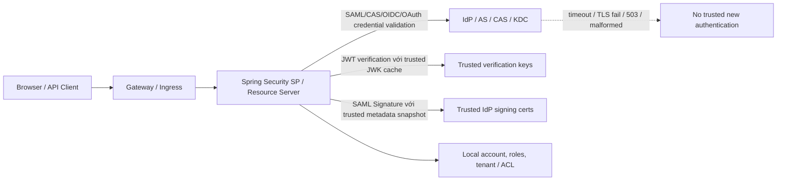
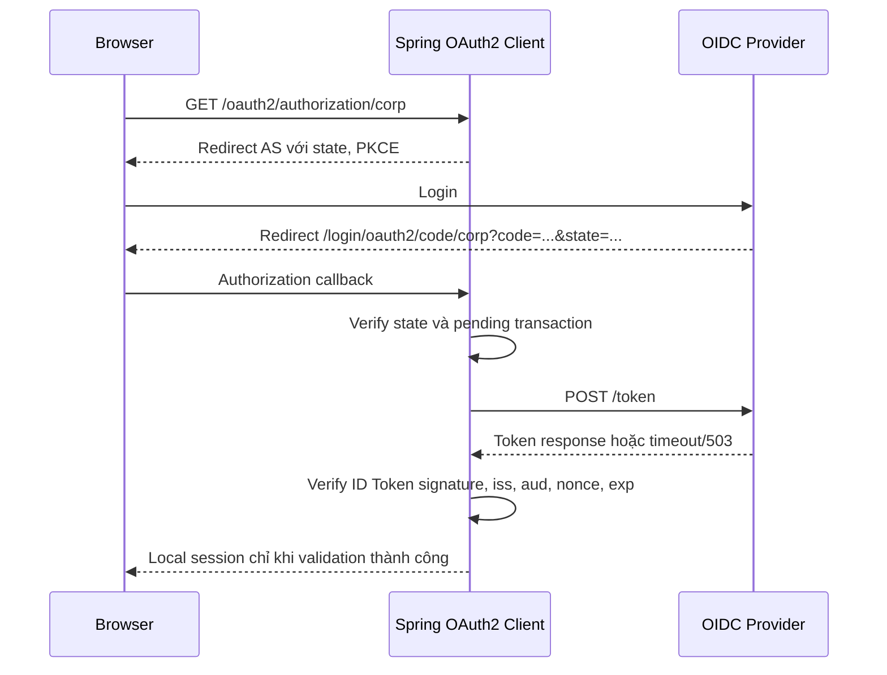

# Kiểm thử lỗi mạng, thời gian chờ và hành vi từ chối khi thiếu tin cậy trong SSO

## 1. Bài toán và phạm vi

Trong **SSO/federation**, ứng dụng Spring Security phụ thuộc vào hệ thống danh tính bên ngoài: CAS Server, OIDC Authorization Server, SAML Identity Provider (IdP), OAuth2 introspection, JWKS endpoint, Kerberos KDC hoặc identity-aware proxy. Khi kết nối mạng ổn định, người dùng đăng nhập và được phân quyền. Tuy nhiên các lỗi **DNS không phân giải, TCP refused/reset, TLS certificate invalid, connect/read timeout, HTTP 503, malformed response, thiếu signing key hoặc IdP metadata** có thể làm ứng dụng gặp tình huống không đủ bằng chứng để tin một danh tính mới.

Mục tiêu của kiểm thử không chỉ là phát hiện exception, mà còn **chứng minh ứng dụng không cấp quyền bảo vệ khi thiếu chứng cứ xác thực bắt buộc**. Đồng thời cần hiểu ngoại lệ có điều kiện: JWT đã được xác minh bằng **khóa công khai tin cậy có sẵn** có thể được kiểm tra hoàn toàn cục bộ khi IdP tạm mất mạng; session ứng dụng đã authenticated và còn hiệu lực cũng có vòng đời riêng. Đây **không phải** cơ chế bỏ kiểm tra authentication khi lỗi.

Bài nằm trong nhóm **Kiểm thử SSO** của module **Spring Security – federation**; ví dụ theo Java 17+, Spring Boot 3.x và Spring Security 6.x (ưu tiên 6.5.x). Các địa chỉ `example.test` và credentials chỉ là dữ liệu minh họa; không dùng trực tiếp trong production.

### Sau bài học cần làm được

1. Phân biệt **không có credential**, **credential invalid**, **xác minh chưa xong vì mạng lỗi**, **đã được xác minh hợp lệ** và **đủ quyền nghiệp vụ**.
2. Xác định điểm gọi mạng của CAS, OAuth2/OIDC Authorization Code, opaque introspection, JWT/JWKS, SAML và Kerberos.
3. Chọn **connect timeout, read timeout, deadline** và retry policy an toàn.
4. Mô phỏng DNS lỗi, TCP reset, HTTP 429/503, TLS invalid, delay, malformed JSON/XML bằng test harness.
5. Kiểm tra **fail closed**: không tạo authenticated principal hoặc tiết lộ dữ liệu được bảo vệ khi không đủ trust.
6. Hiểu khác biệt 401, 403 và 5xx/503 trong HTTP contract.
7. Tách login mới đang fail khỏi browser session hợp lệ có từ trước.
8. Không tắt issuer, audience, signature, state/nonce, InResponseTo hoặc certificate validation trong outage.
9. Viết Java 17 demo có output chính xác và các test JUnit/MockMvc/WireMock.
10. Vận hành với logging, metrics, circuit breaker, canary và negative tests.

## 2. Nguyên tắc fail closed và điều kiện ngoại lệ có kiểm soát

**Fail closed**: khi một điều kiện bắt buộc để tin một authentication **chưa được chứng minh**, quyết định security là **DENY**. Nó không đòi mọi lỗi đều trả HTTP 401. Hệ thống có thể trả 401, redirect login, 503 hay một lỗi server tùy giao thức và exception mapping, miễn không cấp principal/quyền mới và không trả protected data.

Ba trạng thái thường gặp:

| Trạng thái | Ví dụ | Cách xử lý |
| --- | --- | --- |
| Chưa xác minh | Client gửi ST, authorization code, opaque bearer token chưa được kiểm tra | Nếu phụ thuộc online endpoint đang lỗi, từ chối tạo authentication |
| Đã xác minh cục bộ và còn hợp lệ | JWT có chữ ký verify bằng trusted cached key; SAMLResponse verify bằng trusted IdP certificate đã provision | Có thể chấp nhận theo trust/expiry/revocation/tenant policy, không cần IdP mỗi request |
| Thiếu/sai trust | TLS certificate không hợp lệ; JWT `kid` chưa có trusted key; SAML signature/issuer sai; OIDC state sai | Từ chối ngay dù network đang khỏe |

**Câu cần ghi nhớ:** “IdP không reachable” khác với “không có bằng chứng đáng tin”. Nếu ứng dụng thật sự có đầy đủ bằng chứng đã verify cục bộ và chưa hết hạn, sự cố IdP có thể không ảnh hưởng request đó. Ngược lại, **không có cách tạo mới một token đã verified bằng cách suy đoán khi online verifier không trả lời**.

### Điều tuyệt đối tránh

```java
// PHẢN VÍ DỤ: không bao giờ làm trong authentication logic.
try {
    return remoteIdentityProvider.verify(credential);
} catch (Exception outage) {
    return new User("anonymous", "ROLE_ADMIN");
}
```

Tương tự, không bật `anyRequest().permitAll()`, không gán `active=true` cho opaque token, không đọc `X-User` từ browser, không bỏ TLS validation, không tin JWT chưa verify signature để “duy trì dịch vụ”.

## 3. Kiến trúc trust boundary và điểm phát sinh lỗi



**Front-channel** đi qua browser: redirect đến IdP, quay lại OIDC callback, SAML HTTP-POST ACS, CAS `ticket`. **Back-channel** đi từ Spring đến IdP: OAuth token endpoint, CAS `/serviceValidate`, opaque introspection, JWKS fetch, metadata refresh. Những kênh này có timeout và trust properties khác nhau.

Một callback đến từ browser không trở thành đáng tin chỉ vì URL đúng. Ví dụ `code`, `state`, `SAMLResponse`, `ticket` đều có thể xuất hiện trong HTTP request do attacker tạo. Spring provider hoặc external verifier phải kiểm tra từng giao thức trước khi tạo `Authentication`.

## 4. Phân loại lỗi mạng và lỗi xác thực

| Loại | Cách giả lập | Dấu hiệu thường gặp | Cần kiểm tra |
| --- | --- | --- | --- |
| DNS failure | NXDOMAIN/test DNS container | UnknownHostException | Không fallback sang endpoint không được duyệt |
| TCP connect refused | Port test không có listener | ConnectException | Không tạo authentication |
| Connect timeout | Drop TCP SYN trong sandbox | ConnectTimeout | Deadline hữu hạn, fail closed |
| TCP reset | WireMock/Toxiproxy fault | Connection reset | Không retry mù quáng code/ticket một-lần |
| Read timeout | Stub delay quá readTimeout | SocketTimeoutException/HttpTimeoutException | Không tự chấp nhận body chưa tới |
| TLS invalid CA | Test HTTPS cert không trusted | SSLHandshakeException | Không trust-all |
| TLS hostname mismatch | SAN không khớp hostname | Hostname verification failure | Không disable hostname verification |
| HTTP 429/500/503/504 | Stub status | Upstream unavailable/overload | Không coi là token active |
| Malformed JSON/XML | Partial/garbled body | Parsing exception | Không lấy user từ fragment |
| Unexpected redirect | Redirect tới host lạ | SSRF/trust confusion | Không follow untrusted discovery |
| JWKS cache miss | Token `kid` mới nhưng JWKS down | Missing key | Reject token chưa verify |
| Wrong issuer/audience | Signed token cho service khác | Cryptographic key đúng nhưng context sai | Reject |
| State/nonce mismatch | Cross-browser OIDC callback | Protocol correlation failure | Reject |
| Clock skew/expiry | `exp`/`NotOnOrAfter` sai | Token invalid temporal | Reject theo bounded skew |
| Proxy header spoof | Client tự thêm `X-Verified-User` | User bị giả | Strip/overwrite + backend isolation |

**Mọi negative case cần ít nhất một positive control** với credential đúng và đường mạng tốt, để tránh kết quả “test luôn trả lỗi” che giấu cấu hình hỏng.

## 5. Quy tắc HTTP: 401, 403 hay 503?

Phân biệt **security decision** với **HTTP status**:

- **401 Unauthorized / login redirect:** chưa xác thực hoặc credential invalid. Resource Server Bearer thường dùng 401.
- **403 Forbidden:** user đã xác thực nhưng **không đủ quyền**; ví dụ tenant/role/ACL không cho truy cập.
- **503 Service Unavailable hoặc 5xx:** upstream validation service timeout, DNS/TLS failure, configuration outage. Đây thường là lỗi vận hành chứ không chứng minh credential sai.
- **SAML/CAS browser flow:** Spring authentication failure handler có thể redirect tới trang login/error (3xx); không thể assert mọi lỗi đều là 401.
- **Opaque token introspector:** exception do dependency unavailable có thể được map theo entry point/handler/version; không mặc định Spring trả 503.
- **JWT offline valid:** có thể 200 khi có authority/local ACL phù hợp, dù JWKS endpoint đang lỗi, vì cryptographic verification cục bộ vẫn đạt.

**Bất biến test:** không có unauthenticated access đến protected endpoint, không có session mới từ credential chưa được xác minh, và không có role escalations. Sau đó mới assert status theo contract ứng dụng.

Ví dụ error body an toàn:

```json
{
  "error": "authentication_temporarily_unavailable",
  "requestId": "correlation-test-123"
}
```

Không trả raw token, stack trace, signing keys, CAS ticket, `SAMLResponse` hay client secret.

## 6. Connect timeout, read timeout, deadline và budgets

Đường đi back-channel:

```text
resolve DNS
  -> TCP connect
  -> TLS handshake + certificate validation
  -> send HTTP request
  -> wait HTTP response
  -> read body
  -> parse token/JSON/XML
  -> signature + issuer + audience + time validation
  -> resolve local identity and permissions
```

- **Connect timeout** giới hạn thời gian thiết lập kết nối.
- **Read/socket timeout** giới hạn thời gian chờ nhận response hoặc dữ liệu.
- **Connection pool acquisition timeout** giới hạn chờ connection từ pool.
- **Overall deadline** giới hạn tổng thời gian, kể cả retry, parse, validation và proxy hops.
- **Clock skew** liên quan thời gian hiệu lực token, **không phải** timeout kết nối.
- **Cancellation** khi browser/proxy đóng request cần được xử lý để tránh chiếm threads.
- **Timeout nhiều tầng** có thể tạo độ trễ thực khác timeout của từng HTTP client.

Ví dụ **chính sách minh họa**: connect 1 giây, read 2 giây, overall 4 giây, tối đa một retry chỉ với GET JWKS nếu được cho phép. Đây **không phải default Spring Security**. Đọc SLA IdP/AS/KDC và kiểm thử thực tế rồi chọn giới hạn. Không tăng timeout lên vài phút để sửa một service không sẵn sàng.

Khi client thấy timeout, kết luận là **chưa có xác nhận**, không phải “đã xác thực thành công nhưng response chậm”.

## 7. Retry không an toàn với credential một-lần

Có những operations có thể đã được server xử lý trước khi response bị mất:

| Giao thức/operation | Tính một-lần | Hành vi an toàn sau timeout |
| --- | --- | --- |
| CAS ST `/serviceValidate` | ST chỉ hợp lệ cho **một lần validation attempt** | Không cấp principal; flow mới với ST mới |
| OAuth2/OIDC `/token` đổi authorization code | Code ngắn hạn, một-lần | Không đoán token; thường bắt đầu authorization flow mới |
| SAML Artifact Resolve | Artifact có thể one-time theo profile | Không retry mù quáng nếu kết quả không rõ |
| Opaque introspection | Thường read-only về token status | Có thể retry bounded theo hợp đồng nhưng không fail-open |
| JWKS/metadata GET | Có thể retry GET với backoff | Chỉ dùng trusted endpoint/keys |
| Kerberos KDC | Stack có retry riêng | Không bypass GSS validation khi KDC lỗi |

**Quan trọng về CAS:** nếu CAS đã consume ticket nhưng response bị reset, retry cùng ST nhận `INVALID_TICKET` là hành vi đúng. Một ứng dụng tự trả success từ lỗi timeout là **lỗ hổng authentication**.

**Quan trọng về OAuth authorization code:** token endpoint có thể đã đổi code thành tokens nhưng SP chưa nhận response; lần đổi lại có thể nhận `invalid_grant`. Không tạo ID Token giả hoặc dùng thông tin `email` trong query để bù.

## 8. CAS: kiểm thử khi /serviceValidate lỗi mạng

CAS login flow:

```text
Browser -> Spring /login/cas?ticket=ST-...
Spring CAS client -> CAS /serviceValidate?service=...&ticket=ST-...
CAS -> XML authenticationSuccess hoặc authenticationFailure
Spring -> CasAuthenticationToken sau valid success
```

Khi CAS không trả lời đủ, `CasAuthenticationProvider`/`TicketValidator` không thể xác nhận user. Các case:

1. CAS hostname không resolve.
2. TCP connection refused/timeout.
3. CAS trả 503.
4. CAS trả HTTP 200 nhưng `<cas:authenticationFailure code="INVALID_TICKET">`.
5. CAS trả XML hỏng/trống.
6. CAS đóng socket sau khi đã xử lý ticket.
7. CAS certificate/hostname invalid.
8. CAS ticket expired hoặc đã dùng lại.
9. CAS ST phát cho service A nhưng validate với service B (`INVALID_SERVICE`).
10. CAS ticket registry cluster không đồng nhất.

**CAS 2.0 yêu cầu ST chỉ hợp lệ cho một validation attempt kể cả khi attempt thất bại**. Hãy thử bằng **test CAS Server thực** để chứng minh behavior, không chỉ HTTP stub trả XML tùy ý.

**Phải tách Spring session cũ:** nếu browser đã có `JSESSIONID` authenticated, `GET /secure` sau đó vẫn có thể 200 dù ST mới không validate được. Điều đó có thể chỉ là session continuity. Kiểm thử login khi CAS outage phải dùng **fresh anonymous session**.

## 9. OIDC Authorization Code: token endpoint là trust dependency

Các bước chuẩn:



Nếu `/token` timeout/503:

- **Không** tạo authenticated user từ `code`/`state`.
- Không dùng `id_token` chưa có/đã bị hỏng hoặc `email` từ query.
- Không tắt `state` hay `nonce` để “thử lại dễ hơn”.
- Không redirect người dùng tới protected resource như đã login.
- Nếu authorization code có thể đã được dùng, yêu cầu transaction mới thay vì replay vô hạn.
- Vẫn ghi nhận retry/timeout theo telemetry không chứa raw code.

Negative tests còn gồm: `invalid_grant`; client secret sai; token response malformed; wrong issuer/audience/nonce; ID Token expired; mất browser session/RelayState-like state; unknown JWK kid khi JWKS down; callback vào sai registration. Các lỗi này không phải chỉ là network mà là **thiếu trust**.

## 10. JWT Resource Server: có thể verify cục bộ khi JWKS down

Khác opaque token, signed JWT **có thể được verify locally** bằng trusted public key có trong JWK cache:

```text
JWT header kid=K1
Trusted JWK cache contains K1
JWT signature valid
iss=expected, aud=API, exp/nbf valid
Local role/tenant/ACL allows access
JWKS endpoint temporarily down
=> có thể ALLOW theo policy
```

Tình huống ngược lại:

```text
JWT header kid=K2
Trusted JWK cache only contains K1
JWKS fetch timed out
=> signature verification unavailable
=> DENY
```

Điều này **không** cho phép dùng key bất kỳ, bỏ verify signature, chấp nhận `alg=none`, tự lấy URL `jku`/`x5u` do token gợi ý hoặc bỏ issuer/audience/time validation. Cached JWK chỉ là nguồn **khóa đã được tin**, mỗi JWT vẫn cần verify cryptographic signature.

| Test | Key cache | Network | JWT claims | Mong đợi |
| --- | --- | --- | --- | --- |
| JWT signed K1 | K1 trusted | Down | Valid | Có thể 200 nếu được phân quyền |
| JWT signed K2 | K2 unknown | Down | Ngoài ra valid | Reject |
| JWT signed K1 | K1 trusted | OK | Expired | Reject |
| JWT signed K1 | K1 trusted | OK | Wrong issuer/audience | Reject |
| JWT signed K1 | K1 revoked theo policy | Down | Valid | Reject |
| JWT signed unknown algorithm | Key không phù hợp | OK | Valid | Reject |
| JWT signed K1 | K1 trusted | OK | Local user disabled | Không có business permission |

### Spring Boot configuration cơ sở

```yaml
spring:
  security:
    oauth2:
      resourceserver:
        jwt:
          issuer-uri: "https://idp.example.test/issuer"
          jwk-set-uri: "https://idp.example.test/issuer/.well-known/jwks.json"
          audiences: "api://orders"
```

Đây là **ví dụ theo Spring Boot phiên bản hỗ trợ `audiences`**. Nếu BOM không hỗ trợ property đó, cần tự cấu hình audience validator; không mặc định chỉ `issuer-uri` là đủ. Khi khai cả `issuer-uri` và `jwk-set-uri`, Spring có thể tránh phụ thuộc discovery vào startup nhưng **vẫn validate `iss`**. Cách cấu hình cụ thể cần đối chiếu bản Spring Boot đang chạy.

## 11. Spring Security JWT SecurityFilterChain

Với ứng dụng Spring Boot 3/Security 6.x đã có `spring-boot-starter-oauth2-resource-server`:

```java
@Bean
SecurityFilterChain jwtApi(HttpSecurity http) throws Exception {
    return http
            .securityMatcher("/api/**")
            .sessionManagement(s -> s.sessionCreationPolicy(
                    SessionCreationPolicy.STATELESS))
            .authorizeHttpRequests(auth -> auth
                    .requestMatchers("/api/public").permitAll()
                    .requestMatchers("/api/admin/**")
                        .hasAuthority("SCOPE_admin")
                    .anyRequest().authenticated())
            .oauth2ResourceServer(oauth -> oauth
                    .jwt(Customizer.withDefaults()))
            .build();
}
```

Đây là **mảnh JavaConfig** cần imports và trusted `JwtDecoder`. `authenticated()` không thay local tenant/ACL; JWT có scope `admin` cũng chỉ được dùng nếu issuer và audience có quyền phát scope đó.

Để tùy chỉnh JWKS fetch timeout trong nhánh Security 6.5:

```java
@Bean
JwtDecoder decoder(
        RestTemplateBuilder builder,
        @Value("${app.jwt.jwk-set-uri}") String jwks,
        @Value("${app.jwt.issuer}") String issuer) {

    RestOperations rest = builder
            .setConnectTimeout(Duration.ofSeconds(1))
            .setReadTimeout(Duration.ofSeconds(2))
            .build();

    NimbusJwtDecoder jwt = NimbusJwtDecoder.withJwkSetUri(jwks)
            .restOperations(rest)
            .build();
    jwt.setJwtValidator(JwtValidators.createDefaultWithIssuer(issuer));
    return jwt;
}
```

**Mảnh code không phải file Java độc lập**; thêm imports cho `JwtDecoder`, `NimbusJwtDecoder`, `JwtValidators`, `RestTemplateBuilder`, `RestOperations`, `@Value` và `Duration`. `JwtValidators.createDefaultWithIssuer` kiểm tra issuer/time mặc định, **chưa tạo audience validator** — phải bổ sung theo contract. Các builder APIs có thể thay đổi khi nâng Boot/Security minor; xem Javadoc đúng release.

Test cả **cold cache** (JWKS chưa tải) và **warm cache** (K1 trusted): IdP outage có thể tác động khác nhau. Không kéo JWK cache TTL vô hạn để che lỗi key rotation/revocation.

## 12. Opaque token introspection: online verification không có kết quả thì từ chối

Resource Server có thể gọi `/introspect` theo RFC 7662. Chỉ khi **trusted AS** trả response hợp lệ với `active=true` và claims thích hợp, Spring mới có cơ sở tạo `Authentication`.

```json
{
  "active": true,
  "sub": "alice",
  "scope": "orders:read",
  "exp": 1795000000
}
```

JSON đó chỉ có giá trị nếu nhận từ **trusted introspection endpoint** qua transport/certificate/client authentication đúng. Browser tự POST một body `active=true` không chứng minh gì.

| Upstream result | Quyết định |
| --- | --- |
| 200, `active=true`, schema hợp lệ | Tiếp tục local authorization |
| 200, `active=false` | Deny invalid token |
| 200, thiếu `active` | Không mặc định true |
| 200, JSON malformed | Deny/unavailable |
| 401 do client credentials sai | Không có verified result, alert configuration |
| 429/503/timeout | Không biết token active, deny new authentication |
| TLS invalid | Deny |
| Cached success đã hết TTL | Không reuse vô hạn |

Nếu tích hợp revocation online, cache positive introspection result quá lâu sẽ làm token bị thu hồi vẫn có hiệu lực. Cache phải có **token-specific key, issuer/audience/tenant binding, bounded TTL và revocation delay được chấp thuận**. Không fallback trả principal mặc định khi AS down.

## 13. Spring Boot opaque introspection và timeout

Cấu hình starter OAuth2 Resource Server, nhánh opaque:

```yaml
spring:
  security:
    oauth2:
      resourceserver:
        opaquetoken:
          introspection-uri: "https://idp.example.test/introspect"
          client-id: "orders-api"
          client-secret: "LOADED_FROM_SECRET_MANAGER"
```

`LOADED_FROM_SECRET_MANAGER` chỉ là **placeholder mô tả**, không phải secret thật. Dùng secret manager, không commit credentials vào file.

Trong Spring Security 6.5 có `SpringOpaqueTokenIntrospector` và `RestOperations`. Mảnh cấu hình:

```java
@Bean
OpaqueTokenIntrospector introspector(
        RestTemplateBuilder builder,
        @Value("${app.introspection.uri}") String uri,
        @Value("${app.introspection.client-id}") String clientId,
        @Value("${app.introspection.client-secret}") String secret) {

    RestOperations rest = builder
            .basicAuthentication(clientId, secret)
            .setConnectTimeout(Duration.ofSeconds(1))
            .setReadTimeout(Duration.ofSeconds(2))
            .build();

    return new SpringOpaqueTokenIntrospector(uri, rest);
}
```

Cần imports, đúng Boot BOM, và giữ strict TLS validation. Ở nhánh mới hơn có `RestClientOpaqueTokenIntrospector` dùng `RestClient`; không trộn API giữa 6.5 và 7.x. Nếu dependency thực không có method `setConnectTimeout` do upgrade, hãy đối chiếu `RestTemplateBuilder` API thực và điều chỉnh theo release, **không bỏ timeouts**.

```java
@Bean
SecurityFilterChain opaqueApi(HttpSecurity http) throws Exception {
    return http
            .securityMatcher("/api/**")
            .authorizeHttpRequests(auth -> auth
                    .anyRequest().authenticated())
            .oauth2ResourceServer(oauth -> oauth
                    .opaqueToken(Customizer.withDefaults()))
            .build();
}
```

Đây là **biến thể thay thế JWT chain**, không gộp cùng đường API một cách ngầm định. Một outage introspection **không tự làm Spring Security trả 503**; phải test exception handling thực tế và no-access invariant.

## 14. SAML2: metadata endpoint down không luôn làm XML verify thất bại

SAML SP thường có `RelyingPartyRegistration` chứa **IdP signing certificates/trust metadata** đã được provision. Khi browser POST `SAMLResponse` vào ACS, OpenSAML validator có thể kiểm tra **cục bộ**:

- XML Signature của Response/Assertion theo profile.
- `Issuer`, `Destination` và `Recipient`.
- `AudienceRestriction`, `SubjectConfirmation` và `InResponseTo`.
- `NotBefore`/`NotOnOrAfter`.
- Browser transaction/request repository.
- Local identity linking và tenant/role policy.

Do đó:

- **Metadata URL down + trusted cert còn hiệu lực + SAMLResponse ký đúng và mọi validations đạt:** có thể login, tùy refresh/revocation policy.
- **Unknown signing cert + metadata down:** không thể xác minh chữ ký ⇒ reject.
- **Certificate expired/revoked theo policy:** không tự cho phép dùng key cũ vô hạn.
- **XML Signature sai, audience/issuer/recipient/state/time sai:** reject dù IdP metadata endpoint khỏe.
- **Cold startup không có trusted metadata:** không tự trust key nhúng trong SAMLResponse do browser gửi.

Spring Security `Saml2WebSsoAuthenticationFilter` và `OpenSamlAuthenticationProvider` (tên class cụ thể khác theo release) phụ trách flow/validation. Không parse XML bằng regex hoặc disable assertion signature check để vượt outage.

### SAML negative tests

```text
metadata timeout + trusted cert snapshot + valid signed SAML => potential success
metadata timeout + unknown IdP signer              => DENY
SAML signature invalid                              => DENY
SAML issuer mismatch                                => DENY
SAML audience/recipient mismatch                    => DENY
SAML expired/NotBefore future                       => DENY
SP-initiated SSO missing/mismatched InResponseTo     => DENY
SameSite cookie lost => no pending AuthnRequest     => DENY, not downgrade
```

Nếu hệ thống hỗ trợ **SAML Artifact binding**, artifact resolution có thể cần gọi mạng và có one-time semantics riêng; test khác HTTP-POST local signature verification.

## 15. Kerberos/SPNEGO: KDC lỗi và service ticket có sẵn

KDC có thể unavailable trong lúc browser xin service ticket `HTTP/portal@REALM`. Browser chưa có ticket thì login mới thường không hoàn thành. Tuy nhiên một ticket đã được KDC cấp hợp lệ có thể được JAAS/GSS acceptor xác minh cục bộ bằng service keytab trong những điều kiện cho phép.

Test tối thiểu:

1. KDC unavailable, browser không có valid TGT/ST ⇒ không tạo Authentication mới.
2. Browser có valid ST còn hạn, keytab/SPN đúng ⇒ có thể authenticate theo Kerberos policy dù KDC đang offline.
3. SPN hoặc keytab/KVNO/enctype sai ⇒ deny.
4. Ticket expired/clock skew vượt policy ⇒ deny.
5. NGINX proxy làm mất `WWW-Authenticate: Negotiate`/`Authorization: Negotiate` ⇒ không bypass.
6. App không nhận `X-Remote-User` do browser tự gửi làm principal nếu Kerberos validator chưa hoạt động.
7. Keytab unreadable ⇒ fail closed và alert, không tự bật anonymous permissions.

Không sửa KDC outage bằng cách để mọi principal trong domain nhận `ROLE_ADMIN` hoặc tự động tin raw username header.

## 16. Proxy authentication: không tin danh tính do client tự khai

Khi edge proxy xác thực IdP rồi gửi `X-Verified-User` vào backend:

```text
Public client request:
  X-Verified-User: admin

Gateway authenticates:
  auth service timeout

Correct:
  deny/challenge/error, NOT forward user header

Incorrect:
  proxy_pass raw X-Verified-User: admin
  backend RequestHeaderAuthenticationFilter trusts admin
```

Yêu cầu:

1. Strip inbound identity aliases từ client: `X-User`, `X-Verified-User`, `X-Forwarded-User`, `SM_USER`, roles/groups headers.
2. Gateway chỉ ghi đè bằng verified principal từ auth service **sau success**.
3. Auth service unavailable ⇒ fail closed.
4. Backend chỉ reachable qua proxy trusted, có firewall/NetworkPolicy/mTLS tùy thiết kế.
5. Spring `RequestHeaderAuthenticationFilter` **không** verify danh tính; ứng dụng vẫn phải kiểm tra local user/tenant/ACL.
6. Không bật `setifempty`/`append` hoặc fallback anonymous-to-authenticated trong outage.

Đây là một trong những negative tests quan trọng nhất: khi gateway mất kết nối IdP, browser tự thêm `X-Verified-User: admin` vẫn phải không được thấy trang admin.

## 17. TLS trust và endpoint allowlist

TLS không chỉ là “giao thức mã hóa”, còn xác định **endpoint server tin cậy**. Test CAS/OIDC/introspection/JWKS/SAML metadata với:

- Unknown CA hoặc expired certificate.
- Certificate SAN không khớp hostname.
- Certificate chưa có hiệu lực hoặc bị revoke theo policy.
- Redirect từ HTTPS sang HTTP.
- Redirect tới hostname không được allowlist.
- Một endpoint có certificate đúng nhưng không phải configured issuer/metadata URL.
- mTLS client credential hết hạn ở introspection endpoint.
- Truststore thiếu CA sau rotation.
- Server trả metadata chứa key không được approved, dù HTTP 200.

Kỳ vọng: **không tin dữ liệu xác thực từ kênh không được xác nhận**. Không sửa test bằng `trustAll`, `hostnameVerifier -> true` hoặc HTTP cleartext fallback. Nếu cần self-signed cert trong sandbox, tạo test CA/truststore được kiểm soát.

## 18. Clock skew và network timeout là hai loại lỗi khác nhau

Thời gian hiệu lực xuất hiện ở:

- JWT/OIDC `exp`, `nbf`, `iat` và nonce/state transaction freshness.
- SAML `IssueInstant`, `Conditions.NotBefore/NotOnOrAfter`, `SubjectConfirmationData.NotOnOrAfter`.
- CAS ST expiry.
- Kerberos time skew và service ticket TTL.
- Spring Session inactivity/absolute expiry.

Dùng fixed clock trong unit tests:

```text
now = 2026-11-07T10:00:00Z
expiresAt = now + 60s => còn hạn
expiresAt = now       => expired
notBefore = now + 60s => chưa hợp lệ
```

Clock skew phải bounded, không kéo dài vô hạn cửa sổ token acceptance vì mạng chậm. Timeout nhận response từ JWKS **không được dùng để bỏ `exp`**, vì timestamp validator vẫn kiểm tra local được.

## 19. Existing session và login mới phải test riêng

Một web app có thể có local Spring Security session còn hiệu lực:

```text
T1: User Alice login thành công qua IdP
T2: Server tạo session authenticated Alice
T3: IdP outage
T4: Alice GET /secure với session cookie còn hợp lệ
=> có thể 200 theo local session policy
```

Điều này **không** chứng minh IdP outage được bypass. Một login **mới** từ browser anonymous khi IdP down vẫn phải fail closed.

Để test:

- Case A: fresh session → bắt đầu SSO trong outage → không authenticated.
- Case B: existing session authenticated còn TTL → hành vi theo policy.
- Case C: session invalidated/expired trong outage → không tái tạo phiên từ cookie cũ.
- Case D: action yêu cầu **step-up MFA** khi IdP down → không nâng assurance chỉ dựa session thấp hơn.
- Case E: user disabled/local role revoked → application authorization fail closed.
- Case F: logout back-channel không tới khi IdP down → runbook về revocation delay/session TTL; không tự hứa global logout đã hoàn tất.
- Case G: session đã authenticated nhưng business ACL deny → vẫn 403.

Test `@WithMockUser` hoặc một session cũ **không thể chứng minh** hệ thống chấp nhận ST/code/token mới trong outage.

## 20. Java 17 độc lập: mô hình ra quyết định khi mất trust

Chương trình sau **biên dịch/chạy không cần Spring hay Internet**. Nó mô phỏng một policy **sau khi các validators thật đã trả bằng chứng**. Trường `verified` là **cờ fixture của unit test**, tuyệt đối không lấy trực tiếp từ HTTP request ở production.

Lưu `SsoOutageTrustDemo.java`:

```java
import java.time.Clock;
import java.time.Instant;
import java.time.ZoneOffset;

public final class SsoOutageTrustDemo {

    enum Flow {
        CAS_ONLINE, OIDC_CODE_ONLINE, OPAQUE_ONLINE,
        JWT_LOCAL, SAML_LOCAL
    }

    enum Network {
        OK, TIMEOUT, DNS_FAILED, TLS_FAILED
    }

    enum Decision {
        ALLOW, DENY_UNAVAILABLE, DENY_UNVERIFIED,
        DENY_ISSUER, DENY_AUDIENCE, DENY_TIME, DENY_CORRELATION
    }

    record Evidence(
            boolean verified,
            String issuer,
            String audience,
            Instant notBefore,
            Instant expiresAt,
            boolean correlationOk) {
    }

    static final class Policy {
        private final Clock clock;
        private final String issuer;
        private final String audience;

        Policy(Clock clock, String issuer, String audience) {
            this.clock = clock;
            this.issuer = issuer;
            this.audience = audience;
        }

        Decision decide(Flow flow, Network network, Evidence proof) {
            boolean online = flow == Flow.CAS_ONLINE
                    || flow == Flow.OIDC_CODE_ONLINE
                    || flow == Flow.OPAQUE_ONLINE;
            if (online && network != Network.OK) {
                return Decision.DENY_UNAVAILABLE;
            }
            if (proof == null || !proof.verified()) {
                return Decision.DENY_UNVERIFIED;
            }
            if (!issuer.equals(proof.issuer())) {
                return Decision.DENY_ISSUER;
            }
            if (!audience.equals(proof.audience())) {
                return Decision.DENY_AUDIENCE;
            }

            Instant now = clock.instant();
            if (proof.notBefore() == null || proof.expiresAt() == null
                    || now.isBefore(proof.notBefore())
                    || !now.isBefore(proof.expiresAt())) {
                return Decision.DENY_TIME;
            }

            if ((flow == Flow.OIDC_CODE_ONLINE || flow == Flow.SAML_LOCAL)
                    && !proof.correlationOk()) {
                return Decision.DENY_CORRELATION;
            }
            return Decision.ALLOW;
        }
    }

    public static void main(String[] args) {
        Instant now = Instant.parse("2026-11-07T10:00:00Z");
        Policy policy = new Policy(
                Clock.fixed(now, ZoneOffset.UTC),
                "https://idp.example.test", "api://orders");

        Evidence good = new Evidence(
                true, "https://idp.example.test", "api://orders",
                now.minusSeconds(5), now.plusSeconds(60), true);

        Evidence unverified = new Evidence(
                false, good.issuer(), good.audience(),
                good.notBefore(), good.expiresAt(), true);

        Evidence expired = new Evidence(
                true, good.issuer(), good.audience(),
                now.minusSeconds(90), now, true);

        Evidence wrongIssuer = new Evidence(
                true, "https://evil.example.test", good.audience(),
                good.notBefore(), good.expiresAt(), true);

        Evidence wrongAudience = new Evidence(
                true, good.issuer(), "api://other",
                good.notBefore(), good.expiresAt(), true);

        Evidence noState = new Evidence(
                true, good.issuer(), good.audience(),
                good.notBefore(), good.expiresAt(), false);

        System.out.println("opaqueHealthy="
                + policy.decide(Flow.OPAQUE_ONLINE, Network.OK, good));
        System.out.println("opaqueTimeout="
                + policy.decide(Flow.OPAQUE_ONLINE, Network.TIMEOUT, good));
        System.out.println("casDnsFailed="
                + policy.decide(Flow.CAS_ONLINE, Network.DNS_FAILED, good));
        System.out.println("oidcTlsFailed="
                + policy.decide(Flow.OIDC_CODE_ONLINE,
                        Network.TLS_FAILED, good));
        System.out.println("jwtTrustedCachedKey="
                + policy.decide(Flow.JWT_LOCAL, Network.TIMEOUT, good));
        System.out.println("jwtUnknownKey="
                + policy.decide(Flow.JWT_LOCAL,
                        Network.TIMEOUT, unverified));
        System.out.println("samlTrustedMetadata="
                + policy.decide(Flow.SAML_LOCAL, Network.TIMEOUT, good));
        System.out.println("samlNoCorrelation="
                + policy.decide(Flow.SAML_LOCAL, Network.OK, noState));
        System.out.println("jwtBadIssuer="
                + policy.decide(Flow.JWT_LOCAL, Network.OK, wrongIssuer));
        System.out.println("jwtBadAudience="
                + policy.decide(Flow.JWT_LOCAL, Network.OK, wrongAudience));
        System.out.println("jwtExpired="
                + policy.decide(Flow.JWT_LOCAL, Network.OK, expired));
        System.out.println("missingEvidence="
                + policy.decide(Flow.SAML_LOCAL, Network.OK, null));
    }
}
```

Biên dịch/chạy Java 17+:

```bash
javac SsoOutageTrustDemo.java
java SsoOutageTrustDemo
```

**Stdout chính xác:**

```text
opaqueHealthy=ALLOW
opaqueTimeout=DENY_UNAVAILABLE
casDnsFailed=DENY_UNAVAILABLE
oidcTlsFailed=DENY_UNAVAILABLE
jwtTrustedCachedKey=ALLOW
jwtUnknownKey=DENY_UNVERIFIED
samlTrustedMetadata=ALLOW
samlNoCorrelation=DENY_CORRELATION
jwtBadIssuer=DENY_ISSUER
jwtBadAudience=DENY_AUDIENCE
jwtExpired=DENY_TIME
missingEvidence=DENY_UNVERIFIED
```

**Giải thích giới hạn:** Code này không verify TLS/JWT/SAML/CAS. `jwtTrustedCachedKey` đại diện **một JWT đã được cryptographic verification bằng trusted cache** và còn đủ claims; `samlTrustedMetadata` đại diện **Response đã được OpenSAML verify với certificate trusted** và transaction hợp lệ. Khi `verified=false`, ngay cả network khỏe cũng DENY. App thật còn phải kiểm tra local role, tenant, resource ACL và online revocation policy.

## 21. WireMock: mô phỏng delay, HTTP 503 và response hỏng

**WireMock** có fixed delays và fault injection. Ví dụ **mảnh test Java**:

```java
WireMockServer server =
        new WireMockServer(WireMockConfiguration.options().dynamicPort());
server.start();

server.stubFor(get(urlEqualTo("/jwks"))
        .willReturn(aResponse().withStatus(503)));

server.stubFor(post(urlEqualTo("/introspect"))
        .willReturn(aResponse()
                .withStatus(200)
                .withFixedDelay(3000)
                .withBody("{\"active\":true}")));

server.stubFor(post(urlEqualTo("/token"))
        .willReturn(aResponse()
                .withFault(Fault.MALFORMED_RESPONSE_CHUNK)));
```

Đây là **mảnh không độc lập**, cần WireMock 3.x, imports và setup/cleanup test. Khi client read timeout 1 giây, response delayed 3 giây phải không trở thành authenticated result. `MALFORMED_RESPONSE_CHUNK` mô phỏng body hỏng.

WireMock docs lưu ý `CONNECTION_RESET_BY_PEER` **có thể không hoạt động giống nhau trên Windows và Unix**: có khi Windows bị hang thay vì reset. Tránh assert stack trace cố định theo OS, dùng fixed delay hoặc malformed response khi cần portable CI test.

## 22. Contract test Java 17/JUnit 5 cho HTTP failure

Ví dụ sau **chạy trong project đã cài JUnit Jupiter và WireMock Java API**, dùng JDK HttpClient để đo transport behavior. Nó chưa chạy Spring Security provider, nên không được xem như test JWT/CAS validation.

Lưu `src/test/java/demo/sso/DependencyFaultContractTest.java`:

```java
package demo.sso;

import static com.github.tomakehurst.wiremock.client.WireMock.*;
import static com.github.tomakehurst.wiremock.core.WireMockConfiguration.options;
import static org.junit.jupiter.api.Assertions.*;

import java.net.URI;
import java.net.http.HttpClient;
import java.net.http.HttpRequest;
import java.net.http.HttpResponse;
import java.time.Duration;

import com.github.tomakehurst.wiremock.WireMockServer;
import org.junit.jupiter.api.AfterEach;
import org.junit.jupiter.api.BeforeEach;
import org.junit.jupiter.api.Test;

class DependencyFaultContractTest {

    WireMockServer server;
    HttpClient client;

    @BeforeEach
    void setup() {
        server = new WireMockServer(options().dynamicPort());
        server.start();
        client = HttpClient.newBuilder()
                .connectTimeout(Duration.ofSeconds(1))
                .build();
    }

    @AfterEach
    void cleanup() {
        if (server != null) {
            server.stop();
        }
    }

    HttpRequest getRequest(String path) {
        return HttpRequest.newBuilder()
                .uri(URI.create("http://127.0.0.1:"
                        + server.port() + path))
                .timeout(Duration.ofMillis(350))
                .GET()
                .build();
    }

    @Test
    void dependency503IsNotSuccess() throws Exception {
        server.stubFor(get(urlEqualTo("/jwks"))
                .willReturn(aResponse().withStatus(503)
                        .withBody("service down")));

        var response = client.send(getRequest("/jwks"),
                HttpResponse.BodyHandlers.ofString());

        assertEquals(503, response.statusCode());
        assertFalse(response.body().contains("\"keys\""));
    }

    @Test
    void delayedResponseTimesOut() {
        server.stubFor(get(urlEqualTo("/slow"))
                .willReturn(aResponse()
                        .withStatus(200)
                        .withFixedDelay(1500)
                        .withBody("{\"active\":true}")));

        assertThrows(java.net.http.HttpTimeoutException.class,
                () -> client.send(getRequest("/slow"),
                        HttpResponse.BodyHandlers.ofString()));
    }

    @Test
    void malformedBodyMustNotBeTrusted() throws Exception {
        server.stubFor(get(urlEqualTo("/jwks"))
                .willReturn(aResponse()
                        .withStatus(200)
                        .withBody("{bad-json")));

        var response = client.send(getRequest("/jwks"),
                HttpResponse.BodyHandlers.ofString());

        assertEquals(200, response.statusCode());
        assertFalse(response.body().startsWith("{\"keys\""));
        // Chưa đủ: test JwtDecoder thật phải reject malformed JWK.
    }
}
```

**Lưu ý:** Test dựa vào `HttpTimeoutException` của JDK HttpClient khi request deadline hết; một số nền tảng/transport wrappers có thể có subtype khác, nên kiểm tra CI reliability và điều chỉnh timeout/mocking phù hợp. HTTP loopback trong test không thay yêu cầu HTTPS/TLS ở production.

**Không nhầm:** test “WireMock trả 503” chỉ chứng minh HTTP client nhận 503. Để khẳng định **Spring Security không cấp quyền**, phải chạy một test filter/provider integration riêng với fake HTTP endpoint hoặc introspector/decoder test bean.

## 23. MockMvc: kiểm tra protected handler không bị chạy khi auth fail

Một unit test sử dụng `@WithMockUser` sẽ bỏ qua remote SSO verification, nên **không** dùng để chứng minh CAS/OIDC/introspection/JWKS fail-closed. Tốt hơn:

1. Dựng Spring Boot test profile có `SecurityFilterChain` bảo vệ `/api/private`.
2. Inject `OpaqueTokenIntrospector` test bean thực hiện cùng interface với production.
3. Test success control: introspector trả principal hợp lệ có `SCOPE_read` → vào controller.
4. Test invalid token: introspector ném `BadOpaqueTokenException` → không vào protected controller.
5. Test network fault: introspector ném `OAuth2IntrospectionException`/network wrapper → **không vào controller**.
6. Assert controller side effect counter không tăng và response không chứa data.
7. Với availability exception, HTTP có thể 401/500/503 tùy Spring release/handler, test status theo contract đã định.
8. Test raw `Authorization` token không xuất hiện trong exception response/log.
9. Sau failure, request tiếp theo không nhận `SecurityContext` còn sót từ test khác.
10. Với test HTTP thật, dùng WireMock/Toxiproxy để error xuất phát từ network layer.

Mảnh fake introspector:

```java
@TestConfiguration
class UnavailableAuthTestConfig {

    @Bean
    @Primary
    OpaqueTokenIntrospector introspector() {
        return token -> {
            throw new OAuth2IntrospectionException(
                    "test introspection unavailable");
        };
    }
}
```

Đây là **class cần imports/JUnit wiring**. `OAuth2IntrospectionException` có thể bị Spring Security wrap và map 5xx; điều cần assert là không cấp principal. Nếu server side xử lý exception bằng custom `@ControllerAdvice`, phải bảo đảm advice **không** biến failure thành `200 + secret`.

Một protected controller mẫu:

```java
@RestController
class ProtectedController {

    final AtomicInteger calls = new AtomicInteger();

    @GetMapping("/api/private")
    String privateData() {
        calls.incrementAndGet();
        return "protected";
    }
}
```

Thử với fresh anonymous request và bearer token không thể introspect; `calls` không được tăng. Đừng dùng `MockMvc.perform(...).with(user("admin"))` cho test dependency outage.

## 24. Startup cold cache và warm cache

Khi khởi động:

- OIDC Client có thể cần discovery metadata tại startup hoặc khi lần đầu sử dụng, tùy configuration.
- JWT Resource Server có thể cần JWKS/discovery, nhưng Spring Security 6.5 với `jwk-set-uri` cấu hình sẵn có thể khởi động độc lập với issuer discovery, vẫn kiểm tra `iss`.
- SAML RelyingPartyRegistration có thể được load từ local trusted metadata hoặc remote metadata. Lỗi fetch tại cold startup có thể fail bean configuration.
- CAS client có thể khởi động bình thường nhưng fail khi gửi ST tới CAS.
- Opaque introspection thường xảy ra khi nhận request Bearer, không phải một lần duy nhất ở startup.

| State | Dependency | Mong đợi |
| --- | --- | --- |
| Cold JVM, chưa có JWK | JWKS down | Không accept JWT chưa verify |
| Warm JVM, K1 trusted cached | JWKS down | Có thể verify JWT K1 theo policy |
| Warm JVM, unknown K2 | JWKS down | Reject K2 |
| Cold SAML config không có metadata trusted | Metadata down | Không accept unknown signer |
| Warm SAML cert trusted | Metadata down | Có thể verify valid SAML locally |
| CAS Server down | ST cần validate | Không authenticate mới |
| Opaque introspection down | Token chưa introspect | Không authenticate mới |
| Existing session valid | IdP down | Theo TTL/session policy, không tự reset toàn bộ |

**Không cố ép startup phải fail ở mọi trường hợp**: Spring versions khác nhau có lazy discovery/lazy fetch; security invariant là không chấp nhận **unverified** input.

## 25. Multi-tenant và issuer confusion trong khi upstream lỗi

Hai IdPs có thể cấp `sub`/email giống nhau:

```text
IdP-A: iss=https://idp-a.example.test, sub=1001, email=alice@example.test
IdP-B: iss=https://idp-b.example.test, sub=1001, email=alice@example.test
```

Nếu JWKS A đang down, ứng dụng **không** được thử key của B chỉ vì `kid` trùng hoặc email giống. Đúng là:

1. Xác định approved issuer/registration từ server-side config.
2. Xác minh chữ ký bằng trusted key của đúng issuer.
3. Check audience, expiry, nonce/state/InResponseTo nếu cần.
4. Map issuer + stable subject sang **local user ID**.
5. Kiểm tra active account, tenant membership, role và resource ACL.
6. Nếu thiếu bất kỳ điều kiện mandatory nào, deny thay vì fallback sang tenant/issuer khác.

Negative tests: SAML Response B vào ACS A; JWT issuer A ký bằng key B; opaque token AS B introspected ở endpoint A; CAS ST của service A dùng ở B; trusted gateway timeout nhưng browser khai `X-Tenant: admin`; cached roles cũ của Alice North bị áp cho user Alice South.

## 26. Circuit breaker, retries và cache không được thành fail-open

Khi Authorization Server outage, circuit breaker có thể mở để tránh dồn request:

```text
CLOSED: invoke trusted verifier với deadline
  -> nhiều lỗi: OPEN
OPEN: return authentication unavailable / deny new auth
HALF_OPEN: thử probe có giới hạn
  -> success: trở về CLOSED
```

**Sai:**

```java
catch (IOException ex) {
    return new AuthenticatedUser("fallback", "ROLE_USER");
}
```

**Đúng (pseudocode):**

```java
catch (RemoteVerificationUnavailable ex) {
    metrics.recordAuthenticationDependencyFailure();
    throw ex; // HTTP error handler từ chối authentication mới
}
```

Cached introspection positives nếu có phải có TTL/revocation policy chặt; **không** áp cache success của CAS ST hoặc OAuth authorization code để tạo session mới sau timeout.

### Retry storm

Nếu gateway retry 3 lần, Spring HTTP client retry 3 lần, mesh proxy retry 3 lần thì một login có thể tạo tới **27 outbound calls**, dễ làm IdP đang yếu càng sập. Cần một retry budget tổng, per-operation policy, backoff/jitter, circuit breaker và giới hạn concurrent connections.

**Không retry mù quáng một operation one-time**: CAS ST, OIDC code, SAML Artifact. Nếu response mất sau khi upstream consume, tạo transaction mới.

## 27. Phân biệt SLA availability với security assurance

Một số đội muốn SSO tiếp tục hoạt động kể cả khi IdP unreachable. Cần phân loại business requirement:

| Requirement | Kiến trúc được phép | Không được làm |
| --- | --- | --- |
| Existing sessions dùng tiếp theo TTL | Session có expiry và local revocation policy | Auto-extend vô hạn |
| JWT APIs không gọi IdP mọi request | Trusted local JWT signature validation | Bỏ chữ ký/issuer/aud/time |
| SAML login dùng cached trusted cert | Validate Response bằng trusted metadata | Tin key từ response attacker gửi |
| Opaque token phải revoke nhanh | Online introspection và bounded availability | Cache active=true vô hạn |
| CAS ST short-lived | CAS Server validate single-use | Tin ticket string |
| Step-up MFA cho hành động nhạy cảm | Chờ proof mới, deny khi IdP unavailable | Coi session thấp thành MFA |
| Multi-tenant app roles | Local authorization từ verified subject | Tin raw email/role header khi auth lỗi |

Nếu availability và revocation/assurance xung đột, quyết định phải được tài liệu hóa theo threat model và đồng ý security team; không giấu điều chỉnh ở exception handler.

## 28. Ma trận kiểm thử tổng hợp

| ID | Case | Mong đợi |
| --- | --- | --- |
| F01 | CAS DNS failure | Không tạo CasAuthenticationToken mới |
| F02 | CAS connect timeout | Không login từ ST |
| F03 | CAS response reset sau consume | Không tự chấp nhận; ST mới |
| F04 | CAS HTTP 200 + authenticationFailure | Không coi là success |
| F05 | OIDC token endpoint HTTP 503 | Không tạo session mới |
| F06 | OIDC code exchange read timeout | Không dùng code như principal |
| F07 | OIDC state mismatch | Reject |
| F08 | OIDC ID Token nonce mismatch | Reject |
| F09 | OIDC wrong issuer/audience | Reject |
| F10 | JWT K1 cached, JWKS down | Local verify có thể success |
| F11 | JWT unknown K2, JWKS down | Reject |
| F12 | JWT signature invalid | Reject |
| F13 | JWT expired | Reject |
| F14 | JWT wrong issuer/audience | Reject |
| F15 | JWT key revoked theo policy | Reject |
| F16 | Opaque introspection active=false | Reject |
| F17 | Opaque introspection timeout | Không có Authentication mới |
| F18 | Opaque malformed JSON | Reject |
| F19 | Opaque endpoint TLS invalid | Reject |
| F20 | Cached opaque status quá TTL | Reject/revalidate |
| F21 | SAML trusted metadata, IdP down | Có thể verify local |
| F22 | SAML unknown signer, metadata down | Reject |
| F23 | SAML signature tampered | Reject |
| F24 | SAML wrong Recipient/Destination/Audience | Reject |
| F25 | SAML missing InResponseTo | Reject SP-initiated |
| F26 | Kerberos KDC down, client không có ticket | Không login mới |
| F27 | Kerberos valid ST và keytab | Có thể accept theo policy |
| F28 | Kerberos wrong keytab/SPN | Reject |
| F29 | Proxy auth timeout, client khai X-Verified-User admin | Strip/deny |
| F30 | TLS certificate unknown CA | Reject connection |
| F31 | HTTP 429 + retries exhausted | Deny/unavailable |
| F32 | 2 replicas cache cold/warm | Cả hai tuân trust policy |
| F33 | Existing session còn hạn, IdP down | Theo session policy |
| F34 | Fresh session chưa authenticated, IdP down | Không login |
| F35 | Step-up MFA cần fresh proof, IdP down | Deny step-up |
| F36 | Valid token, local user disabled | Deny local authorization |
| F37 | Test `@WithMockUser` trong outage | Không chấp nhận như validation evidence |
| F38 | MockMvc controller invocation sau exception | Không chạy protected handler |
| F39 | Error body/metrics chứa raw ticket/token | Phát hiện và redact |
| F40 | IdP phục hồi | Positive login/trust verification chạy lại |

Với mỗi case, ghi rõ **nguồn fault, thời điểm, trạng thái session/cache, expected security decision, HTTP contract và telemetry**. Không gộp 40 case thành một request hoặc dùng cùng một stale session cho mọi test.

## 29. Troubleshooting khi bộ test thất bại

| Dấu hiệu | Nguyên nhân khả dĩ | Bước xác minh |
| --- | --- | --- |
| Login mới vẫn 200 khi IdP down | Test vô tình giữ authenticated session | Fresh session, check SecurityContext |
| JWKS down nhưng JWT vẫn 200 | K1 đã cache và verify hợp lệ | Kiểm tra token `kid`, signature và expiry |
| JWKS down nhưng K2 được accept | Verification bypass/fallback key | Audit JwtDecoder/issuer key selection |
| Introspection timeout nhưng role vẫn có | Fake introspector returns principal/cached stale | Audit bean override/cache/fallback |
| SAML metadata down nhưng login vẫn chạy | Trusted RP registration đã cache | Kiểm tra signature + trust snapshot policy |
| Unknown SAML signer vẫn accepted | Trust rules quá rộng/validator disabled | Reject unsigned/untrusted |
| CAS invalid ST mà GET /secure vẫn 200 | Local app session còn tồn tại | Test fresh session |
| HTTP 503 introspection nhưng test expected 401 | Exception mapping khác contract | Assert no access, rồi policy status riêng |
| OIDC redirect loop | Token endpoint timeout/state/cookie problem | Phân loại step và correlation |
| TLS handshake lỗi chỉ ở CI | Test truststore/SAN/clock mismatch | Dùng trusted test CA; không trust-all |
| Tests treo | Timeout thiếu/circuit breaker retry storm | Deadline và pool timeout |
| WireMock reset behavior không ổn trên Windows | OS-specific fault simulation | Fixed delay/malformed response |
| Cross-tenant role sai khi cache hot | Cache key thiếu issuer/tenant | Bind subject/issuer/tenant, local ACL |
| Mất `InResponseTo` sau browser redirect | SameSite/session request repository | Sửa session/cookie, không bỏ check |

Không sửa bằng cách tắt Spring Security filter, bỏ signature check, tăng TTL vô hạn hay cho `permitAll` ở protected URLs.

## 30. Logging, metrics và phản ứng sự cố

Ví dụ log đã redact:

```text
event=sso_validation_unavailable
dependency=oauth_token_endpoint
cause=read_timeout
registration=corp
decision=deny_new_authentication
requestId=correlation-001
latencyMs=2030
```

Nên đo:

- `auth_attempt_total{result="success|invalid|unavailable"}`.
- `auth_dependency_latency_seconds`, `auth_timeout_total{stage="connect|read"}`.
- `jwt_jwks_cache_total{result="hit|miss"}`.
- `saml_validation_rejected_total{reason="signature|issuer|audience|time|state"}`.
- `cas_ticket_validation_error_total`.
- `oauth_introspection_unavailable_total`.
- `sso_fail_closed_total`.
- `session_continuity_during_idp_outage_total`.

Không log raw authorization code, access/ID token, CAS ST/TGC, SAMLResponse, SPNEGO ticket, keytab, cookie hoặc client secret. Dùng correlation ID đã loại PII.

Khi outage:

1. Tách login mới thất bại với existing session còn hoạt động.
2. Xác định DNS/TCP/TLS/HTTP/parse/validation stage.
3. Xem JWK cache hit/miss, pinned IdP certs và trust versions.
4. Kiểm tra retry budgets/rate limits và circuit breaker.
5. Không nới signature/issuer/audience/certificate checks để đạt mục tiêu availability.
6. Khi phục hồi, chạy positive control và các negative tests vẫn phải từ chối credential không hợp lệ.

## 31. Những anti-pattern cần tránh

| Anti-pattern | Vì sao sai |
| --- | --- |
| Catch timeout rồi trả authenticated user mặc định | Privilege escalation |
| Đọc `X-User` khi proxy auth không hoạt động | Header spoofing |
| Coi HTTP 200 introspection/SAML metadata là proof dù body malformed | Missing protocol validation |
| Coi `active` thiếu là true | Fail-open opaque token |
| Chọn một JWK key bất kỳ khi `kid` không tìm thấy | Invalid signature acceptance |
| Tắt issuer/audience/expiry vì JWKS endpoint down | Token confusion/replay |
| Cache `active=true` vô hạn | Token revocation bị vô hiệu |
| Retry CAS ST/OIDC code sau timeout rồi tự coi success | One-time credential semantics bị phá |
| Bỏ SAML signature check vì metadata fetch lỗi | Assertion spoofing |
| Disable TLS hostname verification | MITM |
| Tắt CSRF toàn web để sửa OIDC callback | CSRF cho browser session |
| Assert tất cả timeouts là HTTP 401 | Bỏ qua hạ tầng/exception mapping |
| Dùng `@WithMockUser` chứng minh remote validation | Test bypass provider |
| Tái sử dụng session đã authenticated trong test login mới | False positive |
| Dùng raw token/ticket làm metric label | Data leakage/high cardinality |
| Cho phép cross-issuer local account dựa email | Cross-tenant identity confusion |
| Mở backend direct khi identity-aware proxy down | Bypass trust boundary |
| Retry nhiều tầng không budget | Cascading overload |
| Tự pin untrusted metadata/key từ browser input | Trust injection |
| Dùng `Clock.systemUTC()` và Thread.sleep rất lâu cho unit expiry | Test flaky |
| Không test local ACL sau validation | BOLA/IDOR |

## 32. Checklist nghiệm thu và câu hỏi

- [ ] Liệt kê đủ upstreams: CAS, OIDC code/token endpoint, introspection, JWKS, SAML metadata, KDC, gateway external auth.
- [ ] Có positive control success với trust hợp lệ.
- [ ] DNS/TCP/connect/read/TLS/HTTP 503/malformed response faults đã được mô phỏng.
- [ ] Có connect/read/overall deadline, không chờ vô hạn.
- [ ] Không tự retry CAS ST hoặc OAuth code một-lần.
- [ ] Opaque introspection timeout không trả `active=true`/principal.
- [ ] JWT cache hit và miss có expected behavior khác nhau, nhưng signature/issuer/audience/time validators vẫn bắt buộc.
- [ ] SAML valid signer đã cache và unknown signer trong metadata outage được test riêng.
- [ ] CAS và Kerberos không bị bypass khi remote/KDC không có bằng chứng hợp lệ.
- [ ] Proxy strip spoofed headers và không expose backend direct.
- [ ] Test fresh login tách existing authenticated session.
- [ ] Step-up MFA không tự được coi là hoàn tất khi IdP down.
- [ ] HTTP status theo product contract và không có protected data trong bất kỳ error response nào.
- [ ] TLS trust/hostname verification không bị vô hiệu.
- [ ] Multi-issuer/tenant account linking và object ACL được test.
- [ ] Log/metrics đã redact tokens, tickets, cookies, keytabs và PII.
- [ ] Recovery test sau outage chứng minh các positive flows phục hồi.
- [ ] Bản Spring Security/Boot/WireMock trong test được pin đúng BOM và các APIs được đối chiếu Javadoc.

**Tự kiểm tra nhanh:**

1. Khi CAS ST validation timeout, SP có được coi ticket là valid không? **Không.**
2. JWT đã verify bằng trusted cached key có thể dùng khi JWKS outage không? **Có thể, nếu token/policy vẫn hợp lệ.**
3. JWT unknown `kid` khi JWKS outage? **Reject.**
4. Opaque token introspection 503 có khác `active=false` không? **Có về nguyên nhân, nhưng đều không cấp quyền mới.**
5. SAML IdP metadata down có luôn làm signed SAMLResponse invalid? **Không, nếu trusted metadata đã provision và mọi validations đạt.**
6. OIDC `state` mất có thể bỏ qua để “login lại” không? **Không.**
7. Lỗi TLS cert có nên chữa bằng trust-all? **Không.**
8. Khi `@WithMockUser` có principal, có chứng minh remote validator hoạt động không? **Không.**
9. Existing session 200 khi IdP down có tự là fail-open không? **Không; cần xét session policy.**
10. Vì sao timeout không luôn phải map 401? **Authentication invalid khác hạ tầng unavailable; invariant là không cấp quyền trái phép.**

## 33. Tài liệu tham khảo chính thức

- [Spring Security 6.5 – OAuth2 Resource Server JWT](https://docs.spring.io/spring-security/reference/6.5/servlet/oauth2/resource-server/jwt.html): JWT issuer/time verification, JWKS caching, `NimbusJwtDecoder` và request timeouts.
- [Spring Security 6.5 – Opaque Token Introspection](https://docs.spring.io/spring-security/reference/6.5/servlet/oauth2/resource-server/opaque-token.html): `active=true` và `SpringOpaqueTokenIntrospector`.
- [Spring Security – OAuth2 Client Authorization Grant](https://docs.spring.io/spring-security/reference/servlet/oauth2/client/authorization-grants.html): authorization code, state/PKCE, `RestClientAuthorizationCodeTokenResponseClient`.
- [Spring Security – SAML2 Login Overview](https://docs.spring.io/spring-security/reference/servlet/saml2/login/overview.html): XML Signature, Issuer, Destination, Audience và temporal validation.
- [Spring Security – SAML2 Authentication Responses](https://docs.spring.io/spring-security/reference/servlet/saml2/login/authentication.html): provider customization, default validators và assertion processing.
- [Spring Security – CAS Authentication](https://docs.spring.io/spring-security/reference/servlet/authentication/cas.html): CAS filter, provider, ticket validation.
- [Apereo CAS – CAS Protocol 2.0](https://apereo.github.io/cas/8.0.x/protocol/CAS-Protocol-V2-Specification.html): ST one-time, service binding, error codes.
- [WireMock – Simulating Faults](https://wiremock.org/docs/simulating-faults/): connection reset, malformed response và platform caveats.
- [WireMock – Simulating Latency](https://wiremock.org/docs/simulating-latency/): delayed responses để test timeout.
- [RFC 7662 – OAuth Token Introspection](https://www.rfc-editor.org/rfc/rfc7662): active token introspection semantics.
- [RFC 6749 – OAuth2 Authorization Framework](https://www.rfc-editor.org/rfc/rfc6749): authorization code/token endpoint, `invalid_grant` và client errors.
- [OpenID Connect Core](https://openid.net/specs/openid-connect-core-1_0.html): `iss/aud/exp/nonce` ID Token validation.
- [OASIS SAML 2.0 Core](https://docs.oasis-open.org/security/saml/v2.0/saml-core-2.0-os.pdf): assertions, conditions và subject confirmation.
- [OWASP Authentication Cheat Sheet](https://cheatsheetseries.owasp.org/cheatsheets/Authentication_Cheat_Sheet.html): trust boundaries và authentication failure handling.
- [OWASP Session Management Cheat Sheet](https://cheatsheetseries.owasp.org/cheatsheets/Session_Management_Cheat_Sheet.html): session lifecycle/logout/expiry.
- [OWASP SSRF Prevention Cheat Sheet](https://cheatsheetseries.owasp.org/cheatsheets/Server_Side_Request_Forgery_Prevention_Cheat_Sheet.html): trusted endpoints, redirect and allowlist controls.
