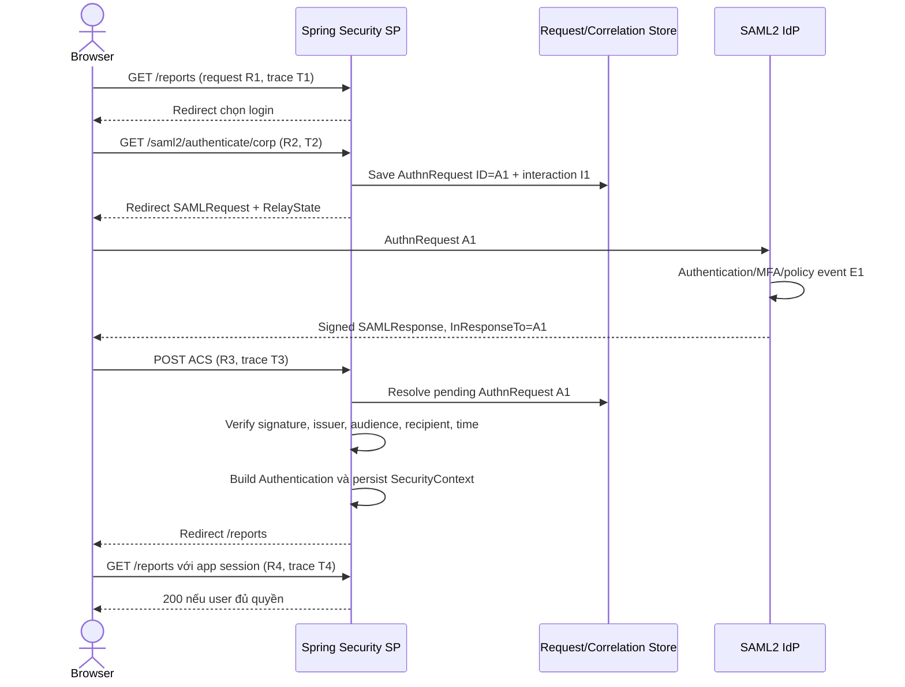

# Ghi mã tương quan giữa yêu cầu ứng dụng, AuthnRequest và sự kiện IdP

**Học phần:** Spring Security – federation → Quan sát và gỡ lỗi.

**Mục tiêu:** biết cách nối các sự kiện trong một lần đăng nhập liên kết SAML2: yêu cầu HTTP ban đầu tại ứng dụng (Service Provider/SP), bước tạo và lưu `AuthnRequest`, lượt chuyển hướng sang IdP, sự kiện đăng nhập/MFA/chính sách tại IdP, `SAMLResponse` quay về Assertion Consumer Service (ACS), kết quả kiểm tra `InResponseTo`/chữ ký và phiên ứng dụng được tạo. Thiết kế log/trace đủ để điều tra lỗi trên nhiều pod, nhiều tab và nhiều IdP, nhưng **không lộ token, cookie, SAMLResponse, NameID hay thông tin cá nhân**, và không biến mã tương quan thành cơ chế xác thực.

**Điểm cần nhớ:** một hành trình đăng nhập có **nhiều loại ID khác nhau**, không phải một ID duy nhất. `interaction_id` là khóa quan sát do ứng dụng tạo; `http_request_id` mô tả một HTTP request; `trace_id` mô tả các span được phân tán theo W3C/OpenTelemetry; `AuthnRequest@ID` do SP sinh và `SAMLResponse@InResponseTo` dùng để tương quan **theo giao thức SAML**; `RelayState` giúp giữ trạng thái theo binding; còn `idp_event_id` là mã audit riêng của IdP **nếu nhà cung cấp có công bố**. Không tự coi mã từ HTTP header hoặc XML chưa xác minh là bằng chứng người dùng đã đăng nhập.

Ví dụ sử dụng Java 17+, Spring Security Servlet/SAML2 và miền `example.test` giả lập. Mã Spring bên dưới là các **mảnh cấu hình trong ứng dụng thật**, còn `SamlCorrelationDemo.java` ở phần thực hành **biên dịch bằng JDK 17 thuần**, chỉ mô phỏng nguyên tắc correlation, không thực hiện XML Signature verification.

## 1. Bài toán: vì sao SSO khó truy vết khi chỉ có HTTP access log?

Một truy vấn `GET /reports` từ browser chưa đăng nhập có thể dẫn đến một chuỗi request và hệ thống độc lập:



**Những câu hỏi mà access log thuần không trả lời được:**
- IdP có nhận đúng `AuthnRequest ID` và phát sự kiện nào?
- IdP chặn bởi MFA, conditional access hay cấu hình SP?
- Browser có hoàn tất POST về ACS không, hay đóng tab sau IdP login?
- `SAMLResponse@InResponseTo` có trùng request đang chờ không?
- Chữ ký, IdP issuer, SP audience/recipient và time constraints có hợp lệ không?
- Callback về pod B có truy cập được request state phát từ pod A không?
- Phiên ứng dụng được tạo và lưu chưa, hay chỉ HTTP 302 success handler?
- Browser có hai tab đăng nhập song song, response nào thuộc request nào?
- Spring đã xác thực nhưng truy cập `/reports` trả 403 vì quyền/tenant?
- Tại sao IdP có event “success” nhưng SP không có authenticated session?

Muốn trả lời, phải tạo **mã tương quan riêng cho hành trình SSO**, gắn nó với AuthnRequest ID trong **server-side state** và kết nối với audit phía IdP khi có nguồn dữ liệu đáng tin.

## 2. Phân biệt đúng các loại mã tương quan

| Mã | Chủ thể tạo và quản lý | Phạm vi | Vai trò đúng |
| --- | --- | --- | --- |
| `http_request_id` | Edge proxy hoặc ứng dụng | Một HTTP request | Tra access log, latency/status |
| `trace_id`, `span_id` | Tracing SDK/W3C context | Một trace/span | Nối các HTTP/service spans được instrument |
| `interaction_id` | Service Provider | Một lần người dùng bắt đầu SSO | Gom nhiều HTTP requests, SAML IDs và audit events |
| `AuthnRequest@ID` | SAML SP library | Một AuthnRequest duy nhất | SAML correlation với Response `InResponseTo` |
| `RelayState` | SP theo SAML binding | Một SAML handshake | Tìm server-side state, không phải credential |
| `SAMLResponse@ID` | IdP | Một SAML Response | Response audit/replay marker |
| `SAMLResponse@InResponseTo` | IdP căn cứ AuthnRequest | Tham chiếu SP request | Trả lời `AuthnRequest@ID` |
| `SubjectConfirmationData@InResponseTo` | IdP | Subject bearer confirmation | Ràng buộc assertion với SP request nếu profile đòi |
| `idp_event_id` | IdP audit system | Một event của vendor | Tra lý do MFA/login/policy |
| `app_session_ref` | SP pseudonymizes session | Một local app session | Kiểm session persistence/expiration mà không lộ cookie |
| `app_user_ref` | App sau verified identity mapping | Một tài khoản nội bộ | Audit authentication/authorization đã được verify |

**Ví dụ**: 
- `AuthnRequest ID = _req-A91`;
- `SAMLResponse ID = _response-B44`;
- `SAMLResponse InResponseTo = _req-A91`;
- `interaction_id = I-2026-8f77`;
- `IdP event = idp-evt-c51`, nhưng chỉ nếu audit của IdP cung cấp;
- `trace_id GET /reports = T1`, `trace_id POST ACS = T3`, có thể khác nhau.

**Không sai lầm đặt tất cả cùng giá trị.** Mỗi mã có mục đích và lifecycle khác nhau: SAML ID do library phát theo quy tắc SAML, trace ID từ observability, interaction từ app, session ID từ framework. Một trace header attacker tự gửi **không được phép trở thành SAML request ID hoặc authentication proof**.

## 3. W3C Trace Context không tự nối xuyên qua trình duyệt và IdP

W3C Trace Context xác định `traceparent` và `tracestate`. Ví dụ:

```http
traceparent: 00-2f4b1de8b76f4b8f98c9d35e625a117a-f5f34b1b9df7058d-01
```

Bốn thành phần là `version-trace_id-parent_id-flags`. Khi các microservices gọi nhau và truyền trace context đúng, hệ thống tracing có thể nối spans trong cùng trace. **Đó không phải điều SAML browser bindings bảo đảm:**

1. SP trả 302 đến IdP, **browser thực hiện một request mới** ở domain khác. Nó không tự sao chép header `traceparent` từ response SP sang request IdP.
2. IdP có thể là dịch vụ do tổ chức khác quản lý, không chấp nhận hay công bố OTel trace IDs.
3. Browser POST `SAMLResponse` về ACS tạo **một HTTP request mới**; phần lớn sẽ có span/trace mới.
4. Nếu reverse proxy truyền trace context trong cùng datacenter, trace có thể liên tục trong **nội bộ một HTTP leg**, không chứng minh end-to-end SAML trace.
5. `tracestate` không được mang PII. Trace headers đến từ Internet phải được validate/rate-limit và không được xem là security authority.
6. Sampling có thể loại bỏ các spans quan trọng; audit sự kiện bảo mật cần được thiết kế độc lập.

**Giải pháp:** duy trì `interaction_id` server-side và map:
```text
interaction I1
  entry request R1, trace T1
  begin SAML request R2, trace T2
  AuthnRequest ID A1, RelayState opaque RS1
  IdP event E1 (optional)
  ACS request R3, trace T3
  Response ID B1, verified InResponseTo=A1
  session ref S1, after-login request R4/trace T4
```

Có thể dùng OpenTelemetry span links hoặc log attributes để nối traces độc lập; **không bịa quan hệ parent-child qua browser**, không đòi IdP dùng cùng sampling policy.

## 4. SAML AuthnRequest ID và InResponseTo là trục quan trọng nhất

Ví dụ XML chỉ để đọc cấu trúc:

```xml
<samlp:AuthnRequest
    xmlns:samlp="urn:oasis:names:tc:SAML:2.0:protocol"
    xmlns:saml="urn:oasis:names:tc:SAML:2.0:assertion"
    ID="_req-A91"
    Version="2.0"
    IssueInstant="2026-11-07T03:00:00Z"
    Destination="https://idp.example.test/sso">
  <saml:Issuer>https://portal.example.test/saml/sp</saml:Issuer>
</samlp:AuthnRequest>
```

IdP sau khi xử lý sẽ phát Response có ID riêng:

```xml
<samlp:Response
    xmlns:samlp="urn:oasis:names:tc:SAML:2.0:protocol"
    xmlns:saml="urn:oasis:names:tc:SAML:2.0:assertion"
    ID="_response-B44"
    Version="2.0"
    InResponseTo="_req-A91"
    IssueInstant="2026-11-07T03:00:11Z"
    Destination="https://portal.example.test/login/saml2/sso/corp">
  <saml:Issuer>https://idp.example.test/metadata</saml:Issuer>
  <!-- Signature, Status, Assertion và SubjectConfirmation bị lược bỏ -->
</samlp:Response>
```

**Hai XML trên không phải fixture SAML hợp lệ để đăng nhập** vì thiếu chữ ký/Response/Assertion đầy đủ. Trong môi trường thật, chữ ký cần được verify bằng credential của IdP trong `RelyingPartyRegistration` và phải kiểm:
- IdP `Issuer` đúng nguồn đáng tin; Response/Assertion có chữ ký đúng profile.
- `AudienceRestriction` là SP EntityID; `Destination`/`Recipient` trùng ACS.
- `InResponseTo` khớp request do **phiên browser này** khởi tạo.
- SubjectConfirmation, `NotBefore/NotOnOrAfter`, AuthnStatement, replay.
- XML Signature Reference không bị wrapping/move sang assertion khác.
- Không tin certificate tùy ý đính trong untrusted response.
- Account/tenant role mapping sau verified SAML principal.

### 4.1. Đừng dùng InResponseTo để bỏ qua security request repository

Dù một incoming response có `InResponseTo=_req-A91`, đây vẫn là **input chưa xác minh**. Attacker có thể tự viết XML và đặt giá trị này. SP có thể dùng nó để **lookup bản ghi candidate** nhưng **không thể** dựa vào sự giống chuỗi đó để cấp `Authentication`. Cần SAML provider verify và kiểm original session binding/one-time request.

Nếu lookup trong Redis dựa duy nhất vào RelayState hoặc `InResponseTo` mà không gắn với browser ban đầu, có nguy cơ login CSRF/login fixation. Spring Security documentation lưu ý `HttpSessionSaml2AuthenticationRequestRepository` cho khả năng ràng buộc session tự nhiên; nếu dùng cache request repository phải bù trust/binding tương đương.

### 4.2. RelayState dùng để truy lại state, không phải chứng minh danh tính

`RelayState` trong browser SSO thường là một chuỗi opaque do SP gửi kèm `AuthnRequest` và được echo khi trả response. Đề nghị:
- Token random có TTL, gắn với browser/session và expected IdP/registration.
- Không là `JSESSIONID`, username, email, raw return URL, token hoặc secret.
- Không xem nó là signed SAML assertion, không gọi `sendRedirect(RelayState)` tùy ý.
- Không ghi raw RelayState vào access logs/analytics.
- Với SAML HTTP Redirect/POST bindings, lưu ý giới hạn **80 bytes** của RelayState theo đặc tả; đếm bytes, không phải Unicode characters.
- Trong HTTP Redirect binding có ký query string, RelayState có thể nằm trong signed input; không mặc định “RelayState luôn unsigned”.
- Kể cả nếu integrity được bảo vệ, destination và browser correlation vẫn phải hợp lệ.

## 5. Tạo một correlation record tại Service Provider

Khi người dùng chọn đăng nhập qua IdP `corp`, ứng dụng tạo `interaction_id` và lưu một bản ghi trong trusted backend.

| Field | Dữ liệu | Ghi chú |
| --- | --- | --- |
| `interaction_id` | Random ID của một login journey | Không dùng làm credential |
| `entry_request_id`, `entry_trace_id` | Request/trace từ GET resource hoặc login picker | Có thể không có entry request trước đó |
| `start_request_id`, `start_trace_id` | Request bắt đầu SAML | Một tương tác có nhiều HTTP requests |
| `authn_request_id` | SAML request ID thật từ library | Unique, dùng để match `InResponseTo` |
| `relay_state_ref` | Fingerprint của opaque RelayState | Không chứa raw lookup token trong log |
| `registration_id` | `corp`, `partner` | Chỉ chọn từ allowed Spring registrations |
| `expected_idp_entity_id` | IdP Issuer/metadata trust config | Không do user chỉ định |
| `sp_entity_id`, `acs_route` | Metadata ứng dụng | Có thể khác theo tenant/IdP |
| `original_session_binding` | Server-side session/browser reference | Không gửi raw session ID qua IdP |
| `issued_at`, `expires_at` | UTC timestamps | TTL và kiểm time |
| `idp_event_refs` | 0..N IdP vendor event IDs nếu có | Optional |
| `acs_request_id`, `acs_trace_id` | Request/trace nhận SAMLResponse | Không đồng nhất với start trace |
| `response_id_ref`, `in_response_to_ref` | Được ghi có nhãn verified/unverified rõ ràng | Không lấy raw XML |
| `auth_outcome` | VERIFIED, REJECTED, TIMEOUT | Outcome độc lập IdP audit |
| `app_user_ref` | Internal pseudonym | Chỉ sau verified identity mapping |
| `post_auth_session_ref` | Fingerprint phiên sau login | Không raw cookie |
| `node_id`/`app_version` | Instance xử lý các bước | Giúp điều tra nhiều pods |

**Tối thiểu** vẫn cần `interaction_id + AuthnRequest ID + expected IdP + original session binding + timestamp`. Để nối với IdP audit, nếu vendor ghi raw AuthnRequest ID trong audit thì có thể join exact trong phạm vi restricted access; nếu không, phải dùng có điều kiện các yếu tố issuer, time, SP EntityID, audit event type và confidence level.

### 5.1. 1:N relationships phải được hỗ trợ

Một lần login có thể có:
- Hai HTTP requests từ app trước khi redirect.
- Nhiều trace IDs trước và sau IdP.
- IdP events cho password challenge, MFA prompt, deny hoặc success.
- Một AuthnRequest, nhiều ACS attempts (ví dụ replay bị reject).
- Một success authentication, session ID được rotate theo session fixation protection.
- Nhiều business requests sử dụng cùng app session sau login.

Không ép `interaction_id` là unique key của **mỗi log line**; nó là khóa **gom sự kiện**. Mỗi event có `event_id` riêng và loại sự kiện rõ.

### 5.2. Database schema minh họa

```sql
CREATE TABLE saml_login_journey (
    interaction_id UUID PRIMARY KEY,
    registration_id VARCHAR(80) NOT NULL,
    expected_idp_ref VARCHAR(150) NOT NULL,
    authn_request_ref VARCHAR(160) UNIQUE NOT NULL,
    original_session_ref VARCHAR(160) NOT NULL,
    entry_trace_id VARCHAR(32),
    start_trace_id VARCHAR(32),
    created_at TIMESTAMPTZ NOT NULL,
    expires_at TIMESTAMPTZ NOT NULL,
    outcome VARCHAR(32) NOT NULL,
    completed_at TIMESTAMPTZ,
    user_ref VARCHAR(160),
    session_ref VARCHAR(160)
);

CREATE TABLE saml_login_event (
    event_id UUID PRIMARY KEY,
    interaction_id UUID REFERENCES saml_login_journey(interaction_id),
    event_type VARCHAR(80) NOT NULL,
    result_code VARCHAR(80),
    event_time TIMESTAMPTZ NOT NULL,
    source_system VARCHAR(80) NOT NULL,
    node_ref VARCHAR(80),
    trace_id VARCHAR(32),
    request_ref VARCHAR(160),
    saml_message_ref VARCHAR(160),
    vendor_event_ref VARCHAR(160)
);

CREATE INDEX saml_login_event_by_interaction
    ON saml_login_event(interaction_id, event_time);
```

Đây là **schema hướng dẫn**, không phải đầy đủ transaction/retention/protection production. `authn_request_ref` có thể là **HMAC** của raw request ID trong logging/audit domain; bản SAML request repository vẫn phải lưu request ID thật để xác minh protocol. Nếu cần tra IdP bằng raw ID, chỉ dùng một restricted lookup có quyền, không rải raw ID sang logging/metrics phổ thông.

Quan trọng: **Correlation store không thay thế Saml2AuthenticationRequestRepository**. Audit ingest có thể chậm hoặc mất event; security handshake state phải có lifecycle và validation độc lập, không dựa trên hệ thống log.

## 6. Spring Security: nơi lấy AuthnRequest ID chính xác

Spring Security SAML2 Servlet sử dụng:
- `Saml2WebSsoAuthenticationRequestFilter` tạo `AuthnRequest` cho `/saml2/authenticate/{registrationId}`.
- `Saml2AuthenticationRequestRepository` lưu `AbstractSaml2AuthenticationRequest`.
- `HttpSessionSaml2AuthenticationRequestRepository` là triển khai mặc định trong tài liệu tham khảo; giúp ràng buộc request với original browser/session.
- `CacheSaml2AuthenticationRequestRepository` hỗ trợ cache phân tán theo RelayState nhưng **không tự bảo đảm** session binding; cần threat model riêng.
- `Saml2WebSsoAuthenticationFilter` và `Saml2AuthenticationTokenConverter` xử lý ACS.
- `OpenSaml5AuthenticationProvider` trong Spring Security 7.x xác minh response/assertion theo profile và tạo authenticated principal.
- `SecurityContextRepository` và session strategy quyết định persistence/rotation của ứng dụng.

### 6.1. Quan sát từng điểm đúng thời điểm

| Hook | Quan sát đáng tin | Không được khẳng định |
| --- | --- | --- |
| Request filter | HTTP request ID, trace ID, anonymous route | Login thành công |
| Request repository `save` | SAML AuthnRequest ID, registration, binding | IdP đã nhận request |
| HTTP 302/POST sang IdP | Đích SSO và binding | IdP đã xác thực user |
| IdP audit API | Vendor events theo quyền | SP đã nhận/verify Response |
| ACS entry | Có callback/HTTP request mới | Response đã signed hợp lệ |
| Repository `load`/`remove` | Pending request lookup/consume | SAML verification đã pass |
| SAML provider authenticated | Verified principal, authority source | Business resource đã authorized |
| Authentication success handler | Callback auth success | App session chắc chắn persisted |
| Session request tiếp theo | SecurityContext còn hoạt động | User có mọi roles/tenants |
| Authorization decision | Permitted/denied resource | Đăng nhập IdP thất bại nếu deny |

**Không ghi `saml.login.success` ngay khi `removeAuthenticationRequest` trả về một request.** Repository chỉ kiểm request state; nó không thay chữ ký/issuer/audience/recipient/time validations.

## 7. Mảnh Java/Spring Security ghi sự kiện khi lưu AuthnRequest

Có thể dùng một **decorator** của `Saml2AuthenticationRequestRepository`: sau `save` thành công mới phát event `saml.authn_request.saved`. Đây là extension point công khai theo Spring Security Javadoc.

```java
package com.example.samlobs;

import jakarta.servlet.http.HttpServletRequest;
import jakarta.servlet.http.HttpServletResponse;
import org.slf4j.Logger;
import org.slf4j.LoggerFactory;
import org.springframework.security.saml2.provider.service.authentication
        .AbstractSaml2AuthenticationRequest;
import org.springframework.security.saml2.provider.service.web
        .HttpSessionSaml2AuthenticationRequestRepository;
import org.springframework.security.saml2.provider.service.web
        .Saml2AuthenticationRequestRepository;

public final class AuditedSamlRequestRepository implements
    Saml2AuthenticationRequestRepository<AbstractSaml2AuthenticationRequest> {

    private static final Logger LOG =
            LoggerFactory.getLogger(AuditedSamlRequestRepository.class);

    private final Saml2AuthenticationRequestRepository
            <AbstractSaml2AuthenticationRequest> delegate;
    private final SecurityAuditRefs refs;

    public AuditedSamlRequestRepository(SecurityAuditRefs refs) {
        this.delegate = new HttpSessionSaml2AuthenticationRequestRepository();
        this.refs = refs;
    }

    @Override
    public void saveAuthenticationRequest(
            AbstractSaml2AuthenticationRequest authn,
            HttpServletRequest request,
            HttpServletResponse response) {
        delegate.saveAuthenticationRequest(authn, request, response);
        if (authn != null) {
            LOG.info("event=saml.request.saved request_ref={} registration={} interaction_ref={}",
                    refs.requestRef(authn.getId()),
                    authn.getRelyingPartyRegistrationId(),
                    refs.interactionRef(request));
        }
    }

    @Override
    public AbstractSaml2AuthenticationRequest loadAuthenticationRequest(
            HttpServletRequest request) {
        return delegate.loadAuthenticationRequest(request);
    }

    @Override
    public AbstractSaml2AuthenticationRequest removeAuthenticationRequest(
            HttpServletRequest request,
            HttpServletResponse response) {
        var pending = delegate.removeAuthenticationRequest(request, response);
        if (pending != null) {
            LOG.info("event=saml.request.consumed request_ref={}",
                    refs.requestRef(pending.getId()));
        }
        return pending;
    }
}
```

```java
package com.example.samlobs;

// Ứng dụng tự triển khai; không phải bean có sẵn của Spring.
// HMAC secret lấy từ secret manager, interaction lấy từ server-side state.
public interface SecurityAuditRefs {
    String requestRef(String rawAuthnRequestId);
    String interactionRef(jakarta.servlet.http.HttpServletRequest request);
}
```

Khai báo bean **minh họa** trong app config:

```java
@Bean
Saml2AuthenticationRequestRepository<AbstractSaml2AuthenticationRequest>
samlAuthenticationRequestRepository(SecurityAuditRefs refs) {
    return new AuditedSamlRequestRepository(refs);
}
```

**Giới hạn:** đây là **mảnh Spring tích hợp**, không chạy bằng `javac` trần. Cần Spring SAML2 module, Servlet, SLF4J, một implementation `SecurityAuditRefs`, IdP/registration và cấu hình production. `SecurityAuditRefs` phải tạo **pseudonymized references** từ server-secret; không dùng `hashCode()`/Base64 làm bảo vệ PII. Không log `authn.getSamlRequest()`, raw `RelayState` hoặc full redirect URL.

Nếu app đang dùng **distributed** request repository, wrapper phải decorate chính repository đó, **không vô tình thay bằng HttpSession repository ở snippet** rồi gây lỗi cluster. Để kiểm filter có lấy bean đúng, viết integration test phát AuthnRequest và assert log audit/ref cùng mapping record, không tự preflight người dùng/ownership.

### 7.1. Vì sao không tự sửa AuthnRequest@ID để bằng trace ID?

SAML yêu cầu uniqueness theo message ID và thư viện có cơ chế sinh ID riêng. Dù trace ID thường random, lấy nó làm SAML ID sẽ trộn hai trust domains, dễ tạo xung đột khi tracing từ client không tin, và không có lý do để thay SAML protocol ID. **Giữ `authn.getId()` thật và mapping một lần**.

## 8. Mảnh Servlet filter tạo HTTP request ID

Để có ID riêng cho **mỗi HTTP request**, có thể dùng ingress/OTel hiện có. Khi cần app-owned ID để không phụ thuộc sampling, một servlet filter minh họa:

```java
package com.example.samlobs;

import jakarta.servlet.FilterChain;
import jakarta.servlet.ServletException;
import jakarta.servlet.http.HttpServletRequest;
import jakarta.servlet.http.HttpServletResponse;
import java.io.IOException;
import java.util.UUID;
import org.slf4j.MDC;
import org.springframework.web.filter.OncePerRequestFilter;

public final class ServerRequestIdFilter extends OncePerRequestFilter {
    @Override
    protected void doFilterInternal(
            HttpServletRequest request,
            HttpServletResponse response,
            FilterChain chain) throws IOException, ServletException {
        String id = UUID.randomUUID().toString();
        try {
            request.setAttribute("serverRequestId", id);
            MDC.put("request_id", id);
            response.setHeader("X-Request-ID", id);
            chain.doFilter(request, response);
        } finally {
            MDC.remove("request_id");
        }
    }
}
```

Chỉ publish **server-generated non-secret request ID**, không dùng nó như authentication token. Nếu ingress đã phát `X-Request-ID`, cần định nghĩa ai sở hữu/validate header; client có thể gửi header tùy ý, nên **không tin inbound X-Request-ID là proof**. Có thể tách `untrusted_client_request_id` đã giới hạn length/charset ra khỏi `server_request_id`.

**MDC và async:** MDC nhiều logging stacks là thread-local. Khi request qua servlet async/executor/Reactor, phải dùng context propagation được hỗ trợ và dọn context theo lifecycle, nếu không log user A có thể lẫn vào user B. `finally` chỉ đảm bảo cleanup trên thread hiện tại. Không để PII, JWT, NameID hoặc session cookies trong MDC.

## 9. Sự kiện ở ACS: phân biệt trước và sau validation

**Khi ACS vừa nhận POST** `/login/saml2/sso/{registrationId}`:
- Ghi `event=saml.acs.received`, `result=UNVERIFIED`.
- Ghi request ID/trace ID mới, node, route template, registration nếu đã resolve được.
- Có thể ghi kích thước message theo bucket và HTTP status, không raw payload.
- Không log principal, NameID hoặc `authenticated=true`.
- Không đọc XML ở một custom logging filter bằng regex hoặc parser không bảo vệ XXE/DTD.

**Sau khi Spring SAML provider verify response**:
- Ghi `event=saml.authentication.verified`.
- Đối chiếu accepted request ID với pending server-side record, expected issuer, audience/recipient và assertion validity.
- Ghi app user pseudonym và session reference sau mapping/rotation.
- Giữ `response_id_ref`/`in_response_to_ref` trong restricted audit khi policy yêu cầu.
- Nếu provider reject: ghi `event=saml.authentication.rejected`, **error code** chuẩn hóa (SIGNATURE_INVALID, UNKNOWN_ISSUER, WRONG_AUDIENCE, NOT_YET_VALID, EXPIRED, IN_RESPONSE_TO_MISMATCH, REPLAY...), không in full exception chứa PII/XML.

**Một value `InResponseTo` trích từ XML chưa verify** chỉ có thể được ghi với nhãn `unverified/candidate`. Không gán nó là trusted linkage trước validation. Có thể giữ correlation tới event lỗi ở security audit mà không tạo authenticated session.

### 9.1. Authentication events của Spring Security

Spring Security có `AuthenticationSuccessEvent`/`AuthenticationFailureEvent` khi app được cấu hình `AuthenticationEventPublisher` phù hợp:

```java
import org.springframework.context.ApplicationEventPublisher;
import org.springframework.context.annotation.Bean;
import org.springframework.context.annotation.Configuration;
import org.springframework.security.authentication.AuthenticationEventPublisher;
import org.springframework.security.authentication.DefaultAuthenticationEventPublisher;

@Configuration
public class AuthenticationPublisherConfig {
    @Bean
    AuthenticationEventPublisher authenticationEventPublisher(
            ApplicationEventPublisher events) {
        return new DefaultAuthenticationEventPublisher(events);
    }
}
```

Ví dụ listener chỉ ghi **loại kết quả**, không in raw Authentication credentials:

```java
import org.slf4j.Logger;
import org.slf4j.LoggerFactory;
import org.springframework.context.event.EventListener;
import org.springframework.stereotype.Component;
import org.springframework.security.authentication.event.AuthenticationSuccessEvent;
import org.springframework.security.authentication.event.AbstractAuthenticationFailureEvent;

@Component
class SafeAuthenticationEventListener {
    private static final Logger LOG =
            LoggerFactory.getLogger(SafeAuthenticationEventListener.class);

    @EventListener
    void onSuccess(AuthenticationSuccessEvent e) {
        LOG.info("event=authentication.provider.success type={}",
                e.getAuthentication().getClass().getSimpleName());
    }

    @EventListener
    void onFailure(AbstractAuthenticationFailureEvent e) {
        LOG.warn("event=authentication.provider.failure reason={}",
                e.getException().getClass().getSimpleName());
    }
}
```

**Không mặc định** tất cả SAML error paths đều publish một event: việc wiring `AuthenticationEventPublisher`/manager, custom handlers và framework version quyết định behavior. Kiểm bằng integration test. Event này chứng minh provider outcome **nếu được phát đúng**, chưa chứng minh `SecurityContext` persisted trên session hoặc authorization resource.

## 10. Lấy IdP audit event ID bằng cách nào?

**Không tồn tại một trường `idp_event_id` chuẩn trong tất cả SAML Response.** Tùy IdP, security/audit console hoặc API có thể ghi:
- AuthnRequest ID mà IdP nhận.
- SP EntityID và IdP tenant/realm.
- IdP-local event ID.
- User login, conditional access decision, MFA challenge/result, session reuse.
- SAML Response ID hoặc request correlation ID vendor-specific.
- Ngày giờ, originating client, IP/user agent theo policy.
- Đôi khi **không ghi request ID**, chỉ có username/time.

**Không gán IdP event ID từ user input hoặc tự suy đoán một event ID khi IdP không công bố.** Trường hợp event không tồn tại phải ghi `NOT_AVAILABLE`, còn SP auth outcome vẫn dựa trên SAML validation.

### 10.1. Ghép chính xác khi IdP ghi AuthnRequest ID

Trong restricted audit:
1. SP lưu `AuthnRequest ID _req-A91` và `interaction I1` vào server-side mapping.
2. IdP audit cho phép tìm `received_request_id=_req-A91` trong trusted realm.
3. Đối chiếu **IdP issuer/tenant, SP EntityID, time window**, và event result.
4. Gắn 0..N IdP events (MFA_REQUIRED, MFA_PASSED, TOKEN_ISSUED) vào I1.
5. Khi SP nhận ACS, verify `InResponseTo=_req-A91` và các SAML conditions.
6. Ghi linked event refs và match confidence; **IdP event không tự xác thực SP session**.

Nếu SP application logs chỉ giữ HMAC fingerprint của AuthnRequest ID, IdP vendor có raw ID, hai hệ thống **không thể join chỉ bằng string compare**. Cần **restricted lookup** hoặc một correlation service có thể chuyển ID thành cùng fingerprint theo chính sách.

### 10.2. Trường hợp không có exact ID ở IdP

Có thể ghép các yếu tố trong môi trường điều tra:
- SP EntityID, IdP registration/tenant, issuer.
- UTC time window đủ hẹp và clocks đồng bộ.
- Event type, MFA/policy status và target application.
- Pseudonymous user info, nếu đã được phép và sau khi xác minh nguồn.
- Số lần browser attempts/phát AuthnRequest.
- Vendor correlation ID khi công khai.

Đây chỉ là **heuristic**. Với nhiều logins từ một user, multi-tab, IdP session reuse hoặc time drift, timestamp/email dễ ghép nhầm. Cần ghi `confidence=LOW/MEDIUM` và **không tự tuyên bố chắc chắn** rằng event X thuộc AuthnRequest A1.

### 10.3. Vì sao không gửi trace ID tùy ý trong SAMLRequest?

Không tùy tiện:
- Thêm query `trace_id=...` vào IdP SSO URL chưa chắc IdP hỗ trợ, có thể leak log/bị bỏ qua.
- Tự thêm XML element không theo SAML schema/extension contract có thể phá signing/binding.
- Đặt trace ID vào RelayState có thể phá ngữ nghĩa session state/giới hạn 80 bytes.
- Gửi HTTP `traceparent` trên browser redirect không được SAML profile bảo đảm.
- Bên thứ ba có thể quan sát một trace ID và giả mạo log correlation.

Nếu hai bên cần trace cross-org, chỉ dùng **extension/contract được IdP hỗ trợ, kiểm duyệt dữ liệu và security review**. Luồng mặc định tốt nhất vẫn dựa AuthnRequest ID trong restricted audit và SP-owned correlation record.

## 11. Mẫu JSON log được làm sạch

**Sự kiện tạo request:**

```json
{
  "timestamp": "2026-11-07T03:00:00.003Z",
  "event": "saml.request.saved",
  "result": "STORED",
  "service": "portal",
  "environment": "staging",
  "node": "pod-a",
  "registration": "corp",
  "expected_idp_ref": "corp-idp",
  "interaction_id": "I1",
  "server_request_id": "R2",
  "trace_id": "2f4b1de8b76f4b8f98c9d35e625a117a",
  "authn_request_ref": "hmac-request-7f1c",
  "session_ref": "hmac-session-44d2",
  "binding": "REDIRECT"
}
```

**Sự kiện callback chưa xác thực:**

```json
{
  "timestamp": "2026-11-07T03:00:11.001Z",
  "event": "saml.acs.received",
  "result": "UNVERIFIED",
  "node": "pod-b",
  "server_request_id": "R3",
  "trace_id": "ad94f72c76b34b249f3418c4f81d10c5",
  "route": "/login/saml2/sso/{registrationId}",
  "saml_response_size_bucket": "4-8KiB"
}
```

**Khi SAML provider và session thành công:**

```json
{
  "timestamp": "2026-11-07T03:00:11.090Z",
  "event": "saml.authentication.verified",
  "result": "SUCCESS",
  "registration": "corp",
  "interaction_id": "I1",
  "authn_request_ref": "hmac-request-7f1c",
  "response_ref": "hmac-response-9b70",
  "idp_ref": "corp-idp",
  "app_user_ref": "user-pseudonym-01",
  "session_ref": "hmac-session-new-77a0",
  "duration_ms": 11087
}
```

**Khi thất bại:**

```json
{
  "timestamp": "2026-11-07T03:00:11.090Z",
  "event": "saml.authentication.rejected",
  "result": "FAILURE",
  "failure_code": "IN_RESPONSE_TO_MISMATCH",
  "server_request_id": "R3",
  "registration": "corp",
  "raw_saml_response_logged": false
}
```

Các ref HMAC trên là **giá trị giả trong ví dụ**, không phải kết quả hash thực. **Không gán `interaction_id` vào sự kiện callback chưa verify chỉ vì user đưa một RelayState hoặc InResponseTo tương ứng**; nếu cần, trường nên là `candidate_interaction_ref` cho đến khi protocol validation thành công.

### 11.1. Taxonomy sự kiện nên thống nhất

| Event | Trạng thái | Ý nghĩa |
| --- | --- | --- |
| `auth.login.entry` | STARTED | User vào ứng dụng hoặc chọn SSO |
| `saml.request.generated` | CREATED | SAML request được dựng |
| `saml.request.saved` | STORED | Request repository lưu thành công |
| `saml.request.redirected` | SENT_ATTEMPTED | SP phát response để browser đi IdP |
| `idp.audit.event.observed` | OBSERVED | Audit vendor event được đối chiếu |
| `saml.acs.received` | UNVERIFIED | Browser POST SAMLResponse |
| `saml.request.matched` | MATCHED | SAML validator xác minh correlation |
| `saml.authentication.verified` | SUCCESS | Provider chấp nhận assertion |
| `saml.authentication.rejected` | FAILURE | Provider/flow từ chối |
| `app.session.established` | ESTABLISHED | SecurityContext persisted |
| `app.session.continued` | ACTIVE | Request mới còn authenticated |
| `app.authorization.denied` | DENIED | User login được nhưng thiếu quyền |
| `auth.login.timeout` | TIMEOUT | Pending handshake hết hạn |

Các bước trên **không bắt buộc luôn có đủ tất cả logs**; app cần định nghĩa và test instrumentation. Không dùng `SAML_LOGIN_SUCCESS` để chỉ một redirect 302 sang IdP hoặc sự kiện IdP login success trong khi SP chưa nhận response.

## 12. Nhiều node, nhiều tab và session rotation

### 12.1. Cross-node correlation

```text
GET /saml2/authenticate/corp  → pod A
  AuthnRequest A1 -> shared request repository
  Interaction I1  -> correlation store

POST /login/saml2/sso/corp    → pod B
  load A1 with original browser/session binding
  verify response
  lookup I1
  log result and session persistence
```

Nếu request repository nằm ở local session pod A nhưng ACS tới pod B, **protocol có thể fail**. Nếu repository shared nhưng correlation map local, **login có thể pass nhưng logs thiếu**. Phân biệt rõ hai sự cố để không mở lỗ hổng:
- Security repository phải fail closed nếu không tìm thấy pending AuthnRequest.
- Correlation store nên có TTL và shared state, nhưng **không được quyết định authentication**.
- Không chấp nhận unsolicited response hoặc chỉ lookup bằng raw RelayState để sửa lỗi cache.
- Nếu app dùng Spring Session Redis/JDBC, kiểm session cookie, TTL và pod routing thật.

### 12.2. Nhiều tabs một browser

```text
Browser session S1:
  Tab A: AuthnRequest A1 / interaction I1 / issuer corp
  Tab B: AuthnRequest A2 / interaction I2 / issuer partner

Correct:
  Response InResponseTo=A2 links to I2 after validation.
  Response InResponseTo=A1 links to I1 after validation.

Wrong:
  session.lastInteraction=I2
  Any SAMLResponse => I2
```

Không lưu duy nhất “lastAuthnRequestId” trong session rồi kỳ vọng không bị ghi đè. Kiểm behavior thực của `Saml2AuthenticationRequestRepository` theo phiên bản; nếu implementation chỉ hỗ trợ một pending request mỗi session, flow hai tab phải có UX/failure xử lý rõ. Correlation không được làm giả nhiều pending states mà security repository không hỗ trợ.

### 12.3. Session fixation protection

Trước login, Spring có thể tạo HttpSession để lưu AuthnRequest. Sau SAML success, session ID có thể rotate:

```text
pre_auth_session_ref  = hmac-session-old
post_auth_session_ref = hmac-session-new
interaction_id        = I1
```

Lưu mapping an toàn trong audit record; **không log raw old/new JSESSIONID**. Một cookie có mặt trước login **không chứng minh user authenticated**. Chỉ request sau login có SecurityContext và quyền tương ứng mới chứng minh session persistence.

### 12.4. SameSite cross-site POST

IdP thường POST SAMLResponse sang ACS từ site khác. Cookie `SameSite=Lax` có thể không được gửi với cross-site POST; `Strict` còn hạn chế hơn. Nếu SP không thấy original cookie/request state, `InResponseTo` lookup có thể fail.

Trong log nên thấy:
- Original sessionRef lúc save AuthnRequest.
- ACS request có hay không có expected session binding (chỉ fingerprint/boolean).
- Cookie configuration flags `SameSite`, `Secure`/`HttpOnly`, Domain/Path.
- Không log raw cookie hay request body để “debug”.
- Có thể cần `SameSite=None; Secure` cho một số SAML POST flow theo threat model; **không disable CSRF toàn app** hoặc bỏ original-browser binding.

## 13. Java 17 runnable: mô phỏng correlation đúng và sai

Bài tập độc lập dưới đây minh họa:
- Một interaction I-101 có AuthnRequest ID riêng và có thể gắn một IdP event.
- `InResponseTo`/issuer/audience/browser binding phải khớp trước khi đặt app session.
- Response lặp, sai browser, sai IdP bị từ chối.
- Một interaction thứ hai **không có IdP audit event** vẫn có thể hoàn tất SSO vì audit availability khác authentication.
- Output không in raw SAMLResponse, cookies hoặc tokens.

**Cảnh báo quan trọng:** `signatureVerified` trong record **chỉ là giả định của test harness**. Production không được nhận boolean từ browser, phải dùng Spring Security/OpenSAML để verify XML signature/Issuer/Audience/Conditions. HashMap ở demo không thread-safe và không là distributed request repository; request IDs cố định chỉ để stdout có thể lặp lại.

File `SamlCorrelationDemo.java`:

```java
import java.time.Instant;
import java.util.HashMap;
import java.util.HashSet;
import java.util.Map;
import java.util.Set;

public class SamlCorrelationDemo {
    static final String IDP = "https://idp.example.test/metadata";
    static final String SP = "https://portal.example.test/saml/sp";

    record Attempt(
            String interactionId, String requestId,
            String registrationId, String browserRef,
            Instant expiresAt) {}

    record ResponseFixture(
            String responseId, String inResponseTo,
            String issuer, String audience,
            String browserRef, String userRef,
            boolean signatureVerified) {}

    static final class Correlator {
        private final Map<String, Attempt> pending = new HashMap<>();
        private final Map<String, String> idpEvents = new HashMap<>();
        private final Map<String, String> sessions = new HashMap<>();
        private final Set<String> usedResponses = new HashSet<>();

        void issued(Attempt attempt) {
            if (pending.putIfAbsent(
                    attempt.requestId(), attempt) != null) {
                throw new IllegalArgumentException("Duplicate request ID");
            }
        }

        boolean observedIdpEvent(String requestId, String eventRef) {
            if (!pending.containsKey(requestId)
                    || eventRef == null || eventRef.isBlank()) {
                return false;
            }
            idpEvents.put(requestId, eventRef);
            return true;
        }

        boolean accept(ResponseFixture response, Instant now) {
            if (response == null || !response.signatureVerified()) {
                return false;
            }
            Attempt attempt = pending.get(response.inResponseTo());
            if (attempt == null
                    || usedResponses.contains(response.responseId())
                    || !attempt.browserRef().equals(response.browserRef())
                    || !IDP.equals(response.issuer())
                    || !SP.equals(response.audience())
                    || !now.isBefore(attempt.expiresAt())
                    || response.userRef() == null
                    || response.userRef().isBlank()) {
                return false;
            }
            pending.remove(response.inResponseTo());
            usedResponses.add(response.responseId());
            sessions.put(attempt.browserRef(), response.userRef());
            return true;
        }

        boolean hasIdpEvent(String requestId) {
            return idpEvents.containsKey(requestId);
        }

        String authenticatedUser(String browserRef) {
            return sessions.get(browserRef);
        }
    }

    public static void main(String[] args) {
        Correlator c = new Correlator();
        Instant now = Instant.parse("2026-11-07T03:00:00Z");

        Attempt first = new Attempt(
                "I-101", "_REQ-A", "corp",
                "browser-A", now.plusSeconds(120));
        c.issued(first);

        System.out.println("Interaction linked: "
                + "I-101".equals(first.interactionId()));
        System.out.println("IdP audit linked: "
                + c.observedIdpEvent("_REQ-A", "IDP-E42"));

        ResponseFixture valid = new ResponseFixture(
                "_RESP-1", "_REQ-A", IDP, SP,
                "browser-A", "U-100", true);
        System.out.println("Verified response accepted: "
                + c.accept(valid, now));
        System.out.println("Application session persisted: "
                + "U-100".equals(c.authenticatedUser("browser-A")));
        System.out.println("Replay rejected: "
                + !c.accept(valid, now));

        Attempt second = new Attempt(
                "I-102", "_REQ-B", "corp",
                "browser-B", now.plusSeconds(120));
        c.issued(second);

        ResponseFixture otherBrowser = new ResponseFixture(
                "_RESP-2", "_REQ-B", IDP, SP,
                "browser-A", "U-100", true);
        System.out.println("Cross-session rejected: "
                + !c.accept(otherBrowser, now));

        ResponseFixture wrongIssuer = new ResponseFixture(
                "_RESP-3", "_REQ-B", "https://evil.example.test",
                SP, "browser-B", "U-100", true);
        System.out.println("Wrong issuer rejected: "
                + !c.accept(wrongIssuer, now));

        System.out.println("IdP event optional: "
                + !c.hasIdpEvent("_REQ-B"));

        ResponseFixture secondValid = new ResponseFixture(
                "_RESP-4", "_REQ-B", IDP, SP,
                "browser-B", "U-200", true);
        System.out.println("Second response accepted: "
                + c.accept(secondValid, now));
    }
}
```

Biên dịch và chạy:

```bash
javac SamlCorrelationDemo.java
java SamlCorrelationDemo
```

**Stdout chính xác:**

```text
Interaction linked: true
IdP audit linked: true
Verified response accepted: true
Application session persisted: true
Replay rejected: true
Cross-session rejected: true
Wrong issuer rejected: true
IdP event optional: true
Second response accepted: true
```

**Giải thích:** map pending dùng `requestId` nối `InResponseTo` với interaction; map IdP events có thể trống; session chỉ được tạo khi request, issuer, audience và browser match. Flag signature chỉ được trusted test harness gán; không có OpenSAML/TLS/HTTP, XML parser, real clock, nonce/RelayState, assertion replay cache, TTL cleanup, login CSRF hoặc database transactions. Do đó không dùng demo này thay SAML security library; nó dạy **cách nghĩ về correlation**, không phải auth implementation.

## 14. Ghi thông tin nào để tránh lộ dữ liệu?

**Nên ghi:** event time UTC, service/environment/pod, `interaction_id`, server request ID, trace/span IDs, IdP registration ref, expected issuer ref, binding, HMAC fingerprint của AuthnRequest ID, normalized error/result code, latency, app/session pseudonymous ref sau authentication.

**Không ghi vào log phổ thông:**
- Raw SAMLResponse/SAMLRequest XML hoặc Base64 form fields.
- Cookies (`JSESSIONID`, TGC), session IDs, OAuth/CAS tokens.
- SAML NameID/UPN/email, AttributeStatement groups nếu không cần cho điều tra.
- Raw RelayState nếu nó là lookup secret.
- Password, OTP, private keys, signing/decryption key material.
- Full redirect Location query chứa `SAMLRequest`/`RelayState`.
- `HttpServletRequest#getParameterMap()` tại ACS.
- Raw HTTP body/HAR từ browser chứa assertions.
- User-controlled text chưa sanitize có newline/CRLF gây log injection.

OWASP khuyến nghị **interaction identifiers** nhưng cũng khuyến nghị masking/hashing session IDs và loại bỏ tokens/PII. Một AuthnRequest ID không nhất thiết là credential, nhưng nên giới hạn phân phối vì có thể góp phần correlate hành vi cá nhân, nhất là khi đi cùng timestamps hoặc NameID.

### 14.1. HMAC fingerprint cho ID

Một fingerprint có thể tính bằng `HMAC-SHA256(auditKey, rawId)`, dùng hex/base64url truncated theo yêu cầu collision risk. Nhưng:
- Key lấy từ secret manager, quản lý rotation và versioning; **không hardcode**.
- Các pods cần join cùng ID phải dùng cùng key/version/normalization.
- Không đưa fingerprint vào URL cho browser như ticket.
- Hash/HMAC không thay RBAC/retention; pseudonymized data vẫn có thể là personal data.
- Nếu IdP dùng key khác/không HMAC, không thể so trực tiếp hai fingerprints để join; cần restricted lookup từ raw ID ở audit service.
- Raw ID nếu phải giữ để cross-system search nên ở restricted encrypted evidence/audit store, không ở mọi application log.

### 14.2. Tracing header có rủi ro riêng

`traceparent`, `tracestate` và vendor headers là **untrusted HTTP input** tại Internet edge. Phải giới hạn chiều dài/charset, tránh attacker ép high-cardinality traces, sampling flood hoặc rò proprietary data trong `tracestate`. Tránh gửi client-supplied baggage/PII ra IdP. Tracing không bao giờ cấp quyền cho một request.

## 15. Time correlation và latency

Một timeline mẫu:

```text
03:00:00.000Z   Browser starts /reports
03:00:00.030Z   SP saves AuthnRequest A1
03:00:00.100Z   Browser reaches IdP
03:00:01.400Z   IdP requests MFA
03:00:16.500Z   IdP issues SAMLResponse
03:00:16.650Z   SP ACS receives
03:00:16.705Z   SP verifies SAML
03:00:16.730Z   Session persisted

SP pre-redirect: 30 ms
IdP + human MFA: 16.4 seconds
Browser return: 150 ms
SP validation: 55 ms
Session persistence: 25 ms
Total journey: 16.73 seconds
```

Đây là số liệu **minh họa, không phải benchmark Spring**. `IssueInstant` từ SP, timestamp IdP và ACS request time đến từ các host khác nhau; phải có NTP/UTC để so được. Nếu IdP audit ingestion bị trễ, **event timestamp khác ingest timestamp**. Với latencies trong một process ưu tiên monotonic clock; khi so cross-host phải chấp nhận uncertainty và clock offset.

### 15.1. Cảnh báo theo event cuối cùng

| Event cuối thấy | Khả năng | Chẩn đoán |
| --- | --- | --- |
| `auth.login.entry` | Chưa tạo SAML request | Login picker, security chain, routing |
| `saml.request.saved` | SP đã lưu; browser/IdP chưa chắc nhận | Redirect network, IdP endpoint |
| `idp.audit.event.observed` | IdP có audit; chưa chắc SP nhận response | IdP outcome, ACS URL/callback |
| `saml.acs.received` | Browser POST; verification chưa hoàn tất | Signature, request matching, session |
| `saml.authentication.rejected` | Provider từ chối | Error code, metadata, skew, replay |
| `saml.authentication.verified` | SAML accepted | Spring session, mapping, authorization |
| `app.session.established` | SecurityContext persisted | Follow-up request, cookie delivery |
| `app.authorization.denied` | User login nhưng thiếu quyền | Tenant membership/RBAC |
| `auth.login.timeout` | Pending flow quá hạn | Browser interruption, IdP timeout |

Nếu `saml.authentication.verified` có mà GET protected route tiếp theo vẫn redirect login: lỗi có thể ở `SecurityContextRepository`, cookie SameSite/Domain/Path, session rotation, Spring Session cluster hoặc custom success handler; **không mặc định IdP login sai**.

## 16. Ma trận kiểm thử correlation

| ID | Trường hợp | Expected |
| --- | --- | --- |
| C-01 | SP-initiated login thành công | Entry, AuthnRequest, ACS, verified session link một interaction |
| C-02 | IdP audit có AuthnRequest ID | Join exact trong đúng issuer/tenant/time |
| C-03 | IdP không trả event ID | Ghi unavailable, không bịa event |
| C-04 | IdP có nhiều MFA events | Cho phép 1:N events trên một interaction |
| C-05 | IdP tái sử dụng SSO session | Không đòi password event mới |
| C-06 | Cross-browser redirect | T1/T2/T3 có thể khác; interaction vẫn giữ |
| C-07 | Wrong InResponseTo | Reject, không authenticated session |
| C-08 | Response unsigned/tampered | Reject, không log verified user |
| C-09 | Signed Response wrong audience | Reject dù request ID giống |
| C-10 | Signed Response wrong issuer | Reject |
| C-11 | Expired/NotBefore invalid | Reject và phân loại time code |
| C-12 | Replay same Response ID | Reject, không mở session mới |
| C-13 | Raw RelayState là URL ngoài | Không dùng làm redirect |
| C-14 | Cross-session callback | Reject do original browser mismatch |
| C-15 | Hai tabs, hai AuthnRequests | Không gắn event Tab A sang B |
| C-16 | Hai IdPs/registrations | Namespace không trộn |
| C-17 | IdP-initiated SSO | Không bịa AuthnRequest/InResponseTo |
| C-18 | ACS post thiếu cookie | Detect session binding absent, fail closed |
| C-19 | Session ID rotation | Pre/post refs vẫn link, không log raw |
| C-20 | Node A phát, node B nhận | Shared repository + correlation store |
| C-21 | Cache TTL expired | Reject, có timeout code |
| C-22 | Audit store outage | Không làm SAML validator bypass |
| C-23 | Client tự đặt X-Request-ID | Server ID riêng và không authentication |
| C-24 | Forged traceparent | Input validation, tracing policy an toàn |
| C-25 | OTel spans bị sampling drop | Audit result vẫn có thể tra |
| C-26 | Audit ingestion delay | Không kết luận event absent ngay |
| C-27 | UTC clocks lệch | Có cảnh báo/time window bù sai số |
| C-28 | IdP event says success, ACS absent | SP không được gán login success |
| C-29 | ACS received, signature wrong | Rejected có error code nhưng không lộ XML |
| C-30 | Auth verified, session lost | Detect session persistence gap |
| C-31 | Auth verified, resource 403 | Authorization riêng với authentication |
| C-32 | Invalid input chứa newline | Logging không bị injection/CRLF |
| C-33 | Logs chứa raw SAMLResponse | QA FAIL, redaction bắt buộc |
| C-34 | Logs chứa cookie/tokens | QA FAIL |
| C-35 | Metrics label là AuthnRequest ID | QA FAIL: high cardinality |
| C-36 | Multi-tenant support query | RBAC ngăn cross-tenant audit lookup |
| C-37 | HMAC key rotation | Query/fingerprint version consistent |
| C-38 | Logout rồi login lại | Interaction mới, không reuse pending ID |
| C-39 | Invalid IdP issuer audit match theo email | Không nhận heuristic thành exact |
| C-40 | Pending request consumed nhưng validation fail | Không ghi login success |
| C-41 | Callback retry/duplicate | Event idempotency, replay blocked |
| C-42 | Message size/parse bomb | Bounded, fail-safe, logs sanitized |
| C-43 | Reverse proxy đổi Host/ACS scheme | Audit chỉ rõ expected origin vs observed |
| C-44 | Browser mất cookie do SameSite | Session refs/flags cho thấy nơi mất |
| C-45 | SecurityContext chỉ tồn tại trong request ACS | Follow-up request QA FAIL |
| C-46 | New browser không cookie | Không được hưởng session cũ |
| C-47 | Raw AuthnRequest ID trong ticket hỗ trợ | Data minimization/audit policy review |
| C-48 | External input đặt interaction ID | Không được chiếm interaction lookup |
| C-49 | Login error trước khi sinh request | Event entry vẫn điều tra được |
| C-50 | Application không dùng trace exporter | Correlation vẫn dùng audit/request IDs |

**Không chỉ assert có log lines:** test phải chạy Spring SAML2 provider thật với signed sandbox IdP Response, verify security outcome, có một request mới sau login và kiểm log không lộ credentials. `@WithMockUser` chỉ tạo giả Authentication trong Spring tests, **không chứng minh AuthnRequest, InResponseTo, XMLDSig hay IdP audit matching**.

## 17. Một quy trình điều tra thực tế với interaction ID

Giả sử support ticket chỉ chứa `interaction_id=I1`:
1. **Tra SP entry:** service/env/tenant, registration, start time, HTTP request ID và trace ID nào tạo login.
2. **Tra AuthnRequest:** có event saved không, request fingerprint nào, expected issuer/ACS/binding ra sao, browser có được redirect đúng IdP?
3. **Tra IdP audit:** nếu có exact request ID và quyền truy cập, tìm IdP events trong đúng tenant/time range. Nếu IdP không ghi request ID, đánh dấu confidence thấp.
4. **Tra ACS:** có callback request không? Nếu không, kiểm browser network, redirect, IdP response binding, load balancer, cert/proxy.
5. **Tra request state:** pending request có khớp original browser/session, RelayState và InResponseTo? Nếu không, kiểm multi-tab, session cookie SameSite, Redis/shared state.
6. **Tra SAML provider:** signature, issuer, audience, recipient, time, replay; không tắt verifier để “lấy log”.
7. **Tra app session:** có authenticated SecurityContext/session sau callback không? Session đã rotate/persist đúng chứ?
8. **Tra quyền nghiệp vụ:** nếu request cuối 403, kiểm role/tenant, không kết luận SAML failed.
9. **Ghi kết luận:** event IDs/trace IDs đã sanitize, outcome và nguyên nhân; không đưa raw assertions hoặc cookie vào ticket.

### 17.1. Phân biệt “không có event” và “event lỗi”

Không thấy IdP event có thể do IdP không logging request ID, queue ingestion trễ, retention policy, quyền audit hạn chế, browser chưa tới IdP hoặc IdP bị lỗi. **Không có audit event ≠ chứng minh login failed hay succeeded**. Kết quả SP phải dựa SAML provider; IdP audit chỉ giúp xác định chặng/hành vi.

### 17.2. Privacy và vận hành lâu dài

- Dùng structured JSON logs có schema/version, UTC timestamps, event codes hữu hạn.
- Giới hạn retention theo policy và quyền đọc qua IAM/tenant scope.
- Không tập trung toàn bộ logs chứa raw SAML/PII vào dashboard công khai.
- Gắn correlation fingerprint HMAC nhất quán giữa pods nếu cần tra nhiều nút.
- Không dùng `interaction_id`, `trace_id`, `session_ref` làm Prometheus metric labels.
- Không để observability SDK gửi `tracestate` PII đến vendor bên ngoài ngoài hợp đồng.
- Có phương án xử lý khi OTel exporter thất bại nhưng audit bảo mật vẫn cần giữ.
- Khi phát hiện nhiều replay/mismatch, cảnh báo theo category; không in attacker-controlled XML hay NameID vào log.

## 18. Checklist áp dụng trong hệ thống Spring Security

**Thiết kế**
- [ ] Có server-owned `interaction_id` cho mỗi SSO attempt.
- [ ] Mapping AuthnRequest ID do library sinh → interaction/session/registration/IdP.
- [ ] `InResponseTo` và `RelayState` không được xem như authentication proof.
- [ ] Phân biệt request ID, trace ID, response ID, IdP event ID, session ref.
- [ ] Hỗ trợ IDP_INITIATED flow không có pending request mà vẫn audit đúng loại.
- [ ] Multi-tab và cross-node state correlation được kiểm thử.

**Instrumentation**
- [ ] Log AuthnRequest issued/saved sau save thành công.
- [ ] ACS có event UNVERIFIED, không log raw SAMLResponse.
- [ ] Provider/handler có events VERIFIED/REJECTED được test thật.
- [ ] Có session persisted/continued và authorization outcome riêng.
- [ ] W3C trace context và MDC cleanup/async propagation đúng.
- [ ] Metrics labels có cardinality thấp và không có PII.

**Bảo mật**
- [ ] Spring SAML signature/trust/issuer/audience/time/replay không bị bypass.
- [ ] AuthnRequest repository ràng buộc original browser/session.
- [ ] RelayState không mang session ID/PII/URL tự do.
- [ ] Session cookies/tokens/NameID không lộ trong logs/traces/tickets.
- [ ] HMAC secret có owner/rotation, audit lookup RBAC theo tenant.
- [ ] Untrusted input được bound length, sanitize và chống XML/log injection.

**QA**
- [ ] SP-initiated SAML login signed end-to-end có thể tra interaction I1.
- [ ] Có thể ghép IdP vendor event khi IdP cung cấp dữ liệu.
- [ ] Không có vendor event thì vẫn phân loại được SP-side outcome.
- [ ] Invalid/replayed/wrong browser/wrong issuer SAML không tạo phiên.
- [ ] Request tiếp theo vẫn authenticated đúng session; browser khác không có quyền.
- [ ] Observability exporter outage không làm thay đổi security decision.

## 19. Câu hỏi tự kiểm tra

**Q1. Tại sao không lấy trace ID làm AuthnRequest ID?**  
Vì SAML ID là phần protocol dùng để match `InResponseTo`, được thư viện SAML sinh với yêu cầu uniqueness và trust riêng; trace ID chỉ dành cho quan sát và inbound trace context có thể không đáng tin.

**Q2. Vì sao một login có nhiều trace IDs?**  
Browser redirect đến IdP và POST về ACS tạo các request độc lập; W3C trace context không tự truyền qua browser SAML flow. Dùng một interaction ID ở SP nối chúng.

**Q3. IdP có luôn trả event ID trong SAMLResponse?**  
Không. IdP event là audit/vendor-specific; có thể không expose. Không bịa nếu thiếu.

**Q4. Mã nào của Response tham chiếu AuthnRequest?**  
`SAMLResponse@InResponseTo`; Response có `@ID` riêng. Cả SubjectConfirmationData cũng có thể chứa `InResponseTo` theo profile.

**Q5. Có khớp InResponseTo và RelayState là chắc chắn authenticated?**  
Không. Cần signed assertion/response, trusted issuer, audience, recipient, time, original session binding và replay checks.

**Q6. Có nên log raw RelayState, session cookie và SAMLResponse để debug?**  
Không trong logs phổ thông; dùng pseudonymized refs/sanitized events. Dữ liệu forensic nhạy cảm, nếu thực sự cần, phải ở secure evidence store.

**Q7. `AuthenticationSuccessEvent` có chứng minh SecurityContext persisted?**  
Không. Phải kiểm session repository và HTTP request độc lập tiếp theo.

**Q8. Một event IdP login success nhưng SP chưa nhận ACS có tạo ứng dụng session không?**  
Không. SP chỉ tạo Authentication sau khi nhận và validate SAMLResponse.

**Q9. Tại sao metric không dùng AuthnRequest ID làm label?**  
Mỗi lần login có ID mới, gây high-cardinality và privacy risk. Dùng labels hữu hạn, ID để ở audit logs/traces.

**Q10. Nếu IdP không ghi request ID mà chỉ ghi email và timestamp, có thể khẳng định exact event match?**  
Không. Đó là heuristic độ tin cậy thấp; cần provenance mạnh hơn nếu muốn kết luận chắc chắn.

## 20. Tài liệu tham khảo

1. [Spring Security – Producing SAML2 AuthnRequests](https://docs.spring.io/spring-security/reference/servlet/saml2/login/authentication-requests.html): request filter, `Saml2AuthenticationRequestRepository` và rủi ro cache/RelayState không session-bound.
2. [Spring Security – Authenticating SAML2 Responses](https://docs.spring.io/spring-security/reference/servlet/saml2/login/authentication.html): token converter, `OpenSaml5AuthenticationProvider`, principal/validation hooks.
3. [Spring Security – SAML2 Login Overview](https://docs.spring.io/spring-security/reference/servlet/saml2/login/overview.html): browser SSO, request/response filters và flow.
4. [Spring Security 7.x API – Saml2AuthenticationRequestRepository](https://docs.spring.io/spring-security/reference/api/java/org/springframework/security/saml2/provider/service/web/Saml2AuthenticationRequestRepository.html): `save/load/removeAuthenticationRequest` signatures.
5. [Spring Security – Authentication Events](https://docs.spring.io/spring-security/reference/servlet/authentication/events.html): `DefaultAuthenticationEventPublisher` và event listeners.
6. [OASIS SAML 2.0 Core](https://docs.oasis-open.org/security/saml/v2.0/saml-core-2.0-os.pdf): request/response ID, `InResponseTo`, issuer, assertions, conditions.
7. [OASIS SAML 2.0 Bindings](https://docs.oasis-open.org/security/saml/v2.0/saml-bindings-2.0-os.pdf): Redirect/POST binding, RelayState và signature rules.
8. [OASIS SAML 2.0 Profiles](https://docs.oasis-open.org/security/saml/v2.0/saml-profiles-2.0-os.pdf): SP-initiated Web Browser SSO, bearer confirmation/correlation.
9. [W3C Trace Context Recommendation](https://www.w3.org/TR/trace-context/): `traceparent`/`tracestate` format, propagation/privacy.
10. [OpenTelemetry – Log Trace Context](https://opentelemetry.io/docs/specs/otel/compatibility/logging_trace_context/): structured `trace_id`/`span_id` fields.
11. [OpenTelemetry – Semantic Conventions](https://opentelemetry.io/docs/specs/semconv/general/trace/): span/event attributes và semantic naming.
12. [OWASP Logging Cheat Sheet](https://cheatsheetseries.owasp.org/cheatsheets/Logging_Cheat_Sheet.html): interaction identifiers, security events, data minimization/log injection.
13. [OWASP Session Management Cheat Sheet](https://cheatsheetseries.owasp.org/cheatsheets/Session_Management_Cheat_Sheet.html): session fingerprints, cookie secrecy, lifecycle.
14. [OWASP SAML Security Cheat Sheet](https://cheatsheetseries.owasp.org/cheatsheets/SAML_Security_Cheat_Sheet.html): assertion verification, replay, signature wrapping and logging concerns.
15. [Spring Session Reference](https://docs.spring.io/spring-session/reference/): shared sessions trong cluster và session persistence.

**Kết luận:** Một lần đăng nhập SAML được quan sát tốt khi **yêu cầu ứng dụng → interaction ID → AuthnRequest ID thật → IdP audit event nếu có → verified InResponseTo tại ACS → Spring Authentication → phiên ứng dụng trên request sau** có thể nối lại trong một kho audit server-side, dù các trace IDs thay đổi khi browser đi qua IdP. Log dùng để điều tra; chỉ xác minh giao thức SAML và chính sách ứng dụng mới quyết định authentication/authorization.