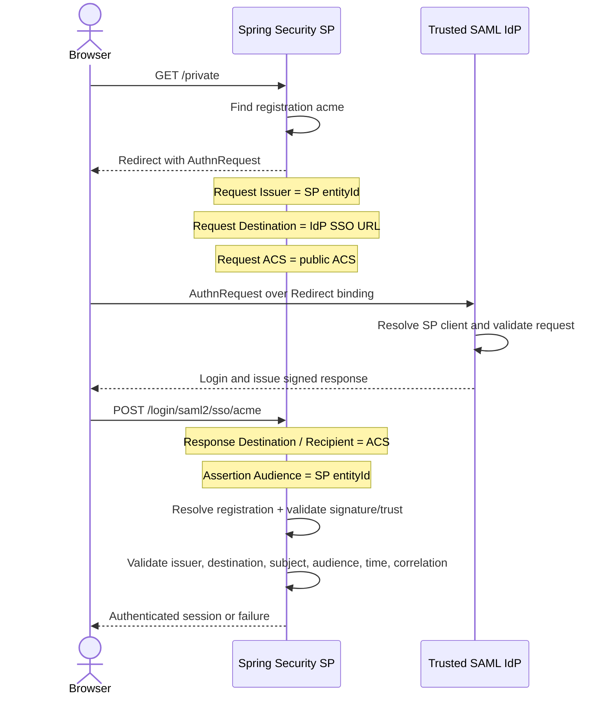

# Chẩn đoán entityId, ACS, Destination hoặc Audience không khớp

## Mục tiêu học tập

Bài học thuộc nhóm **Quan sát và gỡ lỗi** của Spring Security – federation. Sau khi học, bạn có thể:

1. Phân biệt SP `entityId`, Assertion Consumer Service (ACS), `Response.Destination` và `Assertion.AudienceRestriction`; biết trường nào là **định danh**, trường nào là **endpoint HTTP**.
2. Đọc đúng cả hai chiều: `AuthnRequest.Issuer` là định danh SP, `AuthnRequest.Destination` là IdP SSO URL; `Response.Issuer` là IdP, `Response.Destination` là SP ACS.
3. Giải thích sự khác nhau giữa `Response.Destination`, `SubjectConfirmationData.Recipient`, `AudienceRestriction/Audience`, `InResponseTo`, thời hạn assertion và chữ ký.
4. Đối chiếu SP metadata, IdP metadata, `RelyingPartyRegistration`, URL sau reverse proxy và dữ liệu response trong một quy trình quan sát an toàn.
5. Dùng Spring Boot 3 / Spring Security 6 / Java 17+ cấu hình public entityId/ACS rõ ràng, xuất SP metadata và nhận SAMLResponse theo filter chain chuẩn.
6. Chẩn đoán các tình huống typo, scheme HTTP/HTTPS, port, trailing slash, context path, rewrite ingress, `registrationId`, cache metadata và multi-IdP/tenant.
7. Phân biệt lỗi bị IdP từ chối trước login, lỗi ở ACS trước khi validator chạy, lỗi SAML signature/conditions, và lỗi local authorization sau login.
8. Chạy chương trình Java 17 độc lập để kiểm tra ma trận field mismatch với stdout xác định, nhưng không nhầm string-comparison demo với cryptographic SAML validation.
9. Thiết kế testcase wrong entityId/ACS/Destination/Audience/Recipient/Issuer, wrong signature, expired assertion, replay và wrong tenant; không vô hiệu kiểm tra bảo mật để “đăng nhập được”.
10. Phối hợp IdP owner, SSO platform, application và ingress owner bằng runbook có bằng chứng, mức ảnh hưởng, rollback và QA sau sửa.

## 1. Bối cảnh: IdP đăng nhập thành công nhưng SP từ chối

Ứng dụng web Spring Security là **SAML Service Provider (SP)**, còn nhà cung cấp danh tính là **Identity Provider (IdP)**. Một người dùng mở tài nguyên bảo vệ tại SP, được chuyển tới IdP, đăng nhập rồi browser POST một `SAMLResponse` về SP. Trước khi cấp `Authentication`, SP phải kiểm response có thực sự đến từ IdP được tin, dành cho đúng SP và đúng endpoint hay không.

**Không thể kết luận “SSO đã đúng” chỉ vì IdP hiển thị login thành công.** IdP có thể đã xác thực người dùng nhưng phát assertion cho SP khác, gửi sai ACS, dùng signing key không được tin hoặc đặt sai Audience. SP từ chối là hành vi bảo mật đúng.

Ví dụ public URL của Portal là:

```text
https://portal.example.org
```

Nhưng runtime backend nằm sau proxy:

```text
http://portal-service.default.svc.cluster.local:8080
```

Nếu Spring tự suy `ACS` từ địa chỉ nội bộ, trong khi IdP dùng public address, lỗi Destination/Recipient có thể xuất hiện ngay sau bước login. **Đừng sửa bằng cách tắt Destination/Audience validation**; cần căn chỉnh contract SP/IdP và ingress.

### 1.1. Bộ giá trị chuẩn cho các ví dụ

| Thành phần | Giá trị giả định |
| --- | --- |
| SP public base URL | `https://portal.example.org` |
| Spring `registrationId` | `acme` |
| **SP entityId** | `https://portal.example.org/saml2/service-provider-metadata/acme` |
| **SP ACS** | `https://portal.example.org/login/saml2/sso/acme` |
| **IdP entityId** | `https://idp.partner.example.net/realms/acme` |
| **IdP SSO URL** | `https://idp.partner.example.net/realms/acme/protocol/saml` |
| AuthnRequest ID minh họa | `_req-100` |
| SAML response binding | HTTP-POST |
| AuthnRequest binding | HTTP-Redirect |

Đây là **fixtures**, không phải cấu hình hạ tầng thật; các host trong `example.org` và `example.net` không được coi là dịch vụ có sẵn. Toàn bộ XML dưới đây chỉ để đọc cấu trúc, không đủ chữ ký/conditions để dùng đăng nhập.

## 2. Bốn trường chính: cùng trông như URL nhưng ý nghĩa khác

| Trường | Vị trí | Bên tạo hoặc khai báo | Phải phù hợp với |
| --- | --- | --- | --- |
| **SP entityId** | `RelyingPartyRegistration.entityId`, `SP EntityDescriptor@entityID`, `AuthnRequest.Issuer` | SP | SP entityID client được IdP tin và Audience trong assertion |
| **ACS** | `assertionConsumerServiceLocation`, `SP metadata AssertionConsumerService@Location` | SP | ACS URL đã được IdP allowlist, HTTP route thực sự nhận response |
| **`Response.Destination`** | `samlp:Response@Destination` | IdP | ACS endpoint SP dự kiến nhận SAMLResponse |
| **`AudienceRestriction/Audience`** | `saml:Assertion/saml:Conditions` | IdP | SP entityId của ứng dụng được quyền dùng assertion |
| `SubjectConfirmationData.Recipient` | `Assertion.Subject.SubjectConfirmationData` | IdP | ACS/recipient SP theo bearer subject confirmation |
| `AuthnRequest.Destination` | `samlp:AuthnRequest@Destination` | SP | IdP SingleSignOnService URL |
| `Response/Assertion.Issuer` | `saml:Issuer` | IdP | IdP entityId trong trusted asserting-party metadata |
| `AuthnRequest.Issuer` | `saml:Issuer` | SP | SP entityId trong IdP client registration |
| `InResponseTo` | Response và bearer confirmation | IdP | AuthnRequest ID còn hiệu lực trong SP-initiated SSO |

**Mẹo ghi nhớ:**
- **entityId** trả lời “SP là ai?”.
- **ACS** trả lời “IdP gửi response đến đâu?”.
- **Response Destination** trả lời “Response cụ thể này dành cho endpoint nào?”.
- **Audience** trả lời “Assertion cụ thể này được phép sử dụng bởi SP nào?”.
- **IdP entityId** trả lời “Bên phát hành assertion được tin là ai?”.

Không dùng ACS thay entityId chỉ vì chúng cùng là HTTPS URL. EntityID là định danh SAML, không nhất thiết là một endpoint có HTTP 200. ACS là endpoint thật và phải có routing/binding phù hợp.

### 2.1. Hai Destination ngược chiều

```text
AuthnRequest.Destination (SP -> IdP):
https://idp.partner.example.net/realms/acme/protocol/saml

Response.Destination (IdP -> SP):
https://portal.example.org/login/saml2/sso/acme
```

Một log chỉ ghi “Invalid Destination” nhưng không nêu loại message dễ dẫn tới sửa nhầm. Hãy xác định lỗi xuất hiện **khi IdP nhận AuthnRequest** hay **khi SP nhận SAMLResponse**.

### 2.2. Hai Issuer không giống nhau

```text
AuthnRequest.Issuer:
https://portal.example.org/saml2/service-provider-metadata/acme

Response.Issuer (và thường Assertion.Issuer):
https://idp.partner.example.net/realms/acme
```

Spring Security dùng IdP entityId đã đăng ký để kiểm nguồn response. IdP dùng SP entityId được khai báo trong request để tìm SP client config. **Không đặt IdP entityId vào Assertion Audience** hoặc đặt SP entityId vào Response Issuer.

### 2.3. Recipient và Audience khác nhau

```text
SubjectConfirmationData.Recipient:
https://portal.example.org/login/saml2/sso/acme

Assertion.Conditions.AudienceRestriction.Audience:
https://portal.example.org/saml2/service-provider-metadata/acme
```

Recipient thường trỏ tới ACS theo bearer subject confirmation; Audience là identifier của SP được assertion dành cho. **Response.Destination đúng không miễn kiểm Recipient**, và **Recipient đúng không miễn kiểm Audience**.

## 3. Luồng SAML2 và các điểm kiểm



### 3.1. Lỗi xảy ra trước login tại IdP

Nếu IdP nhận request rồi báo “unknown application”, “invalid issuer”, “invalid client”, “invalid ACS”, có thể nó chưa chọn được client SP:
- SP `AuthnRequest.Issuer` khác client entityID IdP cấu hình.
- `AuthnRequest.Destination` sai SingleSignOnService URL.
- `AssertionConsumerServiceURL` không thuộc IdP allowed ACS hoặc binding không phù hợp.
- IdP yêu cầu AuthnRequest signed mà SP không ký/khóa ký không được tin.
- Request thiếu/không đúng binding, stale request hoặc protocol option.

**Lúc này chưa có SAMLResponse hợp lệ để kiểm Audience**, nên sửa Audience chỉ vì “SSO fail” là sai thứ tự.

### 3.2. Lỗi sau IdP login

Nếu browser đã POST về ACS, phân lớp:
1. POST thật sự đến URL nào?
2. Ingress trả `404`/`403`/`502` trước backend, hay Servlet app nhận?
3. `Saml2WebSsoAuthenticationFilter` match route và tìm được `RelyingPartyRegistration` chưa?
4. Signature/decryption provider đã pass chưa?
5. Response Issuer, Destination đúng?
6. Assertion SubjectConfirmation, AudienceRestriction, time/correlation đúng?
7. Authentication đã tạo nhưng local role/tenant authorization trả 403?

Không gộp “màn hình lỗi sau login” thành một nguyên nhân.

## 4. Đọc SP metadata và IdP metadata đúng mục đích

### 4.1. SP metadata

Ví dụ XML **rút gọn, không có đầy đủ certificates và profile declarations**:

```xml
<md:EntityDescriptor
    xmlns:md="urn:oasis:names:tc:SAML:2.0:metadata"
    entityID="https://portal.example.org/saml2/service-provider-metadata/acme">
  <md:SPSSODescriptor
      protocolSupportEnumeration="urn:oasis:names:tc:SAML:2.0:protocol">
    <md:AssertionConsumerService
        Binding="urn:oasis:names:tc:SAML:2.0:bindings:HTTP-POST"
        Location="https://portal.example.org/login/saml2/sso/acme"
        index="0"/>
  </md:SPSSODescriptor>
</md:EntityDescriptor>
```

Cần ghi nhận:
- `EntityDescriptor@entityID` phải đúng **SP entityId** IdP cấu hình.
- `AssertionConsumerService@Location` phải đúng **ACS public URL** IdP cho phép.
- Binding/index phải phù hợp response path. Có thể có nhiều ACS với các index/bindings khác nhau; phải xem endpoint thực sự được chọn.
- Signing/encryption credentials, entityID và service locations phải được đồng bộ theo metadata/trust agreement.

### 4.2. IdP metadata

Ví dụ rút gọn:

```xml
<md:EntityDescriptor
    xmlns:md="urn:oasis:names:tc:SAML:2.0:metadata"
    entityID="https://idp.partner.example.net/realms/acme">
  <md:IDPSSODescriptor
      protocolSupportEnumeration="urn:oasis:names:tc:SAML:2.0:protocol">
    <md:SingleSignOnService
        Binding="urn:oasis:names:tc:SAML:2.0:bindings:HTTP-Redirect"
        Location="https://idp.partner.example.net/realms/acme/protocol/saml"/>
  </md:IDPSSODescriptor>
</md:EntityDescriptor>
```

- Metadata IdP `EntityDescriptor@entityID` là IdP issuer được SP trust.
- `SingleSignOnService@Location` là nơi SP gửi AuthnRequest, không phải nơi IdP POST SAMLResponse.
- `KeyDescriptor` và signing certificates dùng cho response/assertion verification phải được cấu hình theo chính sách tin cậy; ví dụ cố tình không hiển thị để tập trung URI.
- Không tải metadata/verification cert từ URL do một `SAMLResponse` chưa xác minh tự chỉ định.

### 4.3. SP metadata URL không phải ACS

Spring Security 6.5 có `saml2Metadata` DSL; nếu bật, SP metadata thường được đọc tại:

```text
/saml2/metadata
/saml2/metadata/{registrationId}
/saml2/service-provider-metadata/{registrationId}
```

Còn các tuyến đăng nhập mặc định đáng nhớ:

```text
GET /saml2/authenticate/{registrationId}       # khởi tạo AuthnRequest
POST /login/saml2/sso/{registrationId}        # xử lý SAMLResponse
```

Một triển khai có thể dùng entityId mang hình dạng metadata URL, nhưng **về ngữ nghĩa** entityId, metadata URL và ACS vẫn là ba vai trò riêng.

### 4.4. So dữ liệu ở đúng ba hệ

1. **SP runtime registration:** cấu hình mà node hiện đang chạy, không chỉ file YAML trong repository.
2. **SP metadata public:** XML mà IdP đang nhận hoặc đã import/cache.
3. **IdP SP-client configuration:** SP EntityID và ACS allowlist/binding đã phê duyệt.

Sau đó mới xem **dữ liệu SAML request/response** trong môi trường test có kiểm soát. Một XML tùy ý nhận được từ browser không được phép thay thế trust configuration.

## 5. AuthnRequest mẫu: SP gọi tới IdP

```xml
<samlp:AuthnRequest
    xmlns:samlp="urn:oasis:names:tc:SAML:2.0:protocol"
    xmlns:saml="urn:oasis:names:tc:SAML:2.0:assertion"
    ID="_req-100"
    Version="2.0"
    IssueInstant="2026-11-07T10:00:00Z"
    Destination="https://idp.partner.example.net/realms/acme/protocol/saml"
    AssertionConsumerServiceURL="https://portal.example.org/login/saml2/sso/acme"
    ProtocolBinding="urn:oasis:names:tc:SAML:2.0:bindings:HTTP-POST">
  <saml:Issuer>
    https://portal.example.org/saml2/service-provider-metadata/acme
  </saml:Issuer>
</samlp:AuthnRequest>
```

**Không phải AuthnRequest production hợp lệ:** XML ở trên là hình thức để đọc field, chưa có binding encoding, signature và tất cả constraints theo đối tác. Trong HTTP-Redirect binding, XML được encode theo SAML Redirect binding profile; có trường hợp IdP yêu cầu URL-query signature.

### 5.1. Điều IdP phải đối chiếu

| Trường request | Dữ liệu cần khớp |
| --- | --- |
| `Issuer` | SP entityID của một client đã đăng ký |
| `Destination` | IdP SSO URL/binding được chọn |
| `AssertionConsumerServiceURL` | ACS allowlist của SP client |
| `ProtocolBinding` | Binding response IdP hỗ trợ, thường HTTP-POST |
| `ID` | Correlation để response gắn đúng request |
| `IssueInstant` | Timestamp trong policy |
| Signature | SP ký request bằng credential được IdP trust nếu required |

**Biến thể:** AuthnRequest có thể yêu cầu ACS bằng `AssertionConsumerServiceIndex` thay cho URL trực tiếp; nếu thế phải so index với metadata SP và IdP client config. Không đánh dấu sai chỉ vì không thấy URL trong request.

### 5.2. Trường nào IdP không nên tự sửa theo input chưa đáng tin?

Không chấp nhận `AssertionConsumerServiceURL` tùy ý do attacker đưa vào một AuthnRequest giả rồi redirect SAMLResponse tới đó. IdP cần gắn request issuer với SP client, kiểm ACS URL/binding và request signature policy. Wildcard redirect/ACS không kiểm soát có thể tạo token leakage.

## 6. SAMLResponse mẫu: IdP trả cho SP

```xml
<samlp:Response
    xmlns:samlp="urn:oasis:names:tc:SAML:2.0:protocol"
    xmlns:saml="urn:oasis:names:tc:SAML:2.0:assertion"
    ID="_response-100"
    Version="2.0"
    IssueInstant="2026-11-07T10:00:40Z"
    Destination="https://portal.example.org/login/saml2/sso/acme"
    InResponseTo="_req-100">
  <saml:Issuer>https://idp.partner.example.net/realms/acme</saml:Issuer>
  <samlp:Status>
    <samlp:StatusCode Value="urn:oasis:names:tc:SAML:2.0:status:Success"/>
  </samlp:Status>
  <saml:Assertion ID="_assertion-100" Version="2.0"
                  IssueInstant="2026-11-07T10:00:40Z">
    <saml:Issuer>https://idp.partner.example.net/realms/acme</saml:Issuer>
    <saml:Subject>
      <saml:NameID>synthetic-user-001</saml:NameID>
      <saml:SubjectConfirmation
          Method="urn:oasis:names:tc:SAML:2.0:cm:bearer">
        <saml:SubjectConfirmationData
            Recipient="https://portal.example.org/login/saml2/sso/acme"
            InResponseTo="_req-100"
            NotOnOrAfter="2026-11-07T10:05:00Z"/>
      </saml:SubjectConfirmation>
    </saml:Subject>
    <saml:Conditions
        NotBefore="2026-11-07T09:59:00Z"
        NotOnOrAfter="2026-11-07T10:05:00Z">
      <saml:AudienceRestriction>
        <saml:Audience>
          https://portal.example.org/saml2/service-provider-metadata/acme
        </saml:Audience>
      </saml:AudienceRestriction>
    </saml:Conditions>
  </saml:Assertion>
</samlp:Response>
```

**Chỉ là sơ đồ XML để giải thích.** Nó thiếu chữ ký và các trường xác thực đầy đủ; **không** được đem gửi như SAMLResponse login. SAMLResponse thực phải trải qua provider đã được trust, xác minh chữ ký, điều kiện, subject, correlation và replay theo profile.

### 6.1. Bộ kiểm sau khi nhận response

| Trường | So với | Sai sẽ dẫn đến |
| --- | --- | --- |
| `Response.Issuer` | IdP entityId trusted | IdP issuer mismatch |
| `Response.Destination` | ACS public đã đăng ký và request receiver | Destination mismatch |
| `Assertion.Issuer` | IdP issuer/trust của assertion | Assertion issuer mismatch |
| `SubjectConfirmationData.Recipient` | ACS/recipient SP hợp lệ | Bearer confirmation failure |
| `AudienceRestriction/Audience` | SP entityId | Audience mismatch |
| `Response.InResponseTo` / `SubjectConfirmationData.InResponseTo` | Pending `AuthnRequest.ID` trong SP-initiated flow | Correlation failure |
| `NotBefore` / `NotOnOrAfter` | Server time/allowed skew | Not yet valid/expired |
| Signature | Trusted IdP signing key/cert | Authentication must fail |
| `NameID` | Verified principal identity | Không tự là role/tenant grant |

**Không thay kiểm Signature/Issuer bằng việc “URL trông đúng”.** Một attacker có thể viết XML chứa đúng các chuỗi này, nhưng không có chữ ký hoặc bị ký bởi key không đáng tin.

### 6.2. Audience khác Recipient

Trường hợp sai rất thường gặp:

```text
SP entityId expected:
https://portal.example.org/saml2/service-provider-metadata/acme

IdP Assertion Audience sent:
https://portal.example.org/login/saml2/sso/acme

Result: Audience != SP entityId -> REJECT.
```

Dù browser đã POST đúng ACS, Audience vẫn sai. Đúng hướng là sửa **IdP SP client EntityID / Audience mapping**, không sửa SP Audience validator.

### 6.3. Response Destination đúng nhưng Recipient sai

```text
Response.Destination:
https://portal.example.org/login/saml2/sso/acme

SubjectConfirmationData.Recipient:
https://portal.example.org/login/saml2/sso/other

Result: bearer SubjectConfirmation invalid.
```

Một assertion bearer có Recipient sai không được dùng chỉ vì Response Destination đúng. Cần kiểm subject confirmation theo thư viện SAML với đúng method, recipient, time và request ID.

## 7. Spring Security 6 xử lý các trường ở bước nào?

Theo Spring Security SAML2 login flow:

1. `Saml2WebSsoAuthenticationRequestFilter` tạo AuthnRequest theo `RelyingPartyRegistration`; endpoint mặc định `/saml2/authenticate/{registrationId}`.
2. Browser POST SAMLResponse tới ACS; `Saml2WebSsoAuthenticationFilter` xử lý, converter chọn registration theo pending state/URL registrationId/issuer theo trường hợp.
3. `AuthenticationManager` gọi OpenSAML provider. Trong tài liệu Spring Security **6.5**, provider được mô tả là `OpenSaml5AuthenticationProvider`; nhánh Spring Security 6 khác có thể dùng provider tương ứng phiên bản.
4. Provider deserializes response, kiểm signature và trust; giải mã khi cần.
5. Provider kiểm Response Issuer/Destination, assertion signatures, Subjects, Conditions và AudienceRestriction theo profile.
6. Khi thành công Spring tạo `Saml2Authentication`/`Saml2AuthenticatedPrincipal`; sau đó local app authorization vẫn phải kiểm quyền/tenant.

**Đừng bắt đầu debug Audience nếu SAMLResponse chưa vào được filter, hoặc signature đã bị từ chối sớm.**

### 7.1. Các trường trong RelyingPartyRegistration

| Spring Security API | Ý nghĩa |
| --- | --- |
| `registration.getRegistrationId()` | Key local cho một SP–IdP pair, ví dụ `acme` |
| `registration.getEntityId()` | SP entityId, dùng cho metadata/issuer/audience |
| `registration.getAssertionConsumerServiceLocation()` | ACS public URL |
| `registration.getAssertionConsumerServiceBinding()` | Binding tương ứng ACS |
| `registration.getAssertingPartyMetadata().getEntityId()` | IdP entityId trusted |
| `registration.getAssertingPartyMetadata().getSingleSignOnServiceLocation()` | IdP SSO URL |
| `registration.getAssertingPartyMetadata().getVerificationX509Credentials()` | Public verification credentials của IdP |
| `registration.getSigningX509Credentials()` | Credentials của SP dùng ký khi cần |
| `registration.getDecryptionX509Credentials()` | Credentials SP giải mã assertion khi cần |

**`registrationId` không phải SP entityId**. Nó chỉ là key chọn cấu hình Spring; entityId có thể *chứa* registrationId trong template `{baseUrl}/saml2/service-provider-metadata/{registrationId}` nhưng cần khớp exact IdP client.

### 7.2. Mặc định URI đáng nhớ

Trong Spring Security 6:
- Bắt đầu SP-initiated login: `/saml2/authenticate/{registrationId}`.
- ACS mặc định: `/login/saml2/sso/{registrationId}`; endpoint processing cũng có những mẫu resolver khác tùy cấu hình.
- SP entityId mặc định thường theo template `{baseUrl}/saml2/service-provider-metadata/{registrationId}`.
- SP metadata có thể công bố tại `/saml2/metadata/{registrationId}` khi bật metadata DSL.

Nếu muốn ACS custom, phải đồng bộ **cả `saml2Login.loginProcessingUrl` và `RelyingPartyRegistration.assertionConsumerServiceLocation`, metadata SP, IdP client ACS/binding và ingress route**.

## 8. Spring Boot 3 + Spring Security 6: cấu hình minh họa

Đây là ví dụ **Spring Boot 3/Security 6/Java 17+**, có điều kiện IdP test hoặc partner metadata được tổ chức chấp thuận. Nó **không phải** project hoàn chỉnh chứa build plugins/wrapper và không tuyên bố login với IdP thật khi chưa provision trusted metadata/certificates.

### 8.1. Dependencies

Trong `build.gradle` của dự án đã có Spring Boot plugin và dependency-management/BOM:

```groovy
dependencies {
    implementation 'org.springframework.boot:spring-boot-starter-web'
    implementation 'org.springframework.boot:spring-boot-starter-security'
    implementation 'org.springframework.security:spring-security-saml2-service-provider'

    testImplementation 'org.springframework.boot:spring-boot-starter-test'
    testImplementation 'org.springframework.security:spring-security-test'
}
```

**Lưu ý:** OpenSAML artifacts có thể cần thêm repository Shibboleth tùy version và build configuration. Kiểm Spring Boot 3.x docs và dependency graph; không ép Spring Security 7 dependency vào Boot 3 hoặc disable validators vì dependency không tải được.

### 8.2. application.yml

```yaml
server:
  port: 8080
  forward-headers-strategy: framework

logging:
  level:
    root: INFO
```

Backend có thể ở nội bộ `http://portal-svc:8080`, nhưng public URL đã được IAM/SSO owner chốt là `https://portal.example.org`.

**Trust boundary:** `forward-headers-strategy: framework` chỉ an toàn khi proxy/ingress xóa forwarded headers do client gửi rồi đặt lại giá trị đã xác minh, và origin không thể bị gọi trực tiếp. Với cấu hình Java đặt ACS/entityId cố định, forwarded headers vẫn có thể ảnh hưởng redirect/context URL. Không tự tin `X-Forwarded-Host` từ browser.

### 8.3. Main class

```java
package com.example.saml;

import org.springframework.boot.SpringApplication;
import org.springframework.boot.autoconfigure.SpringBootApplication;

@SpringBootApplication
public class SamlPortalApplication {
    public static void main(String[] args) {
        SpringApplication.run(SamlPortalApplication.class, args);
    }
}
```

Lưu tại `src/main/java/com/example/saml/SamlPortalApplication.java`.

### 8.4. Security configuration có public SP entityId/ACS rõ ràng

```java
package com.example.saml;

import org.springframework.context.annotation.Bean;
import org.springframework.context.annotation.Configuration;
import org.springframework.security.config.Customizer;
import org.springframework.security.config.annotation.web.builders.HttpSecurity;
import org.springframework.security.saml2.provider.service.registration.InMemoryRelyingPartyRegistrationRepository;
import org.springframework.security.saml2.provider.service.registration.RelyingPartyRegistration;
import org.springframework.security.saml2.provider.service.registration.RelyingPartyRegistrationRepository;
import org.springframework.security.saml2.provider.service.registration.RelyingPartyRegistrations;
import org.springframework.security.web.SecurityFilterChain;

@Configuration
public class SamlSecurityConfig {

    @Bean
    RelyingPartyRegistrationRepository relyingPartyRegistrations() {
        // Metadata IdP phải được owner/IAM xác minh trước.
        // URL bên dưới là fixture, không bảo đảm endpoint tồn tại.
        RelyingPartyRegistration acme = RelyingPartyRegistrations
            .fromMetadataLocation("https://idp.partner.example.net/metadata")
            .registrationId("acme")
            .entityId(
                "https://portal.example.org/saml2/service-provider-metadata/acme")
            .assertionConsumerServiceLocation(
                "https://portal.example.org/login/saml2/sso/acme")
            .build();
        return new InMemoryRelyingPartyRegistrationRepository(acme);
    }

    @Bean
    SecurityFilterChain securityFilterChain(HttpSecurity http)
            throws Exception {
        return http
            .authorizeHttpRequests(auth -> auth
                .requestMatchers("/", "/error").permitAll()
                .requestMatchers("/private/**").authenticated()
                .anyRequest().denyAll())
            .saml2Login(Customizer.withDefaults())
            .saml2Metadata(Customizer.withDefaults())
            .build();
    }
}
```

Lưu tại `src/main/java/com/example/saml/SamlSecurityConfig.java`.

**Diễn giải:**
1. `RelyingPartyRegistrations.fromMetadataLocation(...)` xây cặp SP/IdP từ metadata đáng tin; không nhận URL từ request body/query để tự trust một issuer tùy ý.
2. `registrationId("acme")` là key local, **không** phải IdP client ID tuyệt đối.
3. `entityId(...)` cố định SP identifier và `assertionConsumerServiceLocation(...)` cố định ACS theo **public HTTPS URL**.
4. `saml2Login` cài SAML login filter chain; `saml2Metadata` công bố SP metadata cho IdP.
5. Nếu IdP yêu cầu signed AuthnRequest, phải cấp SP signing credentials; nếu IdP mã hóa assertions, phải cấp SP decryption credentials. Không đưa private key vào Git.
6. Metadata retrieval yêu cầu TLS/source trust; nếu dùng metadata có chữ ký, phải kiểm signature theo contract, hoặc pin trusted certificates và có rotation plan.
7. Không thêm một bean `RelyingPartyRegistrationRepository` thứ hai khác cấu hình và không rõ bean nào thực sự được sử dụng.
8. Khi deploy, phải xác minh toàn bộ nodes đang chạy **cùng entityId và ACS**, không dùng config của build branch cũ.

### 8.5. Controller sau khi SAML login thành công

```java
package com.example.saml;

import java.util.Map;
import org.springframework.security.core.annotation.AuthenticationPrincipal;
import org.springframework.security.saml2.provider.service.authentication.Saml2AuthenticatedPrincipal;
import org.springframework.web.bind.annotation.GetMapping;
import org.springframework.web.bind.annotation.RestController;

@RestController
public class PrivateController {

    @GetMapping("/")
    public String home() {
        return "SAML test portal";
    }

    @GetMapping("/private/me")
    public Map<String, String> whoami(
            @AuthenticationPrincipal Saml2AuthenticatedPrincipal principal) {
        return Map.of(
            "principal", principal.getName(),
            "mode", "SAML_TEST");
    }
}
```

Lưu tại `src/main/java/com/example/saml/PrivateController.java`. Với tài khoản test đã login hợp lệ, `/private/me` có thể trả NameID/principal của test identity. Không in raw SAMLResponse, credentials, session cookie, NameID của user thật hoặc `Authentication.toString()` vào logs. Với production API, còn phải có quyền local/tenant.

### 8.6. Lấy metadata runtime

Bật metadata DSL rồi đọc qua public URL, ví dụ:

```bash
curl --fail --silent --show-error \
  https://portal.example.org/saml2/metadata/acme
```

Không có stdout cố định; output là SP metadata XML tùy cấu hình. Phải so **`EntityDescriptor@entityID`** và **`AssertionConsumerService@Location`** với bộ giá trị IdP đã import/allowlist.

Nếu metadata hiển thị `http://internal-service:8080`, xử lý config public URL/ingress/trusted forwarded headers rồi xuất lại metadata. **Không tải metadata cũ rồi sửa text và coi là runtime đã cập nhật**.

### 8.7. Build và test

Với Gradle wrapper của dự án:

```bash
./gradlew dependencyInsight --configuration runtimeClasspath --dependency spring-security-saml2-service-provider
./gradlew compileJava
./gradlew test
```

Windows dùng `.\gradlew.bat`. Build pass không chứng minh SAML login end-to-end; vẫn cần IdP test, metadata, signing credentials, callback và browser test.

## 9. Chẩn đoán SP entityId không khớp

### 9.1. Một case cụ thể

```text
SP runtime entityId:
https://portal.example.org/saml2/service-provider-metadata/acme

IdP registered SP Entity ID:
https://portal.example.org/saml2/service-provider-metadata/acme-old
```

IdP có thể từ chối request do `AuthnRequest.Issuer` không nhận diện, hoặc phát assertion Audience cũ. Cần:
1. Lấy runtime entityId từ `RelyingPartyRegistration`.
2. Lấy SP metadata hiện tại.
3. Đối chiếu IdP client entityID, metadata cache/version.
4. Chọn một stable canonical entityId bằng change control.
5. Cập nhật cả hai bên, kiểm IdP nhận config mới.
6. Kiểm positive và negative wrong audience sau cutover.

Không đổi Audience validator thành `startsWith("https://portal.example.org")` hoặc wildcard.

### 9.2. Các trường hợp dễ bị coi là “giống nhau”

- `https://portal.example.org/sp` vs `https://portal.example.org/sp/`.
- `https://portal.example.org/sp` vs `https://portal.example.org:443/sp`.
- `https://portal.example.org/sp` vs `http://portal.example.org/sp`.
- `https://portal.example.org/Sp` vs `https://portal.example.org/sp`.
- `https://portal.example.org/saml%2Fsp` vs `https://portal.example.org/saml/sp`.
- `https://portal.example.org/saml2/.../staging` vs `.../production`.
- URL metadata `/saml2/metadata/acme` bị copy làm ACS.
- SP entityId mang `registrationId=old` nhưng IdP client đã đổi name.
- Một node vẫn dùng entityId cũ sau rolling deploy.

SAML entity IDs là identifiers theo **trust contract**. Đừng tự chuẩn hóa lowercase/path/trailing slash chỉ vì URI browser có vẻ tương đương.

## 10. Chẩn đoán ACS hoặc HTTP route sai

### 10.1. IdP allowed ACS không khớp Spring

```text
Spring expected ACS:
https://portal.example.org/login/saml2/sso/acme

IdP allowed ACS (wrong):
https://portal.example.org/login/saml2/sso
```

Triệu chứng có thể:
- IdP reject `AssertionConsumerServiceURL` trước login.
- IdP POST response về path cũ nên Spring filter không nhận.
- Response Destination/Recipient trỏ path khác expected.
- Browser thấy login loop khi request state không recover được.

Phải đồng bộ **Spring ACS registration + SP metadata + IdP ACS allowlist + public routing + binding**.

### 10.2. Custom ACS processing path phải sửa hai nơi

Ví dụ cấu hình:

```java
.saml2Login(saml -> saml.loginProcessingUrl("/saml/consume"))
```

Không đủ nếu `RelyingPartyRegistration.assertionConsumerServiceLocation` vẫn là `/login/saml2/sso/acme`. Phải đặt location mới và cập nhật SP metadata/IdP, bảo đảm resolver còn chọn đúng registration khi path không chứa `registrationId`.

### 10.3. Kiểm request trước khi chạm SAML provider

| HTTP symptom | Khả năng |
| --- | --- |
| `404` tại ACS | Ingress route, servlet context path, filter chain không match |
| `405` | HTTP method/binding khác handler |
| `403` trước provider | WAF/CSRF/access rules khác SAML validation |
| `413` / `431` | Proxy/container body/header size limit |
| `502` / `504` | Upstream health/network/timeouts |
| `302` liên tục | Session/cookie/registration/callback flow, không tự suy Audience |
| Provider throws `Saml2AuthenticationException` | SAML validation/registration, cần reason stage |

**Không disable CSRF toàn bộ** chỉ vì ACS có POST; Spring `saml2Login` có cách xử lý endpoint SAML phù hợp. Kiểm request đã đến đúng SAML filter và SecurityFilterChain trước.

## 11. Chẩn đoán Response.Destination và Recipient

### 11.1. Sai HTTP nội bộ / HTTPS public

```text
IdP Response.Destination:
http://portal-svc.default.svc.cluster.local:8080/login/saml2/sso/acme

SP expected ACS:
https://portal.example.org/login/saml2/sso/acme
```

Chỉ nhìn browser thấy URL public không đủ: IdP có thể đã import metadata sinh từ hostname nội bộ; hoặc proxy strip prefix khác với SP config.

Cách khắc phục:
1. Chốt external ACS.
2. Cấu hình SP registration/metadata theo external ACS.
3. Kiểm ingress TLS, host, port, prefix.
4. Cập nhật IdP ACS allowlist/metadata cache.
5. Test signed response mới qua public URL.
6. Kiểm exact Destination và Recipient cùng khớp.

### 11.2. Recipient sai dù Destination đúng

```xml
<saml:SubjectConfirmationData
    Recipient="https://portal.example.org/login/saml2/sso/other"
    InResponseTo="_req-100"
    NotOnOrAfter="2026-11-07T10:05:00Z"/>
```

Nếu response đi tới `/login/saml2/sso/acme`, Recipient trên không hợp lệ cho bearer confirmation tương ứng. Không tự bỏ qua SubjectConfirmation; kiểm IdP profile/ACS và tạo response mới.

### 11.3. Response Destination vắng mặt

Một số binding/profile có quy tắc tùy trường hợp về Destination. Không có một quy tắc chung “không thấy thì pass”. Hãy để Spring/OpenSAML áp dụng đúng SAML2 security profile, recipient, signature, issuer, time và correlation; nếu không đủ bằng chứng an toàn thì reject.

## 12. Chẩn đoán AudienceRestriction

### 12.1. Sai Audience bằng ACS

```text
SP entityId:
https://portal.example.org/saml2/service-provider-metadata/acme

Assertion Audience (wrong):
https://portal.example.org/login/saml2/sso/acme
```

Đây là lỗi **Audience**, dù Response Destination và Recipient có thể đúng. Sửa tại **IdP SP-client EntityID/Audience setting**; không sửa XML sau khi ký, không bỏ Audience validation.

### 12.2. Audience của SP khác

Một signed assertion dành cho Portal Finance không được đem sang Portal HR dù:
- Cùng IdP và signing key.
- Cùng subject/email.
- Cùng domain, reverse proxy hoặc tenant owner.
- Browser có app session cookie dùng chung.

Audience ngăn assertion substitution giữa relying parties. Multi-tenant phải kiểm đúng SP registration; không dùng `contains("portal")` để chấp nhận.

### 12.3. Không parse “Audience đầu tiên”

SAML cho phép cấu trúc conditions/audience restrictions phức tạp và có thể có nhiều assertions. Một regex tìm text `<Audience>` trong raw XML có nguy cơ đọc sai hoặc bị XML signature wrapping. Chỉ dựa vào **assertion đã được provider xác minh** và đúng cấu trúc SAML Conditions.

## 13. Reverse proxy và forwarded headers

### 13.1. Kiến trúc phổ biến

```text
Browser -- HTTPS --> Ingress/LB [public portal.example.org:443]
                  |
                  +-- HTTP private --> Spring Boot :8080

Expected response ACS:
https://portal.example.org/login/saml2/sso/acme

Incorrect inferred ACS:
http://portal-svc:8080/login/saml2/sso/acme
```

Nguyên nhân:
- Spring sinh URL từ request internal.
- Ingress không gửi `Forwarded` hoặc `X-Forwarded-Proto/Host/Port`.
- Spring chưa bật trust forwarded headers trong đúng topology.
- Có path prefix `/app` được rewrite khiến SP/IdP khác nhau.
- IdP cache SP metadata cũ sau deploy.
- Một pod mới và một pod cũ phát metadata khác nhau.

### 13.2. Đừng tin forwarded headers không xác thực

```http
Forwarded: proto=https;host=portal.example.org
X-Forwarded-Proto: https
X-Forwarded-Host: portal.example.org
X-Forwarded-Port: 443
```

Client cũng có thể tự gửi các header này. Các điều kiện an toàn:
1. Origin app chỉ nhận traffic từ trusted ingress/network.
2. Ingress **strip/overwrite** forwarded headers của browser.
3. Allowed host/scheme/port/prefix được cấu hình và kiểm.
4. Framework xử lý forwarded headers khi thích hợp; test từ **public route**.
5. Có mTLS/ACL hoặc tương đương cho proxy-to-app boundary theo security policy.
6. Không dùng host/forwarded header do client quyết định để chọn federation trust hoặc metadata issuer.
7. Với static external entityId/ACS, vẫn kiểm public redirects, login process URL và route rewrite.

### 13.3. Context path và trailing slash

```text
Public ACS:
https://portal.example.org/app/login/saml2/sso/acme

Spring internal handler:
POST /login/saml2/sso/acme
```

Nếu ingress strip `/app`, contract vẫn phải dùng **public ACS có prefix**. Sai khi một bên thêm `/app/app` hoặc bỏ `/app`. Không tự sửa Destination bằng cách bỏ path segment khi SAMLResponse được ký.

### 13.4. Cluster/config drift

Một user đi qua node A phát AuthnRequest nhưng callback tới node B. Nếu:
- Các nodes có SP entityId/ACS hoặc trust config khác nhau.
- Pending SAML request state chỉ ở HttpSession node A, không có shared store/sticky routing.
- Node B không có matching registrationId.
thì có thể thấy Destination/InResponseTo/registration errors ngẫu nhiên.

Phải có deployment revision đồng nhất, session strategy phù hợp, health checks và tests cross-node. **Không disable InResponseTo để che lỗi cluster**.

## 14. Multi-IdP, multi-registration và IdP-initiated login

### 14.1. Mỗi IdP có trust riêng

Một ứng dụng có thể dùng:
- `acme` → IdP Acme issuer, SP entityId/ACS dành cho Acme.
- `globex` → IdP Globex issuer, metadata verification certificates riêng.

`Saml2AuthenticationTokenConverter` có thể xác định registration từ pending request/URL registrationId hoặc issuer response theo trường hợp. Không chấp nhận arbitrary issuer bằng cách tải cert/trust từ XML chưa verify.

### 14.2. Response gửi nhầm registration path

IdP Globex POST vào `/login/saml2/sso/acme` có thể làm:
- Converter chọn sai registration.
- Verification cert không khớp.
- Response Issuer/Destination/Audience fail.
- Nguy cơ cấp nhầm tenant nếu custom converter bỏ checks.

Cách sửa là **đúng route và contract**, không viết `if (anySamlAssertionIsSigned) accept`.

### 14.3. SP-initiated và unsolicited IdP-initiated

Trong SP-initiated:
- SP tạo AuthnRequest ID, lưu correlation state.
- IdP Response/SubjectConfirmationData thường chứa `InResponseTo`.
- SP phải so với pending request.

Trong IdP-initiated:
- Không nhất thiết có request trước đó; đây là profile/cấu hình riêng có threat model khác.
- Không bật “allow unsolicited” chỉ vì logout/callback bị mất state.
- Vẫn phải kiểm trust, signature, issuer, recipient, audience, time, replay, tenant binding.

## 15. Các lỗi khác dễ bị nhầm với URI mismatch

| Dấu hiệu | Hướng xử lý |
| --- | --- |
| Signature invalid | IdP verification cert/metadata rotation, message tampering |
| Assertion expired | `NotOnOrAfter`, clock skew, replay, IdP/SP UTC |
| Not yet valid | `NotBefore`, clock mismatch |
| Cannot decrypt assertion | SP decryption private key/cert, encrypted assertion profile |
| Invalid `InResponseTo` | Pending request store, session cookie, duplicate callback |
| Unknown NameID / user | Local account linking, stable SAML subject, not Destination |
| SAML pass nhưng /admin 403 | Local authorization/tenant/roles, not Audience |
| Login loop | Session/SSO cookie, request state, proxy, redirect |
| Wrong binding | Redirect vs POST handling, IdP/SP metadata |
| Request body missing | WAF, proxy POST truncation, content-type/form handling |
| RelayState open redirect | Application redirect validation/correlation, not SAML identity |

**Không thay đổi signature hoặc Audience validator để thử “xem có qua không” trên production.** Với negative tests, dùng test IdP và test signing keys.

## 16. Runbook xử lý sự cố

### Bước 1: Xác định scope và failure stage

Ghi nhận: môi trường, tenant, IdP, registrationId, public URL, node/config revision, thời điểm UTC, request method/path/status và mã lỗi. Có bao nhiêu users/nodes bị ảnh hưởng? Sự cố bắt đầu sau đổi DNS, cert, ingress, ACS hoặc entityId hay không?

### Bước 2: Tạo bảng contract một dòng

```text
Environment: STAGING
registrationId: acme
SP runtime entityId: https://portal.example.org/saml2/service-provider-metadata/acme
SP runtime ACS: https://portal.example.org/login/saml2/sso/acme
SP metadata entityID: [read from trusted SP output]
SP metadata ACS: [read from trusted SP output]
IdP registered SP entityID: [read from IdP admin config]
IdP registered ACS/binding: [read from IdP admin config]
Trusted IdP entityId: https://idp.partner.example.net/realms/acme
Trusted IdP SSO URL: https://idp.partner.example.net/realms/acme/protocol/saml
AuthnRequest Issuer/Destination: [test trace after redaction]
Response Destination: [test trace after redaction]
Subject Recipient: [test trace after redaction]
Assertion Audience: [test trace after redaction]
Signature / time / InResponseTo: PASS or FAIL independently
```

Không ghi raw SAMLResponse, `NameID`/email thật, cookies, private signing keys, full XML có PII hoặc security tokens vào support ticket. URL SP entityId/ACS thường nằm trong metadata, nhưng vẫn áp chính sách thông tin của tổ chức.

### Bước 3: So đúng thứ tự

1. Runtime SP `entityId` và IdP registered SP ID có giống hệt?
2. Runtime SP ACS và IdP ACS allowlist/binding có giống hệt?
3. `AuthnRequest.Issuer` có đúng SP entityId?
4. `AuthnRequest.Destination` có đúng trusted IdP SSO URL?
5. `Response.Issuer` có đúng IdP entityId trusted?
6. `Response.Destination` có đúng SP ACS?
7. `SubjectConfirmationData.Recipient` có đúng recipient/ACS?
8. `Assertion.AudienceRestriction` có phù hợp SP entityId?
9. `InResponseTo` và response correlation có đúng pending request?
10. Signatures/trust, timestamps, replay, subject confirmation có hợp lệ?
11. HTTP POST có thật sự được SAML filter xử lý?
12. Sau authenticated, local authorization có từ chối role/tenant?

### Bước 4: Sửa tại nguồn và phối hợp

- entityId mismatch → thống nhất SP entityId trong registration, metadata, IdP client.
- ACS mismatch → thống nhất public ACS, HTTP route, metadata, IdP allowlist và binding.
- Response Destination mismatch → IdP cấu hình trả đúng SP ACS.
- Audience mismatch → IdP phát Audience đúng SP entityId.
- Recipient mismatch → IdP bearer confirmation hướng đúng ACS.
- Issuer mismatch → sửa IdP/SP trusted registration; không thêm wildcard trust.
- InResponseTo mismatch → sửa session/request store/callback correlation.
- Signature fail → phối hợp cert rotation/metadata trust, không disable verification.

### Bước 5: QA và rollback

Chạy baseline positive login và negative wrong issuer, wrong audience, wrong destination, wrong recipient, wrong signature, expired assertion và wrong request ID. Test public ingress, multi-node, metadata cache và nhiều tenants. Có canary/rollback khi đổi SP entityId/ACS; không cập nhật IdP production và SP production tùy tiện không có cửa sổ thay đổi.

## 17. Java 17+ độc lập: mô phỏng ma trận so sánh URI

Chương trình bên dưới minh họa hợp đồng đã biết trước và các field trong một **fixture**, không parse XML và **không xác minh signature, SAML metadata trust, assertion conditions, replay, encryption hoặc session**. Kết quả `STRUCTURE_MATCH_ONLY` tuyệt đối **không** phải xác thực thành công.

Tệp `SamlMismatchDemo.java`:

```java
import java.util.Objects;

public final class SamlMismatchDemo {
    static final String SP_ENTITY =
        "https://portal.example.org/saml2/service-provider-metadata/acme";
    static final String SP_ACS =
        "https://portal.example.org/login/saml2/sso/acme";
    static final String IDP_ENTITY =
        "https://idp.partner.example.net/realms/acme";
    static final String IDP_SSO =
        "https://idp.partner.example.net/realms/acme/protocol/saml";

    record Contract(
        String appEntity,
        String idpRegisteredEntity,
        String appAcs,
        String idpRegisteredAcs,
        String trustedIdpEntity,
        String trustedIdpSso) {}

    record Message(
        String requestIssuer,
        String requestAcs,
        String requestDestination,
        String responseIssuer,
        String responseDestination,
        String subjectRecipient,
        String audience,
        String pendingRequestId,
        String responseInResponseTo) {

        Message with(String field, String value) {
            return new Message(
                field.equals("requestIssuer") ? value : requestIssuer,
                field.equals("requestAcs") ? value : requestAcs,
                field.equals("requestDestination") ? value : requestDestination,
                field.equals("responseIssuer") ? value : responseIssuer,
                field.equals("responseDestination") ? value : responseDestination,
                field.equals("subjectRecipient") ? value : subjectRecipient,
                field.equals("audience") ? value : audience,
                field.equals("pendingRequestId") ? value : pendingRequestId,
                field.equals("responseInResponseTo") ? value : responseInResponseTo);
        }
    }

    static String inspect(Contract c, Message m) {
        if (!Objects.equals(c.appEntity(), c.idpRegisteredEntity()))
            return "ENTITY_ID_MISMATCH";
        if (!Objects.equals(c.appAcs(), c.idpRegisteredAcs()))
            return "ACS_MISMATCH";
        if (!Objects.equals(c.appEntity(), m.requestIssuer()))
            return "REQUEST_ISSUER_MISMATCH";
        if (!Objects.equals(c.appAcs(), m.requestAcs()))
            return "REQUEST_ACS_MISMATCH";
        if (!Objects.equals(c.trustedIdpSso(), m.requestDestination()))
            return "REQUEST_DESTINATION_MISMATCH";
        if (!Objects.equals(c.trustedIdpEntity(), m.responseIssuer()))
            return "RESPONSE_ISSUER_MISMATCH";
        if (!Objects.equals(c.appAcs(), m.responseDestination()))
            return "RESPONSE_DESTINATION_MISMATCH";
        if (!Objects.equals(c.appAcs(), m.subjectRecipient()))
            return "RECIPIENT_MISMATCH";
        if (!Objects.equals(c.appEntity(), m.audience()))
            return "AUDIENCE_MISMATCH";
        if (!Objects.equals(m.pendingRequestId(), m.responseInResponseTo()))
            return "IN_RESPONSE_TO_MISMATCH";
        return "STRUCTURE_MATCH_ONLY";
    }

    public static void main(String[] args) {
        Contract good = new Contract(
            SP_ENTITY, SP_ENTITY, SP_ACS, SP_ACS,
            IDP_ENTITY, IDP_SSO);
        Message message = new Message(
            SP_ENTITY, SP_ACS, IDP_SSO, IDP_ENTITY,
            SP_ACS, SP_ACS, SP_ENTITY, "_req-100", "_req-100");

        System.out.println("Baseline: " + inspect(good, message));

        Contract badEntity = new Contract(
            SP_ENTITY, SP_ENTITY + "-old", SP_ACS, SP_ACS,
            IDP_ENTITY, IDP_SSO);
        System.out.println("IdP SP entity: " + inspect(badEntity, message));

        Contract badAcs = new Contract(
            SP_ENTITY, SP_ENTITY, SP_ACS, SP_ACS + "-old",
            IDP_ENTITY, IDP_SSO);
        System.out.println("IdP ACS: " + inspect(badAcs, message));

        System.out.println("Request destination: " +
            inspect(good, message.with("requestDestination", SP_ACS)));

        System.out.println("Response destination: " +
            inspect(good, message.with("responseDestination",
                "http://portal-svc:8080/login/saml2/sso/acme")));

        System.out.println("Recipient: " +
            inspect(good, message.with("subjectRecipient", SP_ENTITY)));

        System.out.println("Audience: " +
            inspect(good, message.with("audience", SP_ACS)));

        System.out.println("Request issuer: " +
            inspect(good, message.with("requestIssuer", IDP_ENTITY)));

        System.out.println("Response issuer: " +
            inspect(good, message.with("responseIssuer", SP_ENTITY)));

        System.out.println("InResponseTo: " +
            inspect(good, message.with("responseInResponseTo", "_other")));
    }
}
```

Chạy với JDK 17+:

```bash
javac SamlMismatchDemo.java
java SamlMismatchDemo
```

**Stdout chính xác:**

```text
Baseline: STRUCTURE_MATCH_ONLY
IdP SP entity: ENTITY_ID_MISMATCH
IdP ACS: ACS_MISMATCH
Request destination: REQUEST_DESTINATION_MISMATCH
Response destination: RESPONSE_DESTINATION_MISMATCH
Recipient: RECIPIENT_MISMATCH
Audience: AUDIENCE_MISMATCH
Request issuer: REQUEST_ISSUER_MISMATCH
Response issuer: RESPONSE_ISSUER_MISMATCH
InResponseTo: IN_RESPONSE_TO_MISMATCH
```

### 17.1. Ý nghĩa của mỗi test

- IdP registered entity sai → lỗi **hợp đồng SP entityId**, có thể bị IdP chặn trước login.
- IdP registered ACS sai → lỗi **đăng ký callback**, có thể bị chặn trước khi response.
- Request Destination sai → SP gửi request đến sai IdP SSO URL.
- Response Destination sai → IdP response trỏ host/port/path không phải SP ACS.
- Recipient sai → bearer SubjectConfirmation không dành cho đúng ACS.
- Audience sai → assertion không dành cho SP entityId này.
- Request Issuer sai → SP nói mình là IdP hoặc SP khác.
- Response Issuer sai → response nói issuer không phải trusted IdP.
- InResponseTo sai → response không liên kết pending AuthnRequest.

### 17.2. Giới hạn bảo mật

`Objects.equals` trên strings không thể phân biệt token do IdP ký với XML do browser tự dựng. Nó cũng không mô hình hóa multiple AudienceRestriction, assertion signatures, time, replay, encryption, AuthnRequest index/binding hay IdP-initiated flow. Production dùng **Spring Security/OpenSAML** và trust config; không tạo `Authentication` chỉ vì demo trả `STRUCTURE_MATCH_ONLY`.

## 18. Ma trận test SSO để khóa lỗi

| Kịch bản | Thay đổi trong **test IdP/SP** | Kết quả mong đợi |
| --- | --- | --- |
| Happy SP-initiated login | Tất cả entityId/ACS/Destination/Audience/trust đúng | Authenticated nếu role policy đạt |
| SP entityId bị typo | IdP client EntityID khác request issuer | IdP reject |
| SP entityId có trailing slash khác | EntityID mismatch | Không tự normalize |
| IdP ACS thiếu registrationId | Wrong Reply URL | Reject/404 |
| IdP ACS khác binding | HTTP-POST vs binding không hỗ trợ | Reject |
| IdP ACS dùng HTTP internal | Không giống public HTTPS | Reject / fix proxy |
| Request Destination là ACS | Sai chiều | IdP reject |
| Response Destination là IdP URL | Sai chiều | SP reject |
| Response Destination port nội bộ | `:8080` vs public HTTPS | SP reject |
| Response Destination sai context path | `/app` mất hoặc lặp | SP reject |
| Subject Recipient sai | Recipient = SP entityId | Bearer confirmation reject |
| Audience bằng ACS | Không phải SP entityId | SP reject |
| Audience của SP khác | Cross-SP substitution | SP reject |
| Response Issuer khác trusted IdP | Wrong realm/IdP | SP reject |
| Unknown signing certificate | Signature không trusted | SP reject |
| Unsigned response/assertion | Thiếu chữ ký theo policy | SP reject |
| `InResponseTo` sai | Response tham chiếu request khác | Reject SP-initiated |
| Assertion expired | `NotOnOrAfter` đã qua | Reject |
| Replay callback | POST lại response đã xử lý | Reject theo replay/correlation policy |
| IdP-initiated không được phép | Unsolicited response | Reject theo config/policy |
| Proxy forged forwarded headers | Client đặt host giả | Ingress strip/overwrite |
| One node uses old registration | Rolling deployment mismatch | Test phát hiện config drift |
| IdP cached metadata cũ | Old entityId/ACS | Reconcile, không nới validators |
| SAML auth pass, business route 403 | Local permission thiếu | Đúng: authorization denied |

### 18.1. MockMvc không phải test SAML signature

Spring Security test có thể tạo mock SAML principal để kiểm controller/authorization logic; nó **không chứng minh** Response signature, Issuer, Destination hay Audience validation. Muốn kiểm giao thức phải dùng **SAML IdP thử nghiệm** với keys riêng, phát response thật và chạy Spring provider thật; muốn kiểm browser redirect/POST/ingress thì cần E2E qua public test URL.

### 18.2. Security invariants sau mỗi lần sửa

- Wrong-SP audience không thể login được.
- Wrong destination/recipient không thể login được.
- Response issuer khác IdP registration không thể login.
- Assertion hết hạn hoặc sai `InResponseTo` không thể tạo session.
- SP không tin certificate hay metadata tùy ý từ raw response.
- Không để một tenant nhận assertion của tenant khác.
- Đăng nhập SAML thành công không tự cấp quyền admin.

## 19. Quan sát và gỡ lỗi an toàn

### 19.1. Không dump SAMLResponse trong production

`SAMLResponse` Base64 có thể chứa NameID, email, nhóm, subject confirmation, session information và bearer assertion. Không copy lên “online SAML decoder” công cộng, Slack hay ticket không kiểm soát. Browser SAML tracer chỉ nên dùng trên IdP thử nghiệm với synthetic users và thiết bị/profile được phép.

### 19.2. Log reason codes được redacted

Ví dụ log record **tự thiết kế**, không phải output mặc định của Spring:

```json
{
  "event": "saml_authentication_failed",
  "registrationId": "acme",
  "node": "portal-a",
  "stage": "ASSERTION_VALIDATION",
  "reasonCode": "AUDIENCE_MISMATCH",
  "configRevision": "build-184",
  "correlationId": "server-generated-id",
  "result": "DENIED"
}
```

Có thể thêm timestamp UTC, HTTP method/path group và signature pass/fail, nhưng không log raw assertion, ticket, PII, JWT, cookie hay private keys. Với lỗi không rõ nguyên nhân, bật category logger trong **lab**, giới hạn thời gian/retention, review output trước khi gửi ra support.

### 19.3. Không sửa bằng bypass validation

**Những cách không được dùng:**

```java
// ANTI-PATTERN: không triển khai trong production.
boolean accept = samlXml.contains(expectedAudience)
              || samlXml.contains(expectedAcs);
```

Không:
- Tắt signature hoặc Audience validation.
- Bỏ kiểm Recipient, Issuer, Destination, time hoặc `InResponseTo`.
- Cho phép wildcard ACS hay bất kỳ issuer.
- Sửa raw signed XML trước verifier rồi coi là SAML hợp lệ.
- Tải signing certificate từ URL untrusted do response chứa.
- Tăng clock skew vô hạn hoặc chấp nhận replay.
- Map arbitrary SAML attribute `role=admin` trực tiếp sang quyền quản trị.
- Dùng production identity data trong môi trường test để dễ tái hiện lỗi.

## 20. Bảng triệu chứng và hướng xử lý nhanh

| Triệu chứng | Tầng có khả năng lỗi | Việc kiểm trước |
| --- | --- | --- |
| IdP: unknown service provider | SP EntityID/Issuer | SP `AuthnRequest.Issuer` vs IdP client |
| IdP: invalid reply/ACS URL | ACS allowlist/binding | SP metadata ACS vs IdP configuration |
| IdP: invalid Destination | AuthnRequest target | Trusted IdP SSO URL |
| Browser POST ACS 404 | Ingress/context path | Routing trước khi SAML validator |
| POST ACS 403 trước auth | WAF/CSRF/security chain | Endpoint reached đúng filter chưa? |
| Spring: invalid Destination | Response target | Response.Destination vs public ACS |
| Spring: invalid Recipient | SubjectConfirmation | Recipient vs ACS |
| Spring: invalid Audience | Assertion Conditions | Audience vs SP entityId |
| Spring: invalid Issuer | Asserting-party trust | Response/Assertion Issuer vs IdP entityId |
| Spring: signature invalid | Certificates/alg/trust | IdP verification creds và rotation |
| Spring: InResponseTo missing | Request state/session | AuthnRequest ID, cookies, node |
| Spring: assertion expired | Time/clock skew | UTC NTP, NotBefore/NotOnOrAfter |
| SAML login success, API 403 | Local authorization | Local user/tenant/role policy |
| Chỉ một node lỗi | Config/session drift | Running registration/revision |
| Chỉ sau domain migration lỗi | Metadata/cache/proxy | Old ACS/entityId tại IdP |

## 21. Checklist đóng sự cố

### Hợp đồng SP/IdP

- [ ] SP entityId ở runtime bằng SP metadata entityID và IdP registered SP client ID.
- [ ] ACS public URL trong registration/metadata/IdP allowlist khớp cả path, scheme, port, binding.
- [ ] AuthnRequest Issuer là SP entityId; Destination là trusted IdP SSO URL.
- [ ] Response/Assertion Issuer là IdP entityId trusted.
- [ ] Response Destination và Subject Recipient hợp lệ với SP ACS.
- [ ] Assertion AudienceRestriction thỏa đúng SP entityId.
- [ ] InResponseTo, time, signature/trust và subject confirmation vẫn được validate.
- [ ] IdP/SP metadata cache đã cập nhật; không dùng credentials production ở lab.

### Runtime và ingress

- [ ] `RelyingPartyRegistration` được node thực sự sử dụng là registration đúng.
- [ ] `Saml2WebSsoAuthenticationFilter` xử lý đúng POST ACS.
- [ ] Public HTTPS URL không bị đổi thành internal HTTP host.
- [ ] `Forwarded` headers chỉ từ proxy trusted, không bị browser spoof.
- [ ] Context prefix, slash, port, multiple ACS bindings đã được kiểm.
- [ ] Mọi app nodes và tenants có config/trust revision đúng.
- [ ] Không tắt CSRF toàn cục hoặc các SAML security validators.

### QA và vận hành

- [ ] Có positive SAML login với synthetic user ở test IdP.
- [ ] Negative wrong entityId/ACS/Destination/Audience/Recipient/Issuer đều fail.
- [ ] Wrong signature/expired/replayed assertions bị từ chối.
- [ ] SAML auth thành công nhưng local role thiếu vẫn 403.
- [ ] Logs redacted, không lộ SAMLResponse/NameID/private keys/cookies.
- [ ] IdP owner và SP owner đã xác nhận cấu hình và metadata mới.
- [ ] Có rollback/canary khi đổi entityId/ACS hoặc rotate cert.
- [ ] Đã thử end-to-end sau ingress và không chỉ kiểm mock auth.
- [ ] Không đánh dấu “DONE” khi IdP login được nhưng SP còn reject response.

## 22. Câu hỏi tự kiểm tra

**1. SP entityId là gì?** Là định danh SAML của SP, dùng trong SP metadata và `AuthnRequest.Issuer`, thường là đối tượng so với Assertion Audience. Nó không nhất thiết là một HTTP endpoint trả 200.

**2. ACS là gì?** Assertion Consumer Service là URL SP nhận SAMLResponse; khác SP entityId.

**3. AuthnRequest Destination trỏ đâu?** Đến IdP SSO endpoint.

**4. Response Destination trỏ đâu?** Đến ACS của SP.

**5. Response Issuer có giống AuthnRequest Issuer không?** Không; response từ IdP còn request từ SP.

**6. Assertion Audience thường bằng gì?** Bằng SP entityId mà assertion được phát cho.

**7. Recipient khác Audience thế nào?** Recipient là địa điểm nhận bearer assertion/ACS; Audience là đối tượng SP được phép sử dụng assertion.

**8. Vì sao login ở IdP thành công mà Spring reject Audience?** Vì IdP đã xác thực user nhưng assertion dành cho sai SP entityId, ví dụ chứa ACS hoặc entityId của SP khác.

**9. Nếu ACS sai, chỉ sửa URL ở IdP được không?** Không chắc. Phải đồng bộ Spring registration, metadata, processing URL/filter, ingress và IdP allowlist.

**10. RegistrationId là entityId phải không?** Không, registrationId là key local Spring; entityId là identifier SAML theo contract.

**11. Vì sao SP metadata có URL giống entityId?** Do default template có thể tạo entityId dưới route metadata; vai trò vẫn là identifier, không phải ACS.

**12. Vì sao reverse proxy gây Destination mismatch?** Backend nhìn thấy HTTP/internal port, còn public ACS là HTTPS/external hostname; metadata hoặc IdP client config bị xây từ sai URL.

**13. Có thể tin `X-Forwarded-Host` từ browser không?** Không. Ingress phải strip/overwrite, origin cần cách ly và host allowlist.

**14. Nếu POST ACS trả 404, có cần xem Audience trước không?** Không; response có thể chưa tới SAML provider.

**15. Nếu Response Destination đúng nhưng Subject Recipient sai?** Bearer subject confirmation vẫn phải bị từ chối.

**16. Nếu signature sai nhưng mọi URL đúng?** Vẫn reject. Đúng URL không chứng minh nguồn đáng tin.

**17. Nếu assertion đúng Audience nhưng hết hạn?** Vẫn reject theo Conditions/subject confirmation time.

**18. Nếu IdP gửi response cho tenant A tới path tenant B?** SP phải chọn đúng registration/trust và reject khi issuer, destination hoặc audience không phù hợp.

**19. Nếu pending request mất sau chuyển node?** Kiểm session/request repository, cookie, load balancer và correlation; không tắt InResponseTo.

**20. Có thể dùng `SamlMismatchDemo` làm verifier SAML không?** Không. Nó chỉ so các strings fixture, không kiểm chữ ký, trust, XML, replay hoặc thời gian.

**21. Có nên bật TRACE toàn bộ SAML trên production?** Không mặc định; có thể lộ SAMLResponse và PII. Reproduce ở test IdP và log reason codes có redaction.

**22. Khi nào xem là đã sửa xong?** Khi positive E2E SAML login hoạt động, wrong URI/issuer/signature/time cases vẫn bị từ chối, metadata IdP/SP đồng bộ, local authorization đúng và không có node lệch cấu hình.

## Ghi nhớ

Bốn quan hệ cốt lõi:

```text
SP entityId       <-> IdP registered SP EntityID
SP ACS            <-> IdP allowed ACS / Response.Destination / Recipient
SP entityId       <-> Assertion AudienceRestriction/Audience
IdP entityId      <-> Response and Assertion Issuer

Additional:
AuthnRequest.Issuer      -> SP entityId
AuthnRequest.Destination -> IdP SSO endpoint
Response.InResponseTo    -> SP pending AuthnRequest ID
```

**Chẩn đoán bằng contract và vị trí validation, không bằng cách tắt validation.** Luôn so runtime `RelyingPartyRegistration` → SP/IdP metadata → IdP client config → trace test có kiểm soát → provider failure stage → positive/negative E2E tests.

### Tài liệu tham khảo

- [Spring Security 6.5 – SAML2 Login Overview và URI Patterns](https://docs.spring.io/spring-security/reference/6.5/servlet/saml2/login/overview.html)
- [Spring Security 6.5 – SAML Response Authentication](https://docs.spring.io/spring-security/reference/6.5/servlet/saml2/login/authentication.html)
- [Spring Security 6.5 – SAML2 Metadata](https://docs.spring.io/spring-security/reference/6.5/servlet/saml2/metadata.html)
- [Spring Security 6.5 – RelyingPartyRegistration API](https://docs.spring.io/spring-security/reference/6.5/api/java/org/springframework/security/saml2/provider/service/registration/RelyingPartyRegistration.html)
- [Spring Boot 3.5 – SAML Relying Party configuration](https://docs.spring.io/spring-boot/3.5/reference/web/spring-security.html)
- [OASIS – SAML 2.0 Core Specification](https://docs.oasis-open.org/security/saml/v2.0/saml-core-2.0-os.pdf)
- [OASIS – SAML 2.0 Profiles Specification](https://docs.oasis-open.org/security/saml/v2.0/saml-profiles-2.0-os.pdf)
- [OASIS – SAML 2.0 Bindings Specification](https://docs.oasis-open.org/security/saml/v2.0/saml-bindings-2.0-os.pdf)
- [OASIS – SAML 2.0 Metadata Specification](https://docs.oasis-open.org/security/saml/v2.0/saml-metadata-2.0-os.pdf)
- [OWASP – SAML Security Cheat Sheet](https://cheatsheetseries.owasp.org/cheatsheets/SAML_Security_Cheat_Sheet.html)
