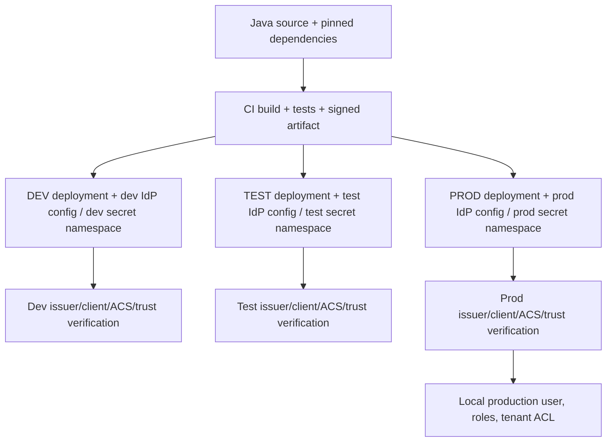

# Phân tách cấu hình IdP giữa phát triển, kiểm thử và production

## 1. Bối cảnh và kết quả mong đợi

Ứng dụng Java/Spring Security hỗ trợ **federation/SSO** không chỉ có một cấu hình `issuer-uri`. Nó liên hệ với một hoặc nhiều Identity Provider (IdP), Authorization Server (AS), SAML Asserting Party, CAS Server hoặc identity-aware gateway; mỗi môi trường phải có **trust boundary độc lập**. Nếu một bản build ở production vô tình dùng OIDC issuer, SAML certificate hoặc client secret của môi trường test, ứng dụng có thể xác thực nhầm người dùng, cấp role sai tenant, làm rò production credential hoặc gửi assertion/token đến endpoint không thuộc phạm vi được phép.

Bài thuộc nhóm **Triển khai và vận hành** của module **Spring Security – federation**. Đề mục trực tiếp: **“Phân tách cấu hình IdP giữa phát triển, kiểm thử và production”**. Các ví dụ dùng Java 17+, Spring Boot 3.x và Spring Security 6.x/6.5; phải đối chiếu với dependency BOM thực tế khi triển khai bản mới. Những URL dưới `example.test`, realm, client ID và certificate IDs là ví dụ, **không phải tài nguyên đã tồn tại**.

**Mục tiêu cuối:** cùng một ứng dụng có thể triển khai qua dev → test/staging → production nhưng mỗi deployment chỉ kết nối đến IdP, tenant/realm, credentials, issuer, audience, redirect/ACS và local authorization policy **được phê duyệt cho chính môi trường đó**. Config sai phải **thất bại có kiểm soát** thay vì âm thầm fallback.

### Sau bài học có thể

1. Lập bảng environment identity contract cho OIDC/OAuth2, SAML2, CAS, JWT Resource Server và proxy authentication.
2. Hiểu khác nhau giữa **Spring profile**, **deployment environment**, **IdP tenant/realm** và **trust anchor**.
3. Tạo `application.yml`/`application-dev.yml`/`application-test.yml`/`application-prod.yml` đúng thứ tự override, tránh profile hỗn hợp.
4. Tách hoàn toàn client secret, SAML SP private key, API credentials, IdP verification certificates và truststores.
5. Sử dụng Spring Boot Config Data, environment variables, `configtree:` và secret manager một cách an toàn.
6. Đặt OIDC `issuer-uri`, `client-id`, `redirect-uri` và audience không lẫn môi trường.
7. Đặt SAML SP Entity ID/ACS/SLO, IdP Entity ID và verification certificates theo environment.
8. Hiểu CAS service URL và CAS Server trust, chống trỏ nhầm service registry.
9. Gắn deployment guard/CI checks để chặn prod dùng test issuer/certificate hoặc dev key.
10. Thiết kế test cross-environment rejection, certificate/client-secret rotation, monitoring và rollback.

## 2. Ba môi trường không phải ba chuỗi URL

| Chiều phân tách | Development | Test/Staging | Production |
| --- | --- | --- | --- |
| IdP/AS | Local fake IdP hoặc dev tenant | Test tenant độc lập, gần production | Tenant/realm chính thức |
| OIDC issuer | `http://127.0.0.1:9080/realms/dev` | `https://idp.test.example.test/realms/test` | `https://login.example.test/realms/prod` |
| OAuth client ID | `portal-dev` | `portal-test` | `portal-prod` |
| OAuth client secret | Secret dev có thể thay nhanh | Secret test từ test vault | Production secret chỉ qua secret store prod |
| Browser callback | `http://127.0.0.1:8080/login/oauth2/code/corp` | `https://portal.test.example.test/login/oauth2/code/corp` | `https://portal.example.test/login/oauth2/code/corp` |
| SAML SP Entity ID | Dev SP entity | Test SP entity | Production SP entity |
| SAML ACS/SLO | Local URL test | Test public HTTPS URL | Production public HTTPS URL |
| IdP signing keys | Dev test keys | Test signing cert/key từ test IdP | Production IdP trust anchors |
| SP private keys | Dev-only keys | Test-only keys | Production HSM/KMS/secret mount |
| Test users/groups | Synthetic | Synthetic, được quản trị | Real production identities |
| Local roles/tenant links | Dev database | Test database | Prod IAM/database |
| Audience/Resource Server | Dev API audience | Test API audience | Prod API audience |
| Observability | Sanitized dev logs | Test metrics/traces | Locked-down production telemetry |
| Network | Loopback/test endpoints | Isolated staging networks | Strict private/public boundary |

**Tên profile giống nhau không tạo isolation.** Nếu `SPRING_PROFILES_ACTIVE=prod` nhưng `client-id=portal-test`, `issuer-uri=test` hoặc `SAML verification cert=test` vẫn lọt vào runtime qua environment-variable override, file mounted nhầm hoặc config server, đó vẫn là **cross-environment trust violation**.

**Không sử dụng production IdP users, production signing private key hay production client secret trong local development hoặc CI.** Test IdP nên có users/groups giả định đủ phản ánh production policies nhưng không dùng dữ liệu thật.

## 3. Environment, profile, registration và tenant: bốn khái niệm khác nhau

- **Environment/deployment stage:** dev, test/staging, prod; thuộc quyền phát hành và hạ tầng. Một image có thể chạy ở nhiều stage.
- **Spring profile:** tập property sources/beans được Spring Boot kích hoạt (`dev`, `test`, `prod`). Nó chỉ là **cơ chế chọn cấu hình**, không phải trust proof.
- **OIDC `registrationId` / SAML `RelyingPartyRegistration.registrationId`:** định danh một cấu hình kết nối **trong application** (`corp`, `partner`). Có thể giữ tên `corp` nhất quán qua stage, nhưng giá trị IdP thực phải khác.
- **IdP tenant/realm/issuer:** định danh security authority; tên tenant trên màn hình quản trị không thay `iss` hoặc SAML Entity ID.

Ví dụ `registrationId=corp` tồn tại ở cả dev và prod:

```text
dev profile:
    registrationId: corp
    issuer: http://127.0.0.1:9080/realms/dev
    client-id: portal-dev
    redirect: http://127.0.0.1:8080/login/oauth2/code/corp

prod profile:
    registrationId: corp
    issuer: https://login.example.test/realms/prod
    client-id: portal-prod
    redirect: https://portal.example.test/login/oauth2/code/corp
```

Đây không phải hai client của một trust domain: **cùng tên local registrationId nhưng khác issuer, client, redirect và secret**. Không lấy `registrationId` một mình làm khóa local account linking. Với OIDC, identifier ổn định là **(verified issuer, subject `sub`)**, cộng tenant/registration scope theo policy. Với SAML, dùng verified IdP Entity ID và persistent NameID/qualifiers theo profile, không tự join bằng email.

## 4. Threat model: hậu quả khi lẫn môi trường

| Sai sót | Kịch bản | Ảnh hưởng |
| --- | --- | --- |
| Production trỏ sang test OIDC issuer | Test token `iss=test` được backend prod tin | Test user truy cập prod |
| Audience/API shared giữa test và prod | Token test `aud` cũng khớp prod | Cross-environment token confusion |
| Production dùng test OAuth client secret | Secret nằm trong CI logs hoặc máy dev | Lộ credential, attacker impersonate client |
| Dev đăng ký prod callback | IdP prod redirect code vào dev host | Authorization code leakage/login confusion |
| Prod SAML SP tin test cert | Test IdP ký assertion được prod chấp nhận | Cross-environment SAML authentication |
| Test SP sử dụng production signing key | Máy CI có key thật | Mở rộng phạm vi lộ khóa |
| Wrong SP Entity ID/ACS | IdP ký Response cho service khác | Destination/Recipient mismatch, login failure |
| CAS ServiceProperties dùng prod service URL ở test | ST phát cho sai service | `INVALID_SERVICE` hoặc grant nhầm nếu registry quá rộng |
| Dùng chung session/cookie domain | Browser gửi prod session sang test | Session leakage/cross-environment confusion |
| Dùng chung user directory/roles | Test cấp `ROLE_ADMIN` trùng prod user | Privilege escalation |
| Profile `dev,prod` cùng bật | Later property source ghi đè một phần | Config lai không an toàn |
| Secret file thiếu nhưng có default dev | Production tự fallback sang dev secret | Vi phạm isolation, có thể khó phát hiện |
| JWKS prod cache dùng test key | Wrong trust anchors | Token issuer/key confusion |
| SAML metadata tự refresh từ URL chưa tin | Bên khác thay cert/EntityID | Trust-store poisoning |

**Ranh giới phải chặn bằng nhiều tầng:** deployment manifest chọn đúng stage; config properties đúng; startup guard xác nhận expected issuer/redirect/certs; validators verify từng token/response; resource authorization còn dựa local user/tenant/ACL.

## 5. Thiết kế kiến trúc “same artifact, different trusted configuration”

Một pattern tốt là xây **một artifact bất biến**, ký/scan nó và promote cùng digest giữa stages:



Không rebuild code để đưa URL prod vào source; tránh `if (prod) ...` rải rác trong controller. **Tách code khỏi config và secrets**, nhưng giữ một **environment-specific contract** không bị override từ input không tin.

Một policy deployment:

1. CI build ra image digest xác định.
2. Ký/scan dependencies, kiểm tra package/SBOM.
3. Triển khai digest đó vào dev với dev-only config/secrets.
4. Test signed SAML/OIDC/CAS flows trong staging với staging IdP.
5. Promote **cùng digest** vào prod với prod-only config/secrets đã approved.
6. App startup đọc config, validate stage/issuer/trust references; không hợp lệ thì fail startup/readiness.
7. Thực hiện smoke SSO, local permission check và health probes đúng scope.
8. Nếu xảy ra lỗi, rollback **artifact + config version** theo quy trình; không bật bypass validators.

Một image có thể dùng profile khác nhau, nhưng **secrets/certificates/IdP tenants không được tự nhân bản theo image**.

## 6. Spring Profiles và thứ tự cấu hình cần nắm

Spring Boot hỗ trợ:

- `application.yml`: cấu hình chung.
- `application-dev.yml`: chỉ cho `dev`.
- `application-test.yml`: chỉ cho `test`.
- `application-prod.yml`: chỉ cho `prod`.
- `spring.profiles.active`: kích hoạt profile.
- `spring.profiles.default`: profile mặc định khi không có active profile.
- `spring.config.activate.on-profile`: bật từng YAML document theo profile expression.
- `spring.config.import`: nhập Config Data/`configtree:`.
- Environment variables, command-line options, ConfigMaps, secret mounts và external Config Data có thể **ghi đè** file trong JAR theo quy tắc precedence.

**Không đặt `spring.profiles.active=prod` bên trong `application-prod.yml` hoặc YAML document đang được kích hoạt bởi `spring.config.activate.on-profile`.** Tài liệu Spring Boot nêu active/default profiles phải nằm trong non-profile-specific document/source. Cách vận hành an toàn là **deployment pipeline** định rõ `SPRING_PROFILES_ACTIVE=prod`, không để app tự quyết đoán môi trường từ hostname.

Không kích hoạt `dev,prod` cùng lúc: khi nhiều profiles cùng bật, nhiều property values có thể override theo thứ tự; tạo một tổ hợp issuer/secret/client-ID không tồn tại ở IdP. Thêm guard **yêu cầu đúng một stage profile** và cấm profile không mong đợi.

### Cấu hình không đồng nghĩa authorization

Bật profile `prod` không đủ: client secret/cert, issuer/audience, local tenant ACL vẫn phải verify thực sự. Cần **startup assertions** và **runtime protocol validators**, không chỉ file name.

## 7. Cấu trúc file đề xuất

```text
src/main/resources/
  application.yml
  application-dev.yml
  application-test.yml
  application-prod.yml

src/test/resources/
  application-unit.yml
  saml/
    test-idp-metadata.xml        # chỉ test public metadata/fixture
  oidc/
    test-issuer-public-jwks.json # public TEST keys only

deployment/
  dev/
    values.yaml
  test/
    values.yaml
  prod/
    values.yaml

# KHÔNG ĐƯA VÀO GIT:
# .env.production
# client-secret.txt
# saml-prod-sp-private.key
# idp-admin-password
```

Các file `deployment/*/values.yaml` chỉ chứa **tham chiếu** tới secret name/volume, không chứa giá trị secret. `application-prod.yml` không chứa private keys, refresh tokens hoặc client secret thật.

Chọn một convention cho stages: chẳng hạn `dev`, `test`, `prod`. Không cùng lúc đặt `staging` và `test` rồi vô tình khai thêm Spring profile `test` cho unit tests mà không có IdP test server. Test unit nên dùng profile riêng như `unit` hoặc test-specific overrides không gọi IdP ngoài Internet.

## 8. Cấu hình chung application.yml: không có trust secrets

Ví dụ dùng Spring Boot 3.x:

```yaml
spring:
  application:
    name: federation-portal
  profiles:
    default: none
  security:
    oauth2:
      client:
        registration:
          corp:
            provider: corp
            authorization-grant-type: authorization_code
            scope: [openid, profile, email]
            redirect-uri: "{baseUrl}/login/oauth2/code/{registrationId}"

server:
  servlet:
    session:
      cookie:
        http-only: true

management:
  endpoints:
    web:
      exposure:
        include: "health,info"
```

**Giải thích:**

- `spring.profiles.default=none` không tạo sẵn trust prod hay dev. Ứng dụng phải nhận active profile từ deployment và có runtime guard.
- Base config không chứa `issuer-uri`, `client-id`, `client-secret`: phải được cấp ở stage tương ứng.
- `redirect-uri` có thể dùng template Spring Security mặc định, nhưng vì proxy có thể làm sai scheme/host, với prod nhiều hệ thống chọn **absolute pinned redirect URI** theo contract.
- `management.endpoints...` giới hạn web exposure; vẫn cần network ACL/auth cho actuator. `/actuator/env` và `configprops` có thể lộ config nếu mở sai; không expose chúng ra public.
- `server.servlet.session.cookie.http-only` giảm JS access nhưng không thay `SameSite`/`Secure`/CSRF controls; điều chỉnh theo browser SSO bindings.

Nếu app có OAuth2 login và SAML login song song, đừng mặc định bật cả hai trong một chain mà chưa xác định login entry point/registration selection. Ví dụ tiếp theo minh họa OIDC baseline riêng; SAML là cấu hình thay thế hoặc cần chain rõ.

## 9. Development profile: local IdP, dữ liệu giả, không prod trust

`src/main/resources/application-dev.yml`:

```yaml
spring:
  security:
    oauth2:
      client:
        registration:
          corp:
            client-id: "portal-dev"
            client-secret: "${DEV_OIDC_CLIENT_SECRET}"
            redirect-uri: "http://127.0.0.1:8080/login/oauth2/code/corp"
        provider:
          corp:
            issuer-uri: "http://127.0.0.1:9080/realms/dev"

app:
  identity:
    stage: dev
    expected-oidc-issuer: "http://127.0.0.1:9080/realms/dev"
    expected-client-id: "portal-dev"
    expected-redirect-uri: "http://127.0.0.1:8080/login/oauth2/code/corp"
```

**Điều kiện:** IdP local chạy thực sự tại loopback trên port 9080; `DEV_OIDC_CLIENT_SECRET` do dev runtime cấp. Các tên `app.identity.*` là **custom application properties** dùng cho một startup guard, **không phải tự động được Spring Security kiểm tra**.

Trong development, có thể dùng HTTP **chỉ với loopback và test IdP**, không dùng làm lý do để tắt TLS verification khi kết nối dev tới hệ thống ngoài. Không dùng actual production client ID/secret hoặc production issuer để “tiện đăng nhập”.

Một lựa chọn khác là dev dùng sandbox IdP HTTPS chung của tổ chức, nhưng phải là **dev tenant**, độc lập prod, có test users và được phân quyền riêng. Nếu dev và test cùng một IdP server host, ít nhất realm/issuer, client registration, secrets và key sets phải có trust boundary phù hợp.

## 10. Test/Staging profile: IdP độc lập và callback public HTTPS

`src/main/resources/application-test.yml`:

```yaml
spring:
  security:
    oauth2:
      client:
        registration:
          corp:
            client-id: "portal-test"
            client-secret: "${TEST_OIDC_CLIENT_SECRET}"
            redirect-uri: "https://portal.test.example.test/login/oauth2/code/corp"
        provider:
          corp:
            issuer-uri: "https://idp.test.example.test/realms/test"

app:
  identity:
    stage: test
    expected-oidc-issuer: "https://idp.test.example.test/realms/test"
    expected-client-id: "portal-test"
    expected-redirect-uri: "https://portal.test.example.test/login/oauth2/code/corp"
```

Staging/Test IdP cần hỗ trợ flow tương đương production: authorization code + PKCE, client authentication, ID token signature/issuer/audience/nonce, signing key rotation, logout, group attributes và redirect rules. Nhưng:

- Dùng synthetic identities, không import production user credentials.
- Đăng ký **test callback** riêng, không add prod redirect vào test client cho “tiện”.
- Secrets lấy từ vault namespace `test`, RBAC chỉ cho deployment test.
- Token `iss` phải khác prod; audience nên phân biệt test/prod để không có cross-environment API token acceptance.
- Không reuse prod SAML SP private key hoặc IdP signing cert trong test.
- Test logs và APM cũng phải redact tokens, SAMLResponse, cookies và PII.

**Unit test** không nhất thiết khởi động test IdP thật; dùng test-specific MockMvc fixtures/MockWebServer/containers. **Staging SSO integration test** mới cần test IdP và giao thức thực.

## 11. Production profile: secret mount bắt buộc, không có dev fallback

`src/main/resources/application-prod.yml`:

```yaml
spring:
  config:
    import: "configtree:/run/secrets/identity/"

  security:
    oauth2:
      client:
        registration:
          corp:
            client-id: "portal-prod"
            client-secret: "${oidc.client-secret}"
            redirect-uri: "https://portal.example.test/login/oauth2/code/corp"
        provider:
          corp:
            issuer-uri: "https://login.example.test/realms/prod"

app:
  identity:
    stage: prod
    expected-oidc-issuer: "https://login.example.test/realms/prod"
    expected-client-id: "portal-prod"
    expected-redirect-uri: "https://portal.example.test/login/oauth2/code/corp"
```

Config Tree layout:

```text
/run/secrets/identity/
  oidc.client-secret      # file content = production OAuth client secret
```

Spring Boot `configtree:` dùng **tên file làm property key**, nên `oidc.client-secret` từ file có thể được resolve qua `${oidc.client-secret}`. Secret file cần mount **read-only**, quyền chỉ user/container được cấp, và không include newline ngoài ý muốn nếu IdP secret là exact string. Cách tên file/volume phải được kiểm chứng trong cluster thực.

**Không thêm `optional:` trước `configtree:` trong production** nếu muốn deployment từ chối thiếu secret mount. Theo Spring Boot Config Data, location thiếu không có `optional:` thường khiến startup fail (`ConfigDataLocationNotFoundException`), đáp ứng yêu cầu không silent fallback. Nếu file key cụ thể thiếu dù folder tồn tại, placeholder không resolve hoặc validation guard phải fail; đừng dùng `${oidc.client-secret:dev-secret}` làm default.

**Đừng đặt production secret trực tiếp trong YAML, Git, Helm values, image layers, Dockerfile `ARG`, CI output hoặc Actuator env endpoint**. Secret manager có thể cung cấp giá trị qua K8s Secret mount, CSI/Vault/KMS hoặc provider đã phê duyệt. Kubernetes Secret tự nó không phải đảm bảo tuyệt đối: cần RBAC, encryption at rest, audit, hạn chế pod exec và quản trị backup.

## 12. Giải thích vì sao ConfigTree không tự tạo “environment security”

`spring.config.import=configtree:/run/secrets/identity/` chỉ **nạp dữ liệu thành config properties**. Nó không chứng minh file chứa prod secret thật hoặc secret thuộc namespace prod. Nếu Helm mount nhầm `portal-test-idp-client` vào prod, Spring vẫn đọc được chuỗi và có thể client authentication thất bại — hoặc tệ hơn, do IdP/client trust sai mà login sai environment lại thành công.

Vì vậy nên thêm:

1. Deployment secret name namespace-bound (`portal-prod-idp-client`).
2. Kubernetes ServiceAccount/RBAC tối thiểu; workload identity chỉ đọc secret prod tương ứng.
3. Startup guard kiểm tra issuer, client ID, redirect/ACS, cert fingerprints và secret **reference scope**, không log giá trị secret.
4. Admission/policy-as-code chặn prod dùng secret names có `dev`/`test`.
5. CI schema check deployment manifests.
6. Runtime negative tests: dev token/SAML assertion không được prod accept.
7. Audit trail cho secret rotation/rollback.

**Secret value không được so với một chuỗi cố định trong source code**. Thay vào đó validate **secret reference/owner/version**, thử client-auth flow ở trusted AS và theo dõi kết quả từ AS; không ghi hash của secret ra logs nếu không có phê duyệt.

## 13. Spring profile precedence: những cách lẫn environment thực tế

Spring Boot sẽ nạp file profile-specific bên cạnh file base; external properties, imports và environment/command-line có quy tắc override. Những lỗi thường gặp:

```bash
# Đúng về mục tiêu, chưa chứng minh đủ trust:
SPRING_PROFILES_ACTIVE=prod java -jar federation-portal.jar

# Nguy hiểm: hai stage profiles cùng kích hoạt.
SPRING_PROFILES_ACTIVE=dev,prod java -jar federation-portal.jar

# Nguy hiểm: thêm override prod client bằng giá trị dev.
SPRING_PROFILES_ACTIVE=prod \
SPRING_SECURITY_OAUTH2_CLIENT_REGISTRATION_CORP_CLIENT_ID=portal-dev \
java -jar federation-portal.jar
```

Đây là **lệnh minh họa shell Unix**. Production deployment cần injection/secret mount theo platform. Việc set `SPRING_PROFILES_ACTIVE=prod` chỉ chọn profile, **không ngăn** một property source có priority cao hơn ghi đè issuer/client ID. Do đó dùng startup guard kiểm tra **effective properties** sau khi Spring binding thay vì chỉ đọc file YAML trong Git.

### Cạm bẫy `spring.profiles.active` trong profile-specific file

`spring.profiles.active` không được khai bên trong `application-prod.yml` hoặc document được kích hoạt bằng `spring.config.activate.on-profile` theo tài liệu Boot. Hãy đặt active profile ở **deployment configuration** và kiểm tra nó. Không dùng `spring.profiles.include=dev` không rõ nguồn khi chạy prod.

### Cạm bẫy `optional:`

`optional:configtree:/run/secrets/identity/` cho phép đường dẫn thiếu. Hợp lý cho local dev khi có fallback an toàn, nhưng trong prod dễ che lỗi secret mount nếu client-secret cũng có default yếu. Trong prod, khai nonoptional và validation bắt buộc.

## 14. OIDC: những tham số phải đi cùng một environment

| Thuộc tính | Nguồn/ý nghĩa | Điều kiện kiểm chứng |
| --- | --- | --- |
| `ClientRegistration.registrationId` | Key local, ví dụ `corp` | Chỉ map tới approved provider ở stage này |
| `client-id` | OAuth/OIDC client tại IdP | Prod có client ID prod riêng |
| `client-secret` | Credential confidential client | Secret stage-specific, không leak |
| `provider.issuer-uri` | Issuer OIDC chính thức | Match exact `iss` ID Token/Discovery |
| `authorization-uri` | Authorization endpoint | Có trong metadata của đúng issuer |
| `token-uri` | Token endpoint | HTTPS, đúng AS, trusted TLS |
| `jwk-set-uri` | Public signing keys | Nằm trong trust contract của issuer |
| `redirect-uri` | Callback client tại SP | Exact redirect URI registered ở client |
| `scope` | OIDC `openid` + attributes | Không tự cấp roles/permissions |
| `nonce` | Ràng buộc ID Token tới authentication flow | Must verify trong OIDC login |
| `state` | CSRF/correlation authorization response | Must match request/session |
| PKCE | Bảo vệ code trong flow | Sử dụng theo client/AS policy |
| Client authentication method | Basic, post, private_key_jwt... | Đúng với registration và secret/key stage |
| Logout/post-logout redirect | OIDC RP-Initiated Logout | Prod URL không lẫn test |

**Issuer là định danh an ninh, không chỉ hostname.** Ví dụ hai realms trên cùng `https://login.example.test` có issuer khác nhau. Không tự chuẩn hóa `iss` bằng cách bỏ path/cắt trailing components. Đối chiếu exact issuer string theo quy tắc OIDC của IdP.

OIDC callback mặc định với Spring Security là `/login/oauth2/code/{registrationId}`. Nếu proxy terminate TLS, `{baseUrl}` có thể bị tính sai nếu forwarded headers không được tin/strip đúng; production có thể pin explicit absolute redirect. **Không cho client khai bất kỳ `X-Forwarded-Host` rồi dùng nó tạo OAuth redirect URI**.

## 15. OIDC: đừng nhầm client secret với JWT verification key

Một OIDC client có hai loại trust material:

- `client-secret` hoặc private-key JWT credential chứng minh **ứng dụng có quyền gọi token endpoint**.
- JWK Set public keys từ IdP chứng minh **chữ ký ID Token/access JWT**.

Thay client secret không thay signing key của IdP. Đổi signing key của IdP không tự thay client secret. Hai loại rotation và scope riêng.

Production cần test cả:

1. Prod client ID + prod client credential gọi đúng token endpoint.
2. Dev/test client credentials bị prod endpoint từ chối.
3. Prod ID Token `iss` khớp configured issuer.
4. ID Token `aud` chứa đúng client ID; nonce/exp/iat và authorized party rules theo profile.
5. Access JWT `aud` chứa Resource Server/API audience, có thể khác OAuth client ID.
6. `kid` unknown dẫn đến JWKS refresh từ **approved** URI, không trust key do token tự trỏ `jku` tùy ý.
7. Key rotation có khoảng overlap an toàn; revoked key không được dùng sau policy invalidation.
8. Group/role mapping từ issuer prod không tự tin groups test có cùng string.

Một production service không nên dùng **cùng một confidential client ID/secret** cho web login và mọi backend jobs nếu có thể tách scope/roles.

## 16. JWT Resource Server: environment-specific issuer, audience và keys

Spring Boot / Spring Security 6.5 có cấu hình JWT như sau, ví dụ **chỉ cho production API**:

```yaml
spring:
  security:
    oauth2:
      resourceserver:
        jwt:
          issuer-uri: "https://login.example.test/realms/prod"
          jwk-set-uri: "https://login.example.test/realms/prod/protocol/openid-connect/certs"
          audiences: "api://orders-prod"
```

`issuer-uri` giúp verify `iss`; khai `jwk-set-uri` trực tiếp có thể tránh phụ thuộc discovery tại startup, **không bỏ issuer validation**. Theo tài liệu Spring Security 6.5, Boot cung cấp `audiences` property để verify `aud`. Với version khác, cần tự tạo audience validator tương đương.

| Environment | Issuer | Audience |
| --- | --- | --- |
| dev | `http://127.0.0.1:9080/realms/dev` | `api://orders-dev` |
| test | `https://idp.test.example.test/realms/test` | `api://orders-test` |
| prod | `https://login.example.test/realms/prod` | `api://orders-prod` |

**Cross-environment negative test:** token ký bởi dev IdP với `aud=api://orders-dev` **không được** chấp nhận ở prod, kể cả payload có email/role giống prod. Nếu dev và prod dùng chung signing key, chỉ kiểm tra chữ ký là chưa đủ; issuer/audience/stage vẫn phải match, và nên dùng signing keys độc lập.

Đừng nhầm token **ID Token** của web OIDC login với **Access Token** dành cho API. Resource Server xác minh access token theo AS/audience/scope/API policy, không tự chấp nhận ID Token chỉ vì signature đúng.

## 17. SAML2: những giá trị bắt buộc tách theo môi trường

Với SAML SP, một `RelyingPartyRegistration` biểu diễn cặp SP và IdP. Các biến chính:

| Thuộc tính | Development | Test | Production |
| --- | --- | --- | --- |
| SP Entity ID | `urn:portal:sp:dev` | `urn:portal:sp:test` | `https://portal.example.test/saml2/service-provider-metadata/corp` |
| ACS URL | Local HTTP loopback | Test HTTPS callback | Prod HTTPS callback |
| SLO URL | Dev endpoint | Test endpoint | Prod SLO endpoint |
| IdP Entity ID/Issuer | Dev IdP | Test IdP | Prod IdP |
| IdP SSO/SLO endpoints | Dev | Test | Prod |
| IdP verification certificates | Dev signing certs | Test certs | Prod certs |
| SP signing private key | Dev-only | Test-only | HSM/KMS/mounted prod secret |
| SP decryption key | Dev-only | Test-only | Separate prod decryption credential if needed |
| NameID / attribute mapping | Dev synthetic users | Test synthetic users | Prod identity link policy |
| `InResponseTo` / RelayState | Local session | Test session | Prod session, cross-site cookie policy |

**Không chỉ sửa IdP SSO URL**. Nếu SP Entity ID hoặc ACS vẫn mang test URL trong prod, IdP có thể gửi SAMLResponse không khớp `Destination`/`Recipient` hoặc đáng ngại hơn là Response đi tới nhầm host.

### Spring Boot SAML profile ví dụ

Mảnh `application-prod.yml` trong một ứng dụng SAML (tách khỏi OIDC-only ví dụ nếu không cần cả hai):

```yaml
spring:
  security:
    saml2:
      relyingparty:
        registration:
          corp:
            entity-id: "https://portal.example.test/saml2/service-provider-metadata/corp"
            acs:
              location: "https://portal.example.test/login/saml2/sso/corp"
            signing:
              credentials:
                - private-key-location: "file:/run/secrets/saml/sp-sign.key"
                  certificate-location: "file:/etc/identity/saml/sp-sign.crt"
            assertingparty:
              entity-id: "https://idp.example.test/saml/prod/entity"
              sso-url: "https://idp.example.test/saml/prod/sso"
              verification:
                credentials:
                  - certificate-location: "file:/etc/identity/saml/prod-idp-verification.crt"
```

Đây là **mảnh cấu hình minh họa**, không phải một IdP hợp lệ có thể đăng nhập ngay. Phải khai key/certificate thực, verified metadata/binding, SLO khi dùng, và đối chiếu exact Spring Boot `Saml2RelyingPartyProperties` của BOM đang chạy. IdP có thể yêu cầu signed AuthnRequests, XML encryption, NameID format/algorithms riêng; không bỏ requirement khi deploy.

Một cách khác là dùng **signed/approved IdP metadata snapshot** từ file/versioned trust artifact thay vì tải metadata internet mỗi lần. Spring Security hỗ trợ `RelyingPartyRegistrations.fromMetadataLocation(...)`; nếu dùng dynamic metadata, phải có trusted source/refresh/rollback policy. **Không lấy metadata location từ request query, untrusted host hoặc người dùng**.

## 18. SAML: tách public verification certificate và private keys

Các loại key phải phân biệt:

1. **IdP signing key private:** do IdP quản lý; SP **không bao giờ nhận private key này**.
2. **IdP verification certificate public:** SP dùng để verify XML signatures; phải ghim approved cert(s) cho đúng IdP và stage.
3. **SP signing private key:** SP dùng ký AuthnRequest/LogoutRequest/metadata khi cần; prod key chỉ ở prod secrets/HSM.
4. **SP signing certificate public:** IdP tin để verify SP-originated messages.
5. **SP decryption private key:** nếu IdP encrypt assertion cho SP, phải dùng key prod riêng; không nhầm với signing key.
6. **TLS server certificate:** dùng xác minh HTTPS của host IdP/SP, không phải thay thế XML Signature certificate.

**Cùng là “certificate” nhưng có trust purpose khác nhau.** Chứng chỉ HTTPS của `idp.example.test` không tự là IdP SAML signing cert. Cần kiểm tra metadata/metadata signature và certificate purpose.

### Rotation an toàn

- Thêm trusted **new IdP verification cert** theo approved metadata/policy trước khi IdP bắt đầu ký bằng key mới.
- Trong khoảng overlap, có thể cho cả old/new cert nếu security approval cho; không trust wildcard/unbounded keys.
- Monitor signed assertions dùng `KeyInfo`/fingerprints đã approved, không tin cert do assertion tự gợi ý nếu chưa nằm trong trust store.
- Khi IdP retire old key, loại nó khỏi trust list và phát hành config version mới.
- Với SP signing/private key, phối hợp cập nhật SP metadata với IdP; không xóa old private key trước khi partner đã biết new public key.
- Test stage phải có **rotation rehearsal** bằng test key, không phải copy key prod sang staging.
- Khi key bị compromise, revocation/incident response có thể yêu cầu **ngừng nhận ngay**, không giữ grace period bất chấp rủi ro.

Không đưa raw private key vào Java classpath JAR, GitHub Actions output, Helm chart, SAML metadata public hoặc log.

## 19. SAML cross-environment acceptance phải bị từ chối

Một test IdP có thể phát signed SAMLResponse hợp lệ cho **test SP**. Điều đó không khiến nó hợp lệ ở **production SP**:

```text
TEST:
  Issuer = urn:example:idp:test
  Recipient = https://portal.test.example.test/login/saml2/sso/corp
  Audience = urn:portal:sp:test
  signer = test IdP key

PROD:
  Issuer = urn:example:idp:prod
  Recipient = https://portal.example.test/login/saml2/sso/corp
  Audience = https://portal.example.test/saml2/service-provider-metadata/corp
  signer = prod IdP key
```

Spring OpenSAML provider phải kiểm tra **signature, issuer, audience, destination/recipient, Conditions, SubjectConfirmation, InResponseTo** và local user link, không chỉ NameID. Trong môi trường test, cố ý gửi signed TEST assertion đến PROD test endpoint **được ủy quyền** rồi assert rejection (không làm điều đó bằng production identities không có phép).

Ngay cả nếu test và prod cùng hostname của IdP nhưng khác realm, `Issuer/Entity ID` và keys cần được gắn chính xác. Không dùng **email** làm khóa xác thực xuyên môi trường khi `NameID` có thể tái cấp/đổi; dùng verified IdP + NameID/qualifiers + local mapping.

## 20. CAS: service URL và CAS server trust theo stage

Spring Security CAS client thường dùng:

- `CasAuthenticationEntryPoint.loginUrl` → CAS Server `/login`.
- `ServiceProperties.service` → public SP login processing URL, ví dụ `https://portal.example.test/login/cas`.
- `Cas20ServiceTicketValidator` → CAS Server `/serviceValidate`.
- `CasAuthenticationFilter` → xử lý query `ticket` tại `/login/cas`.
- Local `UserDetailsService`/`CasAuthenticationProvider` → cấp local roles.

Environment matrix:

| Stage | CAS Server | ServiceProperties.service |
| --- | --- | --- |
| dev | `http://127.0.0.1:8443/cas` (giả định local) | `http://127.0.0.1:8080/login/cas` |
| test | `https://cas.test.example.test/cas` | `https://portal.test.example.test/login/cas` |
| prod | `https://cas.example.test/cas` | `https://portal.example.test/login/cas` |

**ST gắn với `service` cụ thể và chỉ hợp lệ một lần validate.** Test ST cho test service không được production CAS/SP chấp nhận. Nếu config prod `ServiceProperties.service` trỏ nhầm test callback, CAS thường trả `INVALID_SERVICE` hoặc người dùng bị redirect vòng lặp.

Đừng dùng test CAS Server để xác minh prod credentials hoặc tự bật anonymous auth nếu CAS prod timeout. Giới hạn registry URL patterns theo exact service, không tạo wildcard `.*` cho mọi environment. Khi TLS terminate ở proxy, pin public service URL và strip/overwrite `Forwarded` headers.

## 21. Kerberos và proxy pre-auth cũng cần isolation

Một hệ thống federation có thể dùng Kerberos/SPNEGO hoặc IdP-aware proxy:

**Kerberos:**

- Dev/test dùng Kerberos realm/test KDC/HTTP service principal khác prod khi khả thi.
- Test keytab không chứa production service key.
- Production `HTTP/portal.example.test@REALM` không được thay bằng test `HTTP/portal.test.example.test@TEST.REALM`.
- Principal/domain group mapping sang local roles phải thuộc đúng realm.
- Khi keytab sai/KDC lỗi, không nhận raw username header như fallback.

**Proxy pre-auth:**

- Production edge gateway dùng prod OIDC/SAML client riêng, prod trust certificates.
- Backend không reachable public trực tiếp; dùng mTLS/workload identity/firewall/NetworkPolicy.
- Edge strip client-controlled `X-Verified-User`, `X-Auth-User`, `SM_USER` trước khi đặt verified header.
- Test gateway không được chèn danh tính vào production backend.
- Auth service down ⇒ fail closed, không forward nguyên user header từ client.
- Không dùng chung shared session encryption keys giữa dev/test/prod trừ ngoại lệ đã đánh giá chặt chẽ; cookie domains khác nhau.

**`@Profile("dev")` trên một fake authentication bean cần bảo vệ bằng guard không thể bật trong production.** Nếu prod vô tình có `dev,prod` active, một bean “always allow test users” có thể phá hủy toàn bộ isolation.

## 22. SecurityFilterChain cho OIDC login, không trộn fake dev provider vào prod

Một cấu hình Spring Security Servlet tối thiểu:

```java
@Configuration
class WebSecurityConfiguration {

    @Bean
    SecurityFilterChain web(HttpSecurity http) throws Exception {
        return http
                .authorizeHttpRequests(auth -> auth
                        .requestMatchers("/", "/error", "/health")
                            .permitAll()
                        .anyRequest().authenticated())
                .oauth2Login(Customizer.withDefaults())
                .build();
    }
}
```

Đây là **mảnh Java 17+ cần imports và ClientRegistrationRepository**. `.oauth2Login()` chỉ định flow OIDC/OAuth login; runtime config `spring.security.oauth2.client.registration.corp` và `provider.corp.issuer-uri` sẽ được binding theo profile. Nó **không tự kiểm tra** `dev/test/prod` issuer separation nếu config bị override nhầm.

Khi một app còn có JWT Resource Server API, nên tách `SecurityFilterChain` bằng `securityMatcher("/api/**")` và `@Order`; API Bearer token không được nhận web ID Token/session theo ngụ ý. Nếu có SAML2/RP nữa, chọn entry points và routes rõ, không để method security bypass giữa auth mechanisms.

**Không đặt**:

```java
// PHẢN VÍ DỤ: production không được phụ thuộc trên bất kỳ cờ debug nào.
if (environment.acceptsProfiles(Profiles.of("dev"))) {
    return anyUserAsAdmin();
}
```

Thay vì lập “dev bypass mode” trong prod artifact, dùng **test fixture trong test scope** hoặc local IdP test thực, và guard cấm active profiles bất hợp lệ.

## 23. Startup guard: kiểm tra effective properties, không chỉ tên file

Vì environment variables/Helm/command line có thể override cấu hình, một startup guard cần nhìn **effective bound properties**:

```text
Deploy declares stage=prod
  |
  v
Read effective OIDC issuer / client ID / redirect
Read effective SAML IdP Entity ID / ACS / signing + verification refs
Read active Spring Profiles and secret namespace/ref scope
  |
  v
Compare against approved production contract
  |-- mismatch --> Fail startup / not ready; alert
  |
  v
Initialize SSO trusted providers and serve traffic
```

Không cần hardcode production secret trong Java. Có thể pin approved **issuer/redirect/client ID/IdP Entity ID/cert reference IDs** từ signed deployment manifest, policy-as-code hoặc startup guard variables. Nhưng để ngăn một attacker chỉnh cả “actual config” lẫn “expected config” trong cùng secret mount, expected contract nên được quản trị bởi **nguồn/role khác** và có kiểm soát phê duyệt.

Spring Boot hỗ trợ `@ConfigurationProperties` và `@Validated` (với Jakarta Bean Validation dependency). Ví dụ **mảnh thiết kế**:

```java
@ConfigurationProperties(prefix = "app.identity")
@Validated
public record IdentityEnvironmentProperties(
        @NotBlank String stage,
        @NotBlank String expectedOidcIssuer,
        @NotBlank String expectedClientId,
        @NotBlank String expectedRedirectUri) {
}
```

Muốn kiểm chứng sâu, tạo Spring `@Bean` từ `SmartInitializingSingleton`/component startup validator lấy `ClientRegistrationRepository`, `RelyingPartyRegistrationRepository` và expected deployment contract. Nếu mismatch, throw configuration exception trước khi app sẵn sàng. **`@NotBlank` chỉ kiểm tra thiếu value, không chứng minh issuer đúng stage**; phải thêm policy validator thật.

Không log client-secret, private key hoặc raw IdP metadata có PII. Chỉ log stage, approved issuer alias/client ID nếu được phép, public cert fingerprint và config revision.

## 24. Java 17 độc lập: policy kiểm tra đúng môi trường

Chương trình dưới đây **không cần Spring, IdP, Internet hay thư viện ngoài**. Nó mô phỏng **startup environment invariant** bằng danh sách contracts được phê duyệt. Tên `secretRef`/`certRef` chỉ là **ID tham chiếu**, không chứa secret/certificate bytes. Ở production, lấy approved contract từ một nguồn được quản trị độc lập với config runtime.

File `IdpEnvironmentIsolationDemo.java`:

```java
import java.util.Locale;

public final class IdpEnvironmentIsolationDemo {

    enum Stage {
        DEV, TEST, PROD
    }

    enum Decision {
        PASS,
        DENY_STAGE,
        DENY_SECRET_REF,
        DENY_SECRET_SCOPE,
        DENY_TLS,
        DENY_OIDC_ISSUER,
        DENY_REDIRECT_URI,
        DENY_CLIENT_ID,
        DENY_SAML_ISSUER,
        DENY_SAML_ACS,
        DENY_CERT_SET
    }

    record Spec(
            String issuer, String redirect, String clientId,
            String samlIssuer, String samlAcs, String certRef) {
    }

    record IdpConfig(
            Stage stage, String oidcIssuer, String redirect,
            String clientId, String secretRef, String samlIssuer,
            String samlAcs, String certRef) {

        IdpConfig withIssuer(String next) {
            return new IdpConfig(stage, next, redirect,
                    clientId, secretRef, samlIssuer, samlAcs, certRef);
        }

        IdpConfig withRedirect(String next) {
            return new IdpConfig(stage, oidcIssuer, next,
                    clientId, secretRef, samlIssuer, samlAcs, certRef);
        }

        IdpConfig withSecretRef(String next) {
            return new IdpConfig(stage, oidcIssuer, redirect,
                    clientId, next, samlIssuer, samlAcs, certRef);
        }

        IdpConfig withSamlIssuer(String next) {
            return new IdpConfig(stage, oidcIssuer, redirect,
                    clientId, secretRef, next, samlAcs, certRef);
        }

        IdpConfig withSamlAcs(String next) {
            return new IdpConfig(stage, oidcIssuer, redirect,
                    clientId, secretRef, samlIssuer, next, certRef);
        }

        IdpConfig withCertRef(String next) {
            return new IdpConfig(stage, oidcIssuer, redirect,
                    clientId, secretRef, samlIssuer, samlAcs, next);
        }

        IdpConfig withClientId(String next) {
            return new IdpConfig(stage, oidcIssuer, redirect,
                    next, secretRef, samlIssuer, samlAcs, certRef);
        }
    }

    static Spec approved(Stage stage) {
        return switch (stage) {
            case DEV -> new Spec(
                    "http://127.0.0.1:9080/realms/dev",
                    "http://127.0.0.1:8080/login/oauth2/code/corp",
                    "portal-dev",
                    "urn:example:idp:dev",
                    "http://127.0.0.1:8080/login/saml2/sso/corp",
                    "ref:dev/saml-verification");
            case TEST -> new Spec(
                    "https://idp.test.example.test/realms/test",
                    "https://portal.test.example.test/login/oauth2/code/corp",
                    "portal-test",
                    "urn:example:idp:test",
                    "https://portal.test.example.test/login/saml2/sso/corp",
                    "ref:test/saml-verification");
            case PROD -> new Spec(
                    "https://login.example.test/realms/prod",
                    "https://portal.example.test/login/oauth2/code/corp",
                    "portal-prod",
                    "urn:example:idp:prod",
                    "https://portal.example.test/login/saml2/sso/corp",
                    "ref:prod/saml-verification");
        };
    }

    static IdpConfig configFor(Stage stage) {
        Spec spec = approved(stage);
        String scope = stage.name().toLowerCase(Locale.ROOT);
        return new IdpConfig(stage, spec.issuer(), spec.redirect(),
                spec.clientId(), "ref:" + scope + "/oidc-client",
                spec.samlIssuer(), spec.samlAcs(), spec.certRef());
    }

    static Decision check(Stage deployedStage, IdpConfig actual) {
        if (deployedStage == null || actual == null
                || actual.stage() != deployedStage) {
            return Decision.DENY_STAGE;
        }
        if (actual.secretRef() == null
                || actual.secretRef().isBlank()) {
            return Decision.DENY_SECRET_REF;
        }

        String scope = "ref:"
                + deployedStage.name().toLowerCase(Locale.ROOT) + "/";
        if (!actual.secretRef().startsWith(scope)) {
            return Decision.DENY_SECRET_SCOPE;
        }

        if (deployedStage == Stage.PROD
                && (!actual.oidcIssuer().startsWith("https://")
                    || !actual.redirect().startsWith("https://")
                    || !actual.samlAcs().startsWith("https://"))) {
            return Decision.DENY_TLS;
        }

        Spec expected = approved(deployedStage);
        if (!expected.issuer().equals(actual.oidcIssuer())) {
            return Decision.DENY_OIDC_ISSUER;
        }
        if (!expected.redirect().equals(actual.redirect())) {
            return Decision.DENY_REDIRECT_URI;
        }
        if (!expected.clientId().equals(actual.clientId())) {
            return Decision.DENY_CLIENT_ID;
        }
        if (!expected.samlIssuer().equals(actual.samlIssuer())) {
            return Decision.DENY_SAML_ISSUER;
        }
        if (!expected.samlAcs().equals(actual.samlAcs())) {
            return Decision.DENY_SAML_ACS;
        }
        if (!expected.certRef().equals(actual.certRef())) {
            return Decision.DENY_CERT_SET;
        }
        return Decision.PASS;
    }

    public static void main(String[] args) {
        IdpConfig dev = configFor(Stage.DEV);
        IdpConfig test = configFor(Stage.TEST);
        IdpConfig prod = configFor(Stage.PROD);

        System.out.println("devOnDev="
                + check(Stage.DEV, dev));
        System.out.println("testOnTest="
                + check(Stage.TEST, test));
        System.out.println("prodOnProd="
                + check(Stage.PROD, prod));
        System.out.println("devConfigOnProd="
                + check(Stage.PROD, dev));
        System.out.println("testIssuerOnProd="
                + check(Stage.PROD, prod.withIssuer(
                        approved(Stage.TEST).issuer())));
        System.out.println("testRedirectOnProd="
                + check(Stage.PROD, prod.withRedirect(
                        approved(Stage.TEST).redirect())));
        System.out.println("testSecretOnProd="
                + check(Stage.PROD, prod.withSecretRef(
                        "ref:test/oidc-client")));
        System.out.println("missingSecretOnProd="
                + check(Stage.PROD, prod.withSecretRef("")));
        System.out.println("httpIssuerOnProd="
                + check(Stage.PROD, prod.withIssuer(
                        "http://login.example.test/realms/prod")));
        System.out.println("testClientIdOnProd="
                + check(Stage.PROD, prod.withClientId("portal-test")));
        System.out.println("testSamlIssuerOnProd="
                + check(Stage.PROD, prod.withSamlIssuer(
                        approved(Stage.TEST).samlIssuer())));
        System.out.println("testAcsOnProd="
                + check(Stage.PROD, prod.withSamlAcs(
                        approved(Stage.TEST).samlAcs())));
        System.out.println("testCertOnProd="
                + check(Stage.PROD, prod.withCertRef(
                        approved(Stage.TEST).certRef())));
    }
}
```

Chạy với JDK 17+:

```bash
javac IdpEnvironmentIsolationDemo.java
java IdpEnvironmentIsolationDemo
```

**Stdout chính xác:**

```text
devOnDev=PASS
testOnTest=PASS
prodOnProd=PASS
devConfigOnProd=DENY_STAGE
testIssuerOnProd=DENY_OIDC_ISSUER
testRedirectOnProd=DENY_REDIRECT_URI
testSecretOnProd=DENY_SECRET_SCOPE
missingSecretOnProd=DENY_SECRET_REF
httpIssuerOnProd=DENY_TLS
testClientIdOnProd=DENY_CLIENT_ID
testSamlIssuerOnProd=DENY_SAML_ISSUER
testAcsOnProd=DENY_SAML_ACS
testCertOnProd=DENY_CERT_SET
```

### Bản chất và giới hạn của demo

- `Stage.PROD` là **trusted deployment stage do infrastructure định nghĩa**, không đến từ browser query/cookie.
- `approved(Stage.PROD)` mô phỏng contract do security/release team quản trị. Trong production, cần approved config store/policy và chứng minh người sửa deployed properties **không tự ý sửa được approved contract**.
- `secretRef` chỉ là **tên tham chiếu**, không được coi là kiểm tra bí mật tồn tại/đúng owner/đúng nội dung. Triển khai thật cần secret-store RBAC và client authentication với AS.
- `certRef` chỉ là một approved ID, **không tự verify chữ ký SAML**. Runtime phải load đúng certificate bytes và kiểm tra fingerprint/trust chain theo policy.
- Không có HTTP, JWT, SAML XML hoặc session trong demo, nên **không thay** tests integration của Spring Security.
- Việc so `https://` bằng chuỗi chỉ là guard đơn giản; production cần URI parser/allowlist và strict TLS/hostname verification đầy đủ.
- Nếu application không dùng SAML, bỏ các trường SAML khỏi contract; không ép cấu hình SAML giả chỉ để qua test.

## 25. Test startup configuration với Spring Boot và effective properties

Các test cần kiểm tra **đường nạp config thật**, không chỉ một Map do test tự tạo:

1. Bật profile `dev`, đọc `ClientRegistrationRepository` hoặc bound config, assert issuer/client/redirect đều dev.
2. Bật profile `test`, assert không có production client ID/secret/cert references.
3. Bật profile `prod` với đúng secret mounts test, assert issuer/redirect/audience/cert references prod.
4. Bật profile `dev,prod`, assert startup guard **từ chối**, không chọn cấu hình theo last-wins.
5. Prod mount thiếu secret ⇒ startup fail, không tự chèn default.
6. Prod có `OIDC_CLIENT_SECRET` từ dev namespace ⇒ rejected bởi policy/secret scope.
7. Prod có command-line `--spring.security.oauth2.client.registration.corp.client-id=portal-dev` ⇒ rejected.
8. Prod có `provider.corp.issuer-uri` là dev/test ⇒ rejected.
9. Prod resource-server `audiences` bằng test audience ⇒ rejected.
10. Prod SAML IdP cert reference bằng test ⇒ rejected.

`ApplicationContextRunner` (Spring Boot Test) hoặc `@SpringBootTest(properties=...)` giúp kiểm tra context behavior; với profile-specific Config Data, nên dùng integration startup test thật để đảm bảo profile activation/load order đúng. **`@TestPropertySource` không mô phỏng toàn bộ config data precedence một cách mặc nhiên** và không tự làm tải remote IdP hợp lệ.

Ví dụ một **mảnh JUnit assertion**:

```java
assertEquals("prod",
        environment.getProperty("app.identity.stage"));
assertEquals("https://login.example.test/realms/prod",
        environment.getProperty(
          "spring.security.oauth2.client.provider.corp.issuer-uri"));
```

Những dòng này **chưa tự chứng minh issuer runtime** nếu một custom `ClientRegistrationRepository` đã override Boot properties. Có thể cần inspect các beans `ClientRegistration` hoặc `RelyingPartyRegistration` được dùng thật. Khi dùng dynamic registration DB, verify approved registrations từ repository **không chỉ YAML**.

## 26. E2E negative tests: token/test assertion không được production tin

Một testing matrix định hướng deployment:

| Case | Input/hành động | Prod expected |
| --- | --- | --- |
| O1 | Access token được dev AS ký, `iss=dev` | Reject |
| O2 | Access token test `aud=api://orders-test` | Reject |
| O3 | ID Token từ test IdP dùng ở prod callback | Reject issuer/audience/state |
| O4 | `code` từ test authorization endpoint dùng prod `/token` | Reject |
| O5 | `redirect_uri` test được đăng ký nhầm cho prod client | Policy/config QA fail |
| O6 | Prod token ký đúng nhưng `exp` quá hạn | Reject |
| O7 | JWT unknown `kid`/key từ test JWK Set | Reject |
| O8 | JWT `iss=prod` nhưng ký bằng test key | Reject |
| S1 | SAMLResponse test IdP gửi prod ACS | Reject signing cert/issuer/recipient/audience |
| S2 | SAMLResponse có test Recipient URL | Reject |
| S3 | SAMLResponse có test SP Entity ID trong Audience | Reject |
| S4 | Test SP signing key được mount vào prod | Startup/deployment policy fail |
| S5 | Test IdP certificate xuất hiện trong prod trust set | QA/security approval fail |
| S6 | Prod IdP signed Response nhưng `InResponseTo` không khớp | Reject |
| C1 | CAS ST phát cho test service, validate ở prod | `INVALID_SERVICE`/invalid, no principal |
| C2 | CAS client prod trỏ test CAS Server | Startup policy fail |
| P1 | Test gateway header `X-Verified-User` vào prod backend trực tiếp | Network deny |
| P2 | Gateway auth endpoint down, client tự gửi username header | Deny |
| U1 | Cùng email giữa dev/test/prod IdPs | Không cross-link local account |
| U2 | Test group `admins` cùng tên prod group | Không auto cấp production admin |
| R1 | Rotation prod client secret | Test secret không còn hợp lệ |
| R2 | Rollback old deployment image | Vẫn dùng **prod** trust config, không được import test |

**Không thực hiện các negative tests trên production users hoặc production accounts không được ủy quyền.** Dùng canary/prod sandbox/test identities được phê duyệt, signed test fixtures và test routes phù hợp. Thử gửi assertion cross-environment phải được thực hiện trong phạm vi security test được phép.

## 27. CI/CD policy gates chặn config lẫn môi trường

Nên có **hai loại gate**:

### Static/deployment checks

- `application-prod.yml` không chứa `http://127.0.0.1`, `localhost`, `idp.test` hoặc client ID `*-dev`.
- Không có file `*.key`, `.env.production`, client secret value trong repository/artefact image.
- `SPRING_PROFILES_ACTIVE` đúng một stage; reject `dev,prod`.
- ConfigMap prod không tham chiếu Secret dev/test.
- TLS issuer/JWKS/IdP metadata URI phải ở approved host/issuer allowlist.
- Prod redirect/ACS/SLO/Entity ID phải khớp approved registration.
- K8s ServiceAccount chỉ có RBAC cần thiết; namespace/team ownership đúng.
- Image digest/tag là bản đã qua test, không dùng mutable `latest`.
- Dependencies được scan và version pinned theo BOM/SBOM.

### Runtime/contract checks

- Bootstrap actual config, validate expected issuer/client/redirect/ACS/certs.
- OIDC discovery metadata `issuer` khớp configured issuer, không chỉ HTTP 200.
- JWKS keys đến từ approved URL và audience/issuer validators bật.
- SAML Response từ test signer bị prod reject.
- CAS service URL/test ST sai không tạo authentication.
- Test user thiếu local role/tenant không vào protected resource.
- Negative login test không được trả data dù IdP timeout.
- Rotation/rollback test không làm chấp nhận old revoked cert hoặc dev secret.

**Policy file phải được review độc lập.** Một CI script kiểm tra literal `example.test` trong tài liệu chỉ là syntax/static check; deployment thật cần approved domain inventory và trust reference values.

## 28. Kubernetes ví dụ: stage, secret mount và immutable image

Trích đoạn Deployment **minh họa**, thiếu service/network policy/RBAC/health/image digest thật:

```yaml
apiVersion: apps/v1
kind: Deployment
metadata:
  name: federation-portal
  namespace: portal-prod
spec:
  replicas: 2
  selector:
    matchLabels:
      app: federation-portal
  template:
    metadata:
      labels:
        app: federation-portal
        environment: prod
    spec:
      serviceAccountName: portal-prod
      containers:
        - name: app
          image: "registry.example.test/portal@sha256:REPLACE_WITH_APPROVED_DIGEST"
          env:
            - name: SPRING_PROFILES_ACTIVE
              value: "prod"
            - name: DEPLOYMENT_STAGE
              value: "prod"
          volumeMounts:
            - name: oidc-client
              mountPath: /run/secrets/identity
              readOnly: true
      volumes:
        - name: oidc-client
          secret:
            secretName: portal-prod-idp-client
            items:
              - key: client-secret
                path: oidc.client-secret
```

**Không coi manifest này là runnable trước khi thay image digest, secrets, trusted TLS endpoints và security contexts**. Bảo đảm K8s Secret `portal-prod-idp-client` nằm trong namespace prod và chỉ được quản lý qua secret pipeline, không copy từ namespace test. K8s ConfigMap và Secret có update semantics riêng; một env var từ Secret thường không tự cập nhật trong process, mounted file có thể được kubelet cập nhật với độ trễ, nhưng Spring application **không tự reload client registrations/secrets** trừ khi có cơ chế refresh chủ động.

Với prod SAML private keys, mount volume riêng, read-only và kiểm soát file permissions. Cân nhắc HSM/KMS nếu compliance yêu cầu; không coi “file trong pod” tự động là HSM-backed key.

### NetworkPolicy và egress

- Dev pods không được truy cập prod IdP admin APIs hoặc prod secrets.
- Prod pods chỉ được gọi allowlisted prod IdP/AS/CAS/JWKS endpoints.
- Backend chỉ nhận traffic từ trusted ingress/workloads.
- DNS egress, service mesh sidecars và certificate stores phải dùng approved config.
- Không dùng một default egress proxy có thể chuyển IdP requests tới test URL mà không bị phát hiện.

NetworkPolicy của Kubernetes (với CNI hỗ trợ enforcement) chỉ kiểm soát network flows; nó **không xác minh issuer/audience/signature**. Cần đồng thời network restrictions và application trust checks.

## 29. Reverse proxy và callback URLs khi chuyển từ test sang prod

Browser-facing URL thường qua reverse proxy:

```text
Public:   https://portal.example.test
Ingress:  TLS termination
Backend:  http://portal-service:8080
OIDC callback: https://portal.example.test/login/oauth2/code/corp
SAML ACS:      https://portal.example.test/login/saml2/sso/corp
```

Nếu Spring tự xây `{baseUrl}` từ `http://portal-service:8080`, IdP có thể reject redirect URI, hoặc SAML `Recipient/Destination` mismatch. Có hai hướng:

1. **Pin absolute production callback/ACS URLs** trong approved environment config.
2. Nếu dùng dynamic baseUrl, configure trusted `Forwarded`/`X-Forwarded-*` processing đúng, public gateway phải strip các forwarded headers do client gửi và đặt giá trị đã tin.

Không nới IdP redirect allowlist thành wildcard `https://*.example.test/*` để chữa callback mismatch. Với OIDC, exact redirect URI registration là một boundary chống redirect/code leakage. Với SAML, SP Entity ID, ACS và IdP trust phải match; không tắt `Destination`/`Recipient` validator để login “xong”.

## 30. IdP metadata discovery: online và offline trust snapshots

### OIDC discovery

`provider.corp.issuer-uri` có thể dùng OIDC discovery lấy authorization/token/JWKS endpoints. SP phải verify metadata `issuer` khớp giá trị đã cấu hình; **không nhận arbitrary discovery URL từ client input**. Có thể pre-provision endpoints để giảm phụ thuộc IdP lúc startup, nhưng phải cập nhật/rotate theo approved policy.

### SAML metadata

`RelyingPartyRegistrations.fromMetadataLocation(...)` có thể lấy IdP metadata. Metadata từ prod IdP phải được approve; nếu metadata URL down:

- Nếu có trusted snapshot còn hiệu lực và policy cho phép, SP có thể verify SAML locally.
- Nếu không có trust anchors hoặc signer key mới chưa được approve, phải deny.
- Không tự chọn certificate từ `KeyInfo` của SAMLResponse browser gửi.
- Không vô hiệu issuer/destination/recipient/audience/subject confirmation.

### JWT JWKS

Khi `JwtDecoder` đã có trusted cached key, có thể verify JWT còn hạn khi JWKS endpoint tạm unavailable, tùy revocation policy. **Unknown `kid` + JWKS down phải reject**, không lấy key của issuer khác hoặc chọn random cached key. Cache là **cơ chế hiệu năng/khả dụng**, không tạo một trust domain chung giữa test và prod.

### CAS

CAS ST validation thường cần online call để check TTL, single-use và service binding. Không cache kết quả `ST-...` thành “login credential có thể dùng lại” khi CAS down.

## 31. User provisioning và roles phải tách database/tenant

Sự cố nguy hiểm không chỉ ở IdP credentials. Nếu test và prod cùng dùng bảng local user-role/tenant, SSO đã được verify vẫn có thể tạo quyền sai.

Một mapping tốt:

```text
verified protocol identity:
    OIDC: (iss, sub)
    SAML: (verified IdP Entity ID, persistent NameID + qualifiers)
    CAS: (approved CAS server, validated principal)
    Kerberos: (approved realm, service principal, principal)

    -> local identity link scoped to environment/tenant
    -> active user account
    -> local roles/entitlements
    -> resource ownership/ACL
    -> allow/deny
```

**Không dùng email làm khóa duy nhất xuyên environments.** Email có thể đổi, tái cấp hoặc trùng ở test/prod. Các nhóm IdP như `admins`, `developers`, `engineering` có thể cùng tên nhưng quyền application khác nhau. Chỉ map verified attributes/groups bằng allowlist theo issuer/registration, và kết hợp local authorization.

Tách audit database hoặc ít nhất environment namespace rõ; ưu tiên **database/cluster độc lập** cho prod. Không cho test workflow có quyền sửa prod group mappings hay account links.

## 32. Secret lifecycle: cấp phát, phát hiện lộ, rotate và thu hồi

Những secret/certificate cần quản lý riêng theo stage:

- OAuth confidential client secret / private_key_jwt signing credential.
- OIDC application session encryption/signing keys.
- SAML SP signing/decryption private keys.
- CAS service credentials/truststore và Kerberos keytabs.
- TLS/mTLS client keys, secret manager access tokens.
- IdP metadata verification trust anchors (public certs, nhưng phải approve).
- Resource Server JWK trust configuration (public, nhưng không tự trust toàn bộ).
- Admin API credentials dùng provisioning và SCIM.

**Rotation có hai phía:**

1. AS/IdP admin thay secret hoặc public signing cert/key.
2. Application/deployment cập nhật runtime reference, tải đúng version, recycle/refresh clients, verify login/validation, rồi thu hồi old key đúng lịch.

Với OAuth client secret rotation, một số IdPs hỗ trợ **overlap nhiều secrets**, một số chỉ cho một secret. Không giả định có overlap. Khi old secret bị revoke, một release rollback cũ **không được** phục hồi secret đã lộ. Cần quy trình coordinated secret rotation + deployment rollback.

Với SAML signing cert rotation, test metadata/partner acceptance trước khi cutover. Với IdP verification certs, trust đúng old/new trong overlap approved; khi old key compromised thì khác quy trình bảo trì thông thường.

**Không để dev/test có quyền đọc prod secret** ngay cả khi app image giống nhau.

## 33. Rollback: phục hồi artifact nhưng không hạ trust policy

Một deployment lỗi sau khi rotate IdP signing key có thể khiến operator muốn rollback image. Phải phân biệt:

- Rollback application binary.
- Rollback Spring Boot config version.
- Rollback approved IdP metadata/cert set.
- Rollback/rotate client secret.
- Rollback local identity/role mapping.
- Rollback network routing.

**Không rollback toàn bộ trust state về key đã bị compromise/revoked chỉ để login lại**. Nếu old application không hiểu new trust/cert format, cần patch/forward-fix có kiểm soát hoặc bảo vệ traffic, không bật signature verification bypass.

Smoke tests sau rollback:

- Prod OIDC issuer/client/redirect vẫn đúng.
- Prod SAML cert trust đúng với active IdP signing keys.
- Test IdP tokens/assertions vẫn bị reject.
- Session integrity và step-up policy không bị nới lỏng.
- No credentials in logs.
- Health/readiness không gây restart loop khi IdP chỉ tạm outage.

## 34. Monitoring: ghi public identifiers, không lộ secrets

Một log startup an toàn:

```text
environment=prod
activeProfile=prod
idpAlias=corp
oidcIssuer=https://login.example.test/realms/prod
oauthClientId=portal-prod
redirectHost=portal.example.test
samlIdpAlias=prod-saml
verificationCertFingerprint=sha256:TRUNCATED_APPROVED_VALUE
configRevision=release-2026-11-07
secretValue=REDACTED
status=READY
```

Các giá trị fingerprint và version ở ví dụ là placeholder; production không được in certificate chain/raw private key. Logging full OAuth client registration có thể lộ client secret; **cấm log `ClientRegistration.toString()` hoặc raw `Environment` nếu không xác minh redaction**.

Metrics theo stage/issuer alias (không raw tokens/users):

- `federation_config_validation_total{stage, result}`.
- `federation_idp_login_total{stage, provider, result}`.
- `federation_token_validation_failure_total{reason="issuer|audience|signature|time"}`.
- `federation_saml_validation_failure_total{reason="issuer|destination|recipient|cert"}`.
- `federation_jwks_cache_result_total{result="hit|miss"}`.
- `federation_redirect_mismatch_total`.
- `federation_secret_rotation_event_total`.
- `federation_cross_environment_rejection_total`.

Không dùng raw `sub`/NameID, SAMLResponse, Bearer, client secret, session cookie hoặc authorization code làm metric label.

## 35. Liveness/readiness và IdP availability

Một câu hỏi vận hành thực tế: **IdP đang down có nên khiến mọi pod bị restart liên tục không?**

- **Liveness:** ứng dụng còn chạy được và không deadlock. Nếu IdP tạm unavailable, liveness thường **không** nên fail chỉ vì remote service down; restart loop có thể làm outage nặng hơn.
- **Readiness:** ứng dụng có thể phục vụ workload theo product security contract. Nếu mọi request cần online IdP, readiness có thể bị ảnh hưởng; nếu app còn existing sessions hoặc JWT local verification, không nhất thiết mọi endpoint đều unavailable.
- **Startup guard:** config sai issuer/client/cert/secret mount là lỗi cấu hình không thể tự chữa bằng retry login; **fail startup** hoặc không ready.
- **Remote IdP outage:** cần alert/bounded retries/circuit breaker và error handling fail closed; không tự dùng test IdP làm failover mặc định.

Hệ thống HA nếu có **disaster recovery IdP** phải có issuer/trust relationship được phê duyệt trước. Không coi "fallback từ prod issuer sang test issuer" là HA; đó là **đổi security authority**.

## 36. Ma trận kiểm thử CI/CD và security regression

| ID | Tình huống | Kỳ vọng |
| --- | --- | --- |
| E01 | Dev profile với dev IdP đúng | Pass |
| E02 | Test profile với test IdP đúng | Pass |
| E03 | Prod profile với prod IdP đúng | Pass |
| E04 | Không active stage profile | Startup guard fail |
| E05 | `dev,prod` cùng active | Fail config |
| E06 | Prod thiếu `/run/secrets/identity/` | Fail config, không default dev |
| E07 | Prod `client-id=portal-dev` | Fail guard |
| E08 | Prod `issuer-uri=test` | Fail guard |
| E09 | Prod `redirect-uri=portal.test` | Fail guard |
| E10 | Prod `client-secret` từ test namespace | Fail admission/secret policy |
| E11 | Prod `audiences=api://orders-test` | Fail guard/token validation |
| E12 | Test JWT ký bởi test key vào prod | Reject |
| E13 | JWT `iss=prod` nhưng key unknown/test | Reject |
| E14 | JWT prod đúng signature nhưng wrong audience | Reject |
| E15 | Prod ID Token `aud=portal-test` | Reject |
| E16 | OIDC authorization code bị gửi sang callback stage khác | Reject |
| E17 | OIDC `state` hoặc nonce không khớp | Reject |
| E18 | Prod SAML trust test IdP cert | Fail guard |
| E19 | Test SAMLResponse gửi prod ACS | Reject |
| E20 | SAML `Recipient` test, `Audience` prod | Reject |
| E21 | Prod SAML SP private key nằm trong test image | Fail artifact scan |
| E22 | Prod SP Entity ID/ACS/SLO sai stage | Fail config/login |
| E23 | SAML issuer correct nhưng XML Signature invalid | Reject |
| E24 | CAS ST test service sang prod CAS/SP | Reject |
| E25 | CAS `ServiceProperties.service` trỏ test | Fail guard |
| E26 | Kerberos test keytab trong prod | Fail deployment policy |
| E27 | Fake dev auth provider enabled ở prod | Fail bean/profile guard |
| E28 | Proxy auth down + forged `X-Verified-User` | Deny |
| E29 | Prod JWKS cache miss với test key | Reject |
| E30 | Prod JWKS down nhưng K1 trusted cached | Validate locally nếu policy cho |
| E31 | Unknown `kid` và JWKS down | Reject |
| E32 | Secret rotation đúng | Login còn hoạt động bằng approved current credential |
| E33 | Old revoked secret sau rotation | Token exchange fails; không fallback |
| E34 | IdP signing cert rotation | Accept only approved keys |
| E35 | Config rollback dùng revoked key | Fail/security review |
| E36 | Prod startup với command-line override test issuer | Fail guard |
| E37 | Prod ConfigMap/Secret name từ namespace test | Admission/RBAC reject |
| E38 | Reverse proxy `X-Forwarded-Host` giả | Không đổi redirect/ACS |
| E39 | Local user disabled dù token valid | Deny |
| E40 | Test user email trùng prod email | Không cross-link |
| E41 | Role `admins` từ test realm | Không cấp prod admin |
| E42 | Prod IdP offline, existing valid session | Theo session policy |
| E43 | Prod IdP offline, new online login | Fail closed |
| E44 | Missing metadata/trust cert cold startup | Fail, không auto-trust unknown |
| E45 | Exposed actuator env/client-secret | Fail security scan/redaction |
| E46 | Deployment config revision không được phê duyệt | Block promote |

**Negative tests** phải assert không có authenticated session mới/không có protected response body/không cấp local roles, không chỉ status code; 302 có thể là login error redirect. Với SAML phải dùng signed test assertions để thực sự test validation; `@WithMockUser` hoặc tự tạo `Saml2Authentication` fixture **không** kiểm tra IdP signature.

## 37. Phân loại lỗi triển khai và cách chẩn đoán

| Triệu chứng | Nguyên nhân khả dĩ | Kiểm tra |
| --- | --- | --- |
| Dev login nhưng prod redirect loop | Issuer/client ID/redirect lẫn stage | Effective ClientRegistration và IdP registration |
| `invalid_redirect_uri` | Callback chưa đăng ký hoặc proxy scheme sai | Public redirect URI, exact match |
| OIDC discovery issuer mismatch | Trỏ sai realm/tenant/path | Well-known metadata issuer |
| `invalid_client` prod | Client secret sai/expired hoặc auth method khác | Approved secret version và AS client settings |
| JWT test được prod accept | Issuer/audience/keys chung hoặc validator thiếu | Runtime JwtDecoder, `iss`/`aud`/key constraints |
| JWT unknown `kid` sau IdP rotation | Cache stale, new key chưa trusted | JWKS approved endpoint/cache TTL |
| SAML `Invalid Destination/Recipient` | ACS/proxy host sai hoặc Entity ID lẫn | SP metadata và IdP registration |
| SAML Signature check fail sau rotation | Prod verification cert chưa cập nhật | Approved metadata/cert fingerprint |
| SAML test user bị coi là prod local user | Link bằng email không scope issuer | Local identity key |
| CAS `INVALID_SERVICE` | `ServiceProperties.service` sai public URL | CAS login/validate service param |
| Prod pod crash do secret mount thiếu | `configtree:` nonoptional đúng nhưng deployment thiếu secret | K8s Secret/RBAC/volume |
| Prod tự chạy dev trust | Multiple profiles/config override, startup guard thiếu | `SPRING_PROFILES_ACTIVE`, property source priorities |
| Env var đúng nhưng custom bean vẫn test | Bean overrides Boot auto-config | Inspect beans/registration repositories |
| TLS cert dev nằm trong prod truststore | Truststore mount hoặc secret copy nhầm | Deployed cert fingerprints |
| Staging login bằng production account | Shared tenant/users | IdP registration và test user policy |
| User không có local role | Missing provisioning/group mapping | Verified issuer+sub/NameID link |
| IdP outage làm liveness fail/restart loop | Health probes phụ thuộc remote endpoint quá rộng | Tách liveness/readiness và failures |
| Rollback đăng nhập lỗi sau key rotation | Artifact/config/key versions không đồng bộ | Rollback matrix và security approval |

**Đừng sửa bằng cách tắt validation, bổ sung wildcard redirect, bỏ audience, tin mọi IdP cert hoặc cho `permitAll` protected routes.** Cần sửa đúng cấu hình và re-run negative tests.

## 38. Runbook phát hành môi trường mới

**Giai đoạn chuẩn bị**

1. Tạo tenant/realm/issuer riêng, client registrations, SAML SP metadata, CAS service entry hoặc KDC realm theo product.
2. Tạo synthetic test accounts/groups, local user/tenant mapping và permission matrix.
3. Tạo OAuth client ID/secret; SP signing/decryption keys; IdP trusted verification certs; API audience.
4. Lập approved environment contract: stage, issuer, client, redirect, ACS/SLO, cert fingerprint, secret reference, owner và expiry.
5. Phê duyệt TLS/mTLS, network egress allowlist, ingress host/cookie domains.
6. Tạo secret namespace/volume riêng, xác minh RBAC/least privilege.

**Giai đoạn triển khai**

7. Build/signed immutable artifact, scan dependency/image/secrets.
8. Đặt đúng `SPRING_PROFILES_ACTIVE` và expected deployment stage.
9. Mount stage-specific `configtree:` secrets; không chấp nhận missing prod secret.
10. Chạy startup guard effective properties/IdP registration checks.
11. Verify public OIDC redirect URI/SAML ACS/Entity ID và proxy forwarding.
12. Kiểm tra liveness/readiness phù hợp khi remote IdP lỗi.

**Giai đoạn QA/Promote**

13. Chạy successful SSO thật với test IdP, không chỉ MockMvc fixture.
14. Chạy wrong issuer/audience/signature/ACS/state, expired token, cross-environment negative tests.
15. Chạy local authorization matrix (active user, roles, tenant, ACL).
16. Chạy secret/key rotation rehearsal và fault/recovery tests.
17. Promote cùng image digest sang prod với approved prod config/secret references.
18. Verify prod canary synthetic account theo quy trình được phê duyệt.

**Giai đoạn vận hành**

19. Theo dõi unexpected issuer, redirect failures, signing cert fingerprints, expiration/rotation, cache miss và login rates.
20. Audit ai đã chỉnh IdP app registration/secret manager/Helm values.
21. Khi cần rollback, giữ current approved trust policy; không re-enable revoked keys.
22. Nếu nghi lộ credential, thu hồi theo incident response, rotate đúng stage, kiểm tra cross-environment blast radius.

## 39. Câu hỏi tự đánh giá

**1. Spring profile `prod` có tự đảm bảo không dùng test IdP không?**  
Không. External properties có thể override issuer/client/cert; cần effective config guard và runtime validators.

**2. Có nên dùng một confidential client secret cho dev, test và prod không?**  
Không. Mỗi stage phải có registration/secret độc lập và RBAC/trust scope riêng.

**3. OIDC `registrationId=corp` có thể giữ nguyên giữa environments không?**  
Có thể, vì nó là local key. Nhưng issuer, client ID, redirect URI và credentials phải là environment-specific.

**4. OIDC issuer có phải chỉ hostname IdP không?**  
Không. Issuer bao gồm path/realm; `iss` phải khớp exact trusted issuer.

**5. Access token có chữ ký hợp lệ của test IdP có được prod nhận không?**  
Không. Prod cần approved signing key **và** đúng issuer/audience/context.

**6. `configtree:` có tự bảo đảm secret là production secret không?**  
Không. Nó chỉ nạp file; cần secret mount namespace, RBAC và guard.

**7. Vì sao tránh `optional:configtree:` cho prod secrets?**  
Nếu mount thiếu, app có thể tiếp tục khởi động rồi fallback hoặc lỗi muộn; nonoptional giúp fail sớm.

**8. SAML IdP verification certificate có giống TLS server certificate không?**  
Không. Chúng có trust purpose khác; XML Signature không được verify bằng mọi cert chỉ vì HTTPS valid.

**9. SAML IdP test signed assertion có được prod tin nếu email user giống nhau không?**  
Không. SP phải verify đúng IdP signing cert, issuer, audience, recipient, correlation, time.

**10. Khi IdP ký bằng key mới, nên làm gì?**  
Approve/roll out trusted new verification key trước cutover, test overlap và thu hồi old key theo policy.

**11. Khi prod nằm sau reverse proxy HTTP nội bộ, callback phải là gì?**  
Public HTTPS URL đã đăng ký ở IdP, không phải internal service URL.

**12. Vì sao user table vẫn phải phân tách environment?**  
Cùng email/NameID không chứng minh cùng local user; roles và tenant links phải gắn verified issuer/subject.

**13. Nếu prod metadata endpoint down mà đã có trusted cert snapshot thì sao?**  
Có thể verify locally theo policy, nhưng unknown signer không được tự trust.

**14. Rollback app sau key compromise có được phục hồi revoked key không?**  
Không. Trust revocation phải được giữ, dùng forward fix/phối hợp IdP nếu cần.

**15. Test nào quan trọng nhất để chặn environment mixing?**  
Dev/test token/IdP-signed SAMLResponse bị prod reject; prod startup không cho test issuer/client/cert/secret refs; local roles/tenant vẫn bị kiểm tra.

## 40. Checklist cuối trước production

- [ ] Một build/image digest, stage-specific externalized configuration.
- [ ] `SPRING_PROFILES_ACTIVE` đúng một stage và startup guard chống mix.
- [ ] Có approved environment trust contract được quản trị độc lập.
- [ ] Dev/test/prod IdP tenants/realms/issuers được tách rõ.
- [ ] OAuth client IDs/secrets/redirects riêng, không wildcard callbacks.
- [ ] OIDC `iss`, `aud`, `nonce`, `state`, PKCE validations hoạt động.
- [ ] Resource Server issuer/audience/JWKS đều stage-specific.
- [ ] SAML SP Entity ID/ACS/SLO, IdP Entity ID/SSO, signing/verification/decryption keys đúng stage.
- [ ] SAML signature, Issuer, Destination, Recipient, Audience, Conditions và InResponseTo không bị tắt.
- [ ] CAS server/service URL và validation trust riêng stage.
- [ ] Kerberos keytabs/SPN/realm và proxy auth trust đúng environment nếu có.
- [ ] Không đưa production secrets/private keys vào source, images, CI logs hoặc non-prod.
- [ ] Production secret mount/`configtree:` bắt buộc; missing => fail startup.
- [ ] Secret manager, namespace RBAC, read-only volumes, audit được thực hiện.
- [ ] TLS/mTLS, truststores, public proxy/callback URLs và forwarded-header policy đúng.
- [ ] Không nhận arbitrary issuer/JWKS/metadata URL từ untrusted request.
- [ ] Rotation plan và rollback không dùng revoked/compromised credentials.
- [ ] Startup/health monitoring phân biệt config invalid với temporary IdP outage.
- [ ] Test issuer/audience/signature/cert mismatch và cross-environment token rejection.
- [ ] Test test SAMLResponse vào prod ACS phải fail.
- [ ] Test local identity linking, disabled user, role, tenant/resource ACL.
- [ ] Không có fake authentication bean hoặc debug bypass trong prod.
- [ ] Traces/Actuator/logs đã được redact và giới hạn network exposure.
- [ ] Signed deployment config revision, image digest, secrets ownership được ghi nhận.
- [ ] Có runbook incident/secret leakage và canary validation được phép.

## 41. Tài liệu chính thức và hướng đọc thêm

- [Spring Boot 3.5 — Profiles](https://docs.spring.io/spring-boot/3.5/reference/features/profiles.html): profile activation/default, `@Profile`, profile-specific file rules và `spring.profiles.active`.
- [Spring Boot — Externalized Configuration](https://docs.spring.io/spring-boot/reference/features/external-config.html): property source precedence, Config Data imports, `configtree:`, nonoptional/optional locations và placeholders.
- [Spring Boot — Configuration Properties](https://docs.spring.io/spring-boot/reference/features/external-config.html#features.external-config.typesafe-configuration-properties): `@ConfigurationProperties`/validation.
- [Spring Security 6.5 — OAuth2 Login Core Configuration](https://docs.spring.io/spring-security/reference/6.5/servlet/oauth2/login/core.html): client registrations, redirect URI template, provider properties.
- [Spring Security 6.5 — OAuth2 Client](https://docs.spring.io/spring-security/reference/6.5/servlet/oauth2/index.html): `client-id`, `client-secret`, `provider.issuer-uri`, client authentication.
- [Spring Security 6.5 — JWT Resource Server](https://docs.spring.io/spring-security/reference/6.5/servlet/oauth2/resource-server/jwt.html): `issuer-uri`/`jwk-set-uri`, cache, `audiences`.
- [Spring Security — SAML2 Login Overview](https://docs.spring.io/spring-security/reference/servlet/saml2/login/overview.html): `RelyingPartyRegistration`, IdP metadata/trust, ACS, Entity ID, verification credentials.
- [Spring Boot — SAML2 Relying Party](https://docs.spring.io/spring-boot/3.5/reference/security/saml2.html): `spring.security.saml2.relyingparty.registration`, signing/decryption/verification credentials.
- [Spring Security — SAML2 Metadata](https://docs.spring.io/spring-security/reference/servlet/saml2/metadata.html): SP metadata generation and IdP exchange.
- [Spring Security — CAS Authentication](https://docs.spring.io/spring-security/reference/6.5/servlet/authentication/cas.html): `ServiceProperties`, `CasAuthenticationFilter`/`CasAuthenticationProvider`.
- [Apereo CAS — Protocol 2.0](https://apereo.github.io/cas/8.0.x/protocol/CAS-Protocol-V2-Specification.html): service binding và one-time ST.
- [OpenID Connect Core 1.0](https://openid.net/specs/openid-connect-core-1_0.html): issuer, audience, nonce, ID Token validation.
- [RFC 6749 — OAuth2 Authorization Framework](https://www.rfc-editor.org/rfc/rfc6749): client registration, authorization code, redirect URI.
- [RFC 8414 — OAuth2 Authorization Server Metadata](https://www.rfc-editor.org/rfc/rfc8414): discovery metadata/issuer.
- [OASIS — SAML 2.0 Profiles](https://docs.oasis-open.org/security/saml/v2.0/saml-profiles-2.0-os.pdf): SSO ACS, Recipient, Audience, Entity ID, bindings.
- [Kubernetes — Secrets](https://kubernetes.io/docs/concepts/configuration/secret/): secret volume mounts, access controls, lifecycle.
- [Kubernetes — Network Policies](https://kubernetes.io/docs/concepts/services-networking/network-policies/): network isolation.
- [OWASP — Secrets Management Cheat Sheet](https://cheatsheetseries.owasp.org/cheatsheets/Secrets_Management_Cheat_Sheet.html): credential scoping/rotation/audit.
- [OWASP — SAML Security Cheat Sheet](https://cheatsheetseries.owasp.org/cheatsheets/SAML_Security_Cheat_Sheet.html): assertion trust boundaries.
- [OWASP — OAuth2 Cheat Sheet](https://cheatsheetseries.owasp.org/cheatsheets/OAuth2_Cheat_Sheet.html): redirect URI, state, PKCE và client configuration.
