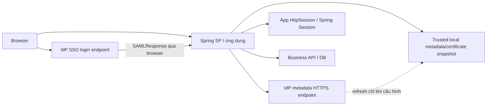
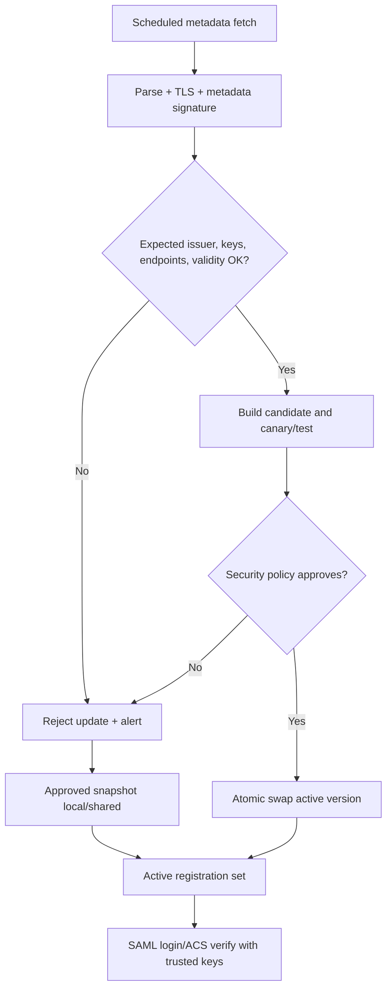

# Khả năng khởi động và hoạt động khi metadata endpoint hoặc IdP bị gián đoạn

**Học phần:** Spring Security – federation → Triển khai và vận hành.

**Mục tiêu:** thiết kế, triển khai và kiểm thử một ứng dụng Spring Security SAML2 (Service Provider – SP) có thể **khởi động an toàn khi endpoint cung cấp metadata của Identity Provider (IdP) tạm thời không truy cập được**, đồng thời xử lý chính xác khi **dịch vụ IdP SSO thật sự ngừng hoạt động**. Bài hướng dẫn phân biệt các kiểu phụ thuộc, lựa chọn lưu metadata có kiểm duyệt, cập nhật khóa ký, cấu hình Spring Security, readiness/liveness, sự suy giảm dịch vụ (graceful degradation), retry/backoff, kiểm thử sự cố, runbook vận hành và khôi phục mà **không bao giờ nới lỏng signature/issuer/audience validation để “cho đăng nhập tạm”**.

**Quy tắc nền tảng:** **IdP metadata endpoint không phải IdP login endpoint**, và **mất endpoint metadata không đồng nghĩa IdP ngừng xác thực**. Ngược lại, **metadata cached đầy đủ không biến một IdP đang offline thành IdP có thể đăng nhập**. Một SP có thể tiếp tục phục vụ phiên ứng dụng hiện có nếu session store và business dependencies vẫn hoạt động; nhưng đăng nhập mới phụ thuộc IdP hoặc một IdP khác được đăng ký. Một signed SAMLResponse đã phát trước sự cố có thể được xác minh offline bằng verification keys đã được tin, nếu còn hợp lệ, khớp pending AuthnRequest và tất cả điều kiện an toàn. **Không có trusted metadata hoặc trust keys hợp lệ thì phải từ chối authentication mới.**

Các ví dụ dùng Java 17+, Spring Security Servlet/SAML2 và các hostname `example.test` minh họa. Hành vi startup/metadata refresh có thể khác theo **Spring Security 6.x/7.x, Boot BOM, loại `RelyingPartyRegistrationRepository` và cách xây bean**; mọi nhận định vận hành phải được kiểm trên đúng release. Các mảnh Spring không chạy độc lập, còn chương trình `FederationOutageDemo.java` ở phần thực hành chạy bằng JDK 17 và có stdout xác định.

## 1. Bốn sự cố rất dễ bị đánh đồng

Một hệ thống SAML2 liên kết có các đường mạng khác nhau:



| Sự cố | Điều gì hỏng? | Điều gì có thể còn hoạt động? |
| --- | --- | --- |
| **Metadata endpoint down** | SP không tải/refresh được XML metadata từ IdP | IdP SSO endpoint vẫn có thể login; SP dùng metadata có sẵn và còn được tin |
| **IdP SSO endpoint down** | Browser không login/MFA được tại IdP | SP chạy, API và phiên app hiện có; callback đã có signed SAMLResponse có thể được xử lý |
| **Trust material expired/invalid** | Không có metadata/cert/keys hợp lệ theo policy để verify SAML | App có thể chạy và phục vụ phiên đã xác thực, nhưng **không accept assertion mới** |
| **Session store/business dependency down** | Spring SecurityContext không lưu/đọc được hoặc business API lỗi | IdP vẫn online; SAML login có thể thành công ở IdP nhưng app không tạo phiên/không phục vụ nghiệp vụ |

**Không tự động restart toàn bộ ứng dụng khi IdP metadata HTTP 503.** Nếu liveness phụ thuộc IdP, Kubernetes có thể restart mọi pods trong khi lỗi nằm ngoài ứng dụng, gây cascading outage. **Không gắn mọi IdP problem vào readiness chung** nếu việc này làm load balancer loại hết các pods và cắt luôn phiên đang hoạt động của user.

### 1.1. Phân biệt ba URL quan trọng

Ví dụ:

```text
IdP metadata:
  https://idp.example.test/saml/metadata

IdP SingleSignOnService:
  https://idp.example.test/sso

SP Assertion Consumer Service (ACS):
  https://portal.example.test/login/saml2/sso/corp

SP metadata publication (nếu bật):
  https://portal.example.test/saml2/metadata/corp
```

- URL **IdP metadata** xuất bản XML gồm `EntityDescriptor`, `IDPSSODescriptor`, `SingleSignOnService` và `KeyDescriptor` (tùy profile).
- URL **IdP SSO** tiếp nhận AuthnRequest và thực hiện authentication/MFA; nó **không nhất thiết cùng host hay cùng uptime** với metadata endpoint.
- URL **SP ACS** do ứng dụng cung cấp, nhận SAMLResponse qua browser và verify.
- URL **SP metadata publication** do chính SP cung cấp để IdP đăng ký SP; nó **không có nghĩa SP đang fetch IdP metadata**.
- HTTP 200 từ IdP metadata chỉ chứng minh XML có thể tải, chưa chứng minh login UI, MFA, credential store, SAML signing và callback hoạt động.
- HTTP 200 từ IdP SSO landing cũng chưa chứng minh một full SAML browser SSO hoạt động.

**Để kiểm đúng, đo availability riêng từng chặng.** Một health check `GET metadata` không thể thay browser integration test đăng nhập.

## 2. Startup phụ thuộc vào cách tạo `RelyingPartyRegistration`

Trong Spring Security, `RelyingPartyRegistration` mô tả cặp SP/IdP và chứa metadata/trust cần dùng để tạo AuthnRequest, lựa chọn SSO endpoint và xác minh SAMLResponse. Repository `RelyingPartyRegistrationRepository` cung cấp registrations cho các filters.

### 2.1. Cách A: tải metadata HTTPS khi tạo bean

Mảnh cấu hình:

```java
@Bean
RelyingPartyRegistrationRepository registrations() {
    RelyingPartyRegistration corp = RelyingPartyRegistrations
        .fromMetadataLocation("https://idp.example.test/saml/metadata")
        .registrationId("corp")
        .entityId("https://portal.example.test/saml/sp")
        .assertionConsumerServiceLocation(
            "https://portal.example.test/login/saml2/sso/corp")
        .build();
    return new InMemoryRelyingPartyRegistrationRepository(corp);
}
```

**Rủi ro:** nếu Spring tạo bean và `fromMetadataLocation` cần HTTP request tại đó, ứng dụng sẽ bị phụ thuộc DNS/TLS/proxy/IdP metadata availability ở **startup**. Metadata endpoint timeout, chứng chỉ TLS lỗi, XML malformed, không có IDPSSODescriptor đúng hoặc issuer sai có thể làm bean creation thất bại, dẫn tới **ApplicationContext start failure** hoặc startup kéo dài. Đây là kết quả của **cách cấu hình bean**, không phải một quy luật bắt buộc rằng mọi Spring SAML2 deployment phải online liên tục để chạy.

### 2.2. Cách B: metadata được kiểm duyệt và đóng gói cục bộ

```java
@Bean
RelyingPartyRegistrationRepository registrations() {
    RelyingPartyRegistration corp = RelyingPartyRegistrations
        .fromMetadataLocation("classpath:metadata/idp-corp.xml")
        .registrationId("corp")
        .entityId("https://portal.example.test/saml/sp")
        .assertionConsumerServiceLocation(
            "https://portal.example.test/login/saml2/sso/corp")
        .build();
    return new InMemoryRelyingPartyRegistrationRepository(corp);
}
```

**Ưu điểm:** khởi động ứng dụng bằng **trusted snapshot cục bộ**, không fetch metadata HTTPS ở runtime startup. Nếu metadata endpoint tạm thời bị 503 nhưng IdP SSO vẫn online, các login mới có thể tiếp tục hoạt động với snapshot còn hợp lệ và IdP signing key vẫn đúng.

**Nhược điểm:** local file có thể cũ sau khi IdP đổi SSO URL, signing key hoặc metadata policy. **Classpath file không tự làm refresh/rollover**. Phải thiết kế quy trình cập nhật và validate trước khi triển khai. Nếu snapshot bị cắt, ký giả, hết hiệu lực theo metadata freshness policy hoặc chưa được approve, không dùng để chấp nhận assertion.

### 2.3. Cách C: refreshable metadata repository có trust policy

Tài liệu Spring Security 7.1 mô tả `AssertingPartyMetadataRepository` và `OpenSaml5AssertingPartyMetadataRepository`, dựa trên OpenSAML MetadataResolver, hỗ trợ **expiry-aware refresh** khi implementation resolver phù hợp.

Hai kiểu API xuất hiện trong tài liệu:

```java
// MẢNH API Spring Security 7.1, cần cấu hình SP đầy đủ.
// Nguồn metadata được tin theo điều kiện ứng dụng.
var metadataRepo = OpenSaml5AssertingPartyMetadataRepository
    .fromTrustedMetadataLocation(
        "https://idp.example.test/saml/metadata")
    .build();

// Khi cần verify XML metadata signature, dùng builder
// cung cấp verification credentials đáng tin.
// Không dùng certificate/KeyInfo tự khai trong untrusted XML
// để tự chứng minh chữ ký của chính XML đó.
var signedMetadataRepo = OpenSaml5AssertingPartyMetadataRepository
    .withMetadataLocation("https://idp.example.test/saml/metadata")
    .verificationCredentials(creds ->
        creds.add(trustedMetadataSigningCredential))
    .build();
```

**Đây là mảnh minh họa**, biến `trustedMetadataSigningCredential` phải là `Saml2X509Credential` được cấp qua trust policy, và còn cần cách map metadata thành `RelyingPartyRegistration` với SP EntityID, ACS, credentials. Spring docs cảnh báo **nếu không cung cấp verification credentials ở builder tương ứng, metadata signature validation sẽ không được thực hiện**. Không diễn giải `fromTrustedMetadataLocation` là “tự verify mọi chữ ký XML”.

**Khác biệt:** một repository refreshable **có thể** quản lý expiry/refresh; còn `InMemoryRelyingPartyRegistrationRepository` dựng từ một file/URL qua `fromMetadataLocation` thường là **snapshot tại lúc dựng bean**. Đừng hứa tự refresh nếu không có component/scheduler thực.

### 2.4. Bảng lựa chọn

| Phương án | Cold start khi metadata endpoint down | Thay đổi khóa IdP | Chi phí/vận hành |
| --- | --- | --- | --- |
| Remote fetch trong bean startup, không cache | **Có thể FAIL/treo** nếu request bắt buộc | Phụ thuộc fetch khi restart | Đơn giản nhưng fragile |
| Packaged local approved metadata | **PASS** nếu file hợp lệ | Cần pipeline/canary deploy snapshot mới | Ổn định, thay đổi qua release |
| Shared last-known-good snapshot + async refresh | **PASS** khi đã có trusted snapshot còn hợp lệ | Cho phép refresh có verify, atomic swap | Cần TTL/rollback/key overlap/metrics |
| Refreshable repository với trusted metadata source | Phụ thuộc resolver đã preload/cache được chưa | Theo resolver expiry policy | Cần kiểm trust và failure semantics version |
| Database config với no trusted bootstrap | Không thể khởi động login an toàn khi DB/metadata đều mất | Không áp dụng | Phải có safe failure path |

**Chọn theo SLA/risk:** đối với dịch vụ yêu cầu vận hành ổn định khi IdP metadata URL down, cấu hình snapshot được approve trước (local hoặc shared) và refresh bất đồng bộ thường phù hợp hơn remote-only cold start. Nếu không thể tin một snapshot nào, **không tiếp tục SAML authentication bằng trust tự đoán**.

## 3. Metadata XML có gì và tại sao không thể dùng file tùy ý?

Ví dụ rút gọn:

```xml
<md:EntityDescriptor
    xmlns:md="urn:oasis:names:tc:SAML:2.0:metadata"
    entityID="https://idp.example.test/metadata"
    validUntil="2026-11-14T00:00:00Z">
  <md:IDPSSODescriptor
      protocolSupportEnumeration="urn:oasis:names:tc:SAML:2.0:protocol">
    <md:KeyDescriptor use="signing">
      <ds:KeyInfo xmlns:ds="http://www.w3.org/2000/09/xmldsig#">
        <!-- Certificate X.509 minh họa, không dùng thật -->
      </ds:KeyInfo>
    </md:KeyDescriptor>
    <md:SingleSignOnService
      Binding="urn:oasis:names:tc:SAML:2.0:bindings:HTTP-Redirect"
      Location="https://idp.example.test/sso"/>
  </md:IDPSSODescriptor>
</md:EntityDescriptor>
```

**Đây không phải XML metadata hoàn chỉnh có thể parse/verify**: phần `ds:X509Certificate` đã lược bỏ. Metadata thật có `EntityDescriptor` hoặc `EntitiesDescriptor`, issuer/entity ID, endpoints/bindings, signing/encryption credentials, `validUntil`, `cacheDuration`, XML signature tùy profile.

Phải kiểm trước khi chấp nhận một snapshot:
- Nguồn download thuộc đúng issuer/tenant/service registration, qua URL allowlist (không lấy từ browser).
- TLS server identity/certificate và redirects/hostname được kiểm; không bỏ certificate verification.
- Nếu profile yêu cầu **metadata signature**, verify XMLDSig bằng **pre-established trusted metadata signing key**.
- Metadata issuer/entityID đúng IdP kỳ vọng; chọn đúng `IDPSSODescriptor` trong aggregate.
- Có `SingleSignOnService` binding/Location hỗ trợ và các `KeyDescriptor use=signing` đúng policy.
- Xác định `validUntil` và `cacheDuration` theo đặc tả/organizational freshness policy; HTTP Cache-Control/ETag không thay SAML metadata validity.
- Giới hạn XML size, entity expansion, XXE/DTD, số entity descriptors, redirects, timeout và internal-network SSRF khi fetch.
- Không dùng certificate từ chính unverified XML làm “trusted root” để tự xác thực XML đó.
- Metadata signature validation **khác** SAML Response/Assertion signature validation; cả hai cần trust policy.
- Kiểm signing key identity/algorithms và key rollover state; không nhận thêm attacker key qua một metadata fetch bị hijack.

### 3.1. Phân biệt ba loại chứng thư

| Certificate/Key | Dùng ở đâu? | Khi gián đoạn |
| --- | --- | --- |
| TLS certificate của `https://idp.../metadata` | HTTPS transport tới metadata server | Sai TLS → **không fetch**; không `-k`/trust-all |
| Metadata XML signing certificate | Verify chữ ký metadata nếu policy dùng signed metadata | Mất trust anchor → reject update |
| IdP SAML signing certificate | SP verify `SAMLResponse`/Assertion | Thiếu trusted key → **không accept assertion** |

Chứng thư SP dùng để **ký AuthnRequest** hoặc **giải mã encrypted Assertion** là bộ key khác. Một TLS certificate hợp lệ không tự chứng minh IDP metadata được ký bằng đúng metadata signing key, và metadata cũ có một signing key không thể tự verify một response do IdP ký bằng key mới chưa được approved.

**Đừng thay SAML verification cert bằng TLS cert** chỉ vì chúng cùng hostname. Rà soát `KeyUsage`, issuer, fingerprints và nguồn trust riêng.

## 4. Tình huống A: metadata endpoint down, IdP SSO vẫn online

Ví dụ:
- Ngày 1, SP đã nhận và approve metadata `M1`, có signing key `K1`, EntityID `corp`, SSO URL `/sso`.
- Ngày 2, endpoint `/saml/metadata` trả HTTP 503.
- IdP `/sso` vẫn hoạt động và tiếp tục ký assertions bằng `K1`.

**Kết quả mong muốn:**
1. SP khởi động được bằng **M1 còn hợp lệ**.
2. Không chặn user đã có authenticated HttpSession.
3. Với user chưa login, SP tạo AuthnRequest gửi đúng cached SSO URL.
4. IdP ký Response bằng `K1`.
5. SP verify signature/issuer/audience/recipient/InResponseTo/conditions/replay, thiết lập session như bình thường.
6. Background refresh có lỗi nhưng **không xóa M1 hoặc thay bằng snapshot rỗng**.
7. Dashboard hiển thị `metadata_refresh=FAILED` và tuổi snapshot; alert theo freshness window.
8. Khi metadata endpoint trở lại, refresh có kiểm duyệt, áp M2 nếu trust policy OK, không làm gián đoạn các sessions.

**Không nên làm:** để một lỗi fetch phá hủy RelyingPartyRegistration hiện có hoặc tự động thay verification key list bằng rỗng. Một biến trạng thái `metadata_endpoint_up=false` chỉ là availability của nguồn refresh, **không mặc nhiên là “authentication unavailable”**.

### 4.1. Metadata chưa từng được tải lần nào

Cold start **không có snapshot trusted** và metadata endpoint cũng không thể truy cập:
- Không đủ issuer/SSO endpoint/verification credentials để tạo một SAML registration đáng tin.
- App có thể khởi động **phần business không cần SSO** với trạng thái `LOGIN_NOT_CONFIGURED` nếu kiến trúc hỗ trợ, nhưng **không được nhận assertions hoặc tạo authenticated sessions giả**.
- Nếu business đòi SSO cho mọi route và không hỗ trợ degraded shell, startup nên fail có lý do rõ ràng hoặc readiness theo policy; **không fallback HTTP Basic/form anonymous bất ngờ**.
- Không lấy certificate mới từ bất kỳ Response nào rồi tự trust (TOFU không có phê duyệt).
- Cần cung cấp trusted snapshot từ artifact/secure config store hoặc chờ IdP metadata phục hồi.

**Lưu metadata snapshot ban đầu trong image/build artifact** là một cách bảo đảm cold start; đối với môi trường nhiều tenants có thể dùng signed configuration bundle với inventory/audit và cache phân tán. Dù lưu local, nếu snapshot quá cũ/hết hạn theo policy, hệ thống vẫn phải fail closed cho SAML login.

## 5. Tình huống B: IdP SSO offline, metadata vẫn tải được

Ví dụ:
- Metadata endpoint HTTPS vẫn trả `M1`.
- IdP SSO endpoint không cho người dùng nhập mật khẩu, MFA fail, DNS lỗi, hoặc HTTP 503.
- SP có user A đang authenticated và user B mới cần login.

**Kết quả đúng:**
- **User A:** tiếp tục truy cập các ứng dụng/resources mà phiên app của họ còn hợp lệ, nếu phiên, session store, quyền và resource backend vẫn OK. Không reauthorize một user bằng IdP trong mỗi request trừ khi app chủ động yêu cầu reauthentication/step-up.
- **User B:** new interactive SSO login không hoàn tất; có thể thấy lỗi IdP hoặc trang “SSO tạm gián đoạn”. Không fake authentication và không cho user anonymous truy cập protected route.
- **Response đã được IdP phát trước outage:** nếu browser vừa POST một signed SAMLResponse còn hạn, SP có pending AuthnRequest và verification keys trusted, SP có thể verify **local** mà không gọi IdP metadata/login endpoint trong callback theo browser POST binding thông thường. Nếu triển khai **SAML Artifact Binding/back-channel resolution** hoặc custom external calls thì outcome phụ thuộc dịch vụ đó.
- **Step-up/MFA:** nếu nghiệp vụ buộc IdP xác thực lại để làm hành động nhạy cảm, phải chặn/hoãn hành động đó khi IdP offline; không dùng “session cũ” để né yêu cầu assurance.
- **SAML SLO:** logout local cần hoạt động theo session policy; IdP-initiated/protocol global SLO có thể không truyền được, vì thế không được hứa “logout toàn hệ đã xong” chỉ vì portal hiển thị `/signed-out`.

### 5.1. Trong outage, “availability” có nhiều cấp

| Năng lực | IdP metadata down, IdP SSO OK, M1 valid | Metadata OK, IdP SSO down | Không có trusted M1 |
| --- | --- | --- | --- |
| App HTTP process chạy | Có | Có | Có thể, tùy kiến trúc |
| Health liveness | Thường vẫn UP | Thường vẫn UP | Có thể vẫn UP nếu app process khỏe |
| Existing authenticated app sessions | Có, nếu session/backend OK | Có, nếu session/backend OK | Có thể còn, nếu phiên hợp lệ/được chấp nhận theo policy |
| New interactive login qua IdP | Có thể thành công | **Không** trong outage | **Không** |
| Accept valid already-issued POST SAMLResponse | Có thể, nếu trust/conditions/pending valid | Có thể, nếu local verification đủ | **Không**, nếu thiếu trusted verification state |
| Dynamic metadata refresh | Không | Có thể | Không, nếu nguồn down |
| Federated logout propagation | Phụ thuộc IdP/SLO endpoints | Có thể thất bại | Không bảo đảm |
| Business API authorization | Có với valid session/roles | Có với valid session/roles | Có theo hiện có và policy; không cấp quyền mới |

**Không lẫn “login readiness” và “process readiness”.** Nếu một hệ thống đã authenticated bằng local HttpSession, tính năng nghiệp vụ có thể tiếp tục dù không thể login thêm user mới.

## 6. Tình huống C: metadata hết hạn hoặc khóa ký IdP đã thay đổi

Metadata có thể chứa `validUntil` hoặc `cacheDuration`; nhà vận hành cần một chính sách:
- Tải lại **trước khi** hết hiệu lực và alert đủ sớm.
- Lưu **last-known-good (LKG)** snapshot đã verify với timestamp, issuer, keyset và source trust.
- Không nhận snapshot mới nếu issuer/entityID khác ngoài change request, signature sai, XML malformed hoặc không có signing keys theo policy.
- Chỉ dùng bản cũ trong giới hạn **metadata validity + local risk policy**; **không kéo dài vô thời hạn chỉ vì IdP endpoint đang 503**.
- Nếu bản cũ hết trusted lifetime, chặn authentication dùng bản cũ; vận hành app/sessions đang có theo policy riêng.
- Không lùi keyset từ metadata mới về bản rất cũ do HTTP cache/proxy trả stale mà không có monotonic version/expiry/fingerprint checks.
- Kiểm key rollover **K1 → K1+K2 → K2** với overlap; metadata và deployment phải được phối hợp.

### 6.1. Rollover đúng cách

```text
T0: trusted IdP metadata M1 có signing key K1
    SP chấp nhận SAML assertions ký bởi K1.

T1: IdP công bố M2 có K1 và K2 trong overlap.
    SP verify M2, check EntityID/endpoint/policy, atomic publish.
    SP chấp nhận K1 hoặc K2 theo trusted registration.

T2: IdP bắt đầu ký assertions bằng K2.
    SP vẫn verify được, không bị outage.

T3: Hết overlap/expired requests theo policy.
    IdP công bố M3 chỉ còn K2; SP verify, publish, retire K1.

Failure: SP chỉ có K1 nhưng IdP đã ký K2
    => SAML signature verification thất bại;
       KHÔNG được disable signature checks để “khôi phục SSO”.
```

**Lưu ý chuyên môn:** giá trị `validUntil`/`cacheDuration` là chính sách cache metadata, còn thời hạn X.509 certificate và quy tắc trust đối với SAML signing credentials là vấn đề riêng. Không tự suy luận mọi OpenSAML default sẽ enforce một trường theo business policy. Phải kiểm version/provider và áp explicit guard rails. Certificate signing metadata và certificate signing assertion có thể độc lập.

### 6.2. Atomic refresh là bắt buộc

Một implementation động nên:
1. Fetch metadata vào buffer **riêng** với size/time/redirect/SSRF bounds.
2. Parse XML an toàn và kiểm metadata signature/TLS/source.
3. Check expected IdP EntityID, SSO/SLO endpoints, algorithms, keyset/trust, validUntil.
4. Đánh giá planned rotation, unexpected issuer/key removals và tenant ownership.
5. Xây một snapshot `RelyingPartyRegistrationRepository` hoặc metadata repository candidate.
6. Validate candidate dưới load/canary/test signed fixture.
7. **Atomic swap** active reference và ghi version/fingerprint mới.
8. Giữ old snapshot/revision để rollback **chỉ khi vẫn thỏa security policy**.
9. Nếu bất kỳ bước nào fail, giữ active version đã duyệt, phát refresh failure event; không publish half-parsed metadata.

Không thao tác từng certificate trong live mutable list mà request threads có thể nhìn thấy keyset nửa cũ nửa mới. Với multitenant, cập nhật theo **registration** thay vì làm mọi IdPs ngừng login vì một issuer lỗi.

## 7. Cấu hình Spring Security với local, pinned IdP metadata

Đây là một lựa chọn triển khai cụ thể, giữ dependency metadata endpoint **ngoài app startup path**. Tạo tệp `src/main/resources/metadata/idp-corp.xml` bằng một snapshot **đã được lấy/verify qua pipeline bảo mật**, chứa EntityID, SSO endpoint và trusted IdP signing cert đúng. **Không nhúng XML giả trong ví dụ của bài này như một file có thể tin.**

```java
package com.example.federation;

import org.springframework.context.annotation.Bean;
import org.springframework.context.annotation.Configuration;
import org.springframework.security.config.Customizer;
import org.springframework.security.config.annotation.web.builders.HttpSecurity;
import org.springframework.security.saml2.provider.service.registration
        .RelyingPartyRegistration;
import org.springframework.security.saml2.provider.service.registration
        .RelyingPartyRegistrationRepository;
import org.springframework.security.saml2.provider.service.registration
        .RelyingPartyRegistrations;
import org.springframework.security.saml2.provider.service.registration
        .InMemoryRelyingPartyRegistrationRepository;
import org.springframework.security.web.SecurityFilterChain;

@Configuration
public class OfflineMetadataSamlConfiguration {
    @Bean
    RelyingPartyRegistrationRepository relyingPartyRegistrations() {
        RelyingPartyRegistration corp = RelyingPartyRegistrations
            .fromMetadataLocation("classpath:metadata/idp-corp.xml")
            .registrationId("corp")
            .entityId("https://portal.example.test/saml/sp")
            .assertionConsumerServiceLocation(
                "https://portal.example.test/login/saml2/sso/corp")
            .build();
        return new InMemoryRelyingPartyRegistrationRepository(corp);
    }

    @Bean
    SecurityFilterChain securityFilterChain(HttpSecurity http)
            throws Exception {
        http
            .authorizeHttpRequests(auth -> auth
                .requestMatchers("/status", "/error").permitAll()
                .anyRequest().authenticated())
            .saml2Login(Customizer.withDefaults());
        return http.build();
    }
}
```

**Đây là mảnh cấu hình trong Spring Boot app**, cần `spring-security-saml2-service-provider`, OpenSAML dependencies tương thích BOM, verified IdP metadata file, HTTPS/proxy config, app endpoints và Spring Boot main class. Nếu IdP yêu cầu signed AuthnRequests hoặc encrypted Assertions, bổ sung SP signing/decryption credentials riêng; không tắt yêu cầu đó vì metadata source offline.

**Vì sao kiến trúc này giúp cold start?** `fromMetadataLocation("classpath:...")` đọc file trong artifact, không gọi HTTP remote URL khi tạo bean. Nó **không** tự cập nhật signing keys khi IdP rotate; vận hành phải quản lý release/pipeline. Metadata source là trusted snapshot **chỉ sau khi đã được kiểm duyệt**, không vì “classpath” mà mặc định trusted.

### 7.1. Dùng Spring Boot property thay vì tự tạo bean

Với Boot release hỗ trợ `spring.security.saml2.relyingparty.registration.*.assertingparty.metadata-uri`, có thể dùng:

```yaml
spring:
  security:
    saml2:
      relyingparty:
        registration:
          corp:
            entity-id: https://portal.example.test/saml/sp
            acs:
              location: https://portal.example.test/login/saml2/sso/corp
            assertingparty:
              metadata-uri: classpath:metadata/idp-corp.xml
```

**Property layout/version note:** Spring Boot version quyết định property aliases và cách bind optional fields; đối chiếu config metadata của đúng BOM và chạy integration test. Tương tự Java bean, đường `classpath:` giảm startup dependency vào metadata HTTP, **không loại bỏ IdP SSO dependency**.

### 7.2. Khi nào dùng URL remote trực tiếp?

Nếu startup contract cố ý yêu cầu fetch metadata mới nhất online và app có failover/retry startup budget rõ, `fromMetadataLocation("https://...")` có thể được dùng. Nhưng:
- Ước lượng DNS/TLS/connect/read timeout và time budget của deployment.
- Không retry vô hạn trong bean factory khi IdP có sự cố.
- Đặt alert `SAML_METADATA_BOOTSTRAP_FAILURE`, logs không chứa raw XML.
- Canary một pod khi IdP metadata endpoint down để thấy readiness và boot behavior.
- Kiểm HTTP proxy, allowed host, truststore và redirects.
- Phân biệt failure HTTP metadata với failure parser/trust (malicious/stale).
- Nếu cần resilience cao, ưu tiên **pre-fetched approved artifact + async refresh** chứ không retry để “hy vọng IdP lên” trong mọi pod.

### 7.3. Phân biệt SP metadata publication với IdP metadata retrieval

```java
http
    .saml2Login(Customizer.withDefaults())
    .saml2Metadata(Customizer.withDefaults());
```

`saml2Metadata` cho SP **xuất bản SP metadata** (theo docs: `/saml2/metadata` và các paths theo registration). Nó **không phải API refresh IdP metadata** và không có nghĩa endpoint IdP đang reachable. Nếu app có cached registration, SP metadata endpoint có thể vẫn render khi IdP down, nhưng thông tin issuer/ACS/keys của SP phải chính xác.

## 8. Refresh động: cơ chế last-known-good và cách triển khai an toàn

Đối với IdP có rollover tự động, pipeline phổ biến:



Một versioned record có thể gồm:

```json
{
  "registration_id": "corp",
  "expected_idp_entity_id": "https://idp.example.test/metadata",
  "snapshot_id": "m-2026-11-07-01",
  "approved_at": "2026-11-07T09:00:00Z",
  "expires_at": "2026-11-14T00:00:00Z",
  "metadata_source_ref": "corp-idp-config",
  "verification_key_refs": ["K1", "K2"],
  "approval_result": "TRUSTED",
  "refresh_result": "SUCCESS"
}
```

**Đây là dữ liệu đã giảm nhạy cảm; không chứa private keys hoặc raw certificates.** Snapshot phải được lưu trong hệ thống bảo mật, có provenance và chống rollback/unauthorized writes. `approval_result` không thể do browser tự set; được xây bởi verified pipeline. Nếu refresh fail, **không ghi đè active snapshot** bằng null; nhưng cần phân biệt “snapshot hợp lệ” và “snapshot đã hết hạn”.

### 8.1. Backoff, jitter và tránh stampede

Nếu 200 pods cùng boot và fetch `https://idp.../metadata`, IdP metadata server có thể bị thác request. Một design tốt:
- **Một refresh worker/leader** hoặc metadata distribution service chung, không để mỗi request browser fetch XML.
- Dùng HTTP conditional GET/ETag/Last-Modified khi provider hỗ trợ, vẫn kiểm metadata trust/expiry.
- Timeout hữu hạn, exponential backoff với jitter và retry budget.
- Dùng circuit breaker cho refresh fetch **không bao giờ bypass SAML validator**.
- Retry các lỗi tạm thời 429/503/timeout theo policy; không retry vô hạn certificate mismatch, invalid issuer, bad XML hoặc metadata signature tampering.
- Không đồng thời update nếu nhiều workers giành quyền; version/optimistic concurrency, compare-and-swap.
- Đảm bảo metadata source URL **fixed allowlist**, không inject từ incoming `registrationId`/issuer.
- Không dùng random untrusted HTTP cache response làm trusted state.
- Giữ metrics `snapshot_age_seconds`/`refresh_failure_rate` và alert trước expiry.

Ví dụ cách phân loại:

| Kết quả fetch | Hành động | Tiếp tục login? |
| --- | --- | --- |
| HTTP 304 và snapshot còn hợp lệ | Giữ active, cập nhật check status phù hợp policy | Có nếu IdP SSO online |
| DNS timeout/HTTP 503 | Giữ LKG, retry backoff | Có nếu LKG vẫn được tin và IdP online |
| XML malformed/XXE | Reject candidate, alert security | Chỉ bằng LKG valid |
| EntityID khác ngoài whitelist | Reject/incident | Chỉ LKG valid |
| Ký metadata sai | Reject/incident | Chỉ LKG valid |
| IdP key rollover hợp lệ | Publish K1+K2 after checks | Có |
| LKG quá hạn theo policy | Không dùng LKG để xác thực mới | Không, cho tới khi có trusted update |
| Source HTTP online nhưng IdP SSO 503 | Metadata refresh có thể OK | Không hoàn tất interactive SSO mới |

### 8.2. Refresh không đồng nghĩa accept certificate “mới lạ”

Nếu signed metadata trust anchor cho phép IdP đổi SAML response-signing keys, refresh có thể xác minh candidate chain và xuất bản keys hợp lệ. Nếu chỉ tải metadata qua TLS mà không validate signature (khi contract yêu cầu signed metadata), công cụ phải dựa vào một nguồn/approval chain đã định nghĩa khác (pinning/release review). **Không làm TOFU theo một URL xuất hiện trong SAMLResponse.**

Khi IdP trả metadata signing key K3 không mong đợi:
- Kiểm rằng sự thay đổi đúng IdP/issuer và trust anchors.
- Xem change window/change request, signed metadata, overlap, validity và audit.
- Nếu không đáp ứng policy, chặn update; không chặn sessions hiện có chỉ vì refresh thất bại.
- Không bật `signatureValidation=false` hoặc `trustAllCertificates=true` để “làm cho SSO lên”.

## 9. Liveness/readiness/probe của Spring Boot và Kubernetes

Spring Boot Actuator hỗ trợ:
- `/actuator/health/liveness` – phản ánh app process có khỏe và nên restart không.
- `/actuator/health/readiness` – app có nhận traffic từ load balancer không.
- `/actuator/health` hoặc **custom health indicator** – chi tiết sức khỏe các dependency khác.
- `ApplicationAvailability`/`LivenessState`/`ReadinessState` theo container lifecycle.

**Nguyên tắc vận hành quan trọng từ Spring Boot docs:** liveness probe **không nên phụ thuộc external systems**. Nếu IdP hoặc Redis shared outage làm tất cả liveness fail, Kubernetes restart hàng loạt pods và tạo cascading failures. Readiness cũng phải chọn cẩn thận, nhất là dependency dùng chung mọi pods; vì đánh DOWN toàn bộ có thể khiến hệ thống ngừng phục vụ cả những request vẫn thực hiện được.

### 9.1. Thiết kế health signals nhiều chiều

| Health signal | Nên phản ánh | Có nên làm liveness FAIL khi IdP metadata down? |
| --- | --- | --- |
| `app_liveness` | Thread/process hoạt động, deadlock/fatal local state | **Không** |
| `app_readiness` | App có thể nhận traffic hữu ích | Không nhất thiết; theo business |
| `idp_metadata_refresh_status` | Metadata HTTP fetch lần cuối, age/expiry | Không |
| `saml_trust_snapshot_valid` | Có trusted issuer/keys/metadata theo policy | Có thể ảnh hưởng login capability, không tự nghĩa app dead |
| `idp_sso_probe_status` | IdP SSO reachability (không gửi credentials thật) | Là signal riêng, không chứng minh end-to-end |
| `saml_new_login_available` | Có trust + IdP login usable + registration | FAIL trong IdP outage |
| `app_existing_session_available` | Local session/backend vẫn phục vụ | Có thể UP khi IdP down |
| `saml_acs_response_verify_available` | Có trust, session/request state và provider hoạt động | Có thể UP với IdP SSO offline |
| `session_store_available` | Redis/JDBC, Spring Session | Có thể ảnh hưởng readiness nếu tất cả authenticated requests cần nó |

**Mẫu chính sách:** giữ app readiness UP khi IdP metadata/SSO down nhưng business + authenticated sessions vẫn hoạt động; khai báo SSO degrade qua custom health và cảnh báo. Nếu sản phẩm hoàn toàn chỉ có một màn hình SSO và không thể làm gì khi IdP down, có thể chọn readiness DOWN **sau khi cân nhắc** tác động LB/global outage. Không có một chuẩn bắt buộc cho mọi ứng dụng.

### 9.2. Spring Boot Actuator properties minh họa

```yaml
management:
  endpoints:
    web:
      exposure:
        include: health,info
  endpoint:
    health:
      probes:
        enabled: true
      show-details: when_authorized
  health:
    probes:
      add-additional-paths: true
```

Theo Spring Boot docs, `/actuator/health/liveness` và `/actuator/health/readiness` có thể dùng cho Kubernetes; `management.endpoint.health.probes.add-additional-paths=true` còn có thể tạo `/livez`/`/readyz` trên main server port. **Xác minh property name theo đúng Boot release** và bảo vệ `/actuator`: không public thông tin IdP issuer, cert fingerprints, topology hoặc internal error details cho anonymous callers.

Kubernetes ví dụ:

```yaml
livenessProbe:
  httpGet:
    path: /actuator/health/liveness
    port: 8080
  initialDelaySeconds: 10
  periodSeconds: 15

readinessProbe:
  httpGet:
    path: /actuator/health/readiness
    port: 8080
  periodSeconds: 5
  failureThreshold: 3
```

**Đây là manifest fragment**, chưa có `apiVersion/kind/spec`. Chọn probe port/path theo ứng dụng và management configuration. Nếu startup parsing metadata local hoặc OpenSAML initialization chậm hợp lý, dùng `startupProbe` phù hợp để tránh kubelet restart liên tục; nếu bị treo do remote fetch không timeout, thêm startupProbe **không giải quyết gốc rễ**, phải loại dependency hoặc bound timeout.

### 9.3. Không dùng health check GET metadata làm bằng chứng login

Một lệnh:

```bash
curl --fail --max-time 3 https://idp.example.test/saml/metadata
```

chỉ kiểm DNS/TLS/HTTP endpoint có phản hồi. Nó không chứng minh signed metadata hợp lệ, IdP SSO page reachable, login/MFA success, SAMLResponse signature, ACS hay persistence. Với metadata endpoint bảo vệ bởi authentication/proxy, health check có thể trả 401/403 dù SSO vẫn online. Không biến probe thành thay thế E2E.

## 10. Đăng nhập, ACS và phiên trong suốt IdP outage

### 10.1. Request chưa authenticated

```text
Browser GET /reports
  |
  v
App kiểm SecurityContext/session
  |
  +-- valid authenticated session ----> authorize /reports
  |
  +-- anonymous ----------------------> SP-initiated SAML login
                                         |
                                         +-- trusted registration unavailable
                                         |      -> safe local failure, không auth
                                         |
                                         +-- IdP login unavailable
                                         |      -> browser khó/không hoàn tất SSO
                                         |         safe error, retry có giới hạn
                                         |
                                         +-- IdP operational
                                                -> normal SAML browser flow
```

Không để login failure handler xoay vô hạn giữa `/reports` → IdP → error → `/reports`. Trường hợp IdP down, UX nên hiển thị thông báo không tiết lộ chi tiết security và một đường retry có rate limit/backoff. **Không tự chuyển sang login bằng mật khẩu local** nếu sản phẩm không có chính sách break-glass độc lập.

### 10.2. Callback SAMLResponse đã được phát trước sự cố

SP có thể verify một Response sau khi IdP SSO ngừng hoạt động, nếu:
- Response được ký bởi **key đã được SP trust** từ trusted registration.
- Issuer/audience/destination/recipient/subject confirmation/time đúng.
- `InResponseTo` khớp pending AuthnRequest và đúng session/browser.
- Replay/one-time use không bị vi phạm.
- Nếu có encrypted assertion, SP còn decryption credentials.
- Không yêu cầu network IdP runtime như SAML Artifact Resolution Service/custom API.
- SP application session store vẫn hoạt động.

**Không cho qua `NotOnOrAfter` hoặc expired verification trust** chỉ vì IdP down. Một Response có Status Success nhưng invalid signature vẫn phải reject. Ghi rõ đây là **offline cryptographic verification**, không phải offline authentication bằng cách chấp nhận token chưa verify.

### 10.3. User đã đăng nhập và session app còn sống

Trong Servlet Spring Security mặc định stateful, một user đã authenticated có `SecurityContext` trong HttpSession theo cấu hình; request business tiếp theo thường không cần chạm IdP. Điều kiện tiếp tục sử dụng:
- Session chưa hết hạn/revoked, cookie hợp lệ.
- Spring Session Redis/JDBC nếu dùng vẫn reachable.
- Roles/tenant/resource authorization kiểm riêng.
- Nếu policy yêu cầu periodic re-authentication hoặc step-up, fail closed khi IdP unavailable.
- Không tự kéo dài absolute session lifetime bất tận vì IdP outage.
- Không tạo “offline admin” qua authorization bypass.
- Tính an toàn của phiên chỉ mạnh bằng session fixation, CSRF, timeout và cookie policy còn lại.

### 10.4. Logout khi IdP ngừng hoạt động

Có thể:
1. **Local logout:** invalidate HttpSession/SecurityContext tại SP, user không dùng session đó nữa.
2. **Federated SAML Single Logout (SLO):** cần gửi/nhận `LogoutRequest`/`LogoutResponse` qua IdP SingleLogoutService, có thể thất bại.
3. **Browser IdP session:** có thể vẫn còn nếu IdP không nhận LogoutRequest.
4. **Các ứng dụng khác:** local logout ở SP **không tự revoke** sessions ở chúng.

UX và audit nên nói “Đã đăng xuất khỏi ứng dụng” nếu chỉ local logout; không tuyên bố toàn bộ IdP SSO bị hủy khi SLO chưa xác nhận. Khi IdP recover, user có thể tự động SSO lại nếu IdP session cũ còn. SAML logout verification và redirect allowlist vẫn bắt buộc.

## 11. Multi-IdP và tenant: giảm phạm vi ảnh hưởng

Một SP có thể có registrations `corp`, `partner`, `staff`:
- IdP `corp` metadata endpoint down không nên làm mất registrations `partner` và `staff`.
- Kết quả refresh phải **per issuer/registration**, không replace cả repository bằng empty map khi một source fail.
- Không tự failover một user từ IdP corp sang partner chỉ vì cùng email; đó là nguồn danh tính khác và có thể sai tenant/assurance.
- Nếu có một identity broker do tổ chức quản lý hỗ trợ fallback, phải đăng ký trust/mapping rõ ràng và kiểm MFA/account linking, không tự bypass.
- Khi một IdP SSO down, login picker có thể hiển thị “Tạm không khả dụng” cho tenant đó và giữ các lựa chọn khác bình thường.
- Các IdP khác nhau có signing certificates, entity IDs, SSO URLs và metadata expiry độc lập.
- Không để Response của IdP B dùng `InResponseTo` hoặc RelayState của AuthnRequest phát cho IdP A.
- Trust repository không được chọn issuer bằng URL do browser chỉ định; issuer trong Response chưa verified là **input**, không phải permission.
- Rollover một IdP phải canary theo issuer và không gây outage toàn tập.

### 11.1. Per-tenant health status

```json
{
  "service": "portal",
  "application_status": "SERVING",
  "federation": {
    "corp": {
      "metadata_snapshot": "TRUSTED",
      "metadata_refresh": "DEGRADED",
      "interactive_sso": "AVAILABLE"
    },
    "partner": {
      "metadata_snapshot": "TRUSTED",
      "metadata_refresh": "OK",
      "interactive_sso": "UNAVAILABLE"
    }
  }
}
```

**Chỉ là mô hình nội bộ**, không expose tenant IdP status/config/cert details công khai nếu không cần. `interactive_sso=AVAILABLE` có thể là status suy luận từ probes; chỉ một browser synthetic login mới chứng minh end-to-end. Tránh gọi synthetic credentials trực tiếp với production users; dùng sandbox test identities và rate limits/approved accounts.

## 12. Java 17 độc lập: mô phỏng fail-safe khi metadata/IdP hỏng

Chương trình dưới đây **chạy với JDK 17**, không cần Spring hoặc Internet. Nó mô tả **policy layer**:
- Cold start không có trusted metadata → không cho SAML login.
- Có snapshot đã duyệt K1 → app khởi động.
- Metadata fetch thất bại → giữ LKG valid, không xóa.
- Nếu IdP SSO offline → user đã login tiếp tục session; new interactive login không hoàn tất.
- Một Response **đã được thư viện SAML thực sự verify** có thể hoàn tất offline với cached key.
- Untrusted metadata update bị từ chối, không ghi đè key K1.
- Approved rollover K1+K2 được publish khi source/trust OK.
- Metadata hết policy validity → không dùng để verify mới; session cũ không bị xoá chỉ vì metadata hết hạn.

**Giới hạn:** `signatureAlreadyVerified` là flag **do test harness giả định**, không có XMLDSig, issuer/audience/recipient/clock skew/replay/cookie trong demo. **Production không bao giờ nhận flag này từ request**. Java `Set` và record chỉ để mô phỏng snapshot; metadata thật phải được Spring/OpenSAML validate và app session policy phải do framework quản lý. Thời gian cố định để stdout tái lập.

Tạo tệp `FederationOutageDemo.java`:

```java
import java.time.Instant;
import java.util.HashSet;
import java.util.Set;

public class FederationOutageDemo {
    private static final String EXPECTED_IDP =
            "https://idp.example.test/metadata";

    record Snapshot(
            String issuer,
            Set<String> trustedSigningKeyIds,
            Instant expiresAt) {
        Snapshot {
            trustedSigningKeyIds =
                    Set.copyOf(trustedSigningKeyIds);
        }

        boolean usable(Instant now) {
            return EXPECTED_IDP.equals(issuer)
                    && !trustedSigningKeyIds.isEmpty()
                    && now.isBefore(expiresAt);
        }
    }

    static final class SpRuntime {
        private Snapshot activeMetadata;
        private boolean idpOnline = true;
        private final Set<String> appSessions = new HashSet<>();

        boolean applyApprovedSnapshot(
                Snapshot candidate,
                boolean metadataTrustVerified,
                Instant now) {
            if (!metadataTrustVerified
                    || candidate == null
                    || !candidate.usable(now)) {
                return false;
            }
            activeMetadata = candidate;
            return true;
        }

        boolean hasUsableTrust(Instant now) {
            return activeMetadata != null
                    && activeMetadata.usable(now);
        }

        boolean canFinishNewInteractiveLogin(Instant now) {
            return hasUsableTrust(now) && idpOnline;
        }

        boolean canValidateAlreadyIssuedResponse(
                Instant now, String signingKeyId,
                boolean signatureAlreadyVerified,
                boolean pendingRequestMatched) {
            return hasUsableTrust(now)
                    && activeMetadata.trustedSigningKeyIds()
                            .contains(signingKeyId)
                    && signatureAlreadyVerified
                    && pendingRequestMatched;
        }

        void setIdpOnline(boolean value) {
            idpOnline = value;
        }

        void addAuthenticatedSession(String id) {
            appSessions.add(id);
        }

        boolean hasExistingSession(String id) {
            return appSessions.contains(id);
        }

        boolean trustsKey(String keyId) {
            return activeMetadata != null
                    && activeMetadata.trustedSigningKeyIds()
                            .contains(keyId);
        }
    }

    public static void main(String[] args) {
        Instant now = Instant.parse("2026-11-07T10:00:00Z");

        SpRuntime cold = new SpRuntime();
        System.out.println("Cold start without metadata: "
                + cold.hasUsableTrust(now));

        SpRuntime sp = new SpRuntime();
        Snapshot m1 = new Snapshot(
                EXPECTED_IDP, Set.of("K1"),
                now.plusSeconds(3600));
        System.out.println("Cold start with pinned metadata: "
                + sp.applyApprovedSnapshot(m1, true, now));

        sp.addAuthenticatedSession("session-A");
        System.out.println("Existing app session active: "
                + sp.hasExistingSession("session-A"));

        Snapshot untrusted = new Snapshot(
                "https://attacker.example.test/idp",
                Set.of("EVIL"), now.plusSeconds(3600));
        boolean rejected = !sp.applyApprovedSnapshot(
                untrusted, false, now);
        System.out.println("Bad refresh rejected, K1 retained: "
                + (rejected && sp.trustsKey("K1")));

        sp.setIdpOnline(false);
        System.out.println("New login during IdP outage: "
                + sp.canFinishNewInteractiveLogin(now));
        System.out.println("Existing session during outage: "
                + sp.hasExistingSession("session-A"));

        System.out.println("Previously signed callback accepted: "
                + sp.canValidateAlreadyIssuedResponse(
                    now, "K1", true, true));
        System.out.println("Unknown signing key rejected: "
                + !sp.canValidateAlreadyIssuedResponse(
                    now, "K-UNKNOWN", true, true));
        System.out.println("Invalid signature rejected: "
                + !sp.canValidateAlreadyIssuedResponse(
                    now, "K1", false, true));

        sp.setIdpOnline(true);
        System.out.println("Login after IdP recovers: "
                + sp.canFinishNewInteractiveLogin(now));

        Snapshot m2 = new Snapshot(
                EXPECTED_IDP, Set.of("K1", "K2"),
                now.plusSeconds(7200));
        System.out.println("Approved key overlap installed: "
                + sp.applyApprovedSnapshot(m2, true, now));
        System.out.println("K2 trusted after rollover: "
                + sp.trustsKey("K2"));

        Instant later = now.plusSeconds(7201);
        System.out.println("Expired metadata blocks new login: "
                + !sp.canFinishNewInteractiveLogin(later));
        System.out.println("Expired metadata keeps old app session: "
                + sp.hasExistingSession("session-A"));
    }
}
```

Biên dịch và chạy:

```bash
javac FederationOutageDemo.java
java FederationOutageDemo
```

**Stdout chính xác:**

```text
Cold start without metadata: false
Cold start with pinned metadata: true
Existing app session active: true
Bad refresh rejected, K1 retained: true
New login during IdP outage: false
Existing session during outage: true
Previously signed callback accepted: true
Unknown signing key rejected: true
Invalid signature rejected: true
Login after IdP recovers: true
Approved key overlap installed: true
K2 trusted after rollover: true
Expired metadata blocks new login: true
Expired metadata keeps old app session: true
```

### 12.1. Những điều demo không chứng minh

- `hasUsableTrust` chỉ xét issuer/key ID/time model, **không parse SAML metadata XML** và không verify metadata signature.
- `signatureAlreadyVerified=true` phải là kết quả kiểm tra bằng trusted SAML provider ngoài demo; client không thể cung cấp sự thật này.
- Hàm `canValidateAlreadyIssuedResponse` bỏ các kiểm issuer/audience/destination/subject/time/replay khác để minh họa khác biệt **IdP HTTP availability vs local key verification**. Production bắt buộc check đầy đủ.
- `HashSet` không thread-safe/distributed; không đại diện HttpSession/Spring Session thật.
- `expiresAt` của demo là security cutoff giả lập; metadata `validUntil`/`cacheDuration` và certificate expiry thực cần policy riêng.
- Existing session được giữ trong ví dụ chỉ để minh họa: thực tế còn phụ thuộc cookie, session TTL, user revoked, reauthentication policy, session store và authorization.
- Java demo không gọi HTTP, không kiểm startup timing/circuit breaker/readiness. Những phần đó phải test bằng Spring Boot + IdP sandbox và proxy có fault injection.

## 13. Bộ kiểm thử startup/availability có tính chứng minh

Một bộ test chỉ kiểm bean `RelyingPartyRegistrationRepository` tạo được khi metadata online là **chưa đủ**. Tối thiểu cần ba lớp:

1. **Unit/policy tests:** snapshot approval, trust key overlap, validity cutoff, retry/backoff, per-registration status, graceful degradation, auth vs session behavior.
2. **Spring integration tests:** startup với metadata URI local/remote, invalid XML/issuer/key, Spring SecurityFilterChain, application readiness, SAML AuthnRequest/ACS validation, session persistence, refresh repository semantics.
3. **Full E2E/failure injection:** browser/IdP sandbox, stop metadata service **riêng** khỏi SSO service, stop SSO service, simulate Redis failure, rotate signing certificate, restart pods trong outage, kiểm callback/authorization.

**Test pass về startup** chỉ nói app context có thể chạy; **test pass về login** cần IdP sandbox phát signed SAMLResponse, SP verify, request sau có valid SecurityContext. **Test pass về existing session** cần request độc lập bằng cookie cũ và kiểm quyền, không dùng `@WithMockUser` làm chứng cứ phiên federation.

### 13.1. Test matrix: metadata endpoint

| ID | Injection | Kỳ vọng |
| --- | --- | --- |
| META-01 | Metadata HTTP 200, XML signed/approved | Fetch/parse/update thành công |
| META-02 | Metadata endpoint HTTP 503, LKG valid, IdP SSO online | Cold start từ approved snapshot PASS; new login vẫn có thể PASS |
| META-03 | Endpoint DNS fail, app dùng remote fetch trong bean | Startup fail/time out rõ ràng; không treo vô hạn |
| META-04 | Endpoint offline, chưa có trusted snapshot | Không accept new SAML assertion; safe failure |
| META-05 | Metadata endpoint TLS certificate untrusted | Reject fetch, không bỏ TLS validation |
| META-06 | Redirect metadata URL sang untrusted domain | Reject theo allowlist/SSRF policy |
| META-07 | Metadata XML malformed | Reject candidate; giữ LKG valid |
| META-08 | Metadata XML XXE/DTD payload | Parse an toàn, không external entity |
| META-09 | Metadata XML quá lớn | Abort theo size/time/resource bounds |
| META-10 | Metadata signed bằng unknown key | Reject, không tự trust KeyInfo |
| META-11 | EntityID mismatch | Reject update, không trust IdP khác |
| META-12 | Không có IDPSSODescriptor phù hợp | Reject unusable registration |
| META-13 | SSO endpoint trong XML bị thay host lạ | Policy reject hoặc manual review |
| META-14 | cacheDuration ngắn/validUntil sắp hết | Refresh trước expiry/alert |
| META-15 | LKG expired theo policy | Không dùng để accept new assertions |
| META-16 | HTTP 304 Conditional GET | Tiếp tục dùng trusted active snapshot đúng expiry |
| META-17 | Xóa hết IdP signing keys trong candidate | Reject/alert |
| META-18 | K1→K1+K2 overlap approved | Cả keys được trust theo policy |
| META-19 | K1→K2 không overlap, SP chưa update | Detect signature failures, không tắt verifier |
| META-20 | Rollback metadata về version quá cũ | Reject downgrade/stale theo policy |
| META-21 | Nhiều pods refresh đồng thời | Không overwrite races/stampede |
| META-22 | Một IdP metadata fail, IdP khác OK | Other registrations unaffected |
| META-23 | Shared metadata repository unavailable | Có trusted local fallback hoặc fail closed |
| META-24 | Refresh fail xóa active keyset | QA FAIL; phải giữ LKG valid |
| META-25 | Metadata endpoint online, IdP SSO down | New interactive login vẫn thất bại; probe tách biệt |

### 13.2. Test matrix: IdP SSO, phiên và bảo mật

| ID | Injection | Kỳ vọng |
| --- | --- | --- |
| IDP-01 | IdP SSO DNS failure, M1 cached | App vẫn sống, new SSO unavailable |
| IDP-02 | IdP SSO HTTP 503 | User thấy safe failure, không redirect loop |
| IDP-03 | MFA service IdP down | Không bỏ qua step-up assurance |
| IDP-04 | IdP SSO down, session A active | A tiếp tục protected resource nếu policy cho phép |
| IDP-05 | IdP down, anonymous B | B không được truy cập protected resource |
| IDP-06 | IdP down, previously issued signed Response valid | ACS có thể verify offline nếu dependency đủ |
| IDP-07 | Response signed by unknown K2, cached K1 | Reject |
| IDP-08 | Response Signature invalid/tampered | Reject, không đổi sang unsigned accept |
| IDP-09 | Response wrong Issuer | Reject |
| IDP-10 | Response wrong Audience/Recipient/ACS | Reject |
| IDP-11 | Response expired/not-yet-valid | Reject |
| IDP-12 | InResponseTo wrong original browser | Reject login fixation |
| IDP-13 | Replay Response ID/Assertion ID | Reject |
| IDP-14 | Session backend Redis down | App auth/session có thể lỗi, phân biệt với IdP |
| IDP-15 | Session A expired trong outage | Không kéo dài TTL vô hạn, yêu cầu login |
| IDP-16 | Business requires reauth for payment | Deny/hold step-up nếu IdP offline |
| IDP-17 | Local logout khi IdP down | Local session invalidated |
| IDP-18 | Federated SLO không phản hồi | Không tuyên bố global logout hoàn tất |
| IDP-19 | Response uses SAML Artifact Binding | Có thể cần artifact resolution backchannel; test riêng |
| IDP-20 | IdP recovers | New login hoạt động lại, không cần restart app nếu configs valid |
| IDP-21 | User login mới sau recovery | Fresh session, không reuse expired pending state |
| IDP-22 | IdP B healthy, IdP A offline | Chỉ IdP A degraded; B vẫn login được |
| IDP-23 | Synthetic SSO user credential revoked | Health không lộ/không bypass user policy |
| IDP-24 | Liveness depends on IdP | QA FAIL: restart storm risk |
| IDP-25 | Readiness IdP down drains all pods | QA policy review, kiểm tác động existing sessions |
| IDP-26 | Browser login error page auto retries liên tục | QA FAIL, bounded retry/UX |
| IDP-27 | Invalid metadata fallback “trust certificate in Response” | QA FAIL/security incident |
| IDP-28 | App success handler redirects raw RelayState | QA FAIL/open redirect |
| IDP-29 | Reverse proxy Host/X-Forwarded-Host spoof | Không tạo ACS/SSO callback attacker URL |
| IDP-30 | Session A valid but user disabled locally | App authorization policy deny |
| IDP-31 | App metadata publisher reachable during IdP outage | Không coi đây là IdP availability proof |
| IDP-32 | Callback accepted only in correct tenant registration | No cross-tenant trust |
| IDP-33 | Logs contain raw SAMLResponse/cookies | QA FAIL/PII leak |
| IDP-34 | Crash mid-refresh after fetch | Active trusted snapshot unchanged |
| IDP-35 | Restart one pod during IdP outage | Pod starts with approved snapshot, joins service |
| IDP-36 | Entire deployment restart during metadata outage | Cold start succeeds only if approved snapshot packaged/shared |
| IDP-37 | Metadata refresh > configured timeout | Abort, no long bean/startup stall |
| IDP-38 | IdP signing key mismatch after recovery | Alert, do not silently switch trust |
| IDP-39 | Multiple SAML sessions after login | No unintended forced logout from metadata status |
| IDP-40 | Login with wrong IdP selected by URL | Do not trust arbitrary issuer/discovery URL |

## 14. Chaos test topology và quy trình

### 14.1. Staging gần production

```text
Browser / E2E runner
          |
    Ingress / TLS
          |
  +-------+--------+
  |                |
Portal Pod A    Portal Pod B
  |                |
  +-------+--------+
          |
     Spring Session Redis
          |
  RelyingPartyRegistration
  approved metadata snapshot
          |
     +----+------------------+
     |                       |
IdP metadata endpoint     IdP SSO endpoint
(fault inject 503)        (fault inject 503 separately)
```

Nên dùng IdP sandbox có thể **tắt metadata HTTP route độc lập** với SSO route, ví dụ reverse proxy route injection, không dừng toàn bộ IdP nếu test chỉ nhằm metadata. Các signing keys và SAML fixtures phải thuộc sandbox, không production.

### 14.2. Bài test A: metadata offline lúc cold start

1. Chuẩn bị approved `idp-corp.xml` trong artifact.
2. Chặn `GET /saml/metadata` tới test IdP.
3. Khởi động một pod mới.
4. Xác minh app context starts, readiness phù hợp, liveness UP; **không có HTTP remote metadata dependency trong startup**.
5. Với IdP `/sso` vẫn online, khởi động AuthnRequest và hoàn tất SAML login thật.
6. Kiểm HTTP request sau login có SecurityContext/session đúng.
7. Ghi metric metadata refresh failure/age nhưng không làm sập pod.
8. Lặp với **không có local approved metadata**: không được authenticate new users, log controlled startup/trust failure.

### 14.3. Bài test B: IdP SSO offline sau khi có người dùng

1. Login user A thành công khi IdP online, giữ app cookie đã sanitize trong test harness.
2. Chặn `/sso` hoặc IdP authentication/MFA path.
3. User A gọi `/reports` bằng session còn hiệu lực; theo policy nên vẫn được phục vụ.
4. User B bắt đầu login mới; browser không hoàn thành authentication.
5. Đảm bảo error page an toàn, không redirect infinite loop.
6. Xác minh không tạo unauthorized session cho B, không disable SAML validation.
7. Nếu có một pre-issued signed SAMLResponse được IdP sandbox phát trước failure, POST ACS với original pending request: có thể pass offline crypto verification nếu profile không cần backchannel.
8. Bật lại IdP; B đăng nhập thành công, A không bị logout oan.
9. Test local logout của A trong outage và SLO failure semantics riêng.

### 14.4. Bài test C: signing certificate rollover khi endpoint gián đoạn

1. Trusted M1 có K1; IdP đang ký K1.
2. IdP công bố M2 có K1+K2, SP tải/verify/approve.
3. Chặn metadata endpoint; IdP chuyển sang ký K2.
4. SP vẫn verify K2 nhờ M2 đã được approve.
5. Với một SP giữ M1 chỉ có K1, login mới bằng K2 phải FAIL signature; đây là an toàn, không phải lý do bỏ verifier.
6. Restore metadata và publish M3 K2 theo policy.
7. Kiểm rollback/canary, no arbitrary issuer/key accepted, metric keyset/expiry.
8. Test các pods có cùng active metadata version; pod cũ M1 không silently accept K2.

### 14.5. Bài test D: session backend lỗi, IdP tốt

1. Giữ IdP online và trusted metadata.
2. Gây lỗi Redis/JDBC Spring Session.
3. SAML authentication có thể xác minh assertion nhưng app không persist session.
4. Phân loại lỗi `SESSION_STORE_UNAVAILABLE`, không gọi sai là `IDP_DOWN`.
5. Không trả protected resources trong trạng thái session không xác thực.
6. Restore store, retry đúng flow mới; không reuse SAMLResponse đã consume.
7. Tránh liveness restart storm nếu Redis là shared external dependency; readiness tradeoff tùy khả năng phục vụ.

**Kết quả E2E phải đọc thực trạng phiên**, không chỉ dựa HTTP 302 ở login success handler.

## 15. Observability: bốn tín hiệu phải tách nhau

### 15.1. Structured events

| Event | Khi nào | Thuộc hệ thống nào |
| --- | --- | --- |
| `saml.metadata.bootstrap.loaded` | Trusted snapshot đã load | SP |
| `saml.metadata.bootstrap.failed` | Không có hoặc invalid snapshot | SP |
| `saml.metadata.refresh.success` | Candidate được verified/published | SP refresh worker |
| `saml.metadata.refresh.failed` | Fetch/parse/trust/timeout failure | SP refresh worker |
| `saml.metadata.expiring` | Gần policy expiry | SP |
| `saml.idp.sso.degraded` | Synthetic check hoặc E2E failure | Observability |
| `saml.login.started` | SP tạo AuthnRequest | Spring Security SP |
| `saml.acs.received` | Browser POST Response | SP |
| `saml.authentication.verified` | Signature/trust/conditions PASS | SP |
| `saml.authentication.rejected` | Validation failure | SP |
| `app.session.continued` | Request mới còn authenticated | App |
| `app.session.persistence.failed` | SecurityContext không lưu được | App/SessionRepository |
| `saml.slo.failed` | Federated logout không hoàn thành | SP/IdP integration |

Không in raw `SAMLResponse`, `SAMLRequest`, RelayState, NameID, TGT/ST, cookies, access tokens, signing/decryption private keys. Dùng correlation ID, registration và error code đã sanitize.

### 15.2. Low-cardinality metrics

Nên có:
- `saml_metadata_refresh_attempts_total{registration,result}`
- `saml_metadata_snapshot_age_seconds{registration}`
- `saml_metadata_snapshot_valid{registration}`
- `saml_idp_sso_probe_up{registration}`
- `saml_login_attempts_total{registration,result}`
- `saml_authentication_failures_total{registration,reason}`
- `saml_acs_verification_duration_seconds{registration}`
- `app_existing_session_requests_total{result}`
- `saml_registration_keyset_version{registration}` nếu đo phiên bản theo tập label hữu hạn.

**Không dùng AuthnRequest ID, Response ID, session ID, user ID, trace ID hoặc raw metadata URL làm metric labels**: chúng có cardinality cao và privacy risk. Kết hợp logs/traces/audit với correlation references để tra riêng một sự kiện.

### 15.3. Alert theo mục đích

- Metadata refresh failed trong nhiều chu kỳ **nhưng LKG valid**: WARNING và thời gian còn lại.
- LKG sắp `validUntil`: HIGH ưu tiên trước cutoff.
- Signing key thay ngoài planned rotation hoặc EntityID mismatch: SECURITY HIGH.
- SAML signature failures tăng sau IdP change: HIGH; không tắt checks.
- IdP SSO authentication synthetic path down: SERVICE DEGRADED.
- Session repository unavailable: APP AVAILABILITY HIGH.
- Kubernetes pods restart hàng loạt khi IdP down: readiness/liveness policy defect.
- Một registration unavailable, registrations khác healthy: alert theo issuer, không page mọi owners vô cớ.
- SLO propagation failed: security/UX incident theo risk.

**Phân biệt outage và attack:** một IdP metadata response ký sai có thể là misconfiguration hoặc compromise, không “retry silently” mà không bảo lưu audit/provenance.

## 16. Runbook xử lý sự cố trong production

### 16.1. Khi ứng dụng không khởi động

**Bước 1 – Đọc exception đúng điểm:** lỗi có xuất phát từ `RelyingPartyRegistrations.fromMetadataLocation("https://...")`, DNS connect, TLS handshake, XML parser, entityID mismatch hay missing SAML key?

**Bước 2 – Kiểm live metadata endpoint ngoài app:** DNS/TLS/HTTP status, response time. Không dùng `curl -k` hoặc self-signed trust-all để “xác nhận” production.

**Bước 3 – Kiểm trusted snapshot:** version, issuer, keyset, `validUntil`, approval provenance; metadata local đã được đóng gói không?

**Bước 4 – Nếu snapshot valid:** khởi động cấu hình local/approved snapshot theo runbook; không tự tải file XML từ email không rõ nguồn.

**Bước 5 – Nếu không có snapshot:** giữ login unavailable/safe failure, chỉ mở app degraded mode theo architecture policy. Không phát lệnh cho Spring chấp nhận unsigned SAML.

**Bước 6 – Khôi phục pipeline:** fetch signed/approved IdP metadata, kiểm issuer/certificate/endpoint và key overlap, test canary rồi rollout.

**Bước 7 – Chống tái diễn:** giảm runtime remote dependency, bounded timeouts, alert trước expiry, kiểm cold-start-chaos CI.

### 16.2. Khi app chạy nhưng user không login được

1. Tách `metadata_refresh_status` khỏi `IdP SSO login status`.
2. Kiểm existing sessions còn hoạt động không; nếu còn, không tự drain hết traffic.
3. Kiểm registration/ACS/IdP SSO URL, browser redirect 302 chain và có IdP 5xx hay không.
4. Nếu SAMLResponse đến ACS, kiểm signature issuer/audience/recipient/conditions/InResponseTo/replay trước khi kết luận IdP down.
5. Nếu signature fail sau rollover, kiểm metadata keyset phiên bản đang active; đừng tắt verification.
6. Nếu RequestState missing do SameSite/Redis, sửa session/cookie/repository, không accept unsolicited Response.
7. Nếu login valid nhưng app GET route sau lại 302, kiểm SecurityContext persistence/SessionRepository.
8. Khi restore, chạy một fresh SP-initiated SSO sandbox user và quan sát app session request tiếp theo.

### 16.3. Khi IdP thay chứng thư ngay trong lúc downtime

- Truy xuất signed/approved metadata qua kênh được xác thực hoặc kênh vận hành chuẩn, **không accept certificate nhận từ browser Response**.
- Xác minh expected issuer, planned key rotation, effective timeline.
- Cập nhật verification keys với overlap phù hợp; canary signed fixture K2.
- Nếu không thể xác minh authenticity của K2, **chặn new logins** thay vì trust K2 tạm thời.
- Không lấy TLS leaf certificate làm SAML signing cert.
- Không thay đổi SP decryption key tùy tiện khiến encrypted assertions cũ không giải mã được.
- Lưu hash/fingerprint, approval và incident timeline; tránh ghi raw secrets.

## 17. Những anti-pattern cần loại bỏ

### 17.1. Remote fetch đồng bộ cho mỗi lần login

```java
// ANTI-PATTERN: không tải remote metadata trong mọi request.
// Thời gian chờ và dependency IdP metadata sẽ nhân với tải login.
RelyingPartyRegistration registration = RelyingPartyRegistrations
    .fromMetadataLocation(userSuppliedUrl)
    .registrationId("corp")
    .build();
```

Vừa tạo dependency availability cao, vừa có thể thành SSRF nếu URL do client điều khiển. Hãy dùng allowlisted sources, cached approved registration và scheduled refresh.

### 17.2. Fallback chấp nhận assertion không cần chữ ký

```text
if (idpMetadataUnavailable) {
    disableSignatureValidation();
    acceptAnyIssuer();
    loginByNameId();
}
```

**Tuyệt đối sai:** khi IdP down, độ tin cậy phải giữ nguyên hoặc ngừng login, không “nới lỏng tạm”. NameID/email trong assertion chưa verify là untrusted input.

### 17.3. “Metadata URL online nên IdP tốt”

Metadata endpoint HTTP 200 không kiểm login UI/credential/MFA/IdP signing key/current SSO endpoint. Phải test browser SSO và response verification riêng.

### 17.4. Restart-on-IdP-unreachable liveness

Gắn liveness DOWN vì IdP 503 gây pod restart storm và làm rơi app sessions/in-flight business requests, không giúp IdP hồi phục. External dependency nên có dedicated metrics/alert, readiness được cân nhắc business chứ không mặc định.

### 17.5. “Last-known-good” bất tử

Không dùng cached XML vô hạn mà bỏ `validUntil`, policy expiry hoặc key revocation. Một IdP có thể thu hồi K1 do compromise; giữ K1 vô hạn trở thành trust bypass. LKG chỉ hợp lệ **trong approved freshness/rotation policy**.

### 17.6. Xóa hết registrations vì một tenant lỗi

Thay global metadata repo bằng map rỗng khiến mọi IdP/tenant login fail. Atomic update per registration, rollback có kiểm chứng.

### 17.7. Đồng nhất mất IdP với tất cả phiên đã logout

Local sessions còn hiệu lực không cần IdP trong mỗi HTTP request (theo session policy), nhưng nếu user đã bị revoke hoặc quyền bị thay, app vẫn phải áp authorization/expiry/revocation phù hợp. Không vì IdP outage mà tự kéo dài TTL.

### 17.8. Tuyên bố global logout khi chỉ local logout

Khi IdP SLO endpoint down, ứng dụng có thể clear local session, nhưng IdP TGT và ứng dụng khác chưa chắc hết phiên. UX và audit phải phản ánh đúng phạm vi.

### 17.9. “Sửa nhanh” bằng bỏ qua SSL hoặc XML signature

`curl -k`, `trustAll`, `disableMetadataSignatureValidation`, `acceptUnsignedResponse` đều mở nguy cơ MITM/forged trust. Chẩn đoán chứng chỉ bằng test/CA truststore đúng thay vì vô hiệu hóa.

## 18. Thiết kế SLO/BCP và mục tiêu SLA

Một chiến lược Business Continuity Plan (BCP) nên phân biệt:
- **RTO khởi động app:** từ khi restart đến khi pod ready với approved metadata.
- **RTO đăng nhập mới:** phụ thuộc IdP SSO provider; SP không thể tự bảo đảm nếu IdP down.
- **RPO metadata:** độ mới tối đa chấp nhận của snapshot, tính theo metadata `validUntil` và local security policy.
- **Độ trễ phát hiện:** thời gian để phát hiện metadata refresh fail/IdP login unavailable.
- **Thời hạn existing sessions:** absolute timeout, idle timeout, policy step-up.
- **Key rollover margin:** thời gian overlap K1+K2 đủ cho refresh/rollout nhiều pods.
- **SLO guarantee:** CAS/SAML/OIDC logout propagation có thể phụ thuộc IdP online; định nghĩa hạn chế/khả năng best-effort.

Không dùng tên `RPO` như giấy phép kéo dài metadata sau khi đã expired: freshness cutoff là policy security riêng. Nếu yêu cầu “mọi người vẫn đăng nhập được dù IdP ngừng hoàn toàn”, cần kiến trúc **alternative pre-established identity provider/broker** hoặc business-approved offline authentication có MFA/trust tương đương; **không thể giải quyết chỉ bằng cache SAML metadata**.

### 18.1. Thiết kế break-glass khi có yêu cầu thực sự

Đối với quản trị viên cần thao tác khẩn cấp khi IdP down, có thể có **break-glass identities** nếu tổ chức phê duyệt:
- Tài khoản ít người, MFA độc lập, không dùng same IdP.
- Scope quyền hạn tối thiểu, approval/rotation và vault.
- Alert đặc biệt, logs/recording, thời hạn tài khoản và post-incident audit.
- Không tự bật username/password local cho mọi user chỉ vì SAML 503.
- Không dùng SAML assertion unsigned hoặc direct NameID mapping làm break-glass.

Đây là policy nền tảng của tổ chức, **không phải Spring Security tự cung cấp fallback an toàn**.

## 19. Checklist trước khi triển khai

**Cấu hình**
- [ ] Các IdP entityIDs/SSO endpoints/ACS/bindings và signing verification credentials được inventory.
- [ ] Metadata download là trusted fixed URL hoặc approved local artifact.
- [ ] Có trusted metadata snapshot phục vụ cold start và kế hoạch cập nhật.
- [ ] Có policy `validUntil`/freshness/key revocation; không trust stale vô hạn.
- [ ] Không dùng inbound request URL làm metadata source.
- [ ] Signing cert rotation K1+K2 được test trước cutover.
- [ ] Không lẫn TLS cert với IdP SAML signing cert hoặc metadata signing cert.

**Availability**
- [ ] Metadata outage không tự làm liveness DOWN.
- [ ] Readiness tradeoff cho SSO vs existing sessions được chốt.
- [ ] App sessions/backend vẫn hoạt động nếu IdP down, theo business.
- [ ] Login mới fail closed khi IdP down hoặc trust snapshot invalid.
- [ ] Có timeout/backoff/jitter và refresh background, không fetch mỗi request.
- [ ] Multi-IdP failure được cô lập per registration.
- [ ] SAML ACS offline verification chỉ dùng trusted keys/pending request còn hạn.

**Security**
- [ ] Verify XML metadata signature/trust khi contract yêu cầu.
- [ ] Verify SAML Response/Assertion signature/issuer/audience/recipient/time/InResponseTo/replay.
- [ ] Không disable TLS/signature/CSRF để sửa lỗi outage.
- [ ] Không accept unsigned/unknown issuer Response khi metadata hết hạn.
- [ ] Không log raw SAMLResponse/RelayState/cookies/private keys.
- [ ] Không kéo dài session TTL vô hạn và có step-up fail closed.
- [ ] Local logout khác federated SLO; user messaging đúng.

**Operations/QA**
- [ ] Test cold start khi endpoint metadata 503 nhưng IdP SSO online.
- [ ] Test cold start không có approved snapshot.
- [ ] Test IdP SSO outage nhưng metadata endpoint online.
- [ ] Test K1→K1+K2→K2 certificate rollover, signature failures và rollback.
- [ ] Test Redis/session outage phân biệt với IdP outage.
- [ ] Test hai pods cùng metadata version, callback cross-node.
- [ ] Test health/alerts/incident runbook và return-to-normal không restart.
- [ ] CI có full signed SAML Response integration test, không chỉ MockMvc 302.

## 20. Câu hỏi tự kiểm tra

**Q1. IdP metadata HTTP endpoint hỏng có buộc ứng dụng Spring SAML2 ngừng hoạt động không?**  
Không nhất thiết. Nếu app đã có `RelyingPartyRegistration`/trusted snapshot còn hợp lệ thì login có thể tiếp tục miễn IdP SSO vẫn hoạt động. Nhưng một cấu hình fetch remote khi bean được tạo **có thể** fail cold start.

**Q2. Đọc `classpath:metadata/idp.xml` có nghĩa Spring tự refresh keys không?**  
Không. Nó là snapshot static trừ khi ứng dụng có update/redeploy/refresh repository được triển khai riêng.

**Q3. IdP SSO down nhưng có cached metadata, user mới login được không?**  
Thông thường không thể hoàn tất interactive login; cached metadata chỉ cung cấp SSO endpoint/trusted keys, không thực hiện authentication thay IdP.

**Q4. User đã có session app còn vào báo cáo được không khi IdP down?**  
Có thể, nếu session còn hợp lệ, app backend hoạt động và authorization policy cho phép. Không dùng IdP outage để bỏ timeout/step-up.

**Q5. Nếu metadata hết `validUntil` thì có thể dùng LKG mãi không?**  
Không. Cần security policy về freshness/expiry; hết hạn thì không dùng để verify các assertions mới theo policy, dù có thể vẫn cho authenticated local sessions tiếp tục.

**Q6. Chỉ thấy HTTP 200 từ metadata có chứng minh SSO login healthy không?**  
Không. Metadata endpoint và IdP SSO/auth/MFA, browser callback, signature validation là những chặng riêng.

**Q7. IdP đã phát signed SAMLResponse trước khi mất mạng, callback về sau outage có thể pass không?**  
Có thể nếu browser POST binding, trust keys/pending request và mọi điều kiện SAML vẫn hợp lệ, không cần external backchannel. SAML Artifact Binding/custom IdP calls cần đánh giá riêng.

**Q8. Tại sao không gắn Kubernetes liveness vào IdP health?**  
Vì IdP là external dependency; lỗi IdP khiến kubelet restart pods và tạo cascade, trong khi app process có thể hoàn toàn khỏe.

**Q9. Làm sao rollout IdP signing key K2 không gây gián đoạn?**  
Công bố/approve overlap metadata K1+K2 trước khi IdP bắt đầu ký K2, canary test, rồi retire K1 sau transition theo policy.

**Q10. Có thể dùng certificate từ raw SAMLResponse làm new trust anchor khi metadata fetch fail không?**  
Không. Attacker có thể tự ký Response và đính key của họ; trust phải có nguồn được phê duyệt trước.

**Q11. Nếu IdP down thì SAML Single Logout có bảo đảm mọi app sessions bị hủy?**  
Không. Local logout có thể hủy app session nhưng IdP SLO và downstream sessions có thể chưa nhận messages.

**Q12. Vì sao readiness và new-login availability khác nhau?**  
Ứng dụng có thể phục vụ authenticated sessions và business API nhưng không cấp login mới được; gắn readiness DOWN với mọi IdP failure có thể làm mất khả năng phục vụ còn lại.

## 21. Tài liệu tham khảo chính thức

1. [Spring Security – SAML2 Login Overview](https://docs.spring.io/spring-security/reference/servlet/saml2/login/overview.html): `RelyingPartyRegistrationRepository`, metadata location, snapshot building, authentication endpoints.
2. [Spring Security – SAML2 Metadata](https://docs.spring.io/spring-security/reference/servlet/saml2/metadata.html): `AssertingPartyMetadataRepository`, `OpenSaml5AssertingPartyMetadataRepository` expiry-aware refresh, verification credentials và SP metadata publication.
3. [Spring Security API – RelyingPartyRegistrations](https://docs.spring.io/spring-security/reference/api/java/org/springframework/security/saml2/provider/service/registration/RelyingPartyRegistrations.html): `fromMetadataLocation` supports HTTPS, classpath, file and `fromMetadata(InputStream)`.
4. [Spring Security – Authenticating SAML2 Responses](https://docs.spring.io/spring-security/reference/servlet/saml2/login/authentication.html): signature/trust/issuer/audience/conditions và SAML provider.
5. [Spring Security – Producing SAML2 AuthnRequests](https://docs.spring.io/spring-security/reference/servlet/saml2/login/authentication-requests.html): request repository/session binding, RelayState và request generation.
6. [Spring Security – SAML2 Logout](https://docs.spring.io/spring-security/reference/servlet/saml2/logout.html): federated SAML SLO vs local logout.
7. [Spring Boot – Actuator Endpoints and Kubernetes Probes](https://docs.spring.io/spring-boot/reference/actuator/endpoints.html): liveness/readiness, external systems và cascading failures.
8. [OASIS SAML 2.0 Metadata Specification](https://docs.oasis-open.org/security/saml/v2.0/saml-metadata-2.0-os.pdf): `EntityDescriptor`/`IDPSSODescriptor`, `validUntil`/`cacheDuration`, keys/SSO endpoints.
9. [OASIS SAML 2.0 Core](https://docs.oasis-open.org/security/saml/v2.0/saml-core-2.0-os.pdf): issuer/audience/conditions/signatures.
10. [OWASP SAML Security Cheat Sheet](https://cheatsheetseries.owasp.org/cheatsheets/SAML_Security_Cheat_Sheet.html): signature, request correlation/replay và trusted IdP boundaries.
11. [OWASP XML External Entity Prevention Cheat Sheet](https://cheatsheetseries.owasp.org/cheatsheets/XML_External_Entity_Prevention_Cheat_Sheet.html): secure XML parsing, chống XXE/entity expansion.
12. [OWASP Session Management Cheat Sheet](https://cheatsheetseries.owasp.org/cheatsheets/Session_Management_Cheat_Sheet.html): session lifetime, logout, fixation và cookie secrecy.
13. [NIST SP 800-63C – Federation and Assertions](https://pages.nist.gov/800-63-4/sp800-63c.html): federation assurance/cryptographic trust và assertion processing.

**Kết luận:** giải pháp vững chắc khi metadata endpoint hoặc IdP bị gián đoạn là **tách bootstrap trust khỏi remote HTTP dependency**, giữ **trusted versioned metadata snapshot còn hiệu lực**, refresh có verify/atomic swap/rollover trước hạn, đo **metadata freshness** và **IdP SSO availability** riêng, giữ liveness độc lập với IdP, bảo toàn những app sessions còn hợp lệ và **fail closed** đối với mọi authentication không thể xác minh. Cached metadata giúp giảm sự phụ thuộc lúc khởi động, **không thể thay IdP xác thực người dùng mới khi SSO service thực sự offline**.