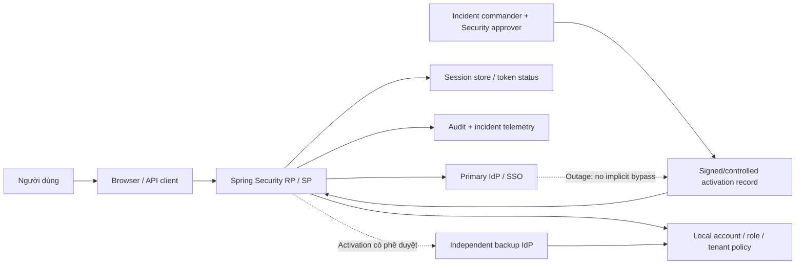

# Kế hoạch dự phòng được phê duyệt mà không tự động bỏ qua xác thực

## Mục tiêu học tập

Bài thuộc nhóm **Triển khai và vận hành** của module **Spring Security – federation**. Sau khi hoàn thành, người học có thể:

1. Giải thích sự khác nhau giữa **khả dụng của SSO/IdP**, **xác thực người dùng** và **phân quyền nội bộ**; hiểu vì sao IdP outage không có nghĩa hệ thống được phép bỏ lớp xác thực.
2. Nhận biết các failure mode: OIDC discovery/JWKS/token endpoint, SAML metadata/signature, CAS ticket validation, Kerberos KDC, proxy preauthentication, session store, network/TLS/DNS và IAM directory.
3. Đề xuất **kế hoạch dự phòng (contingency/fallback plan) đã được IAM, Security, vận hành và owner phê duyệt trước**, với trigger, người quyết định, scope, thời hạn, kiểm soát rủi ro, kiểm thử và rollback.
4. Phân biệt **graceful degradation có giới hạn**, **IdP dự phòng độc lập** với trust riêng, **break-glass** có danh tính và yếu tố xác thực riêng, **read-only mode**, **hàng đợi xử lý sau**, và **fail closed/503**; tránh “fallback password” tự tạo.
5. Thiết kế trạng thái `NORMAL → INCIDENT_DECLARED → APPROVED_ACTIVE → EXPIRED/RECOVERED`, bảo đảm không thể chuyển sang emergency mode chỉ vì frontend gửi `?emergency=true` hay một monitor phát hiện IdP lỗi.
6. Ràng buộc activation với **incident ID, hai người phê duyệt độc lập khi policy yêu cầu, window TTL, allowed actions/tenants/users, approval record và audit**; mặc định mọi thứ không nằm trong scope đều DENY.
7. Hiểu việc thay IdP không được tự nối user theo email hoặc cấp `ROLE_ADMIN` từ claim; vẫn cần issuer/subject linking đã xác minh, MFA/assurance và local permission.
8. Dùng **Spring Boot 3/Spring Security 6/Java 17+** minh họa hai OIDC client registrations với một **authorization-request resolver có cổng duyệt**, hạn chế callback/authorization khi contingency hết hiệu lực và method-level resource authorization.
9. Chạy chương trình **Java 17+ độc lập** mô phỏng chính sách primary/backup, dual approval, TTL, source validation, MFA, role, scope và recovery với stdout xác định.
10. Kiểm thử failure injection, duy trì phiên hợp lệ, revocation, pending request, direct access, multi-node, rotation, audit, phục hồi và tabletop exercise mà không dùng tài khoản hoặc bí mật production ngoài quyền được cấp.

## 1. Nguyên tắc bất biến: dự phòng khả dụng, không dự phòng bằng cách bỏ xác thực

Trong hệ thống federation, ứng dụng Spring Security (Relying Party/Service Provider) phụ thuộc vào một **nhà cung cấp danh tính** để xác thực người dùng. Nếu IdP gặp sự cố, **đăng nhập mới** có thể không hoạt động. Người vận hành bị áp lực khôi phục dịch vụ, nhưng việc thay điều kiện bảo mật bằng:

```java
// ANTI-PATTERN: tuyệt đối không dùng làm giải pháp khi IdP chết.
if (!idpReachable) {
    return new UsernamePasswordAuthenticationToken(
        "emergency-admin", null, List.of(
            new SimpleGrantedAuthority("ROLE_ADMIN")));
}
```

là tạo lối vượt xác thực/ủy quyền. Một lỗi availability đã trở thành **account takeover** và **privilege escalation**. Đoạn trên **chỉ là ví dụ nguy hiểm**, không phải code để chạy trong hệ thống.

Quy tắc vận hành chuẩn:

> **Không xác minh được danh tính và quyền theo phương án đã được phê duyệt thì không cho truy cập tài nguyên yêu cầu xác thực.**

Khi IdP không khả dụng, ứng dụng có thể:
- Tiếp tục xử lý một số request **đã có session xác thực hợp lệ** trong giới hạn rủi ro/pháp lý được duyệt.
- Chặn các hành động đòi reauthentication/MFA mới.
- Cho phép nội dung thực sự công khai như trang tình trạng sự cố.
- Xếp hàng các tác vụ đã được hệ thống kiểm quyền đầy đủ và không đòi user tương tác ngay, nếu có hợp đồng idempotency và audit.
- Chuyển sang **IdP dự phòng đã được đăng ký/trust trước** chỉ sau activation theo quy trình.
- Cho nhóm vận hành truy cập khả năng phục hồi qua kênh quản trị độc lập có **xác thực mạnh và least privilege**, không phải trang login anonymous “superuser”.
- Trả `503 Service Unavailable` hoặc một trạng thái lỗi thích hợp đối với login mới nếu không có phương án nào thỏa yêu cầu.

### 1.1. Ba câu hỏi độc lập

| Câu hỏi | Nơi trả lời | Khi IdP lỗi |
| --- | --- | --- |
| **Ai đang gửi request?** | SAML/OIDC/CAS/Kerberos/proxy IdP hoặc một cơ chế fallback độc lập đã duyệt | Không được tự tạo principal “tạm” |
| **Người đó được phép làm gì?** | Local account, tenant memberships, role/permission policy, SoD, expiry | Không được bỏ local policy vì không gọi IdP được |
| **Dịch vụ nào còn có thể hoạt động an toàn?** | BCP/DR plan, service SLO, business impact, mode restrictions | Có thể giảm chức năng, giữ an ninh |

**SSO availability không giống authorization availability.** Một IdP còn sống nhưng DB quyền nội bộ bị lỗi vẫn không phải lý do cấp role mặc định. Ngược lại, local permissions vẫn có dữ liệu không chứng minh user chưa đăng nhập đã được xác thực.

### 1.2. Ví dụ vận hành

Hệ thống Portal tài chính có hai loại tác vụ:
- `REPORT_READ`: đọc báo cáo nội bộ theo tenant, có thể cho phép trong một **session đã được xác thực trước sự cố** nếu account chưa bị revoke, session còn hợp lệ và business owner chấp nhận cửa sổ rủi ro.
- `PAYMENT_APPROVE`: phê duyệt chi tiền, yêu cầu fresh MFA và maker-checker SoD; **không thực hiện** khi không có bằng chứng assurance đủ mới, dù session cũ chứa `ROLE_MANAGER`.

Khi primary IdP lỗi, phương án có thể là **chặn phê duyệt**, giữ báo cáo trong các phiên hợp lệ có current-state checks, và cho phép người đã được gắn với **backup IdP** đăng nhập qua kênh dự phòng đã duyệt. Điều này **không phải** “mọi user được tự thêm mật khẩu tại Portal”.

## 2. Mô hình phụ thuộc và failure modes



### 2.1. Lỗi nào ảnh hưởng gì?

| Sự cố | Triệu chứng | Ảnh hưởng chính | Không được tự làm |
| --- | --- | --- | --- |
| OIDC Authorization Endpoint ngừng | Browser chuyển IdP rồi lỗi/timeout | Login mới, step-up | Cho anonymous vào protected endpoints |
| OIDC Token Endpoint lỗi | Code callback không đổi được ID Token | Login callback | Chấp nhận `code`/query như user identity |
| OIDC discovery/metadata lỗi | ClientRegistration không khởi tạo hoặc metadata refresh lỗi | Startup/new auth tùy triển khai | Chấp nhận issuer/JWKS từ URL browser gửi |
| JWKS retrieval lỗi | Không verify được token/key mới | Token validation/login | Bỏ chữ ký hoặc accept `alg=none` |
| IdP signing key sai/rotate lỗi | Signature validation fail | Authentication | Dùng key có sẵn từ untrusted source |
| SAML IdP SSO endpoint lỗi | AuthnRequest không được xử lý | SP-initiated login | Tạo `Saml2Authentication` từ SAMLResponse tự khai |
| SAML metadata/cert lỗi | SP không tin assertion | Login | Bỏ Audience/Recipient/signature checks |
| CAS Server/ticket registry lỗi | Không cấp/validate Service Ticket | CAS login, SLO | Chấp nhận vé cũ/reused/không validate |
| Kerberos KDC lỗi | Không cấp TGT/service ticket mới | Windows/Kerberos auth | Mặc định coi `REMOTE_USER` là verified |
| Proxy identity gateway lỗi | Không có verified headers/identity assertion | Pre-auth | Tin `X-Authenticated-User` từ client |
| Session store Redis/JDBC lỗi | Không tải được authenticated app session | Existing sessions | Gán admin vì không đọc được session |
| Local entitlement DB lỗi | Không kiểm quyền hiện hành | Authorization | `return true` cho mọi `@PreAuthorize` |
| Federation broker partial outage | Một IdP/tuyến auth không hoạt động | Một tập users/partners | Auto-link issuer/subject theo email |
| DNS/TLS/certificate expiry | TLS/discovery/redirect fail | Có thể ảnh hưởng nhiều lớp | Tắt TLS verification hoặc bỏ hostname check |
| Network partition nhiều nodes | Một số pods thấy IdP, pods khác không | Kết quả không đồng nhất | Bật emergency flag khác nhau trên mỗi pod |

**Phân loại root cause trước khi chuyển contingency.** Một callback 404 do ingress sai ACS không phải IdP-wide outage; thay mọi user sang backup IdP sẽ mở rộng blast radius mà không sửa lỗi.

### 2.2. Nhu cầu Availability không đồng nghĩa Fail-open

Trong phân quyền, fail-open thường là: “Không hỏi được IdP/permission service nên coi như cho phép”. Với hành động bảo mật, **mặc định deny-by-default** và kiểm quyền hiện hành tại request/method/resource boundary. Dự phòng đúng nghĩa là có **một cách đáng tin khác để xác thực hoặc trì hoãn tác vụ**, không thay xác thực bằng flag.

### 2.3. RTO và RPO có ý nghĩa gì ở IdP/SSO?

- **RTO (Recovery Time Objective):** thời gian tổ chức muốn khôi phục luồng đăng nhập/khả năng phục vụ được bảo vệ.
- **RPO (Recovery Point Objective):** mức mất cập nhật dữ liệu chấp nhận được (ví dụ user/group/entitlement changes) khi restore IdP/directory.
- **RTO thành công không cho phép RPO quyền lỗi thời** làm user đã bị offboard “sống lại”.
- **Security RTO:** mốc phải có đường deny/revoke khi sự cố chưa kết thúc, ví dụ tài khoản compromised.
- **SSO SLO:** có thể khác SLO của app; tối ưu uptime bằng bypass auth là vi phạm security SLO.

Các số phút/giờ cụ thể phải do owner xác định, không có một threshold Spring Security áp dụng cho mọi hệ.

## 3. Phương án dự phòng: so sánh lựa chọn

| Phương án | Xác thực người dùng đến từ đâu? | Dùng khi | Giới hạn / rủi ro |
| --- | --- | --- | --- |
| **Primary IdP retry/backoff** | Primary IdP còn hoạt động | Sự cố thoáng qua, IdP còn xác minh được | Không retry vô hạn/DoS |
| **Giữ session hợp lệ** | Session trước đó đã xác thực | Hành động low-risk, chính sách phiên cho phép | Authorities có thể stale; chưa phục hồi login mới |
| **Secondary/backup IdP** | IdP khác đã trust, có MFA, active user link | Primary outage đã xác minh và có activation | Khác issuer/sub, role mapping, assurance, keys |
| **DR replica của IdP** | Bản sao chính thức theo thiết kế HA/DR | Disaster recovery/cutover theo IdP owner | Đồng bộ key, state, subject/issuer và revocation |
| **Independent break-glass admin** | Kênh credentials + MFA độc lập, lưu an toàn | Cứu hạ tầng khi IAM/SSO unavailable | Rất ít accounts, scoped, dual control và audit |
| **Read-only degraded mode** | Valid existing session hoặc approved backup identity | Giữ dịch vụ đọc được | Không tự cho anonymous đọc dữ liệu kín |
| **Pause/queue protected transactions** | Không thực hiện cho tới khi có auth lại | Approval/payment/export rủi ro cao | Cần idempotency, retention, replay controls |
| **Trang status public** | Không yêu cầu login | Thông báo incident không chứa dữ liệu kín | Không lộ trạng thái tài khoản/PII |
| **Chặn login mới (503)** | Không có phương án đủ tin cậy | Không có verified fallback | Ảnh hưởng availability nhưng giữ trust |

**Không phải tất cả phương án đều thay thế cho nhau.** Backup IdP có thể hỗ trợ login mới, còn break-glass hạ tầng nên chỉ dùng admin plane riêng. Trang thông báo `/status` không được biến thành API tài chính public.

## 4. Kế hoạch dự phòng phải được chuẩn bị và phê duyệt trước sự cố

Một runbook “khi có lỗi, tắt security filter” không được coi là BCP. Một kế hoạch đúng cần **owner, approval, scope, execution path, validation và rollback**.

### 4.1. Những phần bắt buộc trong hồ sơ kế hoạch

| Trường | Nội dung cần chuẩn bị |
| --- | --- |
| Plan ID/version | Ví dụ `SSO-BCP-2026-03`, owner và versioning |
| System/tenant scope | Ứng dụng, khu vực, tenant, partner, operations được phép |
| Threat model | Đánh giá IdP outage, compromise, shared risk, phishing, replay |
| Trigger/criteria | Monitoring signals + human verification; tránh một metric giả |
| Declaring authority | Incident commander/on-call authorized role |
| Security approver | Người độc lập phụ trách IAM/Security |
| Segregation of duties | Người bật không tự chứng nhận approval của chính mình |
| Supported fallback | DR IdP hoặc backup provider, signing keys/issuer/client config |
| Allowed account classes | Ai có backup identity đã được liên kết chính thức |
| Allowed actions | Ví dụ `REPORT_READ`, `SUPPORT_DIAGNOSE`; deny payment/admin |
| Authentication assurance | MFA, phishing resistance, auth_time, device/policy |
| Authorization | Local active account, current grants, tenant/resource restrictions |
| Duration/TTL | Thời điểm bắt đầu/kết thúc tuyệt đối UTC, auto-expire |
| Audit/evidence | Ticket ID, approvers, config revision, decisions, negative tests |
| Monitoring | Alert failover-use, anomaly, backup auth errors, role denies |
| Revocation | Cách hủy phiên/token ngay khi compromise |
| Recovery/rollback | Mốc switch-back, invalidation và reconciliation |
| Exercises | Tabletop và test IdP failover định kỳ, reviewer ký kết |
| Contact tree | App/IdP/network/SOC/manager và escalation |

**Đặt thời hạn và scopes trước khi xảy ra sự cố** giúp tránh mở quyền vĩnh viễn vì áp lực vận hành.

### 4.2. Ai có thẩm quyền kích hoạt?

Một ví dụ policy:
- Nhóm SRE phát hiện và xác minh primary IdP outage.
- Incident commander khai báo sự cố dựa trên evidence.
- Security/IAM owner phê duyệt **mở backup IdP** trong đúng scope và expiry.
- Hệ thống activation lưu audit record **được kiểm soát trên server**, signed hoặc dùng authenticated administrative API với strong MFA/mTLS, RBAC, SoD.
- App/ingress kiểm **record còn hiệu lực** ở mọi request quan trọng, không tin client query.
- Activation chỉ có effect trong allowed tenants/actions và log mọi lần sử dụng.
- Khi hết TTL hoặc recovery, chế độ backup ngừng nhận login/request mới theo policy.

Một “approver” là **định danh người phê duyệt đã xác thực và có thẩm quyền**, không phải string `{"approvedBy":"security"}` mà caller tự nhập.

### 4.3. Kích hoạt không được nằm trên public user API

Các endpoint như:

```http
GET /enable-emergency?secret=123
POST /login?skipMfa=true
X-Emergency-Access: yes
```

không phải phương án dự phòng an toàn. **Không** gắn `@PermitAll` cho đường điều khiển emergency mode. Control plane nên tách network và account privileges; chỉ được operator đã xác thực mạnh, có ticket và approval record sử dụng. Nếu UI điều khiển sử dụng chính IdP đang lỗi, cần **kênh vận hành độc lập đã chuẩn bị**, không phải một đường tắt anonymous.

## 5. Trạng thái: không tự chuyển từ mất kết nối sang “ALLOW”

```mermaid
stateDiagram-v2
    [*] --> NORMAL
    NORMAL --> SUSPECTED: Monitoring nhận tín hiệu
    SUSPECTED --> NORMAL: False alarm / recovered
    SUSPECTED --> DECLARED: Incident commander xác nhận
    DECLARED --> ACTIVE: Security+Incident approvals; TTL & scope
    DECLARED --> NORMAL: Phục hồi trước activation
    ACTIVE --> EXPIRED: TTL hết
    ACTIVE --> RECOVERED: Chính thức switch-back
    ACTIVE --> REVOKED: Security thu hồi khẩn
    EXPIRED --> NORMAL: Cleanup + audit
    REVOKED --> NORMAL: Cleanup + audit
    RECOVERED --> NORMAL: Verify + close incident
```



**State machine là chính sách tự thiết kế, không phải behavior Spring Security có sẵn.** Các transitions phải được thực thi bằng transaction/signed policy và audit.

### 5.1. Bảng quyết định

| Trạng thái | Primary login | Backup login | Existing session | Hành động rủi ro cao |
| --- | --- | --- | --- | --- |
| `NORMAL` | Theo primary IdP | **Không cho bắt đầu** nếu plan chưa active | Theo session rules | Theo MFA/role/SoD bình thường |
| `SUSPECTED` | Retry có giới hạn nếu primary reachable | Không mở | Theo current-state/session | Không tự giảm assurance |
| `DECLARED` | Có thể không hoạt động | Chưa mở cho tới khi approvals hoàn tất | Theo risk policy | Deny/queue nếu cần fresh auth |
| `ACTIVE` | Theo khả năng/plan | **Cho phép đúng scope/TTL** qua trusted backup | Validate issuer/role/time | Thường deny hoặc yêu cầu trusted strong step-up |
| `EXPIRED` | Theo primary nếu recovered | Ngừng | Backup sessions/token phải xử lý theo policy | Không giữ emergency privileges |
| `REVOKED` | Theo policy incident | Ngừng ngay | Revoke/deny relevant sessions/tokens | Deny |
| `RECOVERED` | Khôi phục primary | Dừng cấp login dự phòng | Di chuyển/revoke backup sessions có kiểm soát | Reauthenticate/step-up theo policy |

**Điều quan trọng:** backup login activation có thể giúp *một nhóm users* đăng nhập, không cho mọi users hưởng mọi roles. Khi backup được active, authorization vẫn phải kiểm quyền tại ứng dụng.

### 5.2. TTL và revoke phải áp dụng ở request, không chỉ lúc bật

Một feature flag `backupEnabled=true` được đọc một lần khi app startup sẽ không tự tắt khi TTL hết. Nếu business yêu cầu kết thúc emergency mode lúc 14:00 UTC:
- New backup login request sau 14:00 bị chặn.
- Pending OIDC callback sau 14:00 không được tự gán session backup (trừ policy window/cutover được quyết định có chủ đích).
- Các session backup đã tạo phải được revoke hoặc chỉ tiếp tục trong **window rõ ràng có current-state checks**.
- Grants emergency không thể tồn tại vĩnh viễn trong cache/JWT.
- Các pods phải dùng chung control record/version; không một node giữ cờ cũ.

Khi không đọc được activation store: **backup mode fail closed**. Không để lỗi Redis/DB dẫn tới `active=true` mặc định.

## 6. Cơ chế phát hiện sự cố và quyết định có cần failover

### 6.1. Health signals đáng tin

- OAuth2/OIDC authorization endpoint reachable từ network/browser phù hợp.
- Token endpoint latency/error rates và callback `invalid_grant`/timeout.
- OIDC discovery/`.well-known/openid-configuration` health, issuer/JWKS consistency.
- Tỷ lệ SAML AuthnRequest→SAMLResponse thành công, IdP metadata/signing verification.
- CAS service ticket validation error, ticket registry health.
- Kerberos AS/TGS failures, DNS/KDC reachability.
- TLS certificate expiry/OCSP/trust errors, DNS propagation.
- App session-store và permission-store current-state health.
- Global identity provider status page/partner incident notification, có nguồn xác minh.
- Cross-node traffic và các tenant affected, không chỉ một probe từ một máy.

### 6.2. Phân biệt lỗi cục bộ với toàn hệ

Nếu chỉ một tenant bị `Audience mismatch` vì metadata sai, **mở backup cho mọi tenants là không đúng**. Nếu chỉ một pod bị JWKS cache lỗi, việc restart/refresh cache có thể an toàn hơn activation. Nếu primary IdP bị compromise chứ không chỉ outage, không được tiếp tục tin old tokens/signing keys theo kế hoạch availability bình thường.

### 6.3. Circuit breaker đúng vai trò

Circuit breaker/backoff có thể giảm bão retry vào IdP hoặc token endpoint; nhưng:
- Breaker chỉ quyết định **có nên gọi IdP lúc này**.
- Nó **không** chứng minh người dùng đã xác thực.
- Nó **không** tạo `Authentication` hoặc role admin.
- Nó không thay policy phê duyệt backup IdP.
- Retry cần bounded, jitter, timeouts và metrics; không log auth tokens hay credentials.

**Sai:** `if (circuitBreakerOpen) return authenticated=true`. **Đúng:** breaker open → login failure/503, hoặc redirect backup **chỉ khi approval gate còn hiệu lực và account thuộc scope**.

## 7. Fallback option A: tiếp tục phiên đã xác thực hợp lệ

### 7.1. Existing sessions không phải “bỏ xác thực”

Một Spring web app thường giữ `Authentication` trong `SecurityContext`/`HttpSession`. Nếu user đã login OIDC/SAML/CAS trước khi IdP chết, app có thể đọc session cũ từ shared session store. Tiếp tục session đó khác với tạo session mới cho anonymous user.

Chỉ xem xét tiếp tục khi:
1. Session trước đó **đã được xác thực** bởi IdP được trust.
2. Session chưa hết hạn, chưa bị revoke, còn gắn đúng subject/issuer/app.
3. Local account ACTIVE, tenant membership và permissions còn hiệu lực.
4. Chính sách không yêu cầu reauthentication/fresh MFA cho action này.
5. Security response cho compromise khác outage; nếu IdP bị lộ khóa, phải thu hồi trust/sessions theo incident runbook.
6. Nếu local permission DB unavailable, high-risk actions phải deny; không tin snapshot admin privileges vô thời hạn.
7. Các session được quản lý qua shared store/multi-node; không giả định xóa cookie browser đủ để thu hồi server-side sessions.

### 7.2. Những sai lầm phổ biến

| Sai lầm | Hệ quả |
| --- | --- |
| “IdP lỗi thì session cookie hợp lệ mãi” | Session fixation/theft và stale roles không bị thu hồi |
| “Role có trong SecurityContext là đủ” | Role đã bị thu hồi có thể còn trong HttpSession |
| “Không gọi được DB permission thì tin cache admin” | Fail-open authorization |
| “Đã logout IdP thì mọi SP session tự hết” | SAML/CAS/OIDC logout propagation có giới hạn |
| “JWT đã ký thì vẫn cho dù user disabled” | Self-contained token có thể còn tới `exp` nếu thiếu revoke gate |
| “Đọc dashboard được nên duyệt tiền được” | Action có yêu cầu step-up riêng |

### 7.3. Quy tắc action-level

```text
if no verified prior authentication:
    DENY / require approved backup login
else if account disabled or token/session revoked:
    DENY
else if authorization store cannot establish current permission:
    DENY high-risk action
else if action needs fresh MFA and trusted reauthentication unavailable:
    DENY / queue, not auto-approve
else if session valid and resource policy permits:
    ALLOW within documented SLA
```

Đây là policy pseudocode, không phải mặc định Spring Security. Các thresholds phiên và cache TTL phải được Security/owner phê duyệt; không có một “IdP outage TTL” chung trong Spring.

## 8. Fallback option B: IdP dự phòng có danh tính và trust riêng

Một phương án phổ biến cho hệ thống quan trọng là **secondary independent OIDC/SAML IdP**, có DNS/hosting, signing keys, client registration và authentication policy riêng, đã được kiểm thử trước.

### 8.1. Không chuyển sang IdP chưa được đăng ký

Ứng dụng phải có trước:
- Exact backup issuer/entityID, HTTPS/TLS và JWKS/signing certificates trusted.
- Backup OAuth2 client registration (ID/secret/redirect) hoặc SAML relying-party registration với ACS/SP entityIDs được thống nhất.
- Synthetic testing về issuer, audience, nonce, signature, time, subject và MFA assurance.
- Approved identity links từ backup subject đến **cùng local internal account**.
- Local permission/tenant policy không phụ thuộc vào group names có thể bị sao chép tùy ý.
- Approval gate chặn activation ngoài incident window.
- Revocation/logout/session invalidation và switch-back plan.
- Quản lý keys/secret rotation, logging, per-issuer monitoring và trusted metadata refresh.

**Không nhập một ID token từ backup vào primary RP theo logic “cả hai có chữ ký hợp lệ là được”.** Mỗi token phải được xác minh bằng trust configuration **đúng issuer/client**. Authenticated identity linking phải dựa trên `(issuer, stable subject)`, không chỉ email.

### 8.2. Identity linking không phải email matching

Ví dụ:

```text
Primary:
issuer=https://login.primary.example/realms/corp
sub=primary-uid-1042

Backup:
issuer=https://login.recovery.example/realms/contingency
sub=backup-opaque-f39

Internal account:
accountId=acct-1042
active=true
tenant=finance
permission=REPORT_READ
```

Một approval workflow **trước sự cố** đã xác minh hai external identities này cùng thuộc `acct-1042`. Khi backup IdP xác thực `backup-opaque-f39`, app tìm approved link và tải permissions nội bộ. Nếu không có link, **DENY**, không auto-link email, phone hoặc display name trùng.

### 8.3. Cần cùng mức bảo đảm hay được giảm?

Đối với công việc có yêu cầu MFA/phishing-resistant, backup phải đáp ứng **hợp đồng assurance được duyệt**. Nếu backup chỉ hỗ trợ password:
- Không tự coi `amr=["pwd"]` thành MFA.
- Chỉ cho những tác vụ có risk policy thực sự chấp nhận mức đó, hoặc deny.
- Với action yêu cầu fresh MFA, phải có source verified `acr`/`amr`/`auth_time`/SAML AuthnContext và semantics theo issuer.
- Không tự nâng assurance vì `backupMode=true`.

**Đổi nhà cung cấp danh tính không đổi bản chất quyền tài chính, luật hoặc audit.**

### 8.4. DR replica khác independent IdP

Có hai thiết kế:
1. **DR replica** của cùng IdP/issuer được vận hành chính thức, có đồng bộ signing keys/config/user identities theo chiến lược HA/DR. Nếu issuer, keys hoặc endpoints thay đổi, phải tuân đúng OIDC/SAML trust contract; không giả định chỉ đổi DNS là đủ.
2. **Independent backup IdP** có issuer/subject và keys khác, cần registration/linking mới, approval và assurance mapping.

Đừng copy private signing key production sang một IdP phát triển không được quản lý chỉ để tiện failover. Nếu DR cần đồng bộ keys, phải là **hạ tầng DR được bảo vệ cùng mức** theo key management policy và threat model.

## 9. Fallback option C: break-glass không được biến thành cửa hậu

**Break-glass** dành cho số ít người vận hành khôi phục hạ tầng khi hệ thống identity chính bị gián đoạn, không cho tất cả nhân viên quyền `ROLE_ADMIN`.

### 9.1. Đặc tính của emergency accounts

- **Pre-provisioned**, identity proofed, riêng và không tự động tạo lúc lỗi.
- Có authenticator mạnh độc lập IdP outage, hardware MFA nếu phù hợp risk.
- Số lượng tối thiểu, quyền quản trị hạn chế theo resource/runbook.
- Credential trong vault an toàn; sử dụng theo quy trình hai người/dual control.
- Không chia sẻ một password “breakglass123” qua chat hoặc trong Git.
- Chỉ hoạt động trong network/admin plane cô lập hoặc PAM/jump-host được bảo vệ.
- Gắn incident ticket, owner, time window, session recording/audit và alert.
- Sau dùng rotate credentials/keys, review changes, revoke emergency sessions.
- Không dùng để vượt maker-checker/SoD của nghiệp vụ tài chính.
- Không biến một admin plane route thành public website “emergency login”.

### 9.2. Không nên thêm formLogin trên app vào phút cuối

Trong Spring Security:
```java
// ANTI-PATTERN: thêm lúc sự cố mà không có password store,
// strong factor, approval gate, rate limit và session policy.
http.formLogin(Customizer.withDefaults());
```

Khi được bật không kế hoạch, form login có thể dùng credentials trùng/dễ đoán, không MFA, không phân quyền đúng và khó audit. Một kênh local authentication chỉ hợp lệ khi **đã được thiết kế, đánh giá, phê duyệt, diễn tập và bảo vệ đầy đủ**.

### 9.3. Break-glass cho infrastructure không phải business login

Operator có thể cần:
- Restart IdP/ingress.
- Phục hồi DNS/certificates, JWKS cache, key rotation.
- Mở communication channel cho incident.
- Reconcile directory/IdP after restore.

Họ **không** tự nhiên được phép:
- Đọc dữ liệu mọi tenants.
- Tự duyệt payment.
- Export toàn bộ customer PII.
- Tạo nhiều permanent admin users.
- Tắt toàn bộ `authorizeHttpRequests` hoặc audit.

## 10. Khi không có fallback phù hợp: trả lỗi an toàn

Nếu chưa có approved backup IdP và không thể xác thực user mới:
- Không cấp authenticated session.
- Trả trạng thái dịch vụ phù hợp cho login mới, ví dụ `503 Service Unavailable` trên một failure page đã review.
- Không hiển thị raw IdP exceptions, client secret, token endpoint errors.
- Thông báo status bằng nội dung công khai, không lộ liệu account tồn tại.
- Với API, thông báo lỗi authentication vs availability chuẩn hóa; không trả `200` và response giả “success”.
- Có retry/backoff và circuit-breaker, không phát bão request.
- Giữ CSRF, session fixation protection, TLS, cookie security, account-lock policies.
- Không auto-approve pending business transactions trong hàng đợi khi IdP hết sự cố.

**Thông điệp UX tốt:** “Không thể xác minh đăng nhập vào lúc này. Một số chức năng tạm ngưng; thông tin sẽ được cập nhật qua kênh chính thức.” Không cần nêu endpoint nội bộ hay secret.

## 11. Spring Boot 3 / Spring Security 6: hai OIDC registrations đã định sẵn

Ví dụ kiến trúc minh họa:
- Primary issuer `https://login.primary.example/realms/corp`, registration ID `primary`.
- Backup issuer `https://login.recovery.example/realms/contingency`, registration ID `standby`.
- Backup chỉ được **initiate** khi `EmergencyGate.isActive()` trả true từ **approval store**.
- Provider metadata/JWKS, tokens và redirect callbacks vẫn được Spring Security OIDC client kiểm theo registration đúng.
- Các method business kiểm account, permissions và mode, không chỉ kiểm user đã login.
- **Không có** fallback từ request header, email claim, anonymous hoặc disabled account.

### 11.1. Dependencies

Trong dự án có Spring Boot 3 plugin và dependency management, Java 17:

```groovy
dependencies {
    implementation 'org.springframework.boot:spring-boot-starter-web'
    implementation 'org.springframework.boot:spring-boot-starter-security'
    implementation 'org.springframework.boot:spring-boot-starter-oauth2-client'
    testImplementation 'org.springframework.boot:spring-boot-starter-test'
    testImplementation 'org.springframework.security:spring-security-test'
}
```

Đây là **ví dụ tích hợp trong dự án Spring Boot**, không phải chương trình `javac` độc lập. Các module federation SAML2/CAS/Kerberos phải dùng filter/provider và trust config riêng; hai OIDC registrations không tự hỗ trợ các protocol khác.

### 11.2. application.yml

```yaml
spring:
  security:
    oauth2:
      client:
        registration:
          primary:
            provider: primary
            client-id: portal-primary
            client-secret: "${PRIMARY_OIDC_CLIENT_SECRET}"
            authorization-grant-type: authorization_code
            scope: openid,profile
            redirect-uri: "{baseUrl}/login/oauth2/code/{registrationId}"
          standby:
            provider: standby
            client-id: portal-standby
            client-secret: "${STANDBY_OIDC_CLIENT_SECRET}"
            authorization-grant-type: authorization_code
            scope: openid,profile
            redirect-uri: "{baseUrl}/login/oauth2/code/{registrationId}"
        provider:
          primary:
            issuer-uri: https://login.primary.example/realms/corp
          standby:
            issuer-uri: https://login.recovery.example/realms/contingency
server:
  forward-headers-strategy: framework
  servlet:
    session:
      cookie:
        secure: true
        http-only: true
        same-site: lax
```

**Lưu ý kỹ thuật quan trọng:**

- Hai issuer URLs trên là **fixtures không tồn tại thực tế**, muốn chạy cần IdP test và client registrations thật.
- Secret lấy từ secret manager/CI runtime, không commit source hoặc log.
- Issuer, JWKS, callback và client ID là **trust config cố định**; không lấy `?issuer=...` của browser.
- `issuer-uri` có thể cần provider discovery **lúc khởi tạo ClientRegistrationRepository**. Nếu một provider đang offline và ứng dụng cố load metadata ở startup, app có thể fail startup dù provider kia còn khỏe. Đây là **rủi ro DR cần giải quyết trước production** bằng khả dụng metadata/trust được quản lý, startup/readiness tests hoặc provider endpoints/config đáng tin phù hợp library. Không bypass issuer validation hay hard-code một arbitrary JWKS URL từ input để che outage.
- Behind ingress, chỉ xử lý `Forwarded`/`X-Forwarded-*` từ trusted proxy sau strip/overwrite; `{baseUrl}` phải ra public HTTPS callback.
- Không khai báo cả hai issuers nếu không có backup trust review, runbook và user linking; chỉ thêm registration không tự là phương án dự phòng.
- Không sử dụng HTTP cho OIDC production IdP/callback.

### 11.3. EmergencyActivation và approval store

Dữ liệu điều khiển cần được **ghi bởi control plane độc lập**, không phải browser. Thiết kế mẫu:

```text
activationId: ACT-7F2C
incidentId: INC-2026-1107
mode: APPROVED_ACTIVE
approvedByIncidentCommander: verified principal ICM-04
approvedBySecurity: verified principal SEC-08
scope: app=portal, tenant=finance, actions=[REPORT_READ]
validFrom: 2026-11-07T10:00:00Z
validUntil: 2026-11-07T12:00:00Z
revoked: false
version: 52
auditHash: server-calculated
```

**Không cho phép caller tự gửi những field này để “trở thành approved”.** Approval service phải xác minh identities, roles, separation of duties, signatures/credential strength, incident ticket và monotonic revision; control record cần transaction/audit, có TTL và shared availability.

Ví dụ Java API domain — mã service được tích hợp với một repository **đã được bảo vệ**; các classes này là code Spring và Java 17, nhưng để chạy cần implementation của repository/storage:

```java
package com.example.contingency;

import java.time.Clock;
import java.time.Instant;
import java.util.Optional;
import org.springframework.stereotype.Service;

record Activation(
        String incidentId,
        Instant validFrom,
        Instant validUntil,
        String incidentApproverId,
        String securityApproverId,
        boolean revoked) {

    boolean approvedAt(Instant now) {
        return !revoked
            && incidentId != null && !incidentId.isBlank()
            && incidentApproverId != null
            && securityApproverId != null
            && !incidentApproverId.equals(securityApproverId)
            && validFrom != null && validUntil != null
            && !now.isBefore(validFrom)
            && now.isBefore(validUntil);
    }
}

interface EmergencyActivationRepository {
    Optional<Activation> currentApprovedActivation();
}

@Service
public final class EmergencyGate {
    private final EmergencyActivationRepository approvals;
    private final Clock clock;

    public EmergencyGate(
            EmergencyActivationRepository approvals, Clock clock) {
        this.approvals = approvals;
        this.clock = clock;
    }

    public boolean isActive() {
        try {
            return approvals.currentApprovedActivation()
                    .filter(a -> a.approvedAt(clock.instant()))
                    .isPresent();
        } catch (RuntimeException storeUnavailable) {
            // Fail closed; log only reason code/correlation.
            return false;
        }
    }
}
```

**Tệp và scope:** package `com.example.contingency`, mỗi `public` top-level type phải ở file trùng tên; ví dụ trên trình bày nhiều package-private types và một public `EmergencyGate` trong `EmergencyGate.java`. Một `@Bean Clock.systemUTC()` và một implementation `EmergencyActivationRepository` phải được khai báo để app khởi động. **Không** dùng một in-memory local flag làm nguồn policy trên production multi-node.

**Quan trọng:** code chỉ cho thấy hai approvers khác string; **chưa tự xác minh hai người là Incident Commander/Security** hay approval signatures. Đây là trách nhiệm của repository/control plane và quy trình authorization. Nhìn một JSON có hai IDs không đủ để coi đã dual approved.

### 11.4. GatedAuthorizationRequestResolver: backup không tự mở khi primary lỗi

`DefaultOAuth2AuthorizationRequestResolver` trong Spring Security 6 tạo OAuth2 Authorization Request từ client registration, gồm state/nonce theo OIDC flow. Bọc resolver bằng gate để trả `null` khi backup chưa được phê duyệt, **không tự tạo một token hoặc bypass xác thực**.

Tệp `GatedAuthorizationRequestResolver.java`:

```java
package com.example.contingency;

import jakarta.servlet.http.HttpServletRequest;
import org.springframework.security.oauth2.client.registration.ClientRegistrationRepository;
import org.springframework.security.oauth2.client.web.DefaultOAuth2AuthorizationRequestResolver;
import org.springframework.security.oauth2.client.web.OAuth2AuthorizationRequestResolver;
import org.springframework.security.oauth2.core.endpoint.OAuth2AuthorizationRequest;
import org.springframework.security.oauth2.core.endpoint.OAuth2ParameterNames;

public final class GatedAuthorizationRequestResolver
        implements OAuth2AuthorizationRequestResolver {

    private final DefaultOAuth2AuthorizationRequestResolver delegate;
    private final EmergencyGate gate;

    public GatedAuthorizationRequestResolver(
            ClientRegistrationRepository registrations, EmergencyGate gate) {
        this.delegate = new DefaultOAuth2AuthorizationRequestResolver(
                registrations, "/oauth2/authorization");
        this.gate = gate;
    }

    @Override
    public OAuth2AuthorizationRequest resolve(HttpServletRequest request) {
        return allowed(delegate.resolve(request));
    }

    @Override
    public OAuth2AuthorizationRequest resolve(
            HttpServletRequest request, String registrationId) {
        if ("standby".equals(registrationId) && !gate.isActive()) {
            return null;
        }
        return allowed(delegate.resolve(request, registrationId));
    }

    private OAuth2AuthorizationRequest allowed(
            OAuth2AuthorizationRequest authorizationRequest) {
        if (authorizationRequest == null) {
            return null;
        }
        String registrationId = authorizationRequest.getAttribute(
                OAuth2ParameterNames.REGISTRATION_ID);
        if ("standby".equals(registrationId) && !gate.isActive()) {
            return null;
        }
        return authorizationRequest;
    }
}
```

**Lưu ý:**
- Resolver `return null` có nghĩa **không khởi tạo redirect flow**, không tự trả HTTP 403. Spring cần có request authorization rule chặn path backup khi resolver không xử lý.
- Overload `resolve(request, registrationId)` cũng kiểm gate; cần test custom authorization flow sử dụng overload này.
- Resolver chỉ khóa **login initiation**; vẫn cần chặn callback đến muộn hoặc session backup đã tồn tại khi activation hết hạn.
- Không chỉ ẩn link standby trong HTML: attacker có thể gọi trực tiếp `/oauth2/authorization/standby`.
- Registration `primary` vẫn dùng Spring OIDC validation bình thường; “primary unhealthy” không tự làm `gate.isActive()` thành true.
- OAuth2/OIDC state, nonce, signature, issuer/audience/expiry validation vẫn phải do Spring/provider thực thi.

### 11.5. SecurityFilterChain: deny backup route khi gate đóng

Tệp `SecurityConfig.java`:

```java
package com.example.contingency;

import java.time.Clock;
import jakarta.servlet.http.HttpSession;
import org.springframework.context.annotation.Bean;
import org.springframework.context.annotation.Configuration;
import org.springframework.security.config.annotation.method.configuration.EnableMethodSecurity;
import org.springframework.security.config.annotation.web.builders.HttpSecurity;
import org.springframework.security.core.context.SecurityContextHolder;
import org.springframework.security.oauth2.client.authentication.OAuth2AuthenticationToken;
import org.springframework.security.oauth2.client.registration.ClientRegistrationRepository;
import org.springframework.security.web.SecurityFilterChain;
import org.springframework.security.web.authentication.SavedRequestAwareAuthenticationSuccessHandler;

@Configuration
@EnableMethodSecurity
public class SecurityConfig {

    @Bean
    Clock clock() {
        return Clock.systemUTC();
    }

    @Bean
    SecurityFilterChain filterChain(
            HttpSecurity http,
            ClientRegistrationRepository registrations,
            EmergencyGate gate) throws Exception {

        var resolver = new GatedAuthorizationRequestResolver(
                registrations, gate);
        var success = new SavedRequestAwareAuthenticationSuccessHandler();

        return http
            .authorizeHttpRequests(auth -> auth
                .requestMatchers("/", "/status", "/error").permitAll()
                // If resolver declines to initiate standby, deny this URL.
                .requestMatchers("/oauth2/authorization/standby").denyAll()
                .anyRequest().authenticated())
            .oauth2Login(oauth -> oauth
                .authorizationEndpoint(endpoint ->
                    endpoint.authorizationRequestResolver(resolver))
                .successHandler((request, response, authentication) -> {
                    if (authentication instanceof OAuth2AuthenticationToken t
                            && "standby".equals(
                                t.getAuthorizedClientRegistrationId())
                            && !gate.isActive()) {
                        SecurityContextHolder.clearContext();
                        HttpSession session = request.getSession(false);
                        if (session != null) session.invalidate();
                        response.sendError(403, "Emergency login not active");
                        return;
                    }
                    success.onAuthenticationSuccess(
                            request, response, authentication);
                })
                .failureHandler((request, response, exception) ->
                    response.sendError(
                        503, "Federated authentication unavailable")))
            .build();
    }
}
```

**Phân tích điểm bảo vệ:**

- `oauth2Login` vẫn dùng **OIDC Authorization Code** chuẩn; không cấu hình `formLogin` hoặc anonymous login fallback.
- `GatedAuthorizationRequestResolver` từ chối khởi tạo `standby` nếu approval không còn hiệu lực. `AuthorizationFilter` phía sau deny URL đó trong trường hợp redirect filter không xử lý. **Khi gate đang active**, OAuth2 redirect filter xử lý trước authorization rule và gửi browser tới trusted backup IdP; điều này phải được kiểm bằng MockMvc/browser integration.
- `successHandler` chặn một **callback standby đến muộn** nếu activation đã hết hạn giữa initiation và callback. Nó xóa SecurityContext/invalidate session; chỉ là một lớp, không thay request-time policy.
- Khi callback primary hợp lệ, xử lý success bình thường qua saved request handler.
- `failureHandler` trả `503` cho authentication failures trong filter này; **không** sửa `Authentication` hoặc tạo admin. Production nên phân loại lỗi user cancellation/wrong credentials (4xx) khác provider outage (503), tránh mọi authentication error đều 503 làm sai observability; đoạn code dùng thông báo chung để tập trung an toàn.
- `@EnableMethodSecurity` bật `@PreAuthorize`. URL-level `authenticated()` chỉ là lớp đầu; vẫn cần local entitlement/tenant policy bên trong business service.
- **Không tắt CSRF toàn cục.** Browser forms và transactions cần CSRF protection và secure cookies.
- Nếu IdP outage xảy ra trước khi Spring khởi tạo ClientRegistration vì metadata discovery, `SecurityFilterChain` này **không cứu được startup**. Cần prevalidated metadata availability/deployment strategy theo mục 11.2.
- Không dùng `/status` để hiển thị raw tokens, internal circuit breaker state, user list, admin control endpoints hoặc secrets.

**Lưu ý về tính đầy đủ:** Đây là cấu hình **minh họa và cần integration tests**, chưa cài `EmergencyActivationRepository`, account store, issuer-specific authorization policies và session revocation cluster; không tự coi code là hệ failover production hoàn chỉnh.

### 11.6. Method authorization: backup chỉ cho đúng hoạt động

Tệp `ContingencyPolicy.java`, dữ liệu account dùng in-memory **chỉ để học**, không dùng production:

```java
package com.example.contingency;

import java.util.Map;
import java.util.Set;
import org.springframework.security.core.Authentication;
import org.springframework.security.oauth2.client.authentication.OAuth2AuthenticationToken;
import org.springframework.security.oauth2.core.oidc.user.OidcUser;
import org.springframework.stereotype.Component;

@Component("contingencyPolicy")
public final class ContingencyPolicy {
    private record Key(String issuer, String subject) {}
    private record Account(
        boolean active, Map<String, Set<String>> permissions) {}

    private static final String PRIMARY =
        "https://login.primary.example/realms/corp";
    private static final String BACKUP =
        "https://login.recovery.example/realms/contingency";

    private final EmergencyGate gate;
    private final Map<Key, Account> approvedLinks = Map.of(
        new Key(PRIMARY, "primary-uid-1042"),
        new Account(true,
            Map.of("finance", Set.of("REPORT_READ", "PAYMENT_APPROVE"))),
        new Key(BACKUP, "backup-opaque-f39"),
        new Account(true, Map.of("finance", Set.of("REPORT_READ")))
    );

    public ContingencyPolicy(EmergencyGate gate) {
        this.gate = gate;
    }

    public boolean canRead(Authentication authentication, String tenant) {
        return hasPermission(authentication, tenant, "REPORT_READ");
    }

    public boolean canApprovePayment(
            Authentication authentication, String tenant) {
        // Trong phương án này, backup KHÔNG được duyệt payment.
        if (!(authentication instanceof OAuth2AuthenticationToken token)
                || !"primary".equals(
                    token.getAuthorizedClientRegistrationId())) {
            return false;
        }
        return hasPermission(authentication, tenant, "PAYMENT_APPROVE");
    }

    private boolean hasPermission(
            Authentication auth, String tenant, String action) {
        if (!(auth instanceof OAuth2AuthenticationToken oauth)
                || !auth.isAuthenticated()
                || !(oauth.getPrincipal() instanceof OidcUser oidc)) {
            return false;
        }

        String registrationId = oauth.getAuthorizedClientRegistrationId();
        String issuer = oidc.getIdToken().getIssuer().toString();
        String subject = oidc.getIdToken().getSubject();

        if ("primary".equals(registrationId)) {
            if (!PRIMARY.equals(issuer)) return false;
        } else if ("standby".equals(registrationId)) {
            if (!BACKUP.equals(issuer)
                    || !gate.isActive()
                    || !"REPORT_READ".equals(action)) {
                return false;
            }
        } else {
            return false;
        }

        Account a = approvedLinks.get(new Key(issuer, subject));
        return a != null && a.active()
            && a.permissions().getOrDefault(tenant, Set.of())
                .contains(action);
    }
}
```

**Các ràng buộc cần hiểu:**
- OIDC principal đã do Spring OIDC login tạo sau validation; code không tự verify raw browser JWT hoặc nhận `issuer`/`sub` từ request.
- Hai external identities khác nhau trong demo **được đặt trước**. Production cần bảng `external_identity_link(issuer,subject,internalAccountId)` có approval, không tự gộp email.
- Local permission `REPORT_READ` của Backup **không tự chứa `PAYMENT_APPROVE`**; backup mode không mở admin.
- `gate.isActive()` được kiểm **mỗi lần thực thi method policy**, không chỉ lúc login. Khi gate hết TTL, quyền backup route phải bị deny.
- Account active/tenant grant ở đây là **in-memory fixture**; production thay bằng DB/current-state authorization store có revocation, expiry, caching/invalidation, SoD và object-level checks.
- Hệ thật cần phân biệt role grant từ backup IdP với business local roles; không copy `groups=["admin"]` từ token rồi cấp `ROLE_ADMIN`.
- Method `canApprovePayment` ở primary **còn cần MFA freshness, transaction ownership, maker-checker, risk limits, idempotency**; ví dụ không bảo đảm đầy đủ nghiệp vụ tài chính.

### 11.7. Protected business services

```java
package com.example.contingency;

import org.springframework.security.access.prepost.PreAuthorize;
import org.springframework.stereotype.Service;

@Service
public class ReportService {

    @PreAuthorize("@contingencyPolicy.canRead(authentication, #p0)")
    public String read(String tenant) {
        return "Report for " + tenant;
    }
}
```

Tách endpoint/service phê duyệt payment khỏi report. Đối với `PAYMENT_APPROVE`, method policy phải dùng `@contingencyPolicy.canApprovePayment(...)` **và** các checks MFA/SoD/resource-level đã được phê duyệt. Trong emergency mode có thể **dừng luôn** financial approval nếu không có an toàn tương đương, chứ không tự đưa nó vào read-only scope.

### 11.8. Vì sao không chỉ kiểm URL và không chỉ kiểm gate ở callback?

Một user đã login bằng backup khi gate active có thể giữ `HttpSession` sau khi gate hết hạn. Nếu code chỉ check gate tại `/oauth2/authorization/standby`, user vẫn có thể mở resource cũ. Phải:
- Kiểm mode và current permissions tại **resource/method boundary**.
- Thu hồi/expire backup sessions/tokens theo runbook.
- Khi IDP trust bị compromised, không tin existing sessions theo policy outage thường.
- Kiểm mọi nodes cùng activation revision và mode.
- Test old cookie ngay sau TTL và recovery.
- Với WebSocket/long-running jobs, có risk-specific invalidation/reauthorization.

## 12. Kịch bản khác: SAML2, CAS, Kerberos và proxy pre-authentication

Hai OIDC registrations chỉ giải quyết **OIDC Login**. Trong hệ đa giao thức cần chính sách tương ứng.

### 12.1. SAML2

- SP có thể có nhiều `RelyingPartyRegistration` cho primary và backup SAML IdP.
- Mỗi IdP có **entityId, SSO endpoint, signing certificates** được cấu hình trước; không tải cert từ SAMLResponse.
- SP entityId/ACS/public URLs phải đúng với IdP client metadata/trust contract.
- Backup activation cần gate **SP-initiated AuthnRequest** và acceptance của callback/unrequested messages theo policy; không chỉ ẩn link login.
- Không bỏ `Response.Destination`, `AudienceRestriction`, `SubjectConfirmationData.Recipient`, `InResponseTo`, signature hoặc time checks.
- Nếu failover đổi IdP issuer/NameID, cần approved identity mapping. Không tự link email.
- SAML Single Logout có giới hạn, cần session revoke riêng; backup login không tự invalidate primary sessions.
- Nếu primary signing key bị lộ, cần incident trust revocation chứ không đơn thuần “mở thêm IdP”.

### 12.2. CAS

- CAS Server outage có thể làm ticket issuance/validation thất bại.
- **Không** chấp nhận service ticket đã hết hạn, đã dùng hoặc chưa được CAS test/production validation.
- CAS ticket validation không được thay bằng `if (serviceTicket != null) authenticated`.
- Một CAS Server dự phòng phải có đúng architecture/ticket registry/key/session policy hoặc một protocol mới **được cấu hình và kiểm soát rõ ràng**.
- Các SP app sessions đã xác thực có thể còn dù CAS bị down; policy vẫn phải kiểm account/role.
- SLO callback có thể đến trễ/không đến, không dùng IdP recovery làm bằng chứng mọi SP sessions đã revoke.
- Nếu chọn chuyển từ CAS sang OIDC trong contingency, đó là **protocol migration riêng** và cần identity linking/trust/assurance/permission tests.

### 12.3. Kerberos/SPNEGO

- KDC/DC outage làm vé mới khó lấy, nhưng một số tickets đang cache có thể còn hiệu lực theo Kerberos lifetime.
- Valid service ticket phải được service acceptor kiểm GSS signature/SPN/keytab/replay/time, không coi header `Authorization: Negotiate` tự nó chứng minh danh tính.
- KDC replica/AD DC failover cần realm, SPN, keytab và time sync đúng chính sách; không tạo “Kerberos bypass” nếu KDC tắt.
- Credential compromise khác KDC outage: tickets cũ có thể cần revocation/response tùy threat model.
- Backup IdP đổi protocol sang OIDC không tự chứng minh same principal: cần stable identity mapping.
- Không đưa production keytab vào lab để test outage.

### 12.4. Reverse proxy/identity gateway

- Gateway phải verify upstream IdP assertion, strip client-supplied identity headers, overwrite trust headers và nối origin bằng mTLS/ACL.
- Khi gateway outage, app không được tin `X-User`/`X-MFA` do browser tự gửi.
- “Fail-open proxy” khiến mọi request có thể mang identity giả, nghiêm trọng hơn trả 503.
- Nếu chuyển gateway sang backup, cần verify issuer/source, assurance, replay, tenant/account status.
- Session và token scopes vẫn phải được kiểm tại app/resource server.

## 13. Kế hoạch cho session, JWT, refresh tokens và logout

### 13.1. Kênh browser và API có vòng đời khác

| Thành phần | Khi primary IdP down | Điều kiện tiếp tục | Cách revoke |
| --- | --- | --- | --- |
| Spring `HttpSession` | Có thể tồn tại | Session đã authenticated, unexpired, policy current-state | Shared session store, deny list/account epoch |
| OIDC browser ID Token đã dùng login | Không tự refresh mỗi request | App session policy, trust sau login | App logout/revoke session; OP logout nếu phù hợp |
| OAuth2 JWT access token | Có thể đến `exp` mới hết | Resource server phải validate signature, issuer/aud/scope và status policy | Introspection/deny/token version/short TTL tùy design |
| Refresh token | AS có thể không reach | Không phát token mới khi AS unavailable | Revoke tại AS khi phục hồi và app grants |
| SAML SP session | Có thể tồn tại | Bearer assertion trước đó đã verified, session TTL, account current state | App session index + SLO khi hỗ trợ |
| CAS TGT/ST | Tùy CAS server/registry | Ticket phải validate đúng profile, không reuse ST | CAS registry/clients SLO |
| Kerberos TGT/service ticket | Caching có thể còn | GSS validation, expiry, SPN/keytab | Security response theo realm/ticket/session policy |
| Break-glass admin session | Phụ thuộc kênh độc lập | Incident-scoped, short TTL, MFA | PAM/session kill, credential rotation |

**Một tài khoản bị disabled lúc outage phải được deny** khi local account store biết; không thể giữ open session chỉ vì IdP unavailable. Với local account store cũng down, action nhạy cảm phải áp fail-closed policy.

### 13.2. Reauthentication, `auth_time` và `acr`

OIDC `acr`/`amr`/`auth_time` có thể cung cấp ngữ cảnh assurance theo OP contract. Một IdP backup phát `acr="mfa"` không tự có cùng nghĩa với primary; exact allowed values phải theo issuer. Không chấp nhận `mfa=true` từ body/profile/header. Với hành động có freshness yêu cầu, old authenticated session có thể không đủ khi IdP mất khả dụng.

### 13.3. Revoke khi mode kết thúc

Khi failover kết thúc:
1. Đóng new backup login authorization requests.
2. Đóng callback chưa hoàn thành nếu thuộc window đã hết.
3. Tăng account/session assurance epoch hoặc mark sessions backup invalid theo runbook.
4. Revoke relevant backup refresh grants/tokens tại provider khi hỗ trợ.
5. Remove emergency roles/temporary entitlements đúng scope.
6. Bắt users reauthenticate qua primary khi khả dụng; tránh silent auto-link.
7. Kiểm old cookies/JWT/WebSocket sessions không còn dùng backup privileges sau cutoff.
8. Lưu audit/incident evidence theo retention và không ghi secrets.

## 14. Java 17+ độc lập: một chính sách dự phòng không fail-open

Chương trình **thuần JDK 17+** dưới đây mô phỏng việc **phê duyệt riêng** cho backup và đánh giá người dùng. Không cần Spring, mạng hay IdP. Nó **không kiểm chữ ký JWT, SAML assertion hoặc approver IAM thật**; `verifiedByTrustedProvider` và approver IDs trong fixture là dữ liệu mô phỏng do Java tạo.

### 14.1. Tệp `SafeContingencyDemo.java`

```java
import java.time.Duration;
import java.time.Instant;
import java.util.Map;
import java.util.Objects;
import java.util.Set;

public final class SafeContingencyDemo {
    static final String PRIMARY =
        "https://login.primary.example/realms/corp";
    static final String BACKUP =
        "https://login.recovery.example/realms/contingency";
    static final Instant NOW =
        Instant.parse("2026-11-07T10:30:00Z");

    record Identity(String issuer, String subject) {}

    record Account(boolean active, Set<String> permissions) {}

    record Proof(
        boolean verifiedByTrustedProvider,
        String issuer,
        String subject,
        boolean strongMfa,
        Instant authenticatedAt) {}

    record Approval(
        boolean declared,
        String incidentApprover,
        String securityApprover,
        Instant from,
        Instant until,
        boolean revoked,
        Set<String> actions) {

        boolean active(Instant now) {
            return declared && !revoked
                && incidentApprover != null
                && securityApprover != null
                && !incidentApprover.equals(securityApprover)
                && from != null && until != null
                && !now.isBefore(from) && now.isBefore(until);
        }
    }

    static final Map<Identity, Account> ACCOUNTS = Map.of(
        new Identity(PRIMARY, "primary-alice"),
        new Account(true,
            Set.of("REPORT_READ", "PAYMENT_APPROVE")),
        new Identity(BACKUP, "backup-alice"),
        new Account(true, Set.of("REPORT_READ")),
        new Identity(BACKUP, "backup-disabled"),
        new Account(false, Set.of("REPORT_READ"))
    );

    static String decide(
            Proof proof, Approval approval, String action) {
        if (!proof.verifiedByTrustedProvider()) {
            return "DENY_UNVERIFIED";
        }
        if (!PRIMARY.equals(proof.issuer())
                && !BACKUP.equals(proof.issuer())) {
            return "DENY_ISSUER";
        }
        Account account = ACCOUNTS.get(
            new Identity(proof.issuer(), proof.subject()));
        if (account == null || !account.active()) {
            return "DENY_ACCOUNT";
        }
        if (PRIMARY.equals(proof.issuer())) {
            return account.permissions().contains(action)
                ? "ALLOW_PRIMARY" : "DENY_PERMISSION";
        }
        if (!approval.active(NOW)) {
            return "DENY_BACKUP_DISABLED";
        }
        if (!approval.actions().contains(action)) {
            return "DENY_SCOPE";
        }
        if (!proof.strongMfa()) {
            return "DENY_MFA";
        }
        Instant authenticated = proof.authenticatedAt();
        if (authenticated == null
                || authenticated.isBefore(
                    NOW.minus(Duration.ofMinutes(10)))
                || authenticated.isAfter(NOW.plusSeconds(30))) {
            return "DENY_STALE";
        }
        return account.permissions().contains(action)
            ? "ALLOW_RESTRICTED" : "DENY_PERMISSION";
    }

    public static void main(String[] args) {
        Approval off = new Approval(false, null, null,
            NOW.minusSeconds(60), NOW.plusSeconds(600), false,
            Set.of("REPORT_READ"));
        Approval on = new Approval(true,
            "incident-commander", "security-owner",
            NOW.minusSeconds(60), NOW.plusSeconds(600),
            false, Set.of("REPORT_READ"));
        Approval expired = new Approval(true,
            "incident-commander", "security-owner",
            NOW.minusSeconds(3600), NOW.minusSeconds(1),
            false, Set.of("REPORT_READ"));

        Proof primary = new Proof(true, PRIMARY,
            "primary-alice", true, NOW.minusSeconds(60));
        Proof backup = new Proof(true, BACKUP,
            "backup-alice", true, NOW.minusSeconds(60));

        System.out.println("Primary normal: "
            + decide(primary, off, "REPORT_READ"));
        System.out.println("Backup without approval: "
            + decide(backup, off, "REPORT_READ"));
        System.out.println("Approved backup read: "
            + decide(backup, on, "REPORT_READ"));
        System.out.println("Payment in backup: "
            + decide(backup, on, "PAYMENT_APPROVE"));
        System.out.println("Unknown issuer: "
            + decide(new Proof(true, "https://unknown.example",
                "backup-alice", true, NOW), on, "REPORT_READ"));
        System.out.println("Unverified assertion: "
            + decide(new Proof(false, BACKUP,
                "backup-alice", true, NOW), on, "REPORT_READ"));
        System.out.println("No MFA: "
            + decide(new Proof(true, BACKUP,
                "backup-alice", false, NOW), on, "REPORT_READ"));
        System.out.println("Stale MFA: "
            + decide(new Proof(true, BACKUP,
                "backup-alice", true, NOW.minusSeconds(7200)),
                on, "REPORT_READ"));
        System.out.println("Disabled account: "
            + decide(new Proof(true, BACKUP,
                "backup-disabled", true, NOW), on, "REPORT_READ"));
        System.out.println("Expired activation: "
            + decide(backup, expired, "REPORT_READ"));
        System.out.println("Revoked activation: "
            + decide(backup,
                new Approval(true, "ic", "security",
                    NOW.minusSeconds(60), NOW.plusSeconds(600),
                    true, Set.of("REPORT_READ")),
                "REPORT_READ"));
        System.out.println("Recovery mode: "
            + decide(backup, off, "REPORT_READ"));
    }
}
```

Chạy:

```bash
javac SafeContingencyDemo.java
java SafeContingencyDemo
```

**Stdout chính xác:**

```text
Primary normal: ALLOW_PRIMARY
Backup without approval: DENY_BACKUP_DISABLED
Approved backup read: ALLOW_RESTRICTED
Payment in backup: DENY_SCOPE
Unknown issuer: DENY_ISSUER
Unverified assertion: DENY_UNVERIFIED
No MFA: DENY_MFA
Stale MFA: DENY_STALE
Disabled account: DENY_ACCOUNT
Expired activation: DENY_BACKUP_DISABLED
Revoked activation: DENY_BACKUP_DISABLED
Recovery mode: DENY_BACKUP_DISABLED
```

### 14.2. Diễn giải kết quả

- Primary login vẫn được cho phép bởi policy bình thường khi account, issuer, permission đạt.
- Backup chưa được duyệt → **DENY** mặc dù proof giả định là verified.
- Backup được hai người độc lập duyệt, còn TTL và action `REPORT_READ` thuộc scope → `ALLOW_RESTRICTED`.
- Backup không được dùng cho `PAYMENT_APPROVE`, dù user có MFA: **không nới chức năng nhạy cảm**.
- Issuer lạ, proof tự khai/chưa verify, không có MFA, MFA đã cũ, account disabled đều DENY.
- Activation expired/revoked hoặc recovered không tiếp tục cấp backup quyền.
- Mặc dù `Approval` có hai IDs, demo **không chứng minh người đó thực sự giữ hai vai trò**: production control plane xác minh approver identity, roles và chữ ký/nguồn tin.
- Program dùng một `Instant NOW` cố định để stdout xác định; production dùng server Clock, synchronized time và policy expiry rõ ràng.
- Demo không thể thu hồi `HttpSession`, JWT hoặc CAS/SAML tickets; đó là integrations riêng.
- Test source import `Objects` không cần thiết cho compilation và có thể bỏ; các imports thừa không làm thay đổi stdout.

## 15. Quản trị approvals và dữ liệu khi vận hành thật

### 15.1. Approval không phải boolean

Cần chứng minh:
1. Incident commander đã **xác thực bằng một kênh độc lập** và có đúng vai trò.
2. Security approver không phải cùng principal/người tự duyệt khi policy yêu cầu dual control.
3. Phê duyệt áp dụng đúng plan version, app, tenants, actions và thời hạn.
4. Không có approval bị thu hồi.
5. Activation record có integrity, audit revision và source-of-truth.
6. Control store có hoạt động khi primary IdP down; nhưng **không fail-open** nếu nó down.
7. Sau recovery, không có cách tự tái kích hoạt từ cached flag hay replay old approvals.

Các trường `declared=true` và `approvedBySecurity=alice` trong một HTTP request từ browser **không đủ**. Dịch vụ điều khiển cần xác thực request, chữ ký/approval workflow và authorization.

### 15.2. Audit các hành động khi emergency

| Audit field | Mục đích |
| --- | --- |
| Incident ID / plan revision | Liên hệ tới BCP đã duyệt |
| Actor + issuer + stable subject link ID | Người đã xác thực qua primary/backup |
| Approval IDs/roles | Ai bật và cho phép phạm vi nào |
| Mode/state/version | Mọi node có dùng cùng policy không |
| Start/end/revoked time | Giới hạn time window |
| Requested action/resource/tenant | Kiểm scope và least privilege |
| Local permission decision | Không bỏ authorization |
| MFA assurance/freshness reason | Tránh yếu tố tự khai |
| Provider failure stage | Authentication vs availability failure |
| Session/token revocation outcome | Kiểm hết quyền sau expiry |
| Config/signing key revision | Reconcile trust sau recovery |

Không log password, OTP, raw JWT/SAMLResponse, access/refresh tokens, signing private keys, client secret, session cookie hoặc toàn bộ PII nếu không cần thiết.

### 15.3. Alert ngay khi sử dụng break-glass

Một emergency account được sử dụng phải tạo alert đến SOC/owner, không chỉ ghi logfile. Cần review từng admin command, mục tiêu, duration, outcome. Sau incident thực hiện credential rotation, postmortem và access recertification.

## 16. Kiểm thử và diễn tập kế hoạch dự phòng

### 16.1. Tối thiểu bốn lớp test

**Unit/policy tests:** state machine, expiry, dual approval, issuer mapping, role/tenant scopes, invalid approval, clock skew, denied-by-default.

**Spring MockMvc tests:** OAuth2 authorization request resolver không khởi tạo backup khi inactive, URL backup bị deny, callback path và `@PreAuthorize` resource policy, failure handler không tạo `Authentication`. Dùng mock principal chỉ để kiểm policy; **không** báo OIDC E2E PASS bằng mock `oidcLogin()`.

**Integration tests với test IdPs:** primary và backup OIDC providers thực, verified token signatures/JWKS/issuer/audience/state/nonce; browser login, callback, deactivation mid-flight, metadata outage, key rotation, invalid signature.

**End-to-end disaster drill:** dùng synthetic users, separate sessions/tokens, multi-node, outage injection, activation approvals, emergency window, recovery, token/session revocation, audit reconciliation. Không phá production IdP để test.

### 16.2. Ma trận negative tests

| Kịch bản | Kỳ vọng |
| --- | --- |
| Primary khỏe, backup không được duyệt | Backup initiation bị deny |
| Primary timeout, monitor báo “DOWN” | **Không auto-activate backup** |
| User thêm `?emergency=true` | Không đổi server-side policy |
| Browser gửi `X-Enable-Backup: true` | Không đổi mode |
| Approval chỉ có incident commander | Deny backup |
| Approval chỉ có Security approver | Deny backup |
| Hai approvers là một người | Deny backup |
| Approval record hết TTL | Deny backup initiation và request policy |
| Approval revoked giữa OIDC redirect và callback | Callback không tạo usable backup session |
| Approval store timeout | Backup mode fail closed |
| Backup ID Token thiếu signature/issuer/audience | Spring OIDC validation fail |
| Backup issuer hợp lệ nhưng unknown subject | Không tự JIT-link theo email; deny |
| Backup subject được linked nhưng local user disabled | Deny |
| Backup có `amr=["pwd"]` khi strong MFA required | Deny/step-up |
| Backup có `mfa_enabled=true` profile tự khai | Không đủ assurance |
| Backup read-only `REPORT_READ` | Allow chỉ trong scope nếu policy đạt |
| Backup `PAYMENT_APPROVE` | Deny nếu ngoài approved actions |
| Backup cố truy cập tenant khác | Deny |
| Primary session cũ còn nhưng local role revoked | Deny action tương ứng |
| Primary session cũ cần fresh MFA | Deny/step-up khi không xác minh được |
| Backup session giữ sau expiry | Deny / revoke theo runbook |
| JWT old backup access token còn `exp` xa | Resource server deny theo token version/status policy |
| Spring app DB authorization down | Deny high-risk; không auto-admin |
| One pod mất policy revision | Deny không nhất quán bị alert và không bypass |
| Browser đổi IdP/subject mid-flow | Không nối vào cùng internal account tự động |
| SAML response Audience sai trong contingency | SP reject, không bỏ Audience validation |
| CAS ticket đã dùng lại | Reject |
| Kerberos service ticket sai SPN | Reject |
| Proxy từ client giả `X-Authenticated-User` | Origin/ingress chặn hoặc strip, không xác thực |
| Logout IdP nhưng app session còn | Test old cookie và app revocation rõ |
| Primary recovered | Backup không tự tiếp tục vô thời hạn |
| Replaying old approval record | Reject vì revision/TTL/revocation |
| Không có phương án đủ tin cậy | Login `503`/deny, không anonymous fallback |

### 16.3. Drill theo mốc thời gian minh họa

```text
T-14 ngày  Plan/architecture/IdP trust & ACL reviewed
T-7 ngày   Synthetic accounts, backup client and scoped IAM links ready
T-2 ngày   Security & Ops approve test window and rollback
T0         Inject simulated primary outage in isolated staging
T+2 phút   Confirm new primary login fails safely, no anonymous bypass
T+5 phút   Incident declaration and independent approvals
T+6 phút   Activate backup for tenant finance, REPORT_READ only
T+8 phút   Verify backup signed OIDC login and local permission checks
T+10 phút  Confirm PAYMENT_APPROVE still denied
T+20 phút  Revoke activation; verify old backup session/tokens denied
T+25 phút  Restore primary, verify trusted login and signed assertions
T+30 phút  Reconcile sessions/roles/keys/audit and close drill
```

**Các thời gian chỉ minh họa**, không phải SLA tiêu chuẩn. Doanh nghiệp phải xác định RTO/RPO, incident severity, resource constraints và approval windows.

### 16.4. Những bằng chứng cần lưu

- Test environment và synthetic fixture IDs.
- Plan version, change ID, approvers và scope/TTL.
- Primary outage injection method **không phá production**.
- Kết quả authenticated login và negative requests, reason codes.
- Token validity checks từ provider logs ở mức redacted.
- Backup session/token revocation evidence sau expiry/recovery.
- Multi-node config version, cache consistency và alert traces.
- Recovery/migration state và open issues.
- Audit record được bảo vệ, không lưu raw tokens/credentials.

## 17. Runbook sự cố thực tế

### Phase A – Phát hiện, cô lập và đánh giá

1. Xác minh symptom: provider login, token exchange, JWKS, SAML/CAS/Kerberos validation, DNS/TLS, client app nodes hoặc authorization store?
2. Xác định phạm vi: users/tenants/apps/partners, login mới hay existing sessions, degraded modes.
3. Phân biệt **outage** và **suspected compromise**; compromise đòi trust/key/session revocation, không nhất thiết tiếp tục session cũ.
4. Mở incident, ghi timestamp UTC, on-call owner, metrics và business impact.
5. Kiểm approved BCP có bản còn hiệu lực, IdP backup đã thiết lập, MFA/trust/permissions đã được diễn tập.
6. Không thực hiện change “permitAll”/disable signature như một hotfix.
7. Giao tiếp với người dùng qua kênh status đã duyệt, không lộ secrets/PII.

### Phase B – Quyết định phương án

1. Primary có thể phục hồi nhanh bằng network/routing/cert/IdP owner runbook không?
2. Existing sessions nào hợp lệ, scope nào có thể tiếp tục an toàn?
3. Backup identity/issuers/subject links/MFA có đủ cho từng nhóm users không?
4. Hành động nào phải deny hoặc queue cho tới khi fresh authentication có thể thực hiện?
5. Có cần break-glass admin plane độc lập cho infrastructure recovery không?
6. Incident commander và Security owner xác nhận risk/SoD/TTL/scope bằng workflow được bảo vệ.
7. Nếu thiếu approval/trust/permission, **không activate**, tiếp tục fail closed.

### Phase C – Kích hoạt và quan sát

1. Publish activation record theo authorization control plane, không thông qua public app route.
2. Kiểm policy được mọi nodes nhận với cùng revision.
3. Kiểm backup OIDC/SAML validation thật trên synthetic account trong đúng tenant/scope.
4. Kiểm account linking và local role; không map email hoặc group “admin” tùy ý.
5. Thử negative paths: wrong issuer, stale MFA, cross-tenant, high-risk action, approval expired.
6. Theo dõi backup login rate, auth failures, session revocation, approvals và anomalous access.
7. Không mở rộng scope tự động khi người dùng báo không vào được; cần approval mới.
8. Với bất thường về trust, revoke activation ngay và chuyển sang deny.

### Phase D – Phục hồi và kết thúc

1. Xác minh primary IdP/keys/certs/metadata và role sync được phục hồi, không chỉ HTTP 200.
2. Reconcile new/deleted users, disabled accounts, tenant memberships và pending events.
3. Dừng new backup login, revoke/expire backup sessions/token grants theo BCP.
4. Thử old cookie/bearer token vẫn bị deny đối với backup privileges sau cutoff.
5. Khôi phục fresh MFA/step-up requirements trên high-risk actions.
6. Kiểm mọi nodes cùng mode NORMAL, no stale activation cache.
7. Rotate break-glass credentials/keys nếu dùng; audit commands và trả quyền.
8. Đóng incident khi security owner xác nhận access policy, không chỉ service healthy.
9. Lưu postmortem: trigger, approvals, blast radius, RTO/RPO, gaps, cải tiến drill.

## 18. Những sai lầm vận hành cần nhận biết

| Sai lầm | Lý do không an toàn | Hướng xử lý đúng |
| --- | --- | --- |
| `anyRequest().permitAll()` khi IdP down | Biến protected app thành public | Fail closed, approved backup |
| `if (!idpUp) authenticated=true` | Không xác thực user | Không tự tạo principal |
| Tự bật `formLogin` với password dự phòng chung | Không có user proof, MFA/lockout/SoD | PAM/break-glass độc lập có kiểm |
| Accept unsigned ID Token/JWT/SAML | Có thể giả mạo identity | Validate signature/issuer/audience/time |
| Accept `alg=none` | JWT verification bypass | Library validation theo trusted OP |
| Backup IdP phát same email → auto-link | Account takeover/collision | Approved stable issuer/subject link |
| Copy signing private key prod vào test backup | Mở rộng blast radius compromise | Protected DR key management |
| Mở backup khi circuit breaker OPEN | Monitoring không phải approval | Incident + Security authorization |
| Chỉ ẩn backup link | Direct URL vẫn có thể gọi | Server-side request resolver gate + deny |
| Chỉ kiểm gate lúc bắt đầu login | Pending callback/session có thể còn sau expiry | Guard callback + method access + revoke |
| Backup user có role `ADMIN` claim | Claim không tự là local permission | IAM role mapping/SoD |
| Primary OIDC `acr` được dùng cho backup | IdP semantics không giống nhau | Per-issuer assurance contract |
| Role snapshot trong session dùng mãi | Revoked grants vẫn được cho phép | Current-state permissions/epoch |
| Local authz DB outage thì `return true` | Authorization fail-open | Deny high-risk, alert |
| Dùng emergency API `@PermitAll` | Bất kỳ người nào bật mode | Independent authenticated control plane |
| Activation flag không TTL | Emergency tồn tại vĩnh viễn | Auto-expire, revoke, revision |
| Không kiểm old sessions sau restore | Privilege tồn dư | Revocation test, shared session index |
| Chỉ kiểm GET /health của backup | Không chứng minh OIDC trust/MFA | Real code flow, signature, audience, policy |
| IdP primary compromise nhưng vẫn trust tokens cũ | Credential/assertion nguy cơ bị giả | Incident trust cutover, revoke sessions |
| Gửi OTP/reset password bằng production email trong lab | Tác động user thật | Synthetic/test sandbox data |
| Không ghi approval trail | Không truy cứu trách nhiệm | Incident-linked audit |

## 19. Thực hành: chọn phương án theo tình huống

### Tình huống 1 – Primary IdP lỗi 5 phút, session read-only hợp lệ

**Dữ kiện:** Nhiều user đã login; `REPORT_READ` không yêu cầu fresh step-up, local account DB và session store khỏe, không có dấu hiệu compromise.

**Cách tiếp cận:** Có thể tiếp tục những session hiện hành **theo policy đã duyệt**, kiểm local active account/permissions. Login mới fail closed/503 cho tới khi IdP phục hồi hoặc approved backup được kích hoạt. `PAYMENT_APPROVE` vẫn theo MFA fresh policy.

### Tình huống 2 – IdP token endpoint down, backup IdP được chuẩn bị

**Dữ kiện:** Backup OIDC issuer/JWKS/client secret/subject links đã được kiểm; dual approvers xác nhận incident; activation còn TTL; scope tenant finance chỉ đọc.

**Cách tiếp cận:** Mở registration `standby` qua server-side gate, kiểm signed ID Token đúng backup issuer, local account and role. Không cấp quyền cho user chưa có approved external link. Revoke mode và sessions khi hết TTL.

### Tình huống 3 – Primary signing key nghi bị lộ

**Dữ kiện:** Không chỉ outage; có thể attacker phát assertion giả hoặc sessions bị compromise.

**Cách tiếp cận:** Kích hoạt security incident runbook, xem xét gỡ trust/rotate keys, revoke sessions/token grants liên quan. Không tự tiếp tục existing sessions với giả định chỉ là availability issue. Backup IdP cần trust độc lập thực sự, được security duyệt và kiểm assurance/account linking.

### Tình huống 4 – Local permission DB down, IdP vẫn khỏe

**Dữ kiện:** OIDC login valid nhưng app không kiểm được role/tenant grant hiện hành.

**Cách tiếp cận:** Không tự cho mọi user `ROLE_USER`/`ROLE_ADMIN`, cũng không giả định IdP groups đầy đủ. Có thể cung cấp public status page; các tài nguyên bảo vệ đòi current permissions phải deny theo policy.

### Tình huống 5 – CAS Server outage, SP đã có session

**Dữ kiện:** Browser app session đã authenticated bằng CAS trước outage. Một user khác chưa login.

**Cách tiếp cận:** Giữ session hiện hữu nếu policy cho phép và local entitlement còn hợp lệ; login mới phải dùng CAS khi khôi phục hoặc backup mechanism đã được duyệt. Không chấp nhận `ticket` string do browser khai báo mà không validate CAS.

### Tình huống 6 – Kerberos DC/KDC tạm mất

**Dữ kiện:** Cached Kerberos tickets có thể còn; new tickets không được cấp.

**Cách tiếp cận:** Service chỉ nhận GSS tickets được verify và còn hợp lệ; không mặc định `Authorization: Negotiate` là chứng cứ nếu không verify. Xử lý DC failover/KDC availability, không cấp principal từ remote user header không tin.

## 20. Checklist trước production

### Architecture và trust

- [ ] Có primary/backup identity trust model và threat assessment được phê duyệt.
- [ ] Backup issuer/entityId/JWKS/cert và client IDs là fixed allowlist.
- [ ] OIDC state/nonce/issuer/audience/signature/expiry không bị bỏ trong contingency.
- [ ] SAML signature/Audience/Destination/Recipient/conditions không bị bỏ.
- [ ] CAS ST validation, Kerberos GSS acceptor hoặc trusted proxy provenance vẫn hoạt động.
- [ ] Backup account links dùng stable issuer/subject, không auto-link email.
- [ ] Session/token revocation được thiết kế cho mọi nodes/resources.
- [ ] Permission DB/policy outage có fail-closed behavior.
- [ ] HTTP/TLS, metadata startup discovery và DNS DR đã test.
- [ ] Secrets không chia sẻ production/test hoặc ghi Git.

### Quy trình và phê duyệt

- [ ] BCP có owner, version, risk, RTO/RPO và contact tree.
- [ ] Có trigger rõ và nhân sự xác minh outage vs compromise.
- [ ] Incident commander và Security approval độc lập theo policy.
- [ ] Activation record được ký/bảo vệ, không do browser tự khai.
- [ ] Scope/TTL, allowed actions, tenants, user classes và revocation được ghi.
- [ ] Kênh điều khiển tách khỏi IdP outage, có MFA/role/SoD.
- [ ] Break-glass admin không phải business app superuser vô hạn.
- [ ] Backup không được active tự động vì monitor/circuit breaker.
- [ ] Có rollback/switch-back và credential rotation.
- [ ] Có incident/approval/access logs đã redacted.

### Test và QA

- [ ] Primary outage không tạo anonymous authenticated session.
- [ ] `?emergency=true`, header, user profile không mở backup.
- [ ] Backup initiation bị deny khi chưa approved.
- [ ] Backup callback bị deny nếu approval đã hết TTL/revoked.
- [ ] Backup accepted token phải có issuer/audience/signature đúng.
- [ ] Unknown/disabled/unlinked user và tenant sai bị deny.
- [ ] Payment/admin action vẫn bị deny trong read-only backup.
- [ ] MFA/assurance fresh theo issuer được test.
- [ ] Primary existing session policy theo current roles/TTL được test.
- [ ] Backup sessions/JWT/tokens bị revoke theo cutoff.
- [ ] Metadata/JWKS outage lúc startup được test.
- [ ] Multi-node policy revision và activation TTL thống nhất.
- [ ] Restore primary không tạo shadow admin quyền lâu dài.
- [ ] Có tabletop và failure injection trong test IdP tách production.

## 21. Câu hỏi tự kiểm tra

**1. IdP down thì app có nên bỏ `authenticated()` không?**

Không. Đó là fail-open và cho người chưa được xác thực vào tài nguyên bảo vệ. Chỉ dùng kế hoạch đã duyệt, hoặc fail closed.

**2. Backup IdP hợp lệ có cần approval gate không?**

Có, nếu policy contingency quy định chỉ bật khi incident được xác minh và được phê duyệt. Backup trust config tồn tại không có nghĩa được phép dùng mọi lúc.

**3. Monitoring báo `IdP DOWN` có đủ để tự bật backup không?**

Không. Monitoring là tín hiệu availability, không phải authorization quyết định trust/risk/scope.

**4. “Giữ session trước sự cố” có giống bypass authentication không?**

Không nếu session đã được IdP xác minh, còn hiệu lực, chưa bị revoke và action policy cho phép. Nhưng không được dùng sessions cũ vô hạn hoặc cho admin khi quyền không kiểm được.

**5. Khi permission DB cũng down thì sao?**

Không tự cấp quyền mặc định. High-risk actions phải fail closed theo policy; có thể hiển thị public status nếu không có dữ liệu kín.

**6. Có thể coi user cùng email ở backup IdP là cùng account không?**

Không. Cần approved identity link giữa issuer+stable subject và internal account ID.

**7. Vì sao backup phải có assurance contract riêng?**

Vì `acr/amr`/MFA semantics của mỗi IdP có thể khác; một chuỗi “mfa” không tự chứng minh cùng mức xác thực.

**8. Circuit breaker OPEN nghĩa là gì?**

Client hạn chế gọi upstream bị lỗi. Nó không tạo Authentication và không thay phê duyệt failover.

**9. Break-glass có cần MFA không?**

Phải đáp ứng approved threat model/assurance; nên có strong independent authenticators, vault/PAM, session audit và least privilege. Không dùng password chung đặt trong code.

**10. Vì sao chỉ ẩn link Backup ở UI không đủ?**

Browser có thể gọi direct `/oauth2/authorization/standby`. Cần server-side gate và deny fallback path.

**11. Vì sao chặn login initiation chưa đủ?**

Một callback đã bắt đầu trước khi activation hết TTL có thể đến sau đó; existing backup app sessions còn. Cần callback/method policy/session revocation.

**12. Khi nào trả 503?**

Khi hệ thống không thể phục vụ authentication vì upstream outage và không có trusted fallback. HTTP status phải phản ánh availability, không trả success giả.

**13. Có thể gửi ID Token của backup tới API như access token không?**

Không. OIDC ID Token dành cho RP client; API cần access token đúng issuer/audience/scope và resource-server validation.

**14. OIDC discovery lỗi ở startup có ảnh hưởng cả primary lẫn backup không?**

Có thể. Nếu repository cần metadata của cả providers khi khởi tạo, một issuer unavailable có thể làm startup fail. Phải test recovery/startup và trust metadata strategy trước.

**15. Khi IdP signing key bị compromise, tiếp tục session cũ có luôn an toàn không?**

Không. Compromise khác outage. Có thể phải ngừng trust/revoke các sessions/tokens liên quan theo incident response.

**16. `Approval` record có hai IDs có chứng minh hai người phê duyệt thật không?**

Không. Control plane phải kiểm identities, roles, signatures, SoD, ticket và audit; JSON với IDs tự khai không đủ.

**17. Backup mode hết TTL nhưng user có cookie cũ thì sao?**

App phải deny/revoke backup privileges và sessions theo policy, không chỉ tắt link login mới.

**18. Nếu một pod còn cờ active cũ thì sao?**

Đó là cache/revision drift. Node phải kiểm shared authoritative policy và fail closed khi không xác minh được.

**19. MFA của primary có tự được chuyển thành MFA của backup không?**

Không mặc nhiên. Backup proof phải được kiểm theo issuer/subject, authentication context và freshness do IdP backup xác nhận.

**20. Tại sao break-glass admin không nên cho quyền duyệt payment?**

Break-glass dùng để phục hồi hạ tầng với quyền tối thiểu; business approval có SoD, transaction integrity và audit riêng. Sự cố SSO không xóa các yêu cầu này.

**21. Những test nào chứng minh kế hoạch thực sự an toàn?**

Negative paths unapproved/expired/unknown issuer/disabled account/wrong tenant/no MFA/payment; callback đến muộn; old cookies sau expiry; multi-node; recovery; audit.

**22. Khi nào đóng incident?**

Khi IdP chính đã được kiểm trust/health, dữ liệu quyền và revocation được reconcile, backup mode đã tắt, emergency sessions/credentials xử lý đúng và Security/owner ký xác nhận.

## Ghi nhớ

**Dự phòng SSO đúng nghĩa không phải đường đi để bỏ xác thực.** Khi primary IdP không khả dụng:

```text
1) Verify incident and scope
2) Keep only pre-authenticated valid sessions under approved policy
3) For new logins, use only trusted/pre-registered alternative IdP
4) Require independent approvals, scope and expiry before activation
5) Verify backup token/assertion + issuer/subject + MFA/assurance
6) Enforce local active account + tenant + permission + SoD
7) If proof or policy missing, DENY / 503; never create fake principal
8) On recovery, close backup, revoke temporary sessions/grants and audit
```

**Năm ranh giới không được phá:**

- **Availability khác authentication:** service lỗi không làm người lạ thành user.
- **Authentication khác authorization:** đúng issuer/subject chưa đủ role/resource.
- **Monitor khác approval:** sự kiện outage không tự cho phép failover.
- **Backup login khác break-glass infrastructure:** kênh admin không là business superuser.
- **Activation khác hiệu lực vĩnh viễn:** TTL, scope, revocation và reauthentication phải được kiểm ở request level.

### Tài liệu tham khảo

- [Spring Security – OAuth2 Login, ClientRegistration và authorization flow](https://docs.spring.io/spring-security/reference/servlet/oauth2/login/core.html)
- [Spring Security – Advanced OAuth2 Login Configuration và request resolver](https://docs.spring.io/spring-security/reference/servlet/oauth2/login/advanced.html)
- [Spring Security – OAuth2 Authorization Grant and DefaultOAuth2AuthorizationRequestResolver](https://docs.spring.io/spring-security/reference/servlet/oauth2/client/authorization-grants.html)
- [Spring Security – Method Security và @PreAuthorize](https://docs.spring.io/spring-security/reference/servlet/authorization/method-security.html)
- [Spring Security – Authentication Persistence and Session Management](https://docs.spring.io/spring-security/reference/servlet/authentication/session-management.html)
- [Spring Security – OAuth2 Resource Server JWT Validation](https://docs.spring.io/spring-security/reference/servlet/oauth2/resource-server/jwt.html)
- [Spring Security – SAML2 Login Overview](https://docs.spring.io/spring-security/reference/servlet/saml2/login/overview.html)
- [Spring Session – Reference Documentation](https://docs.spring.io/spring-session/reference/)
- [NIST SP 800-63B-4 (2025) – Authentication and Authenticator Management](https://pages.nist.gov/800-63-4/sp800-63b.html)
- [NIST SP 800-63C-4 – Federation and Assertions](https://pages.nist.gov/800-63-4/sp800-63c.html)
- [OWASP – Authorization Cheat Sheet: Deny by Default](https://cheatsheetseries.owasp.org/cheatsheets/Authorization_Cheat_Sheet.html)
- [OWASP – Authentication Cheat Sheet](https://cheatsheetseries.owasp.org/cheatsheets/Authentication_Cheat_Sheet.html)
- [OWASP – Session Management Cheat Sheet](https://cheatsheetseries.owasp.org/cheatsheets/Session_Management_Cheat_Sheet.html)
- [OWASP – OAuth 2.0 Cheat Sheet](https://cheatsheetseries.owasp.org/cheatsheets/OAuth2_Cheat_Sheet.html)
