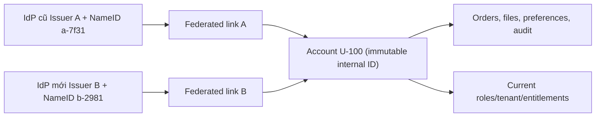
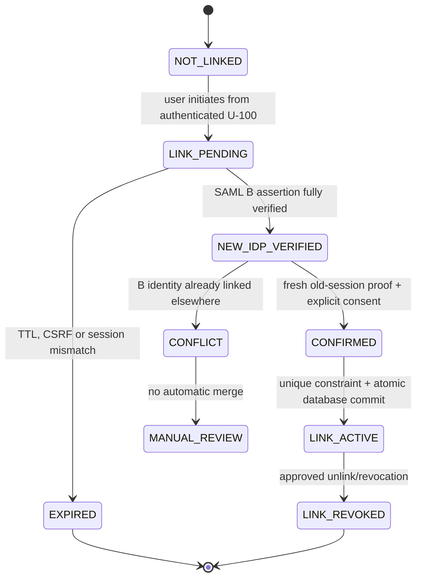

# Giữ ổn định định danh người dùng và liên kết tài khoản khi đổi IdP

**Học phần:** Spring Security – federation → Chuyển đổi và nâng cấp.

**Mục tiêu:** thực hiện chuyển đổi Identity Provider (IdP) trong ứng dụng Java/Spring Security mà **người dùng vẫn đăng nhập vào đúng tài khoản nội bộ**, giữ nguyên dữ liệu, lịch sử, quyền đã được phê duyệt và các ràng buộc bảo mật. Bài hướng dẫn nhận diện các khóa định danh từ SAML2/CAS/OIDC, mô hình ánh xạ **định danh liên kết → tài khoản ứng dụng ổn định**, thiết kế quy trình account linking an toàn, di chuyển có kiểm soát từ IdP cũ sang IdP mới, xử lý thay đổi NameID/Issuer/SP EntityID, thử chuyển đổi song song, rollback, vận hành và kiểm thử ngăn account takeover.

**Nguyên tắc cốt lõi:** **tài khoản ứng dụng có ID riêng không đổi** (ví dụ `account_id=U-100`). Mỗi IdP cung cấp **định danh liên kết trong phạm vi nguồn đó** (federated identifier); ứng dụng **không dùng email, tên hiển thị, `NameID` trần hoặc username giống nhau để tự ghép hai người**. Khi người dùng đổi IdP, hệ thống thêm một **liên kết đã được xác minh** từ identity mới đến **cùng account_id**, không tạo một account mới/di chuyển dữ liệu theo chuỗi email. Nếu không đủ bằng chứng, **tạm dừng liên kết và chuyển sang quy trình kiểm chứng**, không “match tạm” để giữ trải nghiệm đăng nhập.

Bài dùng Java 17+, Spring Security SAML2 Servlet, IdP/SP hostname `example.test` và mã định danh minh họa. Mảnh cấu hình Spring cần project, IdP sandbox/metadata/certificate tin cậy và database thật. Chương trình Java 17 độc lập ở phần thực hành chạy được chỉ bằng JDK và **không xác thực SAML XML/signature**; nó mô phỏng các kiểm tra phải thực hiện sau khi Spring Security đã xác minh assertion.

## 1. Tại sao đổi IdP có thể gây mất tài khoản hoặc chiếm tài khoản?

Một hệ thống ban đầu dùng IdP A:

```text
IdP A (issuer=https://legacy-idp.example.test/metadata)
  -> SAML NameID="a-7f31"
  -> ứng dụng portal
  -> account_id="U-100"
  -> documents/orders/roles/settings gắn U-100
```

Khi chuyển sang IdP B:

```text
IdP B (issuer=https://new-idp.example.test/metadata)
  -> SAML NameID="b-2981"
  -> ứng dụng portal
  -> ? tài khoản nào ?
```

Nếu code hiện tại dùng `userRepository.findByEmail(samlEmail)` để quyết định account, nguy cơ:
- **Account takeover:** một tài khoản ở IdP B có thể cung cấp cùng email hoặc email được tái sử dụng, trỏ nhầm sang U-100.
- **Mất dữ liệu hiển thị:** ứng dụng tạo U-900 mới thay vì U-100, khiến user tưởng lịch sử biến mất.
- **Cross-tenant merge:** hai tổ chức có cùng tên/email local part bị trộn.
- **Đổi/thu hồi email:** người A đổi địa chỉ, mailbox cũ được cấp cho người B.
- **Không nhất quán quyền:** group claim ở IdP mới khác group cũ, dẫn đến mất hoặc tăng quyền ngoài policy.
- **Khó rollback:** sau khi tự động merge theo email, không thể biết dữ liệu gốc thuộc ai.
- **Session confusions:** phiên cũ từ IdP A vẫn giữ roles cũ trong khi link mới dùng policy khác.

Để tránh, phải tách **định danh con người tại IdP** khỏi **định danh account bất biến tại ứng dụng** và lưu bằng chứng mỗi liên kết.

## 2. Phân biệt các loại định danh

| Loại | Ví dụ | Có ổn định khi đổi IdP? | Dùng thế nào? |
| --- | --- | --- | --- |
| `account_id` của app | `U-100` hoặc UUID | **Có** nếu thiết kế đúng | Primary key cho domain data |
| SAML `Issuer` | `https://legacy-idp.example.test/metadata` | Thường đổi theo IdP | Namespace bắt buộc |
| SAML `NameID` | `a-7f31` | **Không chắc** qua IdP mới | Subject của issuer và scope cụ thể |
| SAML `NameID Format` | `persistent`, `transient`, `emailAddress` | Có thể đổi | Contract về semantics subject |
| SAML `NameQualifier` | IdP identifier | Có thể khác theo issuer | Bổ sung scope khi xuất hiện |
| SAML `SPNameQualifier` | SP EntityID | Có thể đổi theo SP | Quan trọng với pairwise identifier |
| SAML `AttributeStatement` | `employeeNumber`, `mail`, `groups` | Không được giả định | Dữ liệu thuộc tính, cần trust/data governance |
| OIDC `iss` + `sub` | `issuer.example#sub-839` | Thường thay khi đổi OP | Khóa định danh OIDC theo issuer |
| CAS principal ID | `person-47` | Tùy CAS deployment | Namespace theo CAS server/realm |
| Email | `user@example.test` | **Không bảo đảm** | Contact/profile, không mặc định identity key |
| Username/UPN | `user@tenant.example.test` | Có thể rename/reassign | Display/login hint, không mặc định unique |
| HR/SCIM anchor | Internal employee/person GUID | Chỉ nếu lifecycle/uniqueness được quản trị | Có thể là bằng chứng account resolution có kiểm tra |
| IdP signing certificate | K1/K2 | Đổi khi rollover | Trust assertion, **không phải user ID** |
| Spring `registrationId` | `legacy`, `modern` | Cục bộ có thể rename | Chọn RelyingPartyRegistration, không tự là issuer |

**Sự khác biệt quan trọng:** một SAML NameID `persistent` thường ổn định **trong quan hệ IdP–SP cụ thể**; không có đảm bảo hai IdP khác nhau phát cùng giá trị. Ngay cả **cùng IdP** cũng có thể phát persistent pairwise NameID khác nếu SP EntityID, federation broker, NameID policy hoặc SPNameQualifier thay đổi. `transient` **không phù hợp làm khóa user lâu dài**.

### 2.1. Federated identifier không phải một chuỗi username

NIST SP 800-63C mô tả với IdP thông thường: **federated identifier = issuer identifier + subject identifier**. Sở dĩ phải có issuer là vì các IdP độc lập có thể phát **cùng subject string cho những người khác nhau**. Trong SAML2, ngoài issuer, cần xét **NameID Format và qualifier/SP scope** theo contract thực tế; với multi-protocol thêm protocol/registration trust domain.

Ví dụ:

```text
(issuer=IdP-A, subject=12345) -> account U-100
(issuer=IdP-B, subject=12345) -> account U-200

Hai chuỗi "12345" giống nhau, nhưng KHÔNG cùng federated identity.
```

**Không normalize làm mất namespace:** không bỏ issuer, không so NameID case-insensitive một cách tùy tiện, không bỏ leading zeros, không tự trim identifiers nếu nhà phát hành không có chính sách canonicalization rõ ràng. `NameID` là định danh có semantics do issuer quy định, không phải email để lowercase theo thói quen.

### 2.2. SAML NameID và qualifiers

Ví dụ một signed assertion thực tế có thể chứa:

```xml
<saml:Subject xmlns:saml="urn:oasis:names:tc:SAML:2.0:assertion">
  <saml:NameID
    Format="urn:oasis:names:tc:SAML:2.0:nameid-format:persistent"
    NameQualifier="https://legacy-idp.example.test/metadata"
    SPNameQualifier="https://portal.example.test/saml/sp-v1">a-7f31</saml:NameID>
</saml:Subject>
```

Đây chỉ là **fragment giải thích NameID**, không phải assertion có chữ ký dùng cho đăng nhập. Tính đúng đắn phải được kiểm trong ngữ cảnh **Response/Assertion đã verify**: issuer, trusted signing certificate, audience, destination, recipient, conditions, subject confirmation và `InResponseTo`.

- `Format=persistent` nói về semantics persistent identifier trong profile; **không mặc định globally unique**.
- `NameQualifier` có thể nêu namespace/issuer của identifier; xử lý đúng cả khi bỏ trống theo SAML spec và IdP contract.
- `SPNameQualifier` có thể ràng buộc pairwise subject với SP. Nếu SP EntityID đổi, output NameID có thể đổi.
- `Format=transient` không ổn định qua login sessions; không map làm account key lâu dài.
- `Format=emailAddress` biểu diễn một email-looking identifier, **không bảo đảm mailbox ownership hay bất biến**.
- `Format=unspecified` cần thỏa thuận profile cụ thể; không suy ra stable subject từ tên format.
- Với IdP broker, `Issuer` có thể là broker thay vì upstream IdP; cần kiểm **ai đang phát assertion** và **upstream identity mapping** có bảo toàn không.

**Lưu ý tính riêng tư:** persistent identifiers được SAML thiết kế có yếu tố privacy; không phát tán rõ trong logs không có kiểm soát và không dùng một pairwise identifier cho RP khác nếu contract không cho phép.

## 3. Nguyên tắc thiết kế bền vững: một account, nhiều federated links



Khi di chuyển:
1. Giữ `account_id` bất biến.
2. **Không UPDATE tất cả khóa ngoại orders/comments/tables** để đổi từ A sang B; dữ liệu nghiệp vụ tham chiếu `account_id`, không IdP NameID.
3. Thêm `FederatedIdentityLink(B,b-2981 → U-100)` **sau khi có bằng chứng**.
4. Trong giai đoạn song song, link A và link B cùng tồn tại (nếu policy cho phép).
5. Khi ngừng IdP A, disable/revoke **link A** sau canary/rollback window.
6. Không xoá U-100 vì IdP A biến mất; business account lifecycle là chuyện riêng.
7. Roles/tenant access quyết định qua application policy, không auto-copy từ IdP cũ sang mọi claim mới.

### 3.1. Bất biến phải giữ

- Một identity key thuộc issuer/trust namespace **tối đa một account nội bộ còn hoạt động** tại một thời điểm.
- Một account nội bộ **có thể có nhiều identity keys** nếu đã được liên kết hợp lệ.
- Cùng `NameID` khác issuer không có nghĩa cùng user.
- Link đã thu hồi **không được phép đăng nhập** kể cả assertions vẫn valid.
- Account bị disabled/terminated không thể được “hồi sinh” bằng login qua IdP mới.
- Linking operation phải có một phiên account hiện hữu đã authenticated và bằng chứng mới được verify; không dùng email làm bằng chứng đủ.
- Account linking và quyền truy cập hệ thống phải có audit trail/approval, không cho người dùng đổi tài khoản đích tùy ý.
- Thay signing cert/metadata của **cùng IdP issuer và subject** thường chỉ là trust rollover, **không tự cần tạo account mới**.
- `registrationId` là cấu hình Spring; mapping production nên dựa trusted issuer/SP namespace, có migration riêng nếu đổi local registration ID.

## 4. Mô hình dữ liệu khuyến nghị

Ví dụ schema quan hệ; đây là **mẫu thiết kế**, cần điều chỉnh RDBMS, tenant rules, privacy protection và concurrency thật:

```sql
CREATE TABLE app_account (
    account_id UUID PRIMARY KEY,
    tenant_id UUID NOT NULL,
    state VARCHAR(24) NOT NULL,
    created_at TIMESTAMPTZ NOT NULL,
    CONSTRAINT ck_account_state
        CHECK (state IN ('ACTIVE', 'DISABLED', 'TERMINATED'))
);

CREATE TABLE federated_identity_link (
    link_id UUID PRIMARY KEY,
    account_id UUID NOT NULL REFERENCES app_account(account_id),
    tenant_id UUID NOT NULL,
    protocol VARCHAR(16) NOT NULL,
    issuer_id TEXT NOT NULL,
    nameid_format TEXT NOT NULL,
    name_qualifier TEXT NOT NULL DEFAULT '',
    sp_name_qualifier TEXT NOT NULL DEFAULT '',
    subject_lookup_key VARCHAR(128) NOT NULL,
    registration_ref VARCHAR(128) NOT NULL,
    state VARCHAR(24) NOT NULL,
    evidence_ref UUID NOT NULL,
    created_at TIMESTAMPTZ NOT NULL,
    revoked_at TIMESTAMPTZ,
    version BIGINT NOT NULL DEFAULT 0,
    CONSTRAINT ck_link_state
        CHECK (state IN ('ACTIVE', 'REVOKED', 'PENDING'))
);

CREATE UNIQUE INDEX uq_federated_identity_key
ON federated_identity_link (
    tenant_id, protocol, issuer_id, nameid_format,
    name_qualifier, sp_name_qualifier, subject_lookup_key
);

CREATE INDEX ix_federated_link_account
ON federated_identity_link (account_id, state);

CREATE TABLE identity_link_evidence (
    evidence_id UUID PRIMARY KEY,
    account_id UUID NOT NULL REFERENCES app_account(account_id),
    method VARCHAR(40) NOT NULL,
    approval_state VARCHAR(32) NOT NULL,
    verified_at TIMESTAMPTZ NOT NULL,
    expires_at TIMESTAMPTZ,
    operator_ref VARCHAR(128),
    audit_reference VARCHAR(128) NOT NULL
);
```

**Giải thích và các lưu ý phải triển khai:**
- `account_id` độc lập IdP và là primary key dữ liệu nghiệp vụ.
- `issuer_id` là canonical trusted issuer; không đặt bằng tên hiển thị tự do hoặc `registrationId` user gửi.
- `protocol` phân biệt SAML2, OIDC, CAS (có chính sách identity scope khác nhau).
- `nameid_format/name_qualifier/sp_name_qualifier` được normalize có kiểm soát; SQL dùng chuỗi rỗng làm giá trị vắng mặt **chỉ khi contract xác định chính xác**. Tránh `NULL` làm uniqueness bỏ lọt bản ghi vì một số SQL DB cho nhiều NULL trong UNIQUE.
- `subject_lookup_key` có thể là HMAC của raw subject bằng khóa quản lý trong secret manager (và version key để rotate) hoặc encrypted deterministic lookup phù hợp policy. Không dùng bare SHA256 cho human-readable employee ID/email mà tưởng đã ẩn danh.
- `registration_ref` dùng cho vận hành, audit; account identity namespace chuẩn phải dựa issuer và SP scope.
- `tenant_id` phải được kiểm khớp với account; **composite foreign key hoặc trigger/transaction constraint** cần bổ sung để ngăn bản ghi link tenant A trỏ account tenant B.
- `state=REVOKED` trong unique index có nghĩa **không tự reuse identity key**; đây là lựa chọn bảo mật bảo tồn lịch sử. Nếu policy cần relink, phải có quy trình đặc biệt, không delete row rồi tự cho đăng ký lại.
- `evidence_ref` trỏ quyết định liên kết được xác minh; lưu đủ provenance nhưng không chứa raw token.
- Index unique là lớp phòng chống race và duplicate; business service còn phải dùng **transaction và conditional state transitions**.
- Quyền delete/modify links phải giới hạn mạnh; audit mọi thay đổi và có rollback có kiểm soát.

### 4.1. Chỉ cập nhật link, không viết lại lịch sử

Ví dụ:

```text
app_account:
    U-100, tenant=T1, state=ACTIVE

federated_identity_link:
    OLD: (SAML2, issuer-A, persistent, subj-A7) -> U-100
    NEW: (SAML2, issuer-B, persistent, subj-B2) -> U-100

business_order:
    order-1.owner_account_id = U-100
business_file:
    file-9.owner_account_id = U-100
audit_record:
    action.actor_account_id = U-100
```

Sau migration, `business_order`, `business_file` và `audit_record` **không thay primary/foreign keys**. Có thể thêm issuer/link ID vào audit mới để xác định đường đăng nhập, nhưng lịch sử user gắn với account_id không bị “bẻ” sang một người khác.

### 4.2. Có nên đồng bộ cùng email làm identity link tự động?

**Không mặc định.** Email có thể:
- đổi alias;
- bị tái sử dụng khi nhân viên nghỉ việc;
- được IdP ký dưới thuộc tính chưa thực sự xác minh sở hữu mailbox;
- trùng trong multi-tenant vì cùng domain alias/UPN;
- thay đổi casing hoặc Unicode normalization;
- không còn ổn định khi tổ chức sáp nhập/chuyển email;
- được dùng chung trong tài khoản nhóm/shared mailbox.

Nếu tổ chức dùng email như **một thuộc tính để account resolution**, phải có trust agreement xác minh tính unique, authoritative lifecycle, verified ownership, no-reassignment policy và kiểm tra xung đột bằng quy trình rõ, không dùng `mail.equalsIgnoreCase` là đủ. NIST 800-63C yêu cầu thuộc tính được dùng để resolution phải đủ để **xác định duy nhất** subscriber trước khi linking.

## 5. Bằng chứng hợp lệ để liên kết tài khoản

NIST SP 800-63C cho phép một RP account gắn nhiều federated identifiers, nhưng linking functions phải yêu cầu **authenticated session của RP account**; nên xác thực qua một identity đã liên kết trước khi thêm identity mới.

### 5.1. Phương án A – Người dùng chứng minh quyền đối với cả tài khoản cũ và IdP mới

Tình huống người dùng còn dùng được IdP cũ:

1. Browser vào account settings bằng authenticated session của **U-100**, được tạo từ link IdP A đã biết.
2. Ứng dụng yêu cầu **fresh reauthentication/step-up** theo risk policy để chống session hijack.
3. Người dùng bấm “Liên kết IdP mới”, ứng dụng tạo `link_transaction_id` ngẫu nhiên, TTL ngắn, server-side bound với session/U-100/target issuer.
4. Redirect qua đúng **IdP B registration** đã đăng ký, không cho user đưa issuer URL tùy ý.
5. IdP B xác thực, gửi signed SAMLResponse về đúng ACS; Spring verify signature/issuer/audience/Recipient/InResponseTo/conditions/subject.
6. Ứng dụng trích **verified new federated identifier** từ trusted SAML mapping, ràng buộc nó với transaction của browser đã bắt đầu.
7. Hiển thị thông tin tóm tắt đã được verify/đúng tenant, xin người dùng xác nhận có chủ đích; không dựa email.
8. Trong **một database transaction**, kiểm U-100 ACTIVE; link B chưa gắn account khác; link A vẫn hợp lệ; freshness/CSRF/one-time challenge; insert link B→U-100.
9. Ghi audit, thông báo account owner qua kênh đã đăng ký, không gửi tokens/NameID nguyên văn; tùy risk policy có cooldown.
10. Kiểm đăng nhập qua IdP B trong **browser context mới**, trả U-100 với quyền đúng, không tạo account khác.
11. Chỉ sau canary và rollback window mới disable link A.

**Đừng lấy login callback đến từ IdP B là đủ để liên kết**: nó chứng minh người dùng kiểm soát một B identity, **không chứng minh** B identity phải nối vào U-100. Cần phiên U-100 đang authenticated và transaction được khởi tạo từ account settings, hoặc một quy trình quản trị có bằng chứng tương đương.

### 5.2. Phương án B – Doanh nghiệp chuyển đổi hàng loạt qua authoritative identity mapping

Nếu người dùng không còn truy cập IdP A khi cutover:
- Inventory một **person/account anchor có lifecycle quản trị** (ví dụ internal HR person ID/SCIM externalId), không lấy email làm nguồn duy nhất.
- Chứng minh nguồn HR/SCIM là authoritative đối với đúng tenant/nhân sự, ổn định, không bị cấp lại và đủ phân biệt.
- Thu thập old IdP subject ↔ person anchor ↔ new IdP subject trong kênh migration **có xác thực nguồn và phân quyền**, không qua CSV gửi email chưa bảo vệ.
- Sinh **proposed links**, phát hiện collisions, many-to-one/many-to-many, missing ID, stale accounts, service accounts.
- Dùng least privilege và **two-person approval** cho các liên kết quyền cao hoặc trường hợp ngoại lệ.
- Với các link xác minh duy nhất, apply bằng transaction có version/unique constraints, audit và canary.
- Với trường hợp mơ hồ, **quarantine** để identity admin thẩm định (không tự tạo/merge).
- Sau migration, thông báo người dùng và có cơ chế báo sai liên kết.
- Nếu cần nối các account tổ chức khác nhau, tuân thủ quy định data sharing và hợp đồng federation; “cùng email” giữa tenant không đủ.

**Nhấn mạnh:** HR anchor chỉ là bằng chứng nếu có chính sách unique/no reassignment, provenance và lifecycle. `employeeNumber` hoặc `externalId` có thể không ổn định trong mọi doanh nghiệp; phải được xác minh thực tế.

### 5.3. Phương án C – Account recovery khi không có cả hai yếu tố

Khi người dùng không còn IdP A, không có HR mapping rõ và chỉ còn email:
- Không tự link.
- Sử dụng recovery process đã phê duyệt: identity proofing, helpdesk có two-party review, historical evidence được kiểm chứng, out-of-band verification có resistance với social engineering.
- Với tài khoản quyền cao, yêu cầu thêm approvals, revoke stale sessions, post-link monitoring.
- Quyết định recovery phải có reason, evidence, operator, expiry và rollback path.
- Không đặt “nhập email rồi nhận magic link” là bằng chứng đủ cho mọi trường hợp; mailbox có thể được tái sử dụng/compromised.
- Nếu danh tính không chứng minh được, có thể tạo account mới riêng, **không nhập dữ liệu U-100**.

## 6. Mô hình state machine của việc liên kết



**Không thêm trạng thái “EMAIL_MATCHED → LINK_ACTIVE”**. Email match có thể tạo `REVIEW_CANDIDATE`, tuyệt đối không coi là authentication proof.

### 6.1. Các yêu cầu bảo mật trên link transaction

| Kiểm soát | Mục đích |
| --- | --- |
| Authenticated U-100 session | Không cho anonymous browser chọn account ID |
| Fresh auth/step-up | Giảm rủi ro stolen session gắn attacker identity |
| Browser/session-bound transaction ID | Chống login CSRF và account linking CSRF |
| CSRF protection on link start/confirm | Không để site khác tự gắn IdP |
| Exact IdP registration/issuer | Không cho IdP B response bị nhận qua IdP A |
| Verified SAMLResponse | Chữ ký, Issuer, Audience, Recipient, Conditions, `InResponseTo` |
| One-time challenge, TTL | Không reuse callback cũ |
| Explicit confirmation | Tránh accidental/linking hijack |
| Existing key uniqueness | Không cho một B subject trỏ sang hai accounts |
| Account/tenant active checks | Chống cross-tenant, disabled account resurrection |
| Transaction isolation, row version | Ngăn race giữa hai linking requests |
| Audit + user notification | Phát hiện và rollback liên kết sai |
| Recovery/unlink controls | Không cắt quyền truy cập cuối cùng khi không có recovery route |

`RelayState` trong SAML flow có thể là opaque pointer tới transaction, nhưng **không là authentication proof**. Tránh raw account IDs/emails in RelayState hoặc tự dùng `RelayState` làm redirect URL.

## 7. Spring Security: cấu hình hai IdP song song

Ở Servlet SAML2, một SP có thể cấu hình hai `RelyingPartyRegistration`:

```text
/saml2/authenticate/legacy
    -> old IdP metadata/SSO/signing trust

/saml2/authenticate/modern
    -> new IdP metadata/SSO/signing trust

/login/saml2/sso/legacy
/login/saml2/sso/modern
    -> callbacks, verified by matching registration/issuer
```

**Không tự động chọn IdP chỉ vì email domain hoặc NameID giống.** Login picker chọn một registration đã được cho phép; server-side policy xác định tenant/expected issuer. Cấu hình IdP metadata, entityID/ACS URL và signing/decryption credentials phải được đăng ký ở từng IdP.

Mảnh Java/Spring (dùng Spring Security SAML2 Servlet cùng BOM phù hợp):

```java
package com.example.migration;

import org.springframework.context.annotation.Bean;
import org.springframework.context.annotation.Configuration;
import org.springframework.security.config.Customizer;
import org.springframework.security.config.annotation.web.builders.HttpSecurity;
import org.springframework.security.saml2.provider.service.registration
        .RelyingPartyRegistration;
import org.springframework.security.saml2.provider.service.registration
        .RelyingPartyRegistrationRepository;
import org.springframework.security.saml2.provider.service.registration
        .RelyingPartyRegistrations;
import org.springframework.security.saml2.provider.service.registration
        .InMemoryRelyingPartyRegistrationRepository;
import org.springframework.security.web.SecurityFilterChain;

@Configuration
public class DualIdpSecurityConfiguration {
    @Bean
    RelyingPartyRegistrationRepository relyingParties() {
        RelyingPartyRegistration legacy = RelyingPartyRegistrations
            .fromMetadataLocation("classpath:idp/legacy.xml")
            .registrationId("legacy")
            .entityId("https://portal.example.test/saml/sp-legacy")
            .assertionConsumerServiceLocation(
                "https://portal.example.test/login/saml2/sso/legacy")
            .build();

        RelyingPartyRegistration modern = RelyingPartyRegistrations
            .fromMetadataLocation("classpath:idp/modern.xml")
            .registrationId("modern")
            .entityId("https://portal.example.test/saml/sp-modern")
            .assertionConsumerServiceLocation(
                "https://portal.example.test/login/saml2/sso/modern")
            .build();

        return new InMemoryRelyingPartyRegistrationRepository(
            legacy, modern);
    }

    @Bean
    SecurityFilterChain securityFilterChain(HttpSecurity http)
            throws Exception {
        http
            .authorizeHttpRequests(auth -> auth
                .requestMatchers("/", "/error", "/signed-out").permitAll()
                .anyRequest().authenticated())
            .saml2Login(Customizer.withDefaults());
        return http.build();
    }
}
```

**Giới hạn:** mảnh trên chỉ chạy trong Spring Boot app đầy đủ với **metadata IdP thật đã được tin** trong hai file local, dependency `spring-security-saml2-service-provider`, HTTPS/ACS chính xác, signing keys và login picker/route bảo vệ. IdP có thể yêu cầu signed AuthnRequest và encrypted Assertion – phải cấu hình SP credentials theo contract. Những tên miền/chứng thư trong bài không phải tài khoản thật.

**Không dùng file metadata mới tải từ URL tùy ý** như nguồn trust chỉ vì `classpath:`; pipeline phải kiểm entityID/issuer, signing keys, metadata signature/TLS, `validUntil` và key rollover. Khi đổi IdP, giữ hai registration trong staged period giúp rollback, nhưng phải giới hạn allowed paths/tenants.

### 7.1. Kiểm IdP của authentication sau khi verify

Spring Security 7 sử dụng `OpenSaml5AuthenticationProvider` và có `Saml2AssertionAuthentication`; `getRelyingPartyRegistrationId()` có thể cho biết verified registration. API `Saml2AuthenticatedPrincipal` quen thuộc của Spring Security 6 đã **được đánh dấu deprecated trong Spring Security 7.x**; Spring Security 7 ưu tiên `Saml2ResponseAssertionAccessor` từ credential để truy cập assertion details. **Đừng nâng cấp ứng dụng rồi giả định mọi principal tiếp tục implement `Saml2AuthenticatedPrincipal`.**

Mảnh dịch vụ nhận **đối tượng Authentication sau khi Spring Security đã verify**:

```java
package com.example.migration;

import org.springframework.security.core.Authentication;
import org.springframework.security.saml2.provider.service.authentication
        .Saml2AssertionAuthentication;

public final class TrustedSamlSubjectAdapter {
    private final TrustedRegistrationDirectory directory;

    public TrustedSamlSubjectAdapter(
            TrustedRegistrationDirectory directory) {
        this.directory = directory;
    }

    public VerifiedSubject fromAuthentication(Authentication auth) {
        if (!(auth instanceof Saml2AssertionAuthentication saml)
                || !saml.isAuthenticated()) {
            throw new IllegalStateException(
                "Expected verified SAML2 assertion authentication");
        }

        String registrationId =
                saml.getRelyingPartyRegistrationId();
        String trustedIssuer =
                directory.expectedIssuer(registrationId);

        // Chỉ dùng getName() nếu principal-name policy đã đảm bảo
        // đây là stable subject trong đúng SAML issuer/SP scope.
        String subject = saml.getName();
        if (subject == null || subject.isBlank()) {
            throw new IllegalStateException("Missing subject");
        }
        return new VerifiedSubject(trustedIssuer, subject);
    }

    public record VerifiedSubject(String issuer, String subject) {}

    public interface TrustedRegistrationDirectory {
        String expectedIssuer(String registrationId);
    }
}
```

**Giới hạn và điểm an toàn:**
- Đây là mảnh **sử dụng Spring Security 7.x**; không chạy độc lập và chưa xử lý `NameID Format/NameQualifier/SPNameQualifier`. Với hệ cần qualifiers, adapter thực tế phải truy cập verified assertion bằng `Saml2ResponseAssertionAccessor` hoặc converter phù hợp, không suy diễn chỉ từ `getName()`.
- `directory.expectedIssuer(registrationId)` là **server-owned allowlist từ RelyingPartyRegistration**, không phải một HTTP request parameter hay SAML attribute chưa verify.
- `getName()` của Authentication có thể là NameID hoặc principal name do converter tùy chỉnh. **Nếu login cũ dùng email làm principal name, đừng tự chuyển email đó thành stable subject**. Kiểm contract với IdP và cấu hình converter.
- Với Spring Security 6, các kiểu `Saml2Authentication` và `Saml2AuthenticatedPrincipal` có thể được dùng; hãy tách adapter theo version, rồi chạy chung identity-link unit tests.
- Thực tế, **account lookup/deny nếu unlinked** phải nằm trong luồng authentication hoặc một authorization gate **trước khi cấp session/cho truy cập tài nguyên**, không chỉ làm ở controller `/whoami` sau khi user đã có Session authenticated.
- Không gọi adapter trên `Saml2AuthenticationToken` (unverified input) hoặc tự deserialize principal từ JSON.
- Không dùng `auth.getCredentials()` để log raw SAMLResponse; credential/assertion chứa dữ liệu nhạy cảm.

### 7.2. Đưa account resolution vào đúng authentication boundary

Trong Spring Security 7.x, tài liệu nêu `OpenSaml5AuthenticationProvider#setResponseAuthenticationConverter(...)` và `ResponseAuthenticationConverter` để tùy biến principal/authorities **sau xử lý assertion theo provider**; có thể dùng để tra verified federated identity và chuyển thành principal nội bộ, hoặc dùng application policy gate riêng nếu architecture quy định. Phải:
1. Giữ **default SAML validators** của provider (signature, issuer, audience, destination, time, subject, correlation, replay).
2. Trích trusted registration/issuer/subject theo đúng converter API và signed assertion đã được provider xử lý.
3. Lookup link record theo identity key đầy đủ (issuer/scope/subject) trong database.
4. Fail authentication nếu không có link và JIT enrollment không được phép; không tự fallback email.
5. Kiểm account ACTIVE, tenant, link ACTIVE, effective access policies.
6. Tạo `Authentication` chứa internal principal `accountId` và authorities được **recomputed** theo app policy.
7. Ghi audit kết quả và persist session theo Spring Security.
8. Test unauthenticated/invalid SAMLResponse không thể tới account mapping code như một verified identity.

**Không nên** nhét lookup vào một success handler rồi quên rằng handler chạy khi framework đã đặt SecurityContext; nếu sử dụng success handler cho đăng ký/linking flow, phải cô lập phiên chờ và không trả protected resources đến khi link được hoàn tất. Ưu tiên enforce trực tiếp tại provider/converter hoặc authorization gate được kiểm thử.

## 8. Định danh ổn định khi đổi IdP là bài toán khác đổi metadata signing key

Phân biệt:
- **Đổi khóa ký tại cùng issuer**: IdP thường vẫn phát cùng NameID; cần cập nhật trusted verification credentials, không thay account identity key.
- **Đổi metadata URL nhưng issuer/entityID giữ nguyên**: có thể không đổi identity; phải verify source/trust/issuer.
- **Đổi IdP issuer**: tạo namespace mới, kể cả subject string giữ nguyên. Cần migration/linking.
- **Đổi NameID policy trong cùng issuer**: NameID có thể đổi từ emailAddress sang persistent; cần identity remapping dù certificate/issuer không đổi.
- **Đổi SP EntityID/ACS registration**: pairwise persistent NameID có thể thay, cần lên kế hoạch/mapping.
- **Thêm broker/federation hub**: SP có thể nhìn broker issuer với một stable broker subject; migration logic phải giữ upstream binding tại broker và audit.
- **Chuyển từ SAML2 sang OIDC**: subject key là `iss + sub` (thường pairwise sub theo client), không so `OIDC sub` với SAML NameID hoặc email.
- **Chuyển từ CAS sang SAML**: principal ID trong CAS namespace có thể giống một attribute ở SAML, nhưng phải dùng verified cross-protocol account link.
- **Thay tenant / sát nhập tổ chức**: luôn kiểm data ownership, account status và retention, không hợp nhất theo cùng tên.

### 8.1. Bảng quyết định

| Thay đổi | Có cần new federated link? | Hành động |
| --- | --- | --- |
| K1→K2 signing key, same issuer/subject | Thường không | Rollover trust metadata có overlap |
| Metadata endpoint HTTP URL thay, issuer/subject giữ | Không nếu trust/contract không đổi | Revalidate trusted metadata |
| IdP A→B, issuer khác | **Có** | Đối chiếu và liên kết rõ ràng |
| SAML NameID persistent đổi vì SP EntityID | **Có** | Mapping old→new với chứng cứ |
| Email người dùng đổi | **Không** | Update profile/contact, account_id không đổi |
| NameID transient từng lần login | Không thể dùng như persistent key | Cần stable subject attribute có trust |
| OIDC OP issuer mới, sub khác | **Có** | iss+sub new link |
| Broker đổi upstream nhưng broker subject bền | Có thể không tại RP | Test broker continuity/assurance |
| Tenant merge | Cần review/phê duyệt | Không auto-merge |
| User bị disable hoặc employee left | Không tạo link mới | Deny/revoke theo lifecycle |

## 9. Triển khai migration theo nhiều pha

### Pha 0 — Inventory và đóng băng assumptions

Ghi cho từng app/tenant:
- IdP issuer/entityID, SSO endpoints, NameID Format/qualifiers, `SPNameQualifier`, SP EntityID.
- Thuộc tính được dùng xác định user: NameID, employeeNumber, object ID, SCIM externalId, email/UPN.
- Các khóa ngoại hiện tại có lỡ dùng email/IdP ID làm primary key không?
- User provisioning: JIT, SCIM sync, database import, manual accounts.
- Active users, disabled accounts, privileged/service accounts, guest users, orphaned accounts.
- Mức assurance/MFA và mapping groups/roles.
- Session lifetime, Spring Session, SLO và step-up policy.
- IdP A/B có ký assertion và trust chain phù hợp không?
- Nơi lưu/link evidence, security audit và quyền cho admin approvals.

**Đầu ra:** bảng mapping **proposed** có nguồn gốc, unique validation, số bản ghi thiếu/xung đột. Không ghi link ACTIVE bằng email-only import.

### Pha 1 — Chuẩn hóa account identity layer

- Tạo `account_id` bất biến cho mọi app user nếu chưa có.
- Di chuyển business foreign keys sang account_id với migrations có transactions/backups; giữ compatibility layer cho hệ thống cũ.
- Tạo unique federated link index theo issuer/scope/subject.
- Giữ link cũ từ IdP A và kiểm account lookup trả đúng.
- Test session/role mapping và disabled account enforcement.
- Không dùng raw NameID trong table names/log lines hoặc link parameters.

Nếu account tables đã dùng email làm PK, phải lên kế hoạch DB migration riêng, zero-downtime dual-write/read, backfill verification và constraint switch. **Không đơn giản chạy UPDATE email trên mọi bảng** mà bỏ audit/data consistency.

### Pha 2 — Đăng ký IdP B nhưng chưa mở rộng quyền

- Tải metadata IdP B qua trusted channel; verify issuer, signing certificate, bindings, ACS, signing/decryption requirements.
- Thêm `modern` registration song song `legacy`; test signed SAML Responses/`InResponseTo`.
- Chốt NameID format/pairwise scope và việc IdP B phát stable subject; nếu IdP B chỉ phát email/transient, phải thương lượng stable identifier.
- Thiết lập mapping attribute/tenant và roles; không copy nguyên IdP B groups sang ROLE_ADMIN.
- Giới hạn access pilot users và bảo vệ endpoints linking.
- Khởi tạo proposed links qua verified HR mapping hoặc dual-auth, không auto-activate tất cả.

### Pha 3 — Dry run identity match và xử lý xung đột

```text
old issuer+subject       app account       new issuer+subject       result
A + subj-007            U-100             B + pair-900            UNIQUE_CANDIDATE
A + subj-008            U-101             B + pair-901            UNIQUE_CANDIDATE
A + subj-009            U-102             B + pair-901            CONFLICT
A + subj-010            U-103             (missing)               HOLD
A + subj-011            disabled U-104    B + pair-903            DENY
A + subj-012            tenant T1         B + pair-904 (T2)       TENANT_MISMATCH
```

- **UNIQUE_CANDIDATE** không đồng nghĩa link VERIFIED: vẫn cần evidence authoritative.
- **CONFLICT:** không dùng “ưu tiên first match” hoặc overwrite; quản trị danh tính điều tra.
- **HOLD:** giữ IdP A hoặc phục hồi identity proof.
- **DENY:** disabled account không được active lại.
- **TENANT_MISMATCH:** reject và kiểm source data.
- Count, uniqueness, coverage, rejected/hold rates theo cohorts; không công khai subjects trong metrics/logs.

### Pha 4 — Pilot và dual-run

- Pilot ít người thuộc nhiều loại tài khoản: ordinary, privileged, service, guest, disabled, renamed email, shared mailbox, duplicate names.
- Người pilot liên kết IdP B và xác minh **account_id trước/sau** không đổi.
- Đăng nhập bằng IdP A rồi logout/re-auth IdP B trong browser profile riêng; không để stale app session che lỗi.
- Kiểm dữ liệu, quyền theo tenant, step-up, audit trail và session.
- Khi sign-in qua B, không tự tạo JIT account U-900 nếu link chưa có.
- Đo login failure, link conflict, account mismatch, support tickets.
- Cấu hình SSO picker chỉ hướng user được enable tới B; giữ A làm fallback có kiểm soát.
- Rehearse rollback canary: B unavailable không làm A trust bị nới lỏng.

### Pha 5 — Cutover có kiểm soát

- Đóng thay đổi mapping và chốt batch approved links.
- Deploy config/metadata, bật B cho cohorts tăng dần.
- Đảm bảo B SAML signing key trust, issued subjects, issuer và ACS được test.
- Kiểm user thuộc U-100 qua B, không duplicate accounts.
- Recompute roles/tenant policy, không gán quyền từ old raw group names.
- Đánh giá session handling: có cho phép phiên A tiếp tục tới TTL hay yêu cầu reauth B? Quyết định bằng threat model.
- Với risk cao hoặc IdP A compromise, revoke old sessions và links nhanh có kiểm soát.
- Theo dõi spike của `UNKNOWN_FEDERATED_IDENTITY`/`CONFLICT`/`ACCOUNT_DISABLED`; không tự fallback email matching để giảm lỗi.
- Giữ đường hỗ trợ người dùng missing proof, không tạo auto-merge.

### Pha 6 — Theo dõi, revoke IdP A và đóng migration

- Khi đạt mục tiêu coverage, disable login mới qua IdP A; giữ link records/audit theo retention và rollback policy.
- Revocation nên thay `ACTIVE→REVOKED`, không xóa mọi record ngay.
- Kiểm local sessions, federated SLO và ứng dụng downstream.
- Cập nhật onboarding, recovery, credential/metadata rotation, operator runbook.
- Lưu bằng chứng account_id continuity, link approvals, security test reports và exception list.
- Sau retention/recovery window, thu hồi keys/config A theo security policy; không giữ trust IdP A vô thời hạn.

## 10. Quyền và tài khoản: authentication đúng chưa chắc authorization đúng

Một link B→U-100 trả đúng account, nhưng IdP B có thể phát:
- `groups=["Finance", "Admin"]` với semantics khác A.
- `department` rỗng hoặc thuộc tính đổi tên.
- `MFA`/AuthnContextClassRef khác yêu cầu.
- Tenant/organization attribute không đồng bộ HR.
- User vẫn thuộc identity B nhưng account nội bộ đã bị disable.
- SAML session assurance thấp hơn policy step-up.

**Do đó cần hai bước:**
1. **Authentication/account resolution:** verified SAML identity + federated link ACTIVE → internal U-100.
2. **Authorization:** U-100 có entitlement cụ thể đối với resource/action/tenant ở thời điểm request, theo internal policy và trusted attributes. Nếu thiếu dữ liệu, deny chứ không grant mặc định.

### 10.1. Không dùng group string trần thành role quyền cao

Ví dụ:

```text
Old IdP A: group="Admin" meant "Portal Admin in tenant T1"
New IdP B: group="Admin" meant "Directory Viewer in tenant T2"

WRONG: if (groups.contains("Admin")) grant ROLE_ADMIN

RIGHT: verified issuer + tenant + contractual attribute mapping
       + account entitlement/approval -> app granted authorities
```

Cần giữ internal account_id và app entitlements tách biệt với raw SAML attributes. Với quyền cao: reauthorization/manual approval, policy version, MFA/step-up, account status. Không copy `ROLE_SUPERADMIN` chỉ để pilot “pass”.

### 10.2. JIT provisioning và SCIM cần phân quyền rõ

- Nếu JIT create enabled cho IdP B, **chỉ tạo account mới khi chắc chắn identity này là người mới** theo policy; không khi trùng email với U-100 mà chưa link.
- Nếu SCIM sync users/groups, SCIM data chỉ authoritative theo agreed source và lifecycle; không suy ra rằng một SCIM externalId của IdP B equals old SAML NameID.
- Provisioning có thể race với login: DB unique constraints quyết định identity key chỉ thuộc một account, transaction xử lý conflict.
- Disable/deprovision phải được cập nhật sang app account/link state, không đơn thuần chờ IdP ngừng phát assertions.
- Guest/B2B user từ tenant khác phải qua allowlisted issuer/tenant mapping.
- Nếu user đổi phòng ban, identity link có thể ổn định nhưng quyền truy cập đổi; test role recalculation không bị stale.

## 11. Java 17 runnable demo: liên kết hai IdP đến một account ổn định

Đoạn code này không dùng Spring, chỉ cho thấy logic cần có **sau khi các authentication proofs đã được verified và bound**. Gọi bằng `javac`/`java` trên Java 17.

**Các invariant trong demo:**
- Account U-100 đã map với IdP cũ.
- IdP mới có subject khác nhưng email nhìn giống **không tự map**.
- Link thành công chỉ khi có **fresh verified proof từ IdP cũ gắn U-100**, proof IdP mới cùng server-side linking flow và user confirm.
- Account disabled, issuer không allowlist, proof hết hạn, thiếu consent, conflict khi new identity đã map U-200 đều bị từ chối.
- Sau linking, cả A và B đều tra về U-100; rollback dùng A identity vẫn có thể hoạt động nếu chưa revoke.
- Chỉ dùng record `Proof` nội bộ giả định đã verified; user/browser **không được phép tự gửi flag verified=true** trong app thật.

Tệp `IdpMigrationLinkDemo.java`:

```java
import java.time.Duration;
import java.time.Instant;
import java.util.HashMap;
import java.util.Map;
import java.util.Set;

public class IdpMigrationLinkDemo {
    static final String OLD = "https://legacy-idp.example.test/metadata";
    static final String NEW = "https://new-idp.example.test/metadata";

    record IdentityKey(String issuer, String subject) {}

    record Proof(
            IdentityKey key, String linkingFlow,
            Instant verifiedAt, boolean signatureVerified) {}

    static final class LinkStore {
        private final Set<String> trustedIssuers = Set.of(OLD, NEW);
        private final Map<IdentityKey, String> links = new HashMap<>();
        private final Map<String, Boolean> activeAccounts = new HashMap<>();

        void addAccount(String account, boolean active) {
            activeAccounts.put(account, active);
        }

        void seedApprovedLink(IdentityKey identity, String account) {
            if (!trustedIssuers.contains(identity.issuer())
                    || !activeAccounts.containsKey(account)
                    || links.putIfAbsent(identity, account) != null) {
                throw new IllegalArgumentException("Invalid initial link");
            }
        }

        String resolve(Proof proof) {
            if (proof == null || !proof.signatureVerified()
                    || !trustedIssuers.contains(proof.key().issuer())) {
                return null;
            }
            String account = links.get(proof.key());
            return account != null
                    && Boolean.TRUE.equals(activeAccounts.get(account))
                    ? account : null;
        }

        boolean link(
                String account, Proof oldProof, Proof newProof,
                Instant now, boolean explicitConfirmation) {
            if (!explicitConfirmation
                    || !Boolean.TRUE.equals(activeAccounts.get(account))
                    || !fresh(oldProof, now)
                    || !fresh(newProof, now)
                    || !OLD.equals(oldProof.key().issuer())
                    || !NEW.equals(newProof.key().issuer())
                    || !oldProof.linkingFlow()
                            .equals(newProof.linkingFlow())
                    || !account.equals(resolve(oldProof))) {
                return false;
            }

            String existing = links.get(newProof.key());
            if (existing != null) {
                return existing.equals(account);
            }
            links.put(newProof.key(), account);
            return true;
        }

        private boolean fresh(Proof proof, Instant now) {
            if (proof == null || !proof.signatureVerified()
                    || proof.key() == null
                    || proof.key().subject() == null
                    || proof.key().subject().isBlank()
                    || proof.linkingFlow() == null
                    || proof.linkingFlow().isBlank()
                    || proof.verifiedAt() == null) {
                return false;
            }
            Duration age = Duration.between(proof.verifiedAt(), now);
            return !age.isNegative() && age.compareTo(
                    Duration.ofMinutes(5)) <= 0;
        }

        void disableAccount(String account) {
            activeAccounts.put(account, false);
        }
    }

    public static void main(String[] args) {
        Instant now = Instant.parse("2026-11-07T03:00:00Z");

        LinkStore store = new LinkStore();
        store.addAccount("U-100", true);
        store.addAccount("U-200", true);

        IdentityKey oldKey = new IdentityKey(OLD, "old-subject-7");
        IdentityKey newKey = new IdentityKey(NEW, "pairwise-2981");
        IdentityKey conflictKey = new IdentityKey(NEW, "assigned-to-U-200");

        store.seedApprovedLink(oldKey, "U-100");
        store.seedApprovedLink(conflictKey, "U-200");

        Proof oldProof = new Proof(oldKey, "flow-1", now, true);
        Proof newProof = new Proof(newKey, "flow-1", now, true);

        System.out.println("Old IdP resolves U-100: "
                + "U-100".equals(store.resolve(oldProof)));

        System.out.println("Matching email does not auto-link: "
                + (store.resolve(newProof) == null));

        System.out.println("Dual-proof linking accepted: "
                + store.link("U-100", oldProof, newProof, now, true));

        System.out.println("New IdP resolves U-100: "
                + "U-100".equals(store.resolve(newProof)));

        System.out.println("Old identity kept for rollback: "
                + "U-100".equals(store.resolve(oldProof)));

        Proof conflicting = new Proof(
                conflictKey, "flow-1", now, true);
        System.out.println("Already-linked identity rejected: "
                + !store.link("U-100",
                        oldProof, conflicting, now, true));

        Proof wrongFlow = new Proof(
                new IdentityKey(NEW, "another-new-subject"),
                "different-flow", now, true);
        System.out.println("Wrong linking flow rejected: "
                + !store.link("U-100",
                        oldProof, wrongFlow, now, true));

        Proof stale = new Proof(
                new IdentityKey(NEW, "stale-subject"),
                "flow-1", now.minusSeconds(400), true);
        System.out.println("Stale proof rejected: "
                + !store.link("U-100",
                        oldProof, stale, now, true));

        Proof noConsent = new Proof(
                new IdentityKey(NEW, "unconfirmed-subject"),
                "flow-1", now, true);
        System.out.println("Consent required: "
                + !store.link("U-100",
                        oldProof, noConsent, now, false));

        Proof unknownIssuer = new Proof(
                new IdentityKey("https://evil.example.test/idp",
                        "attacker-subject"),
                "flow-1", now, true);
        System.out.println("Untrusted issuer rejected: "
                + !store.link("U-100",
                        oldProof, unknownIssuer, now, true));

        store.disableAccount("U-100");
        System.out.println("Disabled account cannot login: "
                + (store.resolve(newProof) == null));

        System.out.println("Disabled account cannot link: "
                + !store.link("U-100",
                        oldProof, noConsent, now, true));
    }
}
```

Chạy:

```bash
javac IdpMigrationLinkDemo.java
java IdpMigrationLinkDemo
```

**Stdout chính xác:**

```text
Old IdP resolves U-100: true
Matching email does not auto-link: true
Dual-proof linking accepted: true
New IdP resolves U-100: true
Old identity kept for rollback: true
Already-linked identity rejected: true
Wrong linking flow rejected: true
Stale proof rejected: true
Consent required: true
Untrusted issuer rejected: true
Disabled account cannot login: true
Disabled account cannot link: true
```

**Giải thích:**
- `IdentityKey(issuer,subject)` là mô hình rút gọn; SAML production còn phải xét NameID Format/qualifiers/SP namespace.
- `Proof` trong demo được tạo trực tiếp bởi main, **không phải browser submit**. Production chỉ được tạo evidence **sau Spring Security SAML signature + trust + subject validations** và server-side linking flow confirmation.
- `resolve` dùng account active status; không có role/tenant vì minh họa chỉ tập trung identity linking.
- `link` giữ link A sau khi thêm B để rollback; production phải áp cutover/revocation schedule.
- `HashMap` và kiểm-then-put **không thread-safe**, không bảo vệ concurrent link races. Production dùng DB transaction, unique index, optimistic lock/row lock, key ownership constraints.
- Tính freshness chỉ xét 5 phút và flow string để demo; production phải có nonce ngẫu nhiên, session binding, CSRF, one-time consume, issuer registration allowlist và assurance/MFA policy.
- `signatureVerified` là giả định của mô hình; nếu lấy boolean này từ HTTP request thì rất nguy hiểm.
- Không phát hoặc xác thực SAML XML; không có OpenSAML, decryption, `InResponseTo`, SubjectConfirmation, ReplayCache, signed metadata, actual login/logout.
- Email không xuất hiện trong lookup để nhấn mạnh **contact attribute khác identity key**.
- Các timestamp cố định chỉ phục vụ stdout tái lập, không dùng làm assertions SAML thật.

## 12. Concurrency, duplicate link và rollback dữ liệu

### 12.1. Hai browser liên kết cùng new IdP identity song song

Nguy cơ:

```text
Request A: SELECT identity B-new -> not found
Request B: SELECT identity B-new -> not found
Request A: INSERT B-new -> U-100
Request B: INSERT B-new -> U-200
```

Nếu không có UNIQUE, cùng external identity map hai accounts → ambiguity/takeover. Để bảo vệ:
- DB unique key theo issuer/scope/subject ngay cả khi link bị revoked (policy cần rõ).
- Thực thi transaction trong đó kiểm target account ACTIVE, tenant, evidence và current link version.
- Dùng `INSERT ... ON CONFLICT DO NOTHING` hoặc comparable technique và verify owner; nếu owner khác → **CONFLICT**.
- Không “last write wins” hoặc tự đổi link account_id khi conflict.
- Trả lỗi an toàn, không cho caller suy ra email/account ID của owner khác.
- Audit link attempts và rate-limit, chống spam/fraud.
- Thiết kế idempotency key theo authenticated linking transaction, không dùng SAMLResponse ID làm credential.

### 12.2. Rollback đúng nghĩa

Nếu chuyển sang IdP B có lỗi:
1. Tạm dừng tạo new links/disable B authentication path theo runbook.
2. Giữ hoặc bật lại IdP A **nếu trust và thời hạn phiên còn hợp lệ**; không tự trust expired/compromised IdP.
3. Giữ internal `account_id`/domain data ổn định; không rollback business data theo NameID.
4. Với links B đã approve đúng, có thể giữ trạng thái ACTIVE nhưng tạm disable registration B; nếu B bị compromise, revoke links/sessions B theo policy.
5. Với links có lỗi, đưa vào QUARANTINE, freeze high-risk operations và thực hiện controlled unlink/repair theo evidence.
6. Kiểm sessions đã phát từ B: logout local hoặc revoke theo risk. Chỉ tắt IdP B endpoint **không làm mọi app session B mất ngay**.
7. Reconcile logs/user notifications, vụ việc cross-account cần incident response, data exposure assessment.
8. Khi B recover, re-run canary/unique mapping tests rồi mở cohorts trở lại.

**Không xóa link A ngay ngày đầu cutover** nếu rollback cần A; nhưng cũng không giữ A vĩnh viễn nếu A đã mất trust. Rollback window là quyết định bảo mật, không “giữ vô hạn cho tiện”.

### 12.3. Unlink phải có kiểm soát

- Chỉ cho account owner có authenticated fresh session/authorized admins thực hiện.
- Không cho user xóa **federated link cuối cùng** nếu không có recovery route đã duyệt.
- Khi unlink identity B, mọi lần login mới qua B phải fail mapping.
- Đánh giá sessions hiện có: có thể cần invalidate các sessions được tạo bằng link B để tránh giữ quyền quá lâu.
- Lưu audit: ai, khi nào, proof/approval và rollback reason, không log raw tokens.
- Nếu muốn tái liên kết B tới account khác, cần quy trình ownership chuyển giao có review, không cho free reuse khi account kia bị disabled.
- NIST 800-63C yêu cầu khi link federated identifier bị gỡ khỏi RP account, ID đó không còn được truy cập account ấy.

## 13. Các failure modes thường gặp và cách phát hiện

| Triệu chứng | Nguyên nhân khả dĩ | Điều tra/khắc phục |
| --- | --- | --- |
| Đổi IdP xong thấy tài khoản trắng | App tạo JIT account mới | Kiểm issuer+subject link và create policy |
| Tài khoản cũ bị chiếm | Auto-match email/UPN | Freeze linking, revoke sessions, audit, verify owners |
| Cùng subject nhưng hai users | Subject collision giữa issuers | Namespace issuer bắt buộc |
| NameID thay sau chuyển SP EntityID | Persistent pairwise per-SP khác | Migration mapping theo SP scope |
| User đổi email không login được | Email bị dùng làm user primary key | Internal account ID và stable subject |
| User login B nhưng ra U-200 | Link B→U-200 sai | Link evidence review, quarantine |
| User thuộc tenant T2 vào data T1 | Tenant không được enforce | Composite constraints + authorization |
| User disabled vẫn đăng nhập được | JIT tự tạo lại/ignore account state | Deny linked inactive accounts |
| Role admin xuất hiện sau migration | Group name semantics thay | Per-issuer claims mapping và entitlement approval |
| SAML Response validated, app 403 | Authorization riêng | Kiểm tenant/role; không bypass |
| SAML Response rejected | Wrong issuer/audience/ACS/signature | IdP registration/metadata/certs |
| IdP B có subject transient mỗi lần | Format không phù hợp | Cấu hình persistent/stable attribute contract |
| Two SP registrations trộn identity | Chỉ key bằng registrationId hoặc subject | Full issuer+scope key |
| OIDC sub bằng SAML NameID nhưng account khác | Khác protocol/issuer context | Explicit cross-protocol links |
| Hai users cùng email | Account resolution ambiguous | Không auto merge; manual review |
| Link race duplicates | Thiếu DB unique/transaction | Unique identity key, atomic link |
| User không chứng minh IdP A | Không có dual-auth proof | HR authoritative mapping/recovery |
| Đã remove link A mà rollback fail | Cutover không có fallback plan | Rollback window/secure recovery |
| Sessions cũ vẫn active sau revoke | Session không invalidated | Session registry/revocation policy |
| SLO không reach IdP cũ | Federation logout unavailable | Không tuyên bố global logout |
| Browser tab 2 link nhầm account | Mất state/session binding | One-time server-side transaction |
| Email verified claim được dùng làm owner proof | Assumption quá mạnh | Trust agreement và no-reassignment proof |
| Signing key rollover làm identity đổi | Code key account bằng certificate fingerprint | Signing cert không phải user identity |
| Account auditor không thể truy lý do link | Thiếu evidence record | Immutable audit/approval |
| Metrics lộ NameID | Raw subject làm label | Use low-cardinality labels/pseudonyms |
| User name ở IdP B trùng old user | “Tên giống là một người” | Deny unmatched identity |
| Bulk CSV map sai thứ tự | Join theo row index, không unique anchor | Dry-run deterministic keyed join |
| Pilot pass chỉ với @WithMockUser | Không test SAML2 thật | Signed sandbox IdP end-to-end |
| Spring upgrade làm mất principal attributes | API 6→7 thay đổi | Update adapter và version tests |
| Link B thành công, profile bị rewrite | Code thay app account bằng IdP user | Giữ internal account_id; profile sync riêng |
| Broker thay pairwise subject | Upstream/broker mapping đổi | Test continuity trước cutover |

## 14. Bộ kiểm thử bắt buộc trước production

| ID | Kịch bản | Expected |
| --- | --- | --- |
| MIG-01 | A link cũ đăng nhập | Trả đúng internal U-100 |
| MIG-02 | B link đã verify đăng nhập | Trả **cùng U-100**, không tạo account |
| MIG-03 | Cùng email từ B nhưng chưa có link | **Không auto link** |
| MIG-04 | Cùng subject string ở issuer A/B | Không coi cùng user |
| MIG-05 | SAML transient NameID mỗi login | Không dùng làm permanent identity |
| MIG-06 | SAML persistent có NameQualifier/SPNameQualifier mới | Map theo đúng namespace, không mất user |
| MIG-07 | SP EntityID thay, pairwise ID đổi | Preapproved migration link hoặc controlled hold |
| MIG-08 | Signing cert K1→K2, subject giữ | Không tạo duplicate account |
| MIG-09 | IdP metadata URL đổi, issuer giữ | Không đổi account identity |
| MIG-10 | IdP B issuer khác nhưng subject giống A | Không tự link |
| MIG-11 | OIDC iss+sub giống SAML NameID về chuỗi | Không auto-cross-protocol merge |
| MIG-12 | CAS principal giống email | Không auto-map |
| MIG-13 | IdP B claim email bị tái sử dụng | Không takeover U-100 |
| MIG-14 | User đổi email trong IdP B | Vẫn là U-100 nếu stable link |
| MIG-15 | IdP A link proof còn hạn và B proof đúng | Có thể link sau consent |
| MIG-16 | Chỉ có B proof, không có U-100 session | Không link |
| MIG-17 | Old session bị cướp/stale | Reauth/step-up yêu cầu |
| MIG-18 | Linking CSRF khác browser | Reject |
| MIG-19 | RelayState giả hoặc link-flow mismatch | Reject |
| MIG-20 | SAML Response thiếu signature | Reject |
| MIG-21 | Signature valid nhưng wrong audience/recipient | Reject |
| MIG-22 | InResponseTo khác pending request | Reject |
| MIG-23 | Replay Response/Assertion | Reject |
| MIG-24 | B subject đã linked U-200 | CONFLICT, không overwrite |
| MIG-25 | Hai linking requests đồng thời | Một ownership duy nhất |
| MIG-26 | U-100 bị disabled | Không login/link qua A hoặc B |
| MIG-27 | Tenant T2 subject thử link U-100 tenant T1 | Reject |
| MIG-28 | Group Admin từ issuer không được tin cho quyền này | Không tự cấp ROLE_ADMIN |
| MIG-29 | User B đủ auth nhưng thiếu entitlement | Resource 403 |
| MIG-30 | SCIM/HR unique mapping verified | Link theo approved evidence |
| MIG-31 | HR anchor duplicate/missing | HOLD/manual review |
| MIG-32 | Same email shared mailbox | HOLD, không auto-merge |
| MIG-33 | IdP B không hỗ trợ stable subject | Migration blocked/profile fix |
| MIG-34 | Link B bị revoked | Login B không còn quyền U-100 |
| MIG-35 | Link A còn trong rollback window | A vẫn map U-100 nếu trust valid |
| MIG-36 | Link A đã revoked | A login fail mapping |
| MIG-37 | Existing B sessions sau revoke | Session revocation policy thực thi |
| MIG-38 | Spring Session qua nhiều pods | Same account/tenant trên pod A/B |
| MIG-39 | Multi-tab linking song song | Không trộn link-flow |
| MIG-40 | Custom AuthenticationSuccessHandler mis-order | Unlinked user không vào protected app |
| MIG-41 | JIT provisioning chạy đồng thời | Unique identity key và account lifecycle |
| MIG-42 | Account linking audit bị thiếu | QA FAIL theo audit policy |
| MIG-43 | Notification sau link/unlink | Đúng user, không lộ raw NameID |
| MIG-44 | Link rollback trên privileged user | Two-person approval/revalidate |
| MIG-45 | Duplicate account U-900 đã tạo sai | Không merge data tự động, remediation riêng |
| MIG-46 | Metadata cert bị lỗi trong pilot | Reject SAML, không trust-all |
| MIG-47 | NameID case/leading zeros khác | Không tự normalize sai contract |
| MIG-48 | Unknown IdP issuer trỏ subject cũ | Reject untrusted issuer |
| MIG-49 | SLO khi IdP A down | Không mặc định global logout completed |
| MIG-50 | Low-cardinality migration metrics | Không có raw identity/email labels |
| MIG-51 | Raw SAMLResponse in logs | QA FAIL/privacy issue |
| MIG-52 | Browser context mới B sau linking | Đăng nhập U-100 bằng signed real SAML flow |
| MIG-53 | Browser context chưa link | Không hưởng session khác |
| MIG-54 | App domain records sau migration | Foreign keys/account_id giữ nguyên |
| MIG-55 | Rollback B→A | Data continuity và access policy đúng |
| MIG-56 | Phased rollout cohort off | Chỉ selected users/tenants chuyển |
| MIG-57 | IdP B outage trong dual-run | Fallback A chỉ nếu still trusted/approved |
| MIG-58 | Spring 7 Saml2AssertionAuthentication | Adapter đọc đúng registration/name |
| MIG-59 | Spring 6 Saml2AuthenticatedPrincipal | Compatibility test, không hardcode contract 7 |
| MIG-60 | Subject per SP registration thay sau relaunch | Mapping theo issuer+SP scope vẫn đúng |

**Definition of Done:**
- IdP A và B đều được kiểm bằng signed SAMLResponse thật từ sandbox; không bypass OpenSAML.
- Ít nhất một pilot cohort chứng minh `account_id` và business data continuity.
- Cross-issuer, email collision, replay, disabled, cross-tenant và concurrent link tests **đều fail closed**.
- Link evidence, access roles, session policies và rollback được kiểm.
- Không còn unresolved/high-risk collisions trước cutover chính thức.
- Tài khoản chưa link được xử lý bằng guided remediation; không bật global email fallback.
- Monitoring theo issuer/cohort/tenant, không lộ PII/subject trong labels.
- Bản ghi liên kết mới chỉ ACTIVE nếu có verified linking evidence.

## 15. E2E runbook kiểm thử chuyển đổi trên IdP sandbox

1. **Chuẩn bị:** đăng ký SP tại IdP A và B, pin metadata/signing keys, hai `registrationId` hợp lệ; user A/B test có mapping authoritative.
2. **Dữ liệu chuẩn:** tạo U-100 với orders/settings/roles; lưu account_id và approved link A.
3. **Đăng nhập IdP A:** browser context 1 login A; Spring verify SAML, trả internal U-100.
4. **Mở trang account link:** yêu cầu current U-100 session + fresh reauthentication và CSRF token; tạo link transaction server-side TTL.
5. **Đăng nhập IdP B để chứng minh new key:** browser flow được ràng buộc transaction, có signed Response từ B, verified issuer/subject/NameID scope; chưa cấp account business rights chỉ vì B success.
6. **Xác nhận và commit:** consent được ghi, unique constraint pass, link B→U-100 ACTIVE, audit event có provenance.
7. **Xóa cookie app, browser context mới:** login qua B và xác nhận `account_id=U-100`, data/orders/roles theo policy vẫn đúng.
8. **Negative collisions:** thử cùng email khác user; same subject khác issuer; new identity đã link account khác; wrong tenant; expired link challenge.
9. **Replay/mismatch:** đổi RelayState, InResponseTo, dùng SAML Response cũ – phải reject, không tạo link.
10. **Privileged roles:** user admin phải được apply role policy riêng, không tự sinh admin từ group tương tự ở B.
11. **IdP A fallback:** khi B tạm tắt, A vẫn đăng nhập đúng U-100 nếu còn trust/rollback window.
12. **Disable old link:** khi cutover approved, revoke link A; request login A sau đó bị từ chối, existing sessions xử lý theo policy.
13. **Rollback drill:** tắt B registration, phục hồi A trong điều kiện approved, xác nhận U-100/data vẫn giữ; nếu A compromised không bật lại.
14. **Finalize:** lưu audit evidence đã sanitize, notify user, review exceptions/collisions và tiêu chí đóng migration.

**Không coi một test `@WithMockUser("same-email")` là E2E:** nó bypass SAML signature/issuer/NameID scope và linking flow. Cần browser/IdP hoặc signed fixtures được Spring Security provider thật xác minh.

## 16. Monitoring, support và incident response

### 16.1. Metrics đúng và ít cardinality

- `federation_login_total{registration,result}`.
- `identity_link_attempts_total{source_idp,target_idp,result}`, chỉ dùng allowlisted registration names.
- `identity_link_conflicts_total{tenant_tier,category}`; không dùng raw tenant ID nếu quá nhiều tenants.
- `migration_unlinked_logins_total{registration,cohort}`.
- `migration_account_id_continuity_checks_total{result}`.
- `identity_link_review_queue_size{category}`.
- `federation_role_mapping_denials_total{registration,reason}`.
- `identity_link_revocations_total{reason}`.

**Không dùng raw NameID, email, `sub`, account_id hoặc `interaction_id` làm metric labels.** Những giá trị đó có cardinality và privacy risk. Logs cần correlation ref dạng pseudonym/HMAC, retention/RBAC phù hợp.

### 16.2. Structured events

```json
{
  "event": "identity.link.created",
  "timestamp": "2026-11-07T03:00:00Z",
  "result": "SUCCESS",
  "source_registration": "legacy",
  "target_registration": "modern",
  "account_ref": "acct-hmac-13d",
  "new_identity_ref": "identity-hmac-925",
  "evidence_method": "DUAL_VERIFIED_SSO",
  "approval_ref": "approval-773",
  "link_transaction_ref": "link-55c",
  "tenant_ref": "tenant-pseudonym",
  "raw_saml_response_logged": false
}
```

- Không log raw SAMLResponse, JWT, cookies, NameID/Email, HR employee details hoặc raw RelayState.
- Với SAML failed response, **không ghi identity như verified user**.
- Có các event LINK_PROPOSED, LINK_VERIFIED, LINK_CREATED, LINK_REJECTED, LINK_REVOKED, ACCOUNT_DISABLED, CONFLICT_DETECTED, MIGRATION_ROLLBACK.
- Giới hạn quyền đọc audit, có incident review process và time bounds.
- Với link nhầm/takeover nghi ngờ, đóng băng thao tác nhạy cảm, revoke sessions/links, điều tra data access và thông báo theo nghĩa vụ tổ chức/pháp luật.

### 16.3. Runbook khi user báo “đổi SSO thì mất tài khoản”

1. Không hỏi người dùng gửi SAMLResponse/cookie/screenshot có token qua ticket phổ thông.
2. Thu thập support reference, registration A/B, app account pseudonym, UTC time window.
3. Kiểm Spring SAML authentication **có qua signature/issuer/audience** không.
4. Kiểm verified issuer + subject key của B có map đến link nào; đừng tra chỉ bằng email.
5. Nếu B key chưa link: dùng dual-auth/approved HR resolution, không tự merge.
6. Nếu B key map account khác: quarantine link, bảo toàn evidence, security incident review.
7. Nếu B key đúng U-100 nhưng data trắng: kiểm tenant/authorization/query account_id, không sửa link theo cảm tính.
8. Nếu roles thiếu: kiểm group mapping, provisioning và entitlements.
9. Nếu login callback thành công nhưng request tiếp theo mất phiên: kiểm session/SameSite/SecurityContext, không kết luận identity mapping sai.
10. Nếu user disabled: không tạo account mới để bypass.
11. Khi xử lý xong, chạy login B mới + data continuity test và audit kết quả.
12. Ghi bài học về namespace, recovery và mapping policy.

## 17. Checklist phát hành và bảo mật

**Identity design**
- [ ] Internal account_id độc lập IdP và không đổi sau migration.
- [ ] Federated identity key chứa trusted issuer + subject và qualifiers/SP scope khi áp dụng.
- [ ] SAML transient NameID không dùng làm durable account key.
- [ ] OIDC iss+sub/SCIM anchors/CAS principal được xử lý theo namespace/protocol riêng.
- [ ] Email và display name chỉ là attributes, không auto link.
- [ ] Multi-tenant constraints, disabled/terminated account policy rõ ràng.

**Linking and proof**
- [ ] Linking dựa authenticated RP session và fresh auth/step-up.
- [ ] New IdP SAMLResponse được provider verify thực.
- [ ] One-time server-side linking intent, TTL, CSRF, session binding, explicit user confirmation.
- [ ] Unique constraint/transaction ngăn race/duplicate ownership.
- [ ] HR/SCIM mapping phải authoritative, unique, audited; manual review khi mơ hồ.
- [ ] Có unlink/revoke/recovery và no-last-link-without-recovery policy.
- [ ] Privileged account links có approvals/notification/cooldown.

**Spring Security**
- [ ] A/B RelyingPartyRegistrations đúng Issuer/SP EntityID/ACS/trust.
- [ ] Account mapping chạy **sau protocol validation** nhưng **trước cấp quyền business**.
- [ ] Spring Security 6/7 principal/converter API differences được test.
- [ ] `Saml2AssertionAuthentication`/`Saml2ResponseAssertionAccessor` và registration lookup được đối chiếu BOM.
- [ ] Signature/Issuer/Audience/Recipient/InResponseTo/Conditions/Replay chưa bao giờ bị tắt.
- [ ] Session fixation, SameSite, SLO và step-up policy qua cutover không bỏ qua.

**Rollout**
- [ ] Inventory/dry-run/collision report có kết quả được review.
- [ ] Pilot nhiều cohorts và loại account.
- [ ] Audit chứng minh account_id không đổi, business data vẫn accessible đúng chủ thể.
- [ ] Feature flag/canary/dual-run/rollback window được phê duyệt.
- [ ] IdP A disable/revoke đúng lúc, không giữ trust vô hạn.
- [ ] Monitoring missing link/duplicate account và incident response rõ.
- [ ] Không log PII/SAML tokens; metrics low-cardinality.

## 18. Câu hỏi tự kiểm tra

**Q1. Tại sao khi đổi IdP không nên đổi primary key của user trong database?**  
Vì mọi đơn hàng, tệp và audit gắn với tài khoản ứng dụng ổn định. Thay PK theo NameID làm mất liên kết dữ liệu và làm rollback khó. Hãy giữ account_id và thêm federated link mới.

**Q2. Hai IdP phát cùng `NameID=12345` thì đó là cùng người không?**  
Không. Subject được xác định trong issuer namespace; NIST yêu cầu xét issuer cùng subject vì các IdPs có thể va chạm subject strings.

**Q3. Persistent NameID có chắc giữ nguyên qua IdP mới không?**  
Không. Nó thường là identifier do **IdP hiện tại** phát cho một SP scope; đổi IdP/SP entityID có thể đổi persistent NameID.

**Q4. Một email giống nhau và đã được IdP B ký có đủ để tự link U-100 không?**  
Không. B chỉ xác nhận thuộc tính trong trust agreement của B, chưa chứng minh identity B là chủ tài khoản U-100. Cần authenticated U-100 session + verified B proof hoặc authoritative resolution được phê duyệt.

**Q5. User đã login IdP B, tại sao phải xác nhận liên kết trong account settings?**  
SAML B chứng minh subject B được IdP B xác thực. Linking là thao tác chuyển quyền truy cập tài khoản nội bộ hiện có, cần chứng minh quyền đối với cả account đích và B identity để chống hijack.

**Q6. Đổi signing cert của IdP A có cần tạo new account link không?**  
Thường không nếu trusted issuer và subject semantics giữ nguyên. Thay certificate là key rollover; account identity không nên key theo cert fingerprint.

**Q7. Vì sao phải có DB unique constraint trên issuer+subject+scope?**  
Để một external identity không thể đồng thời map sang hai internal accounts, kể cả khi concurrent requests cùng link.

**Q8. Khi user bị disable, có được JIT create account mới bằng IdP B để họ login không?**  
Không. Account lifecycle phải được enforce; không cho JIT bypass disabled state.

**Q9. Spring Security 7 có gì cần chú ý về principal?**  
`Saml2AuthenticatedPrincipal` được đánh dấu deprecated; `Saml2AssertionAuthentication` và `Saml2ResponseAssertionAccessor` là API được ưu tiên cho assertion details. Adapter version-specific cần test, đừng assume `getName()` là stable subject nếu converter đã custom.

**Q10. Hai tabs của cùng browser liên kết A/B có nguy cơ gì?**  
Link-flow state bị overwrite, response B có thể gắn vào account khác. Cần one-time server-side challenge gắn session, target account, expected issuer và TTL.

**Q11. Nếu người dùng không còn quyền dùng IdP A, làm sao chuyển account?**  
Dùng authoritative HR/SCIM mapping có uniqueness/provenance hoặc account recovery được phê duyệt. Không tự liên kết bằng email/username trùng.

**Q12. Có nên xóa link A ngay sau khi người đầu tiên login được qua B?**  
Không mặc định. Giữ link A trong rollback window nếu vẫn trusted, sau đó revoke theo security policy; không giữ nếu IdP A bị compromise.

## 19. Tài liệu chính thức

1. [NIST SP 800-63C – Federation and Assertions](https://pages.nist.gov/800-63-4/sp800-63c.html): federated identifier kết hợp issuer+subject, account linking, account resolution, unlink và attribute governance.
2. [NIST SP 800-63C – Common Federation Requirements](https://pages.nist.gov/800-63-4/sp800-63c/Federation/): issuer/subject identifier semantics và trust relationships.
3. [OASIS SAML 2.0 Core](https://docs.oasis-open.org/security/saml/v2.0/saml-core-2.0-os.pdf): NameID Format `persistent`/`transient`/`emailAddress`, qualifiers, subject identifiers, privacy.
4. [OASIS SAML 2.0 Profiles](https://docs.oasis-open.org/security/saml/v2.0/saml-profiles-2.0-os.pdf): Web Browser SSO, NameID/NameIDPolicy và subject confirmation.
5. [OASIS SAML 2.0 Metadata](https://docs.oasis-open.org/security/saml/v2.0/saml-metadata-2.0-os.pdf): EntityID, signing keys, endpoints và SP/IdP trust contracts.
6. [Spring Security – SAML2 Login Overview](https://docs.spring.io/spring-security/reference/servlet/saml2/login/overview.html): SAML filters, `RelyingPartyRegistrationRepository` và assertions.
7. [Spring Security – Authenticating SAML Responses](https://docs.spring.io/spring-security/reference/servlet/saml2/login/authentication.html): `OpenSaml5AuthenticationProvider`, `ResponseAuthenticationConverter`, principal/authority mapping và validators.
8. [Spring Security 7 – SAML2 Migration](https://docs.spring.io/spring-security/reference/7.1-SNAPSHOT/migration/servlet/saml2.html): `Saml2AssertionAuthentication`/`Saml2ResponseAssertionAccessor` và deprecation của `Saml2AuthenticatedPrincipal`.
9. [Spring Security – RelyingPartyRegistrations API](https://docs.spring.io/spring-security/reference/api/java/org/springframework/security/saml2/provider/service/registration/RelyingPartyRegistrations.html): metadata-based registration.
10. [OpenID Connect Core 1.0](https://openid.net/specs/openid-connect-core-1_0.html): `iss`/`sub` định danh người dùng theo OpenID Provider và pairwise subject.
11. [RFC 7643 – SCIM Core Schema](https://datatracker.ietf.org/doc/html/rfc7643): `id`, `externalId`, schema và provisioning identifiers.
12. [OWASP Authentication Cheat Sheet](https://cheatsheetseries.owasp.org/cheatsheets/Authentication_Cheat_Sheet.html): secure authentication, reauthentication and account lifecycle.
13. [OWASP Session Management Cheat Sheet](https://cheatsheetseries.owasp.org/cheatsheets/Session_Management_Cheat_Sheet.html): session fixation, expiry, logout và secure cookies.
14. [OWASP SAML Security Cheat Sheet](https://cheatsheetseries.owasp.org/cheatsheets/SAML_Security_Cheat_Sheet.html): SAML assertion verification, issuer/audience/recipient, signature wrapping, replay.
15. [OWASP Logging Cheat Sheet](https://cheatsheetseries.owasp.org/cheatsheets/Logging_Cheat_Sheet.html): identity linking audit, interaction IDs và bảo vệ PII.

**Kết luận:** chuyển đổi IdP an toàn không phải “sửa email đăng nhập”. Đúng ra, ứng dụng phải duy trì **account_id không đổi**, giữ **federated identity links có issuer+subject+SAML scope**, bổ sung link IdP mới dựa trên **chứng cứ verified và được phê duyệt**, dùng DB transaction/unique constraints để chặn trùng/xung đột, xác minh roles/tenant/session policies và triển khai dual-run/canary/rollback. **Không bao giờ dùng email trùng hoặc raw NameID thiếu namespace làm bằng chứng để trao quyền vào tài khoản đã có.**