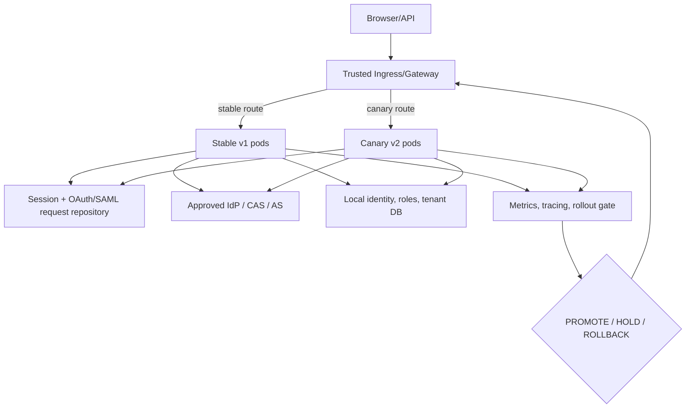
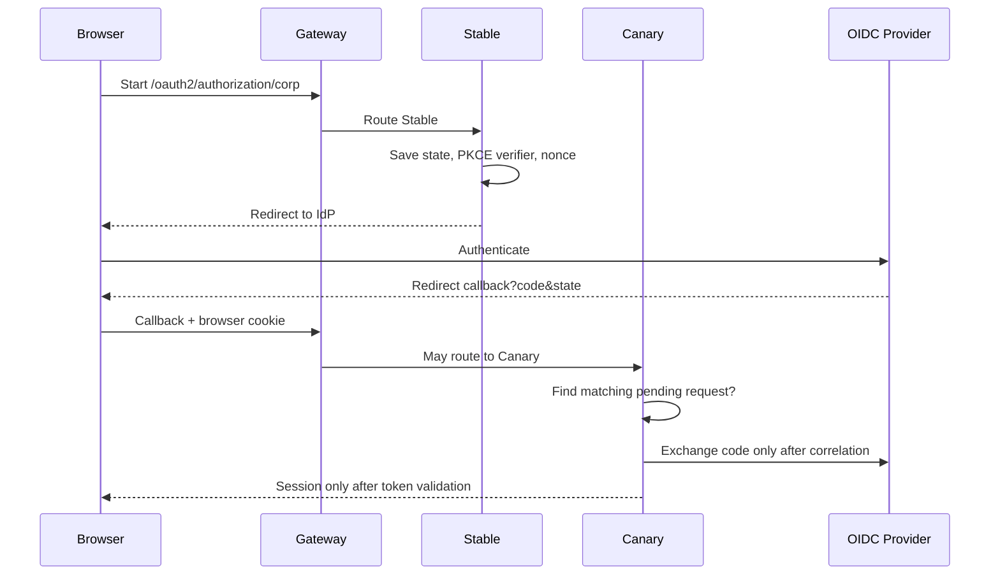

# Kế hoạch kiểm thử, chuyển lưu lượng và quay lui có kiểm soát khi nâng cấp SSO/Federation

## 1. Bối cảnh, bài toán và mục tiêu

Một ứng dụng Spring Boot sử dụng **Spring Security – federation** có thể nâng cấp Spring Security/OpenSAML, thay Identity Provider (IdP), chuyển OAuth/OIDC client registrations, đổi SAML metadata/certificates, chuyển CAS integration, chuyển local session sang Spring Session Redis hoặc triển khai binary mới trên Kubernetes. Những thay đổi này liên quan tới **danh tính và ranh giới tin cậy**; chỉ thấy trang web HTTP 200 sau một release không chứng minh login an toàn.

Một phiên SSO có thể bắt đầu ở phiên bản **Stable** nhưng callback quay về phiên bản **Canary**. Nếu hai phiên bản dùng khác `OAuth2AuthorizationRequestRepository`, `Saml2AuthenticationRequestRepository`, `HttpSession`, cookie, relay-state hoặc serialization, hệ thống có thể redirect loop, đánh mất `state`/`InResponseTo`, trả lỗi sai issuer/audience, cấp role nhầm tenant hoặc thực hiện logout không đầy đủ.

Bài học thuộc nhóm **Chuyển đổi và nâng cấp** và có ba kết quả cần đạt:

1. Có **test plan** đầy đủ cho trước/sau migration, bao gồm unit, integration, end-to-end, security-negative và rollback rehearsal.
2. Có **traffic shift plan** từng bước và các gate đo lường được, tách request-weight khỏi SSO login-flow cohort.
3. Có **controlled rollback plan** trả traffic về bản stable, xử lý callback/session đang dở và giữ nguyên các trust/credential revocation bắt buộc, không đơn giản dùng lại mọi cấu hình cũ.

Ví dụ theo Java 17+, Spring Boot 3.x, Spring Security 6.x/6.5, Spring Session, Kubernetes/Istio khi cần. Các tên `example.test`, service URLs, image tags và ngưỡng số liệu chỉ là ví dụ học tập; không phải hệ thống đang chạy hoặc SLO bắt buộc của Spring.

### Các bất biến không được đánh đổi

- **Không xác minh được authentication mới thì không tạo `Authentication` mới.**
- **Issuer, audience, XML Signature, token signature, Recipient, Destination, `state`, `nonce`, PKCE, `InResponseTo` và replay checks không bị vô hiệu hóa trong canary/rollback.**
- **Mọi local role, tenant, account active status và object-level ACL được kiểm tra ở cả hai versions.**
- **Một sự cố security nghiêm trọng phải dừng/đảo traffic dù tổng login success vẫn tốt.**
- **Rollback binary không có nghĩa được phục hồi key đã bị thu hồi hoặc trust issuer không còn được phê duyệt.**

## 2. Chọn đúng loại chuyển đổi

| Thay đổi | Trạng thái có thể chịu ảnh hưởng | Rollback khả thi khi nào? |
| --- | --- | --- |
| Spring Security filter chain/API upgrade | SecurityContext, principal type, authorization matchers | Khi session/schema và authorization semantics vẫn tương thích |
| OAuth2/OIDC IdP issuer A → B | `iss`/`sub`, JWK keys, client ID/secret, state, logout | Khi IdP cũ, local links và trust policy vẫn hợp lệ |
| SAML SP Entity ID/ACS/metadata change | IdP registration, pending AuthnRequest, XML signature/certs | Khi IdP vẫn công nhận old SP và old cert chưa bị thu hồi |
| CAS client/server migration | ST validation, `ServiceProperties.service`, CAS Server | Khi service URL/trust và ST lifecycle đúng; không replay ST |
| JWT → opaque introspection | JWK trust, online AS dependency, revocation policy | Khi API/token semantics, audience và client contracts còn phù hợp |
| Local sessions → shared Redis | Session cookie, serialized principal, state repositories, CSRF | Khi v1 đọc được v2 records hoặc chấp nhận re-login có kiểm soát |
| Kubernetes binary v1 → v2 | Pod routing, callback, readiness, persistent state | Khi binary/config/DB format tương thích |
| Tenant/role mapping migration | `(issuer,sub)` local links, authority mapping | Khi không mất định danh hoặc gây cross-tenant escalation |

**Không gộp nhiều thay đổi rủi ro cao thành một đợt nếu có thể tách.** Ví dụ nên nâng Spring Security version với IdP issuer giữ nguyên trước, rồi mới chuyển issuer; một lỗi callback khi ấy dễ khoanh vùng hơn.

## 3. Trust contract và tiêu chí thành công trước khi viết test

Xây **SSO Migration Contract** có version/owner:

| Thuộc tính | Stable | Canary | Quy tắc |
| --- | --- | --- | --- |
| External hostname | `portal.example.test` | Cùng host hoặc host riêng đã phê duyệt | HTTPS, không tin Host/Forwarded do client khai |
| OIDC issuer | Issuer A | A hoặc B theo migration scope | Exact `iss`, allowlist |
| OIDC client ID | Client v1 | Client v2 nếu thay IdP | Redirect URI/secret riêng, không wildcard |
| OIDC callback | `/login/oauth2/code/corp` | Same hoặc approved separate path | `state`/PKCE/nonce có correlation |
| SAML SP Entity ID | SP v1 | Giữ hoặc SP v2 | Audience và SP metadata thống nhất |
| SAML ACS/SLO | URLs được IdP đăng ký | URLs được IdP đăng ký | Destination/Recipient/SLO signature |
| IdP verification key | Approved cert set | Approved cert set | Không trust test/unknown cert |
| CAS service URL | `https://portal.example.test/login/cas` | Same hoặc new service registration | ST chỉ valid đúng service và một lần |
| Local user link | Verified issuer+subject | Mapping compatible | Không join theo email trần |
| Session format | v1 | v2 | Cross-version read/write hoặc affinity |
| Local permissions | Existing roles/ACL | Equivalent or versioned policy | Không mở rộng quyền ngầm |
| Rollback artifact | Stable digest | Canary digest | Immutable, signed/pinned |

**Security success** = không có unverified token/assertion được chấp nhận, không role/tenant escalation. **Functional success** = người dùng login/logout đúng, phiên hợp lệ tồn tại, APIs đủ/thiếu quyền trả 200/403 theo chính sách. **Reliability success** = flow completion và latency trong error budget. Cả ba đều cần đạt.

## 4. Kiến trúc route và nơi lưu state



Một lượt login có **ít nhất hai lượt về ứng dụng**: bắt đầu authorization request và callback từ IdP. Routing 5% cho từng HTTP request không bảo đảm callback vào cùng version đã tạo pending request.

State cần inventory: `HttpSession`/Spring Session Redis, OAuth2 `OAuth2AuthorizationRequestRepository`, PKCE verifier, OIDC `nonce`, SAML `Saml2AuthenticationRequestRepository`, `RelayState`, `InResponseTo`, CSRF token, cookie domain/SameSite/Secure, replay ledger, logout state, local SecurityContext, cached authorized clients, signing/decryption keys và account links.

**Hai cách chính:** (A) shared state **tương thích và gắn đúng browser**; (B) trusted route affinity hoặc separate callback endpoints đã đăng ký. **Không** tắt `state`/`InResponseTo` để chữa việc session đọc không được.

## 5. Điều tra trước release: inventory và baseline

Thu thập:

1. Spring Boot/Security/Session, Java version, OpenSAML/CAS client, BOM/transitive crypto dependencies.
2. Danh sách `SecurityFilterChain` và matcher/order, custom filters, principal converters, method security.
3. OIDC discovery/issuer, client registration ID, token/JWKS endpoints, redirect URI, `state`/`nonce`/PKCE policy.
4. SAML IdP/SP entity IDs, metadata, ACS/SLO, HTTP bindings, sign/encrypt requirements, verification/public and private credentials.
5. CAS `/login`/`/serviceValidate`, `ServiceProperties.service`, ST/PGT/PT use cases.
6. JWT `iss`/`aud`, allowed algorithms/JWKs; opaque token introspection and caching.
7. Session provider and serialization, cookie name/path/SameSite, Redis namespace, TTL and failover.
8. Local database schema, identity links, active flag, group-to-authority mapping, tenant/ACL rules.
9. Gateway/ingress/mesh architecture, routing cookies, SSL termination and forwarded header trust.
10. IdP-side rate limits, allowed callbacks, metadata propagation delays, certificate rotation windows.
11. Stable image digest, approved config/trust revision, backup and verified rollback route.
12. Observability: flow success, callback correlation errors, signature failures, logout, latency and error budget.

**Baseline theo protocol/registration/browser**, không trộn mọi flows với health checks/static assets. Định nghĩa “login completed” là đã có validated Authentication và local session/token hợp lệ, không chỉ callback HTTP 302.

## 6. Change ticket và trách nhiệm Go/No-Go

Một change ticket cần ghi: change ID, mục tiêu, old/new digests, dependency versions, approved trust contract, IdP owner, security approver, release owner, SRE/on-call, test lead, change window, rollback deadline, rollback manifest, data migration plan, security hard stops, các metric thresholds, minimum sample, dashboard links và evidence từ staging.

| Vai trò | Trách nhiệm |
| --- | --- |
| Application owner | Code changes, compatibility, feature flags, service behavior |
| IdP admin | Client registration, issuer, SAML metadata, ACS/SLO, key/trust updates |
| Security | Signature/issuer/audience/replay tests; approval of trust and negative tests |
| QA/Test lead | Unit, integration, browser E2E, cross-version/rollback rehearsal |
| SRE/Platform | Traffic weights, readiness, monitoring, stable route and route reversal |
| Data owner | Session/DB schema and identity-link compatibility |
| Incident commander | Emergency stop and status communication |

**Emergency security rollback có thể cần được ủy quyền trước**, không chờ đủ số mẫu canary hoặc cuộc họp. Người điều khiển route phải biết đúng reviewed manifest stable và cách xác nhận route đã đảo.

## 7. Các pha chuyển đổi và điểm dừng

| Pha | Việc làm | Điều kiện ra pha |
| --- | --- | --- |
| P0 Discovery | Inventory, baseline, owner, rollback feasibility | Approved migration contract |
| P1 Build | Immutable artifact, dependency/security scan | Build/unit pass |
| P2 Contract | OIDC/SAML/CAS, provider/validator tests | Positive + negative pass |
| P3 Staging | E2E browser, cross-version sessions, chaos | Rollback drill pass |
| P4 Prod preflight | Effective config, certs, session store, route | Go decision |
| P5 Dark/synthetic | Canary healthy, isolated synthetic logins | Security contract pass |
| P6 Canary | Traffic 1→5→25→50%, gate từng lần | Samples/SLO/security pass |
| P7 Cutover | New traffic 100% tới v2, stable giữ warm | Approved |
| P8 Soak/drain | Theo dõi callbacks/sessions/logout/in-flight requests | Quá rollback window |
| P9 Cleanup | Retire old registration/keys theo policy, release report | Sign-off |

**Không bỏ qua rehearsal rollback**; nếu session v2 không đọc được bằng v1, lệnh đảo binary có thể biến thành logout hàng loạt. Hãy ghi rõ forced re-login UX nếu cần.

## 8. OIDC Authorization Code qua Stable và Canary

Spring Security có authorization endpoint `/oauth2/authorization/{registrationId}` và callback mặc định `/login/oauth2/code/{registrationId}`. Một flow có:



**Vấn đề:** v2 không đọc được `HttpSessionOAuth2AuthorizationRequestRepository` của v1 hoặc cookie bị đổi path/domain → thiếu `state`. Cần shared session state **có ràng buộc browser**, signed trusted route affinity, hoặc callback URL v1/v2 riêng đăng ký chính xác tại IdP.

**Không** coi `code` là authenticated proof. Code exchange cần đúng token endpoint, client authentication/PKCE, ID Token `iss`, `aud`, signature, `nonce`, time và local subject mapping. Callback không có pending request phải fail closed.

### Khi thay IdP issuer

Nếu v1→v2 đổi issuer A→B, người dùng có thể có `sub` mới; phải map bằng verified `(issuer,sub)` cộng local enrollment/tenant checks. Không tự liên kết theo email giống nhau. Nếu dùng dual issuer trong giai đoạn chuyển đổi, phải **approved allowlist + routing policy + audience riêng** và có ngày kết thúc, không cho token A/B đổi chéo service.

## 9. SAML2 AuthnRequest và ACS callback qua hai versions

Spring Security SAML2 phát AuthnRequest từ `/saml2/authenticate/{registrationId}`, lưu pending request bằng `Saml2AuthenticationRequestRepository`; ACS mặc định xử lý `/login/saml2/sso/{registrationId}`. SP Entity ID mặc định có dạng `{baseUrl}/saml2/service-provider-metadata/{registrationId}`, có thể customize.

Một signed Response qua HTTP-POST phải được kiểm tra: XML signature bằng approved IdP verification certificate, `Issuer`, `Destination`, `Recipient`, `AudienceRestriction`, time `NotBefore/NotOnOrAfter`, SubjectConfirmation, `InResponseTo`, NameID và local identity policy.

### Những rủi ro khi cutover

- Stable phát AuthnRequest, Canary nhận Response mà không có pending request.
- IdP chưa đăng ký ACS v2 hoặc Response Audience vẫn là old SP Entity ID.
- Canary sử dụng verification cert/issuer sai environment.
- v2 ký AuthnRequest bằng SP key IdP chưa trust.
- Encrypted Assertion cần SP decryption key cũ nhưng canary không có.
- SAML SLO callback đi về version không có logout request/session state.
- Reverse proxy tạo internal HTTP URL làm `Destination`/`Recipient` mismatch.
- Replay ledger v1/v2 tách riêng chấp nhận lại Response.ID/Assertion.ID.

**Không bỏ chữ ký, audience, recipient, InResponseTo, replay validations.** Nếu cần dual ACS/SP Entity ID, IdP admin phải phê duyệt registrations/metadata phù hợp; không chỉ khai URL tùy ý trong Spring Boot.

## 10. Hai chiến lược SAML migration

**Chiến lược A: giữ nguyên SP contract.** Hai versions dùng cùng Entity ID/ACS/IdP/certs, nhưng thay backend code. Phù hợp nâng version Spring Security nếu custom request/session repository tương thích. Ưu điểm giảm chỉnh sửa phía IdP. Rủi ro phiên/serialization và OpenSAML behavior có thể khác.

**Chiến lược B: đăng ký SP v1 và SP v2 riêng.** Có hai metadata/ACS routes approved. User cohort được chọn trước khi phát AuthnRequest, callback quay về đúng version; dễ isolate trust, nhưng identity linking/NameID/issuer/certs có thể thay và IdP có thể giới hạn registration. Không mặc định cùng NameID giữa hai SP.

Trong cả hai, test đầy đủ SLO, encrypted assertions, signing cert rotation và reverse proxy. **Đừng tự động chấp nhận unsolicited SAMLResponse** để xử lý callback lost state khi product chỉ hỗ trợ SP-initiated SSO.

## 11. SAML request repository và session fixation

`Saml2AuthenticationRequestRepository` giữ `AbstractSaml2AuthenticationRequest` để đối chiếu `InResponseTo`. Spring Security có session-based repository; custom distributed cache qua `RelayState` phải thiết kế chống replay, TTL và ràng buộc browser/tenant. Chỉ tìm request bằng RelayState do attacker mang tới mà không gắn browser context có thể giảm khả năng chống login fixation.

Test:

1. Stable phát AuthnRequest, Canary callback cùng browser: success nếu shared state compatible.
2. Canary phát, Stable callback: success hoặc route lại v2 theo intentional affinity.
3. Browser X dùng RelayState browser Y: reject.
4. Wrong `InResponseTo` hoặc no pending request: reject.
5. Replay same signed Response/Assertion IDs: reject.
6. Wrong issuer/audience/recipient: reject.
7. Invalid XML Signature/untrusted cert: reject.
8. ACS encrypted assertion với key không được approved: reject.
9. SAML LogoutRequest sai signer: không logout người khác.
10. Redis/request store outage: fail closed khi không còn correlation.

Một test dùng `@WithMockUser` hoặc `authentication(Saml2Authentication)` **không chứng minh** bất kỳ XML Signature validation nào; cần signed SAML fixtures và OpenSAML provider thật ở integration.

## 12. CAS Service Ticket: không thể retry khi đổi route

CAS Service Ticket `ST-...` được phát cho `ServiceProperties.service` chính xác và chỉ hợp lệ **một lần validation attempt** (kể cả thất bại theo CAS 2.0). Khi stable gửi `/serviceValidate`, CAS có thể consume ST; nếu response reset, Canary **không thể sử dụng ST đó để thử lại** rồi giả vờ đã verify.

```text
CAS issues ST-ONE for https://portal.example.test/login/cas
Stable validates ST-ONE at CAS
CAS consumes ST-ONE, network reply lost
Canary retries ST-ONE => INVALID_TICKET
Correct: no new Authentication; start fresh CAS login transaction
```

Phải giữ exact public `ServiceProperties.service` URL hoặc đăng ký service v2 riêng. CAS sai service có thể trả `INVALID_SERVICE` và consume ticket. Trong canary tests kiểm tra success/expired/replay/wrong service/network timeout, local role mapping và session creation. Không sử dụng CAS ST như một reusable bearer token trong traffic mirroring.

## 13. JWT, opaque introspection và migration nhiều issuer

**JWT Resource Server** có thể verify token offline bằng JWK public key đã tin, kết hợp `iss`, `aud`, `exp`, `nbf`, algorithm và roles/tenant policy. Khi đổi issuer, không tự tin ký bằng keys của issuer B cho token issuer A. Unknown `kid` và JWKS timeout ⇒ reject. Nếu dùng `JwtIssuerAuthenticationManagerResolver` cho multi-issuer, issuer phải nằm trong **approved allowlist**, không tạo decoder cho arbitrary issuer claim.

**Opaque token introspection** cần `active=true` từ trusted Authorization Server, timeout/503 không cấp principal mới. Cache positive nếu có phải bounded TTL/revocation/issuer binding; không lấy cached introspection success của một token để cấp quyền token khác.

**Dual-issuer window** là thay đổi policy security, không chỉ upgrade library. Hãy xác định endpoints được nhận token A/B, khung thời gian, audience rules, account mapping, migration token TTL, logout/revocation và lộ trình remove old trust. Không mở mọi API accept mọi issuer trong thời gian vô hạn.

## 14. Local session continuity và serialization hai chiều

Spring Session Redis có thể chia sẻ `HttpSession` giữa pods, nhưng không bảo đảm tự động tương thích Java class/serialized SecurityContext sau Spring Security upgrade.

| Nguồn phiên | Đích request | Phải kiểm tra |
| --- | --- | --- |
| Stable v1 | Stable v1 | Baseline |
| Stable v1 | Canary v2 | Deserialize principal, roles, CSRF, OIDC/SAML pending requests |
| Canary v2 | Stable v1 | Rollback đọc được new session? |
| Canary v2 | Canary v2 | New version |
| Stable SSO started | Canary callback | `state`/PKCE/nonce hoặc `InResponseTo` đầy đủ |
| Canary SSO started | Stable callback | Compatible state hoặc route affinity |
| Stable logout | Canary next request | Session invalidation được nhìn thấy |
| Canary logout | Stable next request | Không còn authenticated session |

Nếu không tương thích, chọn route affinity/callback segregation hoặc **forced re-login được phê duyệt**, không làm rơi session âm thầm. Test cookie domain/path/SameSite/Secure, load balancer session affinity, Redis namespace/TTL, failure của session store và session fixation prevention.

**Sticky routing không phải cơ chế thay signature/state validation**; pod crash vẫn phải fail closed. Redis namespace dev/test/prod phải được tách.

## 15. Database và user identity mapping: expand-contract

Nếu migration sửa identity link từ email sang `(issuer,sub)` hoặc SAML NameID, cần:

1. **Expand:** tạo bảng/columns/indexes mới mà stable vẫn có thể đọc.
2. **Backfill:** chỉ link identities có verified provenance, không tự đoán cùng người chỉ vì email giống.
3. **Dual-read** trong thời gian được phê duyệt; dual-write nếu cần phải idempotent/consistent.
4. **Canary:** kiểm tra disabled users, duplicate emails, stale roles và cross-tenant ACL.
5. **Rollback:** giữ schema old version có thể đọc, hoặc ghi rõ forced re-login/data migration constraints.
6. **Contract:** xóa dữ liệu/trust cũ sau rollback window và sign-off.

Không chạy destructive schema migration trước khi chứng minh v1 đọc được v2 data. Nếu v2 đổi role semantics, v1 không được mặc định authority không biết thành `ROLE_ADMIN` hoặc một quyền rộng khác. Rollback binary không tự undo database writes, IdP group changes hoặc issued sessions.

## 16. Các tầng kiểm thử bắt buộc

| Tầng | Mục tiêu | Evidence |
| --- | --- | --- |
| Static/build | Dependency API changes, CVEs, SecurityFilterChain order | Build/scan report |
| Unit | Principal conversion, issuer+subject linking, roles/ACL, gate logic | JUnit |
| Contract | OIDC token/JWKS responses, SAML metadata, CAS XML, timeouts | Stub/test IdP |
| Integration | Spring filters/provider/repositories, Redis session compatibility | Boot tests |
| Browser E2E | Authorization redirect→callback→session, sign-in/out | Test IdP/browser |
| Protocol security | Signed SAML, OIDC `iss`/`aud`/nonce/state, replay | Negative fixtures |
| Traffic | Callback from stable→canary and canary→stable or correct affinity | Ingress test |
| Load/chaos | IdP latency, Redis downtime, canary pod restart | Controlled fault injection |
| Recovery | Revert traffic, rollback binary/config, session/user impact | Drill evidence |

**Unit/mock principal tests không thay protocol tests**. Cần signed test SAMLResponse để thực sự kiểm tra XML validators; OIDC test AS phải phát signed ID Tokens; CAS Server sandbox phải thể hiện ST one-time.

## 17. Positive test cases: OIDC

- Anonymous request protected route khởi tạo `/oauth2/authorization/corp` đúng.
- State là cryptographically random và nằm trong đúng pending transaction.
- PKCE challenge/verifier đúng với AS policy; OIDC nonce được ràng buộc.
- Callback `/login/oauth2/code/corp` tìm đúng auth request của browser.
- Authorization code exchange tại approved token endpoint, client auth đúng.
- ID Token verification với signature, issuer, audience, nonce/time.
- Local user link từ verified issuer+sub, roles/tenant đúng.
- Login creates authenticated session; protected resource 200 nếu đủ quyền.
- Employee thiếu admin role nhận 403.
- OIDC logout/end-session behavior theo registration, không để zombie app session.
- State từ Stable được Canary nhận khi shared session policy cho; ngược lại.
- Khi route affinity được thiết kế, callback ở đúng version bắt đầu, không trust arbitrary client header.

## 18. Positive test cases: SAML2, CAS và JWT

**SAML2:**

- AuthnRequest đến đúng IdP, signed nếu IdP yêu cầu.
- SAMLResponse/Assertion có approved signature, correct Issuer/Destination/Recipient/Audience.
- Conditions/SubjectConfirmationData/time/`InResponseTo` hợp lệ.
- NameID/attributes map sang local user/tenant/permissions.
- SP Entity ID/ACS/SLO metadata khớp IdP configuration của đúng stage.
- Encrypted assertion được decrypt bằng approved SP private key.
- SLO Request/Response signature/correlation hợp lệ.
- Cross-version callback success nếu compatible hoặc affinity đúng.

**CAS:**

- ST mới đúng service, còn hạn → authenticationSuccess; ticket bị consume.
- Stale/expired/replayed/wrong-service ST → failure.
- Local session sau CAS authentication đúng; CAS outage fail closed khi ST chưa validate.

**JWT/Opaque API:**

- JWT signature/`iss`/`aud`/time valid → request authorized theo local ACL.
- JWT unknown `kid`/wrong issuer/audience/expired → reject.
- Opaque introspection `active=true` từ đúng AS → authorize; `active=false`/timeout → deny.

## 19. Security-negative test matrix

| Test | Injection | Kỳ vọng |
| --- | --- | --- |
| SEC01 | OIDC token sai signature | Reject |
| SEC02 | OIDC wrong issuer | Reject |
| SEC03 | OIDC wrong audience | Reject |
| SEC04 | OIDC wrong nonce | Reject |
| SEC05 | OAuth `state` thuộc browser khác | Reject |
| SEC06 | PKCE verifier sai hoặc code reused | Reject |
| SEC07 | Test issuer JWT gửi prod API | Reject |
| SEC08 | JWT expired/unknown key/alg not allowed | Reject |
| SEC09 | SAML Response unsigned hoặc signature tampered | Reject |
| SEC10 | SAML issuer/audience/recipient sai | Reject |
| SEC11 | SAML `InResponseTo` missing/mismatch | Reject |
| SEC12 | Replay SAML Response.ID/Assertion.ID | Reject |
| SEC13 | SAML LogoutRequest invalid signature | Không logout victim |
| SEC14 | CAS expired/reused ST | Reject |
| SEC15 | CAS ST for service A validated at B | Reject + consume theo CAS |
| SEC16 | Opaque introspection active=false/timeout | Deny new authentication |
| SEC17 | Client gửi forged `X-Verified-User` | Strip/deny |
| SEC18 | Same email across issuers | Không auto-link user |
| SEC19 | `admins` group từ untrusted IdP | Không cấp prod admin |
| SEC20 | Disabled user, signed token still valid | Deny local access |
| SEC21 | Cross-tenant resource ID | 403 |
| SEC22 | Lost CSRF/session at canary | Fail closed, không bypass |
| SEC23 | Key revoked before rollback | Không tái trust revoked key |
| SEC24 | Canary response bypasses default SAML validator | Hard stop |
| SEC25 | Invalid identity accepted even once | Emergency rollback |

Security test **fail** phải chặn promotion dù login success rate vẫn đạt. HTTP 302 không tự là success (có thể redirect tới error page); phải assert cuối flow là authenticated session và local authorization.

## 20. Performance, fault injection và soak test

Theo dõi các flow:

```text
login_started -> redirect to IdP -> IdP authentication
  -> callback received -> token/SAML/CAS validation
  -> local principal and authority mapping
  -> authenticated session
  -> protected resource authorization
  -> login_terminal
```

Kịch bản chaos:

- OIDC token endpoint HTTP 503/timeout, retry budget exhaustion.
- JWKS cache cold/warm, unknown kid, key rotation.
- SAML metadata refresh down nhưng cached trusted cert vẫn valid.
- Redis session outage giữa AuthnRequest và callback.
- Canary pod chết ngay sau tạo OAuth state/SAML AuthnRequest.
- CAS validation response lost sau ST consumed.
- Proxy TLS termination gây wrong redirect/Recipient.
- IdP rate-limit 429 và burst login traffic.
- CSRF token or session invalidation across versions.
- Parallel login tabs từ cùng browser, replay attempts.
- Local user directory delay gây timeout; user disabled mid-session.
- SLO/logout cross-version and long-lived connection draining.

Đo terminal success, p50/p95/p99, state mismatch, TLS/issuer/signature errors, session load, Redis latency, IdP rate limits và backend saturation. **Không mirror raw user tokens, authorization codes, SAMLResponse hoặc CAS ST**; chúng có thể là credential one-time và gây side effects.

## 21. Chọn phương án chuyển traffic

| Phương án | Ưu điểm | Rủi ro SSO |
| --- | --- | --- |
| RollingUpdate | Đơn giản khi chỉ đổi binary | Callback/session qua phiên bản khác |
| Blue-green | Đảo route nhanh | Flow bắt đầu ở blue, kết thúc ở green |
| Weighted canary | Giới hạn ảnh hưởng và đo metric | Request weight khác login cohort |
| Session/cohort-based canary | Nhóm user/login flows ổn định | Cần signed routing state và expiry |
| Separate OIDC/SAML callback | Flow v1/v2 rõ | IdP registrations/ACS/entityId phức tạp |
| Feature flag | Cho bật code path từng nhóm | Không được dùng để bỏ security validators |
| Shadow/dark launch | So sánh non-sensitive processing | Raw ST/code/artifact replay hoặc credential leak |
| DNS cutover | Dễ đổi host | Cache DNS và open connections làm rollback chậm |

Trước khi chọn, trả lời: **mỗi SSO transaction được gắn vào version nào, callback được route ra sao và session có được version kia hiểu không?** Nếu chưa có câu trả lời, traffic shifting theo HTTP requests có thể phá login ngay cả khi tất cả pods ready.

## 22. Lịch canary và điều kiện gate

Ví dụ không phải production default:

| Bước | Stable | Canary | Gate |
| --- | ---: | ---: | --- |
| Internal synthetic | 100% | 0% public | Signed E2E/negative pass |
| 1% | 99% | 1% | User cohort, sample tối thiểu, no security event |
| 5% | 95% | 5% | Login/state parity, latency SLO |
| 25% | 75% | 25% | Session/authorization parity, IdP capacity |
| 50% | 50% | 50% | SLO/logout, error budget and rollback readiness |
| 100% new | 0% new | 100% new | Explicit Go approval |
| Soak/drain | Stable warm | New primary | Observe in-flight callbacks, sessions |
| Cleanup | Stable retired | New stable | Post-change sign-off |

Trọng số 5% là **phần request được route** theo service mesh, không tự là 5% new login users. Cần đo theo terminal login flows và cohorts, không chỉ `/actuator/health` requests. Người dùng hiện có session sticky có thể phân phối khác weight.

**Không tăng traffic chỉ vì đã chờ 5 phút**, khi sample quá thấp. Ngược lại một assertion giả được accept lúc chỉ có 10 flows là **emergency stop**. Các ngưỡng phải dựa trên baseline/error budget thực, không sao chép máy móc.

## 23. Đo số liệu đúng và không làm lộ secrets

Metrics gợi ý:

```text
sso_login_started_total{version,protocol,registration}
sso_login_terminal_total{version,protocol,registration,result}
sso_login_duration_seconds{version,protocol,registration}
sso_state_mismatch_total{version,protocol}
sso_signature_invalid_total{version,protocol}
sso_token_endpoint_error_total{version,registration}
sso_session_compatibility_failure_total{source,target}
sso_logout_failure_total{version,protocol}
sso_route_selected_total{version,routeClass}
sso_trust_violation_accepted_total{version}
```

Định nghĩa denominator = **completed terminal flows** có trạng thái success/failure, không chỉ clicks vào login URL; abandoned/outstanding flows theo dõi riêng bằng bounded TTL. Một HTTP 302 từ callback không đủ làm terminal success. Không dùng raw `state`, SAML RelayState, NameID, OAuth code, CAS ticket, cookie, Bearer token, private key hay user email làm metric labels.

So sánh stable/canary cùng browser/IdP/region/tenant mix; không coi raw success rate từ 2 users là đủ. Correlation error phải phân biệt `state` mismatch do tấn công với callback mất session do affinity, nhưng **cả hai đều không cấp authentication**.

## 24. Gate minh họa: Security hard stop và reliability SLO

| Tín hiệu | Ngưỡng minh họa | Quyết định |
| --- | --- | --- |
| Unverified token/assertion accepted | 0 tuyệt đối | Emergency revert |
| Approved issuer/cert/secret guard failed | 0 | Stop before public |
| Cross-version state compatibility known broken | 0 | Block or revert |
| Terminal completed login samples | ≥200 | Nếu thiếu: HOLD |
| Terminal login success | ≥99% | Nếu dưới: rollback reliability |
| Correlation failures | ≤0,5% | Nếu vượt: rollback reliability |
| Login processing p95 | ≤1800 ms | Nếu vượt: rollback reliability |
| Unauthorized role/tenant escalation | 0 | Emergency revert |
| IdP timeout/503, redis failures | Trong agreed error budget | Hold/rollback |
| Missing dashboard or stable route | 0 missing | Không promote |

**Các ngưỡng 200, 99%, 0,5%, 1800 ms chỉ phục vụ ví dụ code**. Khi thực thi, dùng baseline/SLO có owner, confidence interval và thời gian hold phù hợp. Với authentication bypass, không cần minimum sample.

## 25. Java 17 độc lập: quyết định PROMOTE, HOLD hoặc ROLLBACK

Đây là ví dụ **Java SE độc lập** chỉ mô phỏng policy gate theo metrics đã được hệ thống thu thập đáng tin. Nó **không tự điều khiển Istio**, không xác minh SAML/JWT và không nên thay change approval. Lưu `FederationCutoverGateDemo.java`:

```java
public final class FederationCutoverGateDemo {

    enum Decision {
        PROMOTE,
        HOLD_INSUFFICIENT_SAMPLE,
        HOLD_INVALID_METRICS,
        BLOCK_INCOMPATIBLE_STATE,
        ROLLBACK_SECURITY,
        ROLLBACK_RELIABILITY
    }

    record Limits(long minCompleted,
                  double minSuccessRate,
                  double maxCorrelationErrorRate,
                  long maxP95Millis) {
    }

    record Window(long completed,
                  long successful,
                  long correlationFailures,
                  long untrustedAccepted,
                  long p95Millis,
                  boolean approvedTrust,
                  boolean compatibleSession) {
    }

    static Decision evaluate(Limits limits, Window window) {
        if (!window.approvedTrust() || window.untrustedAccepted() > 0) {
            return Decision.ROLLBACK_SECURITY;
        }

        if (!window.compatibleSession()) {
            return Decision.BLOCK_INCOMPATIBLE_STATE;
        }

        if (window.completed() < 0
                || window.successful() < 0
                || window.successful() > window.completed()
                || window.correlationFailures() < 0
                || window.correlationFailures() > window.completed()
                || window.untrustedAccepted() < 0
                || window.p95Millis() < 0) {
            return Decision.HOLD_INVALID_METRICS;
        }

        if (window.completed() < limits.minCompleted()) {
            return Decision.HOLD_INSUFFICIENT_SAMPLE;
        }

        double success = (double) window.successful() / window.completed();
        double correlation = (double) window.correlationFailures()
                / window.completed();

        if (success < limits.minSuccessRate()
                || correlation > limits.maxCorrelationErrorRate()
                || window.p95Millis() > limits.maxP95Millis()) {
            return Decision.ROLLBACK_RELIABILITY;
        }

        return Decision.PROMOTE;
    }

    public static void main(String[] args) {
        Limits limits = new Limits(200, 0.99, 0.005, 1800);
        Window healthy = new Window(500, 498, 0, 0, 900, true, true);
        Window small = new Window(40, 40, 0, 0, 700, true, true);
        Window errors = new Window(500, 475, 11, 0, 900, true, true);
        Window slow = new Window(500, 499, 0, 0, 2100, true, true);
        Window untrusted = new Window(10, 10, 0, 1, 500, true, true);
        Window badTrust = new Window(500, 499, 0, 0, 800, false, true);
        Window incompatible = new Window(500, 499, 0, 0, 800, true, false);
        Window badData = new Window(500, 550, 0, 0, 800, true, true);
        Window correlation = new Window(500, 499, 4, 0, 800, true, true);

        System.out.println("healthy=" + evaluate(limits, healthy));
        System.out.println("small=" + evaluate(limits, small));
        System.out.println("errors=" + evaluate(limits, errors));
        System.out.println("slow=" + evaluate(limits, slow));
        System.out.println("untrustedAccepted=" + evaluate(limits, untrusted));
        System.out.println("unapprovedTrust=" + evaluate(limits, badTrust));
        System.out.println("incompatibleSession="
                + evaluate(limits, incompatible));
        System.out.println("invalidMetrics=" + evaluate(limits, badData));
        System.out.println("stateCorrelation=" + evaluate(limits, correlation));
    }
}
```

Chạy Java 17+:

```bash
javac FederationCutoverGateDemo.java
java FederationCutoverGateDemo
```

Stdout **chính xác**:

```text
healthy=PROMOTE
small=HOLD_INSUFFICIENT_SAMPLE
errors=ROLLBACK_RELIABILITY
slow=ROLLBACK_RELIABILITY
untrustedAccepted=ROLLBACK_SECURITY
unapprovedTrust=ROLLBACK_SECURITY
incompatibleSession=BLOCK_INCOMPATIBLE_STATE
invalidMetrics=HOLD_INVALID_METRICS
stateCorrelation=ROLLBACK_RELIABILITY
```

Giải thích: `untrustedAccepted` rollback ngay dù chỉ 10 samples; `small` chưa đủ sample nên HOLD; `stateCorrelation` 4/500=0,8% lớn hơn 0,5%; `healthy` success 498/500=99,6% và p95 900ms đạt gate mẫu. `BLOCK_INCOMPATIBLE_STATE` có nghĩa không được promote; nếu Canary đã nhận public traffic, revert route và xử lý phiên đang dở.

Trong thực tế phải xác nhận metrics nguồn tin cậy, thời gian cửa sổ, amount of missing data, phân bố IdP/users và change owner phê duyệt trước khi thực hiện traffic action.

## 26. Istio VirtualService: chuyển 5% request traffic

Ví dụ có hai Kubernetes Services `portal-stable` và `portal-canary` trong namespace `portal-prod`, gateway đã có TLS host hợp lệ:

```yaml
apiVersion: networking.istio.io/v1
kind: VirtualService
metadata:
  name: portal
  namespace: portal-prod
spec:
  hosts:
    - portal.example.test
  gateways:
    - portal-gateway
  http:
    - name: portal
      route:
        - destination:
            host: portal-stable.portal-prod.svc.cluster.local
            port:
              number: 8080
          weight: 95
        - destination:
            host: portal-canary.portal-prod.svc.cluster.local
            port:
              number: 8080
          weight: 5
```

Đây là **đoạn manifest minh họa**; cần actual Service selectors/ports/Gateway/TLS chính xác, RBAC và change approval. Istio có thể dùng Gateway API thay vì VirtualService tùy cluster. **Weighted route chỉ phân chia request**, không bảo đảm phiên/SSO callback affinity.

Khi emergency revert, route có thể đổi thành:

```yaml
route:
  - destination:
      host: portal-stable.portal-prod.svc.cluster.local
      port:
        number: 8080
    weight: 100
  - destination:
      host: portal-canary.portal-prod.svc.cluster.local
      port:
        number: 8080
    weight: 0
```

Lệnh apply cần **manifest đã reviewed trong repository deployment thực**, không tự dựng route khẩn cấp từ tham số người dùng. Đảo route không hủy ngay HTTP connections/in-flight callbacks; phải quản lý drain và transaction TTL.

## 27. Kubernetes RollingUpdate không phải canary cohort

Kubernetes Deployment `RollingUpdate` thay Pod dần với `maxUnavailable`/`maxSurge`. Nó **không tự điều khiển** tỷ lệ 1/5/25% theo user SSO.

```yaml
apiVersion: apps/v1
kind: Deployment
metadata:
  name: portal-canary
  namespace: portal-prod
spec:
  replicas: 2
  strategy:
    type: RollingUpdate
    rollingUpdate:
      maxUnavailable: 0
      maxSurge: 1
  selector:
    matchLabels:
      app: portal
      track: canary
  template:
    metadata:
      labels:
        app: portal
        track: canary
    spec:
      containers:
        - name: portal
          image: registry.example.test/portal:v2-candidate
          ports:
            - containerPort: 8080
          readinessProbe:
            httpGet:
              path: /actuator/health/readiness
              port: 8080
            initialDelaySeconds: 5
            periodSeconds: 5
```

Bản thật cần pinned immutable image digest, secrets, namespace isolation, resources và probes. Pod readiness xanh không chứng minh `state`, `nonce` hay `InResponseTo` đúng. Spring Session shared Redis có thể giúp nhưng class serialization v1↔v2 phải test.

```bash
kubectl -n portal-prod rollout status deployment/portal-canary
kubectl -n portal-prod describe deployment portal-canary
kubectl -n portal-prod get pods -l track=canary
```

`kubectl rollout undo` chỉ **rollback Deployment revision**. Nó không tự chỉnh trọng số traffic Istio/Gateway. Nếu đang dùng stable và canary Services riêng, hãy **đảo route trước rồi rollback binary/config khi cần**.

## 28. Blue-green, session-affinity và shadow traffic

**Blue-green**: đổi route giữa hai cụm nhanh, nhưng pending SSO transactions vẫn có thể callback vào cụm khác. Cần shared state compatibility hoặc version-aware callback routing. DNS cutover có TTL/cache nên đảo lại không tức thì; L7 route switch có thể chính xác hơn theo kiến trúc.

**Affinity**: lựa chọn cohort trước khi bắt đầu authorization request; browser callback đi cùng cohort bằng cookie route do trusted gateway phát và kiểm tra, không tin `X-Canary: true` từ client. Nếu pod v2 crash, phải bảo đảm fallback đúng theo policy hoặc yêu cầu login mới, không bỏ validation.

**Shadow/dark launch**: chỉ mirror **synthetic hoặc sanitized non-sensitive requests**. Không mirror real authorization codes, SAML Artifacts, CAS Service Tickets hay SAMLResponse chứa assertions/cookies: one-time semantics, replay/security/privacy problems. Không dùng shadow data để ghi account/session/roles thật.

**Feature flag**: chỉ bật code path theo cohort, tuyệt đối không dùng flag “disable signature checks” để qua gate.

## 29. Rollback runbook: đảo traffic trước, đánh giá state sau

Trong một incident:

1. **Decision:** ngừng promotion, ghi reason, version, metrics và security impact. Security bypass thì emergency incident response.
2. **Freeze:** ngừng automated rollout tiếp tục tăng weight và thay metadata/certs.
3. **Reverse route:** đưa new eligible traffic về Stable 100% qua approved ingress/Istio/Gateway config.
4. **Verify route:** kiểm tra metrics per-version, không chỉ tin command exit code.
5. **Drain:** giám sát in-flight callback/auth requests, user sessions và long-lived connections.
6. **Decide binary rollback:** nếu cần, dùng known stable image/config revision; kiểm tra schema/session serialization.
7. **Trust check:** giữ issuer/keys được approve, không restore revoked/compromised cert/secret.
8. **User impact:** có thể cần controlled forced re-login nếu sessions tạo ở v2 không đọc được bởi v1.
9. **Validate:** positive SSO and security-negative tests trên Stable route sau reversal.
10. **Reconcile:** DB/user links/session invalidation cần rollback/forward-fix riêng.
11. **Report:** timestamps, owner, affected cohorts, root cause, events and remediation.

Ví dụ commands **chỉ dùng trong môi trường đã phê duyệt**, trong đó file route đã tồn tại trong deployment repository của hệ thống:

```bash
kubectl -n portal-prod rollout status deployment/portal-canary
kubectl -n portal-prod apply -f deploy/portal/route-stable.yaml
kubectl -n portal-prod rollout undo deployment/portal-canary
kubectl -n portal-prod describe deployment portal-canary
```

`deploy/portal/route-stable.yaml` là tên **ví dụ** cho artifact của release pipeline, không khẳng định sẵn có. Đừng chạy lệnh phá session/Redis hoặc rollback database tùy tiện.

## 30. Những thứ không thể rollback bằng một lệnh

| Thành phần | Giới hạn |
| --- | --- |
| Traffic weights | Chỉ điều khiển new routing; in-flight flow còn tồn tại |
| Deployment image | Không tự rollback Spring config/IdP metadata/DB |
| OIDC client registration | Old client/secret có thể đã bị xóa hoặc revoked |
| SAML IdP signing cert | Compromised/revoked key không được re-trust |
| SAML SP Entity ID/ACS | IdP có thể đã bỏ old registration |
| Session serialization | v1 có thể không đọc v2 session, buộc re-login |
| Database schema | Destructive migration có thể không reversible |
| User linking | Account mapping mới có thể cần data reconciliation |
| Local roles/permissions | Security entitlements không được undo vô kiểm soát |
| Opaque token revocation | AS có thể đã revoked, không “unrevoke” vì rollback |
| Logout state | Rollback không làm sống lại session đã bị invalidate |

**Rollback target phải gắn với một “rollback feasibility boundary”**: sau mốc nào quay code cũ còn an toàn, sau mốc nào chỉ có forward recovery. Nếu key rotation thuộc incident, không phục hồi old key dù làm tăng login failures tạm thời.

## 31. Rehearsal: diễn tập lỗi có kiểm soát trong staging

Một cuộc rehearsal đáng tin bao gồm:

1. Phát hành Canary với approved test IdP/cert/issuer, stable và canary dùng session store phù hợp.
2. Chạy synthetic OIDC/SAML/CAS logins thành công ở Stable.
3. Chuyển canary 5%, đo terminal outcomes, local roles và tenant ACL.
4. Tạo OIDC `state` ở stable, cố ý đưa callback tới canary theo test route; kiểm tra shared state hoặc affinity.
5. Tạo SAML AuthnRequest ở canary, gửi signed Response tới stable; kiểm tra `InResponseTo` hoặc intent route.
6. Kill canary pod trong thời gian chờ callback; test failover không bỏ validation.
7. Simulate Redis outage/serialization incompatibility; gate không promote.
8. Mô phỏng JWKS unknown `kid`/IdP metadata outage; trust snapshot behavior đúng.
9. CAS ST đã consumed, thử request lần nữa; reject.
10. Signed SAMLResponse wrong issuer/audience; reject.
11. Canary login success nhưng tenant khác hoặc role disabled; 403.
12. Thực thi traffic reverse và xác nhận Stable login/session behavior.
13. Test logout/SLO sau rollback, không tạo session zombie.
14. Báo cáo downtime/re-login rate, rollback steps duration, failure categories.
15. Ký rehearsal result và cập nhật runbook trước production.

Dùng **synthetic users/test IdP**, không lấy token/session thật của production để fault injection.

## 32. Trigger rollback khẩn cấp và xử lý

| Trigger | Hành động |
| --- | --- |
| Chấp nhận untrusted assertion/JWT | Emergency traffic revert + security incident |
| Bỏ `state`/nonce/PKCE/`InResponseTo` | Emergency revert |
| Cross-tenant/role privilege escalation | Emergency revert + revoke affected sessions |
| Login session tạo từ credential chưa validate | Emergency revert |
| Session serialization fail ở canary | HOLD/route revert, xử lý compatibility |
| SAML callback wrong ACS/Entity ID tăng | Hold/rollback, phối hợp IdP admin |
| 5xx/token endpoint spike | Hold/rollback theo error budget |
| IdP rate limiting do retry storm | Freeze traffic, bounded retries |
| No telemetry/rollback route unavailable | Không tăng canary |
| Key rotation unapproved | Block deployment, không trust key lạ |
| Destructive DB migration hoàn tất | Cân nhắc forward-fix, không blind downgrade |

Một failure **signature/issuer/audience validation** là security issue, không thể biện minh bằng tổng login success cao.

## 33. Case study: nâng Spring Security mà giữ IdP

Ví dụ giả định:

- Stable Spring Security 6.4, Canary 6.5.
- OIDC issuer/redirect/client và SAML Entity ID/ACS/cert **giữ nguyên**.
- Thay đổi custom principal mapping và Spring Session serialization.
- 1% canary cho người dùng test đã opt-in; shared Redis có kiểm soát.

**Giai đoạn thử đầu:** test v2-created session không deserialize ở v1. Do rollback có thể mất phiên, **BLOCK_INCOMPATIBLE_STATE**; không đưa public traffic cho đến khi fix hoặc chấp nhận phiên bản-affinity/forced re-login với UX approved.

**Sau fix:** 500 completed logins, 498 success, không correlation error, p95 900ms, negative tests pass → có thể PROMOTE theo gate minh họa.

**Sau tăng weight:** có 500 completed, 475 success, 11 state mismatch, p95 900ms → **ROLLBACK_RELIABILITY**; khả năng IdP/session affinity/serializer lỗi. Không sửa bằng cách tắt OIDC state verification.

**Nếu phát hiện một SAML assertion sai issuer được chấp nhận:** **ROLLBACK_SECURITY** ngay dù 999/1000 login thành công; phân loại incident và kiểm tra affected sessions.

## 34. Troubleshooting trong cửa sổ cutover

| Triệu chứng | Nguyên nhân khả dĩ | Kiểm tra |
| --- | --- | --- |
| OAuth callback loop sau canary | Lost `state`/session | Auth request repository, cookie, route |
| OIDC `invalid_grant` | Code reused/timeout, client/redirect mismatch | Token endpoint, PKCE, registration |
| OIDC wrong issuer | IdP B token vào RP trust A | Effective issuer and JWK config |
| SAML `InResponseTo` mismatch | Pending request không chung hoặc browser khác | SAML request repository |
| SAML `Invalid Recipient/Destination` | ACS/public HTTPS URL sai | SP metadata/proxy |
| SAML signature fails v2 | Verification cert or OpenSAML behavior changed | Approved key fingerprints |
| Encrypted assertion decrypt fails | SP decryption key missing | Secret mount/key rotation |
| CAS `INVALID_SERVICE` | Public `ServiceProperties.service` khác | IdP/CAS registration |
| CAS `INVALID_TICKET` on retry | ST consumed at first attempt | Fresh CAS login |
| 403 chỉ ở Canary | Role/tenant mapper changed | Local authorization tests |
| Redis `ClassNotFoundException` | Session serialized type incompatible | Cross-version deserialization |
| Valid session after logout | Invalidation not shared | Session store/logout request |
| Route 5% nhưng callback errors 20% | Weighted per request, flow not sticky | Cohort routing stats |
| Traffic reverted, errors persist | IdP trust/DB/config changed too | Approved config revision |
| K8s rollout undo không đổi traffic | Istio route still points canary | VirtualService/Gateway |
| Readiness green nhưng login fail | Probe không kiểm tra SSO contract | Synthetic auth flow and terminal metrics |

**Chẩn đoán không được log secrets**: dùng correlation IDs đã ẩn, protocol/registration/version, error categories, latency; không log `SAMLResponse`, JWT, CAS ST, OAuth code, cookies hoặc keys.

## 35. Sau cutover: soak, cleanup và báo cáo

Không xóa Stable ngay khi 100% new traffic đến Canary. Đợi qua window đã phê duyệt đủ cho **in-flight authorization codes, pending AuthnRequests, cookies, sessions, logout flows** và chu kỳ giám sát. Nếu cần migrate account links/metadata, chỉ retire old mappings/certs sau IdP/security confirmation.

Post-change report cần: revision/image digest, effective trust config identifiers (không secret values), weights timeline, metrics baseline/canary, completed flows, failures, security-negative test results, callback/session compatibility, key rotation status, rollback test evidence, user impact, corrective actions và owner sign-off.

Đóng cửa sổ rollback **chỉ khi rollback no longer needed và old secrets/registrations được thu hồi đúng policy**. Không giữ compromised old key vì “chắc một ngày cần rollback”. Khi forced re-login là unavoidable, cần thông báo user support/incident response theo product policy.

## 36. Checklist nghiệm thu

- [ ] Có trust contract, old/new versions, image digest, config revision, approval.
- [ ] OIDC `iss`/`aud`/`nonce`/`state`/PKCE/callback đã kiểm tra.
- [ ] SAML IdP/SP metadata, Entity ID/ACS/SLO, signatures và `InResponseTo` đã kiểm tra.
- [ ] CAS service URL, ST one-time/expiry/wrong-service tests pass.
- [ ] JWT/opaque trust, key rotation, introspection failure behavior fail closed.
- [ ] Local issuer+subject account linking, disabled user, roles, tenant ACL được test.
- [ ] Stable↔Canary sessions/CSRF/auth-request repository tương thích hoặc route affinity rõ.
- [ ] Không dùng raw tokens/codes/tickets/Response trong shadow traffic.
- [ ] Signed protocol E2E tests đã chạy với test IdP, không chỉ `@WithMockUser`.
- [ ] Security-negative tests signature, issuer, audience, state, replay pass.
- [ ] Redis/session store/cookie/SameSite/proxy/HTTPS compatibility pass.
- [ ] Metrics tính terminal login outcomes theo version/IdP/browser cohort.
- [ ] Canaries có minimum sample, hold time và approved thresholds.
- [ ] Security critical event override minimum sample.
- [ ] Traffic controller/VirtualService route stable manifest đã review.
- [ ] Rollback drill bao gồm traffic reversal, binary/config assessment và sessions.
- [ ] Không rollback revoked signing key/client secret hoặc IAM policy.
- [ ] DB/schema migration expand-contract và forward recovery đã đánh giá.
- [ ] SRE, IdP admin, security approver và on-call được phân công.
- [ ] 100% cutover chỉ sau Go decision; giữ Stable warm qua soak window.
- [ ] Incident logs/metrics không tiết lộ credential hoặc PII.
- [ ] Post-change report/sign-off và retirement plan đã có.

## 37. Câu hỏi tự kiểm tra và nguồn chính thức

**1. Canary 5% HTTP requests có đồng nghĩa 5% người dùng SSO không?** Không. Routing có thể phân phối nhiều requests cùng một flow đến các versions khác nhau.

**2. OIDC `state` sinh ở v1, callback đến v2 mà v2 không có request thì xử lý thế nào?** Fail closed hoặc route về v1 theo approved affinity; không bỏ `state`.

**3. SAML signed Response có thể được chấp nhận khi `InResponseTo` không khớp không?** Không trong SP-initiated flow theo contract; phải reject hoặc có chính sách unsolicited riêng được kiểm tra.

**4. CAS Service Ticket mất response sau validation có retry để login lại không?** Ticket có thể đã consumed; bắt đầu login flow lấy ST mới, không tự tạo Authentication.

**5. `kubectl rollout undo` có thay Istio weight không?** Không, nó rollback Deployment revision; route controller có thay đổi riêng.

**6. Vì sao không rollback một revoked IdP signing certificate?** Vì trust revocation có giá trị bảo mật độc lập với code version.

**7. Session Redis dùng chung có luôn tương thích không?** Không. Java object/principal serialization có thể khác giữa Spring Security versions; cần hai chiều tests.

**8. HTTP 302 callback có đủ chứng minh login success không?** Không; có thể redirect đến error page, cần terminal authenticated result.

**9. Khi nào security hard stop được kích hoạt?** Khi có untrusted credential accepted, role escalation, bypass state/nonce/signature; không chờ minimum sample.

**10. Khi nào kết thúc rollback window?** Sau soak/monitoring, in-flight callback/session handling, sign-off, trust/secret cleanup đã phê duyệt.

### Tài liệu tham khảo

- [Spring Security – OAuth2 Login Advanced](https://docs.spring.io/spring-security/reference/servlet/oauth2/login/advanced.html): authorization request repository, callbacks và token endpoints.
- [Spring Security – OAuth2 Login Core](https://docs.spring.io/spring-security/reference/servlet/oauth2/login/core.html): callback URI template.
- [Spring Security – SAML2 Overview](https://docs.spring.io/spring-security/reference/servlet/saml2/login/overview.html): RP/IdP registrations, Entity ID và ACS.
- [Spring Security – SAML Authentication Requests](https://docs.spring.io/spring-security/reference/servlet/saml2/login/authentication-requests.html): state repository, session và RelayState.
- [Spring Security – SAML Authentication Responses](https://docs.spring.io/spring-security/reference/servlet/saml2/login/authentication.html): default validations.
- [Spring Security – SAML Metadata](https://docs.spring.io/spring-security/reference/servlet/saml2/metadata.html): SP metadata and IdP coordination.
- [Spring Security – CAS Authentication](https://docs.spring.io/spring-security/reference/servlet/authentication/cas.html): CAS filter/provider, ticket validation.
- [Spring Security – JWT Resource Server](https://docs.spring.io/spring-security/reference/servlet/oauth2/resource-server/jwt.html): issuer/JWK/time verification.
- [Spring Session – Redis Spring Boot Guide](https://docs.spring.io/spring-session/reference/guides/boot-redis.html): shared `HttpSession`.
- [Kubernetes – Deployment Rolling Updates](https://kubernetes.io/docs/tasks/run-application/update-deployment-rolling/): `RollingUpdate` strategy and progress.
- [Kubernetes – Rollout Undo](https://kubernetes.io/docs/reference/kubectl/generated/kubectl_rollout/kubectl_rollout_undo/): revert deployment revision.
- [Istio – Traffic Shifting](https://istio.io/latest/docs/tasks/traffic-management/traffic-shifting/): weighted route shifting.
- [Apereo CAS – Protocol 2.0](https://apereo.github.io/cas/8.0.x/protocol/CAS-Protocol-V2-Specification.html): ST single-use/service binding.
- [OpenID Connect Core 1.0](https://openid.net/specs/openid-connect-core-1_0.html): issuer/audience/nonce and token validation.
- [OWASP – SAML Security Cheat Sheet](https://cheatsheetseries.owasp.org/cheatsheets/SAML_Security_Cheat_Sheet.html): signed Response/assertion and replay defenses.
- [OWASP – OAuth2 Cheat Sheet](https://cheatsheetseries.owasp.org/cheatsheets/OAuth2_Cheat_Sheet.html): state, PKCE, redirect safety.
- [OWASP – Session Management Cheat Sheet](https://cheatsheetseries.owasp.org/cheatsheets/Session_Management_Cheat_Sheet.html): session expiry/invalidation and cookie security.
