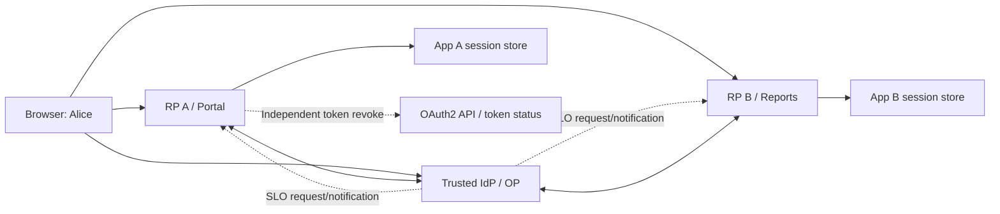
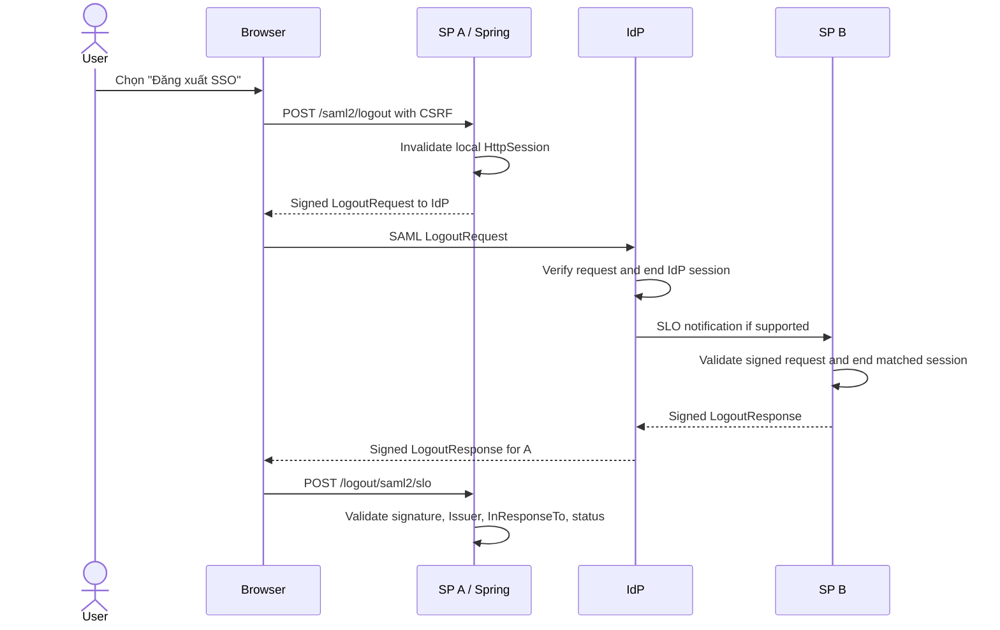
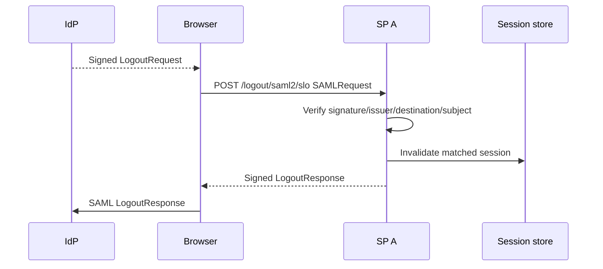
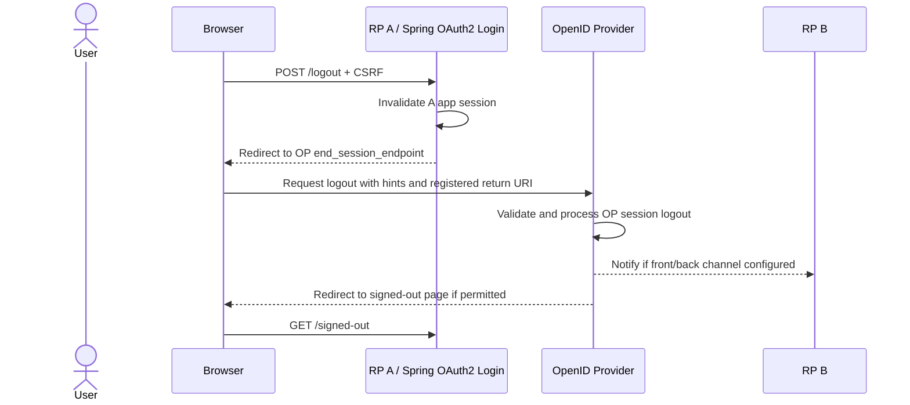

# Triển khai đăng xuất cục bộ và Single Logout với kiểm thử luồng lỗi

## Mục tiêu học tập

Đây là bài **thực hành tổng hợp** cho Spring Security federation (Spring Boot 3, Spring Security 6, Java 17+). Sau bài, người học phải phân biệt được **đăng xuất cục bộ (local logout)** với **Single Logout (SLO)**, triển khai và kiểm thử được các luồng SAML2/OIDC, biết phản ứng đúng khi một ứng dụng hoặc IdP không phản hồi, và không tuyên bố “đăng xuất mọi nơi” khi còn phiên đang hoạt động.

Cụ thể, bạn sẽ:
1. Nhận dạng app `HttpSession`, IdP/OP SSO session, browser cookies, SAML `SessionIndex`, OIDC `sid`/`sub`, OAuth2 access/refresh tokens và quyền của từng ứng dụng.
2. Cấu hình `LogoutFilter`, `SecurityContextLogoutHandler`, `CsrfLogoutHandler`, `LogoutSuccessHandler` để local logout an toàn bằng POST có CSRF.
3. Tách `POST /logout` (local) với `POST /saml2/logout` (RP-initiated SAML SLO), dùng `.saml2Logout(...)` và `RelyingPartyRegistration` với IdP SLO metadata và SP signing credentials.
4. Giải thích IdP/AP-initiated SAML SLO: signed `LogoutRequest`, `LogoutResponse`, issuer/destination, `NameID`, `SessionIndex`, `InResponseTo`, `RelayState` và kết quả `PartialLogout`.
5. Cấu hình OIDC RP-initiated logout với `OidcClientInitiatedLogoutSuccessHandler`/`end_session_endpoint` và exact `post_logout_redirect_uri`; hiểu vì sao nó chưa đủ nếu RP B không hỗ trợ thông báo logout.
6. Mô tả OIDC Front-Channel/Back-Channel Logout và signed `Logout Token` (issuer, audience, sid/sub, events, jti, thời gian, replay).
7. Thiết kế bài lab hai ứng dụng A/B và một IdP, sử dụng users tổng hợp, signing certificates riêng, shared session store khi cần.
8. Kiểm thử logout thành công, partial logout, timeout, signed message không hợp lệ, wrong issuer/audience, replay, stale correlation, CSRF, cookie SameSite và multi-node.
9. Chạy ví dụ **Java 17+ độc lập** với stdout xác định mô phỏng các trạng thái local/full/partial/replay, đồng thời biết rõ giới hạn mô phỏng.
10. Viết log/metrics, bảng quyết định, checklist và runbook an toàn, tránh bỏ signature verification/CSRF để “cho logout chạy”.

## 1. Vì sao đăng xuất khỏi Portal không có nghĩa đã thoát SSO?

Giả sử người dùng Alice đã đăng nhập qua cùng IdP vào:
- **RP A:** `portal-a.sso-lab.test`, lưu session A ở Spring `HttpSession` hoặc Spring Session.
- **RP B:** `reports-b.sso-lab.test`, lưu session B khác.
- **IdP:** có một SSO session/browser cookie riêng, có thể dùng để cấp lần đăng nhập mới.
- **API:** có thể nhận OAuth2 access token đã phát, không nằm trong app session.
- **Browser:** giữ cookies theo domain/path và chính sách SameSite.

Khi A nhận một local logout hợp lệ, nó xóa session A. B vẫn có session B, IdP vẫn có SSO cookie. Vào lại A có thể được redirect sang IdP và tự động đăng nhập, tạo một **session mới** mà không hỏi mật khẩu. Hiện tượng này không chứng minh local logout thất bại: muốn biết phải giữ **old A cookie** và kiểm nó còn access protected resource hay không.

### 1.1. Các mức đăng xuất và phạm vi

| Kiểu | Ai khởi phát | Điều xử lý | Không tự đảm bảo |
| --- | --- | --- | --- |
| Local logout A | Người dùng/app A | HttpSession A, SecurityContext, CSRF token, remember-me nếu bật | IdP session, B session, API JWT |
| SAML SP-initiated SLO | A gửi signed `LogoutRequest` qua browser tới IdP | A local logout, IdP logout, notifications tới SPs theo profile | Mọi participant đã nhận/đã logout |
| SAML IdP/AP-initiated SLO | IdP gửi signed LogoutRequest đến A/B | SP xác minh nguồn và invalidate matched session | Các SP offline đã logout |
| OIDC RP-initiated logout | A redirect browser tới OP `end_session_endpoint` | OP session và supported front/back logout notifications | RP B logout nếu chưa được tích hợp |
| OIDC front-channel | OP báo qua browser/iframe | RP xử lý session nếu browser conditions cho phép | Third-party-cookie restrictions không ảnh hưởng |
| OIDC back-channel | OP gửi signed Logout Token server-to-server | RP map `sid`/`sub` rồi invalidate matching app sessions | Xóa cookie trên browser, revoke mọi access token |
| CAS Single Sign-Out | CAS Server gửi thông báo logout | Client map validated CAS ticket sang app session | Giống OIDC/SAML protocol |
| Kerberos/Windows logout | OS/KDC/service policy | Ticket cache/logon session tùy cấu hình | HTTP sessions tại mọi SP tự hết |

**Không gộp “logout A thành công” và “logout toàn hệ thống thành công” thành một status.**

### 1.2. Bảng trạng thái mẫu

| Thao tác | Session A | Session B | Session IdP | JWT API |
| --- | --- | --- | --- | --- |
| Chưa logout, user đã login | Active | Active | Active | Có thể còn hạn |
| Chỉ local logout A | Inactive | Active | Active | Có thể còn hạn |
| SLO complete (trong phạm vi A/B/IdP) | Inactive | Inactive | Inactive | Tùy token revocation policy |
| SLO partial, B offline | Inactive | Có thể active | Đã logout hoặc chưa rõ | Tùy policy |
| IdP logout nhưng A chưa nhận callback | Có thể active | Có thể active | Inactive | Tùy policy |

Mỗi ô có thể là một thành phần hạ tầng khác. **Xóa browser cookie IdP** không tự invalidate B server session; **tắt A HttpSession** cũng không revoke JWT dùng trực tiếp ở API.

## 2. Các IDs khác nhau phải được map đúng

| Trường | Bản chất | Được dùng cho |
| --- | --- | --- |
| App `JSESSIONID`/`SESSION` | Cookie/ID của phiên ứng dụng | Tìm và vô hiệu session tại RP |
| OIDC `sid` | Session ID do OP phát trong scope issuer | Liên hệ OP session với RP session khi supported |
| OIDC `sub` | Opaque subject ID theo issuer | Logout theo user trong phạm vi một OIDC client, không phải app session |
| SAML `NameID` | Subject assertion đã xác thực | Xác định user của SAML session theo profile |
| SAML `SessionIndex` | IdP authentication-session reference | Match một hoặc nhiều SAML sessions theo contract |
| SAML `LogoutRequest.ID` | ID của yêu cầu logout | Correlate `LogoutResponse.InResponseTo`/replay |
| `RelayState` | Opaque flow state | Match request/response/binding, không tự là identity proof |
| OIDC Logout Token `jti` | Identifier của Logout Token | Phát hiện duplicate/replay theo policy |
| CAS `ST` | Service Ticket đã validation | Link ticket/session theo CAS client SLO |
| API access token `jti` | ID của token nếu có | Token tracking/revocation, không là SAML SessionIndex |

Một user có thể có nhiều trình duyệt, thiết bị và session khác nhau. Không được logout **người khác** chỉ vì email/display name trùng hoặc một message từ browser chứa `{"sub":"alice"}`. Signed/trusted SLO message cần được validate **trước** khi tính toán matched sessions.

### 2.1. Sơ đồ



## 3. Local logout đúng cách trong Spring Security 6

Spring Security Servlet hỗ trợ `GET /logout` như trang xác nhận khi CSRF bật và **`POST /logout` có CSRF hợp lệ** để thay đổi trạng thái. `LogoutFilter` gọi logout handlers, trong đó:
- `SecurityContextLogoutHandler` invalidate `HttpSession`, xóa security context và authentication theo cấu hình.
- `CsrfLogoutHandler` dọn CSRF token cũ.
- Remember-me handler dọn remember-me cookie/persistent token nếu được bật.
- `LogoutSuccessEventPublishingLogoutHandler` có thể publish event.
- `LogoutSuccessHandler` quyết định redirect/status sau khi local cleanup.

**Không chọn GET state-changing** để người dùng nhấn link dễ hơn. Một web page độc hại có thể ép browser truy cập GET URL và làm user bị logout (logout CSRF).

### 3.1. Cấu hình local logout

Đoạn sau đặt bên trong Spring `@Configuration`, dự án Spring Boot có security/web starter:

```java
@Bean
SecurityFilterChain appSecurity(HttpSecurity http) throws Exception {
    return http
        .authorizeHttpRequests(auth -> auth
            .requestMatchers("/", "/signed-out", "/error").permitAll()
            .anyRequest().authenticated())
        .logout(logout -> logout
            .logoutUrl("/logout")
            .logoutSuccessUrl("/signed-out")
            .invalidateHttpSession(true)
            .clearAuthentication(true))
        .build();
}
```

Đây là **Spring fragment**, không phải file Java độc lập. Dự án cần class imports/beans. Trong app dùng OIDC/SAML, thêm `oauth2Login` hoặc `saml2Login` khi phù hợp. `logout` trên là **local only**, không tự gửi SAML `LogoutRequest` hoặc OP logout request.

### 3.2. HTML form POST có CSRF

Với Thymeleaf được Spring tích hợp CSRF:

```html
<form th:action="@{/logout}" method="post">
  <button type="submit">Đăng xuất khỏi Portal</button>
</form>
```

Với plain HTML cần render token thật từ server:

```html
<form action="/logout" method="post">
  <input type="hidden" name="_csrf" value="SERVER_CSRF_TOKEN"/>
  <button type="submit">Đăng xuất</button>
</form>
```

`SERVER_CSRF_TOKEN` chỉ là nhãn giải thích, **không** hard-code thành token. Với SPA, dùng CsrfToken header pattern do Spring hỗ trợ. Token CSRF cũ được xóa trên logout và có thể cần cấp token mới sau login/logout.

### 3.3. Không tự xóa cookie thay LogoutFilter

```java
// ANTI-PATTERN, không dùng như logout implementation:
response.addHeader("Set-Cookie", "JSESSIONID=; Max-Age=0");
```

Chỉ xóa cookie không bảo đảm session đã bị invalidate server-side. Trong Redis/JDBC, old session ID vẫn có thể tồn tại, và nếu attacker đã biết nó thì vẫn có thể gửi request. Hãy dùng `LogoutFilter`/`SecurityContextLogoutHandler` và **kiểm old cookie**.

### 3.4. Local logout và các loại dữ liệu

| Dọn gì? | Khi nào | Tránh hiểu nhầm |
| --- | --- | --- |
| `HttpSession` | Browser session trong app | Không tự dọn IdP/B |
| `SecurityContextHolder` | Mọi logout chuẩn | Không là revocation từ AS |
| Remember-me cookie/token store | Nếu bật remember-me | Cần dọn persistent token store |
| CSRF token | Logout session | Token mới sau logout cần refresh |
| `Clear-Site-Data` | Khi được review và browser hỗ trợ | Không xóa cookies tại IdP origin khác |
| SPA local state | Sau logout/redirect | Không tự thu hồi access token đã copy |
| Server-side access/refresh grants | Theo OAuth2 revoke policy | Spring browser logout không tự revoke tất cả |
| WebSocket/long-lived sessions | Khi policy cần | Cần disconnect/reauthorize riêng |

## 4. SAML2 SLO: hai chiều và những điều kiện bắt buộc

Spring Security Servlet 6.5 hỗ trợ:
- **RP/SP-initiated SLO:** user `POST` vào SP logout trigger, SP dọn local session, tạo signed `samlp:LogoutRequest` tới IdP, nhận `samlp:LogoutResponse` rồi validate.
- **AP/IdP-initiated SLO:** IdP gửi signed `LogoutRequest` tới SP SLO endpoint, SP verify trước khi invalidate session, rồi phát signed `LogoutResponse`.
- IdP có thể điều phối nhiều SP tham gia nhưng phụ thuộc metadata/profile, trạng thái phiên và network. **Không phải mọi IdP hỗ trợ SLO.**

### 4.1. RP-initiated SLO sequence



Vì A đã invalidate local session **trước** khi IdP trả LogoutResponse, timeout tại IdP không được làm A “đăng nhập lại” tự động để rollback. Kết quả đúng: **LOCAL_LOGOUT_DONE** và **SLO_OUTCOME_UNKNOWN/PARTIAL**.

### 4.2. IdP-initiated SLO sequence



**Không parse raw XML rồi tự xóa sessions bằng `NameID` string trước SAML provider verification.** Chỉ dựa trên trusted SAML message với issuer, signing cert, subject/session binding và replay conditions.

### 4.3. Cấu trúc thông điệp

| Field | Vai trò | Điều cần xác minh |
| --- | --- | --- |
| `LogoutRequest.ID` | Correlation/replay | Unique, chưa xử lý trước |
| `Issuer` | SP hoặc IdP entityID theo chiều | Exact trusted registration |
| `Destination` | Bên nhận LogoutRequest/LogoutResponse | SLO URL đúng metadata |
| `NameID` | User subject | Match principal, không suy từ email |
| `SessionIndex` | IdP authentication session reference | Không lẫn `JSESSIONID` |
| `NotOnOrAfter` | Expiry nếu profile dùng | Không chấp nhận stale |
| `LogoutResponse.InResponseTo` | Trả lời request đã phát | Khớp pending request |
| `RelayState` | Opaque state qua binding | Bind flow và tránh open redirect |
| `StatusCode` | Success/`PartialLogout`/failure | Không tuyên bố complete khi partial |
| XML signature | Nguồn và tính toàn vẹn | Trusted cert, signed portion/binding |

### 4.4. LogoutRequest minh họa (không phải message hợp lệ)

```xml
<samlp:LogoutRequest
  xmlns:samlp="urn:oasis:names:tc:SAML:2.0:protocol"
  xmlns:saml="urn:oasis:names:tc:SAML:2.0:assertion"
  ID="_logout-100" Version="2.0"
  IssueInstant="2026-11-07T10:00:00Z"
  Destination="https://idp.sso-lab.test/saml/slo">
  <saml:Issuer>https://portal-a.sso-lab.test/saml/sp</saml:Issuer>
  <saml:NameID>synthetic-alice-001</saml:NameID>
  <samlp:SessionIndex>_idp-session-17</samlp:SessionIndex>
</samlp:LogoutRequest>
```

Chỉ là **minh họa trường**; thiếu chữ ký và transport binding. Không đưa raw XML unsigned này vào endpoint production.

### 4.5. LogoutResponse và partial logout

```xml
<samlp:LogoutResponse
  xmlns:samlp="urn:oasis:names:tc:SAML:2.0:protocol"
  xmlns:saml="urn:oasis:names:tc:SAML:2.0:assertion"
  ID="_logout-response-100" InResponseTo="_logout-100"
  Version="2.0" IssueInstant="2026-11-07T10:00:12Z"
  Destination="https://portal-a.sso-lab.test/logout/saml2/slo">
  <saml:Issuer>https://idp.sso-lab.test/saml/idp</saml:Issuer>
  <samlp:Status>
    <samlp:StatusCode
       Value="urn:oasis:names:tc:SAML:2.0:status:PartialLogout"/>
  </samlp:Status>
</samlp:LogoutResponse>
```

Đây cũng là XML **chưa ký để giải thích**, không phải sample có thể dùng login/logout thật. Khi IdP báo `PartialLogout`, app phải coi global SLO chưa complete; dẫu vậy A local session vẫn đã hết. Nếu có SLO response `Success`, cần hiểu phạm vi participant acknowledgement mà IdP cam kết, không suy tất cả hệ thống legacy đã logout.

## 5. Triển khai Spring Boot 3/Security 6 SAML2 SLO

Ví dụ cho một **ứng dụng SAML test** riêng; IdP metadata thực, keys và HTTPS hostnames do người học chuẩn bị trong sandbox.

### 5.1. Gradle dependencies

Trong project đã có Spring Boot plugin và dependency management/BOM phù hợp:

```groovy
dependencies {
    implementation 'org.springframework.boot:spring-boot-starter-web'
    implementation 'org.springframework.boot:spring-boot-starter-security'
    implementation 'org.springframework.security:spring-security-saml2-service-provider'
    testImplementation 'org.springframework.boot:spring-boot-starter-test'
    testImplementation 'org.springframework.security:spring-security-test'
}
```

Tùy phiên bản Boot/Security, OpenSAML artifacts có thể cần repository dependency thích hợp; kiểm tài liệu Spring của đúng version. Không dùng API Spring Security 7 trong dự án Spring Boot 3 nếu chưa migration.

### 5.2. application.yml: metadata và SP signing key

```yaml
spring:
  security:
    saml2:
      relyingparty:
        registration:
          idp-lab:
            signing:
              credentials:
                - private-key-location: "file:/run/secrets/rp-signing.key"
                  certificate-location: "file:/run/secrets/rp-signing.crt"
            singlelogout:
              url: "https://portal-a.sso-lab.test/logout/saml2/slo"
            assertingparty:
              metadata-uri: "https://idp.sso-lab.test/metadata"
server:
  forward-headers-strategy: framework
  servlet:
    session:
      cookie:
        secure: true
        http-only: true
        same-site: lax
```

Các URLs là **fixtures không đại diện hệ thật**. IdP metadata phải có `SingleLogoutService`, SP signing private key PKCS#8 và cert đúng trust, IdP cho phép SP client/entityID, logout endpoints/binding phù hợp. **Không commit private key**, không lấy metadata URL từ browser input.

### 5.3. SAML metadata với SingleLogoutService

```xml
<md:EntityDescriptor
  xmlns:md="urn:oasis:names:tc:SAML:2.0:metadata"
  entityID="https://idp.sso-lab.test/saml/idp">
  <md:IDPSSODescriptor
    protocolSupportEnumeration="urn:oasis:names:tc:SAML:2.0:protocol">
    <md:SingleLogoutService
      Binding="urn:oasis:names:tc:SAML:2.0:bindings:HTTP-POST"
      Location="https://idp.sso-lab.test/saml/slo"/>
  </md:IDPSSODescriptor>
</md:EntityDescriptor>
```

Đây chỉ là phần metadata rút gọn để chỉ nơi SLO được công bố; metadata thật còn signing certificates, SSO endpoints và các fields cần thiết. `singlelogout.url` trong Boot là **SP endpoint nhận callback**, không phải URL IdP SLO. Location phía IdP đến từ `SingleLogoutService`.

### 5.4. Hai endpoint local và SAML SLO

Tệp `src/main/java/com/example/saml/SamlSecurityConfig.java`:

```java
package com.example.saml;

import org.springframework.context.annotation.Bean;
import org.springframework.context.annotation.Configuration;
import org.springframework.security.config.Customizer;
import org.springframework.security.config.annotation.web.builders.HttpSecurity;
import org.springframework.security.web.SecurityFilterChain;

@Configuration
public class SamlSecurityConfig {
    @Bean
    SecurityFilterChain filterChain(HttpSecurity http) throws Exception {
        return http
            .authorizeHttpRequests(auth -> auth
                .requestMatchers("/", "/signed-out", "/error").permitAll()
                .anyRequest().authenticated())
            .saml2Login(Customizer.withDefaults())
            .logout(logout -> logout
                .logoutUrl("/logout")
                .logoutSuccessUrl("/signed-out")
                .invalidateHttpSession(true))
            .saml2Logout(saml -> saml.logoutUrl("/saml2/logout"))
            .build();
    }
}
```

Theo Spring Security 6.5:
- `POST /logout` → **chỉ local logout**.
- `POST /saml2/logout` → **RP-initiated SAML2 SLO**.
- `POST /logout/saml2/slo` → **protocol endpoint** cho signed AP/IdP-initiated `SAMLRequest` hoặc `SAMLResponse` trả lời RP request.
- Cả hai nút user phải gửi POST có CSRF phù hợp.
- `saml2Logout` cần IdP `SingleLogoutService` metadata + signing credentials đã cấu hình; chỉ gọi DSL không khiến một IdP không hỗ trợ SLO bỗng hỗ trợ.
- Nếu không tách hai URLs như ví dụ, default `POST /logout` cho SAML user có thể khởi phát SLO.
- Trong multi-`SecurityFilterChain`, kiểm matcher của SAML SLO protocol endpoints; không thêm `permitAll` cho arbitrary signed/unsigned XML mà bỏ provider validation.
- Reverse proxy phải xuất đúng external `https` scheme/hostname/path và strip untrusted forwarded headers.

### 5.5. Hai nút UI khác nhau

```html
<!-- Thymeleaf tự phối hợp CSRF trong form khi tích hợp đúng -->
<form th:action="@{/logout}" method="post">
  <button type="submit">Chỉ đăng xuất khỏi Portal</button>
</form>
<form th:action="@{/saml2/logout}" method="post">
  <button type="submit">Đăng xuất SSO với các ứng dụng hỗ trợ</button>
</form>
```

Đừng gắn cả hai nút vào cùng `/logout` nhưng ghi khác text. Test trong browser để bảo đảm CSRF token, signed LogoutRequest, post-logout redirects và session outcome.

### 5.6. Nếu LogoutResponse về muộn

Spring Security SAML2 logout request repository lưu thông tin pending LogoutRequest để so `RelayState`/`InResponseTo` khi response trở lại. Trong clustered app cần test callback đến node khác với node đã phát request, session invalidation, pending request store TTL, same-site cookies. Không tắt correlation validator để tránh lỗi khi state mất.

## 6. OIDC RP-Initiated Logout với OP end-session

OIDC RP ở A thực hiện local logout rồi có thể chuyển browser tới `end_session_endpoint` của OP nếu provider hỗ trợ. `post_logout_redirect_uri` phải nằm trong allowlist exact của OP. OP có thể hỏi người dùng xác nhận, kết thúc phiên OP, sau đó **có thể** gửi logout notifications đến các RP đã hỗ trợ.

### 6.1. OIDC client application.yml

**Dự án OIDC riêng** (không copy trực tiếp vào dự án SAML nếu chưa thiết kế multi-protocol):

```yaml
spring:
  security:
    oauth2:
      client:
        registration:
          lab:
            provider: lab
            client-id: portal-a
            client-secret: "${OIDC_LAB_CLIENT_SECRET}"
            authorization-grant-type: authorization_code
            scope: openid,profile
            redirect-uri: "{baseUrl}/login/oauth2/code/{registrationId}"
        provider:
          lab:
            issuer-uri: https://idp.sso-lab.test/realms/lab
```

Lúc áp dụng, `${OIDC_LAB_CLIENT_SECRET}` phải là placeholder Spring environment `\${OIDC_LAB_CLIENT_SECRET}`, secret đến từ secret manager. Không dùng URL IdP thật trong sandbox nếu chưa được phê duyệt.

### 6.2. OidcClientInitiatedLogoutSuccessHandler

Tệp `src/main/java/com/example/oidc/OidcSecurityConfig.java`:

```java
package com.example.oidc;

import org.springframework.context.annotation.Bean;
import org.springframework.context.annotation.Configuration;
import org.springframework.security.config.Customizer;
import org.springframework.security.config.annotation.web.builders.HttpSecurity;
import org.springframework.security.oauth2.client.oidc.web.logout.OidcClientInitiatedLogoutSuccessHandler;
import org.springframework.security.oauth2.client.registration.ClientRegistrationRepository;
import org.springframework.security.web.SecurityFilterChain;
import org.springframework.security.web.authentication.logout.LogoutSuccessHandler;

@Configuration
public class OidcSecurityConfig {

    @Bean
    LogoutSuccessHandler oidcLogout(
            ClientRegistrationRepository registrations) {
        var h = new OidcClientInitiatedLogoutSuccessHandler(registrations);
        h.setPostLogoutRedirectUri("{baseUrl}/signed-out");
        return h;
    }

    @Bean
    SecurityFilterChain security(
            HttpSecurity http, LogoutSuccessHandler oidcLogout)
            throws Exception {
        return http
            .authorizeHttpRequests(auth -> auth
                .requestMatchers("/", "/signed-out", "/error").permitAll()
                .anyRequest().authenticated())
            .oauth2Login(Customizer.withDefaults())
            .logout(logout -> logout
                .logoutUrl("/logout")
                .logoutSuccessHandler(oidcLogout)
                .invalidateHttpSession(true))
            .build();
    }
}
```

**Ý nghĩa và giới hạn:**
1. `LogoutSuccessHandler` được gọi **sau local logout**; nó hướng browser sang OP logout khi client registration/OP metadata hỗ trợ.
2. `setPostLogoutRedirectUri` dùng template `{baseUrl}` và path `/signed-out`. IdP phải đăng ký chính xác public HTTPS post-logout redirect, không dùng `returnUrl` tùy browser.
3. `id_token_hint` do handler xử lý theo IdP/flow, không tự ghép JSON unsigned.
4. Nếu OP không có end-session support hoặc endpoint unreachable, A local logout vẫn đã xảy ra nhưng **không hứa OP/B đã logout**.
5. Khi OP đang giữ SSO cookie, local-only variant không tự kết thúc IdP session. Muốn local-only OIDC, dùng `logoutSuccessUrl("/signed-out")` thay cho OIDC logout success handler.
6. B cần OP notification integration riêng; redirect OP chỉ chứng minh RP đã **yêu cầu** logout.

### 6.3. OIDC RP-initiated sequence



Không dùng `GET /signed-out` response 200 làm bằng chứng B đã logout. Cần test old cookie B.

## 7. OIDC Front-Channel và Back-Channel Logout

### 7.1. Front-channel

OP có thể gửi notification qua browser/iframe/redirect. Tùy browser, third-party cookie restrictions, SameSite và anti-tracking, RP có thể không đọc được session. Nếu deployment dựa vào front-channel, phải kiểm những browser chính và xử lý partial delivery; không bật third-party cookies bừa bãi hoặc tắt CSRF toàn cục.

### 7.2. Back-channel Logout Token

OP gửi **signed JWT Logout Token** tới endpoint của RP, không phụ thuộc browser cookie. Ví dụ decoded claims để đọc (**không phải JWT hợp lệ**, không có chữ ký):

```json
{
  "iss": "https://idp.sso-lab.test/realms/lab",
  "aud": "portal-a",
  "iat": 1794045600,
  "jti": "logout-jti-001",
  "sid": "op-session-opaque-43",
  "events": {
    "http://schemas.openid.net/event/backchannel-logout": {}
  }
}
```

**Phải validate**:
- Signature/approved algorithm/signing key/JWKS của **configured issuer**.
- `iss` exact, `aud` đúng RP/client (và token time claims).
- `events` chứa đúng `http://schemas.openid.net/event/backchannel-logout` object.
- Có `sid` hoặc `sub` hoặc cả hai; `nonce` **không được có**.
- `jti`/replay policy và `iat`; nếu `exp` được dùng phải validate, không nhận token stale theo local profile.
- Nếu có `sid`, chọn matching session; nếu chỉ `sub`, semantics có thể là tất cả sessions của subject tại client đó. Không xóa sessions của client/issuer khác.
- Không chấp nhận browser gửi JSON `{"sub":"alice"}` không ký để xóa session Alice.

### 7.3. Spring Security OIDC Back-Channel

Ở Spring Security Servlet phiên bản 6.x có hỗ trợ `oidcLogout` DSL (kiểm version cụ thể của project), có thể bổ sung:

```java
@Bean
SecurityFilterChain filterChain(HttpSecurity http) throws Exception {
    return http
        .authorizeHttpRequests(auth -> auth.anyRequest().authenticated())
        .oauth2Login(Customizer.withDefaults())
        .oidcLogout(oidc -> oidc
            .backChannel(Customizer.withDefaults()))
        .build();
}
```

Đây là **ví dụ cấu hình độc lập**, không thêm nguyên xi vào SAML sample; client/OP và session registry phải hoạt động. Endpoint theo Spring Security docs:

```text
POST /logout/connect/back-channel/{registrationId}
```

**Cần có:**
- OP hỗ trợ backchannel và đã đăng ký chính xác HTTPS logout URI của RP.
- `OidcSessionRegistry` map OP session/`sid`/`sub` với app sessions; metadata claim `aud` ngăn một token của client A xóa client B.
- `OidcBackChannelLogoutHandler` và session event publisher/cleanup phù hợp version.
- Session cookie name: handler thường dùng `JSESSIONID`; nếu Spring Session cookie `SESSION` cần cấu hình handler tương ứng `setSessionCookieName("SESSION")`.
- Multi-node session store và shared registry/revocation design để callback trên node X xóa session tạo tại node Y.
- Negative tests wrong signature, iss, aud, events, nonce, sid/sub, replay.
- Đảm bảo endpoint là **protocol-validated**, không một public POST nhận `sub` tùy ý rồi query database xóa.
- Browser vẫn có thể giữ cookie cũ, nhưng server phải deny access sau invalidation.

### 7.4. OIDC logout khác token revocation

RP/OP logout không tự khiến:
- OAuth2 JWT access token chưa hết `exp` bị resource server offline từ chối.
- Refresh token có `offline_access` bị revoke theo mọi policy.
- API key/client_credentials bị xóa.
- WebSocket session hoặc mobile client khác tự ngắt.

Nếu cần “đăng xuất mọi thiết bị” hoặc offboarding, cần token revocation/introspection/denylist, account/session epochs, current-state authorization và endpoint coverage. Không tự hứa kết quả vượt protocol support.

## 8. CAS SLO và Kerberos/SPNEGO: không thay giao thức

### 8.1. CAS Single Sign-Out

CAS Server có phiên TGT và Service Tickets (ST). CAS SLO thường đòi client có ticket/session mapping sau validated login, nhận logout notification từ nguồn được tin và invalidate đúng HttpSession.

Checklist:
- Service Ticket được CAS client xác minh khi login, không coi string ticket là identity.
- Khi CAS TGT/logout xảy ra, các SP đã tham gia có được CAS server gửi thông báo không?
- Client listener/filter phù hợp version CAS client có thể tìm session bằng ticket key không?
- Multi-node ticket→session mapping có nằm ở shared store không?
- Signed/trusted protocol notification có bị giả mạo/replay không?
- Partial delivery/timeout có được ghi lại không?
- Local logout A không mặc nhiên kill TGT tại CAS; ngược lại CAS logout cần thông báo tới A/B.

**Không dùng OIDC end-session URL làm CAS SLO** nếu ứng dụng đang dùng CAS native tickets.

### 8.2. Kerberos/SPNEGO

Kerberos service tickets/TGT và app HttpSession là các tầng khác nhau. `LogoutFilter` xóa Spring app session nhưng browser/OS vẫn có thể tự gửi GSS-APREQ để đăng nhập lại qua `Authorization: Negotiate`; đó là **new authentication**, không phải old cookie hồi sinh.

Không có một HTTP SLO chung cho mọi ứng dụng Kerberos tương đương SAML2 SLO. Muốn thu hồi rộng cần Windows/AD/KDC/OS ticket policy, account disable, application sessions và security response riêng. Không tin `REMOTE_USER` hoặc `Authorization: Negotiate` raw text nếu không có GSS verification.

### 8.3. Reverse proxy pre-auth

Khi gateway nắm IdP session:
- App local logout không tự logout gateway.
- Gateway có thể preauth lại ngay lần kế.
- Client-supplied `X-User`/`X-Logout`/`X-MFA` phải bị strip/overwrite; origin không public, proxy→app có authenticated channel.
- Logout notification gateway cần source attestation/issuer/subject/session binding; không để browser tự xóa người khác.

## 9. Kiến trúc lab hai RP và một IdP

Dựng sandbox:
- IdP SAML2 hoặc OP OIDC có test realm/users/metadata/signing keys riêng.
- RP A `https://portal-a.sso-lab.test`, RP B `https://reports-b.sso-lab.test`.
- Synthetic user `alice-qa` và `bob-qa`.
- Riêng client registrations/SP entityIDs, ACS, SLO endpoints, secrets/certs và app session stores.
- Browser profile test; khi automation giữ cookies, chỉ lưu trong secret-protected test artifacts.
- Gateway, session store và network policies gần production nếu cần multi-node test.
- Test harness có thể làm B unreachable/IdP timeout **chỉ trong sandbox**.

**Lưu ý:** cookie domain không phân biệt port. Nếu cả A/B dùng `localhost` khác ports nhưng cùng cookie `JSESSIONID`/Path, chúng có thể va chạm; dùng hostnames/paths khác hoặc cấu hình cookie scope/names thích hợp.

### 9.1. Trạng thái baseline phải được đo

Trước testcase:
1. Browser login Alice ở A, xác nhận protected `/private` 200.
2. Browser login Alice ở B qua cùng IdP SSO session, xác nhận protected `/private` 200.
3. Lưu test-only old session cookie handles A và B.
4. IdP vẫn có authenticated SSO session.
5. Ghi session store entries và IdP session reference theo các API/log **đã được cấp quyền trong lab**.
6. Nếu API có JWT, ghi riêng token status/expiry theo cách không log raw JWT.
7. Dùng fresh browser profile để phân biệt old cookie access với new SSO login.

### 9.2. Local logout A test

- `POST /logout` A có CSRF → A old session invalid.
- Gọi `GET /private` A bằng **old A cookie** mà không follow re-login: không được protected response.
- B old cookie vẫn có thể `GET /private` B 200.
- IdP SSO session vẫn có thể cấp new login khi browser tới A.
- A local logout log chỉ được ghi `LOCAL_DONE`, không `GLOBAL_DONE`.
- POST không CSRF phải bị chặn; GET không được state-changing.

### 9.3. SAML SLO complete test

- A/B cùng synthetic user, IdP SLO metadata/trust đã cấu hình.
- A `POST /saml2/logout`, phát signed LogoutRequest.
- IdP verify, terminate IdP SSO session, thông báo B theo protocol.
- B verify signed message, invalidate B session và trả LogoutResponse.
- A verify signed LogoutResponse/`InResponseTo`/status.
- Old A/B cookies deny; IdP session không còn cho silent SSO.
- Chỉ ghi complete nếu participant scope thật sự được xác nhận; nếu một RP không nhận callback thì partial.

### 9.4. AP-initiated SLO test

- User logout trực tiếp tại IdP test.
- IdP gửi signed SAML LogoutRequest tới các SP.
- SPs chỉ invalidate matched sessions **sau** signature/issuer/destination/session validation.
- SPs trả signed LogoutResponse; IdP tổng hợp statuses.
- Test duplicate/replay requests không làm logout một **new session** của user khác.

### 9.5. OIDC RP/Back-Channel test

- A/B là OIDC clients riêng, OP hỗ trợ end-session và back-channel (nếu test).
- A `POST /logout`, local session invalidated, browser redirect OP `end_session_endpoint`.
- OP logout session, gửi signed Logout Token đúng RP B `aud`/`sid`/`sub`.
- B validate Logout Token và invalidate local B session.
- Old B cookie deny. Nếu B không hỗ trợ notifications, **không hứa** global logout.
- Test OP không có endpoint, wrong post-logout URI, invalid token signatures và old JWT access token còn hoạt động theo policy.

## 10. Bộ kiểm thử lỗi bắt buộc

| Case | Cách mô phỏng **trong test lab** | Kết quả mong đợi |
| --- | --- | --- |
| Local POST hợp lệ | CSRF đúng | App session invalid, IdP/B không tự đổi |
| Local POST thiếu CSRF | Không gửi token | 403, request không được logout |
| GET /logout | CSRF enabled | Confirmation, không state-changing |
| Browser cross-site forged logout | POST từ origin khác không token | CSRF reject |
| Logout A hai lần | Gửi lại logout | Safe/idempotent, không login lại |
| SAML SLO full | Signatures/correlation hợp lệ, B reachable | Old A/B sessions deny |
| SAML AP-initiated | IdP signed LogoutRequest hợp lệ | SP logout đúng session |
| SAML wrong signature | Key/cert không tin | Reject, không xóa session sai |
| SAML wrong issuer | IdP khác trusted entity | Reject |
| SAML wrong Destination | SLO endpoint không khớp | Reject |
| SAML missing/old `InResponseTo` | Response không khớp LogoutRequest | Reject response |
| SAML replay request ID | Gửi lại cùng request | Reject/handle idempotently theo replay policy |
| SAML wrong `NameID` | Message chỉ tới user khác | Không logout user mục tiêu |
| SAML wrong `SessionIndex` | Index không match | Không logout unrelated session |
| SAML expired timestamp | Request stale | Reject |
| SAML `PartialLogout` | B offline/timeouts | A local logout, global partial |
| IdP SLO timeout | IdP không trả response | A local logout, global unknown |
| SAML metadata thiếu `SingleLogoutService` | IdP không hỗ trợ | Không tuyên bố SLO configured |
| OIDC OP thiếu end-session endpoint | Metadata thiếu | Local only/không global |
| OIDC post-logout URI không đăng ký | Invalid URI | OP reject, không arbitrary redirect |
| OIDC Logout Token unsigned | Token không verified | Reject, không xóa B |
| OIDC wrong issuer | Wrong `iss` | Reject |
| OIDC wrong client | Wrong `aud` | Reject; không xóa client khác |
| OIDC no `sid` and no `sub` | Không định danh session | Reject |
| OIDC Logout Token có `nonce` | Sai spec | Reject |
| OIDC `events` sai | Không phải logout event | Reject |
| OIDC duplicate `jti` | Replay | Reject/idempotent theo policy |
| OIDC `sid` khác | Không match session | Không xóa session khác |
| Back-channel B unreachable | HTTP timeout/502 | Partial/alert, không giả complete |
| Spring Session store down | Không invalidate được B session | Log/alert; không báo complete |
| Multi-node callback B | Node khác nhận event | Shared registry revoke đúng |
| Browser third-party cookie block | Front-channel mất cookie | Không coi RP đã xử lý |
| A logout rồi SSO login ngay | OP session vẫn còn | Phân biệt **new** session vs old |
| API access JWT còn hạn | Resource server offline validation | Theo revocation policy riêng |
| Browser đổi user giữa flow | Alice→Bob | Không xóa Bob session |
| CAS ticket logout replay | Duplicate/stale CAS message | Không invalidate sai session |
| Kerberos SPNEGO auto-login | Browser còn TGT | Nhận biết new auth, không old cookie |
| Reverse proxy sai public URL | SAML Destination mismatch | Fix metadata/ingress, không tắt checks |
| Signing key rotation | Signed message bằng key cũ/khác | Validate theo trusted rotation policy |

### 10.1. Không coi HTTP 200 là chứng minh SLO

Một response 200/302 hoặc trang `/signed-out` chỉ xác nhận UI/redirect. Phải thử:
- **old A cookie** và **old B cookie** trên protected endpoints.
- Session registry/Redis/JDBC state sau logout.
- OP/IdP session và khả năng silent SSO trên browser mới/old profile.
- Old JWT access token với resource server theo đúng mục tiêu revocation.
- Logout callback trên node khác; browser/cookie SameSite restrictions.

### 10.2. MockMvc không thay SAML/OIDC protocol tests

Với Spring Security MockMvc:
```java
mvc.perform(post("/logout")
        .with(user("synthetic-alice"))
        .with(csrf()))
    .andExpect(status().is3xxRedirection());
```

Đây là **fragment JUnit test** (cần `MockMvc`/Spring Security imports), kiểm handler/router; không chứng minh đã gửi signed SAML LogoutRequest hoặc OP Logout Token.

Negative local logout khi CSRF bật:

```java
mvc.perform(post("/logout").with(user("synthetic-alice")))
    .andExpect(status().isForbidden());
```

Static imports trong test class:

```java
import static org.springframework.security.test.web.servlet.request.SecurityMockMvcRequestPostProcessors.user;
import static org.springframework.security.test.web.servlet.request.SecurityMockMvcRequestPostProcessors.csrf;
import static org.springframework.test.web.servlet.request.MockMvcRequestBuilders.post;
import static org.springframework.test.web.servlet.result.MockMvcResultMatchers.status;
```

Dùng real test IdP với signed LogoutRequest/LogoutResponse hoặc JWT Logout Token để kiểm signature/issuer/correlation. Mock `oidcLogin()` tạo principal giả **không** kiểm OP browser cookies/back-channel notifications.

## 11. Java 17+ độc lập: mô phỏng local/full/partial/logout replay

Chương trình này **không có mạng, IdP, XML Signature, JWT, HttpSession thật**. Nó chỉ minh họa trạng thái và quy tắc “untrusted message không làm logout”. Các flags `trustedMessage` và `timely` do Java test fixture tạo, **không** được lấy từ body/header của client trong production.

Tệp `LogoutFlowDemo.java`:

```java
import java.util.HashMap;
import java.util.HashSet;
import java.util.Map;
import java.util.Set;

public final class LogoutFlowDemo {
    private final Map<String, Boolean> sessions = new HashMap<>();
    private final Set<String> processedRequests = new HashSet<>();

    void reset() {
        sessions.clear();
        sessions.put("A", true);
        sessions.put("B", true);
        sessions.put("IdP", true);
        processedRequests.clear();
    }

    void localLogout(String app) {
        if (!"A".equals(app) && !"B".equals(app)) {
            throw new IllegalArgumentException("Not an RP");
        }
        sessions.put(app, false);
    }

    String singleLogout(
            String requestId,
            boolean trustedMessage,
            boolean timely,
            boolean bReachable) {
        if (!trustedMessage || !timely) {
            return "REJECT_UNTRUSTED";
        }
        if (!processedRequests.add(requestId)) {
            return "REJECT_REPLAY";
        }
        // Chỉ là mô hình sau khi protocol message đã được verified.
        sessions.put("A", false);
        sessions.put("IdP", false);
        if (!bReachable) {
            return "PARTIAL";
        }
        sessions.put("B", false);
        return "COMPLETE";
    }

    String snapshot() {
        return "A=" + (sessions.get("A") ? "IN" : "OUT")
             + ",B=" + (sessions.get("B") ? "IN" : "OUT")
             + ",IdP=" + (sessions.get("IdP") ? "IN" : "OUT");
    }

    public static void main(String[] args) {
        LogoutFlowDemo lab = new LogoutFlowDemo();

        lab.reset();
        System.out.println("Initially: " + lab.snapshot());
        lab.localLogout("A");
        System.out.println("Local A: " + lab.snapshot());

        lab.reset();
        System.out.println("Forged: " +
            lab.singleLogout("_forged", false, true, true));
        System.out.println("After forged: " + lab.snapshot());

        lab.reset();
        System.out.println("SLO full: " +
            lab.singleLogout("_req-1", true, true, true));
        System.out.println("After full: " + lab.snapshot());
        System.out.println("Replay: " +
            lab.singleLogout("_req-1", true, true, true));

        lab.reset();
        System.out.println("SLO timeout B: " +
            lab.singleLogout("_req-2", true, true, false));
        System.out.println("After timeout: " + lab.snapshot());

        lab.reset();
        System.out.println("Stale request: " +
            lab.singleLogout("_req-3", true, false, true));
        System.out.println("After stale: " + lab.snapshot());
    }
}
```

Chạy:

```bash
javac LogoutFlowDemo.java
java LogoutFlowDemo
```

**Stdout chính xác:**

```text
Initially: A=IN,B=IN,IdP=IN
Local A: A=OUT,B=IN,IdP=IN
Forged: REJECT_UNTRUSTED
After forged: A=IN,B=IN,IdP=IN
SLO full: COMPLETE
After full: A=OUT,B=OUT,IdP=OUT
Replay: REJECT_REPLAY
SLO timeout B: PARTIAL
After timeout: A=OUT,B=IN,IdP=OUT
Stale request: REJECT_UNTRUSTED
After stale: A=IN,B=IN,IdP=IN
```

**Giải thích:**
- `Local A` chỉ vô hiệu A; B/IdP còn phiên.
- `Forged` không được trusted nên cả ba vẫn active.
- `SLO full` mô phỏng all participants đã logout.
- `Replay` cùng ID phải bị reject theo replay/idempotency policy.
- `SLO timeout B` tạo trạng thái **PARTIAL**, A/IdP out nhưng B còn active.
- `Stale request` không được dùng để xóa sessions.

**Không triển khai `singleLogout(...)` thành một HTTP SLO endpoint**: nó không xác minh signature/issuer/audience/recipient/SessionIndex/nonce, không có session correlation, expiry policy và không xử lý concurrency. Production dùng Spring Security/OpenSAML/OIDC handlers đã được cấu hình theo IdP.

## 12. Multi-node, storage, cookie và token revocation

### 12.1. Node A nhận logout nhưng session ở node B

Một hệ có `portal-1`/`portal-2`/`portal-3` không được phụ thuộc vào `Map<String,HttpSession>` riêng mỗi JVM để xử lý IdP-initiated logout. Cần:
- Shared session store hoặc architecture session routing rõ.
- Mapping IdP session (SAML `SessionIndex`, OIDC `sid`, trusted issuer + subject + client) với local RP session IDs.
- Pending logout request repository đủ để so `InResponseTo` khi callback đến node khác.
- Revocation/tombstone/TTL để old session ở node khác không được “sống lại”.
- Test race: logout Alice xảy ra trước khi Alice login session mới; old `LogoutRequest.ID` không được vô hiệu nhầm new session.
- Shared revision/metrics để phát hiện node stale.
- Spring Session Redis **không tự tạo toàn bộ federation session correlation**; phải tích hợp registry phù hợp.

### 12.2. Browser cookies không phân biệt port

Hai apps tại `localhost:8081` và `localhost:8082` dùng `JSESSIONID` cùng host/path có thể ghi đè cookie của nhau, khiến testcase “B logout cùng A” sai. Dùng test hostnames tách biệt hoặc cookie scope/name cấu hình đúng, kiểm `Domain`/`Path`/`Secure`/`SameSite`/`HttpOnly`.

SAML HTTP-POST cross-site và OIDC front-channel iframe có thể cần cookie behavior khác; không tắt SameSite/CSRF bừa bãi. Back-channel giảm phụ thuộc browser cookie nhưng phải có trusted JWT Logout Token và RP session registry.

### 12.3. Token access/refresh không nằm trong app logout mặc định

- **JWT access token** còn hạn có thể được API chấp nhận nếu resource server chỉ verify offline, bất kể app browser session đã logout.
- **Refresh token** cần AS revocation policy; offline access có semantics riêng.
- **Opaque token** có thể cần introspection/revocation.
- **Service-to-service client credentials/API keys** không bị SSO logout user tác động tự động.
- “Logout mọi thiết bị” hoặc offboarding cần current-state user status/session epoch/denylist và kiểm đủ applications/API/clients.
- Khi phát hiện account compromise, không chỉ broadcast SLO rồi coi là đã thu hồi quyền.

## 13. Runbook khi SLO thất bại một phần

### 13.1. Nhận diện và phân loại

| Triệu chứng | Kiểm trước |
| --- | --- |
| `POST /logout` 403 | CSRF, method và SecurityFilterChain |
| App A vẫn authenticated sau POST | LogoutFilter, HttpSession/SecurityContextRepository |
| Không tạo SAML LogoutRequest | `saml2Logout` DSL, SP signing creds, IdP SLO metadata |
| IdP reject LogoutRequest | Signature, issuer/entityID, destination, NameID/SessionIndex |
| IdP không gửi thông báo B | Participant registry, SLO binding, B availability |
| B trả HTTP 400 | Signature/issuer/destination/correlation/replay |
| A từ chối LogoutResponse | `InResponseTo`, pending state, RelayState, status, signature |
| IdP SLO timeout | Local A done; global unknown |
| OIDC OP không redirect về | end-session support/registered return URI/browser interaction |
| OIDC backchannel 400 | Logout Token `iss`/`aud`/`events`/`sid`/`sub`/`jti` |
| B session vẫn active | Session registry mapping, store, notification delivery |
| Một node còn A session | Shared store/invalidation propagation |
| Logout rồi login lại ngay | IdP session còn, new auth, không old session |
| API JWT còn hiệu lực | Token revocation policy, không phải HTTP session |

### 13.2. Hành động khi B không logout được

1. Giữ A **local-logged-out**; không rollback thành authenticated session.
2. Xác định IdP session đã thoát hay còn chưa rõ.
3. Lưu trạng thái `SLO_PARTIAL` hoặc `SLO_UNKNOWN`, không `GLOBAL_COMPLETE`.
4. Thông báo rõ: “Đã đăng xuất khỏi Portal; một số ứng dụng khác có thể vẫn giữ phiên.”
5. Dùng retry/queue **đã được duyệt**, bảo toàn signature, session binding, expiry/replay semantics.
6. Nếu security incident, thực hiện server-side revoke sessions/tokens qua control plane hợp lệ.
7. Khi B hồi phục, reconcile pending notifications và verify old cookies bị deny.
8. Kiểm session cache và node khác không tái tạo quyền.
9. Ghi incident correlation ID, scope, IdP/registration/participant và redacted reason codes.
10. Sửa root cause (TLS/proxy, session store, metadata, cert, SOP/cookies); không disable validation.

### 13.3. Log/metrics an toàn

Ví dụ log do ứng dụng tự thiết kế:

```json
{
  "event": "federated_logout",
  "protocol": "SAML2",
  "registrationId": "idp-lab",
  "result": "PARTIAL",
  "reasonCode": "PARTICIPANT_TIMEOUT",
  "correlationId": "srv-generated-501",
  "configRevision": "release-2026-11",
  "node": "portal-a-2"
}
```

Metrics: `logout_local_success_total`, `logout_slo_started_total`, `logout_slo_complete_total`, `logout_slo_partial_total`, `logout_invalid_signature_total`, `logout_oidc_backchannel_rejected_total`, `logout_session_invalidation_failure_total`, `logout_pending_timeout_total`.

**Không ghi raw `SAMLResponse`/Logout Token, NameID/email/`sub`, session cookies, client secrets hoặc private signing keys** vào logs/metrics/ticket. Correlation ID do server sinh và reason code đủ cho đa số chẩn đoán.

## 14. Checklist production

### Security và protocol
- [ ] Local logout sử dụng POST+CSRF và `LogoutFilter`, invalidate server session, clear context.
- [ ] UI phân biệt “chỉ logout app” và “đăng xuất SSO” theo endpoint thực tế.
- [ ] SAML IdP metadata có `SingleLogoutService`, đúng binding/Location.
- [ ] SP có signing private key/cert an toàn và IdP trust chính xác.
- [ ] SP/IdP validate SAML LogoutRequest/LogoutResponse signatures, issuer, destination, status, NameID/SessionIndex, request correlation và replay.
- [ ] OIDC OP công bố `end_session_endpoint` nếu dùng RP-initiated.
- [ ] `post_logout_redirect_uri` đã được đăng ký exact, không open redirect.
- [ ] OIDC Logout Token backchannel có signature/`iss`/`aud`/`events`/`sid|sub`/time/replay validation.
- [ ] Không nhận unsigned XML/JSON từ browser làm SLO.
- [ ] Không nhầm CAS SLO hoặc Kerberos tickets với OIDC/SAML.

### Hạ tầng
- [ ] Hai apps có distinct cookie domains/paths/names, không collision localhost ports.
- [ ] Multi-node app sessions/revocation state/registry đồng nhất.
- [ ] SAML pending LogoutRequest store hoạt động khi callback về node khác.
- [ ] Backchannel OP-to-RP endpoint reachable trên HTTPS và có trust/monitoring.
- [ ] SameSite, Secure, CSRF, proxy hostname/public SLO endpoints đúng.
- [ ] Session invalidation xảy ra server-side, không chỉ cookie deletion.
- [ ] Old access/refresh tokens có revocation/expiry policy riêng.
- [ ] Re-login qua IdP không bị nhầm với old session chưa invalid.
- [ ] Cross-tenant/user switching/replay tests pass.

### QA và trải nghiệm
- [ ] Local A old cookie deny; B cookie vẫn active nếu thiết kế local-only.
- [ ] Complete SLO old A/B cookies deny và IdP session đã hết.
- [ ] Invalid signatures/issuer/audience/expired/replayed messages bị reject.
- [ ] Wrong `sid`/`SessionIndex` không logout sai user.
- [ ] Partial/timeout không được báo “đăng xuất tất cả hoàn tất”.
- [ ] Có synthetic users, test IdP và browser E2E.
- [ ] Có log trạng thái theo participant, timeouts, correlation ID redacted.
- [ ] Có runbook retry/revocation/incident response.
- [ ] Không chỉ dựa vào MockMvc `@WithMockUser` để kết luận SLO verified.

## 15. Câu hỏi tự kiểm tra

**1. Local logout A có kết thúc IdP session không?** Không mặc nhiên. A session invalid nhưng IdP và B có phiên riêng.

**2. Vì sao user có thể login lại không cần password sau local logout?** IdP SSO cookie còn; lần truy cập lại khởi tạo **authentication mới**.

**3. POST /logout có cần CSRF token không?** Với Spring Security mặc định CSRF enabled, có.

**4. `SecurityContextLogoutHandler` làm gì?** Dọn security context và invalidate HttpSession theo config.

**5. Đâu là SAML SLO trigger trong sample?** `POST /saml2/logout`; `POST /logout` là local; `POST /logout/saml2/slo` là protocol callback.

**6. SAML RP-initiated khác IdP-initiated thế nào?** RP gửi signed LogoutRequest tới IdP; IdP-initiated là IdP gửi trusted signed LogoutRequest tới SP.

**7. Vì sao `SessionIndex` khác `JSESSIONID`?** Một cái thuộc authentication session của IdP trong SAML, một cái là RP app HttpSession ID.

**8. Vì sao `InResponseTo` phải khớp?** Ngăn nhận LogoutResponse của request khác hoặc replay.

**9. `PartialLogout` nghĩa là gì?** Không phải toàn bộ participants đã hoàn tất logout; phải phản ánh partial/unknown.

**10. Tại sao không POST XML LogoutRequest unsigned tự tạo rồi xóa session?** Vì ai cũng có thể giả mạo; cần trusted signature/issuer/destination/session binding.

**11. OIDC `end_session_endpoint` dùng để làm gì?** RP yêu cầu OP logout qua browser nếu OP hỗ trợ.

**12. OP post_logout_redirect_uri có thể tùy ý?** Không, phải được OP đăng ký/allowlist exact.

**13. OIDC RP-initiated logout có bắt B hết phiên không?** Không chắc nếu OP và B không hỗ trợ/cấu hình logout notifications.

**14. OIDC Back-Channel Logout Token là gì?** JWT signed do OP phát cho RP, có logout `events` và `sid`/`sub` theo spec.

**15. Logout Token có được chứa `nonce` không?** Không, spec cấm.

**16. Nếu Logout Token chỉ chứa sub trong JSON unsigned?** Reject, không dùng để xóa user sessions.

**17. Vì sao Java simulation báo PARTIAL khi B timeout?** Vì A và IdP logout, B vẫn active.

**18. Có nên khôi phục A session sau IdP timeout?** Không, local logout đã hoàn tất.

**19. Cookie `SESSION` thay `JSESSIONID` ảnh hưởng gì?** OIDC backchannel handler/session mapping có thể cần config cookie name tương ứng.

**20. Vì sao MockMvc logout pass chưa chứng minh SLO?** MockMvc không gọi IdP thật, không test signed XML/JWT, browser cookies và thông báo tới B.

**21. Kerberos có global HTTP SLO giống SAML2 không?** Không; OS tickets và app HttpSessions khác nhau, browser có thể SPNEGO login lại.

**22. B bằng old cookie vẫn truy cập sau SLO thì kết luận gì?** B chưa logout đúng scope, cần xem notification/mapping/store và báo partial/unknown.

**23. JWT API còn hạn có tự hết sau SLO browser không?** Không tất yếu; cần revocation/expiry policy của Authorization Server/resource server.

**24. Cần log gì nếu SLO không hoàn tất?** Correlation ID, protocol, trusted registration, failure stage, participant status, version; không raw tokens/cookies/PII.

## Ghi nhớ

**Local logout** kết thúc phiên của một ứng dụng. **Single Logout** là phối hợp logout dựa trên SAML2/OIDC/CAS protocol và khả năng của IdP + các RP tham gia; vì vậy không thể tuyên bố “mọi phiên đã chấm dứt” chỉ vì A trả HTTP 200 hoặc redirect thành công.

```text
LOCAL A:
POST /logout + CSRF -> invalidate A HttpSession
B session: may remain
IdP SSO: may remain
API tokens: follow separate policy

SAML SLO:
Signed LogoutRequest/Response, trusted issuer,
Destination, NameID, SessionIndex, InResponseTo,
participant ACK/status, partial failure handling

OIDC SLO:
RP end_session_endpoint, registered return URI,
OP front/back-channel notifications,
validated Logout Token + sid/sub-to-session mapping

QA:
old cookies A/B, issuer/signature/replay negative tests,
multi-node/session store, API token revocation scope
```

**Ưu tiên security invariant:** không nhận logout message giả, không logout nhầm user, không hồi sinh session đã hủy, không thông báo hoàn tất toàn cục khi còn participant chưa xác minh được.

### Tài liệu tham khảo

- [Spring Security 6.5 – Handling Logouts](https://docs.spring.io/spring-security/reference/6.5/servlet/authentication/logout.html)
- [Spring Security 6.5 – Performing SAML2 Single Logout](https://docs.spring.io/spring-security/reference/6.5/servlet/saml2/logout.html)
- [Spring Security – OIDC Logout, RP-initiated & back-channel](https://docs.spring.io/spring-security/reference/servlet/oauth2/login/logout.html)
- [Spring Security 6.5 – OidcClientInitiatedLogoutSuccessHandler API](https://docs.spring.io/spring-security/reference/6.5/api/java/org/springframework/security/oauth2/client/oidc/web/logout/OidcClientInitiatedLogoutSuccessHandler.html)
- [Spring Security – CSRF considerations for logout](https://docs.spring.io/spring-security/reference/6.5/servlet/exploits/csrf.html)
- [Spring Security – Testing Logout](https://docs.spring.io/spring-security/reference/servlet/test/mockmvc/logout.html)
- [Spring Session – Reference Documentation](https://docs.spring.io/spring-session/reference/)
- [OpenID Connect RP-Initiated Logout 1.0](https://openid.net/specs/openid-connect-rpinitiated-1_0.html)
- [OpenID Connect Back-Channel Logout 1.0](https://openid.net/specs/openid-connect-backchannel-1_0.html)
- [OpenID Connect Front-Channel Logout 1.0](https://openid.net/specs/openid-connect-frontchannel-1_0.html)
- [OASIS SAML 2.0 Core](https://docs.oasis-open.org/security/saml/v2.0/saml-core-2.0-os.pdf)
- [OASIS SAML 2.0 Profiles – Single Logout](https://docs.oasis-open.org/security/saml/v2.0/saml-profiles-2.0-os.pdf)
- [OWASP Session Management Cheat Sheet](https://cheatsheetseries.owasp.org/cheatsheets/Session_Management_Cheat_Sheet.html)
- [OWASP CSRF Prevention Cheat Sheet](https://cheatsheetseries.owasp.org/cheatsheets/Cross-Site_Request_Forgery_Prevention_Cheat_Sheet.html)
