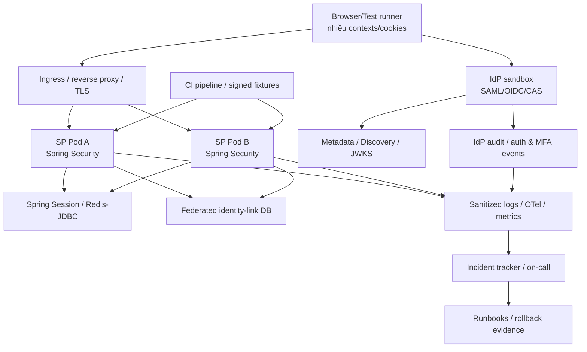
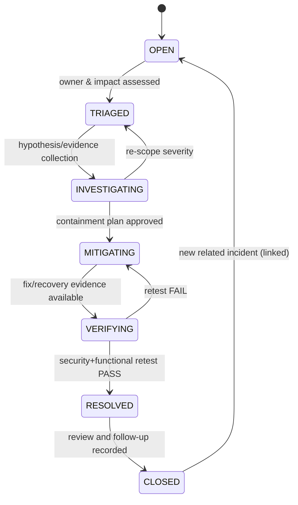

# Xây dựng bộ kiểm thử bảo mật, bảng theo dõi sự cố và quy trình vận hành liên kết

**Học phần:** Spring Security – federation → Thực hành tổng hợp.

**Mục tiêu:** xây dựng một bộ công cụ vận hành **federated authentication** đầu cuối cho ứng dụng Java/Spring Security: (1) **bộ kiểm thử bảo mật** có test cases, fixtures, assertion, CI và chứng cứ; (2) **bảng theo dõi sự cố** có mức độ nghiêm trọng, trạng thái, trách nhiệm, lịch sử xử lý, quyết định rollback và bằng chứng đóng; (3) **quy trình vận hành (runbook)** cho sự cố IdP/metadata/chứng thư, SAML/OIDC/CAS SSO, session, logout, account linking, multi-tenant và khả năng phục hồi. Ba sản phẩm phải kết nối bằng **mã định danh test/incident/correlation ổn định**, dữ liệu nhạy cảm được bảo vệ và tiêu chí PASS/FAIL có thể kiểm chứng.

**Luận điểm an toàn:** “IdP trả trang đăng nhập 200”, “HTTP callback trả 302”, “unit test MockMvc có `@WithMockUser`” hoặc “đã tạo ticket incident” **không chứng minh bảo mật đăng nhập**. Kết quả chỉ đáng tin khi kiểm chứng được **giao thức thực + state/crypto validation + phiên và quyền ứng dụng + âm tính bị chặn + sự cố có chủ sở hữu và evidence phục hồi**. Bộ kiểm thử phải ưu tiên lỗi có thể dẫn tới **đăng nhập trái phép, chiếm tài khoản, vượt tenant, cấp quyền sai hoặc phiên không bị thu hồi**, rồi mới đến trải nghiệm hoặc hiệu năng.

Tài liệu dùng Java 17+, Spring Security Servlet 6.x/7.x, SAML2, OpenID Connect (OIDC), CAS và IdP sandbox. **Không phải mọi ứng dụng đều dùng cả ba giao thức:** test suite cần bật từng protocol theo cấu hình thực, không giả định CAS logout message cũng là SAML2 SLO hoặc OIDC Logout Token. Ví dụ endpoint, issuer, IDs, bảng ticket và thời gian trong bài là dữ liệu giả lập. Chương trình Java 17 độc lập ở phần 12 minh họa logic quyết định/gating và incident lifecycle; **không parse hay verify XMLDSig/JWT thật**. Với production, dùng thư viện Spring Security/OpenSAML/JWT decoder, không tự viết bộ xác thực.

## 1. Sản phẩm bàn giao và định nghĩa hoàn thành

| Sản phẩm | Nội dung bắt buộc | Người dùng chính | Bằng chứng PASS |
| --- | --- | --- | --- |
| **Security test suite** | Scope, threat model, môi trường, matrix, automation, negative tests, CI gates, signed fixtures, evidence index | Developer, QA, AppSec | Test run reproducible, assertion rõ, security controls vẫn bật |
| **Incident tracker** | Ticket schema, severity, trạng thái, owner/on-call, phát hiện, impact, timeline, evidence, next action, resolution/review | On-call, IAM, SRE, AppSec, support | Mỗi incident có provenance, quyết định và xác nhận phục hồi |
| **Federation runbook** | Diagnose, contain, recover, rollback, contact IdP, certificate/metadata rotation, session/token revocation, post-incident follow-up | SRE, IAM, security responders | Diễn tập tabletop và fault injection theo tình huống |
| **Operational dashboard** | Login failure/SLO gap, metadata age, trust expiry, IdP outage, session continuity, incident aging, high-risk unresolved | On-call/incident commander | Alert đo đúng capability, không tiết lộ secrets |
| **Release evidence pack** | CI build + signed SAML/OIDC/CAS E2E reports, known risks, security exceptions, sign-off | Release manager/AppSec | Critical gates PASS, không có blocker chưa xử lý |

**Definition of Done (DoD):**
1. Tài sản SSO được inventory: ứng dụng/Relying Party, IdP, issuer, protocol, environment, tenant, ACS/redirect URI, logout, signing/trust keys, metadata/discovery endpoints.
2. Tối thiểu **một SAML2 SP-initiated happy path** chạy với IdP sandbox thật, callback được framework verify, request sau bằng cookie mới đọc được protected route. Nếu triển khai OIDC/CAS, có E2E tương ứng.
3. Negative tests chứng minh response giả, issuer/audience sai, request không khớp, token replay và cross-session đều **không tạo Authentication/app session**.
4. Session/SLO có kiểm thử **trên nhiều nodes** khi deployment là cluster; callback HTTP 200 nhưng session còn hoạt động phải FAIL.
5. Account linking chỉ dùng verified issuer+subject (với scope SAML khi cần), không auto-merge theo email; disabled user và cross-tenant bị chặn.
6. Pipeline ghi kết quả có timestamp, commit/build/IdP fixture version; artifact không chứa tokens/PII.
7. Một incident giả lập đi được từ phát hiện đến khắc phục và **VERIFYING→RESOLVED dựa trên rerun evidence**, không chỉ comment “fixed”.
8. Runbook đã được tập diễn tập tối thiểu một metadata outage, signing key rollover và logout propagation failure.
9. Biết chính xác thao tác nào **cần incident response** và thao tác nào là vận hành lỗi bình thường; phân biệt symptom, impact, root cause và exploit evidence.
10. Security exception còn mở được ghi rõ scope/owner/expiry, không dùng “known issue” để bỏ qua critical regression.

Không áp một số lượng testcase tối thiểu cho mọi app; ma trận dưới đây là **khung bài thực hành**, phải gắn từng case với giao thức/deployment thật. Không tạo case “PASS” nếu tính năng không được cấu hình: dùng `NOT_APPLICABLE` kèm lý do và approval, không giả green.

## 2. Kiến trúc lab kiểm thử



### 2.1. Môi trường khuyến nghị

- **Unit:** validate policy của account mapping, state machine, session revocation, ticket-to-session index, URL allowlist, risk classification; không cần IdP thật.
- **Spring integration:** ApplicationContext/SecurityFilterChain, MockMvc filters, real SessionRepository/Testcontainers Redis, repository lookup, ACS response verification với signed fixtures đủ profile; tránh mock mất phần security cần kiểm.
- **Federation E2E:** test IdP phát **signed SAMLResponse, signed OIDC ID Token, CAS service ticket** đúng contract; browser contexts và network routes thật.
- **Chaos/staging:** tách metadata URL khỏi IdP login URL, inject TLS error, timeouts, restart pod, revoke key, Redis interruption, wrong SLO callback node.
- **Production canary:** chỉ synthetic account/service được duyệt, không phát assertions giả hoặc phá sessions người dùng thật, không scan IdP partner nếu chưa được phép; dùng telemetry giảm nhạy cảm.

**Bất biến của fixture:** một test chỉ mutate accounts/tenants/tickets/session trong namespace sandbox. Mọi signed sample có key test được bảo vệ riêng, không chứa production credentials, không dùng production private key để tạo assertions giả. Secrets phải ở CI secret manager; teardown xóa test sessions, caches, users theo policy.

### 2.2. Inventory trước khi test

| Trường | Ví dụ (giả lập) | Kiểm soát |
| --- | --- | --- |
| `service_id` | `portal-web` | Stable app identifier |
| `environment` | `staging` | Không lẫn production |
| `protocol` | `SAML2` | Test suite riêng đúng giao thức |
| `registration_id` | `corp` | Spring server-owned allowlist |
| `idp_issuer` | `https://idp.example.test/metadata` | Trust issuer chính xác |
| `sp_entity_id` | `https://portal.example.test/saml/sp` | Audience và metadata contract |
| `acs_url` | `https://portal.example.test/login/saml2/sso/corp` | Destination/Recipient |
| `slo_url` | `https://portal.example.test/logout/saml2/slo` | SAML2 logout, không nhầm CAS |
| `idp_metadata_version` | `approved-M2` | Keyset K1+K2, expiry |
| `session_repository` | `spring-session-redis` | Shared trong cluster |
| `identity_link_policy` | `issuer+subject+scope` | Không match email |
| `business_resource` | `/api/reports/weekly` | Nơi kiểm authorization |
| `risk_tier` | `high` | Điều chỉnh độ sâu/retest |
| `oncall_team` | `iam-oncall` | Chủ sở hữu hướng vận hành |

Dữ liệu trên chỉ là ví dụ. Inventory phải khớp config thực và hợp đồng IdP; không tự thêm một IdP issuer từ query user. Source-of-truth cho registration/trust thuộc hạ tầng IAM/AppSec.

## 3. Threat model: xác định những gì có thể sai

**Tài sản cần bảo vệ:** tài khoản U-100, session cookie, business API, data ownership/tenant, SAML assertion, OIDC ID/access/refresh tokens, CAS service tickets/TGT, signing/decryption keys, metadata trust, audit trail và incident evidence.

**Ranh giới tin cậy:**
- Browser → SP: request/header/form params mặc định **untrusted**.
- IdP → browser → SP ACS: SAMLResponse cần **cryptographic validation**; browser truyền không làm message đáng tin.
- OIDC redirect callback: authorization code/state đi qua browser; token endpoint/JWKS/issuer validation mới hoàn tất authentication.
- CAS server → service/client: service ticket phải validate với trusted CAS; SLO callback sender/auth cần hợp đồng riêng.
- SP → DB/session: mapping nội bộ phải dùng unique keys, RBAC, TTL và atomic operations.
- SP ↔ IdP metadata/JWKS: nguồn trust phải được pin/verify theo contract, key rotation không tạo “trust-all fallback”.
- Logs/trace/incident attachments: dữ liệu đã sanitize, có access control và retention.

### 3.1. Những tấn công/bug phải thử

- Forged SAMLResponse, unsigned assertions, XML Signature Wrapping, wrong issuer, wrong Audience/Recipient/Destination, expired assertion, `InResponseTo` mismatch, replay.
- Login CSRF / response fixation khi original browser/session binding mất, RelayState/state bị đoán hoặc gửi từ browser khác.
- OIDC state/nonce/PKCE mismatch, `iss`/`aud`/`azp` sai, `exp`/`nbf`, JWKS kid/alg confusion, code reuse, open redirect URI.
- CAS ticket replay, wrong service validation, back-channel SLO callback fake, static ST→session map lỗi khi nhiều nodes.
- Session fixation, CSRF, SameSite cross-site POST, cookie Secure/HttpOnly, privilege retention/step-up.
- Account linking bằng email, subject collision giữa issuer, disabled account self-resurrection, cross-tenant authorization.
- Metadata trust/key rotation: nhận key giả, stale metadata, TLS insecure, XML XXE, SSRF.
- IdP outage, callback loss, Redis timeout, multiple tabs/IdPs, concurrent logout/login races.
- Log injection, leaking raw token/assertion/session cookie, high cardinality metrics, thiếu incident evidence.
- Authentication success nhưng business resource 403 (không mặc định đó là federation failure), hoặc 200 khi role không đủ (authorization bypass).

### 3.2. Bảng yêu cầu → bằng chứng

| Security requirement | Test kỹ thuật | Chứng cứ |
| --- | --- | --- |
| Chỉ trusted IdP được đăng nhập | Untrusted Issuer/unknown key rejected | Framework auth failure, no new session |
| Không replay assertion/token | Send same message twice in isolated test | Second rejected, replay status |
| Không cross-session login | Wrong browser request/nonce/state | Session A unaffected; no auth in B |
| Không cross-tenant | Signed user in tenant B requests tenant A data | 403 without data leakage |
| Không auto-link email | Same email, different issuer+subject | No account takeover; review queue |
| SLO invalidates target session | Real SLO notice to different node | Old cookie unauthorized on all nodes |
| Key rollover safe | K1→K1+K2→K2 signed fixtures | Valid K2 accepted only after trust approval |
| Incident closure evidence | Fail → fix → signed retest + owner approval | Ticket RESOLVED with linked run IDs |

**Không tự viết SAML/JWT parser mới để “kiểm thử” thư viện:** test nên sinh fixtures từ IdP/AS test environment và kiểm **Spring Security provider thật**. Unit test riêng chỉ mô tả logic nghiệp vụ sau verification.

## 4. Cấu trúc bộ kiểm thử trong dự án

Một layout gợi ý trong repo (mô tả, không cần tạo chính các file này để đọc bài):

```text
federation-security/
  README.md
  scope/
    registrations.yml
    data-classification.md
    threat-model.md
    ownership.md
  testcases/
    saml2.yml
    oidc.yml
    cas.yml
    session-and-authorization.yml
    operations.yml
  fixtures/
    signed-saml/
      fixture-index.yml
    oidc/
      fixture-index.yml
    cas/
      fixture-index.yml
  src/test/java/
    .../unit/
    .../integration/
    .../e2e/
  env/
    idp-sandbox.yml
    trust-snapshot.yml
    fault-injection.yml
  ci/
    pipeline.yml
    evidence-policy.yml
  incidents/
    schema.md
    redacted-board-example.csv
    closure-template.md
  runbooks/
    idp-unavailable.md
    metadata-key-rotation.md
    saml-validation-failure.md
    logout-partial.md
    account-linking.md
    incident-escalation.md
  reports/
    run-manifest.json
    sanitized-results.json
    findings.md
```

**Không commit thật:** private keys, production metadata token, raw SAMLResponses, OTP, browser cookies, refresh tokens, service tickets, email/NameID gắn người thật, account recovery evidence. `fixture-index.yml` lưu fixture ID, signer test key reference và checksum; signed fixtures nếu có dữ liệu nhạy cảm chỉ lưu encrypted test artifact theo quyền.

### 4.1. Testcase chuẩn

```yaml
id: SAML-NEG-003
title: Reject SAMLResponse with wrong Audience
protocol: SAML2
feature: login
priority: P0
risk: cross_service_authentication
environment: staging
owner_role: appsec
preconditions:
  - "Registered SP corp and signed sandbox response fixture"
  - "Browser session has one pending AuthnRequest"
action:
  - "Send sandbox-signed assertion with Audience for a different SP"
expected:
  - "SAML authentication rejected by provider"
  - "No authenticated SecurityContext persisted"
  - "GET protected route with original cookie remains unauthorized"
  - "Sanitized failure reason is recorded"
evidence:
  - "test_run_id"
  - "request_ref"
  - "failure_category"
  - "session_assertion"
security_constraints:
  - "No raw SAMLResponse or cookie in logs"
  - "No Signature/Audience validator disabled"
```

Đây là cấu trúc quản lý case **minh họa**, không phải DSL mặc định của Spring. Nếu tự viết test runner, phải thống nhất parser/schema và mapping sang JUnit/Testcontainers/Playwright. Field `priority=P0` trong testcase chỉ là **mức độ nghiêm trọng nếu yêu cầu bị vi phạm**, không đồng nghĩa đã xảy ra incident P0.

### 4.2. Quy tắc test ID ổn định

- Prefix theo domain: `SAML-NEG-...`, `OIDC-NEG-...`, `CAS-...`, `SES-...`, `OPS-...`.
- Không đổi test ID khi sửa tên testcase; dùng version/change log.
- Test có `owner_role` và link requirement/control (ASVS/NIST/OASIS/OIDC theo phiên bản).
- Result mỗi run là `PASS, FAIL, BLOCKED, SKIPPED_APPROVED, NOT_APPLICABLE`; không mặc định `SKIP=PASS`.
- Mỗi FAIL tạo **finding**; nếu có impact trên production hoặc nguy cơ đang khai thác thì mở **incident** theo triage policy.
- Các test flaky phải giữ tín hiệu failure, có root-cause owner và expiry cho quarantine; không xóa case để pipeline xanh.

## 5. Ma trận SAML2 security tests

Giả định SP-initiated Web Browser SSO qua Spring Security SAML2. Các case ký số phải dùng sandbox IdP/key được cấp phép, không dùng assertions thật của người dùng.

| ID | Kiểm thử | Expected |
| --- | --- | --- |
| SAML-01 | Login SP-initiated đúng IdP | Signed response verified; session authenticated |
| SAML-02 | Browser vào protected route chưa login | Redirect/login flow, không 200 nội dung riêng |
| SAML-03 | AuthnRequest có ID/Issuer/ACS hợp lệ | Pending request lưu theo đúng registration |
| SAML-04 | IdP trả signed Response InResponseTo đúng | Match pending, verify profile |
| SAML-05 | Response thiếu chữ ký theo policy | Reject; không tạo SecurityContext |
| SAML-06 | Assertion ký bởi key lạ | Reject; không auto-trust embedded KeyInfo |
| SAML-07 | XML signature modified after signing | Reject |
| SAML-08 | Signature Wrapping / duplicate ID | Reject, parser/validator không chọn unsigned element |
| SAML-09 | Wrong IdP Issuer dù XML có chữ ký | Reject untrusted issuer |
| SAML-10 | Wrong Audience SP EntityID | Reject |
| SAML-11 | Wrong Recipient hoặc Destination ACS | Reject |
| SAML-12 | `InResponseTo` unknown | Reject |
| SAML-13 | `InResponseTo` của browser khác | Reject login CSRF/fixation |
| SAML-14 | Replay same Response/Assertion ID | Reject lần 2 |
| SAML-15 | Assertion expired | Reject, không tăng skew tùy tiện |
| SAML-16 | NotBefore trong tương lai | Reject ngoài configured skew |
| SAML-17 | Requested AuthnContext/MFA yếu hơn policy | Reject/step-up tùy contract |
| SAML-18 | `RelayState` sai hoặc forged | Không redirect URL không tin; không authorize |
| SAML-19 | Browser tab A/B với hai pending requests | Không trộn response, session hoặc registration |
| SAML-20 | IdP-initiated response khi SP policy cấm | Reject unsolicited response |
| SAML-21 | Correct SAML authentication nhưng app account disabled | Deny protected access |
| SAML-22 | NameID từ issuer khác nhưng string giống | Không auto-link internal account |
| SAML-23 | NameQualifier/SPNameQualifier khác scope | Không map sai user |
| SAML-24 | XML DTD/XXE/entity expansion payload | Reject/parse safe, bounded resources |
| SAML-25 | ACS POST quá lớn | HTTP bounded reject, no resource exhaustion |
| SAML-26 | Browser không gửi original session cookie tại ACS | Fail closed, investigate SameSite |
| SAML-27 | Metadata signing key rollover K1+K2 | Approved keys accepted, unknown key rejected |
| SAML-28 | Metadata endpoint down với valid trusted snapshot | Startup/login behavior theo policy, không trust-all |
| SAML-29 | ACS callback tới node B, request ở node A | Shared request/session store match, or reject safely |
| SAML-30 | Authenticated cookie trên pod A/B | Same logical session, no unauthorized resurrection |
| SAML-31 | SP local logout vs SAML SLO | Chỉ tuyên bố phạm vi thật; old cookie invalid |
| SAML-32 | RP-initiated SLO signed request/response | IdP SLO contract và session destroy đúng |
| SAML-33 | AP-initiated signed LogoutRequest | Verify issuer/signature, targeted session invalid |
| SAML-34 | Unsigned/wrong issuer SLO | Reject; không bulk logout user khác |
| SAML-35 | Lost/out-of-order/logout replay | Idempotent, observable, no false success |
| SAML-36 | Success handler redirect raw RelayState | Open redirect rejected |
| SAML-37 | Validation success nhưng role thiếu | Authenticated ≠ authorized; 403 đúng |
| SAML-38 | Signed response nhưng wrong tenant | Deny account mapping/cross-tenant |
| SAML-39 | Reverse proxy Host spoofing ACS URL | Canonical external URL allowlist |
| SAML-40 | SAMLResponse và session cookie xuất hiện trong logs | **QA FAIL / privacy incident** |

**Lưu ý:** nếu Spring Security 7.x được dùng, provider có thể là `OpenSaml5AuthenticationProvider`, còn 6.x có đường API và principal khác; test phải dùng **BOM thực**. Một test parse XML và so `InResponseTo` bằng string **không thay** validation của OpenSAML. Với `SAML-26`, SameSite và session-bound repository phải được thiết kế phù hợp cross-site POST, không tắt original-browser binding.

## 6. Ma trận OIDC/OAuth2 Login và token validation

**Phân biệt:** OAuth2 Authorization Code/PKCE là giao thức ủy quyền; **OIDC** bổ sung xác thực danh tính bằng **ID Token**. API Resource Server kiểm **access token** theo issuer/audience/scope, không dùng ID Token làm bearer API token nếu contract không cho phép.

| ID | Kiểm thử | Expected |
| --- | --- | --- |
| OIDC-01 | Authorization Code Flow + PKCE đúng | Login qua OP, verified ID Token, session |
| OIDC-02 | Callback `state` không khớp pending request | Reject, no session |
| OIDC-03 | Missing/changed `nonce` | Reject ID Token theo policy |
| OIDC-04 | Wrong code_verifier | Token exchange fail |
| OIDC-05 | Reuse authorization code | Rejected by OP, không login lại |
| OIDC-06 | Invalid ID Token JWS signature | Reject |
| OIDC-07 | ID Token `iss` khác trusted OP | Reject |
| OIDC-08 | ID Token `aud` không chứa client ID | Reject |
| OIDC-09 | Multi-audience `azp` sai khi required | Reject |
| OIDC-10 | ID Token expired/nbf invalid | Reject |
| OIDC-11 | JWK kid lạ hoặc alg không cho phép | Reject, không switch algorithm tự do |
| OIDC-12 | Same `sub` từ hai `iss` khác nhau | Không map cùng internal account |
| OIDC-13 | Email trùng nhưng `iss+sub` khác | Không auto-link |
| OIDC-14 | Redirect URI/open redirect không whitelist | Authorization request rejected |
| OIDC-15 | Discovery/JWKS endpoint timeout | Không bỏ signature verification; cache policy rõ |
| OIDC-16 | Key rotation overlap in JWKS | New key trusted qua approved issuer/source |
| OIDC-17 | OAuth access token có wrong `aud` | Resource server rejects |
| OIDC-18 | Access token thiếu scope/role | 403 theo app policy |
| OIDC-19 | Expired bearer token | 401, no refresh bypass |
| OIDC-20 | Refresh token rotation/reuse detection | Theo OP contract; reused token denied |
| OIDC-21 | Back-channel Logout Token invalid signature | Reject; không revoke sessions tùy ý |
| OIDC-22 | Back-channel logout `sid`/`sub` đúng | Revoke exactly target sessions per OP policy |
| OIDC-23 | RP-initiated logout URI sai/redirect không whitelist | Reject hoặc safe fallback |
| OIDC-24 | API dùng ID Token như access token | Security QA FAIL |
| OIDC-25 | Confuse OAuth client `registrationId` với OP issuer | Trusted issuer là source-of-truth |
| OIDC-26 | Multiple browser tabs OAuth state | Không overwrite/trộn state |
| OIDC-27 | Session cookie SameSite/CSRF | Không login CSRF/session fixation |
| OIDC-28 | User disabled sau valid OIDC token | App authorization/lifecycle deny |
| OIDC-29 | Client secret leak in CI logs | Secret redaction and incident |
| OIDC-30 | IdP outage nhưng existing app session valid | Existing session policy độc lập interactive login |

Spring Security docs có `oauth2Login`, `OidcClientInitiatedLogoutSuccessHandler` và các cơ chế OIDC Back-Channel Logout **khi được cấu hình theo OP contract**. **Đừng giả định** enabling logout cho SAML tự bật OIDC back-channel hoặc CAS SLO. Logout endpoints, token semantics và replay validation khác nhau giữa các giao thức.

## 7. Ma trận CAS protocol, session và logout

Với CAS, phân biệt **Ticket-Granting Ticket (TGT)** ở CAS Server, TGC cookie trên CAS domain, **Service Ticket (ST)** xác thực từng service và **HttpSession** của ứng dụng. CAS protocol **Single Sign-Out** thường gửi logoutRequest với `SessionIndex=ST ID`; đó **không phải SAML2 SP LogoutRequest SessionIndex có semantics giống hệt**.

| ID | Kiểm thử | Expected |
| --- | --- | --- |
| CAS-01 | Valid service ticket cho đúng `service` | CAS client authenticate, app session tạo |
| CAS-02 | Replay ST sau dùng một lần | Reject |
| CAS-03 | ST phát cho service A gửi service B | Reject wrong service |
| CAS-04 | CAS server trust/TLS invalid | Không tắt server certificate verification |
| CAS-05 | Browser mất TGC nhưng app session còn | Hiểu session layers, không giả global logout |
| CAS-06 | CAS logout TGT khi đã vào 2 apps | SLO callbacks tới đúng registered services |
| CAS-07 | `SessionIndex` trong CAS logoutRequest map ST→HttpSession | Chỉ hủy đúng app session |
| CAS-08 | Portal node A tạo session, node B nhận SLO | Distributed ST→session mapping, revoke đúng |
| CAS-09 | SLO callback duplicate | Idempotent, không hủy session mới |
| CAS-10 | SLO callback forged từ Internet | Authenticated CAS sender policy, reject |
| CAS-11 | SLO missing, CAS logout page 200 | **Không** đánh PASS cho downstream sessions |
| CAS-12 | Two tabs share one cookie | Một app session, không giả hai |
| CAS-13 | Same user, two different CAS TGTs | Logout TGT1 không xóa TGT2 session theo policy |
| CAS-14 | SLO front-channel browser blocked | Detect browser-dependent failure |
| CAS-15 | CAS metadata/service registry misrouting | ServiceId/logoutType/logoutUrl đúng |
| CAS-16 | Redirect/logout loop hoặc blocked CSRF filter | Narrow SLO endpoint contract, không disable CSRF toàn app |
| CAS-17 | Session fixation after CAS login | ST→current session binding được cập nhật |
| CAS-18 | CAS client incompatible `javax.servlet` vs `jakarta.servlet` | Integration/compilation fail sớm, no hack |
| CAS-19 | Logout local portal, CAS TGT còn | User có thể SSO lại, UX giải thích |
| CAS-20 | CAS test payload được log nguyên dạng | QA FAIL / secret exposure |

**Kết quả kiểm CAS SLO không đo bằng số lần callback 200**, mà bằng request kế tiếp trên mỗi ứng dụng với **cookie cũ phải không còn authenticated**, kể cả khác node; đối chứng sessions khác TGT không bị xóa. Khi dùng Spring Session, vẫn cần **ST→session index** phân tán nếu CAS client lưu mapping local.

## 8. Cross-cutting tests: session, quyền, multi-tenant, observability

| ID | Tình huống | Expected |
| --- | --- | --- |
| SES-01 | User chưa xác thực truy cập protected route | 302 login hoặc 401 đúng context; không 200 dữ liệu |
| SES-02 | User xác thực, request sau dùng cookie mới | SecurityContext persisted |
| SES-03 | Session ID rotate khi login | Không fixation, old ID unusable |
| SES-04 | Cookie Secure/HttpOnly/SameSite theo risk | Không lộ/không gửi sai context |
| SES-05 | Cross-site POST protected business route thiếu CSRF | 403; ngoại lệ SLO/ACS hẹp đúng contract |
| SES-06 | Idle/absolute session timeout | Request cũ yêu cầu reauth |
| SES-07 | Account disabled nhưng session còn | Access/revocation policy được enforce |
| SES-08 | Step-up MFA required cho giao dịch nhạy cảm | Weak/freshness expired session bị deny |
| SES-09 | Tenant B user vào tenant A API | 403, không data leakage |
| SES-10 | Role mapping từ IdP mới khác semantics | Không auto grant admin |
| SES-11 | Signed assertion với email của account khác | Không auto-link |
| SES-12 | Multiple sessions/pods | Shared state ổn định và revoke được |
| SES-13 | Redis/session store unavailable | Safe failure, không resurrect authenticated session |
| SES-14 | Concurrent logout với request đang chạy | Không hồi sinh state/revoke proof |
| SES-15 | Redirect URL parameter attacker-controlled | Reject open redirect |
| SES-16 | Trace/header/user-provided correlation ID spoof | Không làm auth, sanitize |
| SES-17 | Logs/HTTP capture chứa raw assertions/tokens/cookies | QA FAIL |
| SES-18 | Metrics dùng subject/request IDs làm labels | QA FAIL vì cardinality/privacy |
| SES-19 | Same issuer+subject link đã revoked | Login bị deny, không JIT resurrect |
| SES-20 | Two link transactions race tới hai accounts | DB uniqueness/concurrency ngăn takeover |
| SES-21 | IdP A outage, IdP B healthy | Failure isolation per registration |
| SES-22 | Key rotation khi production có nhiều versions | Canary/pods consistent trusted keys |
| SES-23 | System clock skew | Reject ngoài bounded policy, alert NTP |
| SES-24 | TLS between reverse proxy/SP/IdP | Canonical scheme/Host/origin trust |
| SES-25 | Signing/decryption key secret rotation | No plaintext leak, rollback policy |
| SES-26 | Audit exporter offline | Authentication behavior không bypass |
| SES-27 | Signed Response replay trong same session | Reject |
| SES-28 | Old app session cookie sau logout | Unauthenticated trên tất cả nodes |
| SES-29 | New login sau logout | Fresh authentication hợp lệ, old session vẫn revoked |
| SES-30 | Account recovery qua email đơn thuần | Không mặc định chiếm account |

**Test quan trọng nhất là kiểm request độc lập sau authentication/logout.** Mock authentication context trong một request controller **không thể** chứng minh SAML/CAS/OIDC handshake, session fixation strategy, cookie delivery hoặc multi-node persistence.

## 9. Automation: unit → integration → E2E → chaos

### 9.1. Unit test và policy test

Đối tượng:
- issuer+subject identity key và tenant allowlist;
- deterministic role mapping và denied inactive accounts;
- CSRF/return URL allowlist policy;
- SLO ticket/session index, one-time/replay behavior;
- incident severity classification, transition rules và closure evidence;
- metadata refresh candidate approve/reject, trusted keys snapshot;
- retry/backoff ceilings;
- redaction và metrics label allowlist.

Có thể dùng JUnit 5 parameterized tests, AssertJ và Mockito trong project thật. Đừng mock Spring SAML provider mà dùng mock result để chứng minh “SAML signature verified”; chỉ nên mock upstream service **sau trust boundary** cho business logic.

### 9.2. Spring Boot integration tests

Các lớp test:
- `@SpringBootTest` với `SecurityFilterChain` cấu hình giống runtime.
- `@AutoConfigureMockMvc` cho HTTP routing/authorization, `spring-security-test` để tạo fixtures ở **tầng phù hợp**.
- Testcontainers Redis/JDBC cho Spring Session, unique identity-link store.
- Real SAML response verification với signed sandbox fixture và trusted test signing certificate; không nhận unsigned XML chỉ vì test.
- Test actual `Saml2AuthenticationRequestRepository` và correct original browser session binding.
- OIDC token decoder signed fixture/JWKS test server hoặc OP sandbox, issuer/audience/nonce/state đúng.
- CAS client `serviceValidate`/callback SLO sandbox; verify cross-node behavior.
- HTTP CSRF for business actions; exceptions chỉ hẹp ở SSO-specific paths khi framework required.

**Mảnh Spring Security config** (chỉ dùng với app có registrations và IdP sandbox đã cấu hình):

```java
package com.example.federation;

import org.springframework.context.annotation.Bean;
import org.springframework.context.annotation.Configuration;
import org.springframework.security.config.Customizer;
import org.springframework.security.config.annotation.web.builders.HttpSecurity;
import org.springframework.security.web.SecurityFilterChain;

@Configuration
class FederationSecurityConfig {
    @Bean
    SecurityFilterChain federationFilterChain(HttpSecurity http)
            throws Exception {
        http
            .authorizeHttpRequests(auth -> auth
                .requestMatchers("/health", "/login-error").permitAll()
                .requestMatchers("/admin/**").hasRole("ADMIN")
                .anyRequest().authenticated())
            .saml2Login(Customizer.withDefaults())
            .saml2Logout(Customizer.withDefaults());
        return http.build();
    }
}
```

**Không chạy độc lập:** cần `spring-security-saml2-service-provider`, `RelyingPartyRegistrationRepository`, metadata/keys thật trong sandbox, controllers và SLO contract. Chỉ bật `saml2Logout` khi IdP có SAML SLO và SP đủ signing credentials; không copy blanket config vào OIDC/CAS application rồi cho là đã test mọi protocol.

### 9.3. MockMvc smoke test có giới hạn

```java
package com.example.federation;

import org.junit.jupiter.api.Test;
import org.springframework.beans.factory.annotation.Autowired;
import org.springframework.boot.test.autoconfigure.web.servlet.AutoConfigureMockMvc;
import org.springframework.boot.test.context.SpringBootTest;
import org.springframework.test.web.servlet.MockMvc;

import static org.springframework.test.web.servlet.request.MockMvcRequestBuilders.get;
import static org.springframework.test.web.servlet.result.MockMvcResultMatchers.status;

@SpringBootTest
@AutoConfigureMockMvc
class AnonymousRouteSecurityTest {
    @Autowired MockMvc mvc;

    @Test
    void anonymousCannotReadAdminAs200() throws Exception {
        mvc.perform(get("/admin/"))
            .andExpect(result -> {
                int code = result.getResponse().getStatus();
                if (code == 200) {
                    throw new AssertionError(
                        "Anonymous user received admin resource");
                }
                if (code < 300 || code >= 500) {
                    throw new AssertionError(
                        "Unexpected response status: " + code);
                }
            });
    }
}
```

**Điều kiện:** app thực có `/admin/` và filter chain phù hợp; unauthorized có thể 302 login, 401 hoặc 403 tùy entrypoint/CSRF/context. Test này chỉ chứng minh **anonymous route không trả HTTP 200** theo assumption, **không chứng minh** chữ ký SAML/IdP đã verify hoặc user đã có quyền. Bài E2E phải thêm signed sandbox SAMLResponse và authorization request sau login, không lẫn các mức test.

### 9.4. E2E bằng browser và IdP sandbox

1. Browser context A bắt đầu protected route; ghi correlation ref không phải cookie raw.
2. SP phát AuthnRequest ID hoặc OAuth2 state/PKCE; CAS service redirect tương ứng.
3. IdP sandbox thực hiện login/MFA theo policy, ký assertion/token bằng key test.
4. Browser quay về ACS/OIDC callback/CAS client serviceValidate.
5. App tạo SecurityContext, session cookie và principal mapped đúng `account_id`/tenant.
6. Request mới GET protected API: expect resource đúng user/tenant/role.
7. Dùng browser context B với identity khác: không được dùng context A.
8. Dùng signed/invalid fixtures âm: wrong issuer/audience/nonce/RelayState phải reject.
9. Trigger local logout và federated logout theo từng protocol, kiểm old session cookie trên mọi nodes không còn quyền.
10. Simulate IdP SSO/metadata/JWKS outage và Redis network chaos, ghi expected degraded capability.
11. Thu thập sanitized `test_run_id`, `case_id`, build SHA, environment, expected/actual, timestamps và trusted event code.
12. Cleanup test accounts/sessions, không lưu raw HAR/SAMLResponses trong artifact phổ thông.

### 9.5. CI/CD pipeline gợi ý

```yaml
name: federation-security
on:
  pull_request:
  push:
    branches: [main]
jobs:
  unit-and-integration:
    runs-on: ubuntu-latest
    permissions:
      contents: read
    steps:
      - uses: actions/checkout@v4
      - uses: actions/setup-java@v4
        with:
          distribution: temurin
          java-version: '17'
          cache: maven
      - name: Run deterministic unit and integration gates
        run: mvn -B -ntp verify
      - name: Archive sanitized test reports
        if: always()
        uses: actions/upload-artifact@v4
        with:
          name: federation-test-reports
          path: target/surefire-reports/
```

**Cấu hình CI trên chỉ là minh họa nếu dùng GitHub Actions và Maven.** Không bao gồm IdP sandbox và Testcontainers provisioning: trong project thực, thêm isolated ephemeral IdP/Redis/test CA, secret injection, job permissions/approval, integration test tags và rule kiểm artifacts không chứa secret. `actions@v4` cần pin commit SHA hoặc version trust policy của tổ chức trước production. Không đẩy signed production credentials sang runner public.

### 9.6. Release gates

| Gate | Nguyên tắc |
| --- | --- |
| G0 – Build reproducibility | Source/BOM/tests chạy được, SBOM/scan theo policy |
| G1 – SAML/OIDC/CAS core auth | Protocol test suite applicable PASS |
| G2 – Negative security | Forged/expired/replay/cross-tenant responses DENIED |
| G3 – Session/logout | Session fixation & revocation test PASS |
| G4 – Identity mapping | No email auto-link, account ID continuity |
| G5 – Operational chaos | Metadata/IdP outage, key rotation, node restart theo runbook |
| G6 – Privacy/evidence | No raw secrets/PII in report/logs |
| G7 – Incident review | P0/P1 unresolved blockers có quyết định được ghi và owner |
| G8 – Sign-off | QA/AppSec/IAM/SRE phê duyệt theo RACI |

**Không bypass G2 bằng “expected flaky” hoặc tự set `AUTHENTICATED=true` trong test fixture.** Khi một gate không áp dụng, cần `N/A reason` có người duyệt; khi thất bại, release bị chặn theo policy và có incident/finding tùy impact.

## 10. Bảng theo dõi sự cố (Incident Tracker)

### 10.1. Phân biệt finding, defect, incident, change

- **Finding:** kết quả kiểm thử chỉ ra thiếu control trong sandbox; chưa chắc production bị ảnh hưởng.
- **Defect:** lỗi phần mềm có thể cần sửa code/config; có thể không phải sự cố đang diễn ra.
- **Security incident:** nghi ngờ/xác nhận có hành vi đe dọa hoặc exposure thực ảnh hưởng confidentiality/integrity/availability, cần phản ứng có trách nhiệm.
- **Operational incident:** gián đoạn IdP/metadata/session store gây ảnh hưởng dịch vụ; có thể hoặc không có yếu tố tấn công.
- **Change request:** công việc có kế hoạch như rollover key, update metadata; không tự gọi incident trừ khi xảy ra sai lệch.
- **Problem/RCA:** phân tích nguyên nhân lâu dài của một hoặc nhiều incidents.

Một security testcase FAIL trong CI tạo finding/defect; nếu cùng bug đang có trong production hoặc có exploitation evidence, triage nâng thành incident. **Không mặc định mọi test FAIL là P0, cũng không hạ bug nguy hiểm thành “chỉ là test” khi production dễ bị khai thác.**

### 10.2. Các trường cần có trong board

| Field | Ví dụ hoặc quy định |
| --- | --- |
| `incident_id` | `INC-FED-2026-001`, unique |
| `title` | “SAML Response accepted for wrong Audience” |
| `created_at`, `detected_at` | UTC ISO 8601 |
| `reported_by/source` | `CI gate SAML-10`, alert, user, IdP |
| `environment` | staging/production |
| `service/registration/protocol` | portal/corp/SAML2 |
| `category` | AUTH_BYPASS, IDP_OUTAGE, SLO_GAP, KEY_ROTATION... |
| `severity` | SEV0/SEV1/SEV2/SEV3 theo policy |
| `priority` | Triage/remediation priority, có thể khác severity |
| `impact_scope` | Tài khoản/tenant/services bị ảnh hưởng, pseudonymized |
| `confirmed_vs_suspected` | Không giả chắn chắn khi thiếu bằng chứng |
| `status` | OPEN, TRIAGED, INVESTIGATING, MITIGATING, VERIFYING, RESOLVED, CLOSED |
| `owner`/`incident_commander` | Một người/nhóm chịu trách nhiệm có mặt |
| `security_approver` | Quyết định trust/rollback/exceptions |
| `idp_contact` | Vendor contact reference, không lưu credentials |
| `first_response_due_at` | Theo SLO nội bộ, không gán thời gian tự chế |
| `next_update_at` | Khung thông báo stakeholders |
| `last_update_at` | UTC |
| `correlation_refs` | trace/request/authn/incident refs đã sanitize |
| `test_case_ids` | `SAML-10`, `SES-28` |
| `evidence_links` | Restricted artifacts with RBAC |
| `containment_action` | Disable IdP registration, revoke key/session... |
| `rollback_action` | Revert config/version hoặc disable feature |
| `customer_impact` | Có/không/chưa xác định và số liệu grounded |
| `root_cause` | Chỉ xác nhận sau điều tra |
| `fix_commit/config_version` | Phiên bản remediation |
| `retest_run_id` | Run chứng minh đã sửa |
| `review_approval` | AppSec/IAM/SRE theo severity |
| `resolution_at`/`closed_at` | Chỉ ghi khi đúng state |
| `postmortem_link` | RCA, preventive actions |

Các field ID không phải là bearer secrets. Một reference có thể vẫn tiết lộ thông tin nhân sự/hạ tầng nếu gắn cùng PII; dashboard phổ thông chỉ để authorized responders.

### 10.3. Ví dụ bảng sự cố giả lập

| ID | SEV | Trạng thái | Vấn đề | Owner role | Bằng chứng cần | Next action |
| --- | --- | --- | --- | --- | --- | --- |
| INC-FED-001 | SEV1 | MITIGATING | ACS callback tạo session dù `Audience` sai trong staging regression | AppSec + backend | Signed negative fixture, no-session retest | Roll back custom validator và chạy G2 |
| INC-FED-002 | SEV2 | INVESTIGATING | IdP metadata HTTP 503, LKG valid, IdP SSO OK | IAM + SRE | Snapshot age, login canary, refresh logs | Khôi phục metadata source, không restart storm |
| INC-FED-003 | SEV1 | VERIFYING | CAS SLO callback node B không revoke session node A | Backend + SRE | Old-cookie across-pod test, ST-map redacted refs | Verify shared ticket→session index |
| INC-FED-004 | SEV1 | TRIAGED | OIDC state mismatch ignored in sandbox | AppSec | Real framework callback denial test | Chặn release, xác định ảnh hưởng |
| INC-FED-005 | SEV2 | OPEN | New IdP email matches old account without link | IAM | Identity-link DB record + access audit | Quarantine auto-link, run dual-proof |
| INC-FED-006 | SEV3 | RESOLVED | Session correlation logs thiếu trace sau ACS | Observability | Sanitized run ID, trace joins | Đóng sau verify data minimization |

Mức độ trong bảng **minh họa**, không phản ánh bất kỳ sự cố thật nào. Chỉ định SEV dựa xác suất, phạm vi ảnh hưởng, exploitability và business impact thực; không dựa duy nhất số lượng users.

### 10.4. CSV schema để import công cụ

```csv
incident_id,status,severity,protocol,service,registration,category,owner_role,test_case_id,environment,detected_at,next_update_at,evidence_ref
INC-FED-101,TRIAGED,SEV2,SAML2,portal,corp,METADATA_REFRESH,sre,SAML-28,staging,2026-11-07T03:00:00Z,2026-11-07T04:00:00Z,evidence-redacted-101
INC-FED-102,VERIFYING,SEV1,CAS,portal,corp,SLO_GAP,iam,CAS-08,staging,2026-11-07T03:10:00Z,2026-11-07T03:30:00Z,evidence-redacted-102
```

File CSV chỉ là **mẫu cấu trúc**, không phải board production đã tạo. Sau import, cấu hình type/required field/validation, RBAC, immutable event history, timezones và không để raw `SAMLResponse`/tickets trong attachment. Mỗi hàng phải link đến ticket thật và giữ version/audit.

### 10.5. State machine và ý nghĩa



**Không cho `OPEN→CLOSED` chỉ vì “cannot reproduce”.** Muốn `RESOLVED` phải có mitigation evidence và negative test rerun; `CLOSED` cần review/communication theo policy. Nếu người xử lý cần đánh dấu false positive, dùng terminal state `DISMISSED` với chứng cứ và approver riêng, không giả `PASS`.

### 10.6. Mức độ sự cố

- **SEV0 (khủng hoảng):** dấu hiệu active exploitation diện rộng, xâm phạm định danh/quyền nghiêm trọng, signing key/identity trust compromise quy mô lớn; kích hoạt security incident commander theo policy.
- **SEV1 (nghiêm trọng):** authentication bypass khả thi, cross-tenant data access, SLO/revocation hỏng với rủi ro cao hoặc nhiều người không thể đăng nhập critical app.
- **SEV2 (trung bình):** partial IdP availability, single-tenant login outage, metadata refresh failure còn LKG hợp lệ, bug có workaround an toàn.
- **SEV3 (thấp):** log correlation thiếu, warning/UX lỗi, monitoring gap không làm mất security control.

**Đây là ví dụ taxonomy để tổ chức phê duyệt**, không là mức SLA cố định của NIST/OWASP. IdP outage của một dịch vụ thiết yếu có thể lên SEV1/SEV0 theo impact; signed metadata sai có thể là compromise và cần escalation ngay.

### 10.7. RACI/đầu mối trách nhiệm

| Công việc | Responsible | Accountable | Consulted |
| --- | --- | --- | --- |
| SAML/OIDC/CAS trust contract | IAM federation engineer | IAM service owner | IdP vendor, AppSec |
| Authentication/authorization code | Backend developer | App technical owner | AppSec, QA |
| Multi-node session/SLO | SRE + Backend | Platform owner | IAM |
| Security test suite | QA automation + AppSec | Release security approver | Backend, IAM |
| Monitoring/on-call response | SRE on-call | Incident commander | IAM, Support |
| Confirm exploitability/data exposure | AppSec/IR | Security incident lead | Privacy/Legal khi cần |
| Approve signing key rollover | IAM/PKI owner | Security key owner | SRE |
| External user communication | Support/communications | Incident commander | Legal/Privacy/Customer success |
| Incident closure and RCA | Assigned owner | Incident commander | QA/AppSec/IAM |

Nếu vendor IdP quản lý khóa, bên tổ chức vẫn phải có **owner xác minh metadata/key changes** trước khi SP trust. “IdP đang xử lý” không đủ để bỏ trống on-call owner.

## 11. Từ một test FAIL đến incident có căn cứ

Ví dụ: `SAML-10` phát hiện SP nhận signed assertion với `Audience` của service khác.

### 11.1. Luồng bằng chứng

```text
CI run RUN-401
   |
   +-- Case SAML-10 FAIL
   |     fixture_ref=f-signed-wrong-aud
   |     expected=reject
   |     actual=authenticated app session
   |
   +-- Finding FIND-401 created
   |
   +-- Triage production exposure?
         |
         +-- no deployment yet -> release-blocking defect
         |
         +-- deployed/exploitable/unknown -> Incident INC-FED-001
                                        |
                                        +-- owner, severity, impact
                                        +-- containment/rollback
                                        +-- verify session revocation
                                        +-- patch default validators
                                        +-- rerun signed negative test
                                        +-- approval/recovery
```

Bằng chứng tối thiểu:
- `build_sha`/artifact version, Spring Security BOM, IdP metadata version/key refs.
- Case ID, fixture ID, test runner version, UTC timestamp, environment.
- **Expected vs actual** security outcome; không chỉ HTTP status.
- Session existence/absence sau callback và follow-up request.
- Sanitized correlation ID/trace, IdP/SAML issuer ref, rejection code.
- Approved mitigation action, owner và rollback decision.
- Rerun pass link và evidence review status.

**Không ghi raw assertion/cookies trong incident description**; dùng restricted encrypted evidence nếu pháp lý/IR cần nguyên liệu forensic. Tách **evidence integrity** khỏi dashboard text: signed artifact manifest/checksums và access logs có thể được dùng theo incident policy.

### 11.2. Triaging: symptom khác root cause

| Symptom | Có thể do | Không kết luận vội |
| --- | --- | --- |
| Login 302 vòng lặp | SameSite cookie, session persistence, wrong ACS, IdP SSO | “Sai mật khẩu” |
| IdP login page 200 | Chỉ IdP UI reachable | “SSO full PASS” |
| Signed response bị reject | Key rollover, Audience/Recipient, Issuer, time skew, InResponseTo | “Tắt signature check” |
| Existing users OK, new users fail | IdP SSO down, metadata trust expired, OAuth token endpoint | “App không khỏe” |
| CAS logout page OK nhưng app session active | SLO message lost, ST mapping local, wrong node | “Logout done” |
| OIDC JWKS fetching fails | Network/discovery stale, key mismatch | “Trust arbitrary kid” |
| User đổi IdP thấy account mới | Auto-provision/identity link absent | “Dữ liệu bị xóa” |
| 403 sau login success | Role/tenant authorization mapping | “SAML assertion invalid” |
| Log chứa NameID và SAMLResponse | Unsafe logging filter/debug mode | “Vô hại vì môi trường test” |

## 12. Java 17 chạy độc lập: mini security gate + incident board

Chương trình `FederationSecurityDrill.java` giúp tập luyện **hai trách nhiệm**:
- Phần **security gate** nhận các fixture đã được harness mô phỏng là signed/verified hay invalid; yêu cầu issuer, audience, `InResponseTo`, time window và replay đúng. Tất cả negative test phải bị từ chối.
- Phần **SLO** lưu một mapping service ticket→application session; một callback chỉ hủy phiên liên quan, callback trùng là no-op.
- Phần **incident board** yêu cầu qua TRIAGED, MITIGATING, VERIFYING trước RESOLVED; không được chuyển sang VERIFYING nếu thiếu evidence và không được close nếu không có rerun proof.
- Test harness in ra từng `PASS` và tổng số check, không dùng network, tokens hay tài khoản thực.

**Quan trọng:** bool `signatureVerified` trong demo **không phải đầu vào tin cậy từ browser**. Production phải do Spring Security/OpenSAML/JWT decoder/CAS ticket validation xác minh nguồn. Ví dụ này kiểm **logic nghiệp vụ và state transitions**, không thay E2E.

```java
import java.time.Instant;
import java.util.HashMap;
import java.util.HashSet;
import java.util.Map;
import java.util.Set;

public class FederationSecurityDrill {
    static final Instant NOW =
            Instant.parse("2026-11-07T03:00:00Z");
    static final String IDP = "https://idp.example.test/metadata";
    static final String SP = "https://portal.example.test/saml/sp";

    record SamlFixture(
            String responseId, String issuer, String audience,
            String inResponseTo, Instant notBefore, Instant expiresAt,
            boolean signatureVerified) {}

    static final class SamlGate {
        private final Set<String> usedResponses = new HashSet<>();

        boolean accept(SamlFixture f, String expectedRequestId) {
            if (f == null || !f.signatureVerified()
                    || !IDP.equals(f.issuer())
                    || !SP.equals(f.audience())
                    || !expectedRequestId.equals(f.inResponseTo())
                    || NOW.isBefore(f.notBefore())
                    || !NOW.isBefore(f.expiresAt())) {
                return false;
            }
            return usedResponses.add(f.responseId());
        }
    }

    static final class ServiceSessions {
        private final Map<String, String> ticketToSession = new HashMap<>();
        private final Set<String> active = new HashSet<>();

        void create(String ticket, String sessionId) {
            if (ticketToSession.putIfAbsent(ticket, sessionId) != null) {
                throw new IllegalArgumentException("Ticket duplicate");
            }
            active.add(sessionId);
        }

        boolean logoutVerifiedTicket(String ticket) {
            String session = ticketToSession.remove(ticket);
            return session != null && active.remove(session);
        }

        boolean active(String sessionId) {
            return active.contains(sessionId);
        }
    }

    enum Status { OPEN, TRIAGED, MITIGATING, VERIFYING, RESOLVED }

    static final class Ticket {
        Status status = Status.OPEN;
        String evidenceRef = "";
    }

    static final class IncidentBoard {
        private final Map<String, Ticket> tickets = new HashMap<>();

        void open(String id) {
            if (tickets.putIfAbsent(id, new Ticket()) != null) {
                throw new IllegalArgumentException("Incident duplicate");
            }
        }

        boolean move(String id, Status next, String evidence) {
            Ticket ticket = tickets.get(id);
            if (ticket == null) return false;
            boolean allowed = switch (ticket.status) {
                case OPEN -> next == Status.TRIAGED;
                case TRIAGED -> next == Status.MITIGATING;
                case MITIGATING -> next == Status.VERIFYING;
                case VERIFYING -> next == Status.RESOLVED;
                case RESOLVED -> false;
            };
            if (!allowed) return false;
            if ((next == Status.VERIFYING
                    || next == Status.RESOLVED)
                    && (evidence == null || evidence.isBlank())) {
                return false;
            }
            ticket.status = next;
            if (evidence != null && !evidence.isBlank()) {
                ticket.evidenceRef = evidence;
            }
            return true;
        }

        Status status(String id) {
            return tickets.get(id).status;
        }
    }

    static int passed = 0;

    static void check(String id, boolean condition) {
        if (!condition) {
            throw new AssertionError(id);
        }
        passed++;
        System.out.println("PASS " + id);
    }

    public static void main(String[] args) {
        SamlGate saml = new SamlGate();

        SamlFixture good = new SamlFixture(
                "RESP-1", IDP, SP, "REQ-1",
                NOW.minusSeconds(10), NOW.plusSeconds(60), true);
        check("saml-valid", saml.accept(good, "REQ-1"));
        check("saml-replay", !saml.accept(good, "REQ-1"));

        SamlFixture unsigned = new SamlFixture(
                "RESP-2", IDP, SP, "REQ-1",
                NOW.minusSeconds(10), NOW.plusSeconds(60), false);
        check("saml-unsigned", !saml.accept(unsigned, "REQ-1"));

        SamlFixture wrongIssuer = new SamlFixture(
                "RESP-3", "https://evil.example.test/idp",
                SP, "REQ-1",
                NOW.minusSeconds(10), NOW.plusSeconds(60), true);
        check("saml-wrong-issuer",
                !saml.accept(wrongIssuer, "REQ-1"));

        SamlFixture wrongAudience = new SamlFixture(
                "RESP-4", IDP, "https://other-sp.example.test",
                "REQ-1", NOW.minusSeconds(10),
                NOW.plusSeconds(60), true);
        check("saml-wrong-audience",
                !saml.accept(wrongAudience, "REQ-1"));

        SamlFixture wrongRequest = new SamlFixture(
                "RESP-5", IDP, SP, "REQ-OTHER",
                NOW.minusSeconds(10), NOW.plusSeconds(60), true);
        check("saml-wrong-request",
                !saml.accept(wrongRequest, "REQ-1"));

        SamlFixture expired = new SamlFixture(
                "RESP-6", IDP, SP, "REQ-1",
                NOW.minusSeconds(120), NOW.minusSeconds(1), true);
        check("saml-expired",
                !saml.accept(expired, "REQ-1"));

        ServiceSessions sessions = new ServiceSessions();
        sessions.create("ST-A", "session-A");
        sessions.create("ST-B", "session-B");

        check("slo-exact-target",
                sessions.logoutVerifiedTicket("ST-A")
                && !sessions.active("session-A")
                && sessions.active("session-B"));
        check("slo-duplicate-idempotent",
                !sessions.logoutVerifiedTicket("ST-A"));

        IncidentBoard board = new IncidentBoard();
        board.open("INC-FED-001");
        check("incident-triaged",
                board.move("INC-FED-001", Status.TRIAGED, ""));
        check("incident-mitigating",
                board.move("INC-FED-001", Status.MITIGATING, ""));
        check("incident-no-evidence-no-verify",
                !board.move("INC-FED-001", Status.VERIFYING, ""));
        check("incident-verify-with-evidence",
                board.move("INC-FED-001",
                    Status.VERIFYING, "RUN-FIX-401"));
        check("incident-resolve-with-rerun",
                board.move("INC-FED-001",
                    Status.RESOLVED, "RUN-RETEST-402")
                && board.status("INC-FED-001") == Status.RESOLVED);

        System.out.println("TOTAL_PASS=" + passed);
    }
}
```

**Lệnh:**

```bash
javac FederationSecurityDrill.java
java FederationSecurityDrill
```

**Stdout chính xác:**

```text
PASS saml-valid
PASS saml-replay
PASS saml-unsigned
PASS saml-wrong-issuer
PASS saml-wrong-audience
PASS saml-wrong-request
PASS saml-expired
PASS slo-exact-target
PASS slo-duplicate-idempotent
PASS incident-triaged
PASS incident-mitigating
PASS incident-no-evidence-no-verify
PASS incident-verify-with-evidence
PASS incident-resolve-with-rerun
TOTAL_PASS=14
```

### 12.1. Giới hạn cần nói rõ

- `SamlFixture` **không parse XML hay kiểm X.509/XMLDSig**. Flag `signatureVerified` do test code dựng không chứng minh attacker không thể giả mạo nếu dùng trong server thật. Không bao giờ nhận boolean/issuer/subject từ request làm authenticated principal.
- Gate chỉ dùng issuer, audience, InResponseTo, time và replay đơn giản; **production còn** destination, recipient, subject confirmation, validation đúng signature reference, conditions, account/tenant, original session binding và key trust.
- `usedResponses` là `HashSet` local, không thread-safe/distributed; production yêu cầu request repository/replay cache/lifecycle đủ mạnh.
- `ticketToSession` chỉ mô phỏng CAS ST→local session. Real CAS SLO cần authenticated callback, verified SessionIndex, shared session store và fail-safe multi-node deletion.
- `IncidentBoard` không có durable DB, RBAC, audit history, SLA, evidence hash hoặc người phê duyệt; production phải có chúng. Một string `RUN-RETEST-402` chỉ là ref được giả lập; hệ thống thật **phải kiểm artifact tồn tại, signed/provenance/QA PASS và approver hợp lệ** trước khi chuyển RESOLVED.
- Code không có CSRF/mTLS, logging, multi-tenant, NIST incident workflow hay actual rollback; đó là bài lab giúp hiểu invariant.
- Không chạy mã thử nghiệm phát signed invalid tokens vào IdP production; dùng sandbox và quyền hợp lệ.

## 13. Runbook 1 — IdP SSO không khả dụng

**Trigger:** canary synthetic SSO thất bại, nhiều login callbacks timeout hoặc IdP 5xx. Không chỉ dựa vào HTTP GET metadata.

**Detect / Triage**
1. Xác định issuer/registration/tenant ảnh hưởng, start time UTC, error rate, các app affected.
2. Tách IdP login/MFA/SSO endpoint khỏi **metadata/JWKS** và SP session/backend.
3. Kiểm browser redirect, IdP audit, network DNS/TLS; không log raw code, SAMLResponse hay credentials.
4. Kiểm current authenticated users còn dùng được không. **IdP outage thường chặn login mới nhưng không tự invalidate app sessions hiện có.**
5. Phân loại severity theo business impact, sở hữu incident, thông báo IAM/IdP vendor.

**Contain**
6. Không restart toàn bộ app khi IdP không phản hồi; liveness probe phải đo process, external dependency là capability signal.
7. Bật safe failure page, retry bounded/backoff, giảm vòng lặp redirect.
8. Không bật local fallback password cho mọi users hoặc chấp nhận unsigned SAML để “vượt outage”.
9. Nếu có IdP dự phòng **đã được đăng ký và approved**, chuyển tenant/cohort theo playbook; không tự match email qua IdP khác.
10. Các hành động cần fresh auth/step-up phải fail closed khi IdP unavailable.

**Recover**
11. Sau IdP phục hồi, thực hiện real browser E2E: authentication + app session + authorization.
12. Kiểm key/metadata mới không bị lạ, session state không resurrect.
13. Update incident với thời gian, số users impacted dựa telemetry, IdP incident ref, canary run.
14. Chỉ RESOLVED khi login mới có thể hoàn tất và negative signature/state tests vẫn PASS.

**Không tuyên bố “có metadata 200 là IdP healthy”.** Key/value metadata endpoint và SSO endpoint có thể khác availability.

## 14. Runbook 2 — Metadata, discovery/JWKS và signing keys

**Trigger:** SAML signature verification failures đột tăng, `unknown kid` ở OIDC, metadata URL down, keys expiring, issuer mismatch.

**Diagnose**
1. Lấy trusted issuer/entityID, registration, metadata version/JWKS version, hiện trạng IdP sign key K1/K2.
2. Phân biệt TLS certificate, metadata XML signing certificate và IdP SAML response-signing certificate; chúng **không tự đồng nhất**.
3. Với OIDC, issuer discovery/JWKS must be trusted source; `kid` là selector, **không phải lý do để tin bất kỳ key mới từ response**.
4. Với SAML, verify metadata XML signature/trusted source (theo profile), `EntityDescriptor`, `IDPSSODescriptor`, `validUntil`/`cacheDuration`, signing keys.
5. Kiểm time skew/NTP, wrong Audience/Recipient, old pod metadata snapshot trước khi kết luận key compromised.
6. Không chạy `curl -k`/trust-all, không load certificate từ XML assertion untrusted làm trust anchor.

**Contain/Rotate**
7. Nếu planned rotation: phát/pin metadata K1+K2 **trước khi** IdP chuyển ký K2, test canary, rồi retire K1 sau overlap.
8. Nếu unplanned key: tạm giữ last-known-good còn trusted, quarantine candidate và liên hệ IdP/PKI owner.
9. Nếu key thật bị compromise: kích hoạt security incident, revoke trust, assess assertion forgery/window, invalidate affected sessions theo approved incident response, thay keys, kiểm lại account access. Có thể phải ưu tiên integrity hơn availability.
10. Dùng atomic snapshot swap; không publish metadata parse dở, không xóa toàn bộ IdP registrations vì một tenant fail.
11. Nếu metadata endpoint down nhưng cached trusted snapshot còn hợp lệ và IdP SSO vẫn online, login có thể tiếp tục theo policy. Nếu snapshot hết trusted validity thì **không dùng vô hạn** để accept assertions.

**Verify/Close**
12. Signed fixtures K1/K2, wrong key, wrong issuer, expired metadata và follow-up app session tests.
13. CI G2/G5 PASS, audit approved change, security owner review.
14. Có rollback nhưng **không quay về compromised key**.

## 15. Runbook 3 — SAML Response bị reject hoặc login loop

**Trigger:** nhiều 400 tại ACS, `InResponseTo mismatch`, signature/audience failure, browser quay lại IdP vô tận.

**Diagnose**
1. Kiểm exact SP registration, IdP Issuer, trust keys và external ACS URL do proxy công bố.
2. Đối chiếu `AuthnRequest@ID` với `SAMLResponse@InResponseTo` **sau trusted validation**; không chấp nhận dựa string match.
3. Kiểm original-browser/session binding, HttpSession repository, multi-tab request state, SameSite cross-site POST.
4. Kiểm Signature/Response vs Assertion signing profile, AudienceRestriction, SubjectConfirmationData Recipient, Destination, Conditions.
5. Phân biệt authn success ở IdP với SP đã nhận signed Response; IdP audit “SUCCESS” **không đồng nghĩa** app session authenticated.
6. Nếu login success handler chạy nhưng request tiếp theo 302, kiểm `SecurityContextRepository`/session fixation/Redis, không tắt SAML signature.

**Contain**
7. Ngăn redirect loop; hiển thị safe error page với support ref, không log raw SAML XML.
8. Không nới Time skew vô hạn; sửa NTP hoặc IdP config.
9. Không tắt InResponseTo/session binding hay bật unsolicited SSO nếu policy cấm.
10. Canary bản cấu hình IdP/SP metadata đúng, tránh thay global.
11. Test app session mới và role/tenant authorization; không chỉ HTTP 302.

**Verify**
12. SAML-04,05,09,10,11,12,13,14,15,19,26,29 và SES-02 PASS.
13. Root-cause gắn error code/route/correlation/ref; notify user theo policy.

## 16. Runbook 4 — Federated logout không thu hồi phiên

**Trigger:** người dùng đã logout CAS/IdP nhưng portal session vẫn authenticated hoặc SLO callback 200 mà access còn.

**Diagnose**
1. Xác định protocol: CAS SLO `logoutRequest(SessionIndex=ST)`, SAML2 `LogoutRequest/LogoutResponse` hay OIDC Back-Channel Logout Token. **Không xử lý các payload như cùng một loại.**
2. Kiểm logoutType/ServiceRegistry/SingleLogoutService/end_session_endpoint và registration phù hợp.
3. Với CAS, kiểm ST→app session mapping; callback có thể tới node khác nơi session được tạo. Sticky browser session **không bảo đảm** server-to-server callback đi đúng node.
4. Với SAML2, verify signed LogoutRequest/Response và expected principal/session, trust key/issuer, replay.
5. Với OIDC, verify Logout Token signature, `iss`/`aud`/`iat`/`jti`/`sid` hoặc `sub` và events claim theo spec, không nhận bare query `sid` như proof.
6. Kiểm local sessions qua shared SessionRepository; callback acknowledgment 200 không chứng minh deletion.
7. Phân biệt logout một TGT và “logout mọi phiên của cùng username”; không bulk revoke theo NameID/email trừ khi policy riêng.

**Contain/Recover**
8. Nếu suspect active compromise, theo IR policy revoke impacted sessions/tokens bằng trusted internal control, không gửi guessed STs.
9. Fix authenticated SLO ingress/filter order, narrow CSRF exemptions, distributed index/Redis session deletion, idempotency.
10. Test callback duplicate/delayed/lost, node restart và in-flight request race.
11. Test old browser cookies trên **mọi app và pod** phải unauthorized, sessions khác TGT/user vẫn active.
12. Nếu IdP outbound callback best-effort đã bị mất, minh bạch với user về phạm vi logout và fallback session TTL/revocation strategy.
13. Attach sanitized rerun ID và chứng cứ trước/sau, rồi chuyển VERIFYING→RESOLVED.

## 17. Runbook 5 — Người dùng bị ghép sai tài khoản khi đổi IdP

**Trigger:** email giống nhau dẫn đến account U-100 bị truy cập bởi subject mới, hoặc user thấy profile/account trắng sau migration.

**Contain**
1. Dừng **automatic account linking/JIT fallback** đang gây nhầm, không tắt toàn bộ trust key.
2. Nếu khả năng chiếm tài khoản, đánh dấu security incident, freeze risky actions, revoke affected sessions/links theo policy.
3. Không xóa hoặc merge business data vội; bảo toàn audit evidence/provenance.
4. Chỉ tra **verified issuer+subject** (SAML NameID Format/NameQualifier/SP scope khi cần; OIDC iss+sub) và internal account_id.
5. Kiểm tenant, account ACTIVE/DISABLED, roles, HR/SCIM anchors và mapping approval.
6. Nếu chưa rõ ownership, quarantine proposed links; không auto-link vì mail/UPN trùng.

**Recover**
7. Yêu cầu dual proof (authenticated RP account + verified new IdP) hoặc authoritative HR/SCIM mapping đã được xác minh; trường hợp mơ hồ dùng manual recovery.
8. Transaction + unique DB constraints để một external identity chỉ trỏ đến một app account.
9. Sau fix, test legacy và new IdP login đều map đúng U-100, business data và role mapping chính xác; không nâng quyền.
10. Phê duyệt rollback/cutover, notify impacted users, làm root-cause và theo dõi duplicate account rate.

## 18. Runbook 6 — Sự cố đa nút, session store hoặc authorization

**Trigger:** login thành công ở pod A nhưng pod B redirect IdP, session không tồn tại; user được 403 bất thường hoặc session cũ còn dùng được sau revoke.

1. Phân biệt **authentication** (SAML/OIDC/CAS đã verify) với **authorization** (roles/tenant/business policy).
2. Kiểm Spring Session Redis/JDBC, cookie Domain/Path/Secure/SameSite/HttpOnly, session ID rotation.
3. Kiểm shared SAML request repository và session-bound pending AuthnRequest khi ACS vào pod B.
4. Kiểm Redis outage, TTL/eviction, key prefix per environment/tenant và consistency.
5. Kiểm revocation tombstone/epoch và request concurrent re-save khi SLO.
6. Nếu user authenticated nhưng 403: kiểm account disabled/tenant membership/role mapping, **không sửa bằng `permitAll("/api/**")`**.
7. Nếu process healthy nhưng IdP down: liveness không nên phụ thuộc IdP; readiness là quyết định service capability/traffic theo business.
8. Khôi phục session store; đừng tự bơm SecurityContext từ cookie chưa được validate.
9. Test SES-02,03,06,08,09,12,13,14,28 và signed SSO E2E trên từng pod.
10. Đóng incident khi state đã ổn định, không còn resurrect session, role/tenant tests PASS.

## 19. Observability, SLI, SLO và cảnh báo

### 19.1. Structured logs

```json
{
  "timestamp": "2026-11-07T03:10:00Z",
  "event": "federation.authentication.rejected",
  "environment": "staging",
  "service": "portal-web",
  "protocol": "SAML2",
  "registration": "corp",
  "result": "FAILURE",
  "reason_code": "AUDIENCE_MISMATCH",
  "interaction_ref": "i-hmac-7d19",
  "authn_request_ref": "a-hmac-8e22",
  "trace_id": "fe0189d6b66c4e7d9045776b1d45a112",
  "node": "portal-pod-b",
  "raw_saml_logged": false
}
```

**Không ghi** raw SAMLResponse, OAuth code/ID Token, CAS ST/TGT/TGC, browser cookies, NameID, email/UPN, account recovery proof hoặc private keys. Chỉ ghi event code/registration refs và HMAC pseudonymized identities nếu thực sự cần. Audit có quyền riêng có thể có encrypted evidence với retention phù hợp.

### 19.2. Metrics nên có

| Metric | Ý nghĩa | Cardinality |
| --- | --- | --- |
| `federation_auth_attempts_total{protocol,registration,outcome}` | Tỷ lệ login thành/bại | Labels hữu hạn |
| `federation_validation_failures_total{reason,registration}` | Sai chữ ký/audience/issuer/replay | Reason codes allowlist |
| `federation_login_duration_seconds{registration}` | Độ trễ hoàn tất từ app start tới session | Không label user |
| `federation_slo_target_sessions_total{protocol,result}` | Session expected vs revoked | Aggregate |
| `federation_metadata_age_seconds{registration}` | Last known good age | Registration allowlist |
| `federation_idp_sso_probe_up{registration}` | Probe tình trạng SSO | Không coi là E2E success |
| `federation_session_store_errors_total{reason}` | Redis/JDBC fail | Hạn chế reason |
| `federation_account_link_conflicts_total{category}` | Collision/nghi ngờ takeover | Không label email/subject |
| `federation_incident_open_total{severity,status}` | On-call backlog | Hạn chế số nhãn |
| `federation_incident_age_seconds{severity}` | Aging của unresolved incidents | Không label incident ID |

**Không đặt user_id/NameID/SessionID/trace_id/AuthnRequest ID/Incident ID làm Prometheus labels**. Chúng có cardinality quá lớn và có thể là dữ liệu cá nhân. IDs nên nằm trong protected log/audit store.

### 19.3. SLI/SLO là mục tiêu do tổ chức định nghĩa

Ví dụ để thảo luận, **không phải Spring/NIST bảo đảm**:
- SLI login success của **valid synthetic requests** trên từng IdP registration; phân biệt legitimate invalid logins không tính failure của system.
- SLI authentication latency đo tại app/IdP stage đúng định nghĩa (human MFA làm phân bố thời gian khác automated probe).
- SLI logout correctness: tỷ lệ target sessions không còn authenticated trong eventual deadline nội bộ.
- SLI metadata freshness: snapshot còn trusted policy validity.
- SLI incident response: thời gian từ detect→triage, triage→containment, recovery→verified closure.
- SLI security: số high-risk unresolved auth bypass/account takeover findings.

Một tổ chức có thể chọn `99.9% successful synthetic login` và deadline logout vài giây theo contract, nhưng **không nên ghi làm “cam kết của CAS/SAML/OIDC”**. Khả năng SLO best-effort và IdP dependency có thể làm immediate logout guarantee không đạt được nếu không có revocation layer riêng.

### 19.4. Cảnh báo ưu tiên

- SAML signature/audience/replay failure spike → AppSec/IAM.
- Unexpected new SAML signing key/metadata issuer mismatch → security incident candidate.
- OIDC unknown kid/discovery trusted source changed → IAM/PKI.
- CAS SLO callbacks delivered but old sessions still active → on-call P1 review.
- Multi-tenant authorization bypass → immediate security escalation.
- Stale metadata gần `validUntil`, key certificate expiry → planned change alert.
- IdP SSO outage nhưng existing app sessions OK → degraded capability, tránh pod restart storm.
- Linking conflicts/duplicate account activity → IAM/IR.
- Logs chứa tokens/cookies → secrets/privacy incident and log access restriction.
- Incident không có owner/next update hoặc quá SLA → escalation.

## 20. Incident communications và evidence hygiene

### 20.1. Mẫu cập nhật nội bộ

```text
Incident: INC-FED-001
Status: MITIGATING | Severity: SEV1 | Owner: AppSec + Backend
Affected capability: SAML login validation in staging
Observed: Wrong-Audience signed fixture accepted unexpectedly
Confirmed production impact: NOT YET DETERMINED
Containment: Release blocked, custom validator disabled in canary
Next action: Restore default validation path; rerun SAML-10 & regression
Next update: scheduled per incident policy
Evidence: restricted RUN-401, config version R-18
Sensitive data: no SAMLResponse/cookies/tokens included
```

Với production, thông tin cần rõ **confirmed vs suspected**, affected cohorts, security risk, ETA chỉ khi có căn cứ, owner và next update. Không công bố chi tiết có thể giúp attacker lợi dụng khi incident chưa được chặn; phối hợp AppSec/Legal/Privacy/Communications theo policy.

### 20.2. Bằng chứng “an toàn để chia sẻ” và restricted evidence

| Loại | Có thể đưa vào tracker thường? | Điều kiện |
| --- | --- | --- |
| Test case ID, build SHA, result, reason code | Có | Không chứa PII |
| Sanitized HTTP status/route template | Có | Không full URL query chứa tokens |
| HMAC fingerprint AuthnRequest/session | Có hạn chế | RBAC/retention |
| IdP audit event reference | Theo quyền | Có thể liên kết người thật |
| Raw SAMLResponse, ID/access token, CAS ST/TGT | **Không** | Chỉ approved encrypted forensic store |
| Cookies, session IDs, secrets, private keys | **Không** | Restricted response procedure |
| User email/NameID/employee number | Hạn chế mạnh | Purpose/consent/tenancy requirements |
| Signed artifact checksum/manifest | Có | Không tự chứa payload nhạy cảm |
| Full HAR/pcap | **Không** trong board thường | Sanitization/restricted archive |

**Không giả định chỉ cần base64/hex SHA256 của email là đã ẩn danh**. Dùng HMAC secret và security access policy; nếu còn có thể liên kết identity, vẫn là dữ liệu cần bảo vệ.

### 20.3. Kết nối ticket với test run

Mẫu:
- `INC-FED-001` → finding `FIND-401` → case `SAML-10` → baseline `RUN-401 FAIL`.
- Containment change `R-18`, rollout canary.
- Fix commit `abcdef0`, updated Spring BOM/validator config.
- Rerun `RUN-402 PASS` cho signed wrong-audience fixture và all login happy paths.
- Session readback from sandbox: no authenticated session on rejected response.
- Owner + AppSec sign-off.
- Follow-up action: add test to permanent gate G2 and monitor anomaly.

Nếu chỉ sửa UI message rồi đóng ticket, chưa chứng minh security bug đã được khắc phục.

## 21. RACI theo một ca trực (on-call handoff)

**Trước ca trực:**
1. Kiểm các IdP registrations và approved metadata version/trust key fingerprints.
2. Xem lịch planned certificate rotations và `validUntil`/JWKS TTL.
3. Xem incident board P0/P1/P2, owner, next update, open security exceptions.
4. Kiểm dashboard authentication outcomes, logout gaps, session store availability, per-tenant IdP health.
5. Kiểm canary last PASS (không thay production user credentials).
6. Biết địa chỉ runbook/vendor contact và approval authority.

**Trong ca:**
7. Khi alert xuất hiện, nhận ticket, phân loại impact/severity, bắt đầu UTC timeline.
8. Dùng decision tree để không gộp IdP outage với SAML validation/cookie/role errors.
9. Contain theo least-risk action (rollback release, disable affected registration, revoke compromised key/sessions).
10. Liên hệ IAM/AppSec/SRE/vender theo runbook; không để tất cả owner “đang chờ”.
11. Ghi mỗi thay đổi config với change ID và rollback option.
12. Giữ update cadence theo severity, không suy đoán ETA.

**Kết thúc ca:**
13. Handoff mọi unresolved incident có current state, impact, next update, evidence và owner nhận.
14. Không đóng ticket chỉ vì alert đã tắt; kiểm lại signed E2E + session/authorization tests.
15. Gắn postmortem action vào backlog với hạn/owner, cập nhật runbook nếu phát hiện thao tác thiếu.

## 22. Tabletop drill: diễn tập tích hợp

### 22.1. Drill A — Metadata certificate K2 thay giữa lúc IdP outage

**Setup:** staging SP có approved K1, IdP công bố K1+K2, key change K2 sắp áp dụng; metadata URL bị 503. Sau đó IdP SSO ký bằng K2.

**Nhóm phải làm:**
1. Xem inventory: keyset active ở SP, source metadata version.
2. Phân biệt outage HTTP metadata và key mismatch.
3. Kiểm K2 đã được approve trước hay chưa.
4. Nếu K2 đã trong trusted snapshot K1+K2: E2E signed SSO K2 nên PASS.
5. Nếu chưa được approve: new K2 response phải FAIL; không tắt signature verification.
6. Tạo incident/change theo impact, có owner/vendor contact.
7. Chỉ publish K2 qua approved channel, canary/regression.
8. Rerun SAML-06,27,28; kiểm app sessions hiện tại.
9. Đóng theo evidence, không chấp nhận “login works now” mà bỏ negative test.

**Chấm PASS:** trust không bị nới, issuer không đổi trái contract, login được phục hồi qua approved snapshot, audit đầy đủ.

### 22.2. Drill B — CAS SLO callback đúng ST tới sai pod

**Setup:** P1 được đăng nhập tại Portal Pod A; CAS SLO POST `SessionIndex=ST-P1` tới Pod B; client chỉ có static JVM ticket map ở A.

**Nhóm phải làm:**
1. Quan sát CAS callback HTTP 200 nhưng P1 còn active trên Pod A.
2. Nêu chính xác nguyên nhân: ST→HttpSession mapping không phân tán.
3. Không hủy tất cả sessions theo username như workaround.
4. Triển khai shared ST→session index/SessionRepository hoặc authenticated event routing.
5. Test duplicate, lost, out-of-order callbacks, node restart, Redis outage.
6. Kiểm cookie cũ P1 bị deny trên A/B; P2 khác TGT vẫn active.
7. Tạo `INC-FED-003`, ghi initial FAIL và post-fix PASS run IDs.

**Chấm PASS:** không false ack, không cross-user logout và không dựa sticky browser routing để chữa callback server-to-server.

### 22.3. Drill C — Auto-link cùng email gây sai tài khoản

**Setup:** IdP A có U-100; IdP B phát cùng email cho một subject/tenant khác, ứng dụng tự map email.

**Nhóm phải làm:**
1. Triage account takeover vs false duplicate.
2. Disable auto-link, revoke affected sessions/links theo policy, bảo toàn evidence.
3. Đối chiếu trusted issuer+subject+tenant, internal account_id, HR/SCIM authoritative anchor nếu có.
4. Không merge business data hay cấp account quyền cao vì email trùng.
5. Thiết kế dual-proof linking hoặc manual recovery.
6. Bổ sung SES-11,19,20,30 vào CI; test cross-tenant/session.
7. Ghi incident severity/impact và postmortem về identity governance.

**Chấm PASS:** B identity chưa được chứng minh không thể vào U-100 và user thật có recovery an toàn.

### 22.4. Drill D — OIDC nonce missing và logout token forged

**Setup:** OP sandbox trả signed ID Token có nonce sai; sau đó một HTTP caller giả gửi logout token unsigned tới backchannel endpoint.

**Nhóm phải làm:**
1. Xác minh OIDC login bị reject vì nonce/state contract.
2. Không nhận ID Token hay logout token chỉ vì JWT parse được.
3. Check OP issuer/JWKS/audience/alg, sid/sub and replay claims trên logout theo spec.
4. Tách authentication failure với availability; không tắt validation để E2E xanh.
5. Đóng ticket dựa OIDC-03,06,07,08,21,22 PASS và app session readback.
6. Bảo đảm không log raw JWT.

**Chấm PASS:** cả forged tokens bị chặn, target session chỉ revoked khi logout proof verified.

## 23. Sai lầm thường gặp và cách sửa

| Sai lầm | Vì sao nguy hiểm | Cách sửa |
| --- | --- | --- |
| MockMVC `@WithMockUser` PASS => SAML security PASS | Bỏ qua IdP/crypto/session | Real signed E2E + framework provider |
| Chỉ test HTTP 302 vào IdP | Chưa verify Response/session | Browser + callback + protected request |
| HTTP 200 từ SLO callback => logout PASS | Session có thể còn ở pod khác | Old-cookie cross-node verification |
| Disable signature/Audience/nonce khi test fail | Authentication bypass | Chẩn đoán trust/metadata/config |
| Tạo signed malformed fixtures bằng production key | Lộ key/đụng production | Test CA/IdP sandbox isolated |
| Dùng email để auto link IdP | Account takeover/merge | Verified issuer+subject+proof |
| Test case bị FAIL thì xóa khỏi CI | Mất regression detection | Fix/triage/quarantine có expiry |
| Mọi failure đều severity P0 | Alert fatigue, sai ưu tiên | Impact + exploitability + scope |
| Mọi IdP outage làm liveness DOWN | Restart storm, mất existing session | Capability metrics, process liveness |
| Incident CLOSED không rerun | Fix chưa được chứng minh | VERIFYING→RESOLVED evidence |
| Đưa raw SAMLResponse vào tracker | Rò thông tin người dùng/token | Sanitized refs, restricted evidence |
| Auto-retry auth login không giới hạn | Redirect loop/IdP overload | Bounded retry/backoff UX |
| Cache metadata vô hạn | Trust stale/revoked key | Expiry/approval/atomic refresh |
| Không test old-cookie sau logout | False sense of revocation | Server session readback across pods |
| IdP event success coi SP authenticated | Browser callback có thể fail | SP provider+session verifies |
| Nhiều tenants dùng chung index không namespace | Cross-tenant mix | Scoped issuer/tenant/registration |
| Logs chỉ có raw username và timestamp | Dễ trộn multiple requests/PII | Interaction refs + request IDs |
| SLO callback vô điều kiện permitAll | Forged logout/DoS | Authenticated sender/trust boundary |
| Đồng nhất CAS và SAML LogoutRequest | Sai SessionIndex semantics | Protocol-specific handler/tests |
| Test stage không phản ánh production version | Lỗ hổng regression khi upgrade | Version/BOM/metadata manifest |

## 24. Kế hoạch thực hành theo buổi

**Buổi 1 – Inventory và threat model (đầu vào):**
- Lập bảng IdP/SP registrations, protocols, trust keys, ACS/callback/logout URLs, expected tenant.
- Chọn protected business resource, demo users (user/privileged/disabled/other-tenant).
- Chốt các negative tests high risk và privacy restrictions.
- Deliverable: inventory + threat model + test case catalog IDs.

**Buổi 2 – Bộ kiểm thử tự động:**
- Triển khai unit policy tests và Spring Security integration tests.
- Tạo sandbox IdP signed fixture và browser E2E cho SAML/OIDC/CAS theo đúng app.
- Dùng Testcontainers hoặc isolated Redis nếu cluster, test session SLO trên 2 pods.
- Deliverable: CI run manifest, sanitized results và SAML/OIDC/CAS negative evidence.

**Buổi 3 – Incident board:**
- Thiết kế schema/status/severity/owner/evidence, board roles/permissions.
- Import 3–5 fictional records rồi diễn tập từ finding sang incident.
- Chạy `FederationSecurityDrill.java`, xem rule no-proof no-close.
- Deliverable: incident tracker example, operational RACI, user comms template.

**Buổi 4 – Runbooks/chaos:**
- Metadata 503 riêng với IdP SSO 503.
- K1→K1+K2 rollover, forged issuer, CAS SLO callback tới pod khác.
- Account link collision/disabled user incident.
- Deliverable: runbook markdown, timelines, fix/rollback evidence.

**Buổi 5 – Release review:**
- Rerun security gates, xem negative tests/PII scan.
- Triage unresolved cases, explicit security exceptions.
- IAM/AppSec/SRE/QA sign-off; lặp tabletop một sự cố.
- Deliverable: release evidence pack và postmortem improvement plan.

### 24.1. Rubric đánh giá gợi ý

| Trọng số | Tiêu chí |
| --- | --- |
| 30% | Security tests có real protocol validation, negative cases fail closed |
| 15% | Session/SLO và cross-node verification đúng |
| 15% | Incident tracker đủ owner/SEV/timeline/state/evidence |
| 15% | Runbooks rõ detect/contain/recover/retest/rollback |
| 10% | Account/tenant identity mapping an toàn |
| 10% | Logs/traces/redaction/CI reproducibility |
| 5% | Tabletop/chaos handoff và tài liệu onboarding |

Đây là **rubric đào tạo**, không phải tiêu chuẩn tuân thủ độc lập. Một lỗ hổng authentication bypass P0 không được bù bằng điểm tài liệu tốt; security gates là điều kiện bắt buộc.

## 25. Checklist bàn giao production

**Protocol/security**
- [ ] SAML signature/issuer/audience/destination/recipient/InResponseTo/time/replay được framework validate thật.
- [ ] OIDC state/nonce/PKCE/ID Token issuer/audience/alg/kid, API access token scope/audience được test.
- [ ] CAS service ticket validation và correct SLO SessionIndex→session map được test.
- [ ] Không có test nhận unsigned/wrong issuer/cross-tenant user như authenticated.
- [ ] Account linking không dựa email; internal account ID stable.
- [ ] Session fixation, CSRF, SameSite, session expiry/step-up và logout policy đúng.
- [ ] Callback/IdP registration không chọn bằng untrusted browser input.
- [ ] SAML XML/metadata parse safe, JWKS keys từ trusted source.

**Automation**
- [ ] ID stable và requirement mapping; runnable suite theo protocol.
- [ ] Fixtures từ approved sandbox, checksum/provenance và teardown.
- [ ] Unit/integration/E2E/chaos scopes phân biệt rõ; không fake PASS bằng mocks.
- [ ] CI có release gate, build manifest, no secrets in artifacts.
- [ ] Negative test FAIL tạo finding với owner và retest requirement.
- [ ] Cross-pod/multi-tenant/multi-tab scenarios có khi topology cần.
- [ ] No broad CSRF disable/permitAll vì test fail.

**Incident & operations**
- [ ] Severity taxonomy và impact source được approve.
- [ ] Ticket có owner/on-call, UTC timeline, next update, evidence refs.
- [ ] Workflow OPEN→TRIAGED→INVESTIGATING→MITIGATING→VERIFYING→RESOLVED→CLOSED.
- [ ] Closure cần negative rerun, session readback và approval.
- [ ] Runbooks: IdP outage, metadata/JWKS/cert, SAML failure, logout gap, identity linking, session store.
- [ ] Vendor IdP/escalation/incident commander/IR contacts được chuẩn hóa.
- [ ] Liveness/readiness external dependency policy tránh restart storm.
- [ ] Rollback và key revoke làm fail closed, không accept unknown assertion.
- [ ] Postmortem actions được gán owner/due date và quay trở lại CI/runbook.

**Privacy**
- [ ] SAMLResponse/ID Token/access token/CAS tickets/cookies/NameID không xuất hiện trong log phổ thông.
- [ ] Metrics labels low-cardinality.
- [ ] Evidence forensic restricted/encrypted, có retention và audit.
- [ ] Incident board không chứa credentials/PII không cần thiết.
- [ ] Data subject/tenant access và notification được xử lý theo chính sách pháp lý của tổ chức.

## 26. Câu hỏi tự kiểm tra

**Q1. Tại sao phải có cả unit test và E2E với IdP sandbox?**  
Unit test nhanh và kiểm chính sách riêng; nó không chứng minh Signed SAMLResponse/JWT/CAS service tickets được framework xác thực hay session persisted. E2E qua protocol thật bắt đúng integration và browser/IdP issues.

**Q2. HTTP 200 từ CAS/SAML logout callback đã đủ PASS chưa?**  
Chưa. Phải gửi protected request với old cookie tới các nodes/apps mục tiêu và xác minh phiên bị revoke; sessions khác không bị ảnh hưởng.

**Q3. Một IdP login event ghi SUCCESS có chứng minh ứng dụng có authenticated user không?**  
Không. Browser có thể chưa quay về ACS/callback; SP phải validate response và tạo session.

**Q4. Có được tắt SAML signature validation để lab chạy nhanh không?**  
Không đối với security verification suite. Có thể mock trong unit test của business policy với **ghi rõ không kiểm protocol**, nhưng full E2E phải verify signed assertions.

**Q5. `state`, `nonce` và `PKCE` có vai trò gì trong OIDC?**  
`state` ràng buộc authorization callback với request/bảo vệ CSRF; `nonce` liên kết ID Token với login flow chống token replay/substitution; PKCE ràng buộc authorization code với client instance. Chúng có mục đích khác nhau và không được coi là thay thế chữ ký/issuer/audience validation.

**Q6. Tại sao SAML logout và CAS SLO không thể dùng chung parser?**  
Payload, sender trust, SessionIndex semantics và session correlation khác nhau; CAS SLO thường gửi ST ID trong SessionIndex của dạng SAML-like LogoutRequest, không phải SAML2 SP SessionIndex contract mặc định.

**Q7. Incident khác finding ra sao?**  
Finding là phát hiện kiểm thử; incident là tình huống có nguy cơ/tác động cần ứng phó. Finding nguy hiểm đã deploy/exploitable có thể nâng thành security incident; không tự gán mọi CI failure thành production breach.

**Q8. Lúc nào một incident được đóng?**  
Sau containment/recovery và **verified negative retest** với đúng môi trường, owner/AppSec approval, cập nhật impact/communication/RCA. Không chỉ vì alert đã hết.

**Q9. Nếu metadata endpoint down nhưng IdP SSO vẫn hoạt động, có cần restart toàn bộ app?**  
Thường không. Với trusted metadata snapshot còn hợp lệ, app có thể đăng nhập và phục vụ phiên; health/refresh metrics phải tách khỏi liveness.

**Q10. Tại sao không auto-link theo email khi đổi IdP?**  
Email có thể đổi, trùng hoặc tái cấp; federation identity phải có trusted issuer+subject và verified linking evidence để tránh account takeover/cross-tenant merge.

**Q11. Thử session/logout trong Kubernetes cần gì khác 1 JVM?**  
Shared session repository và ticket/request mapping trên các nodes, callback có thể tới pod khác, old-cookie retest ở A/B, race/restart/Redis errors.

**Q12. Khi có dấu hiệu signing key bị compromise, lựa chọn nào đúng?**  
Kích hoạt IR, revoke trust/affected sessions theo policy, approve key replacement và verify signed E2E; không mở `trust-all` để giữ availability.

**Q13. Bộ kiểm thử phải lưu bằng chứng gì nhưng không làm lộ dữ liệu?**  
Stable case/run/build IDs, expected/actual, normalized reason, HMAC correlation refs, approved artifact checksums và session existence result; raw assertions/tokens/cookies chỉ trong restricted forensic store nếu thực sự cần.

**Q14. Độ trễ phát hiện và thời gian đóng sự cố có phải SLO chung của Spring không?**  
Không. Đó là business/SRE/IR objectives, phải xác định bằng risk, operational contract, khả năng IdP và chính sách nội bộ.

## 27. Tài liệu tham khảo chính thức và cách dùng

1. [Spring Security – SAML2 Login](https://docs.spring.io/spring-security/reference/servlet/saml2/login/): browser SSO, AuthnRequest/Response flow, SP-side validation.
2. [Spring Security – SAML2 Authentication Requests](https://docs.spring.io/spring-security/reference/servlet/saml2/login/authentication-requests.html): request repository/RelayState/session-bound request.
3. [Spring Security – SAML2 Authentication Responses](https://docs.spring.io/spring-security/reference/servlet/saml2/login/authentication.html): principal/issuer/assertion validation, response handling.
4. [Spring Security – SAML2 Logout](https://docs.spring.io/spring-security/reference/servlet/saml2/logout.html): RP-/AP-initiated SLO, logout endpoints, signing credentials, local vs federated logout.
5. [Spring Security – OAuth2 Login Advanced](https://docs.spring.io/spring-security/reference/servlet/oauth2/login/advanced.html): authorization redirect, user info, OIDC ID Token verification.
6. [Spring Security – OIDC Logout](https://docs.spring.io/spring-security/reference/servlet/oauth2/login/logout.html): local, RP-initiated và back-channel logout.
7. [Spring Security – OAuth2 Resource Server JWT](https://docs.spring.io/spring-security/reference/servlet/oauth2/resource-server/jwt.html): JWT signature, issuer, audience/scope theo cấu hình.
8. [Spring Security – Session Management](https://docs.spring.io/spring-security/reference/servlet/authentication/session-management.html): SecurityContext/session fixation, concurrent sessions.
9. [Spring Session – Reference](https://docs.spring.io/spring-session/reference/): distributed session repository/Redis/JDBC.
10. [Apereo CAS – Logout/Single Logout](https://apereo.github.io/cas/8.0.x/installation/Logout-Single-Signout.html): CAS TGT/ST back/front-channel SLO, best-effort delivery.
11. [OASIS SAML 2.0 Core](https://docs.oasis-open.org/security/saml/v2.0/saml-core-2.0-os.pdf): Response/Assertion/Issuer/Audience/Conditions/Signature.
12. [OASIS SAML 2.0 Profiles](https://docs.oasis-open.org/security/saml/v2.0/saml-profiles-2.0-os.pdf): Web Browser SSO và SLO profiles.
13. [OpenID Connect Core 1.0](https://openid.net/specs/openid-connect-core-1_0.html): ID Token, nonce, issuer/audience/sub, auth code flow.
14. [OpenID Connect Back-Channel Logout 1.0](https://openid.net/specs/openid-connect-backchannel-1_0.html): logout token signature/events/sid/jti.
15. [OAuth 2.0 Security Best Current Practice – RFC 9700](https://www.rfc-editor.org/rfc/rfc9700.html): OAuth authorization flow hardening, PKCE and redirect URI considerations.
16. [OWASP ASVS 5.0.0](https://asvs.owasp.org/): map verification requirements vào test cases, dùng version stable và IDs theo version.
17. [OWASP Web Security Testing Guide](https://owasp.org/www-project-web-security-testing-guide/): phương pháp test authentication/session/authorization và evidence.
18. [OWASP SAML Security Cheat Sheet](https://cheatsheetseries.owasp.org/cheatsheets/SAML_Security_Cheat_Sheet.html): signed SAML security, replay, XML attacks.
19. [OWASP Session Management Cheat Sheet](https://cheatsheetseries.owasp.org/cheatsheets/Session_Management_Cheat_Sheet.html): session fixation, expiry, logout, cookies.
20. [OWASP Logging Cheat Sheet](https://cheatsheetseries.owasp.org/cheatsheets/Logging_Cheat_Sheet.html): interaction identifiers, sanitized events, secrets/PII.
21. [NIST SP 800-61 Rev. 3 (2025)](https://csrc.nist.gov/pubs/sp/800/61/r3/final): incident response gắn với NIST CSF 2.0, chuẩn bị/điều tra/giảm thiểu/phục hồi và governance; **không tự suy ra SLA cố định từ NIST**.
22. [NIST SP 800-63C Federation](https://pages.nist.gov/800-63-4/sp800-63c.html): issuer+subject federated identifier và account linking risk.
23. [Spring Boot – Actuator Health Probes](https://docs.spring.io/spring-boot/reference/actuator/endpoints.html): liveness/readiness, external dependency availability.
24. [OWASP XML External Entity Prevention](https://cheatsheetseries.owasp.org/cheatsheets/XML_External_Entity_Prevention_Cheat_Sheet.html): safe XML parsing/XXE protections.

**Kết luận:** bộ vận hành federation hoàn chỉnh không phải chỉ có test scripts. Nó là một **chu trình có bằng chứng**: **threat model → test cases/happy+negative flows → validated security outcome và session/permission → monitoring/finding → incident với owner/trạng thái/impact → containment/rollback → retest PASS → review và cập nhật runbook/CI**. Mọi giao thức SAML2/OIDC/CAS đều cần verifier/trust boundary đúng, không trộn semantics; mọi incident phải được đóng bằng **chứng cứ phục hồi**, không phải bằng HTTP 200, log “success” hoặc lời hứa đã sửa.