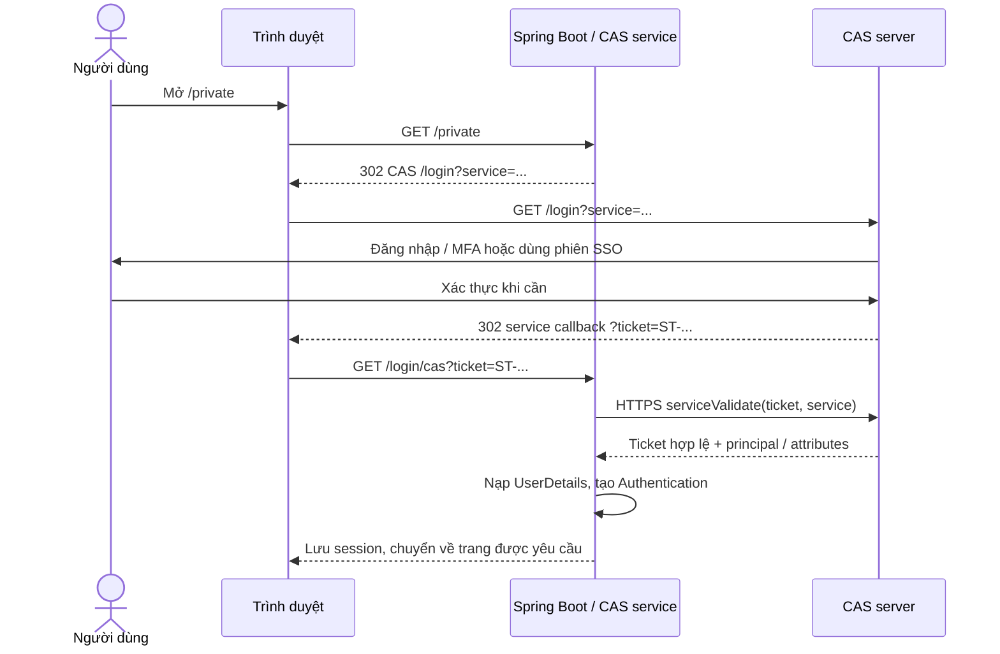

# Thiết lập spring-security-cas và thư viện CAS client tương thích Jakarta Servlet

## Mục tiêu học tập

Sau bài học, bạn có thể:

- Giải thích nhiệm vụ của `spring-security-cas` và Apereo `cas-client-core` trong ứng dụng Spring Boot **Servlet** dùng CAS SSO.
- Chọn dependency tương thích với **Jakarta Servlet** trên Spring Boot 3 / Spring Security 6, đồng bộ phiên bản và nhận diện lỗi do còn `javax.servlet.*`.
- Cấu hình `ServiceProperties`, `CasAuthenticationEntryPoint`, `CasAuthenticationFilter`, `CasAuthenticationProvider` và `Cas20ServiceTicketValidator` để xử lý một **service ticket**.
- Tạo phiên xác thực Spring Security sau khi CAS xác minh ticket, ánh xạ user/role và bảo vệ request tiếp theo.
- Kiểm thử luồng chuyển hướng, callback, ticket validation; phân biệt đăng xuất cục bộ với CAS Single Logout; tránh cấu hình hai filter xử lý cùng một ticket.

## 1. Bối cảnh: ứng dụng là CAS client, không phải CAS server

**Central Authentication Service (CAS)** là hệ thống Single Sign-On và tên của một giao thức xác thực. Một CAS server cung cấp trang đăng nhập tập trung, duy trì phiên SSO và phát hành **service ticket (ST)** cho ứng dụng đã được đăng ký. Ứng dụng là **CAS service/client**: nó chuyển trình duyệt tới CAS, nhận ticket tại callback và nhờ CAS server kiểm tra ticket.

Trong hệ sinh thái Spring có hai thành phần liên quan nhưng không đồng nhất:

| Thành phần | Artifact / package | Trách nhiệm |
| --- | --- | --- |
| Spring Security CAS integration | `org.springframework.security:spring-security-cas`, package `org.springframework.security.cas` | Đưa xác thực CAS vào `AuthenticationManager`, `SecurityFilterChain`, `SecurityContext` và phân quyền Spring Security |
| Apereo Java CAS Client Core | `org.apereo.cas.client:cas-client-core`, package `org.apereo.cas.client` | Cung cấp cơ chế giao thức CAS và `TicketValidator` như `Cas20ServiceTicketValidator`; cũng có servlet filters riêng |
| CAS server | Một dịch vụ SSO vận hành độc lập | Xác thực người dùng, quản lý phiên CAS, phát hành và xác minh service tickets |
| Ứng dụng Spring Boot | Service đã được đăng ký tại CAS | Quản lý phiên/role/quyền chức năng của chính ứng dụng |

**Không nhầm với OIDC/SAML:** một CAS server có thể hỗ trợ nhiều protocol, nhưng `spring-security-cas` tích hợp **CAS protocol**. Nếu hệ thống chọn OpenID Connect thì `oauth2Login()` là cơ chế khác; nếu chọn SAML 2.0 thì `saml2Login()` là cơ chế khác. Không cài ba cơ chế vào cùng callback chỉ vì cùng gọi là SSO.

### 1.1. Luồng CAS Service Ticket



CAS **service ticket** thường là chuỗi opaque, ngắn hạn, gắn với **service URL** cụ thể và không dùng lại sau khi xác minh. Nó không phải OAuth access token, OIDC ID token hay SAML assertion. Việc trình duyệt gửi `?ticket=...` chưa đủ để ứng dụng tin người dùng; **server phải validate ticket** với CAS và kiểm tra kết quả.

## 2. Rào cản Jakarta Servlet khi nâng cấp Spring Boot 3

Spring Framework 6, Spring Security 6 và Spring Boot 3 chuyển từ API Java EE `javax.servlet.*` sang Jakarta EE `jakarta.servlet.*`. Ví dụ:

```java
// Jakarta Servlet: dùng với Spring Boot 3 / Spring Security 6
import jakarta.servlet.Filter;
import jakarta.servlet.http.HttpServletRequest;
import jakarta.servlet.http.HttpServletResponse;
```

Một CAS filter cũ có thể được biên dịch với:

```java
// Java EE cũ: KHÔNG tương thích trực tiếp với Jakarta Servlet
import javax.servlet.Filter;
import javax.servlet.http.HttpServletRequest;
import javax.servlet.http.HttpServletResponse;
```

Đây là **hai kiểu Java khác nhau**: dù tên `Filter` giống nhau, một instance của `javax.servlet.Filter` không trở thành `jakarta.servlet.Filter` chỉ vì bạn thêm dependency servlet-api mới. Cần thay bằng **artifact được biên dịch cho Jakarta** và đồng bộ các dependency liên quan.

### 2.1. Ma trận lựa chọn

| Hạng mục | Định hướng cho dự án Spring Boot 3.x / Spring Security 6.x | Cách kiểm tra |
| --- | --- | --- |
| JDK | Java 17 trở lên; chọn version đúng với Boot của dự án | `java -version`, cấu hình toolchain |
| Web stack | Servlet MVC, không lấy WebFlux làm mẫu cho CAS Servlet | `spring-boot-starter-web`, servlet container do Boot quản lý |
| Spring CAS | `spring-security-cas` **cùng phiên bản** với các module Spring Security khác | Kiểm Gradle/Maven dependency tree và BOM |
| CAS Client Core | Nhánh Apereo **4.x** tương thích Jakarta Servlet | Artifact `org.apereo.cas.client:cas-client-core` và API/JAR thực tế |
| Mốc bản vá Apereo | **4.1.1** theo advisory về CAS client kiểm tra **JWT tickets** công bố ngày 27/05/2026 | Nếu triển khai xác minh JWT ticket, đánh giá ảnh hưởng và nâng bản đã được vá |
| Servlet API | `jakarta.servlet.*` | Không bổ sung `javax.servlet-api` để che lỗi namespace |

**Lưu ý:** `spring-security-cas` và `cas-client-core` có **hai hệ phiên bản độc lập**. Ví dụ `spring-security-cas` 6.x không có nghĩa CAS client phải là 6.x. Nên để Spring Boot BOM quản lý version của các module Spring Security và khai báo client core đã chọn bằng dependency/constraint rõ ràng.

Apereo công bố lỗ hổng vào tháng 5/2026 cho **trường hợp Java CAS client xác minh ticket được phát hành dưới dạng JWT** và khuyến cáo nâng lên client **4.1.1**. CAS service ticket opaque thông thường không tự đồng nghĩa với chế độ JWT ticket. Cần xác định giao thức/config thực tế khi đánh giá phạm vi ảnh hưởng. Dù không dùng JWT tickets, vẫn cần cập nhật bản vá và kiểm tra dependency tree theo chính sách dự án.

### 2.2. Tên lớp và artifact dễ nhầm

- `org.springframework.security.cas.web.CasAuthenticationFilter` là **Spring Security filter** xử lý callback CAS trong `SecurityFilterChain`.
- `org.springframework.security.cas.authentication.CasAuthenticationProvider` là provider kiểm tra ticket qua `TicketValidator`, rồi ánh xạ principal thành `Authentication`.
- `org.springframework.security.cas.web.CasAuthenticationEntryPoint` điều hướng người dùng chưa xác thực sang CAS login.
- `org.apereo.cas.client.validation.Cas20ServiceTicketValidator` là **Apereo client** dùng để kiểm tra CAS service ticket theo CAS 2 protocol.
- `org.apereo.cas.client.authentication.AuthenticationFilter` và các validation filters trong CAS client core là **bộ servlet filters riêng**. Chúng là một lối tích hợp khác; không nên thêm chồng lên Spring Security CAS filter tại cùng callback.
- Artifact `org.apereo.cas.client:cas-client` là **POM cha/aggregator**; dependency JAR core cần khai báo là `cas-client-core`.
- Các ví dụ cũ có `org.jasig.cas.client.*`, `javax.servlet.*` hay `WebSecurityConfigurerAdapter` cần được đánh giá lại, không copy nguyên vào Boot 3.

## 3. Cài dependency tương thích Jakarta

### 3.1. Gradle Groovy DSL

Trong một dự án **đã áp dụng** Spring Boot 3 plugin và cấu hình dependency management/BOM, phần `dependencies` của `build.gradle` có thể là:

```groovy
dependencies {
    implementation 'org.springframework.boot:spring-boot-starter-web'
    implementation 'org.springframework.boot:spring-boot-starter-security'

    implementation('org.springframework.security:spring-security-cas') {
        // Sử dụng version CAS client core đã thẩm định ở dưới.
        exclude group: 'org.apereo.cas.client', module: 'cas-client-core'
    }
    implementation 'org.apereo.cas.client:cas-client-core:4.1.1'

    testImplementation 'org.springframework.boot:spring-boot-starter-test'
    testImplementation 'org.springframework.security:spring-security-test'
}
```

Giải thích:

1. `spring-boot-starter-web` cung cấp runtime **Servlet**. Không trộn vào mẫu này một runtime WebFlux thuần.
2. `spring-boot-starter-security` và `spring-security-cas` tạo filter chain và các class CAS Spring; **BOM phải quản lý chúng thành một bộ version tương thích**.
3. `cas-client-core:4.1.1` được pin để làm rõ version client và đáp ứng mốc vá nêu trên. Khi dự án có dependency governance/constraints riêng, áp dụng cách quản lý version tương đương và kiểm tra build.
4. `exclude` trên dependency CAS tránh kéo thêm bản client core bắc cầu ngoài bản do dự án chủ động chọn. Không loại các class CAS client khỏi runtime hoàn toàn vì `Cas20ServiceTicketValidator` vẫn cần thiết.
5. `jakarta.servlet-api` thường được starter/container quản lý; không thêm `javax.servlet-api` hoặc ép servlet-api version không khớp container chỉ để thử khắc phục lỗi.

Nếu Spring Boot BOM của dự án không quản lý `spring-security-cas`, hãy quản lý một **Spring Security BOM** cùng dòng version được hỗ trợ; không nhập tay một version `spring-security-cas` khác với `spring-security-web`/`core`.

### 3.2. Maven

Trong dự án Maven **đã cấu hình Spring Boot parent/BOM**, dependencies tương ứng:

```xml
<dependencies>
    <dependency>
        <groupId>org.springframework.boot</groupId>
        <artifactId>spring-boot-starter-web</artifactId>
    </dependency>
    <dependency>
        <groupId>org.springframework.boot</groupId>
        <artifactId>spring-boot-starter-security</artifactId>
    </dependency>
    <dependency>
        <groupId>org.springframework.security</groupId>
        <artifactId>spring-security-cas</artifactId>
        <exclusions>
            <exclusion>
                <groupId>org.apereo.cas.client</groupId>
                <artifactId>cas-client-core</artifactId>
            </exclusion>
        </exclusions>
    </dependency>
    <dependency>
        <groupId>org.apereo.cas.client</groupId>
        <artifactId>cas-client-core</artifactId>
        <version>4.1.1</version>
    </dependency>
</dependencies>
```

### 3.3. Đọc dependency tree trước khi chạy

```bash
./gradlew dependencyInsight --configuration runtimeClasspath --dependency spring-security-cas
./gradlew dependencyInsight --configuration runtimeClasspath --dependency cas-client-core
./gradlew dependencies --configuration runtimeClasspath
./gradlew compileJava
```

Trên Windows, có thể dùng `.\gradlew.bat` thay cho `./gradlew`. Với Maven dùng `mvn dependency:tree`.

Đầu ra phụ thuộc dự án, nên không có stdout cố định. Điểm cần xác minh: `spring-security-core`, `spring-security-web` và `spring-security-cas` cùng một bộ version; CAS client core resolve đúng artifact/phiên bản; servlet filter thực tế không còn phụ thuộc namespace `javax.servlet` cũ; không có hai đường đăng ký CAS callback trùng nhau. Khi sử dụng starter bên thứ ba, cần đọc dependency transitive thực tế của starter.

## 4. Cấu hình CAS server và service URL

Giả sử hệ thống sử dụng:

| Thuộc tính | URL ví dụ |
| --- | --- |
| CAS server base | `https://sso.example.org/cas` |
| CAS login | `https://sso.example.org/cas/login` |
| Ứng dụng public base | `https://portal.example.org` |
| **Service callback** | `https://portal.example.org/login/cas` |
| Spring filter callback path | `/login/cas` |

CAS server phải **đăng ký/cho phép service** tại `https://portal.example.org/login/cas`. Khi Spring Security yêu cầu xác thực, `CasAuthenticationEntryPoint` gửi người dùng tới CAS login với tham số `service`. Sau đó CAS redirect về **service URL đó** kèm `ticket`. Khi ticket được validate, client phải dùng service tương ứng; CAS có thể từ chối nếu scheme, host, path hoặc các phần quan trọng khác sai.

Ví dụ ba vị trí phải thống nhất:

- `ServiceProperties.service = "https://portal.example.org/login/cas"`
- `CasAuthenticationFilter.setFilterProcessesUrl("/login/cas")`
- CAS server service registry chấp nhận `https://portal.example.org/login/cas`

**Reverse proxy/ingress:** nếu Tomcat chạy nội bộ tại `http://app:8080` nhưng browser đi qua `https://portal.example.org` thì CAS service URL phải thể hiện **địa chỉ công khai** đã đăng ký. Chỉ tin forwarded headers từ proxy do bạn kiểm soát; đừng tự quyết định callback URL từ header `Host` do người dùng tùy ý gửi. Kiểm tra context path, port, trailing slash và URL encoding. Dùng HTTPS tin cậy từ ứng dụng tới CAS validation endpoint.

## 5. Ví dụ Spring Boot 3 + Spring Security 6 với CAS service tickets

Ví dụ có cấu trúc:

```text
src/main/java/com/example/cas/
    CasDemoApplication.java
    CasSecurityConfiguration.java
    DemoController.java
src/main/resources/
    application.yml
```

Đây là **một ứng dụng Spring Boot Servlet**, cần dependencies tại mục 3, Java 17+ và CAS server được cấu hình thực tế. Không thể biên dịch từng class riêng chỉ bằng `javac` không có Spring dependencies. Mã hướng đến cách lắp Spring Security 6 bằng `SecurityFilterChain`; URL host ví dụ không phải CAS server đang chạy.

### 5.1. `application.yml`

```yaml
app:
  cas:
    server-base-url: https://sso.example.org/cas
    service-url: https://portal.example.org/login/cas

server:
  servlet:
    session:
      cookie:
        http-only: true
        secure: true
```

Với môi trường local chưa có HTTPS public callback và CAS server đăng ký tương ứng, chỉ kiểm được build/wiring; đăng nhập SSO cần môi trường tích hợp thật. Trong production, URL và truststore/certificate nên thuộc cấu hình môi trường quản lý tập trung.

### 5.2. Lớp khởi động

```java
package com.example.cas;

import org.springframework.boot.SpringApplication;
import org.springframework.boot.autoconfigure.SpringBootApplication;

@SpringBootApplication
public class CasDemoApplication {
    public static void main(String[] args) {
        SpringApplication.run(CasDemoApplication.class, args);
    }
}
```

Lưu thành `CasDemoApplication.java`. Đây là entry point tiêu chuẩn; không có output xác định trước vì log phụ thuộc Boot profile, servlet container và môi trường.

### 5.3. Cấu hình CAS Spring Security

```java
package com.example.cas;

import org.apereo.cas.client.validation.Cas20ServiceTicketValidator;
import org.springframework.beans.factory.annotation.Value;
import org.springframework.context.annotation.Bean;
import org.springframework.context.annotation.Configuration;
import org.springframework.security.authentication.ProviderManager;
import org.springframework.security.cas.ServiceProperties;
import org.springframework.security.cas.authentication.CasAuthenticationProvider;
import org.springframework.security.cas.web.CasAuthenticationEntryPoint;
import org.springframework.security.cas.web.CasAuthenticationFilter;
import org.springframework.security.config.annotation.web.builders.HttpSecurity;
import org.springframework.security.core.userdetails.User;
import org.springframework.security.core.userdetails.UserDetailsService;
import org.springframework.security.provisioning.InMemoryUserDetailsManager;
import org.springframework.security.web.SecurityFilterChain;
import org.springframework.security.web.authentication.session.ChangeSessionIdAuthenticationStrategy;
import org.springframework.security.web.context.HttpSessionSecurityContextRepository;

@Configuration
public class CasSecurityConfiguration {

    @Bean
    ServiceProperties serviceProperties(
            @Value("${app.cas.service-url}") String serviceUrl) {
        ServiceProperties properties = new ServiceProperties();
        properties.setService(serviceUrl);
        properties.setSendRenew(false);
        return properties;
    }

    @Bean
    CasAuthenticationEntryPoint casEntryPoint(
            ServiceProperties serviceProperties,
            @Value("${app.cas.server-base-url}") String casBase) {
        CasAuthenticationEntryPoint entryPoint = new CasAuthenticationEntryPoint();
        entryPoint.setServiceProperties(serviceProperties);
        entryPoint.setLoginUrl(casBase + "/login");
        return entryPoint;
    }

    @Bean
    CasAuthenticationProvider casProvider(
            ServiceProperties serviceProperties,
            UserDetailsService userDetailsService,
            @Value("${app.cas.server-base-url}") String casBase) {
        CasAuthenticationProvider provider = new CasAuthenticationProvider();
        provider.setServiceProperties(serviceProperties);
        provider.setTicketValidator(new Cas20ServiceTicketValidator(casBase));
        provider.setUserDetailsService(userDetailsService);
        provider.setKey("portal-cas-provider");
        return provider;
    }

    @Bean
    SecurityFilterChain securityFilterChain(
            HttpSecurity http,
            ServiceProperties serviceProperties,
            CasAuthenticationEntryPoint entryPoint,
            CasAuthenticationProvider provider) throws Exception {

        HttpSessionSecurityContextRepository repository =
                new HttpSessionSecurityContextRepository();

        // Filter thuộc Spring Security chain, không thêm @Bean Filter trùng.
        CasAuthenticationFilter casFilter = new CasAuthenticationFilter();
        casFilter.setFilterProcessesUrl("/login/cas");
        casFilter.setServiceProperties(serviceProperties);
        casFilter.setAuthenticationManager(new ProviderManager(provider));
        casFilter.setSecurityContextRepository(repository);
        casFilter.setSessionAuthenticationStrategy(
                new ChangeSessionIdAuthenticationStrategy());

        return http
                .authorizeHttpRequests(auth -> auth
                        .requestMatchers("/", "/error").permitAll()
                        .anyRequest().authenticated())
                .exceptionHandling(ex -> ex.authenticationEntryPoint(entryPoint))
                .securityContext(sc -> sc.securityContextRepository(repository))
                .authenticationProvider(provider)
                .addFilterAt(casFilter, CasAuthenticationFilter.class)
                .build();
    }

    @Bean
    UserDetailsService users() {
        // Demo: tài khoản cục bộ được CAS xác nhận bằng principal "alice".
        // Password placeholder không dùng để xác thực CAS.
        return new InMemoryUserDetailsManager(
                User.withUsername("alice")
                        .password("{noop}not-used-for-cas")
                        .roles("READER")
                        .build());
    }
}
```

Lưu thành `CasSecurityConfiguration.java`. Tên package `com.example.cas` phải khớp thư mục Java và cùng phạm vi package scanning của `@SpringBootApplication`.

Giải thích từng mắt xích:

1. **`ServiceProperties`:** lưu `service` URL. `sendRenew(false)` cho phép CAS tái sử dụng phiên SSO hiện có; khi nghiệp vụ đòi xác thực mới, thiết lập `renew` phù hợp với chính sách CAS.
2. **`CasAuthenticationEntryPoint`:** khi request chưa được xác thực, `ExceptionTranslationFilter` gọi entry point để redirect trình duyệt tới CAS login endpoint.
3. **`CasAuthenticationFilter`:** lắng nghe callback `/login/cas`, lấy `ticket` và tạo yêu cầu xác thực đưa tới `AuthenticationManager`.
4. **`CasAuthenticationProvider`:** dùng `Cas20ServiceTicketValidator` hỏi CAS server ticket có hợp lệ với service hay không; nhận principal rồi nạp tài khoản/authorities của ứng dụng qua `UserDetailsService`. Không xử lý mật khẩu CAS trong ứng dụng.
5. **`ProviderManager`:** chứa provider có khả năng xác minh service ticket. Trong hệ thống nhiều authentication mechanisms, cần đảm bảo manager/provider của filter khớp kiến trúc chung.
6. **`HttpSessionSecurityContextRepository`:** lưu `SecurityContext` sau callback để các request sau nhận biết phiên đăng nhập. Với Spring Security 6, filter xác thực tùy chỉnh không nên chỉ dựa vào việc `SecurityContextHolder` được set trong một request.
7. **`ChangeSessionIdAuthenticationStrategy`:** thay session ID sau đăng nhập để hạn chế session fixation. Kiểm tra cả chính sách session concurrency/timeout của sản phẩm.
8. **`addFilterAt`:** đưa CAS filter vào đúng vị trí trong Spring Security filter chain. Việc tạo filter **trong method** tránh Spring Boot tự đăng ký bean filter ấy lần thứ hai ngoài filter chain.
9. **`.authenticationProvider(provider)`:** khai báo provider ở cấu hình chain, trong khi filter cũng được cấp manager chứa provider để không dựa vào một manager tự suy đoán.
10. **CSRF:** cấu hình không tắt CSRF toàn cục. Callback CAS service ticket ví dụ là GET, còn các phương thức thay đổi trạng thái vẫn được bảo vệ theo mặc định.

**Chú ý production:** `InMemoryUserDetailsManager` và `{noop}` chỉ để minh họa mapping sau khi CAS đã xác thực. Không dùng tài khoản demo làm cơ sở phân quyền thật. Với production, tra cứu user, trạng thái khóa, tenant, vai trò và mapping chính thức; không cấp quyền quản trị tự động cho mọi CAS principal.

### 5.4. Controller minh họa

```java
package com.example.cas;

import org.springframework.security.core.Authentication;
import org.springframework.web.bind.annotation.GetMapping;
import org.springframework.web.bind.annotation.RestController;

@RestController
public class DemoController {
    @GetMapping("/")
    String home() {
        return "Public endpoint";
    }

    @GetMapping("/private")
    String privatePage(Authentication authentication) {
        return "Signed in as " + authentication.getName();
    }
}
```

Lưu thành `DemoController.java`.

Khi CAS server xác thực người dùng `alice`, trả service ticket hợp lệ và ứng dụng có mapping `alice`, `GET /private` sẽ hiển thị:

```text
Signed in as alice
```

Đây là **kết quả HTTP dự kiến khi môi trường được tích hợp đầy đủ**, không phải stdout của chương trình chạy độc lập. Nếu CAS chưa cấu hình, không thể giả định luồng đăng nhập đã chạy thành công chỉ dựa vào `compileJava`.

### 5.5. Lựa chọn Java DSL so với tài liệu CAS cũ

Một số tài liệu Spring Security CAS vẫn minh họa **XML namespace**, vì tích hợp này tồn tại từ các thế hệ Spring Security cũ. Mục tiêu của Java DSL là ánh xạ đúng các bean/vai trò, không phải sao chép `WebSecurityConfigurerAdapter` (đã được thay thế trong dự án hiện đại). Đối chiếu tên class/setter với Java API của phiên bản đang dùng và xây dựng `SecurityFilterChain` tường minh.

Nếu ứng dụng có **nhiều `SecurityFilterChain`**, cần bảo đảm callback `/login/cas` thuộc chain có CAS filter, còn tài nguyên được bảo vệ dùng đúng entry point. Một `securityMatcher` quá hẹp có thể khiến callback không hề đi qua CAS filter.

## 6. Chọn giữa Spring Security CAS và servlet filters của Apereo

Apereo Java CAS Client có những bộ filter dành cho ứng dụng Servlet không sử dụng Spring Security làm lớp xác thực chính. Chẳng hạn `org.apereo.cas.client.authentication.AuthenticationFilter` có thể chuyển hướng sang CAS, các ticket validation filters có thể xử lý response theo cấu hình CAS client.

| Cách tích hợp | Lớp đảm nhiệm đăng nhập | Nơi giữ trạng thái xác thực | Phân quyền |
| --- | --- | --- | --- |
| **Spring Security CAS** | `CasAuthenticationEntryPoint`, `CasAuthenticationFilter`, `CasAuthenticationProvider` | `SecurityContextRepository` và Spring session strategy | `authorizeHttpRequests`, authorities, method security |
| **CAS client Servlet filters trực tiếp** | Filter authentication và ticket validation của Apereo | Servlet request/session và assertion theo client library | Ứng dụng phải tích hợp cơ chế phân quyền phù hợp |
| **OIDC/SAML qua CAS server** | `oauth2Login()` hoặc `saml2Login()` theo đúng protocol đã chọn | Cơ chế của OIDC/SAML integration | Phân quyền Spring Security sau authentication |

Không đăng ký nguyên bộ filters Apereo **và** Spring CAS filter để cùng xử lý `/login/cas`. Một service ticket có thể bị validate/consume hai lần hoặc một filter hoàn tất redirect nhưng filter khác không lưu được `SecurityContext`.

Apereo client 4.x dùng Jakarta Servlet còn giúp các filter độc lập chạy trong servlet container Jakarta; tuy nhiên **có mặt trong classpath không có nghĩa bạn bắt buộc phải đăng ký chúng**. Với mẫu `spring-security-cas` ở mục 5, cần `Cas20ServiceTicketValidator` từ client core, không thêm bộ filter Apereo song song.

### 6.1. Authentication và authorization phải tách bạch

CAS có thể xác thực user `alice`, nhưng Spring Security vẫn phải quyết định user đó được truy cập API hay nghiệp vụ nào:

| Bước | Ai chịu trách nhiệm? |
| --- | --- |
| Người dùng nhập mật khẩu/MFA | CAS server |
| Kiểm tra ST có đúng service | CAS server, qua lời gọi của `TicketValidator` |
| Ánh xạ `alice` tới tài khoản ứng dụng | `UserDetailsService`/logic account linking |
| Gán `ROLE_READER`/`ROLE_ADMIN` theo chính sách | Ứng dụng |
| Chặn `/admin` khi thiếu role | Spring Security authorization |
| Tạo, hủy và gia hạn session app | Ứng dụng và session framework |

CAS login thành công **không có nghĩa** tất cả người dùng đều có `ROLE_ADMIN`. Nếu CAS principal không tồn tại trong kho user cục bộ, ứng dụng có thể từ chối đăng nhập hoặc kích hoạt quy trình provisioning theo chính sách.

## 7. Phiên đăng nhập, Single Logout và proxy tickets

### 7.1. Hai phiên cần hiểu

- **CAS SSO session:** do CAS server quản lý; có thể giúp người dùng đăng nhập nhiều ứng dụng mà không nhập lại mật khẩu.
- **Application session:** do ứng dụng quản lý qua cookie/session và `SecurityContextRepository`. Hết hạn app session không nhất thiết làm CAS session hết hạn.

Logout cục bộ `/logout` của Spring Security thường chỉ xóa trạng thái của ứng dụng. **CAS Single Logout (SLO)** phải được thiết kế bổ sung: cơ chế thông báo logout từ CAS tới các dịch vụ, xử lý session invalidation, endpoint/filter/listener tương ứng và tác động khi triển khai nhiều node.

Apereo CAS client có `SingleSignOutFilter` cùng các thành phần hỗ trợ. Không tự động lắp nó như filter authentication thứ hai; cần đối chiếu phương thức logout, vị trí filter, các callback và session mapping cho version được chọn. Một browser logout thành công không đảm bảo mọi dịch vụ khác lập tức bị đăng xuất nếu chưa có SLO hoạt động.

### 7.2. Service ticket khác proxy ticket

- **Service ticket (ST):** cấp cho một service đã đăng ký, thường được xác minh một lần để đăng nhập web app.
- **Proxy-granting ticket (PGT):** service nhận được trong flow proxy thích hợp để xin proxy tickets.
- **Proxy ticket (PT):** cho phép một service đại diện user gọi service khác theo mô hình CAS proxy.

Mã mục 5 dùng `Cas20ServiceTicketValidator` cho **service ticket** và không hỗ trợ proxy ticket một cách mặc nhiên. Khi cần proxy, phải cấu hình `Cas20ProxyTicketValidator`, proxy callback, proxy-granting ticket storage, trusted proxy policy và tương quan các request. Không dùng `acceptAnyProxy` như một cách bỏ qua lỗi xác minh.

### 7.3. Service ticket opaque khác JWT ticket

Thông báo Apereo tháng 5/2026 liên quan **CAS client validate tickets được phát hành dưới dạng JWT**. Đừng suy rằng mọi `ST-...` đều là JWT, hoặc tự parse/verify theo OIDC. Xác định CAS protocol/ticket format thực tế trước khi lựa chọn validator và đánh giá bản vá. Nếu dùng JWT ticket validation, phải xét thông báo và nâng client core theo khuyến nghị.

## 8. Kiểm thử từ dependency đến SSO end-to-end

Một quy trình kiểm thử có thể làm theo thứ tự:

1. **Build graph:** chạy `dependencyInsight`, xác minh Spring CAS + client core Jakarta; đảm bảo không dùng Java EE servlet filter cũ.
2. **Compile:** chạy `./gradlew compileJava` hoặc `./gradlew test` trên dự án đã có CAS dependencies. Nếu có lỗi import, kiểm tra tên class và API đúng theo phiên bản thực, không đổi namespace một cách máy móc.
3. **CAS service registry:** đăng ký callback công khai `https://portal.example.org/login/cas`, bảo đảm CAS chấp nhận đúng scheme/host/path.
4. **Redirect chưa đăng nhập:** mở `/private` trong trình duyệt chưa có app session, kỳ vọng redirect tới `CAS /login` kèm `service` URL chính xác.
5. **CAS callback:** đăng nhập CAS; ticket phải quay lại `/login/cas?ticket=...` đúng chain và đúng host.
6. **Validation:** quan sát server-side request tới `/cas/serviceValidate`; kết quả hợp lệ và principal ánh xạ được sang tài khoản ứng dụng.
7. **Session:** refresh `/private`; request sau phải dùng app session, không cần validate lại service ticket cũ.
8. **Negative tests:** ticket giả/hết hạn/đã dùng, `service` bị thay, tài khoản không tồn tại, user thiếu role, CAS server tạm không sẵn sàng. Không trường hợp nào được cho qua authentication nếu ticket không hợp lệ.
9. **Logout:** kiểm riêng logout cục bộ, SLO nếu triển khai và hành vi khi nhiều app cùng dùng CAS.

Lệnh minh họa:

```bash
./gradlew compileJava
./gradlew test
./gradlew bootRun
curl -I https://portal.example.org/private
```

Khi chưa đăng nhập, `curl -I` có thể nhận `302` cùng `Location` trỏ về CAS. Vì HEAD request có thể được proxy/controller xử lý khác GET, nên xác minh bằng trình duyệt thực tế đối với luồng SSO. Chạy được các lệnh trên **không đồng nghĩa** đã kiểm thử toàn bộ đăng nhập khi CAS server chưa tồn tại.

## 9. Xử lý sự cố thường gặp

| Triệu chứng | Lý do có thể | Kiểm tra/khắc phục |
| --- | --- | --- |
| `NoClassDefFoundError: javax/servlet/Filter` | Thư viện/filter cũ dùng Java EE | Xem `dependencyInsight`, nâng CAS client Jakarta, bỏ filter javax cũ |
| `ClassCastException` giữa hai loại `Filter` | Trộn javax và jakarta | Chỉ dùng filter và container cùng namespace Jakarta |
| `NoSuchMethodError` ở CAS client/Spring Security | Dependency transitive bị kéo lệch version | Đồng bộ Spring BOM; kiểm JAR core/ABI; xây dựng lại dependency graph |
| Không redirect tới CAS | Entry point chưa nối, URL chưa bảo vệ hoặc chain khác xử lý | Kiểm `ExceptionTranslationFilter`, `authorizeHttpRequests`, `SecurityFilterChain` |
| CAS trả “invalid service” | CAS service registry không khớp URL | So sánh `ServiceProperties.service`, URL được đưa qua `service` và service registry |
| Ticket bị từ chối | Ticket quá hạn/đã sử dụng hoặc validate với service khác | Kiểm callback, host/proxy và kiểm soát chỉ validate ticket một lần |
| Redirect loop về CAS | Không lưu auth, callback không qua CAS filter, cookie session không quay về | Kiểm `HttpSessionSecurityContextRepository`, chain matcher, cookie và proxy |
| Callback 404 hoặc không qua filter | `/login/cas` bị rewrite, đường filter không khớp | So sánh `setFilterProcessesUrl` và URL public callback |
| CAS xác thực xong nhưng 403 | Thiếu authority hoặc rule ứng dụng từ chối | Kiểm `UserDetailsService`, `GrantedAuthority` và `hasRole` |
| User CAS hợp lệ nhưng không vào app | Không có tài khoản cục bộ / mapping sai | Kiểm principal string, tenant và quy trình đăng ký/đồng bộ user |
| CAS ticket được xử lý hai lần | Có đồng thời Apereo validation filter và Spring filter | Dùng một cơ chế authentication cho callback |
| Request tiếp theo mất đăng nhập | Auth không được lưu session hoặc LB mất session | Kiểm `SecurityContextRepository`, session affinity/store, cookie |
| Lỗi TLS khi ticket validate | JVM không tin CA hoặc hostname cert sai | Cấu hình truststore/CA đúng; không tắt certificate validation |
| Logout ở app mà còn SSO | App logout không xóa CAS session | Triển khai/kiểm thử CAS SLO theo yêu cầu |
| Lo lắng về JWT ticket CVE | Client core chưa vá ở deployment dùng JWT tickets | Đối chiếu Apereo advisory 27/05/2026; nâng client core 4.1.1 |

**Quy tắc debug:** log đường đi và lỗi theo mức hợp lý, nhưng không ghi công khai service ticket, cookie session, mật khẩu hoặc assertions chứa dữ liệu nhạy cảm. Ticket có thể nằm trong URL callback nên cần chú ý web access logs, analytics và telemetry.

## 10. Checklist khi đưa vào vận hành

- CAS URL, service callback và registry dùng **HTTPS**, kiểm chứng chứng thư từ JVM tới CAS.
- Dependency tree rõ ràng; Spring Security modules cùng BOM; `cas-client-core` phiên bản Jakarta phù hợp và đã xét advisory.
- CAS callback được xử lý bởi đúng **một filter chain**, không trùng servlet filter.
- Ticket được validate trên server bằng protocol chính xác; không chấp nhận giá trị `ticket` từ query chỉ vì có tiền tố `ST-`.
- Cấu hình `SecurityContextRepository`, session fixation protection, thời gian timeout, cookie `Secure`/`HttpOnly`/`SameSite` phù hợp.
- CSRF cho các thao tác thay đổi trạng thái vẫn được bật và kiểm chứng.
- Có user mapping/authorization rõ ràng; không tự gán quyền admin từ thuộc tính không đáng tin.
- Có xử lý CAS không sẵn sàng, timeout, lỗi xác minh, session còn hiệu lực, logout từng thành phần.
- CAS SLO/proxy tickets chỉ được bật nếu có yêu cầu và bộ kiểm thử riêng.
- Khi nâng Boot/Security/CAS client hoặc chuyển Tomcat/container, chạy lại kiểm tra classpath, callback, ticket validation và SSO end-to-end.

## 11. Câu hỏi tự kiểm tra

**1. Vì sao `spring-security-cas` và `cas-client-core` đều xuất hiện trong dependency?**

Module Spring Security cung cấp entry point/filter/provider và tích hợp với `SecurityContext`. Apereo client core cung cấp các loại ticket validator và xử lý giao thức CAS mà provider sử dụng.

**2. Tại sao không thể dùng nguyên thư viện CAS filter `javax.servlet` cũ trên Boot 3?**

Vì Spring Boot 3 dùng `jakarta.servlet`; hai package không tương thích ở cấp kiểu Java/bytecode. Cần thư viện Jakarta tương thích, không thể sửa bằng cách thêm cả hai servlet APIs.

**3. `ServiceProperties.service` là `https://portal.example.org/login/cas` nhưng CAS server chỉ cho phép `http://localhost:8080/login/cas`. Kết quả?**

CAS có thể không cấp/không xác minh ticket do không khớp service đã đăng ký. Phải thống nhất callback công khai và cấu hình registry/proxy tin cậy.

**4. CAS đã xác thực `alice`, nhưng `/admin` trả 403. Đây có phải lỗi CAS?**

Không nhất thiết. CAS xác thực danh tính, còn ứng dụng kiểm tra authorization. Thiếu `ROLE_ADMIN` là lý do hợp lệ để trả 403.

**5. Vì sao phải lưu `SecurityContext` sau callback?**

Nếu chỉ xác thực trong request chứa ticket mà không lưu vào session/repository, request tiếp theo có thể quay lại trạng thái chưa đăng nhập và gây vòng redirect.

**6. Vì sao không bật đồng thời Apereo authentication/validation servlet filters và `CasAuthenticationFilter` trên cùng callback?**

Chúng có thể cùng đọc/validate ticket, quản lý phiên khác nhau và làm đăng nhập thất bại. Chọn một cơ chế điều phối xác thực chính.

**7. Advisory Apereo tháng 5/2026 nhấn mạnh trường hợp nào?**

Các deployment CAS Java client được cấu hình **xác minh ticket dạng JWT**. Phải đánh giá bản client thực sự đang chạy và nâng lên **4.1.1** theo khuyến cáo khi thuộc phạm vi.

## Ghi nhớ

Trong Spring Boot 3 / Spring Security 6, tích hợp CAS đúng nghĩa là ghép **Spring Security CAS filter/provider** với **Apereo CAS client core có hỗ trợ Jakarta Servlet**, sau đó cấu hình chính xác CAS `service` URL và luồng xác minh ST. Spring Security lưu phiên và thực thi phân quyền; CAS server chịu trách nhiệm xác thực danh tính ban đầu. Kiểm dependency tree, tránh javax/jakarta mix và cấu hình trùng filter trước khi điều tra lỗi SSO.

### Tài liệu tham khảo

- [Spring Security – CAS Authentication](https://docs.spring.io/spring-security/reference/servlet/authentication/cas.html)
- [Spring Security – CAS Module Dependencies](https://docs.spring.io/spring-security/reference/6.5/modules.html)
- [Spring Security – CasAuthenticationFilter API](https://docs.spring.io/spring-security/site/docs/6.3.5/api/org/springframework/security/cas/web/CasAuthenticationFilter.html)
- [Spring Security – CasAuthenticationProvider API](https://docs.spring.io/spring-security/site/docs/6.3.5/api/org/springframework/security/cas/authentication/CasAuthenticationProvider.html)
- [Apereo Java CAS Client](https://github.com/apereo/java-cas-client)
- [Maven Central – cas-client-core 4.1.1](https://central.sonatype.com/artifact/org.apereo.cas.client/cas-client-core/4.1.1)
- [Apereo advisory – Java CAS Client JWT Vulnerability Disclosure, 27/05/2026](https://www.apereo.org/news/2026/java-cas-client-jwt-vulnerability-disclosure)
