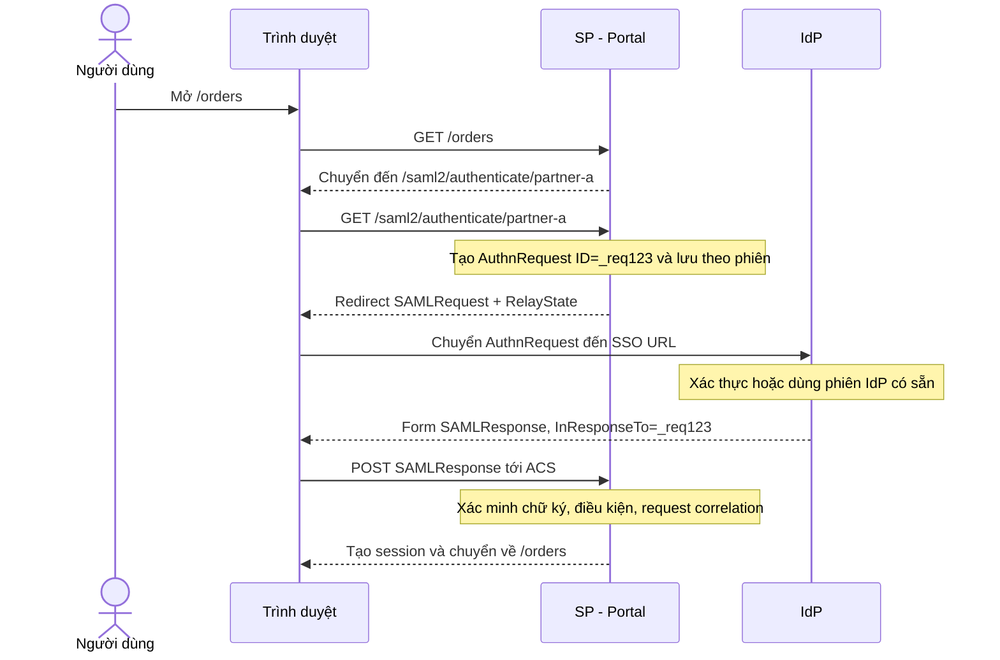
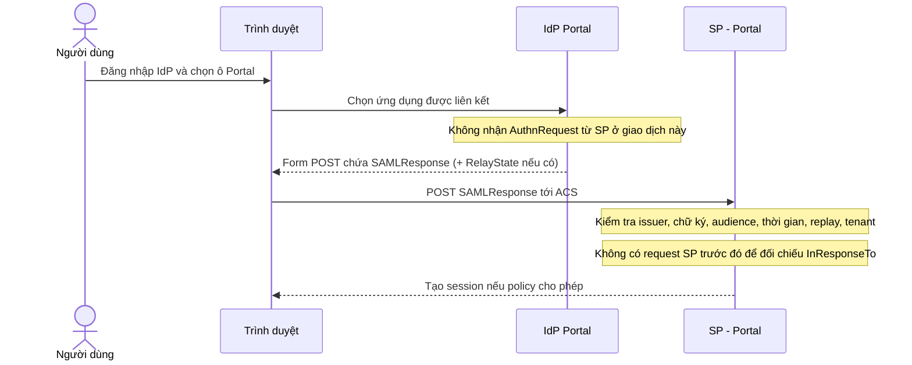

# Phân biệt đăng nhập do Service Provider khởi tạo và do Identity Provider khởi tạo

**Chủ đề:** Spring Security – federation / Mô hình SAML2.

Trong SAML 2.0 Web Browser Single Sign-On (SSO), người dùng có thể bắt đầu đăng nhập từ **ứng dụng cần truy cập (Service Provider, SP)** hoặc từ **cổng danh tính (Identity Provider, IdP)**. Hai trường hợp cùng sử dụng SAML Response/Assertion để thiết lập danh tính tại SP, nhưng **khác điểm xuất phát, sự hiện diện của `AuthnRequest`, khả năng tương quan yêu cầu–phản hồi bằng `InResponseTo`, quản lý trạng thái trình duyệt và bề mặt tấn công**.

Bài học tập trung vào luồng Web Browser SSO thông thường, nơi SP là ứng dụng Spring Security Servlet. SAML không phải OAuth2/OIDC; những tên như `AuthnRequest`, `SAMLResponse`, `RelayState`, `ACS` không tương đương một-một với `state`, authorization code hay ID Token của OIDC.

## 1. Khái niệm và các bên tham gia

| Thành phần | Vai trò |
| --- | --- |
| **Service Provider (SP)** / Relying Party | Ứng dụng cần người dùng đăng nhập; nhận, xác minh assertion và tạo phiên đăng nhập riêng của ứng dụng |
| **Identity Provider (IdP)** / Asserting Party | Hệ thống xác thực người dùng (mật khẩu, MFA, Kerberos, passkey...) và phát hành SAML Response/Assertion cho SP |
| **Browser (user agent)** | Chuyển hướng người dùng, mang `SAMLRequest` hoặc `SAMLResponse` qua HTTP Redirect/POST binding |
| **AuthnRequest** | Thông điệp yêu cầu xác thực do SP tạo; thường có `ID`, `Issuer`, `Destination`, `AssertionConsumerServiceURL`, các yêu cầu về ngữ cảnh xác thực tùy chọn |
| **SAML Response** | Thông điệp IdP gửi về SP; thường chứa một hoặc nhiều `Assertion`, trạng thái xử lý và metadata xác thực liên quan |
| **Assertion** | Chứa danh tính người dùng, phương thức/thời điểm xác thực và các điều kiện sử dụng; có thể chứa `NameID` và `AttributeStatement` |
| **ACS (Assertion Consumer Service)** | Endpoint tại SP nhận phản hồi SAML, thường là HTTP POST từ trình duyệt |
| **InResponseTo** | Thuộc tính liên hệ response hoặc bearer `SubjectConfirmationData` với `ID` của `AuthnRequest` mà SP đã gửi trước đó |
| **RelayState** | Trạng thái được chuyển kèm thông điệp qua binding; thường phục vụ quay về tài nguyên ban đầu nhưng **không tự chứng minh danh tính hay tính hợp lệ của phiên** |
| **RelyingPartyRegistration** | Cấu hình Spring Security ánh xạ một SP với IdP tin cậy: issuer/entity ID, SSO URL, chứng chỉ xác minh, ACS và khóa liên quan |

Ví dụ giả định:

- SP: `https://portal.example.com` — ứng dụng nghiệp vụ Spring Boot.
- IdP: `https://login.partner.example` — hệ thống danh tính của đối tác.
- Registration ID trong Spring Security: `partner-a`.
- ACS mặc định của SP: `https://portal.example.com/login/saml2/sso/partner-a`.
- Endpoint tạo yêu cầu xác thực tại SP: `https://portal.example.com/saml2/authenticate/partner-a`.

Các hostname chỉ để minh họa. Trong triển khai thật, entity ID và endpoint phải khớp metadata, TLS/host và cấu hình của từng đối tác.

**Điều cốt lõi:** hai luồng trả về cùng loại **SAML Response**, nhưng chỉ có **SP-initiated** là SP chắc chắn đã khởi tạo một yêu cầu trước đó và có cơ sở ghép response với yêu cầu ấy. Một SAML Response có chữ ký hợp lệ chưa cho biết trình duyệt hiện tại có chủ ý khởi động phiên đăng nhập hay chưa.

## 2. SP-initiated SSO — ứng dụng khởi tạo đăng nhập

### 2.1. Diễn tiến chuẩn

1. Người dùng mở một URL cần bảo vệ, ví dụ `GET https://portal.example.com/orders`. SP phát hiện chưa có phiên đã xác thực.
2. SP quyết định IdP nào được dùng (có thể từ tenant hoặc trang chọn IdP), tạo một `<samlp:AuthnRequest>` với ID mới và lưu yêu cầu tương ứng trong trạng thái phiên hoặc repository đáng tin cậy. SP có thể lưu đích cần quay về trong `SavedRequest` hoặc trạng thái liên quan.
3. Trình duyệt được chuyển đến endpoint Single Sign-On của IdP bằng HTTP Redirect binding; một số cấu hình IdP sử dụng HTTP POST binding. Với Redirect thường thấy tham số `SAMLRequest` và `RelayState` trong URL.
4. IdP kiểm tra `AuthnRequest`, xác thực người dùng hoặc sử dụng phiên IdP còn hiệu lực, sau đó phát hành `<samlp:Response>` và assertion được ký theo hợp đồng federation.
5. Trình duyệt POST `SAMLResponse` đến ACS của SP. Phản hồi theo yêu cầu **thường có `InResponseTo="_req..."` khớp với ID request đã phát hành**.
6. SP lấy yêu cầu đã lưu, kiểm chứng ràng buộc yêu cầu–phản hồi, chữ ký, issuer, recipient/destination, audience, thời gian, subject confirmation và các điều kiện khác; sau đó mới tạo phiên ứng dụng.
7. Người dùng được trả về URL được bảo vệ nếu URL đó an toàn và thuộc ứng dụng. Từ thời điểm này, **SP quản lý session và authorization**, dù IdP đã xác thực danh tính.



**Điểm nhận diện trong network trace:** trước `POST /login/saml2/sso/partner-a` có request từ SP đến `/saml2/authenticate/partner-a` và một `SAMLRequest` được gửi tới IdP. `InResponseTo` ở response phải tương quan với ID request mà SP đã lưu **cho đúng giao dịch/trình duyệt**, không chỉ trùng một chuỗi ID được truyền trong response.

### 2.2. Ý nghĩa của tương quan và trạng thái

Giả sử SP đã tạo `AuthnRequest ID="_r-7c42"`. Khi IdP gửi phản hồi:

```xml
<samlp:Response
    xmlns:samlp="urn:oasis:names:tc:SAML:2.0:protocol"
    ID="_response-a9"
    InResponseTo="_r-7c42"
    Destination="https://portal.example.com/login/saml2/sso/partner-a"
    Version="2.0"
    IssueInstant="2026-11-07T03:00:00Z">
    <!-- Minh họa trường liên kết; response đầy đủ cần Issuer,
         Status, Assertion, chữ ký và các điều kiện phù hợp -->
</samlp:Response>
```

Đây là **mảnh XML minh họa**, không phải SAML Response có thể sử dụng để đăng nhập. Trong hệ thống thật, SP phải xác minh `InResponseTo="_r-7c42"` với **request đang chờ được tạo bởi ứng dụng** và state gắn với phiên trình duyệt theo chính sách; không tạo request giả hoặc chỉ tin vào ID do response tự khai báo.

Lưu ý có thể có `InResponseTo` trong cả Response và bearer `SubjectConfirmationData`, tùy profile/IdP. Các trường hợp phải kiểm thử riêng:

- `InResponseTo` đúng, request đang chờ đúng phiên và chưa hết hạn: có thể tiếp tục các bước xác minh.
- `InResponseTo` không tồn tại trong một giao dịch SP-initiated được yêu cầu phải có correlation: **từ chối**, không tự chuyển sang chế độ IdP-initiated để “cứu” request.
- `InResponseTo` tồn tại nhưng sai hoặc đã tiêu thụ: **từ chối**.
- Response hợp lệ về chữ ký nhưng đến từ IdP khác tenant được chọn hoặc đến một ACS không đăng ký: **từ chối**.

Trong Spring Security, `Saml2WebSsoAuthenticationRequestFilter` tạo AuthnRequest; theo mặc định `HttpSessionSaml2AuthenticationRequestRepository` lưu request vào `HttpSession`. `Saml2WebSsoAuthenticationFilter` xử lý SAML Response và dùng `Saml2AuthenticationTokenConverter` để tìm registration/request trước khi xác minh.

**Lợi ích an ninh:** SP có khả năng gắn việc tạo session mới với một thao tác đã xảy ra ở chính ứng dụng, giảm khả năng kẻ tấn công ép trình duyệt nạn nhân nhận phiên tài khoản khác. Cơ chế này hữu ích khi chính request được gắn với phiên phía SP và được sử dụng một lần. Nếu chuyển sang cache tra cứu bằng `RelayState` hoặc `InResponseTo` mà không ràng buộc với browser/session, phải đánh giá lại khả năng **login CSRF/session fixation**.

### 2.3. Khi nào chọn SP-initiated?

- Người dùng mở link sâu như `/orders/123` hoặc xuất phát từ một ứng dụng cụ thể.
- Ứng dụng cần **lưu ý định đăng nhập**, khôi phục đường dẫn an toàn sau callback hoặc dùng IdP discovery dựa trên tenant.
- Cần quy tắc xác thực riêng cho ứng dụng: `ForceAuthn`, `RequestedAuthnContext`, `NameIDPolicy` (phải thương lượng IdP), hoặc muốn kiểm soát khi tạo một giao dịch mới.
- Hệ thống nhạy cảm cần ưu tiên chặn **unsolicited SAML Response** và kiểm chứng tương quan request–response.
- Có nhiều đối tác/tenant và ứng dụng phải chọn registration tin cậy đúng tổ chức.

**Không tự động kết luận SP-initiated buộc người dùng nhập lại mật khẩu.** Nếu IdP đã có session, `AuthnRequest` mới vẫn có thể được xử lý mà không yêu cầu người dùng nhập lại. Muốn xác thực lại cần tham số và chính sách IdP hỗ trợ, chẳng hạn `ForceAuthn`, chứ không chỉ đổi loại luồng.

## 3. IdP-initiated SSO — cổng danh tính khởi tạo đăng nhập

### 3.1. Diễn tiến chuẩn

1. Người dùng đăng nhập tại **IdP portal**, ví dụ một dashboard hiển thị ô ứng dụng “Partner Portal”.
2. Người dùng nhấp ô ứng dụng. **SP không gửi `AuthnRequest` cho lần đăng nhập này**.
3. IdP tự tạo một SAML Response/Assertion nhắm đến SP đã được cấu hình sẵn bằng entity ID, audience, ACS, certificate và thuộc tính người dùng. Đây là **unsolicited response** trong thuật ngữ SAML.
4. IdP trả HTML form chứa `SAMLResponse`; browser tự động hoặc theo thao tác người dùng POST đến ACS SP, có thể kèm `RelayState` được hai bên thỏa thuận.
5. SP kiểm chứng SAML Response như với giao dịch SAML khác: nguồn IdP tin cậy, chữ ký, recipient/destination, audience, thời gian, chống replay, subject confirmation, tài khoản/tenant và quyền.
6. Nếu **chính sách SP cho phép** IdP-initiated và response hợp lệ, SP tạo session ứng dụng; sau đó điều hướng đến trang mặc định hoặc đường dẫn được cho phép.



**Dấu hiệu nhận diện:** browser nhận `SAMLResponse` từ cổng IdP rồi POST thẳng đến ACS. Không có `SAMLRequest`/`AuthnRequest` do SP phát hành cho giao dịch này. `InResponseTo` thường **không xuất hiện** trong unsolicited response (và bearer subject confirmation tương ứng), vì không tồn tại request ID được SP phát hành để tham chiếu.

**Đừng nhầm:** Nếu người dùng đang có phiên IdP và mở link ứng dụng rồi SP tạo `AuthnRequest`, đó vẫn là **SP-initiated**, kể cả IdP không hỏi mật khẩu. Ngược lại, một login bắt đầu từ IdP portal có SAMLResponse trực tiếp đến ACS là **IdP-initiated**, dù người dùng phải xác thực MFA trước đó.

### 3.2. IdP-initiated được và mất gì?

**Ưu điểm nghiệp vụ:** tích hợp tốt với “app launcher” của nhân viên/đối tác; người dùng chọn ứng dụng ngay trong portal danh tính; SP không phải tự phát động một AuthnRequest trong giao dịch.

**Hạn chế quan trọng:**

- SP không có `AuthnRequest` đang chờ nên **không thể thực hiện kiểm tra `InResponseTo` đối với một yêu cầu do SP gửi trong chính giao dịch đó**.
- SP không có cơ sở mặc định để chứng minh browser này đã tự bắt đầu login tại SP. OWASP cảnh báo trường hợp này có nguy cơ **login CSRF**; ví dụ kẻ tấn công lợi dụng response hợp lệ của **tài khoản kẻ tấn công** nhằm khiến nạn nhân đăng nhập vào SP dưới tài khoản đó. Việc response có chữ ký thật không loại bỏ riêng rủi ro này.
- Ứng dụng khó khôi phục đường dẫn sâu nếu không có state được hai bên thiết kế; `RelayState` từ IdP có thể bị điều khiển hoặc mất bảo vệ toàn vẹn trong một số binding.
- SP không thể tự đặt một `RequestedAuthnContext`/`ForceAuthn` cho một request không tồn tại; mức xác thực tùy thuộc IdP và chính sách federation đã thỏa thuận.
- Đăng nhập từ IdP portal không tự làm SP logout cùng IdP; phiên của hai bên vẫn có vòng đời riêng.

**Khuyến nghị:** ưu tiên SP-initiated nếu có quyền quyết định luồng. Chỉ bật IdP-initiated vì yêu cầu nghiệp vụ, khả năng tương thích hoặc thiết kế app launcher, và ghi rõ những rủi ro/chống đỡ tại SP. Không bật theo giả định “SAML login chạy thì unsolicited response phải an toàn”.

### 3.3. Điều kiện tối thiểu nếu phải cho phép unsolicited response

1. **Allowlist từng IdP và registration:** chỉ nhận response từ issuer đã cấu hình, chứng chỉ ký của chính IdP đó, trên ACS/entity ID đúng; không suy IdP đáng tin từ URL, email domain hoặc một trường không được xác minh.
2. **Xác minh SAML toàn diện:** chữ ký ở đúng thành phần thực sự dùng, issuer, `Destination`, `AudienceRestriction`, `SubjectConfirmationData Recipient`, `NotBefore`/`NotOnOrAfter`, `Conditions`, trạng thái response, thuật toán được phép và chính sách encryption. Chống XML Signature Wrapping.
3. **Chống replay phía SP:** cache ID assertion/response theo IdP/tenant và thời hạn chấp nhận, từ chối dùng lại sau lần đầu; kiểm soát timestamp/clock skew chặt chẽ. Yêu cầu `OneTimeUse` khi IdP hỗ trợ nhưng **không coi mỗi việc có thuộc tính này là đã có replay cache**.
4. **Kiểm soát login CSRF:** đánh giá rủi ro session swapping/login intent theo ứng dụng; ưu tiên buộc đi qua luồng SP-initiated cho thao tác nhạy cảm, yêu cầu lựa chọn/đồng ý liên kết tài khoản trước khi gắn danh tính với tài khoản có sẵn; không tự động account linking dựa vào email.
5. **Giới hạn `RelayState`:** tốt nhất dùng một mã đích opaque được SP/broker cấp hoặc đường dẫn tương đối trong allowlist. Nếu nhận URL, phải xác minh scheme/host/path sau chuẩn hóa, tránh `https://evil.example`, `//evil.example`, `javascript:`, URL có mã hóa lắt léo và open redirect. Nếu không có đích hợp lệ, chuyển về trang mặc định an toàn.
6. **Chặn tenant confusion:** ánh xạ danh tính bằng tổ hợp có namespace như `issuer + NameID` theo định dạng đã thống nhất (hoặc mã người dùng ổn định do IdP cấp), cộng tenant nội bộ, không cấp quyền dựa vào email trùng giữa hai tổ chức.
7. **Kiểm soát vòng đời phiên:** session fixation protection, cookie HTTPS/Secure/HttpOnly/SameSite phù hợp luồng POST callback, thời gian phiên, khả năng thu hồi quyền, xử lý IdP outage; không log nội dung assertion/secret.
8. **Gắn hợp đồng và monitoring:** có chính sách rõ ràng IdP-initiated được phép cho registration nào, người phụ trách chứng chỉ/metadata, lịch rotate và cảnh báo số lần response bị từ chối.

Trong SAML Profile, “unsolicited” là một tình huống hợp lệ theo thỏa thuận giao thức, **không phải lệnh cho SP bỏ qua việc xác minh**. Chính sách ràng buộc request tương quan và chấp nhận unsolicited phải được phân biệt rõ.

## 4. So sánh trực tiếp hai luồng

| Tiêu chí | **SP-initiated** | **IdP-initiated** |
| --- | --- | --- |
| Ai bắt đầu? | SP khi người dùng vào app/link bảo vệ hoặc chọn nút login của SP | IdP khi người dùng bấm app tile/launcher hoặc IdP tự bắt đầu liên kết |
| Có `AuthnRequest` từ SP? | **Có** | **Không** trong chính giao dịch này |
| Thông điệp đầu tiên ở browser | Thường `SAMLRequest` qua HTTP Redirect/POST từ SP đến IdP | Thường `SAMLResponse` từ IdP đến ACS của SP |
| `InResponseTo` | Mong đợi/kiểm chứng so với request ID đã phát hành (kể cả subject confirmation theo profile) | Không có request ID SP, nên unsolicited response thông thường không có `InResponseTo` |
| Có state phiên trước login ở SP? | Có thể lưu AuthnRequest và SavedRequest; mặc định Spring Security dùng HttpSession repository | Không có request được SP phát hành để correlating; vẫn có thể đã tồn tại một browser session của SP khác |
| Khôi phục deep link | Thuận lợi nếu SavedRequest/RelayState được kiểm soát | Cần thỏa thuận đích quay về; nên dùng đích cố định/allowlist |
| Yêu cầu xác thực lại | SP có thể truyền tùy chọn như `ForceAuthn` nếu IdP hỗ trợ | Không có AuthnRequest để yêu cầu tùy chọn đó trong giao dịch |
| Rủi ro đặc thù | Mất state request, sai `InResponseTo`, SameSite/proxy làm rớt session | Login CSRF, unsolicited/replay, RelayState không tin cậy, tenant confusion |
| Kiểm tra chữ ký/issuer/audience | **Bắt buộc** | **Bắt buộc** |
| Có cần phiên IdP? | Có thể dùng phiên đang tồn tại hoặc xác thực mới | Thường bắt đầu tại IdP portal với phiên đã xác thực |
| Mức ưu tiên thiết kế mới | Thường **ưu tiên** | Dùng khi cần app launcher/tương thích và có kiểm soát bổ sung |

**Không đánh đồng IdP-initiated với IdP là “người duy nhất được phép đăng nhập”**. Trong cả hai luồng, IdP xác thực người dùng; tên hai luồng chỉ mô tả **bên khởi động giao dịch SAML**.

## 5. Góc nhìn HTTP, SAML XML và các field hay nhầm

### 5.1. SP-initiated: request/response tương quan

Chuỗi rút gọn:

```http
GET /saml2/authenticate/partner-a HTTP/1.1
Host: portal.example.com

HTTP/1.1 302 Found
Location: https://login.partner.example/sso?SAMLRequest=...&RelayState=...

POST /login/saml2/sso/partner-a HTTP/1.1
Host: portal.example.com
Content-Type: application/x-www-form-urlencoded

SAMLResponse=...&RelayState=...
```

**Đây là sơ đồ minh họa, không phải một HTTP transcript thực thi:** các dòng từ nhiều host và nhiều request được rút gọn; `SAMLRequest`/`SAMLResponse` chứa thông điệp được encoding theo binding. HTTP Redirect thường dùng deflate + Base64 + URL encoding cho request, còn HTTP POST binding dùng Base64 XML trong form; cách ký thông điệp phụ thuộc binding và metadata. Không có quy tắc “AuthnRequest luôn unsigned” hay “Response luôn chỉ có một Assertion”.

Trong XML, `ID` của AuthnRequest và `InResponseTo` không phải token phiên do client tự tạo để nộp lại tùy ý. Spring Security kiểm tra correlation theo request đã lưu và validation SAML. Nếu IdP gửi `InResponseTo="_wrong"` thì không nên cố chuyển response đó sang luồng unsolicited.

### 5.2. IdP-initiated: unsolicited response

Chuỗi rút gọn:

```http
GET /my-apps HTTP/1.1
Host: login.partner.example

POST /login/saml2/sso/partner-a HTTP/1.1
Host: portal.example.com
Content-Type: application/x-www-form-urlencoded

SAMLResponse=...&RelayState=%2Fdashboard
```

Đây **không phải cấu hình bắt buộc** cho mọi IdP: portal path, cách tạo form, format RelayState và binding có thể khác. Tùy chính sách, IdP có thể gửi hoặc không gửi RelayState. Nếu thiếu RelayState, SP nên dùng landing page mặc định. Không coi `RelayState=%2Fdashboard` là “đã được ký” hay “đã được server xác minh” nếu chưa có ràng buộc toàn vẹn theo giao thức/binding/cấu hình thực tế.

### 5.3. Cần kiểm chứng những thuộc tính nào?

- **`Issuer`:** phải là đúng IdP mà SP đã cấu hình tin cậy; với multi-IdP, đảm bảo không map issuer A vào registration B chỉ vì đường dẫn ACS giống nhau.
- **`Signature`/X.509:** xác minh XML signature và đảm bảo assertion được dùng là nội dung đã được bảo vệ; kiểm tra trust anchors, algorithm policy và rollover. TLS đến ACS không thay thế xác minh chữ ký SAML.
- **`AudienceRestriction`:** assertion thực sự được cấp cho SP entity ID này; kiểm tra tenant/registration theo thiết kế.
- **`Destination` và `Recipient`:** response và subject confirmation nhắm đúng ACS mà SP đang nhận; không chấp nhận host/path ngoài cấu hình.
- **`NotBefore`, `NotOnOrAfter`, `IssueInstant`, `AuthnInstant`:** kiểm tra hiệu lực và clock skew; quá hạn phải từ chối, không kéo dài tùy tiện vì lệch đồng hồ.
- **`InResponseTo`:** khi có AuthnRequest, phải khớp đúng request còn hiệu lực, được liên hệ với giao dịch/browser theo cấu hình; với unsolicited, không bịa tương quan không tồn tại.
- **`NameID` và attributes:** chỉ được dùng sau khi SAML validation hoàn tất; mapping tài khoản/tenant, khóa người dùng và GrantedAuthority là lớp authorization của SP.

Khẳng định “response có chữ ký nên chắc chắn đúng người” là thiếu: chữ ký chứng minh nội dung đã được IdP tin cậy phát hành, **chưa chứng minh** message dành cho đúng ACS, đúng tenant, chưa bị replay hoặc được browser hiện tại chủ động khởi tạo.

## 6. Liên hệ trực tiếp Spring Security Servlet

Spring Security SAML2 Login có sẵn **điểm tạo AuthnRequest** và **điểm xử lý SAMLResponse**. Việc xác định SP-initiated hay IdP-initiated dựa trên nguồn gốc giao dịch, không phải một annotation trên controller.

| Thành phần Spring Security | Trách nhiệm |
| --- | --- |
| `Saml2WebSsoAuthenticationRequestFilter` | Tạo và gửi AuthnRequest; xử lý mặc định `/saml2/authenticate/{registrationId}` |
| `Saml2AuthenticationRequestRepository` | Lưu và lấy lại request đã tạo cho SP-initiated |
| `HttpSessionSaml2AuthenticationRequestRepository` | Repository mặc định lưu request vào `HttpSession` |
| `Saml2WebSsoAuthenticationFilter` | Nhận `SAMLResponse` tại ACS mặc định `/login/saml2/sso/{registrationId}` |
| `Saml2AuthenticationTokenConverter` | Chuyển request HTTP thành token, resolve `RelyingPartyRegistration` và request tương quan nếu có |
| `OpenSaml5AuthenticationProvider` | Provider mặc định được mô tả trong tài liệu Spring Security 7.1: xác minh SAML Response/Assertion |
| `SecurityContext` + session | Lưu trạng thái authenticated tại SP sau khi xác minh; authorization là bước riêng |

Các tên provider OpenSAML phụ thuộc phiên bản: ví dụ Spring Security 6.x có khác biệt thế hệ OpenSAML so với Security 7.x. Không sao chép custom validator/provider giữa các major mà không đối chiếu JavaDoc và migration notes.

### 6.1. Cấu hình Spring Boot và Spring Security cơ bản

Ví dụ này hướng đến **Spring Boot 4.1.x / Spring Security 7.1.x, Java 17+ trên Servlet MVC**. Đây là các **tệp của một ứng dụng Maven**, không phải code Java độc lập chỉ chạy bằng `javac`. Cần thay IdP metadata, domain và certificate theo môi trường thật. Với Boot 3.5, starter SAML khác; không dùng nguyên POM dưới đây để áp vào Boot 3.

Tối thiểu `pom.xml` (SAML phụ thuộc OpenSAML cần Shibboleth repository):

```xml
<?xml version="1.0" encoding="UTF-8"?>
<project xmlns="http://maven.apache.org/POM/4.0.0"
         xmlns:xsi="http://www.w3.org/2001/XMLSchema-instance"
         xsi:schemaLocation="http://maven.apache.org/POM/4.0.0
           https://maven.apache.org/xsd/maven-4.0.0.xsd">
    <modelVersion>4.0.0</modelVersion>
    <parent>
        <groupId>org.springframework.boot</groupId>
        <artifactId>spring-boot-starter-parent</artifactId>
        <version>4.1.2</version>
        <relativePath/>
    </parent>
    <groupId>com.example</groupId>
    <artifactId>saml-portal</artifactId>
    <version>1.0.0</version>
    <properties>
        <java.version>17</java.version>
    </properties>
    <repositories>
        <repository>
            <id>shibboleth-releases</id>
            <url>https://build.shibboleth.net/maven/releases/</url>
            <snapshots><enabled>false</enabled></snapshots>
        </repository>
    </repositories>
    <dependencies>
        <dependency>
            <groupId>org.springframework.boot</groupId>
            <artifactId>spring-boot-starter-webmvc</artifactId>
        </dependency>
        <dependency>
            <groupId>org.springframework.boot</groupId>
            <artifactId>spring-boot-starter-security</artifactId>
        </dependency>
        <dependency>
            <groupId>org.springframework.boot</groupId>
            <artifactId>spring-boot-starter-security-saml2</artifactId>
        </dependency>
    </dependencies>
    <build>
        <plugins>
            <plugin>
                <groupId>org.springframework.boot</groupId>
                <artifactId>spring-boot-maven-plugin</artifactId>
            </plugin>
        </plugins>
    </build>
</project>
```

`src/main/java/com/example/portal/PortalApplication.java`:

```java
package com.example.portal;

import org.springframework.boot.SpringApplication;
import org.springframework.boot.autoconfigure.SpringBootApplication;

@SpringBootApplication
public class PortalApplication {
    public static void main(String[] args) {
        SpringApplication.run(PortalApplication.class, args);
    }
}
```

`src/main/java/com/example/portal/SecurityConfig.java`:

```java
package com.example.portal;

import org.springframework.context.annotation.Bean;
import org.springframework.context.annotation.Configuration;
import org.springframework.security.config.Customizer;
import org.springframework.security.config.annotation.web.builders.HttpSecurity;
import org.springframework.security.web.SecurityFilterChain;

@Configuration
public class SecurityConfig {
    @Bean
    SecurityFilterChain securityFilterChain(HttpSecurity http) throws Exception {
        http.authorizeHttpRequests(auth -> auth
                .requestMatchers("/", "/error").permitAll()
                .anyRequest().authenticated())
            .saml2Login(Customizer.withDefaults())
            .saml2Metadata(Customizer.withDefaults());
        return http.build();
    }
}
```

`src/main/resources/application.yml`:

```yaml
spring:
  security:
    saml2:
      relyingparty:
        registration:
          partner-a:
            assertingparty:
              metadata-uri: https://login.partner.example/metadata.xml
```

Trong môi trường thực, metadata-uri phải trả về metadata SAML hợp lệ qua HTTPS; trao đổi **SP entity ID, ACS URL và SP metadata** với IdP. Tài liệu Spring Security công bố mặc định:

- Start SP-initiated: `GET /saml2/authenticate/partner-a`.
- ACS: `POST /login/saml2/sso/partner-a` (hoặc endpoint phù hợp với cấu hình); metadata SP qua `/saml2/metadata/partner-a` khi bật `saml2Metadata`.
- Nếu IdP yêu cầu signed AuthnRequest, phải cấu hình SP signing credentials. Không đặt `sign-request: false` để bỏ qua hợp đồng hoặc tắt xác minh response.

**Với IdP-initiated:** IdP app tile được cấu hình gửi SAMLResponse đến cùng ACS do SP công bố trong metadata. Việc có endpoint ACS không có nghĩa mọi ứng dụng **nên** cho phép unsolicited. Hãy xem nhu cầu hỗ trợ và chính sách an ninh của hệ thống, sau đó triển khai kiểm soát chấp nhận/loại bỏ ở tầng xử lý SAML tương thích phiên bản Spring Security đang dùng; **không có một cờ chuẩn SAML2 chung tên `idp-initiated=true` trong cấu hình mẫu**. Nếu chính sách cấm unsolicited, cần kiểm thử thực tế rằng SAMLResponse không có request tương quan bị từ chối; không chỉ ẩn app tile ở IdP.

### 6.2. Vì sao session cookie và request repository ảnh hưởng SP-initiated?

Mặc định Spring Security lưu `AuthnRequest` trong HttpSession để ghép request–response. Khi IdP POST response qua một website khác, **SameSite**, domain/path, proxy, cluster session, session persistence và sticky session có thể khiến callback không truy cập được request đã lưu. Kết quả là login hợp lệ bị từ chối vì không tìm thấy correlation.

- Đồng bộ scheme/host/port ở SP và metadata/ACS, nhất là sau reverse proxy.
- Cookie **Secure** trên HTTPS, **HttpOnly**, SameSite phù hợp binding/browser chính sách; cross-site POST callback có thể không gửi cookie `SameSite=Lax/Strict` như dự kiến. Không đổi bừa sang `SameSite=None` mà bỏ đánh giá CSRF/session/security.
- Nếu dùng nhiều instance, đảm bảo request repository và session tồn tại qua callback; dùng session store phân tán khi kiến trúc cần, với bảo vệ dữ liệu phù hợp.
- Spring Security có cơ chế tùy biến `Saml2AuthenticationRequestRepository` và `CacheSaml2AuthenticationRequestRepository`; **không** chỉ tra request theo một `RelayState` bất kỳ mà quên ràng buộc nó với browser đã khởi tạo login. Tài liệu Spring nhấn mạnh repository gắn với session giúp chống login fixation.

Đây là lỗi vận hành điển hình của **SP-initiated**, không phải lý do chuyển bất kỳ response “mất request” nào thành IdP-initiated.

### 6.3. Chọn registration đúng với multi-IdP

Một ứng dụng B2B có thể tin nhiều IdP: `partner-a`, `partner-b`. Với SP-initiated, URL start login mang registration ID do ứng dụng đã chọn. Với response, Spring có thể xác định registration từ request đã lưu, đường dẫn ACS hoặc issuer theo cấu hình. **Đường dẫn không thay thế xác minh issuer/chữ ký/tenant.**

Ví dụ: response do IdP B ký, người dùng có email `user@business.example`, nhưng đang đăng nhập vào tenant A. Dù chữ ký B hợp lệ, SP phải kiểm tra tổ hợp issuer, registration và tenant target, rồi từ chối nếu không được phép. Không dùng “email domain” làm khóa duy nhất vì email có thể đổi, được tái sử dụng hoặc không được IdP xác thực theo mức mong đợi.

## 7. Mã Java 17 mô phỏng khác biệt correlation (chạy độc lập)

Mã sau minh họa **trạng thái giao dịch**: SP-initiated có request ID được tạo trước, IdP-initiated thì không. Đây là **mô phỏng để học**, không xử lý XML, chữ ký, audience, browser session, không đại diện một bộ kiểm chứng SAML; phải dùng thư viện SAML đáng tin cho sản phẩm thật.

`InitiationModel.java`:

```java
import java.util.Objects;

public class InitiationModel {
    static boolean hasMatchingRequest(String issuedRequestId, String inResponseTo) {
        return issuedRequestId != null
                && !issuedRequestId.isBlank()
                && Objects.equals(issuedRequestId, inResponseTo);
    }

    public static void main(String[] args) {
        String issuedBySp = "_req-123";
        String correlatedResponse = "_req-123";
        String unsolicitedResponse = null;

        System.out.println("SP request matches: "
                + hasMatchingRequest(issuedBySp, correlatedResponse));
        System.out.println("IdP-initiated has SP request: "
                + hasMatchingRequest(null, unsolicitedResponse));
        System.out.println("Wrong request matches: "
                + hasMatchingRequest(issuedBySp, "_req-999"));
    }
}
```

Chạy với JDK 17+:

```bash
javac InitiationModel.java
java InitiationModel
```

Kết quả stdout **chính xác**:

```text
SP request matches: true
IdP-initiated has SP request: false
Wrong request matches: false
```

**Không dùng hàm `hasMatchingRequest` làm logic xác minh SAML thật.** Nếu chỉ so sánh hai chuỗi nhận từ phía client thì kẻ tấn công có thể tự cung cấp cả hai; hệ thống thật phải có request ID và trạng thái đáng tin **đã được SP lưu** và đầy đủ bước verify SAML của framework.

## 8. Chính sách triển khai: lựa chọn và thiết kế

### Trường hợp A — Nhân viên vào đường dẫn sâu trong ứng dụng

Người dùng mở `https://portal.example.com/orders/123` từ email nội bộ. Ứng dụng nên dùng **SP-initiated**: nó tự tạo request, ghi nhớ địa chỉ ban đầu, chuyển sang IdP đã cấu hình cho tenant và nhận response tương quan. Nếu người dùng đã có phiên IdP, họ vẫn có thể đăng nhập một lần nhấp, không nhất thiết nhập lại mật khẩu.

**Bộ kiểm soát quan trọng:** correlation `InResponseTo`, SavedRequest/deep link an toàn, session cookie, tenant mapping, authorization đối với đơn hàng 123.

### Trường hợp B — Nhân viên chọn app tile từ dashboard IdP

Người dùng đang ở cổng IdP và nhấp “Portal”. IdP có thể gửi **unsolicited SAMLResponse** đến ACS. Đây là IdP-initiated theo nghĩa giao thức. Nếu tổ chức không cần bắt buộc IdP-initiated, một thiết kế thay thế là app tile mở **URL bắt đầu SP-initiated** tại portal, cho phép SP tạo request và vẫn sử dụng session IdP.

Nếu yêu cầu IdP-initiated thực sự, phải cấu hình entity ID/ACS/issuer/certificate đúng, giới hạn registration được phép nhận unsolicited, chống replay, xử lý RelayState bằng allowlist và kiểm soát login CSRF/tenant.

### Trường hợp C — Portal đa đối tác

SP có đối tác A và B; mỗi bên có IdP và metadata riêng. **SP-initiated** cho phép SP chọn IdP theo tenant đã nhận diện và lưu mối liên hệ request–registration. **IdP-initiated** có thể đưa assertion đến ACS trước khi SP biết tenant từ một tương tác có chủ đích tại ứng dụng. Vì vậy cần mapping dựa trên issuer đã được xác minh và quy tắc tenant cho phép; không nhầm mọi response hợp lệ về chữ ký thành hợp lệ cho mọi tổ chức.

### Trường hợp D — Tác vụ nhạy cảm và xác thực lại

Chức năng duyệt thanh toán cần xác thực mạnh. Với SP-initiated, ứng dụng có thể gửi thông số `ForceAuthn` hoặc `RequestedAuthnContext` theo thỏa thuận, đồng thời kiểm tra `AuthnContext` thực nhận và chính sách riêng của sản phẩm. **IdP-initiated không thể gửi AuthnRequest tương ứng từ SP**; nếu cần step-up do SP chủ động yêu cầu, thiết kế lại theo SP-initiated hoặc một cơ chế hỗ trợ phù hợp. Bất kể luồng nào, không mặc định “IdP đã MFA” nếu assertion không có bằng chứng đủ theo hợp đồng.

## 9. Checklist QA / thử nghiệm trên staging

| Test case | Kỳ vọng với SP-initiated | Kỳ vọng với IdP-initiated nếu được phép |
| --- | --- | --- |
| Người dùng chưa có phiên IdP | SP gửi AuthnRequest rồi IdP xác thực và trả response | IdP portal yêu cầu xác thực trước khi phát unsolicited response |
| Người dùng có phiên IdP | Vẫn có AuthnRequest, có thể SSO không hỏi lại mật khẩu | Click app tile rồi POST trực tiếp ACS |
| Có request và `InResponseTo` đúng, same browser session | **PASS** sau khi các kiểm tra SAML khác đạt | Không phải tình huống IdP-initiated |
| `InResponseTo` sai hoặc request hết hạn | **FAIL**; không fallback sang unsolicited | Nếu response chứa tham chiếu sai trong khi policy yêu cầu unsolicited không tham chiếu, **FAIL** |
| Response hoàn toàn không có request tương quan | **FAIL** khi policy chỉ cho phép SP-initiated | Chỉ **PASS** nếu policy cho unsolicited và toàn bộ validation đạt |
| Sai chữ ký, issuer, audience, recipient, destination, time window | **FAIL** | **FAIL** |
| Dùng lại cùng response/assertion | **FAIL** nhờ chống replay | **FAIL** nhờ chống replay phía SP |
| RelayState chứa URL ngoài allowlist hoặc scheme nguy hiểm | Không được redirect ngoài ứng dụng | Không được redirect ngoài ứng dụng |
| IdP B cố đăng nhập vào tenant A | **FAIL** | **FAIL** |
| Cookie session bị mất qua cross-site POST | SP-initiated không thể ghép request: xử lý lỗi an toàn | Không được coi mất session là giấy phép bỏ qua policy |
| IdP đổi chứng chỉ ký | Nhận theo chính sách rotation đã chuẩn bị | Tương tự; không tắt signature validation |
| Người dùng logout hoặc bị khóa tài khoản | Tuân theo session, provisioning, logout policy | Tương tự; đăng nhập unsolicited không hồi sinh quyền đã thu hồi trái policy |

**Lưu ý khi phân tích log và HAR:**

- Ghi **correlation ID**, registration/issuer đã được xác minh, nguyên nhân lỗi phân loại, request ID đã hash/mask, timestamp và session trace theo chính sách.
- Không ghi nguyên `SAMLResponse`, assertion có thuộc tính nhạy cảm, private key hay browser session cookie vào log/ticket.
- Kiểm tra thứ tự network: `SAMLRequest` có được SP phát ra không? `InResponseTo` có trùng request đã lưu không? ACS có đúng host/path hay bị proxy đổi? Cookie có còn trên callback?
- Nếu test response được gửi lại và vẫn đăng nhập thành công, cần điều tra replay cache, request tiêu thụ một lần và time validation. Chữ ký hợp lệ **không** thay chống replay.
- Nếu SAML IdP-initiated bị từ chối trên một môi trường, phải xác định policy/khả năng thư viện/registration; không hạ thấp validation để biến test xanh.

## 10. Các lỗi hiểu sai phổ biến

1. **“IdP-initiated an toàn hơn vì bắt đầu từ nhà cung cấp danh tính.”** Sai. Cả hai cần IdP đáng tin; IdP-initiated thiếu correlation của AuthnRequest, có thêm rủi ro login CSRF.
2. **“Người dùng đang đăng nhập IdP thì luồng là IdP-initiated.”** Sai. Nếu SP tạo AuthnRequest, đó vẫn là SP-initiated dù IdP dùng lại phiên.
3. **“Có chữ ký SAML hợp lệ thì có thể tạo session ngay.”** Thiếu kiểm tra issuer, audience, recipient, time, replay, tenant và chính sách nhận unsolicited.
4. **“Không thấy InResponseTo thì cứ cho IdP-initiated.”** Sai. Có thể SP-initiated bị mất state hoặc IdP tạo response sai chuẩn; chỉ chính sách cho phép unsolicited mới quyết định.
5. **“RelayState là token xác thực.”** Sai. RelayState giúp chuyển trạng thái/đích quay về; có thể bị sửa và gây open redirect nếu không kiểm soát.
6. **“SAMLResponse gửi từ đúng hostname IdP nên đáng tin.”** Browser là bên vận chuyển và dữ liệu có thể được gửi lại; SP phải xác minh chữ ký/message với chứng chỉ của đúng issuer.
7. **“Cấu hình SAML2 Login trên Spring đủ để có phân quyền.”** Sai. Spring xác thực người dùng; quyền thao tác/tenant isolation cần kiểm tra trong ứng dụng.
8. **“Tắt CSRF toàn bộ để ACS POST hoạt động.”** Không nên. Spring Security có xử lý đặc thù cho SAML callback; mọi ngoại lệ CSRF phải giới hạn chính xác theo endpoint/binding và bảo vệ các POST nghiệp vụ khác.
9. **“Logout SP là logout toàn bộ IdP và đối tác.”** Sai. Session SP, session IdP và Single Logout là cơ chế có điều kiện; phải triển khai/kiểm chứng theo metadata và chính sách.
10. **“SAML là OAuth2 trên XML.”** Sai. Giao thức, kiểu thông điệp, cơ chế xác minh và state khác nhau; không áp mẹo validation OAuth cho SAML.

## 11. Quy tắc lựa chọn thực hành

Dùng **SP-initiated SAML SSO làm mặc định** khi ứng dụng kiểm soát điểm login, cần deep link, cần xác thực lại theo yêu cầu hoặc phải kiểm soát giao dịch trước khi tạo session. Dùng **IdP-initiated** khi ứng dụng thực sự cần app launcher/partner workflow và SP được thiết kế để nhận unsolicited response một cách có chủ đích, với kiểm tra trust, chống replay, xử lý RelayState và giảm thiểu login CSRF.

**Mấu chốt để phân biệt trong bất kỳ trace nào:** hỏi **“SP có phát hành `AuthnRequest` cho giao dịch này không, và SP có request đang chờ để so khớp `InResponseTo` không?”** Có → SP-initiated. Không, IdP chủ động gửi assertion → IdP-initiated. Cả hai **đều phải xác minh assertion và áp authorization độc lập**.

## 12. Nguồn chuẩn để tra cứu

- [Spring Security – SAML2 Login Overview](https://docs.spring.io/spring-security/reference/servlet/saml2/login/overview.html): vai trò SP/IdP, default endpoints, `RelyingPartyRegistration` và hai cách bắt đầu SSO.
- [Spring Security – Producing AuthnRequests](https://docs.spring.io/spring-security/reference/servlet/saml2/login/authentication-requests.html): `Saml2WebSsoAuthenticationRequestFilter`, request repository, bảo vệ session/correlation và request binding.
- [Spring Security – Authenticating SAML Responses](https://docs.spring.io/spring-security/reference/servlet/saml2/login/authentication.html): ACS, `Saml2AuthenticationTokenConverter`, OpenSAML provider và các bước validation.
- [OWASP – SAML Security Cheat Sheet](https://cheatsheetseries.owasp.org/cheatsheets/SAML_Security_Cheat_Sheet): đặc biệt unsolicited response, login CSRF, replay, RelayState và xác minh assertion.
- [OASIS – SAML 2.0 Technical Overview](https://docs.oasis-open.org/security/saml/Post2.0/sstc-saml-tech-overview-2.0.html): mô hình Web Browser SSO, vai trò, request/response và binding.
- [OASIS – SAML 2.0 Profiles](https://docs.oasis-open.org/security/saml/v2.0/saml-profiles-2.0-os.pdf): `Web Browser SSO Profile` và `Unsolicited Responses`.
- [OASIS – SAML 2.0 Bindings](https://docs.oasis-open.org/security/saml/v2.0/saml-bindings-2.0-os.pdf): HTTP Redirect/POST binding và sử dụng `RelayState`.

Nên kiểm tra **đúng phiên bản Spring Security, IdP và metadata** đang triển khai khi áp dụng cấu hình; SAML là giao thức liên tổ chức nên sự khác biệt về binding, chứng chỉ và chính sách mỗi bên phải được xác minh bằng integration tests.