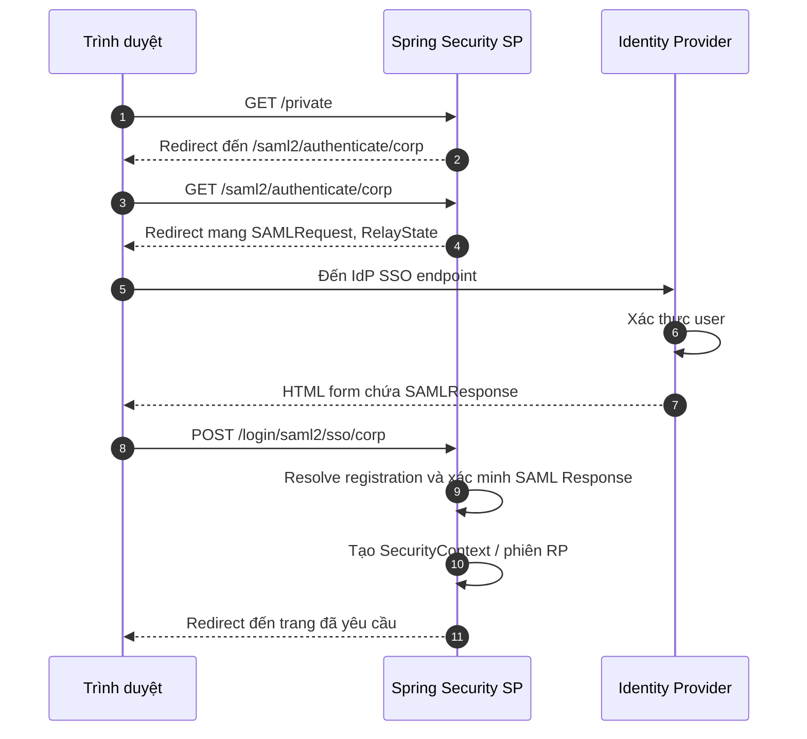

# Thiết lập Assertion Consumer Service và địa chỉ nhận SAMLResponse

## 1. Mục tiêu bài học

**Assertion Consumer Service (ACS)** là điểm nhận kết quả xác thực SAML 2.0 ở phía **Service Provider (SP)**. Khi dùng Spring Security SAML2 Login, ứng dụng Spring Boot là SP/Relying Party; hệ thống đăng nhập doanh nghiệp là **Identity Provider (IdP)**. Sau khi IdP xác thực người dùng, browser chuyển thông điệp SAML về ACS, thường dưới dạng HTTP POST có trường form `SAMLResponse`. Chỉ sau khi Spring Security xác minh response, ứng dụng mới thiết lập `Authentication` và phiên đăng nhập.

Bài này hướng dẫn thiết lập đúng ACS và URL nhận `SAMLResponse`, nhất quán giữa Spring Security filter, `RelyingPartyRegistration`, SP metadata và cấu hình IdP. Nội dung bao gồm endpoint mặc định và tùy chỉnh, HTTP-POST binding, Spring Boot/Java, reverse proxy, CSRF/cookie, nhiều IdP, xác minh response và chẩn đoán lỗi.

**Đích đến thực hành:** người học phải phân biệt được một URL ACS được *công bố* với một endpoint ACS thực sự được Spring Security *lắng nghe*, xác minh được metadata/response cho một registration và biết cách phát hiện mismatch mà không vô hiệu hóa kiểm tra bảo mật.

## 2. Bốn vai trò/địa chỉ cần phân biệt

| Thành phần | Chức năng | Ví dụ giả định |
| --- | --- | --- |
| **SP Entity ID** | Định danh logic của ứng dụng trong SAML federation; thường là giá trị `AudienceRestriction` của assertion | `https://app.example.com/saml2/service-provider-metadata/corp` |
| **ACS URL** | Public endpoint của SP nhận SAML Response | `https://app.example.com/login/saml2/sso/corp` |
| **IdP Single Sign-On Service URL** | Endpoint của IdP nhận AuthnRequest hoặc bắt đầu SSO | `https://idp.example.com/sso` |
| **Spring registrationId** | Khóa nội bộ để tra cứu một `RelyingPartyRegistration` | `corp` |

**Không hoán đổi** SP Entity ID, ACS URL và IdP SSO URL dù chúng đều trông giống địa chỉ HTTPS. `registrationId` cũng không đồng nghĩa `entityId`: một tên ngắn như `corp` cho phép Spring Security phân biệt cấu hình, còn IdP thường yêu cầu SP Entity ID theo chính sách của mình.

Hai endpoint khác ở phía Spring Security:

- `/saml2/authenticate/{registrationId}`: khởi tạo SAML authentication và tạo `AuthnRequest`.
- `/saml2/metadata/{registrationId}`: trả về SP metadata nếu bật `saml2Metadata`; metadata cho biết SP Entity ID, ACS/binding và certificate công khai liên quan.

Bản thân metadata URL và ACS URL có thể giống nhau ở một phần prefix nhưng hoàn toàn khác về chức năng. ACS thường nhận **POST**, còn metadata thường được truy cập bằng **GET**. Không tạo `@PostMapping` tùy ý để thay endpoint của framework.

## 3. ACS trong Web Browser SSO



Ở bước khởi tạo, Spring Security có thể lưu **AuthnRequest ID và correlation state** để kiểm tra kết quả sau khi IdP trả về. Nếu browser giữ cookie phiên và request state đầy đủ, response từ IdP được liên kết với lần đăng nhập ban đầu. Với các hệ thống IdP-initiated không có AuthnRequest trước đó, cần chính sách riêng; không mặc định coi trạng thái thiếu correlation là bình thường.

**HTTP-Redirect binding khi gửi AuthnRequest** và **HTTP-POST binding khi trả Response** là tổ hợp phổ biến, không phải hai tên cho cùng thao tác. SAML có thể hỗ trợ các binding khác như Artifact trong một số triển khai chuyên biệt; việc bật một binding phải được cả SP/IdP đồng ý và framework hỗ trợ.

## 4. Default endpoint nhận SAMLResponse trong Spring Security Servlet

Khi cấu hình `http.saml2Login(...)`, Spring Security đăng ký **`Saml2WebSsoAuthenticationFilter`** để xử lý đăng nhập. Với đường dẫn mặc định, một browser có thể gửi:

```http
POST /login/saml2/sso/corp HTTP/1.1
Host: app.example.com
Content-Type: application/x-www-form-urlencoded

SAMLResponse=BASE64_ENCODED_XML&RelayState=OPAQUE_STATE
```

Đây là **minh họa**, không phải payload có thể dùng để đăng nhập. `SAMLResponse` là một giá trị form chứa XML SAML được Base64-encode theo HTTP-POST binding. Nó có thể chứa thông tin nhạy cảm; không log raw form body.

Spring Security xử lý request theo chuỗi sau:

1. `Saml2WebSsoAuthenticationFilter` khớp processing URL, nhận request và chuyển cho authentication converter.
2. Converter trích xuất `SAMLResponse` từ request, tìm `RelyingPartyRegistration` phù hợp và tạo `Saml2AuthenticationToken`.
3. Authentication manager/provider SAML/OpenSAML phân tích response, kiểm tra chữ ký, issuer, destination, điều kiện assertion và giải mã phần được mã hóa khi cần.
4. Khi hợp lệ, Spring Security tạo `Saml2Authentication` và `Saml2AuthenticatedPrincipal`, lưu trạng thái trong `SecurityContext` và thực hiện success handling.
5. Khi không hợp lệ, authentication phải bị từ chối; không cấp session chỉ vì nhận POST hoặc Base64 có thể giải mã.

Tên provider OpenSAML nội bộ thay đổi theo phiên bản Spring Security (ví dụ OpenSAML 4/5). Bài này ưu tiên API công khai `saml2Login`/`RelyingPartyRegistration` để ví dụ ít phụ thuộc implementation.

### Các URL mặc định cần nhớ

| Spring Security URI | Mục đích |
| --- | --- |
| `/saml2/authenticate/{registrationId}` | Sinh AuthnRequest và đưa browser đến IdP |
| `/login/saml2/sso/{registrationId}` | ACS xác thực SAMLResponse |
| `/login/saml2/sso` | Biến thể URL có thể được hỗ trợ khi framework resolve registration theo state/issuer |
| `/saml2/metadata/{registrationId}` | Công bố SP metadata khi bật chức năng |
| `/login` | Login page hoặc IdP selection tùy cấu hình |
| `/logout/saml2/slo` | Single Logout; không phải ACS login |

Đường dẫn HTTP thực có thể chịu tác động của `server.servlet.context-path` và proxy rewrite. Luôn kiểm tra URL public thực tế và filter path được Spring Security xử lý, đặc biệt nếu thay đổi đường dẫn mặc định.

## 5. Ba cấu hình ACS phải đồng bộ

Có **ba nơi** mà thông tin ACS cần tương ứng:

1. **Trong `RelyingPartyRegistration`:** `assertionConsumerServiceLocation` nói SP dự kiến nhận Response ở đâu, ví dụ `{baseUrl}/login/saml2/sso/{registrationId}`.
2. **Trong Spring Security filter:** `saml2Login.loginProcessingUrl` quy định path mà `Saml2WebSsoAuthenticationFilter` xử lý; mặc định theo đường dẫn SAML WebSSO của Spring.
3. **Trong IdP/SP metadata:** IdP chỉ gửi Response đến địa chỉ được đăng ký/chấp nhận; metadata chứa `AssertionConsumerService@Location` và Binding.

Cấu hình chỉ một nơi sẽ tạo mismatch. Ví dụ IdP lưu ACS `https://app.example.com/login/saml2/sso/corp` nhưng developer đổi Spring filter sang `/saml/acs/corp` thì POST của IdP có thể đi đến một route không được filter xử lý. Nếu metadata mới chưa được IdP nạp lại, IdP vẫn có thể dùng ACS cũ.

### Ví dụ đoạn XML metadata

Trong `SPSSODescriptor`, metadata của SP có thể chứa một phần tử như sau:

```xml
<md:AssertionConsumerService
    xmlns:md="urn:oasis:names:tc:SAML:2.0:metadata"
    Binding="urn:oasis:names:tc:SAML:2.0:bindings:HTTP-POST"
    Location="https://app.example.com/login/saml2/sso/corp"
    index="0"
    isDefault="true"/>
```

Đây chỉ là **đoạn trích XML**, không phải metadata đầy đủ. `Binding` là cách IdP gửi SAML Response về SP; `Location` phải đúng public ACS. `index`/`isDefault` giúp IdP chọn ACS trong metadata khi có nhiều lựa chọn. Không cho rằng mọi IdP tự động cập nhật metadata theo thời gian thực; có đối tác yêu cầu nhập URL thủ công.

Nếu thay ACS, phải xác minh metadata mới, cấu hình IdP và routing thực tế. Một URL ACS không cần trở thành một Spring MVC controller; Spring Security filter có thể nhận trực tiếp.

## 6. Ví dụ ứng dụng Spring Boot cấu hình ACS mặc định

Ví dụ chạy trên **Java 17+, Spring Boot 3.x và Spring Security 6.x** khi có IdP SAML thật, metadata đọc được và registration SP đúng. Thông tin domain/registration sau đây là giả định để học, không phải tài khoản hoạt động.

### 6.1. Dependency

Một dự án Spring Boot đã có Gradle plugin/BOM có thể khai báo mảnh cấu hình `build.gradle`:

```groovy
repositories {
    mavenCentral()
    // Một số phiên bản OpenSAML cần repository phát hành Shibboleth.
    maven { url "https://build.shibboleth.net/maven/releases/" }
}

dependencies {
    implementation "org.springframework.boot:spring-boot-starter-web"
    implementation "org.springframework.boot:spring-boot-starter-security"
    implementation "org.springframework.security:spring-security-saml2-service-provider"
}
```

Đây là **đoạn thêm vào build.gradle**, không phải file build đầy đủ. Dùng các phiên bản tương thích do Spring Boot plugin quản lý; tránh tự ép phiên bản OpenSAML không phù hợp.

### 6.2. application.yml

```yaml
app:
  saml:
    idp-metadata: "${IDP_METADATA_LOCATION}"
```

Biến môi trường `IDP_METADATA_LOCATION` là location của metadata IdP được cấu hình tin cậy, ví dụ `https://idp.example.com/metadata`. Trong production, không cho người dùng cuối tự đưa URL metadata vào request để thay trust anchor.

### 6.3. Class Java hoàn chỉnh

Lưu tại `src/main/java/demo/saml/SamlAcsApplication.java`:

```java
package demo.saml;

import java.util.Map;

import org.springframework.beans.factory.annotation.Value;
import org.springframework.boot.SpringApplication;
import org.springframework.boot.autoconfigure.SpringBootApplication;
import org.springframework.context.annotation.Bean;
import org.springframework.security.config.Customizer;
import org.springframework.security.config.annotation.web.builders.HttpSecurity;
import org.springframework.security.core.annotation.AuthenticationPrincipal;
import org.springframework.security.saml2.provider.service.authentication.Saml2AuthenticatedPrincipal;
import org.springframework.security.saml2.provider.service.registration.InMemoryRelyingPartyRegistrationRepository;
import org.springframework.security.saml2.provider.service.registration.RelyingPartyRegistration;
import org.springframework.security.saml2.provider.service.registration.RelyingPartyRegistrationRepository;
import org.springframework.security.saml2.provider.service.registration.RelyingPartyRegistrations;
import org.springframework.security.web.SecurityFilterChain;
import org.springframework.web.bind.annotation.GetMapping;
import org.springframework.web.bind.annotation.RestController;

@SpringBootApplication
@RestController
public class SamlAcsApplication {

    public static void main(String[] args) {
        SpringApplication.run(SamlAcsApplication.class, args);
    }

    @Bean
    RelyingPartyRegistrationRepository registrations(
            @Value("${app.saml.idp-metadata}") String metadataLocation) {

        RelyingPartyRegistration registration = RelyingPartyRegistrations
                .fromMetadataLocation(metadataLocation)
                .registrationId("corp")
                .entityId("{baseUrl}/saml2/service-provider-metadata/{registrationId}")
                .assertionConsumerServiceLocation(
                        "{baseUrl}/login/saml2/sso/{registrationId}")
                .build();

        return new InMemoryRelyingPartyRegistrationRepository(registration);
    }

    @Bean
    SecurityFilterChain securityFilterChain(HttpSecurity http) throws Exception {
        return http
                .authorizeHttpRequests(auth -> auth
                        .requestMatchers("/").permitAll()
                        .anyRequest().authenticated())
                .saml2Login(Customizer.withDefaults())
                .saml2Metadata(Customizer.withDefaults())
                .build();
    }

    @GetMapping("/")
    public String home() {
        return "Public page";
    }

    @GetMapping("/private")
    public Map<String, String> privatePage(
            @AuthenticationPrincipal Saml2AuthenticatedPrincipal principal) {
        return Map.of(
                "subject", principal.getName(),
                "registration", principal.getRelyingPartyRegistrationId());
    }
}
```

**Giải thích:** `registrations` tạo đúng một registration nội bộ tên `corp` từ IdP metadata, đặt rõ SP Entity ID và ACS. `securityFilterChain` bật `saml2Login` và `saml2Metadata` để xử lý login và xuất metadata SP. Endpoint `/private` cần đăng nhập, còn `/` là public. HTTP POST ACS được SAML filter xử lý **trước** MVC controller.

**Chạy thử:** trong dự án Spring Boot/Gradle hoàn chỉnh với IdP thật đã đăng ký ACS/SP Entity ID, chạy (shell POSIX):

```bash
IDP_METADATA_LOCATION=https://idp.example.com/metadata ./gradlew bootRun
```

Địa chỉ `idp.example.com` là placeholder cần thay. Đăng ký SP ở IdP phải cho phép ACS `http://localhost:8080/login/saml2/sso/corp` khi chạy local và dùng host/certificate riêng ở production. Mở `http://localhost:8080/private` để bắt đầu đăng nhập.

Không thể hứa một stdout cố định vì startup, metadata và IdP phụ thuộc môi trường. Khi có Response hợp lệ và authentication thành công, endpoint `/private` trả JSON chứa NameID (ví dụ `subject`) và registration ID thực; không dự đoán NameID cho một người dùng cụ thể. Nếu không có IdP thực, ví dụ không thể tự xác thực SAML bằng payload giả.

## 7. Tùy chỉnh ACS URL khi có yêu cầu tích hợp

Giả sử IdP yêu cầu endpoint mới `https://app.example.com/saml/acs/corp`. Cần thay **cả** thông tin location và filter path.

Trong bean xây `RelyingPartyRegistration` của class trên, thay:

```java
.assertionConsumerServiceLocation("{baseUrl}/saml/acs/{registrationId}")
```

Trong bean `SecurityFilterChain`, thay cấu hình login mặc định bằng:

```java
.saml2Login(saml -> saml
        .loginProcessingUrl("/saml/acs/{registrationId}"))
```

Hai đoạn Java ở đây **là phần chỉnh sửa của class ví dụ**, không phải chương trình độc lập. Build lại, kiểm tra metadata mới và sửa ACS trong IdP trước khi dùng production. Nếu ứng dụng nằm dưới `/portal`, public ACS có thể cần `https://app.example.com/portal/saml/acs/corp` nhưng internal filter matcher vẫn là đường sau servlet context path; cần thử thực tế.

**Tại sao không dùng `@PostMapping` cho `/saml/acs/corp`?** Vì controller sẽ nhận dữ liệu trước/ngoài cơ chế xác minh SAML mà framework đã cung cấp, trừ khi có kiến trúc rất đặc thù. Đổi `loginProcessingUrl` giữ công việc xử lý trong `Saml2WebSsoAuthenticationFilter` và authentication provider đã được kiểm thử.

### Trường hợp muốn ACS chung không chứa registrationId

Các URL như `/saml/acs` đôi khi được đối tác yêu cầu. Khi không có `{registrationId}`, Spring Security phải tìm registration từ state của AuthnRequest và/hoặc issuer theo khả năng từng phiên bản. Có thể cần tùy biến `AuthenticationConverter` hoặc `RelyingPartyRegistrationResolver` để chọn chính xác đối tác, đặc biệt với nhiều IdP và unsolicited response.

Không chỉ xóa `{registrationId}` rồi mặc nhiên chấp nhận mọi Response: cần kiểm thử trường hợp IdP A gửi response đến registration B, trường hợp không có session/correlation và trường hợp ký bằng key không đúng IdP.

## 8. Phương án cấu hình qua Spring Boot properties

Ngoài Java builder, Spring Boot 3.x cung cấp cấu hình trong namespace `spring.security.saml2.relyingparty.registration`. Ví dụ **phương án thay thế**, không nên đồng thời tạo bean repository theo code và để auto-configuration tạo một nguồn truth khác:

```yaml
spring:
  security:
    saml2:
      relyingparty:
        registration:
          corp:
            entity-id: "https://app.example.com/saml2/service-provider-metadata/corp"
            acs:
              location: "https://app.example.com/login/saml2/sso/corp"
            assertingparty:
              entity-id: "https://idp.example.com/issuer"
              sso-url: "https://idp.example.com/sso"
              verification:
                credentials:
                  - certificate-location: "file:/etc/app/saml/idp-signing.crt"
```

`idp-signing.crt` là **certificate xác minh chữ ký do IdP cung cấp theo kênh tin cậy**, không phải private key của SP. Đoạn YAML cần thay bằng giá trị thực theo phiên bản Spring Boot đang dùng; kiểm tra `Saml2RelyingPartyProperties` tương ứng. `acs.location` và `entity-id` là thông tin **phía SP**, còn `assertingparty` là thông tin **phía IdP**. Với ACS tùy chỉnh, vẫn cần bảo đảm `saml2Login.loginProcessingUrl` tiếp nhận đúng path mới.

Các placeholder `{baseUrl}` và `{registrationId}` có thể được dùng trong một số API của `RelyingPartyRegistration`; chúng không giống placeholder `${ENV_VAR}` của Spring properties. `{baseUrl}` phụ thuộc scheme/host/port mà application nhìn thấy ở request, nên phải kiểm tra khi chạy sau proxy.

## 9. ACS sau reverse proxy, ingress hoặc context path

Mô hình thường gặp:

```text
Browser --HTTPS--> https://app.example.com
                           |
                           v
                     Reverse proxy
                     TLS termination
                           |
                           v
                     Spring Boot :8080

Public ACS:
https://app.example.com/login/saml2/sso/corp

Local filter path:
/login/saml2/sso/corp
```

Nếu framework nhìn thấy host nội bộ `http://service:8080` thay vì public URL, `{baseUrl}` có thể resolve sai. IdP sẽ dùng ACS khác với giá trị mà SP tạo/kiểm tra, dẫn tới lỗi `Destination`/`Recipient` hoặc redirect.

Với Spring Boot Servlet, có thể cấu hình:

```yaml
server:
  forward-headers-strategy: framework
  servlet:
    session:
      cookie:
        secure: true
        http-only: true
```

Dòng `forward-headers-strategy: framework` giúp Spring hiểu forwarded headers khi hạ tầng proxy cung cấp chúng. **Chỉ bật trust cho proxy được kiểm soát**: ingress cần xóa/ghi đè `Forwarded`, `X-Forwarded-Host` và `X-Forwarded-Proto` đến từ Internet. Nếu không, client có thể gây sai host/scheme được ứng dụng tin.

Kiểm tra thêm:

- Public `https://` URL và cổng 443 được IdP đăng ký chính xác.
- Ingress cho phép POST đến ACS, không thay method hoặc rewrite sai path.
- Không bị HTTP↔HTTPS redirect lặp làm mất form POST.
- `server.servlet.context-path` hoặc path prefix `/portal` được tính đúng.
- Tất cả replica dùng cùng SP Entity ID, ACS URL, certificate và registration.
- Metadata công bố public URL, không lộ host pod/Kubernetes nội bộ.

Khi không cần dynamic base URL, dùng public HTTPS ACS tuyệt đối cố định theo môi trường có thể dễ audit hơn, nhưng phải triển khai/đăng ký đúng ở mọi nơi.

## 10. HTTP-POST binding và nội dung SAMLResponse

IdP có thể tạo HTML form được browser tự gửi:

```html
<form method="post"
      action="https://app.example.com/login/saml2/sso/corp">
  <input type="hidden" name="SAMLResponse"
         value="BASE64_ENCODED_RESPONSE"/>
  <input type="hidden" name="RelayState"
         value="OPAQUE_STATE"/>
</form>
<script>document.forms[0].submit();</script>
```

Đây là minh họa HTML của HTTP-POST binding; chuỗi placeholder không hợp lệ để xác thực. Đường dẫn `action` phải khớp ACS đã đăng ký. Browser không cần một API riêng ở SP để decode response.

SAML Response thực có thể chứa `Response@ID`, `Issuer`, `Status`, `Destination`, `InResponseTo`, `Assertion` hoặc `EncryptedAssertion`. Assertion có thể chứa `NameID`, `AudienceRestriction`, `SubjectConfirmationData@Recipient`, `NotBefore`/`NotOnOrAfter`, và các attribute.

**Base64 không phải mã hóa:** browser có thể thấy dữ liệu assertion chưa được mã hóa. Chữ ký XML chứng minh tính toàn vẹn/phát hành của phần được ký, nhưng không che payload. Với thuộc tính cần bảo mật khỏi browser/proxy, IdP có thể mã hóa assertion cho SP; SP quản lý private key giải mã phù hợp.

## 11. Những kiểm tra an toàn tại ACS

Một POST đến đúng URL không đủ cho phép đăng nhập. SP phải thực hiện kiểm tra theo profile và chính sách, trong đó gồm:

1. **Đúng IdP/registration:** issuer và certificate xác minh chữ ký phải thuộc `RelyingPartyRegistration` được tin cậy.
2. **Chữ ký XML:** verify chữ ký trên Response/Assertion được dùng để xây principal, phòng chống XML Signature Wrapping.
3. **`Destination`:** Response được gửi tới đúng ACS được phép.
4. **`Recipient`:** `SubjectConfirmationData` ràng buộc assertion với ACS/recipient phù hợp.
5. **`AudienceRestriction`:** audience phải phù hợp **SP Entity ID**, không tự suy diễn từ registration ID.
6. **`InResponseTo`:** với SP-initiated, response thuộc AuthnRequest đã lưu, không phải một request khác.
7. **`RelayState`:** chỉ dùng như correlation/return-state theo chính sách; không dùng làm bằng chứng authentication và không mở redirect tùy ý.
8. **Thời hạn:** điều kiện `NotBefore`, `NotOnOrAfter`, session timing và clock skew hợp lý.
9. **Replay:** Response/Assertion không được tái sử dụng sau khi xử lý theo chính sách chống replay.
10. **Quyền:** chỉ map attributes của assertion đã xác minh sang principal/authorities theo quy tắc ứng dụng; một string từ IdP không tự cho quyền admin.

Dùng framework SAML/OpenSAML mặc định để thực hiện validation. Nếu cần IdP-specific policy, bổ sung validation có chủ đích và test; không tự viết parser XML để rút ngắn code hoặc tắt signature/destination/audience validation khi thấy lỗi.

## 12. Cookie, CSRF và việc tìm lại AuthnRequest

HTTP POST từ IdP là request cross-site. IdP không có CSRF token truyền thống của SP, nên `saml2Login` và xử lý SAML WebSSO dùng quy tắc CSRF phù hợp cho endpoint protocol. Nếu tự đổi `loginProcessingUrl`, hãy kiểm tra ngoại lệ CSRF của phiên bản Spring Security và chain hiện tại đã áp dụng cho path mới.

**Không tắt CSRF toàn ứng dụng bằng `csrf(csrf -> csrf.disable())`** để sửa một lỗi 403 ở ACS. Chỉ định đúng endpoint SAML theo cơ chế framework, giữ CSRF cho các form/session endpoints khác. Ngoại lệ CSRF truyền thống không làm ACS thiếu bảo vệ: signature, request correlation, destination, audience và replay vẫn cần thiết.

Với SP-initiated, AuthnRequest thường được lưu trong repository liên quan session. Browser quay về từ IdP phải gửi đúng cookie phiên SP để tìm lại state. `SameSite=Lax` có thể khiến cookie không được gửi ở cross-site POST; `SameSite=None` thường yêu cầu `Secure` và phải đánh giá CSRF vì mở rộng ngữ cảnh cookie được gửi.

Trường hợp multi-replica: request khởi tạo ở instance A nhưng ACS POST vào B; nếu không chia sẻ session/request repository, `InResponseTo` có thể thiếu. Giải pháp là session sharing, sticky sessions được thiết kế có chủ đích hoặc repository phù hợp. Không bỏ correlation validation để che lỗi hạ tầng.

## 13. Nhiều IdP và chính sách IdP-initiated

Nếu SP dùng hai registrations `corp` và `partner`, các URL mặc định có thể là:

```text
/saml2/authenticate/corp
/login/saml2/sso/corp

/saml2/authenticate/partner
/login/saml2/sso/partner
```

Mỗi registration cần issuer, verification certificate, SP entity ID/ACS và IdP SSO endpoint chính xác. Khi payload đến ACS, không cho phép người dùng tùy ý chọn registration bằng một parameter rồi bỏ kiểm tra issuer, key hoặc audience.

Với **IdP-initiated SSO**, có thể không có AuthnRequest trước và response không mang `InResponseTo` tương ứng. Vì thế cần quyết định có cho phép unsolicited login hay không, chống replay/login CSRF/session confusion, kiểm tra IdP tin cậy và giới hạn redirect destination. Với **SP-initiated**, cần kiểm tra tương quan với request đã phát. Hai flow có mức bảo vệ giao dịch khác nhau dù có thể dùng cùng ACS path.

## 14. Kiểm thử ACS trong môi trường tích hợp

### 14.1. Xác minh metadata

Sau khi bật `saml2Metadata`, lấy metadata SP và kiểm tra:

- `EntityDescriptor@entityID` đúng SP Entity ID trong IdP.
- `AssertionConsumerService@Location` là public HTTPS ACS đúng.
- Binding là HTTP-POST nếu IdP gửi Response bằng POST.
- Certificate ký/mã hóa (nếu công bố) đúng môi trường.
- Không còn URL `localhost`, scheme HTTP hoặc host pod nội bộ trong metadata production.

Metadata chứng minh SP **công bố** URL nào; cần test HTTP POST thực để khẳng định filter xử lý URL đó.

### 14.2. End-to-end browser test

1. Mở `/private` hoặc `/saml2/authenticate/corp`.
2. Trong browser Network tab, xác nhận redirect/`SAMLRequest` tới đúng IdP SSO URL.
3. Sau login, xem browser POST đến đúng public ACS URL và form field `SAMLResponse`.
4. Nếu fail, kiểm tra status 404/405/403 hoặc redirect error và log đã được redacted của ứng dụng.
5. Nếu success, truy cập lại `/private` và xác nhận principal/registration phù hợp.
6. Test cả session cookie, refresh trang, nhiều tab login và multi-replica.

Không chia sẻ raw `SAMLResponse`, cookies, private keys hoặc thông tin định danh người dùng thật trong issue tracker. HTTP 302/200 ở ACS đơn thuần không chứng minh authentication thành công; cần xác nhận `SecurityContext` và tài nguyên protected sau redirect.

### 14.3. Negative tests

| Đầu vào thử nghiệm | Kết quả mong đợi |
| --- | --- |
| Response không parse được | Không tạo authentication |
| Chữ ký sai hoặc certificate không tin cậy | Từ chối |
| `Destination` hoặc `Recipient` trỏ ACS khác | Từ chối theo policy |
| `AudienceRestriction` trỏ SP khác | Từ chối |
| Assertion hết hạn/chưa hiệu lực | Từ chối |
| Response/Assertion đã dùng bị phát lại | Từ chối theo replay policy |
| `InResponseTo` sai trong SP-initiated | Từ chối |
| Response IdP A gửi đến registration B | Từ chối vì issuer/key/audience |
| Metadata mới nhưng IdP dùng ACS cũ | Phát hiện mismatch trước production |
| Thay proxy headers sai làm ACS thành HTTP | Phát hiện trong metadata/tracing |

Chạy tests bằng IdP sandbox và dữ liệu/cert thử nghiệm. Không cần ghi đè security policy hoặc dùng token production để kiểm tra.

## 15. Ma trận lỗi ACS thường gặp

| Triệu chứng | Khu vực điều tra |
| --- | --- |
| **404** khi IdP POST | URL IdP cấu hình, ingress rewrite, context path, filter matcher |
| **405** | Endpoint thực chỉ cho GET, request không tới SAML filter |
| **403** trước authentication | CSRF matcher, WAF, rule SecurityFilterChain, request method |
| `Invalid Destination` | ACS Location, scheme/host/port public, forwarded headers |
| `Invalid Recipient` | `SubjectConfirmationData@Recipient`, ACS URL, IdP registration |
| `Audience invalid` | SP Entity ID sai, IdP gửi assertion cho SP khác |
| `Signature invalid` | IdP verification certificate/metadata, key rotation, signed node |
| `InResponseTo missing` | HTTP session/cookie/SameSite, request repository, replicas |
| `No RelyingPartyRegistration` | `registrationId` sai, repository hoặc resolver sai |
| RelayState dẫn tới URL lạ | Return-state handling/open redirect policy |
| Success nhưng role sai | Mapping verified attributes sang `GrantedAuthority` |

**Một quy trình debug hiệu quả:** xác định browser gửi POST tới đâu → request có đến đúng filter không → registration nào được chọn → validation cụ thể nào thất bại → sau success session/cookie có được lưu không. Tránh hạ mức xác thực SAML khi nguyên nhân chỉ là HTTP routing hoặc phiên.

## 16. Checklist phát hành

- [ ] ACS public URL, port, scheme và context path khớp metadata và IdP.
- [ ] `assertionConsumerServiceLocation` và `loginProcessingUrl` tương thích.
- [ ] SP Entity ID khác với ACS đúng theo thiết kế và khớp audience.
- [ ] Binding của Response được SP và IdP hỗ trợ.
- [ ] HTTPS/TLS và forwarded headers từ proxy tin cậy được cấu hình chính xác.
- [ ] Session cookie và AuthnRequest repository hoạt động khi browser gửi cross-site POST.
- [ ] Multi-replica có cơ chế chia sẻ session/correlation hoặc routing ổn định.
- [ ] IdP verification certificate, signature, issuer, destination, recipient, audience và thời hạn được kiểm tra.
- [ ] Chính sách replay và unsolicited IdP-initiated login được quyết định rõ.
- [ ] Exception CSRF chỉ áp dụng đúng SAML protocol path; không vô hiệu hóa toàn bộ ứng dụng.
- [ ] Metadata IdP đã cập nhật sau đổi ACS, test end-to-end thành công.
- [ ] Log không lộ SAMLResponse, RelayState, assertion, cookie hoặc private key.
- [ ] Negative tests và kịch bản lỗi proxy/cert/session đã chạy.

## 17. Câu hỏi tự đánh giá

**1. ACS trong Spring Security có bắt buộc là một `@PostMapping` Controller không?** Không. `Saml2WebSsoAuthenticationFilter` xử lý SAML POST trong filter chain khi `saml2Login` được cấu hình.

**2. Chỉ đổi `RelyingPartyRegistration.assertionConsumerServiceLocation` có làm filter nhận endpoint mới không?** Không tự động bảo đảm. Cần kiểm tra/cấu hình `loginProcessingUrl` và metadata/IdP tương ứng.

**3. SP Entity ID có phải là ACS URL không?** Không. Entity ID là định danh được assertion nhắc tới trong audience, ACS là điểm nhận SAMLResponse.

**4. Vì sao sau proxy `{baseUrl}` có thể thành `http://service:8080`?** Vì ứng dụng thấy host/scheme nội bộ khi forwarded headers chưa được xử lý đúng.

**5. SAMLResponse gửi bằng Base64 có phải là mã hóa không?** Không. Base64 là encoding, không che payload khỏi browser.

**6. Lỗi `InResponseTo` nên xử lý ra sao?** Kiểm tra AuthnRequest state, cookie/SameSite, session store và multi-replica; không bỏ correlation check.

**7. Chữ ký hợp lệ có đủ nhận assertion không?** Không. Cần đúng issuer, audience, destination/recipient, thời hạn, subject confirmation, request correlation và chống replay.

**8. IdP-initiated và SP-initiated có nhất thiết cùng độ an toàn không?** Không. IdP-initiated có thể thiếu request correlation và cần chính sách riêng.

## 18. Tài liệu tham khảo

- [Spring Security 6.5 – SAML 2.0 Login Overview](https://docs.spring.io/spring-security/reference/6.5/servlet/saml2/login/overview.html): Web Browser SSO, `RelyingPartyRegistration`, mặc định route.
- [Spring Security 6.5 – Authenticating SAML Responses](https://docs.spring.io/spring-security/reference/6.5/servlet/saml2/login/authentication.html): processing endpoint, filter/provider, custom URL.
- [Spring Security 6.5 – Producing AuthnRequests](https://docs.spring.io/spring-security/reference/6.5/servlet/saml2/login/authentication-requests.html): request initiation, state và binding.
- [Spring Security 6.5 – SAML Metadata](https://docs.spring.io/spring-security/reference/6.5/servlet/saml2/metadata.html): xuất SP metadata.
- [Spring Boot 3.5 – SAML2 Relying Party Properties](https://docs.spring.io/spring-boot/3.5/reference/web/spring-security.html): dependency và cấu hình.
- [Spring Boot 3.5 – Embedded Web Server/Forwarded Headers](https://docs.spring.io/spring-boot/3.5/how-to/webserver.html): reverse proxy.
- [OASIS – SAML 2.0 Profiles](https://docs.oasis-open.org/security/saml/v2.0/saml-profiles-2.0-os.pdf) và [Bindings](https://docs.oasis-open.org/security/saml/v2.0/saml-bindings-2.0-os.pdf): chuẩn giao thức.
- [OWASP SAML Security Cheat Sheet](https://cheatsheetseries.owasp.org/cheatsheets/SAML_Security_Cheat_Sheet.html): chống signature wrapping, replay và cấu hình trust.
