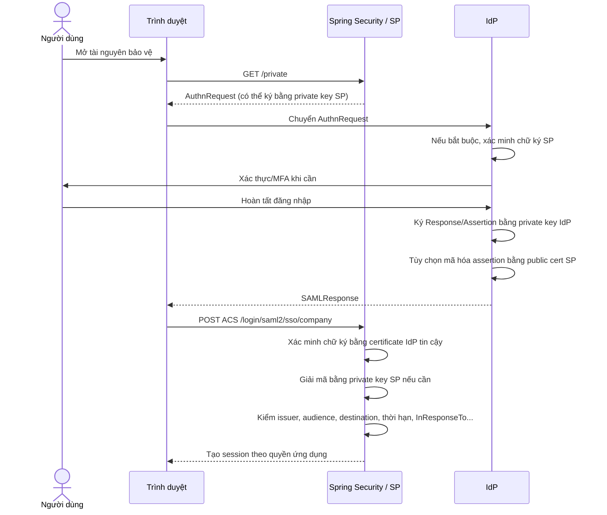

# Cấu hình khóa ký, khóa giải mã và chứng thư xác minh trong Spring Security SAML2

## Mục tiêu học tập

Sau bài học, bạn có thể:

1. Phân biệt **private key dùng ký của Service Provider (SP)**, **private key dùng giải mã của SP** và **chứng thư công khai của Identity Provider (IdP) dùng xác minh chữ ký**.
2. Giải thích đường đi của khóa/chứng thư trong SAML 2.0 Web Browser SSO: ai ký `AuthnRequest`, ai ký `Response`/`Assertion`, ai mã hóa và ai giải mã `EncryptedAssertion`.
3. Cấu hình chính xác ba nhóm credentials của `RelyingPartyRegistration`: `signingX509Credentials`, `decryptionX509Credentials` và `assertingPartyDetails.verificationX509Credentials` (tên API có thể thay đổi theo nhánh Spring Security).
4. Viết cấu hình Spring Boot 3 + Spring Security 6 sử dụng `spring-security-saml2-service-provider`, chứng thư X.509 và khóa riêng PKCS#8, đồng thời xuất **SP metadata** cho IdP.
5. Kiểm thử tính phù hợp của cặp khóa/chứng thư, xử lý thay/luân chuyển khóa, và phân biệt lỗi chữ ký, lỗi giải mã, sai issuer/audience hoặc sai URL.
6. Bảo vệ private key trong môi trường thực tế, tránh chấp nhận chứng thư tự khai báo trong SAML Response hay vô hiệu hóa signature verification.

## 1. Bối cảnh: một quan hệ SAML2 có hai phía

Spring Security SAML2 Login trong ứng dụng web Servlet thường vận hành ứng dụng như một **Relying Party (RP)**, đồng nghĩa **Service Provider (SP)**. Bên xác thực người dùng và phát hành SAML assertion là **Asserting Party (AP)**, đồng nghĩa **Identity Provider (IdP)**.

- **SP:** ứng dụng Spring Boot nhận SAML Response tại **Assertion Consumer Service (ACS)**, xác minh nguồn phát hành và chữ ký, giải mã assertion khi được mã hóa, kiểm tra các điều kiện SAML rồi tạo phiên ứng dụng.
- **IdP:** hệ thống xác thực người dùng, ký SAML Response/Assertion bằng khóa riêng của IdP và tùy thỏa thuận có thể mã hóa assertion bằng khóa công khai của SP.
- **Người dùng/trình duyệt:** chuyển hướng giữa SP và IdP và chuyển các thông điệp qua Redirect/POST binding. Trình duyệt **không phải nơi ứng dụng tin chữ ký** và không được giữ private key phía SP.

Một luồng đăng nhập SP-initiated điển hình:



**Ba thao tác khác nhau**:

- **Ký (sign):** tạo chữ ký bằng **private key** của bên gửi để bên nhận kiểm tra tính toàn vẹn/xác thực nguồn phát hành bằng **public certificate** đã tin cậy.
- **Xác minh (verify):** dùng **public certificate** của bên phát hành để kiểm tra chữ ký; không cần và không được sở hữu private key của bên phát hành.
- **Mã hóa/giải mã (encrypt/decrypt):** IdP mã hóa nội dung gửi tới SP bằng **public key/certificate của SP**, chỉ SP có private key tương ứng mới giải mã được.

**Chữ ký không thay thế mã hóa**: thông điệp đã ký vẫn có thể đọc được nếu không mã hóa. **Mã hóa không thay thế xác minh chữ ký**: giải mã thành công chưa đủ để tin issuer, tính toàn vẹn, audience và điều kiện xác thực.

## 2. Sơ đồ sở hữu khóa: ai giữ gì?

| Tác vụ | Khóa riêng do ai giữ? | Chứng thư công khai do ai nhận? | Spring Security đặt ở đâu? |
| --- | --- | --- | --- |
| **SP ký AuthnRequest**; có thể ký LogoutRequest nếu hỗ trợ SLO | **SP** giữ signing private key | **IdP** đăng ký public signing certificate của SP | `RelyingPartyRegistration.signingX509Credentials(...)`; Boot `registration.<id>.signing.credentials` |
| **SP giải mã EncryptedAssertion/EncryptedAttribute/EncryptedID** | **SP** giữ decryption private key | **IdP** biết public encryption certificate của SP để mã hóa | `RelyingPartyRegistration.decryptionX509Credentials(...)`; Boot `registration.<id>.decryption.credentials` |
| **SP xác minh chữ ký Response/Assertion từ IdP** | **IdP** giữ signing private key của IdP | **SP** nhận/trust **IdP signing certificate** | `assertingPartyDetails.verificationX509Credentials(...)`; Boot `registration.<id>.assertingparty.verification.credentials` |
| **IdP xác minh AuthnRequest có chữ ký** | **SP** đã ký trước đó | IdP phải tin **SP signing certificate** | Đăng ký tại IdP, thường qua **SP metadata** |
| **IdP ký Response/Assertion** | **IdP** giữ signing private key | SP phải tin **IdP signing certificate** | Đăng ký thủ công từ nguồn tin cậy hoặc import metadata IdP đã xác minh nguồn |

Ví dụ có ba cặp khóa/credential khác nhau:

```text
SP:
  sp-signing.key       (PRIVATE, SP giữ)
  sp-signing.crt       (PUBLIC, cấp cho IdP để verify AuthnRequest)
  sp-decryption.key    (PRIVATE, SP giữ)
  sp-decryption.crt    (PUBLIC, cấp cho IdP để encrypt assertion)

IdP:
  idp-signing.key      (PRIVATE, CHỈ IdP giữ; KHÔNG giao cho SP)
  idp-signing.crt      (PUBLIC, cấp cho SP để verify Response/Assertion)
```

Có thể dùng chung một cặp khóa SP cho signing và decryption nếu thỏa thuận cho phép, nhưng **tách khóa** sẽ thuận lợi hơn cho chính sách quyền sử dụng, audit và luân chuyển độc lập. Khóa ký/giải mã của SP **không phải** khóa TLS/HTTPS của web server; có thể là chứng thư X.509 riêng cho SAML, không bắt buộc do CA công cộng phát hành nếu đối tác tin theo metadata/chứng thư đã trao đổi an toàn.

### 2.1. Ba kiểu credential trong Spring Security

Spring Security cung cấp lớp `org.springframework.security.saml2.core.Saml2X509Credential` với các factory method tương ứng:

```java
Saml2X509Credential.signing(spPrivateKey, spSigningCertificate);
Saml2X509Credential.decryption(spPrivateKey, spDecryptionCertificate);
Saml2X509Credential.verification(idpSigningCertificate);
```

Đoạn trên minh họa các lời gọi API sau khi đã có biến `PrivateKey`/`X509Certificate` và import; **không phải một chương trình Java độc lập**. Chữ ký tĩnh nêu rõ ràng:

- `signing(PrivateKey, X509Certificate)` cần private key và certificate **thuộc SP**.
- `decryption(PrivateKey, X509Certificate)` cần private key và certificate **thuộc SP**.
- `verification(X509Certificate)` chỉ cần certificate công khai **thuộc IdP**.

Spring Security còn có kiểu `encryption(X509Certificate)` cho trường hợp một bên đóng vai **bên gửi nội dung mã hóa**; trong SAML2 Login SP thông thường, IdP dùng chứng thư SP để mã hóa cho SP, còn SP dùng `decryption`.

**Không đưa IdP private key vào cấu hình SP.** Nếu một hướng dẫn yêu cầu SP có IdP private key để “verify”, hướng dẫn đó đang nhầm ký và xác minh.

## 3. Tài liệu và định danh cần trao đổi trước khi cấu hình

Một tích hợp thành công cần đủ **định danh, endpoint và trust material**, không chỉ là các tệp `.crt`/`.key`.

| Thông số | Bên xác định / cung cấp | Ví dụ minh họa |
| --- | --- | --- |
| `registrationId` của Spring | SP (tên cục bộ) | `company` |
| SP `entityId` | SP thống nhất với IdP | `https://app.example.org/saml2/service-provider-metadata/company` |
| SP ACS endpoint | SP và IdP thống nhất | `https://app.example.org/login/saml2/sso/company` |
| IdP `entityId`/Issuer | IdP | `https://idp.example.org/saml` |
| IdP Single Sign-On URL + binding | IdP | `https://idp.example.org/sso`, Redirect hoặc POST theo cấu hình |
| IdP signing certificate(s) | IdP, lấy qua kênh đã tin cậy | `idp-signing-2026.crt` |
| SP signing certificate | SP cung cấp cho IdP | `sp-signing.crt` |
| SP encryption certificate | SP cung cấp cho IdP | `sp-decryption.crt` |
| Yêu cầu ký AuthnRequest | IdP và chính sách hai bên | `true` nếu IdP yêu cầu request phải được ký |
| Yêu cầu mã hóa assertion | Thỏa thuận/SP policy và IdP | Có thể bật sau khi IdP đã có SP public encryption certificate |
| Thời hạn, algorithm, rollover | Hai bên phối hợp | SHA-256/thuật toán tương thích; lịch thay cert |

**Không nhầm `registrationId` với `entityId`:** `company` chỉ là tên cục bộ của registration. `entityId` là định danh SAML mà phía IdP ghi nhận; không nhất thiết là URL có thể truy cập, nhưng phải **khớp tuyệt đối** với thỏa thuận và metadata.

### 3.1. Trao đổi metadata SP và IdP

**IdP metadata** thường chứa `<EntityDescriptor entityID="...">`, `<IDPSSODescriptor>`, SSO endpoints và một hay nhiều `<KeyDescriptor use="signing">`. SP dùng thông tin ấy để đăng ký IdP tin cậy.

**SP metadata** thường chứa `<SPSSODescriptor>`, ACS, SP entity ID và `<KeyDescriptor use="signing">`/`<KeyDescriptor use="encryption">`. IdP dựa vào đó để xác minh AuthnRequest hoặc mã hóa assertion cho SP.

Trong Spring Security, có thể công bố SP metadata bằng `http.saml2Metadata(...)`. Endpoint mặc định thường là:

```text
/saml2/metadata
/saml2/metadata/{registrationId}
/saml2/service-provider-metadata/{registrationId}
```

Ví dụ: `https://app.example.org/saml2/metadata/company`.

**Metadata không chứa private key.** Chỉ công bố certificate công khai cho bên đối tác. Cần kiểm tra hostname/entity ID/ACS thật trong metadata, nhất là khi chạy sau ingress hoặc reverse proxy.

**Nguồn metadata phải đáng tin:** tải metadata từ một URL bất kỳ rồi tự động chấp nhận tất cả signing cert được khai báo có thể biến nguồn không đáng tin thành IdP đáng tin. HTTPS bảo vệ kênh truyền nhưng không tự thay thế chính sách thẩm định nguồn/chữ ký metadata. Với bản Spring Security và resolver hỗ trợ xác minh metadata signature, cấu hình khóa kiểm chữ ký metadata riêng; với giải pháp tải file tĩnh, kiểm nguồn/đối chiếu fingerprint bằng kênh ngoài trước khi phân phối.

## 4. Chuẩn bị khóa và chứng thư X.509

Các ví dụ dưới đây dùng **OpenSSL** để giải thích cách tạo cặp khóa mới cho SP trong môi trường học tập/lab. Production nên dùng secret manager/HSM/key management phù hợp, xoay khóa có kiểm soát, không chép private key vào Git hoặc artifact công khai.

### 4.1. Tạo hai cặp khóa RSA cho SP (lab)

```bash
# Cặp khóa cho SP ký AuthnRequest
openssl genpkey -algorithm RSA -pkeyopt rsa_keygen_bits:3072 -out sp-signing.key
openssl req -new -x509 -sha256 -days 365 -key sp-signing.key \
  -out sp-signing.crt -subj "/CN=saml-sp-signing.example.org"

# Cặp khóa khác cho IdP mã hóa Assertion gửi đến SP
openssl genpkey -algorithm RSA -pkeyopt rsa_keygen_bits:3072 -out sp-decryption.key
openssl req -new -x509 -sha256 -days 365 -key sp-decryption.key \
  -out sp-decryption.crt -subj "/CN=saml-sp-encryption.example.org"
```

Đây là **lệnh minh họa cho lab**, không chạy trong Google Sheets. `openssl genpkey` sinh **PKCS#8** ở định dạng PEM thường có header `BEGIN PRIVATE KEY`. Nhiều cấu hình Spring Boot SAML đọc private key từ file PEM PKCS#8 không mã hóa bằng password. Khi môi trường dùng encrypted PEM/PKCS#12/HSM, cần tầng tích hợp đọc khóa/secret thích hợp; không giả định Boot properties sẽ tự giải mã mọi loại keystore.

Tự ký chứng thư X.509 phục vụ **SAML trust theo metadata** có thể dùng trong lab hoặc với đối tác tin theo certificate pinning; điều này khác cơ chế TLS web server phải có chứng thư HTTPS phù hợp domain/trust chain. Tính hợp lệ của certificate, thuật toán và độ mạnh khóa vẫn phải tuân theo chính sách hai bên.

### 4.2. Kiểm certificate và private key có cùng public key

```bash
# In dấu vân tay certificate để đối chiếu out-of-band
openssl x509 -in sp-signing.crt -noout -fingerprint -sha256

# Đọc thông tin công khai: issuer, subject, serial và ngày hiệu lực
openssl x509 -in sp-signing.crt -noout -subject -issuer -serial -dates

# Trích public key tương ứng từ certificate
openssl x509 -in sp-signing.crt -pubkey -noout > public-from-cert.pem

# Trích public key từ private key (KHÔNG in private key)
openssl pkey -in sp-signing.key -pubout > public-from-private.pem
```

Hai tệp `public-from-cert.pem` và `public-from-private.pem` phải chứa cùng public key. Có thể so sánh sau khi chuẩn hóa/đối chiếu byte (ví dụ `cmp` trên Unix); không cần đưa nội dung private key cho IdP để làm phép kiểm này. Lặp quy trình cho cặp decryption.

**Khi dùng PowerShell/Windows:** cú pháp shell của lệnh có `\` nối dòng, `>` redirect và `cmp` thuộc ví dụ Bash. Hãy viết mỗi lệnh trên một dòng hoặc dùng cú pháp PowerShell tương đương; đừng sao chép nguyên dấu `\` để nối dòng trong PowerShell.

### 4.3. Phân phối tệp trong production

Ví dụ đường dẫn được mount trong container:

```text
/run/secrets/saml/sp-signing.key          <- private, SP service account đọc
/run/certs/saml/sp-signing.crt            <- public
/run/secrets/saml/sp-decryption.key       <- private, SP service account đọc
/run/certs/saml/sp-decryption.crt         <- public
/run/certs/saml/idp-signing-2026.crt      <- public, nguồn IdP đã thẩm định
```

Quy tắc:

1. Khóa riêng được lưu bằng quyền file tối thiểu, chỉ service process cần ký/giải mã được đọc. Không commit, in log, hoặc gắn vào SP metadata.
2. Cấp cho IdP **chỉ public certificates của SP**; cấp cho SP **chỉ public signing certificate của IdP**.
3. Khóa decryption cũ có thể vẫn cần trong giai đoạn chuyển tiếp khi IdP còn gửi assertion mã hóa bằng cert cũ.
4. Khóa ký/giải mã có thể thuộc các keystore/KMS khác nhau; nếu key không xuất được khỏi HSM, phải chọn integration hỗ trợ HSM/PKCS#11 hoặc callback ký/giải mã phù hợp, không ép giải mật mã vào file text.

## 5. Cấu hình Spring Boot bằng `application.yml`

Đây là cách dễ đọc để đặt cả ba loại credential vào một **SAML2 relying party registration**. Ví dụ phù hợp với mô hình **Spring Boot 3.x, Spring Security 6.x, Servlet stack** và cú pháp properties của `Saml2RelyingPartyProperties` trong Spring Boot 3. Tên hostname, issuer và đường dẫn file là **giả định**, cần được thay bằng môi trường thật.

### 5.1. Dependency Gradle

Trong `build.gradle` của dự án đã có Spring Boot plugin/BOM:

```groovy
dependencies {
    implementation 'org.springframework.boot:spring-boot-starter-web'
    implementation 'org.springframework.boot:spring-boot-starter-security'
    implementation 'org.springframework.security:spring-security-saml2-service-provider'
}
```

**Lưu ý:** Spring Security SAML2 sử dụng OpenSAML bên dưới; hệ thống build cần repository chứa artifact OpenSAML theo version được chọn. Không chọn OpenSAML dependency với version xung đột hoặc tự ép module ngoài BOM. Với Spring Boot 3.3/Spring Security 6.3, kiểm tài liệu/dependency graph của đúng nhánh sử dụng.

### 5.2. YAML cho signing, decryption và verification

```yaml
spring:
  security:
    saml2:
      relyingparty:
        registration:
          company:
            entity-id: "https://app.example.org/saml2/service-provider-metadata/company"

            # SP ký AuthnRequest/Logout messages khi flow yêu cầu
            signing:
              credentials:
                - private-key-location: "file:/run/secrets/saml/sp-signing.key"
                  certificate-location: "file:/run/certs/saml/sp-signing.crt"

            # SP giải mã assertion/attributes được IdP mã hóa cho SP
            decryption:
              credentials:
                - private-key-location: "file:/run/secrets/saml/sp-decryption.key"
                  certificate-location: "file:/run/certs/saml/sp-decryption.crt"

            # IdP mà SP tin cậy: xác minh Response/Assertion
            assertingparty:
              entity-id: "https://idp.example.org/saml"
              verification:
                credentials:
                  - certificate-location: "file:/run/certs/saml/idp-signing-2026.crt"
              singlesignon:
                url: "https://idp.example.org/sso"
                sign-request: true
```

**Giải thích chính xác từng phần:**

- `registration.company` là cấu hình một cặp SP–IdP. Một ứng dụng có thể có nhiều registrations, mỗi registration có IdP/cert riêng.
- `entity-id` trên cấp `company` là **SP entityId**. IdP phải nhận đúng giá trị này trong AuthnRequest/metadata.
- `signing.credentials` chứa **SP private key + SP certificate**. Spring Security dùng để ký thông điệp gửi đi như AuthnRequest khi IdP hoặc flow yêu cầu.
- `decryption.credentials` chứa **SP private key + SP certificate** dành cho nội dung IdP mã hóa bằng public certificate tương ứng.
- `assertingparty.entity-id` là **IdP issuer/entityId**, khác SP entityId.
- `assertingparty.verification.credentials` chỉ chứa **public signing certificate của IdP**. Không cấu hình private key cho nó.
- `singlesignon.url` là địa chỉ IdP nhận yêu cầu SSO theo binding đã thỏa thuận.
- `singlesignon.sign-request: true` diễn đạt IdP yêu cầu AuthnRequest được ký; khi IdP **không yêu cầu**, có thể đặt `false` và signing credentials cho riêng luồng login có thể không cần. Thỏa thuận SAML phải quyết định chế độ ký; không bỏ chữ ký để “chữa” lỗi khi IdP yêu cầu.
- **ACS callback** mặc định đối với registration `company` là `/login/saml2/sso/company`. IdP cần biết public URL tương ứng, ví dụ `https://app.example.org/login/saml2/sso/company`. Một số phiên bản hỗ trợ response processing path chung và lookup registration theo trạng thái giao dịch.
- Có thể thay nội dung `file:/run/...` bằng nơi Spring `Resource` đọc được từ môi trường. Nếu dùng `classpath:` cho demo, tuyệt đối không đóng gói **private key production** trong JAR.

**Chứng thư xác minh không tự mang lại trust nếu nguồn không an toàn**: giá trị `idp-signing-2026.crt` phải được cấp/xác thực từ chính IdP đã đăng ký, không lấy từ một SAMLResponse gửi lên bởi bất kỳ trình duyệt nào.

### 5.3. SecurityFilterChain Java 17+

Ví dụ trong tệp `src/main/java/com/example/saml/SamlSecurityConfiguration.java`:

```java
package com.example.saml;

import org.springframework.context.annotation.Bean;
import org.springframework.context.annotation.Configuration;
import org.springframework.security.config.Customizer;
import org.springframework.security.config.annotation.web.builders.HttpSecurity;
import org.springframework.security.web.SecurityFilterChain;

@Configuration
public class SamlSecurityConfiguration {

    @Bean
    SecurityFilterChain securityFilterChain(HttpSecurity http) throws Exception {
        return http
            .authorizeHttpRequests(auth -> auth
                .requestMatchers("/", "/error").permitAll()
                .anyRequest().authenticated()
            )
            .saml2Login(Customizer.withDefaults())
            .saml2Metadata(Customizer.withDefaults())
            .build();
    }
}
```

Ví dụ giả định `spring-security-saml2-service-provider` đã trên classpath và Spring Boot có thể tự tạo `RelyingPartyRegistrationRepository` từ YAML. `saml2Login()` cài đặt web SSO filter/entrypoint; `saml2Metadata()` tạo endpoint cung cấp **SP metadata**. Chính sách bảo vệ `/private` là `authenticated()`, còn quyền nghiệp vụ cần được cấu hình riêng.

Có thể kiểm tra người dùng đã đăng nhập qua controller tối giản:

```java
package com.example.saml;

import org.springframework.security.core.Authentication;
import org.springframework.web.bind.annotation.GetMapping;
import org.springframework.web.bind.annotation.RestController;

@RestController
public class SamlDemoController {
    @GetMapping("/")
    String home() {
        return "SAML SP demo";
    }

    @GetMapping("/private")
    String privateResource(Authentication authentication) {
        return "Authenticated as " + authentication.getName();
    }
}
```

Lớp controller là phần của **ứng dụng Spring Boot**, không phải tệp Java độc lập biên dịch bằng `javac` mà không có dependencies. Không thể dự đoán tên người dùng/HTTP output trước khi có IdP thật và assertion hợp lệ.

**Luồng thử nghiệm mong đợi:**

1. `GET /private` khi chưa có session dẫn tới đăng nhập.
2. `GET /saml2/authenticate/company` khởi tạo `AuthnRequest` tới IdP.
3. Sau khi IdP xác thực, trình duyệt **POST `SAMLResponse`** đến `/login/saml2/sso/company`.
4. Spring Security chọn `RelyingPartyRegistration`, giải mã khi cần, xác minh chữ ký/issuer/audience/destination/thời gian và các điều kiện liên quan; thành công thì tạo `Authentication`.
5. `GET /private` trả chuỗi chứa principal của assertion đã được xác minh.

Nếu không có IdP, chứng thư, key files và service registration hợp lệ thì đoạn mã chỉ là **mẫu tích hợp**; không tuyên bố đã chạy SSO end-to-end.

### 5.4. Phân biệt mẫu YAML thủ công và metadata IdP

Có hai cách cấu hình thông tin IdP:

**Cách A: thủ công**, như YAML ở trên: đặt `assertingparty.entity-id`, `singlesignon.url` và `verification.credentials` với tệp cert do IdP cung cấp.

**Cách B: dựa trên IdP metadata đã thẩm định:** có thể dùng `assertingparty.metadata-uri` trong Boot hoặc `RelyingPartyRegistrations.fromMetadataLocation(...)` trong Java để suy ra issuer, SSO endpoint và public verification certificates từ metadata.

Chỉ chọn **một nguồn quản lý canonical phù hợp** hoặc có quy tắc override rõ ràng. Metadata tự động không thay thế việc tin cậy đúng IdP; key rollover cần có chiến lược refresh/reload metadata. Nếu IdP thay signing cert nhưng ứng dụng vẫn dùng file cert cũ, chữ ký hợp lệ từ IdP mới vẫn có thể bị từ chối.

## 6. Java API: `Saml2X509Credential` và `RelyingPartyRegistration`

YAML được Spring Boot ánh xạ thành `RelyingPartyRegistration`. Khi cần đa tenant, tải khóa từ KMS hoặc cấu hình động, có thể tạo repository bằng Java thay vì Boot auto-config.

### 6.1. Mapping giữa YAML và Java

| Ý định | Spring Boot property | API Java |
| --- | --- | --- |
| SP ký yêu cầu | `signing.credentials` | `registration.signingX509Credentials(...)` với `Saml2X509Credential.signing(privateKey, cert)` |
| SP giải mã assertion | `decryption.credentials` | `registration.decryptionX509Credentials(...)` với `Saml2X509Credential.decryption(privateKey, cert)` |
| SP xác minh chữ ký IdP | `assertingparty.verification.credentials` | `assertingPartyDetails.verificationX509Credentials(...)` hoặc API metadata tương ứng của phiên bản đang dùng; dùng `Saml2X509Credential.verification(idpCert)` |
| Lấy issuer/SSO URL từ IdP metadata | `assertingparty.metadata-uri` | `RelyingPartyRegistrations.fromMetadataLocation(...)` |
| Xuất SP metadata | `saml2Metadata()` | Metadata resolver dựa trên `RelyingPartyRegistrationRepository` |
| Đối chiếu IdP/SP | `assertingparty.entity-id` và `registration.entity-id` | `assertingPartyDetails.entityId(...)` và `registration.entityId(...)` |

### 6.2. Đoạn mã tạo credential bằng Java

Phần này là **đoạn cấu hình ghép vào `@Configuration`**, giả định các biến `spSigningKey`, `spSigningCert`, `spDecryptionKey`, `spDecryptionCert`, `idpSigningCert` đã được đọc từ nguồn bí mật/chứng thư tin cậy. Không phải chương trình Java độc lập; không giả định private key là chuỗi plain text.

```java
import java.security.PrivateKey;
import java.security.cert.X509Certificate;
import org.springframework.security.saml2.core.Saml2X509Credential;

// spSigningKey, spDecryptionKey: private key của SP
// spSigningCert, spDecryptionCert: public X.509 certificate của SP
// idpSigningCert: public X.509 certificate của IdP

Saml2X509Credential signing =
        Saml2X509Credential.signing(spSigningKey, spSigningCert);

Saml2X509Credential decryption =
        Saml2X509Credential.decryption(spDecryptionKey, spDecryptionCert);

Saml2X509Credential verification =
        Saml2X509Credential.verification(idpSigningCert);
```

Những biến ở trên là **đầu vào chưa khai báo** để làm rõ ý nghĩa API, không phải mã Java có thể dán vào file một mình rồi biên dịch. Với đa tenant, mỗi `registrationId` phải liên kết đúng certificate set của IdP tương ứng. Không dùng chung một danh sách verification certificates cho tất cả IdP nếu không có chính sách tin cậy rõ ràng.

### 6.3. Tại sao private key và certificate phải khớp?

Cặp `PrivateKey`/`X509Certificate` cùng khóa công khai là một **credential**; signing private key không khớp certificate public dẫn tới IdP không verify được chữ ký. Tương tự, IdP mã hóa cho SP public encryption cert A thì SP private key B **không thể** giải mã dữ liệu đó.

Việc chứng thư còn hạn chưa đồng nghĩa cặp khóa đúng. Kiểm riêng:

- Thuật toán khóa (RSA/EC) và thuật toán chữ ký/mã hóa được phía đối tác hỗ trợ.
- Public key của certificate khớp private key.
- Certificate thật sự được IdP/SP đăng ký cho **đúng vai trò** signing/encryption/verification.
- Khi quay vòng nhiều certificates, khóa mới được công bố trước thời điểm bên kia bắt đầu sử dụng.

## 7. Những điều Spring Security phải xác minh ngoài chữ ký

Chữ ký hợp lệ là **một điều kiện cần**, chưa đủ để hoàn tất đăng nhập. Sau khi xác minh chữ ký từ cert IdP được tin cậy, SP vẫn phải kiểm tra:

| Điều kiện | Vì sao cần? |
| --- | --- |
| **Issuer** | Response/Assertion phải do **IdP đã đăng ký** cho registration này phát hành |
| **AudienceRestriction** | Assertion phải dành cho **SP entityId** mong đợi, không dành cho ứng dụng khác |
| **Destination/Recipient** | SAML Response/SubjectConfirmation phải hướng đến **ACS** hợp lệ |
| **NotBefore / NotOnOrAfter** | Chống assertion quá hạn hoặc chưa có hiệu lực; lệch thời gian cần chính sách clock skew có giới hạn |
| **InResponseTo** | Liên kết Response với AuthnRequest đang chờ trong luồng SP-initiated |
| **SubjectConfirmation** | Đảm bảo điều kiện xác nhận chủ thể, recipient, thời hạn phù hợp |
| **Signature placement và XML integrity** | Không tin một assertion unsigned khác được lồng vào XML có chữ ký; thư viện phải kiểm tra đúng đối tượng được ký |
| **Replay controls** | Không chấp nhận lại assertion/response/ticket như một đăng nhập mới không kiểm soát |
| **User mapping/authorization** | Sau xác thực, ứng dụng vẫn quyết định tài khoản cục bộ và quyền truy cập |

Vì vậy, **không tự viết XML parser giản lược** lấy `NameID`/email từ HTTP POST và bỏ qua OpenSAML/Spring Security validation. Không được sửa logic thành “nếu decode Base64 và thấy user là alice thì cho đăng nhập”.

### 7.1. Response được ký hay Assertion được ký?

SAML cho phép các thông điệp/đối tượng khác nhau có chữ ký: `Response`, `Assertion` hoặc cả hai, tùy profile và thỏa thuận. Hai hệ thống phải thống nhất **chính sách chữ ký** phù hợp để thư viện có thể kiểm chứng đúng nội dung đã được bảo vệ.

Cần kiểm:

- IdP ký thành phần nào, thuật toán gì, certificate nào?
- SP validator chấp nhận kiểu chữ ký đó theo chính sách chứ không đơn giản bỏ qua khi gặp “unsigned assertion”.
- Với `EncryptedAssertion`, khâu giải mã phải đi kèm quy trình kiểm chữ ký/điều kiện SAML thích hợp.
- Certificate trong `KeyInfo` của thông điệp không tự trở thành anchor tin cậy; phải đối chiếu với registration/metadata đã tin.

**Metadata signature khác SAML Response signature:** Chữ ký trên file metadata, nếu có, bảo vệ **nguồn và nội dung metadata**; còn `verification.credentials` của RP kiểm tra **SAML Response/Assertion trong quá trình login**. Hai việc không nên coi là cùng một bước kiểm tra.

## 8. Tình huống A: IdP yêu cầu AuthnRequest phải ký

Giả sử IdP đặt `WantAuthnRequestsSigned=true` trong metadata hoặc thỏa thuận doanh nghiệp.

1. SP tạo cặp **SP signing key + cert**.
2. SP cấu hình `signing.credentials` trong registration, đồng thời chọn chế độ yêu cầu ký (ví dụ `singlesignon.sign-request: true`).
3. SP công bố **signing certificate** ở metadata hoặc đăng ký trực tiếp tại IdP.
4. Khi tạo `AuthnRequest`, Spring Security sử dụng signing credential theo binding/thuật toán phù hợp.
5. IdP dùng **SP signing certificate** đã đăng ký để xác minh chữ ký trước khi xử lý yêu cầu.
6. Nếu IdP thay đổi chính sách ký hoặc certificate đã thay, phối hợp cập nhật và thử lại.

**Ký yêu cầu không đồng nghĩa** mọi SAML Response từ IdP sẽ được ứng dụng chấp nhận. Phía SP vẫn phải có **IdP verification certificate** và kiểm chứng phản hồi.

Nếu IdP thực sự không yêu cầu signed AuthnRequest, cấu hình `sign-request: false` có thể phù hợp; quyết định phải theo thỏa thuận/profile, không được chọn `false` như cách né lỗi khi IdP yêu cầu bảo đảm chữ ký.

## 9. Tình huống B: IdP mã hóa Assertion cho SP

Giả sử SP yêu cầu assertion không hiển thị dưới dạng XML rõ trong trình duyệt.

1. SP tạo cặp **SP encryption key + cert**.
2. SP giữ `sp-decryption.key` và công bố `sp-decryption.crt` cho IdP trong metadata.
3. IdP dùng **SP public encryption cert** để mã hóa assertion hoặc phần dữ liệu theo thỏa thuận.
4. Trình duyệt chuyển `SAMLResponse` chứa `EncryptedAssertion` đến SP ACS.
5. Spring Security/OpenSAML dùng private key trong `decryption.credentials` để giải mã, sau đó thực hiện các bước xác minh SAML được yêu cầu và tạo authentication nếu hợp lệ.

**Hướng khóa:** IdP dùng *public key của SP để mã hóa*; SP dùng *private key của SP để giải mã*. IdP **không được** có private decryption key của SP. Mã hóa không làm giảm nghĩa vụ xác minh issuer/chữ ký/audience.

Các nguyên nhân giải mã thất bại thường gặp:

- IdP vẫn mã hóa bằng **cert SP cũ**, còn SP chỉ giữ private key mới.
- Private key không khớp certificate đã công bố.
- Thuật toán encryption/key transport không được cả hai bên hỗ trợ hoặc bị chính sách cấm.
- File private key bị sai định dạng/password/permission.
- SP chưa cấu hình `decryption.credentials` dù IdP đã chuyển sang gửi `EncryptedAssertion`.

Trong giai đoạn chuyển khóa, giữ decryption credentials cũ và mới theo chính sách nếu phiên bản/library cho phép; IdP phải chủ động chuyển sang public certificate mới. Chỉ xóa private key cũ khi chắc chắn không còn assertion được mã hóa cho khóa đó đang trên đường hoặc được xử lý theo nhu cầu vận hành.

## 10. Tình huống C: SP kiểm chứng Response/Assertion do IdP ký

Đây là trách nhiệm tối quan trọng của SP. Nếu IdP dùng keypair của mình ký Response/Assertion:

1. SP nhận **IdP public signing certificate** qua kênh tin cậy.
2. SP khai báo cert đó trong `assertingparty.verification.credentials` hoặc đọc nó từ metadata IdP đã được thẩm định.
3. Khi `SAMLResponse` quay về ACS, Spring Security/OpenSAML xác minh chữ ký bằng **IdP certificate được cấu hình**, đồng thời kiểm tra điều kiện SAML.
4. Nếu kết quả hợp lệ, SP ánh xạ principal/attributes thành đối tượng `Authentication`. Authorization vẫn do ứng dụng quyết định.

Nếu IdP thay signing key từ `idp-signing-old.crt` sang `idp-signing-new.crt` trong thời gian rollover, SP có thể cấu hình **hai verification credentials** tin cậy trong thời gian giao thoa:

```yaml
spring:
  security:
    saml2:
      relyingparty:
        registration:
          company:
            assertingparty:
              verification:
                credentials:
                  - certificate-location: "file:/run/certs/saml/idp-signing-old.crt"
                  - certificate-location: "file:/run/certs/saml/idp-signing-new.crt"
```

Đây là **mảnh YAML minh họa cho phần verification**; muốn chạy đăng nhập vẫn cần cấu hình issuer/SSO endpoint và SP registration đầy đủ như mục 5. Sau khi IdP ngừng ký bằng khóa cũ và đã kiểm thử thành công trong mọi node, có thể xóa cert cũ theo lịch phối hợp.

**Không dùng certificate trong Response HTTP làm nguồn xác minh tự động.** Kẻ tấn công có thể gửi response tự ký và kèm certificate của chính mình; nếu SP tin chứng thư đó chỉ vì nó có mặt trong XML, bước xác minh mất ý nghĩa.

## 11. Quy trình luân chuyển khóa/chứng thư an toàn

Luân chuyển (rotation) là việc **phối hợp giữa hai bên**, đặc biệt với SAML static metadata. Có ba luồng độc lập:

### 11.1. IdP signing certificate rollover (SP verification)

1. IdP cung cấp public signing cert mới qua metadata/đầu mối đã thẩm định.
2. SP thêm **old + new verification certificates** ở đúng registration.
3. Xác minh SP đã nạp certificate mới (reload/restart nếu config tĩnh) trên **mọi instance**.
4. IdP chuyển private signing key mới sang active; xác thực SSO với key mới.
5. Sau thời gian giao thoa, IdP ngừng key cũ; SP loại cert cũ khi chắc chắn không còn phản hồi hợp lệ cần xác minh với nó.

### 11.2. SP signing key rollover (IdP verification)

1. SP tạo keypair signing mới; private key vẫn ở SP.
2. SP thông báo/public SP certificate mới cho IdP bằng kênh tin cậy hoặc metadata phiên bản cập nhật.
3. IdP nạp/cấp quyền kiểm chứng với cert mới, tốt nhất giai đoạn hỗ trợ đồng thời old + new theo khả năng IdP.
4. SP chuyển **signing private key active** sang khóa mới và kiểm thử AuthnRequest signed.
5. Sau khi ổn định mới thu hồi signing public cert cũ phía IdP.

**Không** chuyển sang ký bằng private key mới trước khi IdP nhận biết public cert mới; nếu vậy IdP sẽ từ chối AuthnRequest.

### 11.3. SP decryption key rollover (IdP encryption)

1. SP tạo cặp decryption mới và cho IdP biết public encryption cert mới.
2. SP duy trì private decryption credentials **cũ và mới** trong thời gian chuyển tiếp theo API/library cho phép.
3. IdP bắt đầu mã hóa assertion với **public cert mới**.
4. Kiểm thử giải mã login khi IdP dùng mới và khi còn thông điệp được mã hóa bằng cert cũ.
5. Loại private key cũ khỏi SP sau thời gian phù hợp.

**Không** xóa SP private decryption key cũ trước khi IdP ngừng dùng public cert cũ. Với các bản cài có cache metadata hoặc nhiều node, cần quan sát đồng bộ config/cert và thời gian hiệu lực.

### 11.4. Checklist rotation

| Yếu tố | Điều cần xác nhận |
| --- | --- |
| Cặp khóa mới | Public certificate khớp private key; có hiệu lực, algorithm được hỗ trợ |
| Vai trò | Cert mới dùng đúng signing/verification/encryption |
| Trust | Bên nhận đã **thẩm định** và nạp cert mới |
| Metadata | Đã công bố/chỉnh sửa, cache/reload theo cơ chế thực tế |
| Thứ tự | Bên xác minh/giải mã đã sẵn sàng **trước** khi bên kia đổi khóa active |
| Khả năng quay lại | Giữ bản cũ trong thời gian chuyển tiếp có kiểm soát |
| Quan sát | Audit/login success, signature/decryption errors, không ghi private key |
| Dọn dẹp | Thu hồi cert/key cũ đúng thời điểm và phương thức |

## 12. Kiểm thử cấu hình trong môi trường thực

### 12.1. Kiểm dependencies và certificate

Kiểm Java/Gradle build:

```bash
./gradlew dependencies --configuration runtimeClasspath
./gradlew compileJava
./gradlew test
```

Nếu chạy Gradle Wrapper trên Windows, dùng `.\gradlew.bat`. Các lệnh chỉ có tác dụng nếu dự án hiện diện và đã cài đúng dependency; tài liệu không thể đưa ra stdout cố định cho runtime mà không chạy trên dự án cụ thể.

Kiểm công khai metadata:

```bash
curl -fsS https://app.example.org/saml2/metadata/company
```

Đầu ra mong muốn là XML metadata SP có đúng SP entity ID, ACS và certificates công khai tương ứng; không được xuất private key. URL chỉ mang tính minh họa, cần dịch vụ đang chạy thật.

Kiểm certificate public:

```bash
openssl x509 -in sp-signing.crt -noout -fingerprint -sha256
openssl x509 -in sp-decryption.crt -noout -fingerprint -sha256
openssl x509 -in idp-signing-2026.crt -noout -fingerprint -sha256
```

Dấu vân tay thật phụ thuộc các tệp certificate nên không có giá trị output cố định. Nên đối chiếu certificate fingerprint với thông tin IdP/SP xác nhận qua một kênh độc lập.

### 12.2. Kiểm thử positive flow

- Truy cập `/saml2/authenticate/company` và quan sát IdP nhận AuthnRequest.
- Nếu cấu hình `sign-request=true`, IdP phải xác minh thành công chữ ký của AuthnRequest theo binding; nếu lỗi, kiểm SP signing cert đã được đăng ký.
- IdP ký Response/Assertion; nếu bật encryption, nó mã hóa cho đúng SP public encryption cert.
- Browser gửi SAMLResponse tới ACS `/login/saml2/sso/company`.
- SP xác minh chữ ký IdP bằng verification credentials, giải mã nếu cần và kiểm điều kiện SAML.
- Ứng dụng cấp session/authority theo chính sách; tải lại tài nguyên không cần gửi lại cùng SAML Response.

### 12.3. Kiểm thử negative flow

| Ca kiểm thử | Kết quả mong đợi |
| --- | --- |
| Đổi nội dung assertion sau khi IdP ký | SP **từ chối** do chữ ký hoặc ràng buộc tính toàn vẹn sai |
| Response được ký bằng khóa của IdP khác chưa tin | SP **từ chối**; không nhận certificate tự khai báo |
| EncryptedAssertion dùng public cert mà SP không có private key | SP **không giải mã được**; không tạo phiên |
| Response hợp lệ về chữ ký nhưng audience là SP khác | SP **từ chối** |
| Assertion hết hạn/chưa có hiệu lực | SP **từ chối** |
| Response trỏ đến ACS khác hoặc InResponseTo sai | SP **từ chối** theo điều kiện giao thức/flow |
| Người dùng xác thực nhưng thiếu role nghiệp vụ | SP có thể đăng nhập thành công nhưng tài nguyên bị **403** |
| IdP certificate rollover, SP chưa nạp cert mới | SSO có thể bị lỗi signature; cần cập nhật nguồn tin cậy, không bỏ bước verify |

**Không ghi nguyên SAMLResponse, private key hay assertion chứa PII vào log công khai**. Đối với debug, chỉ ghi request ID, registration ID, loại lỗi, issuer đã khử nhạy cảm và certificate fingerprint khi cần.

## 13. Các lỗi thường gặp và hướng chẩn đoán

| Triệu chứng | Nguyên nhân có thể | Cách xử lý |
| --- | --- | --- |
| `No signing credentials configured` hoặc AuthnRequest bị IdP từ chối | IdP yêu cầu request ký nhưng SP chưa có signing credential, cert chưa đăng ký | Cấp SP signing key+cert, đưa public cert vào IdP, kiểm `sign-request` và thuật toán |
| `InvalidSignature`, `SignatureException` | SP verification cert sai/cũ hoặc IdP ký bằng key khác; dữ liệu bị sửa | Kiểm fingerprint IdP cert, metadata, signature placement, không tắt verify |
| `Unable to decrypt EncryptedAssertion` | SP decryption private key không khớp public cert IdP dùng; thuật toán không được hỗ trợ | Kiểm credential decryption, public key matching, algorithm và rollover |
| `Cannot read private key` | PEM sai định dạng (PKCS#1/PKCS#8), file path/permission/password | Kiểm header PEM, tạo/chuyển sang định dạng được hỗ trợ và secret mount |
| `Certificate expired` hoặc cert chưa hiệu lực | Cert đã hết hạn/chưa đúng thời gian | Đổi cert qua quy trình phối hợp, kiểm NTP |
| `Audience restriction failed` | SP entityId khác audience của Assertion | Đối chiếu metadata/registration và cấu hình IdP |
| `Destination/Recipient mismatch` | ACS URL khác cấu hình IdP; proxy đổi scheme/host | Kiểm URL công khai, forwarded headers từ trusted proxy, cấu hình ACS |
| `InResponseTo mismatch` / login loop | Không tìm thấy AuthnRequest đã lưu trong session hoặc flow bị trộn | Kiểm cookie, session affinity/SameSite, request repository, không bỏ kiểm tra |
| SSO chạy trên node A nhưng lỗi node B | Config/cert không đồng bộ hoặc session không chia sẻ | Đồng bộ secret/certificate và session store; thử từng node |
| Browser đăng nhập nhưng ứng dụng trả 403 | Mapping authorities/roles sai | Phân tách authentication khỏi authorization, kiểm rule ứng dụng |
| XML metadata hiển thị cert không đúng | SP metadata chưa cập nhật hoặc load nhầm registration | Kiểm id, restart/reload, export metadata và fingerprint |
| IdP ký đúng nhưng signature verify vẫn fail | Chưa nhận khóa mới, thuật toán không chấp nhận hoặc sign scope không đúng | Kiểm cert/algorithm/profile, thỏa thuận với IdP, không tắt validation |

**Lưu ý đặc biệt về thuật toán:** không bật các thuật toán chữ ký/hash lỗi thời chỉ để tương thích một IdP di sản. Hãy thống nhất thuật toán an toàn được cả Spring Security/OpenSAML và IdP hỗ trợ, rồi kiểm thử trong môi trường thật. XML signature algorithm, canonicalization và thuật toán mã hóa/key transport là những thông số giao thức riêng, không thể khắc phục bằng cách “đổi đuôi file cert”.

## 14. Lưu ý bảo mật và vận hành

1. **Private key của SP chỉ lưu tại SP** hoặc trong hệ thống quản lý khóa hỗ trợ việc ký/giải mã. Không sao chép sang IdP; chỉ trao đổi public certificates.
2. **IdP verification certificate phải có nguồn tin cậy**. Chữ ký XML không chứng minh gì nếu khóa công khai dùng verify được lấy từ dữ liệu do chính kẻ gửi tự đưa vào mà không kiểm trust.
3. **IdP private key không bao giờ cấp cho SP**. Nếu một tích hợp yêu cầu như vậy, phải sửa thiết kế.
4. **Ký và mã hóa là hai chức năng độc lập**. Bật mã hóa không thay được kiểm chữ ký; ký Response không bảo đảm nội dung XML không bị xem được trên browser.
5. **SAML signature không phải HTTPS/TLS certificate validation**. Phải bảo vệ cả TLS channel và trust của SAML message; không trộn hai kho certificate theo cảm tính.
6. **Quản lý certificate rotation trước hạn**; đặt cảnh báo expiry, kiểm metadata cache/reload, test cả old/new trong giai đoạn chuyển.
7. **Ánh xạ đúng registration/tenant**: IdP A không được được kiểm chứng bằng certificate của IdP B chỉ vì hệ thống có chung một kho cert.
8. **Bảo vệ login state** và các điều kiện `Issuer`, `Destination`, `Audience`, `InResponseTo`, `SubjectConfirmation` và clock skew có giới hạn.
9. **Ghi audit tối thiểu** cho lỗi verify/decrypt/rotation, không log nguyên private key/assertion/response.
10. **Ứng dụng vẫn phân quyền riêng** sau khi đăng nhập. Một assertion hợp lệ từ IdP không mặc nhiên cho phép truy cập dữ liệu mà role/tenant không cho phép.

## 15. Câu hỏi tự kiểm tra

**1. SP nhận một SAMLResponse có chữ ký từ IdP. Nó cần private key hay certificate nào để kiểm chứng?**

Chỉ cần **public signing certificate của IdP đã được trust** trong registration; không cần IdP private key. Ngoài signature, SP còn kiểm issuer, audience, destination, thời hạn và các điều kiện SAML.

**2. IdP muốn mã hóa Assertion cho SP. Ai tạo cặp khóa và ai giữ private key?**

SP tạo/kiểm soát cặp **decryption key+certificate**; IdP nhận **public encryption certificate của SP** để mã hóa; SP giữ private key để giải mã.

**3. IdP yêu cầu AuthnRequest có chữ ký. Khóa nào ký? Ai xác minh?**

SP dùng **SP signing private key** ký, IdP dùng **SP signing public certificate** đã đăng ký để kiểm chứng. Không dùng IdP signing private key để ký thay cho SP.

**4. Trong YAML, `signing.credentials` và `assertingparty.verification.credentials` có thể dùng cùng file `idp.crt` không?**

Không đúng về ý nghĩa. `signing.credentials` cần cặp **private key + certificate của SP**; `assertingparty.verification.credentials` chứa **public certificate của IdP**. Nếu cấu hình chung file một cách máy móc, signature sẽ không hợp lệ hoặc làm rối quan hệ tin cậy.

**5. Khi IdP đổi signing key, SP có cần lập tức xóa certificate cũ?**

Không. Thường thêm **cert mới bên cạnh cert cũ** trước khi IdP chuyển active key; sau khi xác nhận mọi luồng đã dùng cert mới mới thu hồi cert cũ theo lịch. Tùy cơ chế metadata/cache, cần reload/restart cấu hình.

**6. SP decrypt assertion thành công thì đã có thể cho user đăng nhập chưa?**

Chưa. Vẫn phải xác minh chữ ký và các điều kiện SAML, ánh xạ principal, áp dụng chính sách auth/authorization của ứng dụng.

**7. Vì sao không tự lấy `<X509Certificate>` trong `KeyInfo` của Response rồi dùng để verify mà không so khớp trust?**

Vì người gửi thông điệp có thể tự tạo khóa, tự ký và tự đính kèm cert. Xác minh chữ ký bằng khóa đó chứng minh chữ ký khớp khóa do người gửi tự chọn, **không chứng minh đây là IdP đã được SP tin cậy**.

**8. Một ứng dụng có hai IdP. Có thể dùng chung danh sách verification cert cho cả hai không?**

Không nên nếu không có mô hình trust được thiết kế rõ ràng. Mỗi `RelyingPartyRegistration` cần issuer và verification certificates đúng IdP tương ứng, ngăn một IdP xác nhận danh tính thay cho IdP khác.

## Ghi nhớ

Trong **SAML2 Relying Party Registration** của Spring Security, hãy nhớ chiều sử dụng khóa:

- **SP signing:** **SP private key** ký yêu cầu → **IdP** dùng **SP public certificate** xác minh.
- **SP decryption:** **IdP** dùng **SP public certificate** mã hóa → **SP private key** giải mã.
- **IdP verification:** **IdP private key** ký Response/Assertion → **SP** dùng **IdP public certificate đã tin cậy** xác minh.

Tất cả được gắn với đúng `RelyingPartyRegistration`, `entityId` và ACS; chứng thư/chữ ký chỉ là một phần của kiểm tra SAML hoàn chỉnh. Khi cấu hình, kiểm cả metadata, nguồn trust, tệp khóa, ký request, mã hóa assertion và kế hoạch rotation trước khi đưa vào production.

### Tài liệu tham khảo chính thức

- [Spring Security – SAML2 Login Overview](https://docs.spring.io/spring-security/reference/servlet/saml2/login/overview.html)
- [Spring Security – Producing AuthnRequests](https://docs.spring.io/spring-security/reference/servlet/saml2/login/authentication-requests.html)
- [Spring Security – Authenticating Responses](https://docs.spring.io/spring-security/reference/servlet/saml2/login/authentication.html)
- [Spring Security – SAML2 Metadata](https://docs.spring.io/spring-security/reference/servlet/saml2/metadata.html)
- [Spring Security – Saml2X509Credential API](https://docs.spring.io/spring-security/site/docs/6.5.x/api/org/springframework/security/saml2/core/Saml2X509Credential.html)
- [Spring Boot 3.3 Reference – SAML 2.0 Relying Party](https://docs.spring.io/spring-boot/docs/3.3.0/reference/htmlsingle/#web.security.saml2)
