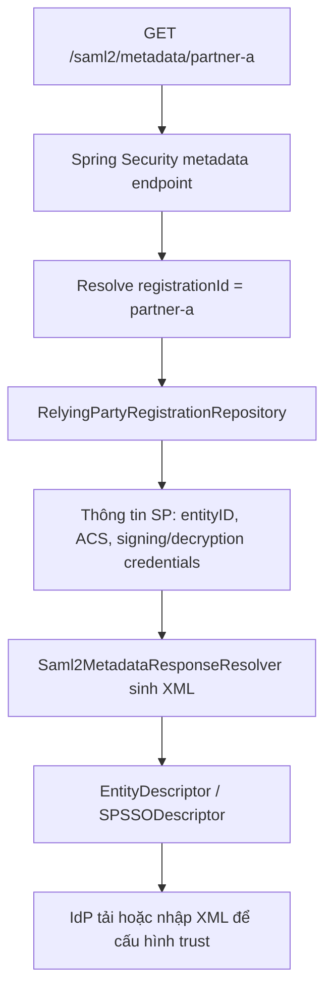

# Công bố metadata của Service Provider bằng `saml2Metadata` trong Spring Security

**Chủ đề:** Spring Security – federation → Metadata SAML2.

Khi ứng dụng Spring Boot đóng vai **SAML 2.0 Service Provider (SP, còn gọi Relying Party)**, Identity Provider (IdP, còn gọi Asserting Party) cần biết ứng dụng đó là ai, địa chỉ nào nhận `SAMLResponse`, cách ký yêu cầu xác thực và chứng chỉ công khai nào được SP sử dụng. Thay vì nhập thủ công hàng loạt trường, SP có thể **công bố một tài liệu metadata XML**; IdP nhập URL hoặc file metadata để thiết lập kết nối federation.

Spring Security cung cấp DSL **`HttpSecurity.saml2Metadata(...)`** để phát hành metadata từ các đối tượng `RelyingPartyRegistration` đã cấu hình. Bài học hướng dẫn cơ chế, ví dụ Java 17+ và Spring Boot, đường dẫn mặc định/tùy chỉnh, cách kiểm chứng XML, triển khai qua reverse proxy, xử lý nhiều IdP và quy trình phối hợp cấp chứng chỉ. Cấu hình minh họa cho **Servlet/MVC**, không dùng trực tiếp cho WebFlux.

## 1. SP metadata dùng để làm gì?

Một kết nối SAML Web SSO thường có hai bộ metadata:

| Tài liệu | Ai công bố? | Ai sử dụng? | Nội dung tiêu biểu |
| --- | --- | --- | --- |
| **SP/Relying Party metadata** | Ứng dụng Spring Security | IdP/đối tác | `entityID` của SP, `SPSSODescriptor`, ACS URL, binding, chứng chỉ công khai của SP nếu được khai báo, các cờ hỗ trợ ký |
| **IdP/Asserting Party metadata** | IdP | SP/Spring Security | `entityID` IdP, `IDPSSODescriptor`, SSO/SLO service URL, X.509 để SP kiểm chứng chữ ký từ IdP, binding được hỗ trợ |

**`saml2Metadata` công bố metadata của SP.** Nó không biến ứng dụng thành IdP; cũng không tự sinh identity provider, tài khoản người dùng hoặc cấu hình quyền nghiệp vụ. Để xử lý đăng nhập thật, ứng dụng còn cần `saml2Login`, IdP tin cậy, cấu hình assertion verification và chính sách authorization.

Ví dụ thực tế: portal `https://portal.example.com` cần đăng nhập qua IdP doanh nghiệp. Đội vận hành portal đưa đối tác đường dẫn:

```text
https://portal.example.com/saml2/metadata/partner-a
```

IdP tải XML, nhận biết `entityID` và `AssertionConsumerService Location` của portal, sau đó cấu hình gửi SAML Response về ACS. Nếu IdP yêu cầu SP ký `AuthnRequest`, đối tác cũng cần chứng chỉ **công khai** tương ứng của SP để xác minh chữ ký. SP đồng thời cần metadata/chứng chỉ công khai IdP để xác minh response.

**Phân biệt ba URL dễ nhầm:**

- **Metadata URL**: endpoint HTTP để *lấy file cấu hình XML*. Ví dụ `/saml2/metadata/partner-a`.
- **SP entity ID**: định danh logic, duy nhất và ổn định của SP trong federation; thường là URI nhưng không nhất thiết là một HTTP endpoint phải truy cập được.
- **ACS URL**: endpoint HTTP nơi browser **POST `SAMLResponse`**; mặc định `/login/saml2/sso/{registrationId}`.

Thay `metadataUrl` **không tự động đổi SP entity ID hoặc ACS URL**. Phải quản lý từng giá trị riêng và bảo đảm IdP tin đúng các giá trị được công bố.

## 2. Spring Security tạo metadata như thế nào?

`saml2Metadata` nối thêm một **metadata filter/response resolver** vào chuỗi filter Servlet. Khi có request tới URL metadata, Spring Security xác định `RelyingPartyRegistration` liên quan, lấy các thuộc tính SP trong registration rồi sinh nội dung XML theo SAML 2.0 Metadata specification.



**Đầu vào chính:** một `RelyingPartyRegistration`, trong đó có cả thông tin về SP (entity ID, ACS, credential ký/giải mã) và IdP được tin (entity ID, SSO location, verification certificates). Khi xuất SP metadata, điểm nhấn là **phần mô tả SP**.

**Đầu ra:** XML với `<md:EntityDescriptor>` hoặc một tập `<md:EntitiesDescriptor>` khi endpoint tổng hợp nhiều registration và repository hỗ trợ liệt kê. IdP có thể import XML hoặc dùng URL để tải; việc IdP tự động refresh định kỳ hay chỉ nhập một lần **do IdP quyết định**, không do `saml2Metadata` bảo đảm.

**Khi thay đổi registration hoặc chứng chỉ:** metadata được phát hành phải nhất quán với cấu hình ứng dụng đang chạy. Nếu IdP đang dùng bản metadata đã import từ lâu, việc SP đổi URL/chứng chỉ có thể khiến login đột ngột thất bại. Vì vậy metadata là **hợp đồng liên kết danh tính**, cần quy trình triển khai và phối hợp.

## 3. Những trường quan trọng trong SP metadata

Một tài liệu XML có thể trông như sau (mẫu học tập rút gọn; **không phải XML thực tế mà Spring Security luôn sinh ra**, không chứa chứng chỉ):

```xml
<?xml version="1.0" encoding="UTF-8"?>
<md:EntityDescriptor
    xmlns:md="urn:oasis:names:tc:SAML:2.0:metadata"
    entityID="https://portal.example.com/saml2/service-provider-metadata/partner-a">
    <md:SPSSODescriptor
        protocolSupportEnumeration="urn:oasis:names:tc:SAML:2.0:protocol"
        AuthnRequestsSigned="false"
        WantAssertionsSigned="true">
        <md:AssertionConsumerService
            Binding="urn:oasis:names:tc:SAML:2.0:bindings:HTTP-POST"
            Location="https://portal.example.com/login/saml2/sso/partner-a"
            index="0"
            isDefault="true"/>
    </md:SPSSODescriptor>
</md:EntityDescriptor>
```

| Thành phần XML | Ý nghĩa khi triển khai |
| --- | --- |
| `EntityDescriptor@entityID` | ID SP mà IdP dùng để ràng buộc audience/trust; phải khớp `entityID` IdP cấu hình cho portal |
| `SPSSODescriptor` | Tuyên bố ứng dụng có vai trò SAML Service Provider cho Web Browser SSO |
| `protocolSupportEnumeration` | Cho biết protocol được hỗ trợ; SAML 2.0 dùng URI protocol chuẩn |
| `AuthnRequestsSigned` | Tuyên bố kỳ vọng về việc SP ký `AuthnRequest`; phải nhất quán signing credentials và yêu cầu của IdP |
| `WantAssertionsSigned` | Thông tin về việc SP mong muốn assertion ký; vẫn phải áp chính sách xác minh Response/Assertion theo profile và Spring Security |
| `AssertionConsumerService@Binding` | Cách nhận response, rất thường là HTTP-POST, không tự đồng nghĩa với Redirect binding của `AuthnRequest` |
| `AssertionConsumerService@Location` | URL public browser POST `SAMLResponse` về SP, **khác URL metadata** |
| `KeyDescriptor use="signing"` | Có thể công bố chứng chỉ SP để IdP xác minh chữ ký `AuthnRequest` hoặc thông điệp tương ứng khi SP có signing credential |
| `KeyDescriptor use="encryption"` | Có thể công bố chứng chỉ public để IdP mã hóa assertion cho SP có private key giải mã |
| `SingleLogoutService` | Chỉ xuất hiện khi cấu hình/hỗ trợ SAML Single Logout tương ứng; login thành công không chứng minh SLO đã bật |

Trong `KeyDescriptor`, `ds:X509Certificate` chứa **certificate công khai mã hóa Base64**; **private key tuyệt đối không nằm trong metadata**. Không nhầm certificate IdP dùng để ký assertion với certificate SP dùng để ký AuthnRequest hoặc giải mã assertion. Không suy rằng mọi SP metadata đều có KeyDescriptor: còn tùy cách cấu hình credential.

**Chữ ký XML metadata** khác **chữ ký SAML Assertion**, **chữ ký AuthnRequest** và chứng chỉ **HTTPS/TLS**. Đưa metadata qua HTTPS giúp bảo vệ vận chuyển nhưng không mặc định chứng minh metadata XML có chữ ký XML. Nếu đối tác bắt buộc metadata được ký, kiểm tra khả năng và triển khai quy trình ký/phân phối đáng tin theo yêu cầu IdP; đừng tuyên bố `saml2Metadata` mặc định tạo `ds:Signature` khi chưa kiểm tra phản hồi thật.

## 4. Bật endpoint bằng `saml2Metadata`

Trong một `SecurityFilterChain` Servlet đã có SAML2 Login, chỉ cần thêm DSL:

```java
http
    .saml2Login(Customizer.withDefaults())
    .saml2Metadata(Customizer.withDefaults());
```

Đây là **mảnh cấu hình** nằm trong phương thức cấu hình `HttpSecurity`, không phải một chương trình Java độc lập. `saml2Login` phụ trách luồng xác thực SAML; `saml2Metadata` công bố metadata. Có thể dùng `saml2Metadata` để xuất tài liệu cho registration ngay cả khi tự triển khai các khâu khác, nhưng trong hệ thống Web SSO thông thường hai DSL cần phối hợp.

### 4.1. Các URL mặc định

Theo Spring Security Servlet metadata reference:

| Đường dẫn | Tác dụng |
| --- | --- |
| `GET /saml2/metadata` | Metadata của các registration có thể liệt kê; khi repository hỗ trợ Iterable có thể là một `EntitiesDescriptor` tổng hợp |
| `GET /saml2/metadata/{registrationId}` | SP metadata tương ứng một `RelyingPartyRegistration` |
| `GET /saml2/service-provider-metadata/{registrationId}` | URL tương thích đã được Spring Security hỗ trợ, cũng trả metadata theo registration |
| `GET /saml2/authenticate/{registrationId}` | **Không phải metadata**: khởi tạo `AuthnRequest` để login SP-initiated |
| `POST /login/saml2/sso/{registrationId}` | **Không phải metadata**: ACS nhận và xác minh `SAMLResponse` |

Ví dụ registration ID `partner-a` nên cung cấp link có ID rõ ràng `https://portal.example.com/saml2/metadata/partner-a`. Nếu có nhiều đối tác, endpoint tổng hợp `/saml2/metadata` có thể xuất nhiều thực thể; một số IdP chỉ chấp nhận một `EntityDescriptor`, nên dùng **URL theo registration** để import đúng cấu hình.

Đường dẫn metadata xuất hiện khi **chuỗi SecurityFilterChain chứa cấu hình `saml2Metadata` và request được xử lý đúng filter chain**. Nếu có nhiều filter chain (`@Order`, `securityMatcher`), cần kiểm tra chuỗi xử lý URL metadata; một filter chain dành riêng cho API có thể chặn hoặc không đăng ký bộ lọc metadata.

### 4.2. Đổi URL metadata

Nếu yêu cầu đặt endpoint dưới `/federation`, có thể cấu hình:

```java
http.saml2Metadata(metadata ->
    metadata.metadataUrl("/federation/sp-metadata/{registrationId}"));
```

`metadataUrl` thay **đường dẫn truy cập tài liệu metadata**. Nếu không có `{registrationId}`, khả năng trả một hay nhiều entity phụ thuộc repository/resolver. Khi dùng đường dẫn tùy chỉnh, phải cấp đúng URL mới cho đối tác và kiểm thử trực tiếp; không giả định mọi alias cũ vẫn được bật sau khi thay đổi DSL.

**Không nhầm:** thay đổi `/saml2/metadata/partner-a` thành `/federation/sp-metadata/partner-a` **không có nghĩa** IdP sẽ tự đổi `entityID` hoặc ACS. Nếu cần đổi entity ID/ACS vì tên miền hoặc kiến trúc, hãy sửa đúng thuộc tính của `RelyingPartyRegistration` và phối hợp với IdP.

## 5. Ví dụ Spring Boot 4.1.x + Java 17+: công bố SP metadata

Ví dụ sau là **một dự án Maven Spring Boot Servlet** với các lớp Java 17+. Nó cần internet/kho Maven để resolve dependency và một IdP metadata URI **thật** để khởi động và kiểm chứng SSO. Domain `example.com` chỉ minh họa, không vận hành được nếu chưa thay. Các tệp Java cần build bằng **Maven**, không phải `javac SecurityConfig.java` đơn lẻ.

Cấu trúc:

```text
saml-sp/
├── pom.xml
└── src/main/
    ├── java/com/example/saml/
    │   ├── SamlSpApplication.java
    │   └── SecurityConfig.java
    └── resources/application.yml
```

### 5.1. `pom.xml`

Ví dụ dùng Spring Boot `4.1.2` và starter SAML2 của dòng Boot 4. Spring Boot 3.5.x dùng `spring-security-saml2-service-provider` trực tiếp cùng starter MVC cũ `spring-boot-starter-web`. Không ghép ngẫu nhiên starter Boot 4 vào Boot 3.

```xml
<?xml version="1.0" encoding="UTF-8"?>
<project xmlns="http://maven.apache.org/POM/4.0.0"
         xmlns:xsi="http://www.w3.org/2001/XMLSchema-instance"
         xsi:schemaLocation="http://maven.apache.org/POM/4.0.0
           https://maven.apache.org/xsd/maven-4.0.0.xsd">
    <modelVersion>4.0.0</modelVersion>
    <parent>
        <groupId>org.springframework.boot</groupId>
        <artifactId>spring-boot-starter-parent</artifactId>
        <version>4.1.2</version>
        <relativePath/>
    </parent>
    <groupId>com.example</groupId>
    <artifactId>saml-sp</artifactId>
    <version>1.0.0</version>
    <properties>
        <java.version>17</java.version>
    </properties>

    <repositories>
        <repository>
            <id>shibboleth-releases</id>
            <url>https://build.shibboleth.net/maven/releases/</url>
            <snapshots><enabled>false</enabled></snapshots>
        </repository>
    </repositories>

    <dependencies>
        <dependency>
            <groupId>org.springframework.boot</groupId>
            <artifactId>spring-boot-starter-webmvc</artifactId>
        </dependency>
        <dependency>
            <groupId>org.springframework.boot</groupId>
            <artifactId>spring-boot-starter-security</artifactId>
        </dependency>
        <dependency>
            <groupId>org.springframework.boot</groupId>
            <artifactId>spring-boot-starter-security-saml2</artifactId>
        </dependency>
    </dependencies>

    <build>
        <plugins>
            <plugin>
                <groupId>org.springframework.boot</groupId>
                <artifactId>spring-boot-maven-plugin</artifactId>
            </plugin>
        </plugins>
    </build>
</project>
```

SAML2 Service Provider dựa trên **OpenSAML**; tài liệu Spring Security yêu cầu kho **Shibboleth Releases**. Nếu môi trường công ty có Nexus/Artifactory, cần mirror/proxy repository hợp lệ. Không sửa lỗi download bằng cách ép phiên bản OpenSAML thủ công không tương thích Spring Security.

### 5.2. `SamlSpApplication.java`

```java
package com.example.saml;

import org.springframework.boot.SpringApplication;
import org.springframework.boot.autoconfigure.SpringBootApplication;
import org.springframework.security.core.Authentication;
import org.springframework.web.bind.annotation.GetMapping;
import org.springframework.web.bind.annotation.RestController;

@SpringBootApplication
@RestController
public class SamlSpApplication {
    public static void main(String[] args) {
        SpringApplication.run(SamlSpApplication.class, args);
    }

    @GetMapping("/")
    String home() {
        return "SAML SP online";
    }

    @GetMapping("/private")
    String privatePage(Authentication authentication) {
        return "Authenticated as: " + authentication.getName();
    }
}
```

`/` là trang công khai để kiểm tra ứng dụng có khởi động; `/private` cần phiên đăng nhập. Kết quả của `/private` phụ thuộc `NameID`/principal thực sự nhận từ IdP, **không có một stdout login cố định**.

### 5.3. `SecurityConfig.java`

```java
package com.example.saml;

import org.springframework.context.annotation.Bean;
import org.springframework.context.annotation.Configuration;
import org.springframework.security.config.Customizer;
import org.springframework.security.config.annotation.web.builders.HttpSecurity;
import org.springframework.security.web.SecurityFilterChain;

@Configuration
public class SecurityConfig {
    @Bean
    SecurityFilterChain securityFilterChain(HttpSecurity http) throws Exception {
        http
            .authorizeHttpRequests(authorize -> authorize
                .requestMatchers(
                    "/",
                    "/error",
                    "/saml2/metadata",
                    "/saml2/metadata/**",
                    "/saml2/service-provider-metadata/**"
                ).permitAll()
                .anyRequest().authenticated()
            )
            .saml2Login(Customizer.withDefaults())
            .saml2Metadata(Customizer.withDefaults());

        return http.build();
    }
}
```

**Điểm mấu chốt là dòng `.saml2Metadata(Customizer.withDefaults())`.** Nó đăng ký endpoint xuất SP metadata và dùng repository đã được Boot dựng từ cấu hình. `permitAll` cho các GET metadata giúp đối tác có thể tải XML **không phải đăng nhập vào SP trước**. Tránh chặn bằng login redirect, nếu không IdP importer có thể nhận HTML login thay cho XML. Với yêu cầu bảo mật nội bộ, có thể giới hạn bằng mạng/gateway/IP allowlist thay vì mở công khai toàn Internet, nhưng IdP phải thực sự truy cập được.

Đừng thêm `.csrf(csrf -> csrf.disable())` cho toàn ứng dụng chỉ để metadata chạy. Endpoint metadata chỉ đọc; các POST khác vẫn cần chiến lược chống CSRF phù hợp. Spring Security SAML2 Login xử lý ACS POST theo cơ chế của nó; không tắt các bảo vệ không liên quan.

### 5.4. `application.yml` và nơi xác định SP metadata

```yaml
server:
  forward-headers-strategy: framework

spring:
  security:
    saml2:
      relyingparty:
        registration:
          partner-a:
            entity-id: https://portal.example.com/saml2/service-provider-metadata/partner-a
            assertingparty:
              metadata-uri: https://login.partner.example/metadata.xml
```

- `partner-a` là **registrationId** của một liên kết SP–IdP.
- `entity-id` là **định danh logic của SP**, được khai báo rõ để không phụ thuộc tên host nội bộ; phải khớp entity ID bên IdP.
- `assertingparty.metadata-uri` là **metadata URL của IdP**, được Spring Security dùng để xây registration chứa issuer, SSO URL và certificate tin cậy của IdP. **Đây không phải URL xuất SP metadata.**
- ACS của Spring Security có mặc định `{baseUrl}/login/saml2/sso/{registrationId}`; dưới host public của ví dụ, endpoint mong muốn là `https://portal.example.com/login/saml2/sso/partner-a`. Kiểm chứng giá trị **thật** trong XML được sinh và đăng ký chính xác với IdP.
- `forward-headers-strategy: framework` hữu ích **nếu ứng dụng nằm sau reverse proxy tin cậy** chuyển `Forwarded`/`X-Forwarded-*` đã được proxy làm sạch. Không tin header forwarded trực tiếp từ Internet hoặc từ client không được kiểm soát. Nếu không dùng proxy, có thể bỏ phần cấu hình này.

**Quan trọng:** nếu chưa có IdP metadata thật, cấu hình mẫu `https://login.partner.example/metadata.xml` sẽ không cho bạn môi trường login hoạt động. Lấy metadata IdP thật, certificate phù hợp và thống nhất entity ID/ACS trước khi thử tích hợp. Tên thuộc tính Boot có thể thay đổi theo major: luôn đối chiếu reference của đúng bản Boot đang dùng.

### 5.5. Chạy, lấy metadata và so với hợp đồng IdP

Tại thư mục dự án:

```bash
mvn -DskipTests compile
mvn spring-boot:run
```

Khi server chạy với IdP metadata hợp lệ, truy cập tại máy có thể dùng `http://localhost:8080/saml2/metadata/partner-a`, nhưng **đây chỉ là địa chỉ phát triển**. Nếu metadata sinh ra còn chứa `localhost` ở ACS hoặc host sai, **không nhập file đó cho production**. Đối tác production phải tải qua domain HTTPS chính thức để các URL public xuất hiện chính xác.

Trên máy có thể truy cập host public:

```bash
curl -fSL -D metadata-headers.txt \
  https://portal.example.com/saml2/metadata/partner-a \
  -o sp-metadata.xml
```

Kiểm tra file có XML metadata, bắt đầu từ `EntityDescriptor`/`EntitiesDescriptor`; không bị redirect về login form, không trả `404`/`500`. Sau đó xác nhận bằng mắt hoặc công cụ XML:

```bash
xmllint --noout sp-metadata.xml
grep -E 'entityID=|AssertionConsumerService|KeyDescriptor' sp-metadata.xml
```

`xmllint`/`grep` là công cụ bên ngoài JDK, phải cài sẵn nếu sử dụng. Kiểm tra XML well-formed chỉ là bước cơ bản: **cần đối chiếu entity ID, ACS, binding, cert và chính sách IdP**, và kiểm thử login SAML thực sự.

## 6. Bài thực hành Java 17 kiểm tra nội dung XML metadata

Để hiểu rõ một SP metadata phải chứa gì, có thể tạo tệp `sp-example.xml` với **mẫu XML trong mục 3**, sau đó dùng chương trình JDK đơn giản đọc thông tin `EntityDescriptor` và `AssertionConsumerService`. Mẫu này chạy độc lập, không yêu cầu Spring; chỉ xác minh cấu trúc/giá trị, **không thực hiện XML signature validation hoặc đánh giá trust**.

Tệp `MetadataInspector.java`:

```java
import java.nio.file.Path;
import javax.xml.XMLConstants;
import javax.xml.parsers.DocumentBuilderFactory;
import org.w3c.dom.Document;
import org.w3c.dom.Element;
import org.w3c.dom.NodeList;

public class MetadataInspector {
    private static final String NS =
            "urn:oasis:names:tc:SAML:2.0:metadata";

    public static void main(String[] args) throws Exception {
        if (args.length != 1) {
            throw new IllegalArgumentException(
                    "Usage: java MetadataInspector metadata.xml");
        }

        DocumentBuilderFactory factory =
                DocumentBuilderFactory.newInstance();
        factory.setNamespaceAware(true);
        factory.setFeature(
                XMLConstants.FEATURE_SECURE_PROCESSING, true);
        factory.setFeature(
                "http://apache.org/xml/features/disallow-doctype-decl",
                true);
        factory.setXIncludeAware(false);
        factory.setExpandEntityReferences(false);

        Document doc = factory.newDocumentBuilder()
                .parse(Path.of(args[0]).toFile());

        NodeList entities = doc.getElementsByTagNameNS(
                NS, "EntityDescriptor");
        if (entities.getLength() != 1) {
            throw new IllegalArgumentException(
                    "Expected exactly one EntityDescriptor");
        }
        Element entity = (Element) entities.item(0);

        NodeList descriptors = entity.getElementsByTagNameNS(
                NS, "SPSSODescriptor");
        if (descriptors.getLength() != 1) {
            throw new IllegalArgumentException(
                    "Expected exactly one SPSSODescriptor");
        }

        NodeList endpoints = entity.getElementsByTagNameNS(
                NS, "AssertionConsumerService");
        if (endpoints.getLength() == 0) {
            throw new IllegalArgumentException(
                    "No AssertionConsumerService declared");
        }

        Element firstAcs = (Element) endpoints.item(0);
        System.out.println("Entity ID: "
                + entity.getAttribute("entityID"));
        System.out.println("SP descriptors: "
                + descriptors.getLength());
        System.out.println("ACS location: "
                + firstAcs.getAttribute("Location"));
    }
}
```

Giả sử `sp-example.xml` lưu nguyên mẫu XML trong mục 3, chạy JDK 17+:

```bash
javac MetadataInspector.java
java MetadataInspector sp-example.xml
```

**Stdout chính xác với XML mẫu:**

```text
Entity ID: https://portal.example.com/saml2/service-provider-metadata/partner-a
SP descriptors: 1
ACS location: https://portal.example.com/login/saml2/sso/partner-a
```

Chương trình từ chối DTD để hạn chế XML External Entity/XXE trên tệp đầu vào và chỉ đọc thuộc tính; nó **không xác minh đúng SAML protocol, chữ ký metadata hay chính sách federation**, vì vậy không dùng nó thay thư viện OpenSAML/Spring Security để tin metadata hoặc đăng nhập. Nếu lấy `/saml2/metadata` tổng hợp có nhiều `EntityDescriptor`, chương trình cố ý không nhận; để kiểm tra một registration hãy tải URL có `/{registrationId}`.

## 7. Cấu hình endpoint tùy chỉnh và giải quyết registration

### 7.1. Tùy chỉnh một đường dẫn theo registration

Trong `SecurityConfig`, thay DSL mặc định bằng:

```java
.saml2Login(Customizer.withDefaults())
.saml2Metadata(metadata ->
    metadata.metadataUrl("/federation/metadata/{registrationId}"));
```

Khi đó, với registration `partner-a`, đường dẫn mong muốn là `GET /federation/metadata/partner-a`. Nếu dùng allowlist URL, cập nhật `requestMatchers` để cho phép đường dẫn mới. Kiểm tra route thực tế sau khi deploy; URL cũ có thể không còn là endpoint được phục vụ.

### 7.2. Khi có nhiều IdP/đối tác

Một `RelyingPartyRegistration` biểu diễn một liên kết SP–IdP. Repository có thể chứa:

```text
partner-a → SP entityID A + ACS A + IdP A
partner-b → SP entityID B + ACS B + IdP B
internal  → SP entityID nội bộ + ACS nội bộ + IdP nội bộ
```

Cung cấp `/saml2/metadata/partner-a` riêng cho IdP A và `/saml2/metadata/partner-b` cho IdP B. Trong vài kiến trúc, nhiều registration có thể dùng chung SP entity ID/ACS, nhưng **không tự giả định chúng đều như nhau**: phải tuân theo khả năng IdP, entity ID ổn định, issuer và quy tắc tenant.

Ở `/saml2/metadata`, nếu repository là `Iterable`, Spring Security có thể xuất danh sách metadata dưới dạng `EntitiesDescriptor`. Nhiều IdP chỉ hỗ trợ import một entity tại một thời điểm, vì vậy **URL theo registration** là điểm bắt đầu ít mơ hồ hơn. Không công bố tổng hợp tenant nội bộ nếu nó làm lộ danh sách đối tác không cần thiết.

### 7.3. Khi cơ chế lookup mặc định chưa đủ

Spring Security hỗ trợ `Saml2MetadataResponseResolver`, ví dụ `RequestMatcherMetadataResponseResolver`, để tùy biến cách xác định registration và tên file metadata. Có thể dùng khi đường dẫn không chứa `registrationId` hoặc khi tenant được phân giải theo host đã tin cậy. Tuy nhiên:

- Resolver phải **tra từ allowlist registration cấu hình trước**, không nhận issuer/certificate tùy ý từ query string.
- Nếu truy cập qua domain/host nhiều tenant, phải chỉ tin host đã được proxy xác nhận; không biến một `Host` header tùy ý thành entity ID hợp lệ.
- Tạo metadata cho đúng SP entityID/ACS/credential của tenant, tránh tráo issuer hoặc dùng nhầm certificate của tenant khác.
- Sau thay đổi resolver, test từng tenant trong môi trường thật, bao gồm trường hợp ID không tồn tại (phải trả lỗi an toàn).

Tùy chỉnh response resolver là giải pháp nâng cao. Với một hoặc vài registration tĩnh, DSL mặc định dễ bảo trì và dễ đối chiếu tài liệu hơn.

## 8. Tạo đúng entity ID và ACS khi triển khai qua reverse proxy

**Đây là nguyên nhân phổ biến nhất khiến SP metadata nhìn có XML hợp lệ nhưng IdP không thể đăng nhập.**

Ví dụ hạ tầng:

```text
Browser / IdP
  → https://portal.example.com  (Ingress / Load Balancer)
  → http://saml-sp:8080          (Spring Boot bên trong)
```

Nếu Spring xây `{baseUrl}` từ request nội bộ mà không nhận thông tin proxy đáng tin, metadata có thể công bố:

```text
entityID = http://saml-sp:8080/saml2/service-provider-metadata/partner-a
ACS      = http://saml-sp:8080/login/saml2/sso/partner-a
```

IdP cần giá trị **public**:

```text
entityID = https://portal.example.com/saml2/service-provider-metadata/partner-a
ACS      = https://portal.example.com/login/saml2/sso/partner-a
```

Để xử lý:

1. Đặt public DNS, HTTPS, base path/context path chính xác; cấu hình ingress/gateway để chuyển tiếp `Host`/`X-Forwarded-Proto`/`X-Forwarded-Host` hoặc `Forwarded` **từ proxy tin cậy**.
2. Trong Boot, cấu hình forwarded-header strategy thích hợp cho hạ tầng; không cho untrusted client giả mạo header làm SP phát hành metadata sai host.
3. Cố định SP `entity-id` ở cấu hình nếu hợp đồng IdP yêu cầu identifier ổn định. Mặc định Spring Security dùng mẫu `{baseUrl}/saml2/service-provider-metadata/{registrationId}`; khi thay đổi host/port sẽ ảnh hưởng nếu phụ thuộc default.
4. Kiểm tra metadata tại **domain public** thay vì chỉ thử `localhost`. So sánh chính xác scheme/host/port/path/URI encoding của `entityID` và ACS.
5. Nếu ứng dụng có prefix như `/portal`, đảm bảo ingress không gỡ/nhân đôi prefix khiến IdP POST vào URL khác.
6. Không đổi ACS trong IdP trước khi ứng dụng đã thực sự nhận POST ở endpoint mới; nếu đổi endpoint cần triển khai có kế hoạch và kiểm thử cả luồng.

**Entity ID không bắt buộc là metadata endpoint:** mặc dù default trông giống URL metadata tương thích, entity ID chỉ là định danh đã thỏa thuận. Khi đổi `metadataUrl`, không được suy diễn entity ID tự đổi theo. Nếu đã có IdP phụ thuộc entity ID cũ, thay nó có thể được xem như đăng ký một SP mới và làm đứt federation.

## 9. Chứng chỉ SP, ký AuthnRequest và xoay vòng metadata

SP có thể sở hữu private key dùng để:

- **Ký AuthnRequest** để IdP xác minh ứng dụng gửi yêu cầu xác thực. Certificate công khai tương ứng có thể được đưa vào SP metadata khi có signing credential.
- **Giải mã EncryptedAssertion/EncryptedID** mà IdP mã hóa cho SP. Metadata có thể công bố certificate public để IdP mã hóa.
- **Ký logout request/response** trong giao thức SAML Single Logout nếu cả hai bên hỗ trợ và cấu hình.

**Spring `saml2Metadata` không tự tạo private key cho hệ thống nếu bạn chưa cấu hình.** Cài SAML2 starter và bật endpoint không tự khiến SP bắt đầu ký mọi request. Nếu IdP yêu cầu `AuthnRequestsSigned="true"`, cần cấu hình `signing.credentials` thích hợp và kiểm thử rằng AuthnRequest thực sự được ký đúng binding và chứng chỉ. Chỉ sửa cờ trong metadata XML mà không có private key thực tế sẽ không giúp đăng nhập.

Minh họa **đường dẫn thuộc tính Boot** (chỉ áp dụng khi đã có certificate và private key thật; đường dẫn `classpath` trong production phải theo chính sách secret management):

```yaml
spring:
  security:
    saml2:
      relyingparty:
        registration:
          partner-a:
            signing:
              credentials:
                - private-key-location: file:/run/secrets/sp-signing.key
                  certificate-location: file:/run/secrets/sp-signing.crt
            assertingparty:
              metadata-uri: https://login.partner.example/metadata.xml
```

Cặp key/certificate phải khớp nhau, key được bảo vệ bằng quyền file/secret manager; **chỉ certificate public xuất hiện trong metadata**. Nếu IdP dùng response/assertion encryption, cấu hình **decryption credential riêng** khi cần. Nếu dùng cùng một cặp key cho nhiều mục đích, cần được phê duyệt và có quy trình bảo vệ/rotation rõ ràng.

**Quy trình xoay chứng chỉ không gián đoạn:**

1. Tạo cặp khóa mới và chuẩn bị certificate công khai theo chính sách.
2. Thống nhất với IdP cách đưa certificate mới vào trust store; nếu IdP hỗ trợ nhiều certificate, đưa **cũ + mới** vào giai đoạn chuyển tiếp để không ngắt quãng.
3. Công bố metadata mới tương ứng theo lịch phối hợp; bảo đảm IdP đã tải/nhập, tin certificate mới trước khi SP ký bằng private key mới.
4. Chuyển sang key mới, thử AuthnRequest/response thật; giám sát lỗi signature, encryption và SSO.
5. Chỉ gỡ key/certificate cũ khi chắc chắn IdP không còn sử dụng, cả quy trình rollback và phiên đang có đã được xử lý.

Một số IdP **không tự đồng bộ metadata**, nên việc XML của Spring đã đổi không có nghĩa IdP đã đổi. Thông báo chính thức, ghi lại fingerprint, ngày hiệu lực và chủ sở hữu rotation.

## 10. Quy trình bàn giao metadata cho IdP

Khi cả SP và IdP đã có thông tin định danh tối thiểu:

1. **Xác nhận registration:** `partner-a` liên kết đúng IdP A; đã có metadata IdP, verification certificate và SSO endpoint đúng.
2. **Triển khai public domain:** DNS, HTTPS, proxy, session/ACS và SecurityFilterChain hoạt động.
3. **Bật `saml2Metadata`**, đảm bảo GET metadata không đòi login hoặc bị gateway redirect.
4. **Lấy SP metadata** từ `/saml2/metadata/partner-a` trên domain public; lưu XML làm bản kiểm chứng release.
5. **Kiểm tra XML và trường hợp đồng:** entity ID, ACS binding/location, NameIDFormat nếu có, AuthnRequestsSigned/WantAssertionsSigned, signing/encryption KeyDescriptor.
6. **Cung cấp URL hoặc file XML cho IdP**, xác nhận IdP đã import đúng entity; không cung cấp private key/secret.
7. **Kiểm tra cấu hình chiều ngược lại:** SP trust IdP issuer/certificate; IdP trust SP entity ID/certificate đúng hợp đồng.
8. **Thử SP-initiated login** từ `/saml2/authenticate/partner-a` và callback đến ACS; xác minh issuer, destination, audience, response signature, hạn dùng và session.
9. **Kiểm tra lỗi và tình huống nâng cấp:** sai certificate, sai ACS, sai entity ID, metadata quá cũ, login từ tenant khác, IdP outage, logout và certificate rotation.
10. **Chốt vận hành:** lưu phiên bản metadata/fingerprint, đầu mối chịu trách nhiệm, lịch cập nhật IdP và biện pháp rollback.

Ví dụ checklist ký nhận với đối tác:

| Trường cần xác nhận | Giá trị ví dụ | Vai trò |
| --- | --- | --- |
| SP entity ID | `https://portal.example.com/saml2/service-provider-metadata/partner-a` | IdP nhận biết SP và kiểm tra audience |
| SP metadata URL | `https://portal.example.com/saml2/metadata/partner-a` | IdP tải XML |
| ACS URL | `https://portal.example.com/login/saml2/sso/partner-a` | Browser POST SAMLResponse |
| ACS Binding | HTTP-POST | Tương thích cấu hình SAML ở IdP |
| IdP entity ID | Theo metadata IdP chính thức | SP kiểm chứng issuer |
| IdP signing certificate | Theo metadata/trust anchor IdP | SP xác minh response/assertion |
| SP signing certificate | Có nếu SP được cấu hình ký AuthnRequest | IdP xác minh request từ SP |
| Contact/rotation policy | Người chịu trách nhiệm hai bên | Thay certificate/URL tránh downtime |

## 11. Bảo mật khi công bố SP metadata

SP metadata thường là dữ liệu **cấu hình công khai để IdP thiết lập trust**, nhưng vẫn cần bảo vệ quá trình công bố:

- **HTTPS và trusted host:** chống thay đổi metadata trong quá trình tải; chống Host Header/Forwarded Header injection để không xuất XML có endpoint do kẻ tấn công điều khiển.
- **Không chứa private key:** chỉ công bố public certificate. Nếu thấy private key, token hay secret trong metadata/log, đó là sự cố cấu hình cần điều tra.
- **Không tự coi URL metadata là nguồn đáng tin tuyệt đối:** IdP phải nhận URL qua kênh đã xác thực, đối chiếu entity ID, chứng chỉ, fingerprint/chính sách ký. Metadata có XML hợp lệ vẫn có thể do nguồn không đáng tin phát hành.
- **Giới hạn công bố multi-tenant:** metadata aggregate có thể tiết lộ tên registration hoặc cấu trúc liên kết. Nếu cần bảo mật danh sách đối tác, ưu tiên URL theo registration và policy truy cập mạng.
- **Không tắt validation SAML:** việc import SP metadata ở IdP chỉ tạo trust/config; SP vẫn phải xác minh IdP signature, issuer, conditions, recipient/audience, replay và tenant khi xử lý SAMLResponse.
- **Hạn chế thay đổi đường dẫn bất ngờ:** metadata URL, entity ID, ACS và signing credentials là bốn trục khác nhau; mỗi thay đổi có thể ảnh hưởng IdP độc lập.
- **Cache và CDN:** nếu proxy/CDN cache XML, kiểm tra TTL/ETag và invalidation trước rotation; tránh IdP lấy metadata cũ hoặc nhận HTML lỗi được cache.
- **Giám sát HTTP metadata:** báo động `404`, `302` tới login, `500`, XML rỗng, entity ID/ACS sai và certificate sắp đến hạn thay thế. Không lưu toàn bộ private material hay session cookie vào log.
- **Không nhập XML từ nguồn tùy ý vào SP:** khi lấy IdP metadata qua URL, đánh giá nguồn được tin, SSRF, XML signature verification khi yêu cầu, và các chính sách refresh/cache phù hợp. Hỗ trợ đọc metadata IdP không đồng nghĩa có thể tin mọi URL được người dùng cung cấp.

## 12. Xử lý lỗi thường gặp

| Hiện tượng | Nguyên nhân có thể | Cách kiểm tra/sửa |
| --- | --- | --- |
| `GET /saml2/metadata/partner-a` trả **404** | Chưa bật `saml2Metadata`, sai registration ID, request chạy qua SecurityFilterChain khác, context path hoặc gateway rewrite sai | Xem cấu hình DSL, danh sách registration hợp lệ, đường dẫn thực tế và route tại proxy |
| GET metadata trả **302 login** hoặc HTML | URL metadata bị bảo vệ/redirect, gateway chặn, filter chain chưa permit | Cho phép GET metadata đúng đường dẫn hoặc cung cấp truy cập riêng cho IdP; xác minh Content-Type và XML trả về |
| Response **500** khi xuất metadata | `RelyingPartyRegistration` thiếu/sai, IdP metadata không tải được, credential không đọc được, cấu hình XML/xác thực lỗi | Đọc log server đã lọc; kiểm tra IdP metadata URL, repository, certificate/key và startup |
| XML có `http://localhost` hoặc tên container ở ACS | Public host/forwarded headers không đúng | Kiểm tra reverse proxy, URL public, trusted headers và base URL; cố định entity ID khi cần |
| IdP báo `Invalid Entity ID` / `AudienceMismatch` | IdP đăng ký một entity ID khác giá trị SP thực dùng | So chính xác `EntityDescriptor@entityID`, AudienceRestriction và cấu hình IdP |
| IdP POST vào ACS sai hoặc 404 | Metadata/IdP dùng ACS host/path cũ, binding không trùng, ingress rewrite | Đối chiếu `AssertionConsumerService@Location` với URL nhận callback thật |
| Không có `KeyDescriptor` | Chưa cấu hình signing/decryption credential hoặc dùng cấu hình khác registration | Xem nhu cầu IdP và `signing.credentials`/`decryption.credentials` của registration |
| IdP từ chối `AuthnRequest` unsigned | IdP yêu cầu chữ ký nhưng SP chưa có credential hoặc chưa ký request | Cấu hình signing credentials và trao certificate public theo metadata |
| Đổi cert nhưng login thất bại | IdP chưa refresh/import, chỉ tin certificate cũ, metadata cache stale | Phối hợp rotation, kiểm tra trust store/fingerprint và giai đoạn cũ+mới |
| `/saml2/metadata` chứa nhiều entities, IdP không import | Repository là Iterable và endpoint tổng hợp | Dùng `/saml2/metadata/{registrationId}` để lấy một entity |
| Login SP-initiated thất bại dù metadata đúng | Sai issuer/chữ ký, session/cookie làm mất AuthnRequest, `InResponseTo` không khớp, replay, thời gian | Kiểm tra trace SAML, request repository, cookie SameSite, clock skew; không tắt validation |
| Môi trường dev chạy nhưng production không | DNS/TLS/proxy, metadata URL, hostname, certificate và IdP registration khác | Dùng metadata public từ chính production và test end-to-end với IdP production/sandbox |

**Thứ tự debug hữu ích:** thử GET metadata và xác nhận XML đúng → kiểm tra SP entity ID/ACS → xác minh IdP import/trust → thử AuthnRequest/Response → điều tra SAML validation/session. Không nhầm metadata endpoint với ACS hoặc coi `curl 200` là bằng chứng đăng nhập thành công.

## 13. Kiểm thử chấp nhận trước khi giao IdP

**Metadata endpoint**
- [ ] `GET /saml2/metadata/partner-a` trả metadata XML cho đúng registration, không redirect HTML login.
- [ ] XML parse được và có đúng `SPSSODescriptor`, `entityID`, ACS URL/binding dự kiến.
- [ ] URL metadata qua domain HTTPS public hiển thị chính xác scheme/host/port/context path; không rò hostname nội bộ.
- [ ] Metadata theo registration A khác/đúng logic registration B; không bị lộ nhầm tenant.
- [ ] `metadataUrl` tùy chỉnh được xác minh riêng; route cũ, route mới và security matcher khớp thiết kế.
- [ ] Nếu có certificate, XML chỉ chứa public certificate và IdP trust đúng key.

**Tích hợp federation**
- [ ] IdP import SP metadata đúng, không nhầm entity ID với metadata URL hoặc ACS.
- [ ] SP-initiated login gửi AuthnRequest tới đúng IdP và nhận response vào ACS được công bố.
- [ ] IdP ký response/assertion và SP xác minh issuer/audience/recipient/time/chữ ký/replay theo chính sách.
- [ ] Nếu IdP yêu cầu ký AuthnRequest, request thực sự có signature hợp lệ theo binding, certificate đã được IdP tin.
- [ ] Thử rotate certificate/môi trường fail, kết quả lỗi an toàn, không tắt xác minh để đạt PASS.
- [ ] Cookie/session/reverse proxy không làm mất request tương quan; authorization theo user/tenant được đánh giá độc lập.
- [ ] Lưu bản metadata đã phê duyệt, ngày hiệu lực, đầu mối liên hệ và kế hoạch rollback.

## 14. Tài liệu tham khảo chính thức

1. [Spring Security – SAML 2.0 Metadata](https://docs.spring.io/spring-security/reference/servlet/saml2/metadata.html): `saml2Metadata`, endpoint mặc định, `metadataUrl` và `Saml2MetadataResponseResolver`.
2. [Spring Security – SAML 2.0 Login Overview](https://docs.spring.io/spring-security/reference/servlet/saml2/login/overview.html): `RelyingPartyRegistration`, `entityID`, ACS, phiên login và quyền xác minh IdP.
3. [Spring Security – SAML 2.0 Logout](https://docs.spring.io/spring-security/reference/servlet/saml2/logout.html): metadata/credential cho Single Logout khi có nhu cầu.
4. [Spring Security – `HttpSecurity.saml2Metadata` JavaDoc](https://docs.spring.io/spring-security/reference/api/java/org/springframework/security/config/annotation/web/builders/HttpSecurity.html): API và route metadata thực tế.
5. [Spring Security – `Saml2MetadataConfigurer` JavaDoc](https://docs.spring.io/spring-security/reference/api/java/org/springframework/security/config/annotation/web/configurers/saml2/Saml2MetadataConfigurer.html): tùy biến URL và resolver.
6. [OASIS – SAML 2.0 Metadata Specification](https://docs.oasis-open.org/security/saml/v2.0/saml-metadata-2.0-os.pdf): định nghĩa XML `EntityDescriptor`/`SPSSODescriptor`, service endpoints và `KeyDescriptor`.
7. [Spring Boot – Reference Documentation](https://docs.spring.io/spring-boot/reference/): starter, server/proxy/forwarded headers và cấu hình ứng dụng theo phiên bản.

**Điểm cần nhớ:** `saml2Metadata` **công bố hợp đồng metadata XML của SP**; `RelyingPartyRegistration` quyết định entity ID, ACS và credentials trong đó. Hãy kiểm tra tài liệu xuất ra dưới **domain HTTPS thực**, so khớp với cấu hình IdP và kiểm thử login SAML end-to-end. Metadata đúng cú pháp là điều kiện khởi đầu, còn đăng nhập an toàn phụ thuộc trust, chữ ký, audience, thời gian, phiên và phân quyền.