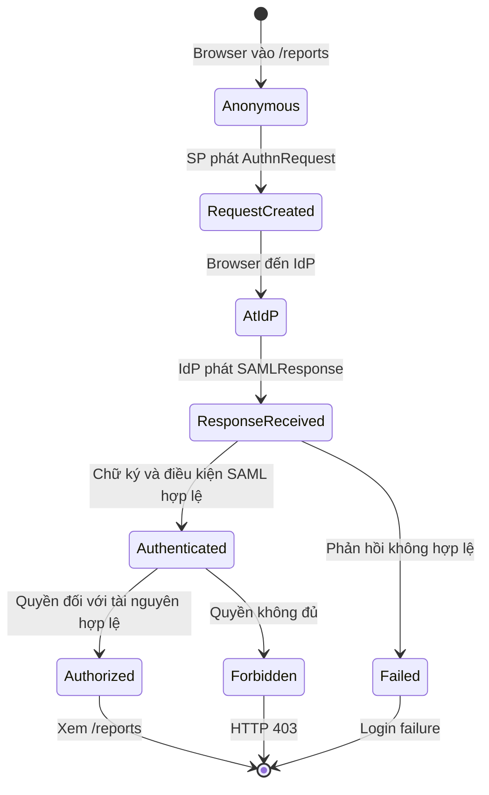

# Đường đi từ tài nguyên được bảo vệ đến IdP và trở lại ứng dụng

## Mục tiêu học tập

Sau bài học này, bạn có thể:

1. Kể lại đúng thứ tự luồng **SAML 2.0 Web Browser SSO do Service Provider khởi tạo (SP-initiated)**, từ `GET /private` chưa được xác thực cho đến khi ứng dụng cấp phiên và hiển thị lại tài nguyên.
2. Xác định vai trò **trình duyệt**, **Relying Party / Service Provider (RP/SP)**, **Asserting Party / Identity Provider (AP/IdP)** và các thành phần Spring Security tương ứng.
3. Phân biệt **điểm khởi tạo AuthnRequest** (`/saml2/authenticate/{registrationId}`) với **Assertion Consumer Service – ACS** (`/login/saml2/sso/{registrationId}`); hiểu `SAMLRequest`, `SAMLResponse`, `RelayState`, `InResponseTo` và `RelyingPartyRegistration`.
4. Giải thích quá trình Spring Security chặn tài nguyên, tạo/chuyển `AuthnRequest`, nhận SAML Response, kiểm tra chữ ký và điều kiện xác thực, rồi lưu `Authentication` vào `SecurityContext`/phiên ứng dụng.
5. Cấu hình một ứng dụng Spring Boot 3/Spring Security 6 minh họa và lần theo từng HTTP request, đồng thời chẩn đoán lỗi redirect loop, mất phiên, ACS sai, chữ ký sai và 403 sau đăng nhập.
6. Phân biệt thành công của **authentication** với quyết định **authorization** cuối cùng của từng tài nguyên.

## 1. Bối cảnh và phạm vi

**SAML 2.0 Web Browser SSO** cho phép ứng dụng ủy thác bước xác thực danh tính cho IdP đã được thiết lập tin cậy. Trong mô hình **SP-initiated**, người dùng **đến một tài nguyên được bảo vệ ở ứng dụng trước**, và ứng dụng bắt đầu thủ tục đăng nhập. Sau khi IdP xác thực, trình duyệt đưa SAML Response trở lại ứng dụng tại ACS.

Trong bài này:

| Thành phần | Vai trò | Ví dụ |
| --- | --- | --- |
| **Người dùng** | Người muốn mở chức năng yêu cầu đăng nhập | Nhân viên mở `/reports` |
| **Browser** | Đi theo redirect, chuyển form POST, mang cookie; không tự xác minh danh tính | Trình duyệt trên máy người dùng |
| **SP/RP** | Ứng dụng nhận assertion, kiểm chứng thông điệp và tạo phiên cục bộ | Spring Boot ở `https://portal.example.org` |
| **IdP/AP** | Hệ thống xác thực người dùng, ký SAML Response/Assertion và có thể mã hóa assertion | `https://idp.example.org` |
| **Relying Party Registration** | Cấu hình liên kết chính xác một quan hệ SP–IdP | Registration ID `company` |

**Authentication** trả lời “người dùng này đã được xác thực theo quan hệ SAML đáng tin chưa?”. **Authorization** trả lời “người dùng đã xác thực có được xem báo cáo, sửa dữ liệu hay phê duyệt không?”. Luồng SSO hoàn tất **không tự cấp quyền** vào mọi tài nguyên.

**Lưu ý thuật ngữ:** trong tài liệu Spring Security, **Relying Party** thường đồng nghĩa **Service Provider**, và **Asserting Party** đồng nghĩa **Identity Provider**. Spring Security SAML2 Login là cơ chế để **ứng dụng Servlet đóng vai RP/SP**; nó không biến ứng dụng thành IdP.

## 2. Sơ đồ toàn cảnh SP-initiated login

Giả định người dùng đang **chưa đăng nhập vào ứng dụng** và gọi đường dẫn `/reports`.

```mermaid
sequenceDiagram
    actor U as Người dùng
    participant B as Browser
    participant SP as Spring Security (SP)
    participant IDP as IdP (AP)
    U->>B: Truy cập /reports
    B->>SP: GET /reports + cookie nếu có
    SP->>SP: AuthorizationFilter -> chưa authenticated
    SP-->>B: 302 tới SAML authentication request endpoint
    B->>SP: GET /saml2/authenticate/company
    SP->>SP: Tạo và lưu AuthnRequest, RelayState
    SP-->>B: 302 tới IdP SSO kèm SAMLRequest
    B->>IDP: GET SSO?SAMLRequest=...&RelayState=...
    IDP->>U: Hiển thị login/MFA nếu cần
    U->>IDP: Hoàn tất xác thực
    IDP->>IDP: Tạo, ký Response/Assertion
    IDP-->>B: HTML form chứa SAMLResponse
    B->>SP: POST /login/saml2/sso/company
    SP->>SP: Resolve registration; verify/decrypt/validate
    SP->>SP: Tạo Authentication, lưu SecurityContext/session
    SP-->>B: 302 quay lại /reports (tùy success handler)
    B->>SP: GET /reports + application session cookie
    SP-->>B: 200 nếu có quyền; 403 nếu thiếu quyền
    B-->>U: Hiển thị kết quả
```

Đường đi gồm **hai lần browser quay tới SP có mục đích khác nhau**: lần đầu là tài nguyên cần bảo vệ, lần sau là **ACS nhận SAMLResponse**. Sau khi xác thực, browser thường được chuyển tới tài nguyên gốc qua **saved request**; cơ chế điều hướng thành công có thể được tùy chỉnh nên không phải ứng dụng nào cũng trả đúng một chuỗi 302 giống hệt sơ đồ.

### 2.1. Các URL mẫu

| Thành phần | URL ví dụ | Mục đích |
| --- | --- | --- |
| Tài nguyên bảo vệ | `https://portal.example.org/reports` | Nơi người dùng định truy cập ban đầu |
| Điểm tạo yêu cầu | `https://portal.example.org/saml2/authenticate/company` | Spring Security tạo `AuthnRequest` và khởi động luồng SP-initiated |
| IdP SSO endpoint | `https://idp.example.org/sso` | IdP nhận yêu cầu đăng nhập qua binding đã thỏa thuận |
| ACS / callback | `https://portal.example.org/login/saml2/sso/company` | SP nhận HTTP POST có `SAMLResponse` |
| SP entity ID | `https://portal.example.org/saml2/service-provider-metadata/company` | Định danh SAML dùng làm issuer của yêu cầu và audience của assertion theo thỏa thuận |
| IdP entity ID | `https://idp.example.org/saml` | Issuer mà RP/SP được phép tin |

`company` là `registrationId` nội bộ của Spring Security; **không phải** định danh người dùng hoặc entity ID của IdP. Khi có nhiều IdP, registration ID giúp xác định đúng cấu hình khóa, issuer, SSO URL, ACS và chính sách.

## 3. Bước 1 – Tài nguyên được bảo vệ kích hoạt Spring Security

Trình duyệt gửi một HTTP request như:

```http
GET /reports HTTP/1.1
Host: portal.example.org
Accept: text/html
```

Giả định chưa có session đăng nhập hợp lệ. Trong `SecurityFilterChain`, Spring Security xử lý request và đối chiếu chính sách `authorizeHttpRequests`:

- `AuthorizationFilter` xét quy tắc yêu cầu `authenticated()` hoặc authority cụ thể.
- Nếu chưa xác thực, request không được đi thẳng đến controller trả dữ liệu.
- `ExceptionTranslationFilter` khởi động cơ chế authentication thích hợp, thường qua `AuthenticationEntryPoint` dẫn người dùng đến endpoint tạo SAML AuthnRequest. Nếu có nhiều IdP/registration và ứng dụng dùng trang chọn phương thức đăng nhập, có thể có bước chọn IdP trước khi tạo yêu cầu.
- `RequestCache` thông thường có thể lưu URL tài nguyên ban đầu (saved request) để quay lại sau khi đăng nhập. Việc ghi nhớ URL này **khác** cơ chế lưu AuthnRequest SAML.

**Phân biệt 401, 302 và 403:** với web app có SAML login, browser chưa xác thực thường bị **302 redirect tới login**; không nên cho rằng sẽ luôn nhận 401. Sau đăng nhập thành công, nếu thiếu quyền nghiệp vụ, ứng dụng thường trả **403 Forbidden**. Nếu xây API thuần JSON, phải thiết kế response authentication/authorization phù hợp thay vì chuyển mọi API call sang trang HTML của IdP.

## 4. Bước 2 – Tạo `AuthnRequest` tại endpoint của SP

Với một registration tên `company`, điểm khởi tạo mặc định của Spring Security thường là:

```text
GET /saml2/authenticate/company
```

Một số phiên bản còn hỗ trợ `/saml2/authenticate?registrationId=company`. Đây là **endpoint của ứng dụng SP**, chưa phải ACS và chưa nhận SAMLResponse.

Thành phần Spring Security quan trọng là `Saml2WebSsoAuthenticationRequestFilter`. Nó:

1. Tra cứu `RelyingPartyRegistration` của `company`.
2. Lấy SP entity ID, IdP entity ID, IdP SSO endpoint, ACS URL, binding và yêu cầu ký AuthnRequest.
3. Tạo `<saml2:AuthnRequest>` chứa các thuộc tính phù hợp; thông thường có một `ID` duy nhất và thời điểm `IssueInstant`.
4. Ký yêu cầu **nếu cấu hình và IdP/profile yêu cầu**, bằng private signing key của SP. Không khẳng định mọi AuthnRequest đều được ký.
5. Tuân theo binding đã cấu hình để đưa SAMLRequest qua trình duyệt đến IdP, thường bằng HTTP-Redirect.
6. Lưu giao dịch/yêu cầu đã phát để đối chiếu khi phản hồi quay về.

### 4.1. AuthnRequest trông như thế nào?

Ví dụ XML đã giản lược **để học cấu trúc**, không phải thông điệp hoàn chỉnh đã ký hoặc có thể gửi trực tiếp:

```xml
<samlp:AuthnRequest
    xmlns:samlp="urn:oasis:names:tc:SAML:2.0:protocol"
    xmlns:saml="urn:oasis:names:tc:SAML:2.0:assertion"
    ID="_req-a1b2c3"
    Version="2.0"
    IssueInstant="2026-11-07T03:00:00Z"
    Destination="https://idp.example.org/sso"
    AssertionConsumerServiceURL="https://portal.example.org/login/saml2/sso/company">
    <saml:Issuer>https://portal.example.org/saml2/service-provider-metadata/company</saml:Issuer>
</samlp:AuthnRequest>
```

- `ID`: dùng liên hệ response đến request đã phát, đồng thời giúp phân biệt giao dịch và chống phản hồi bị ghép nhầm.
- `Issuer`: là **SP entity ID** ở request, không phải tên cá nhân.
- `Destination`: endpoint IdP nhận yêu cầu, phải khớp cấu hình.
- `AssertionConsumerServiceURL`: nơi IdP trả response, phải được IdP cho phép/đăng ký.
- `IssueInstant`: mốc UTC minh họa; hệ thống thật tự tạo timestamp lúc phát request.

**Không dùng XML mẫu này để tự dựng request trong production**. Thư viện Spring Security/OpenSAML thực hiện serialization, binding, chữ ký và kiểm tra điều kiện theo chuẩn.

### 4.2. Browser mang `SAMLRequest` theo HTTP-Redirect

Với HTTP-Redirect binding thông dụng, SP trả redirect như sau (giá trị đã rút gọn):

```http
HTTP/1.1 302 Found
Location: https://idp.example.org/sso?SAMLRequest=ENCODED_VALUE&RelayState=OPAQUE_VALUE
```

`SAMLRequest` là payload AuthnRequest được mã hóa theo binding (với Redirect binding thường có DEFLATE, Base64 và URL encoding). Nếu cấu hình ký Redirect binding, chữ ký nằm ở các tham số của binding như `SigAlg` và `Signature`; **không suy ra rằng ký Redirect bắt buộc có thẻ XML Signature trong phần XML được giải nén**.

`RelayState` mang một giá trị trạng thái luồng do SP cung cấp, có thể hỗ trợ tương quan và quay lại đúng ngữ cảnh. Đây **không phải** giấy chứng nhận người dùng đã đăng nhập, và không nên đặt dữ liệu nhạy cảm trong đó. Không được tin một URL do trình duyệt tự đưa vào `RelayState` để redirect tùy ý.

### 4.3. Spring lưu `AuthnRequest` ở đâu?

Trong cấu hình Spring Security thông thường, `Saml2AuthenticationRequestRepository` lưu thông tin yêu cầu đã phát, thường là `HttpSessionSaml2AuthenticationRequestRepository` gắn với session trình duyệt. Nhờ đó, khi SAML Response quay về:

- SP biết **đã thực sự phát ra một yêu cầu** cho browser/session đó.
- SP có thể đối chiếu `InResponseTo` trong response với `ID` của request tương ứng.
- SP giảm nguy cơ login CSRF, phản hồi bị gán cho sai browser và nhầm luồng giữa nhiều IdP.

Nếu hệ thống dùng distributed cache/custom repository, phải giữ khả năng ràng buộc response với **đúng browser và đúng request**; việc chỉ dùng `RelayState` do người dùng tự cung cấp làm chìa khóa tìm request mà không có binding bảo mật khác có thể yếu hơn session-bound flow.

**Chú ý quan hệ với saved request:** `HttpSessionRequestCache` có thể lưu URL `/reports` cho success handler, còn `Saml2AuthenticationRequestRepository` lưu AuthnRequest. Đây là **hai loại state khác nhau**.

## 5. Bước 3 – IdP nhận yêu cầu và xác thực người dùng

Khi trình duyệt tới IdP SSO endpoint:

1. IdP nhận `SAMLRequest` theo binding đã thỏa thuận và xác định SP từ issuer/metadata.
2. IdP kiểm tra `Destination`, ACS URL, version, trạng thái giao dịch và **chữ ký của AuthnRequest nếu được yêu cầu**. IdP phải có public signing certificate của SP để xác minh yêu cầu có chữ ký.
3. IdP kiểm tra phiên đăng nhập SSO hiện tại của browser. Nếu đã có phiên đạt chính sách, IdP **có thể** không yêu cầu nhập mật khẩu lại; nếu chưa có hoặc cần MFA/step-up, IdP sẽ hiển thị bước xác thực.
4. Nếu người dùng xác thực thành công và được phép truy cập SP, IdP tạo `Response`/`Assertion`, điền `Subject` và các điều kiện dành **đúng SP**, ký bằng private signing key của IdP và tùy yêu cầu có thể mã hóa assertion bằng public encryption certificate của SP.
5. IdP gửi kết quả tới browser theo binding phía response, thường là **HTTP-POST** để browser chuyển về ACS.

**Quan hệ tin cậy hai chiều:** IdP cần tin SP entity ID, ACS URL và SP signing certificate khi yêu cầu ký; SP phải tin IdP issuer và IdP verification certificate. Nếu IdP tự ý phát response cho ACS không được đăng ký, SP phải kiểm tra và có thể từ chối.

### 5.1. Response và Assertion là gì?

- `<samlp:Response>` là **vỏ giao thức** trả lời request. Có thể mang status, issuer, `InResponseTo`, `Destination` và một hay nhiều assertion.
- `<saml:Assertion>` là **khẳng định về chủ thể**: `NameID`, thông tin xác thực (`AuthnStatement`), điều kiện thời gian (`Conditions`), `AudienceRestriction`, và thuộc tính (`AttributeStatement`) nếu có.
- `<saml:EncryptedAssertion>` là assertion được mã hóa để chỉ SP có private decryption key mới đọc được; nếu mã hóa không làm mất nghĩa vụ xác minh chữ ký/điều kiện.
- Chữ ký có thể nằm trên Response, Assertion hoặc cả hai theo chính sách/profile. SP cần xác minh đúng phần được bảo vệ; thư viện không được chấp nhận thông điệp không có chữ ký đáng tin theo chính sách yêu cầu.

Một đoạn XML giản lược thể hiện ý nghĩa:

```xml
<samlp:Response
    xmlns:samlp="urn:oasis:names:tc:SAML:2.0:protocol"
    xmlns:saml="urn:oasis:names:tc:SAML:2.0:assertion"
    ID="_resp-42"
    InResponseTo="_req-a1b2c3"
    Destination="https://portal.example.org/login/saml2/sso/company"
    Version="2.0">
    <saml:Issuer>https://idp.example.org/saml</saml:Issuer>
    <saml:Assertion ID="_assert-42">
        <saml:Issuer>https://idp.example.org/saml</saml:Issuer>
        <saml:Subject>
            <saml:NameID>user-2048</saml:NameID>
        </saml:Subject>
        <!-- Signature, Conditions, SubjectConfirmation và
             AuthnStatement được lược bỏ trong ví dụ minh họa này. -->
    </saml:Assertion>
</samlp:Response>
```

Đoạn XML **cố ý thiếu chữ ký và các phần bắt buộc theo profile**, dùng để giải thích trường dữ liệu; **không được** xem là response hợp lệ hay dùng làm fixture “login thành công”. Không ghi đè validator chỉ để response giả có thể qua.

## 6. Bước 4 – Trình duyệt POST `SAMLResponse` về ACS

Đối với HTTP-POST binding, IdP thường trả trang HTML có form ẩn `SAMLResponse` và `RelayState`, rồi browser tự submit tới ACS:

```html
<!-- Minh họa: các giá trị được rút gọn và không dùng đăng nhập thật -->
<form method="post"
      action="https://portal.example.org/login/saml2/sso/company">
  <input type="hidden" name="SAMLResponse" value="BASE64_XML_RESPONSE" />
  <input type="hidden" name="RelayState" value="OPAQUE_VALUE" />
  <button type="submit">Continue</button>
</form>
```

Browser tiếp tục gửi:

```http
POST /login/saml2/sso/company HTTP/1.1
Host: portal.example.org
Content-Type: application/x-www-form-urlencoded

SAMLResponse=BASE64_XML_RESPONSE&RelayState=OPAQUE_VALUE
```

Đây là **Assertion Consumer Service (ACS)**, một endpoint **trên SP**. Nó khác endpoint `/saml2/authenticate/company` dùng để **tạo yêu cầu**. Nhiều lỗi cấu hình xuất phát từ việc nhầm hai endpoint hoặc khai báo ACS tại IdP bằng URL nội bộ của container.

### 6.1. Đường đi vào Spring Security

Spring Security SAML2 hỗ trợ `Saml2WebSsoAuthenticationFilter` xử lý SAMLResponse tại ACS. Filter:

1. Nhận request callback `POST` chứa `SAMLResponse`.
2. Dùng authentication converter (thường `Saml2AuthenticationTokenConverter`) để tìm `RelyingPartyRegistration` tương ứng, lấy response và thông tin request trước đó.
3. Tạo `Saml2AuthenticationToken` mang SAML Response cùng cấu hình IdP/SP.
4. Giao token cho `AuthenticationManager` và provider dựa trên OpenSAML để xác thực. **Tên provider OpenSAML 4/5 khác nhau theo phiên bản Spring Security và dependency đã chọn**; không ràng buộc kiến thức vào một class version duy nhất.
5. Nếu hợp lệ, tạo `Saml2Authentication` chứa principal/attributes/authorities và đưa vào `SecurityContext` theo cơ chế của Spring Security.
6. Nếu thất bại, xử lý authentication failure và **không** tạo phiên đã xác thực.

Đường callback `/login/saml2/sso/{registrationId}` là mặc định thông dụng; Spring Security có thể hỗ trợ biến thể `/login/saml2/sso` hoặc endpoint tùy chỉnh. Nếu đổi `saml2Login().loginProcessingUrl(...)` thì cũng phải cập nhật **ACS trong RelyingPartyRegistration và metadata/IdP** cho phù hợp, không đổi một bên đơn lẻ.

## 7. Bước 5 – SP xác minh những gì trước khi chấp nhận Response?

**Không chấp nhận** chỉ vì form POST có `SAMLResponse` hoặc vì có `NameID`. SP cần thực thi các bước bảo mật bằng thư viện chuẩn, theo trust và chính sách đã cấu hình.

| Hạng mục kiểm tra | Ý nghĩa / hậu quả khi sai |
| --- | --- |
| **Chữ ký XML** | Chữ ký Response/Assertion phải được xác minh bằng **IdP signing certificate đáng tin**; chữ ký sai hoặc thiếu theo chính sách phải thất bại |
| **Issuer** | IdP phát hành phải trùng IdP đã cấu hình cho registration; không dùng cert tùy ý đính trong XML làm nguồn tin cậy |
| **AudienceRestriction** | Assertion phải được phát cho đúng **SP entity ID**, không phải SP khác |
| **Destination** | Response phải hướng đúng ACS URL được SP kỳ vọng |
| **SubjectConfirmation Recipient** | Subject/Assertion phải được nhận tại endpoint hợp lệ, với điều kiện Bearer phù hợp |
| **InResponseTo** | Trong SP-initiated login, liên hệ response/assertion với AuthnRequest đã phát; tránh nhận response không gắn đúng request khi chính sách đòi hỏi |
| **Conditions (NotBefore/NotOnOrAfter)** | Không chấp nhận assertion chưa đến thời gian hiệu lực hoặc đã hết hạn; cần đồng bộ đồng hồ và clock skew giới hạn |
| **Tình trạng response** | Kiểm `StatusCode` thể hiện thành công hay từ chối; lỗi từ IdP không được biến thành login thành công |
| **Giải mã** | Nếu có `EncryptedAssertion`/encrypted attributes, dùng **SP private decryption key** phù hợp rồi kiểm tra nội dung sau giải mã |
| **Replay / state correlation** | Không tái sử dụng response/assertion để tạo phiên khác; bảo vệ request repository, browser session và ID/state |
| **Mapping user / authorities** | Chỉ sau xác minh mới dùng `NameID`/claims để ánh xạ tài khoản, nhóm và quyền |

**Vị trí của các khóa:**

- **IdP private signing key** ký assertion/response; SP chỉ cần **IdP public verification certificate** đã thẩm định.
- **SP private decryption key** giải mã assertion được mã hóa bằng **SP public encryption certificate**.
- **SP private signing key** ký AuthnRequest nếu IdP/profile yêu cầu, để IdP kiểm bằng **SP public signing certificate**.

Chữ ký chứng minh thông điệp từ khóa được tin cậy; **không đồng nghĩa** nội dung bị che khỏi trình duyệt. Mã hóa bảo vệ tính bí mật một số nội dung, nhưng **không tự thay thế** signature/issuer/audience validation.

### 7.1. `NameID`, attributes và quyền cục bộ

Sau xác minh, Spring Security có thể tạo `Saml2AuthenticatedPrincipal`. `authentication.getName()` thường phản ánh `NameID` theo cấu hình mặc định, và principal có thể truy cập các SAML attributes phù hợp:

- `NameID` không nhất thiết là email; có thể là định danh bền vững, tạm thời hoặc có qualifier.
- `email` hoặc `groups` là thuộc tính do IdP phát hành **sau khi đã xác minh**, nhưng không có nghĩa thuộc tính đó được phép trực tiếp quyết định toàn bộ quyền nghiệp vụ.
- Khi có nhiều IdP, cần namespace danh tính theo issuer/registration và identifier ổn định, tránh ghép mù hai tài khoản chỉ vì cùng email.
- Ứng dụng chịu trách nhiệm ánh xạ principal thành user nội bộ, tenant và `GrantedAuthority` theo chính sách của mình.

**Một response có chữ ký hợp lệ nhưng claim không đáp ứng chính sách của ứng dụng vẫn có thể bị từ chối** ở bước mapping/authorization. Ví dụ “đã đăng nhập” là điều kiện để vào `/profile`, nhưng `/admin` có thể yêu cầu `ROLE_ADMIN` và trả 403.

## 8. Bước 6 – Lưu Authentication, tạo phiên và quay về tài nguyên ban đầu

Sau khi provider xác thực thành công:

1. Spring Security đưa `Saml2Authentication` vào security context bằng cơ chế authentication filter.
2. Với web app có trạng thái, authentication thường được duy trì bằng `HttpSession`/`SecurityContextRepository` và cookie phiên của **SP**. Cấu hình session fixation protection, timeout và cookie phải phù hợp.
3. Success handler (thông thường là cơ chế xét `SavedRequest`) có thể redirect người dùng về đường dẫn `/reports` đã lưu trước login.
4. Browser gửi request mới tới `/reports` cùng cookie ứng dụng. Lần này `AuthorizationFilter` thấy authentication hợp lệ và đánh giá quyền.
5. Nếu đủ quyền, controller xử lý request và trả nội dung. Nếu thiếu quyền, ứng dụng có thể trả 403 dù người dùng đã xác thực đúng với IdP.

Sơ đồ trạng thái:



**Phân biệt ba loại state:**

| State | Ai giữ? | Mục đích |
| --- | --- | --- |
| **IdP SSO session** | IdP và cookie thuộc domain IdP | Cho phép tái sử dụng lần đăng nhập tại nhiều SP nếu chính sách cho phép |
| **AuthnRequest/correlation state** | SP, thông thường trong HTTP session hoặc repository có binding | Liên hệ SAMLResponse với yêu cầu đã phát để chống nhầm luồng |
| **SP application session** | SP và cookie thuộc domain ứng dụng | Nhớ `Authentication` giữa các lần tải trang, quản lý quyền và thời hạn cục bộ |

Việc đã có phiên IdP **không thay** phiên SP. Logout khỏi SP không bảo đảm logout khỏi IdP/ứng dụng khác. SAML Single Logout là cơ chế riêng, đòi hỏi cấu hình và kiểm thử độc lập.

### 8.1. Vấn đề cookie khi ACS là cross-site POST

Một IdP thường nằm ở **site khác** với ứng dụng SP. HTTP-POST từ IdP tới ACS là **cross-site POST**; nếu session cookie có `SameSite=Lax` hoặc `Strict`, tùy trình duyệt nó có thể **không đi cùng POST**. Khi đó SP không tìm được AuthnRequest đã lưu trong session và có thể báo `InResponseTo` mismatch, login loop hoặc “request not found”.

Cách xử lý phải dựa trên mô hình triển khai:

- Kiểm **SameSite/Secure**, HTTPS và cookie domain/path. Trong một số kiến trúc cần `SameSite=None; Secure` để browser gửi cookie vào ACS cross-site POST. Chính sách `SameSite=None` không tự thay các biện pháp chống CSRF, do đó càng phải giữ request correlation/replay protection.
- Có thể dùng repository/cơ chế state thay thế có binding bảo mật khi không thể sử dụng session theo cách mặc định; không tự xóa yêu cầu `InResponseTo` hoặc tin `RelayState` do browser đưa vào mà không kiểm chứng.
- Với nhiều replica, đồng bộ session (hoặc dùng session store) để callback không thất bại khi đến node khác; cấu hình sticky session chỉ khi phù hợp.
- Nếu IdP/SP cùng site theo định nghĩa browser thì chính sách cookie có thể khác; cần kiểm thử trên trình duyệt thực tế thay vì dựa vào suy đoán.

## 9. Ví dụ Spring Boot 3 / Spring Security 6 cho một IdP

Đây là **ví dụ tích hợp Servlet app** dùng Java 17+ và Spring Boot 3.x/Spring Security 6.x. Không phải một chương trình Java độc lập chạy chỉ bằng `javac` vì cần Spring framework, SAML library và một IdP đang vận hành.

### 9.1. Cấu trúc dự án

```text
src/main/java/com/example/saml/
  SamlDemoApplication.java
  SecurityConfiguration.java
  ReportController.java
src/main/resources/
  application.yml
  idp-signing.crt
build.gradle
```

**Dấu an toàn:** `idp-signing.crt` là **public certificate** IdP đã thẩm định, có thể đặt trong classpath của demo. Không đưa private key production vào Git/JAR. Nếu IdP yêu cầu AuthnRequest ký hoặc Assertion được mã hóa, thêm signing/decryption credentials của **SP** và lưu private key trong secret mount/KMS như chính sách.

### 9.2. Dependency Gradle (Groovy DSL)

Trong một dự án đã quản lý Spring Boot BOM:

```groovy
dependencies {
    implementation 'org.springframework.boot:spring-boot-starter-web'
    implementation 'org.springframework.boot:spring-boot-starter-security'
    implementation 'org.springframework.security:spring-security-saml2-service-provider'

    testImplementation 'org.springframework.boot:spring-boot-starter-test'
    testImplementation 'org.springframework.security:spring-security-test'
}
```

Các module Spring Security cần đồng bộ version qua BOM. Spring SAML2 dùng OpenSAML ở dưới; repository và dependency management phải cung cấp artifact OpenSAML phù hợp với nhánh Boot/Security đang dùng, không nên ép OpenSAML version khác chỉ để xử lý lỗi build.

### 9.3. `application.yml`

Ví dụ cấu hình **thủ công** các thông tin IdP thay cho metadata URI. Các URL minh họa cần được thay bằng issuer, SSO URL và certificate từ IdP thực sự:

```yaml
spring:
  security:
    saml2:
      relyingparty:
        registration:
          company:
            entity-id: "https://portal.example.org/saml2/service-provider-metadata/company"
            acs:
              location: "https://portal.example.org/login/saml2/sso/company"
            assertingparty:
              entity-id: "https://idp.example.org/saml"
              verification:
                credentials:
                  - certificate-location: "classpath:idp-signing.crt"
              singlesignon:
                url: "https://idp.example.org/sso"
                sign-request: false
```

**Giải thích:**

- `company` là registration ID của mối quan hệ với IdP.
- `entity-id` ở mức registration là **SP entity ID**, phải được IdP đăng ký làm đối tượng nhận assertion.
- `acs.location` nêu rõ public ACS URL mà IdP phải POST response; giá trị này phải khớp metadata và URL ứng dụng thật.
- `assertingparty.entity-id` là **IdP issuer**, khác entity ID của SP.
- `assertingparty.verification.credentials` chứa **certificate công khai của IdP** dùng xác minh chữ ký XML; lấy từ IdP metadata/kênh tin cậy.
- `singlesignon.url` là IdP endpoint nhận AuthnRequest.
- `sign-request: false` chỉ phù hợp **khi IdP không yêu cầu SP ký AuthnRequest**. Nếu IdP yêu cầu, phải cấu hình SP private signing key + public cert tại registration, gửi public cert cho IdP và dùng `sign-request: true`.

**Không có IdP thật**, file `idp-signing.crt` hợp lệ hoặc đăng ký service thực tế thì ví dụ này chỉ thể hiện cấu trúc, không tự tạo đăng nhập SSO hoạt động.

### 9.4. Lớp khởi động

Tệp `SamlDemoApplication.java`:

```java
package com.example.saml;

import org.springframework.boot.SpringApplication;
import org.springframework.boot.autoconfigure.SpringBootApplication;

@SpringBootApplication
public class SamlDemoApplication {
    public static void main(String[] args) {
        SpringApplication.run(SamlDemoApplication.class, args);
    }
}
```

### 9.5. Cấu hình Spring Security

Tệp `SecurityConfiguration.java`:

```java
package com.example.saml;

import org.springframework.context.annotation.Bean;
import org.springframework.context.annotation.Configuration;
import org.springframework.security.config.Customizer;
import org.springframework.security.config.annotation.web.builders.HttpSecurity;
import org.springframework.security.web.SecurityFilterChain;

@Configuration
public class SecurityConfiguration {

    @Bean
    SecurityFilterChain securityFilterChain(HttpSecurity http) throws Exception {
        return http
            .authorizeHttpRequests(auth -> auth
                .requestMatchers("/").permitAll()
                .requestMatchers("/reports").authenticated()
                .anyRequest().authenticated()
            )
            .saml2Login(Customizer.withDefaults())
            .build();
    }
}
```

Cấu hình dùng `SecurityFilterChain` theo Spring Security 6. `saml2Login()` cài cơ chế request/response SAML2 login vào filter chain. Không cần viết controller cho `/saml2/authenticate/company` hoặc `/login/saml2/sso/company`; chúng được Spring Security xử lý theo registration/cấu hình mặc định.

**Không vô hiệu hóa CSRF toàn cục để ACS hoạt động.** Spring Security SAML2 login tự tích hợp cách xử lý callback theo cơ chế của framework. Các endpoint thay đổi dữ liệu ngoài SAML vẫn cần CSRF protection khi dùng cookie/session.

### 9.6. Controller tài nguyên

Tệp `ReportController.java`:

```java
package com.example.saml;

import org.springframework.security.core.Authentication;
import org.springframework.web.bind.annotation.GetMapping;
import org.springframework.web.bind.annotation.RestController;

@RestController
public class ReportController {

    @GetMapping("/")
    String home() {
        return "Public";
    }

    @GetMapping("/reports")
    String reports(Authentication authentication) {
        return "Reports for " + authentication.getName();
    }
}
```

Sau đăng nhập thật, `GET /reports` trả một response tương tự:

```text
Reports for user-2048
```

Giá trị `user-2048` chỉ là **định danh minh họa** lấy từ NameID/trình ánh xạ principal; không có stdout hay HTTP response cố định nếu chưa có IdP và user thật. Controller giả định authentication đã được framework cấp sau khi SAML validation thành công.

### 9.7. Diễn giải trace HTTP mong đợi

Một lượt thành công ở mức nguyên tắc:

```text
(1) GET  https://portal.example.org/reports
    -> 302 /saml2/authenticate/company

(2) GET  https://portal.example.org/saml2/authenticate/company
    -> 302 https://idp.example.org/sso?SAMLRequest=...&RelayState=...

(3) Browser đi qua trang IdP/login/MFA theo chính sách
    -> IdP trả form HTML POST đến ACS

(4) POST https://portal.example.org/login/saml2/sso/company
    Body: SAMLResponse=...&RelayState=...
    -> SP xác minh, tạo phiên; có thể 302 về /reports

(5) GET  https://portal.example.org/reports
    Cookie: phiên ứng dụng
    -> 200 nếu đã xác thực và có quyền
```

Dòng trace là **minh họa đường đi**, không phải bản ghi HTTP đã chạy. Các status/redirect trung gian, URL login page, cookie và status sau callback có thể khác theo configuration, request cache, IdP binding và success handler. Khi thiết lập nhiều IdP, có thể xuất hiện trang chọn đăng nhập trước bước (2).

## 10. Trình tự phía Spring Security theo từng lớp

Để đọc stack trace và debug, hãy gắn **thành phần** với **thời điểm**:

| Thời điểm | Thành phần Spring | Chức năng |
| --- | --- | --- |
| Browser chưa đăng nhập vào `/reports` | `SecurityFilterChain`, `AuthorizationFilter` | Kiểm chính sách truy cập, không cho anonymous qua tài nguyên bảo vệ |
| Cần bắt đầu đăng nhập | `ExceptionTranslationFilter` và `AuthenticationEntryPoint` | Khởi động authentication redirect, có thể lưu saved request |
| Đến `/saml2/authenticate/company` | `Saml2WebSsoAuthenticationRequestFilter` | Tạo `AuthnRequest`, chọn registration, ký nếu cấu hình, gửi browser tới IdP |
| Chờ response | `Saml2AuthenticationRequestRepository` | Lưu yêu cầu để đối chiếu tương quan request/response |
| Browser POST về ACS | `Saml2WebSsoAuthenticationFilter` | Chuyển HTTP SAMLResponse thành authentication request |
| Chọn cấu hình IdP đúng | `Saml2AuthenticationTokenConverter`/`RelyingPartyRegistrationRepository` | Liên kết response với issuer, registration, state cần xác minh |
| Xác minh SAML | `AuthenticationManager` + provider OpenSAML | Chữ ký, giải mã, issuer, audience, recipient, thời hạn và các điều kiện giao thức |
| Hoàn tất authentication | `Saml2Authentication` và `SecurityContext` | Ghi nhận principal/authorities và phiên đăng nhập |
| Trở về `/reports` | Success handler / request cache / `AuthorizationFilter` | Redirect về tài nguyên, sau đó kiểm quyền và cho truy cập hoặc 403 |

**Tên provider OpenSAML cần theo phiên bản:** Spring Security 6.x có các triển khai `OpenSaml4AuthenticationProvider`/`OpenSaml5AuthenticationProvider` tương ứng OpenSAML trên classpath; các bản tài liệu mới có thể mô tả provider mặc định khác. Khi học **luồng**, nên hiểu vai trò provider hơn là phụ thuộc vào một tên class cố định qua các version.

## 11. AuthnRequest, RelayState, cookie và `InResponseTo` khác nhau thế nào?

| Giá trị | Tạo/gắn ở đâu | Dùng để làm gì? | Điều không nên làm |
| --- | --- | --- | --- |
| **`AuthnRequest.ID`** | SP tạo trước khi chuyển tới IdP | Định danh một yêu cầu login cụ thể | Dùng ID cũ tùy tiện hoặc bỏ tương quan với response |
| **`RelayState`** | Thường SP phát/IdP phản hồi lại theo binding | Mang opaque state/giúp liên kết luồng theo cơ chế thư viện | Tin thành URL redirect tùy ý hoặc xem là bằng chứng xác thực |
| **`Response.InResponseTo`** | IdP đặt theo request đã nhận | Liên hệ phản hồi với AuthnRequest của SP | Bỏ kiểm tra khi đang yêu cầu SP-initiated security |
| **`JSESSIONID`/SP cookie** | SP tạo cho browser | Gắn browser với phiên/lưu request và sau login lưu authentication | Giả định cross-site POST luôn gửi cookie bất kể SameSite |
| **IdP SSO cookie** | IdP tạo | Giữ phiên SSO phía IdP | Đồng nhất với SP cookie hoặc cho SP đọc cookie IdP |
| **`SAMLResponse`** | IdP phát, browser chuyển qua POST | Bằng chứng/khẳng định danh tính cần SP verify | Tin chỉ vì đã Base64-decode được XML |
| **SavedRequest** | SP request cache trước login | Biết tài nguyên cần quay về sau thành công | Nhầm với SAML AuthnRequest/replay cache |

**Đặc biệt:** `RelayState` không tự bảo vệ khỏi login CSRF. Cần bảo vệ bằng liên hệ phiên/request đã phát, kiểm chữ ký/issuer/audience/conditions và không sử dụng RelayState như một “vé thông hành” độc lập.

## 12. Lỗi thường gặp theo đúng vị trí trong luồng

| Vị trí | Triệu chứng | Nguyên nhân khả dĩ | Hướng kiểm tra |
| --- | --- | --- | --- |
| `/reports` | HTTP 200 cho anonymous dù phải bảo vệ | Security matcher/rule sai | Kiểm `SecurityFilterChain` và rule `authenticated()` |
| Trước `AuthnRequest` | Không redirect, 404 ở `/saml2/authenticate/company` | `registrationId` sai, thiếu `saml2Login()` hoặc request vào chain khác | Kiểm registration repository, URL, filter chain |
| Redirect tới IdP | IdP trả invalid request/destination | SP entity ID, IdP SSO URL, binding hoặc chữ ký AuthnRequest sai | So metadata, IdP logs, signing certificate |
| IdP login | IdP yêu cầu đăng nhập lại liên tục | Phiên IdP hết hạn/MFA policy hoặc cookie IdP bị chặn | Kiểm chính sách SSO ở IdP |
| Form POST đến SP | ACS trả 404/405 | ACS URL/HTTP method/path bị rewrite hoặc khác cấu hình | Kiểm IdP ACS, ingress, `loginProcessingUrl` và repository |
| ACS | HTTP 403 do CSRF | Có custom CSRF/security chain không tương thích hoặc callback không tới SAML filter | Kiểm callback filter và CSRF config; không tắt bảo vệ toàn cục |
| ACS | `InResponseTo` mismatch / “request not found” | Mất `HttpSession`/cookie tại cross-site POST hoặc nhiều node không chia sẻ session | Kiểm SameSite, Secure, domain, request repository, session replication |
| ACS | Signature invalid | IdP signing certificate sai/cũ, response bị thay đổi hoặc signature scope không đúng | Kiểm trust, metadata, cert rollover; không bỏ verify |
| ACS | Audience/Recipient/Destination mismatch | SP entity ID hoặc public ACS không khớp IdP, reverse proxy đổi URL | Đối chiếu metadata/registration và proxy headers |
| ACS | Assertion expired | Đồng hồ lệch hoặc response hết hạn | Kiểm NTP/clock skew giới hạn, không tăng vô hạn |
| ACS | Decryption failed | IdP mã hóa cho cert khác; SP thiếu đúng private decryption key | Kiểm encryption cert, private key, rollover |
| Sau login | Redirect loop lại IdP | Không lưu security context, mất cookie, wrong success URL, request cache sai | Kiểm session repository, headers và chain |
| Sau login | 403 | User được xác thực nhưng thiếu authorities/tenant | Kiểm chính sách ứng dụng, mapping user/role |
| Logout | Vào lại thấy không cần mật khẩu | IdP vẫn có SSO session | Phân biệt local logout và SAML Single Logout |
| Nhiều IdP | User từ IdP A bị ánh xạ sang B | Chọn sai registration hoặc nhầm issuer/cert | Cô lập registration, session state và identity mapping |

### 12.1. Cách debug có thứ tự, tránh đi sai hướng

1. **Xem network trace (có che thông tin nhạy cảm):** đã có request `GET /reports` → `/saml2/authenticate/company` → IdP → `POST ACS` chưa?
2. **Xác minh điểm đứt:** lỗi trước IdP, tại IdP, lúc POST ACS hay sau khi SP tạo session?
3. **Đối chiếu metadata:** entity ID, IdP SSO endpoint, public ACS URL, cert trust và chế độ ký request; đừng sửa ngẫu nhiên tham số.
4. **Kiểm cookie/session:** `SameSite`, `Secure`, domain/path, reverse proxy và session store, đặc biệt khi ACS là cross-site POST.
5. **Phân biệt identity với quyền:** login thành công nhưng HTTP 403 là vấn đề authorization/mapping, không nhất thiết là IdP ký sai.
6. **Không log token thô:** có thể log request ID, registration ID, lỗi validator và certificate fingerprint phù hợp; không ghi full `SAMLResponse`, cookie session, private key, NameID/thuộc tính nhạy cảm vào log công khai.

Có thể bật logging có kiểm soát cho các package `org.springframework.security` và thành phần SAML/OpenSAML khi điều tra, nhưng phải lọc dữ liệu nhận dạng và thu hẹp thời gian bật debug.

## 13. Những biến thể cần biết nhưng không làm lệch luồng chính

### 13.1. Một IdP hay nhiều IdP

Với **một registration**, entry point có thể đi thẳng tới endpoint tạo AuthnRequest. Với **nhiều registrations**, ứng dụng có thể cho người dùng chọn IdP trên login page hoặc tự xác định theo tenant đã được gắn với session/route. Việc chọn phải tránh cho người dùng ép chọn issuer bất kỳ hay trộn response giữa registrations.

### 13.2. HTTP-Redirect và HTTP-POST binding

**AuthnRequest** thường đi từ SP sang IdP qua HTTP-Redirect và được encode vào URL `SAMLRequest`; nhưng profile cũng hỗ trợ HTTP-POST. **SAMLResponse** thường đi từ IdP về ACS qua HTTP-POST. Không thể kết luận mọi binding luôn là Redirect hoặc luôn là POST; cần đọc metadata và thỏa thuận thực tế. XML Signature và URL-level signature có cách thể hiện khác nhau tùy binding.

### 13.3. IdP-initiated SSO

Trong luồng **IdP-initiated**, người dùng có thể bắt đầu từ IdP mà không có `AuthnRequest` do SP phát ngay trước đó. Khi đó `InResponseTo`/request correlation có thể khác SP-initiated; cần chính sách riêng vì luồng này thường có rủi ro login CSRF/mix-up lớn hơn khi thiếu liên hệ với request browser. Bài học hiện tại tập trung vào **SP-initiated** từ tài nguyên bảo vệ, không nên áp dụng máy móc mọi giả định session/state sang IdP-initiated.

### 13.4. Đăng xuất và kết thúc phiên

SAML 2.0 **Single Logout (SLO)** là luồng khác với login, có thể dùng `LogoutRequest`/`LogoutResponse` và yêu cầu cấu hình signing/verification/session mapping riêng. Xóa session cục bộ ở RP không tự làm mất IdP SSO session hoặc session của các RP khác. Nếu sản phẩm yêu cầu đăng xuất trên toàn hệ thống, phải thiết kế SLO/cơ chế thu hồi cùng kiểm thử đa ứng dụng.

### 13.5. API và ứng dụng trình duyệt

SAML2 Web Browser SSO sử dụng redirect và browser POST, phù hợp ứng dụng có phiên web. Một API backend nhận JWT bearer token thường sẽ được cấu hình như **OAuth2 Resource Server**, không dùng `saml2Login()` để bắt mỗi API request chạy vòng qua trình duyệt. Nếu cần API sau SAML login, ứng dụng phải thiết kế phiên và ủy quyền gọi API phù hợp, không tự coi SAMLResponse là API access token.

## 14. Kiểm thử luồng theo kịch bản

### Positive flow

- Trình duyệt mới mở `/reports`, chưa có app session → ứng dụng redirect thay vì trả dữ liệu.
- SP phát `AuthnRequest` với issuer, destination, ACS đúng, gắn request ID và lưu state.
- IdP nhận và xác thực user hoặc tái sử dụng SSO phù hợp; ký response/assertion bằng khóa được SP tin.
- Browser POST tới đúng ACS; SP tìm được registration và request đã phát, kiểm chữ ký/issuer/audience/conditions, giải mã nếu cần.
- Spring Security tạo `Saml2Authentication`, lưu session, chuyển về `/reports`.
- `/reports` trả 200 nếu có quyền; kiểm lại bằng refresh để bảo đảm không cần POST lại cùng response.

### Negative flow

- Gửi một `SAMLResponse` giả tự ký → SP phải từ chối.
- Response có chữ ký hợp lệ nhưng audience của SP khác → SP phải từ chối.
- Response expired, wrong recipient/destination, wrong InResponseTo → SP phải từ chối theo điều kiện/profile áp dụng.
- Browser thiếu cookie session do cross-site POST → quan sát lỗi correlation và xử lý cookie/state đúng chính sách; **không** bỏ signature/state validation.
- Login thành công nhưng người dùng không có quyền xem báo cáo → ứng dụng trả 403, không diễn giải thành “SAML sai”.
- Sau local logout, người dùng quay lại và IdP còn SSO session → có thể đăng nhập lại nhanh; đây là cơ chế session, không phải SAML login bỏ qua bước xác minh.

### 14.1. Lệnh hỗ trợ kiểm tra

```bash
./gradlew dependencyInsight --configuration runtimeClasspath --dependency spring-security-saml2-service-provider
./gradlew compileJava
./gradlew test
curl -I https://portal.example.org/reports
```

Các lệnh chỉ có thể chạy nếu ứng dụng/build và domain thật sẵn có. `curl -I` gửi HEAD, có thể cho kết quả khác request GET qua browser; dùng trình duyệt/network panel để xác minh chính xác chuỗi Redirect → IdP → form POST → ACS. Không có stdout cố định cho login SAML2 vì phụ thuộc IdP và môi trường.

## 15. Câu hỏi tự kiểm tra

**1. Tại sao lần truy cập `GET /reports` chưa đăng nhập không đi thẳng vào controller?**

Vì `AuthorizationFilter` áp dụng rule yêu cầu authenticated; `ExceptionTranslationFilter` khởi động authentication redirect qua entry point thay vì cho user anonymous xem dữ liệu.

**2. `/saml2/authenticate/company` và `/login/saml2/sso/company` khác nhau thế nào?**

Endpoint thứ nhất thuộc SP, **tạo AuthnRequest** gửi IdP. Endpoint thứ hai là **ACS**, nhận `SAMLResponse` từ IdP và khởi động quá trình verify/login. Chúng không hoán đổi cho nhau.

**3. Vai trò của `RelayState` là gì? Nó có tự xác nhận danh tính không?**

`RelayState` là dữ liệu trạng thái/đối chiếu theo SAML binding, thường giúp liên hệ luồng; **không phải** chứng chỉ xác thực. Phải dùng request binding, chữ ký và validation của SP theo giao thức, không tin mỗi RelayState.

**4. Vì sao `InResponseTo` quan trọng trong SP-initiated login?**

Nó liên hệ response với ID của AuthnRequest đã phát để giúp SP nhận đúng kết quả của giao dịch đăng nhập và chống phản hồi bị ghép nhầm/replay hoặc login CSRF.

**5. Trình duyệt đã POST `SAMLResponse` có `NameID=user-2048`. Có thể xem người dùng đã login thành công ngay chưa?**

Chưa. SP còn phải xác minh chữ ký từ IdP tin cậy, issuer, destination, audience, recipient, thời hạn, correlation và điều kiện SAML. Chỉ sau đó mới tạo `Authentication`.

**6. Vì sao login thất bại nếu IdP → ACS là cross-site POST nhưng không có session cookie?**

Spring có thể không tìm thấy `AuthnRequest` đã lưu trong browser session, nên `InResponseTo`/state correlation thất bại. Cần kiểm SameSite/Secure, session repository và CSRF binding; không bỏ bước kiểm tra.

**7. Sau SSO, `/reports` trả 403. Có mâu thuẫn với IdP đăng nhập thành công không?**

Không. Đăng nhập chứng minh danh tính, còn ứng dụng kiểm quyền tài nguyên. 403 có thể là phản hồi đúng khi thiếu role/permission.

**8. Tại sao cần cả IdP session lẫn application session?**

IdP session hỗ trợ trải nghiệm SSO giữa nhiều dịch vụ; application session duy trì `Authentication`, thời hạn và phân quyền riêng của từng SP. Logout một bên không mặc định logout tất cả.

**9. `Saml2WebSsoAuthenticationRequestFilter` và `Saml2WebSsoAuthenticationFilter` có cùng nhiệm vụ không?**

Không. Filter thứ nhất tạo/gửi **AuthnRequest**; filter thứ hai nhận **SAMLResponse** ở ACS, chuyển cho authentication provider xác minh và đăng nhập.

**10. Người dùng bắt đầu từ IdP thay vì mở `/reports`. Đó có còn là đúng luồng bài học này không?**

Không hoàn toàn. Đó là biến thể **IdP-initiated**, có khác biệt về AuthnRequest và correlation; cần chính sách/phòng vệ riêng. Bài này mô tả **SP-initiated** từ tài nguyên được bảo vệ.

## Ghi nhớ

Một luồng **SP-initiated SAML2 login** có thể nhớ bằng chuỗi:

**`GET protected resource` → Spring Security chặn → `AuthnRequest` từ SP → IdP xác thực → `SAMLResponse` qua browser POST → ACS của SP → verify/decrypt/validate → lưu `Authentication` và session → trở về tài nguyên → kiểm authorization.**

Hai điểm quan trọng:

- **IdP xác thực và phát bằng chứng; SP tự kiểm bằng chứng, phiên, mapping và quyền.** Trình duyệt chỉ chuyển thông điệp, không phải bên được tin cậy.
- **`/saml2/authenticate/{registrationId}` tạo yêu cầu; `/login/saml2/sso/{registrationId}` nhận phản hồi.** Cần gắn đúng session/request, issuer, ACS, certificate và policy. Nếu bất kỳ bước bảo mật nào thất bại, ứng dụng không được tạo phiên đăng nhập.

### Tài liệu tham khảo

- [Spring Security – SAML 2.0 Login Overview](https://docs.spring.io/spring-security/reference/servlet/saml2/login/overview.html)
- [Spring Security – Producing AuthnRequests](https://docs.spring.io/spring-security/reference/servlet/saml2/login/authentication-requests.html)
- [Spring Security – Authenticating SAML Responses](https://docs.spring.io/spring-security/reference/servlet/saml2/login/authentication.html)
- [Spring Security – SAML 2.0 Login](https://docs.spring.io/spring-security/reference/servlet/saml2/login/)
- [Spring Security – SAML2 Metadata](https://docs.spring.io/spring-security/reference/servlet/saml2/metadata.html)
