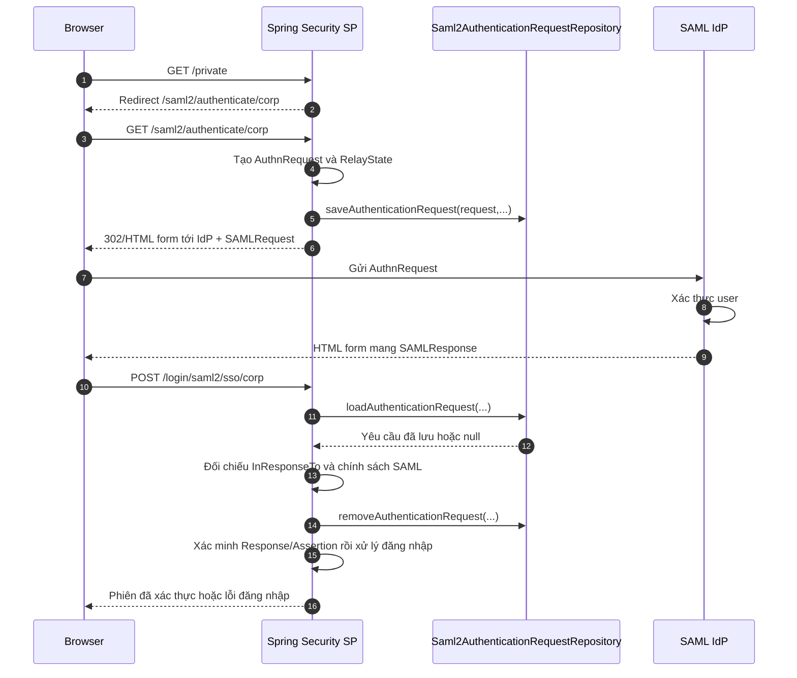

# Lưu yêu cầu bằng Saml2AuthenticationRequestRepository trong Spring Security

## 1. Vì sao cần lưu SAML AuthnRequest?

Trong **SAML 2.0 Web Browser SSO**, một ứng dụng **Service Provider (SP)** chuyển người dùng sang **Identity Provider (IdP)** để xác thực. Khi SP chủ động khởi tạo đăng nhập, nó gửi một `<saml2:AuthnRequest>`. Sau khi người dùng đăng nhập, IdP gửi một `<saml2:Response>` về **Assertion Consumer Service (ACS)** của SP qua trình duyệt.

Trình duyệt là phương tiện vận chuyển giữa hai miền: SP không thể chỉ dựa vào việc nhận HTTP POST có trường `SAMLResponse` để biết rằng phản hồi thuộc **đúng yêu cầu, đúng phiên và đúng IdP**. SP phải giữ được ngữ cảnh yêu cầu đã phát trước khi redirect để đối chiếu khi browser quay về.

Trong Spring Security Servlet, **`Saml2AuthenticationRequestRepository<T extends AbstractSaml2AuthenticationRequest>`** là abstraction lưu, đọc và loại bỏ thông tin **AuthnRequest đã được tạo bởi SP** trong quá trình đăng nhập. Nó trả lời câu hỏi: “Yêu cầu SAML nào đang chờ kết quả, và chúng ta tìm lại nó bằng cách nào khi nhận response?”

### Mục tiêu học tập

Sau bài này, người học có thể:

1. Diễn giải vị trí của repository trong SP-initiated SSO và sự khác biệt với `RelyingPartyRegistrationRepository`.
2. Hiểu chính xác vai trò của ba phương thức `saveAuthenticationRequest`, `loadAuthenticationRequest`, `removeAuthenticationRequest` và dữ liệu `AbstractSaml2AuthenticationRequest`.
3. Cấu hình repository mặc định dựa trên `HttpSession` bằng Java 17+/Spring Boot 3.x.
4. Nhận biết khi nào cần repository dùng cache, session chia sẻ, quản lý TTL/replay và những đánh đổi bảo mật.
5. Chẩn đoán lỗi mất request vì cookie `SameSite`, session timeout, multi-replica, nhiều tab, registration sai hoặc callback không khớp.
6. Phân biệt việc tìm thấy request với việc **xác minh SAML Response đầy đủ**: repository không thay thế chữ ký, issuer, recipient, audience hay thời gian.

Phạm vi chính là **SP-initiated SAML2 Login trên Spring Security Servlet**. Các ví dụ Spring Boot chỉ có thể chạy end-to-end khi ứng dụng có một IdP hợp lệ, metadata, certificate và đăng ký SP/ACS chính xác.

## 2. Luồng đăng nhập và điểm lưu/đọc request



Sơ đồ mô tả **trách nhiệm logic**, không cam kết thứ tự nội bộ tuyệt đối của mọi implementation: thời điểm framework gọi `load` và `remove` phụ thuộc converter/filter và phiên bản Spring Security. Điều bất biến là một request phải được lưu **trước khi** chuyển browser đến IdP, chỉ được dùng theo chính sách phù hợp, rồi được loại bỏ/không còn dùng lại khi kết thúc giao dịch.

Các thành phần Spring Security liên quan:

- **`Saml2WebSsoAuthenticationRequestFilter`:** xử lý điểm bắt đầu (thường `/saml2/authenticate/{registrationId}`), dùng resolver để tạo request, rồi ghi request vào repository trước khi browser chuyển sang IdP.
- **`Saml2AuthenticationRequestResolver`:** lựa chọn registration và tạo AuthnRequest với binding/endpoint phù hợp.
- **`Saml2AuthenticationRequestRepository`:** giữ thông tin cần cho bước callback; không tự xác thực danh tính.
- **`Saml2WebSsoAuthenticationFilter`:** xử lý callback tại ACS (mặc định `/login/saml2/sso/{registrationId}`) và chuyển dữ liệu tới authentication converter/provider.
- **`Saml2AuthenticationTokenConverter`:** chuyển HTTP request thành authentication token, có thể tìm request đã lưu nhằm xác định transaction/registration.
- **OpenSAML authentication provider:** xác minh SAML Response và Assertion theo trust configuration, sau đó mới tạo kết quả đăng nhập.

**Điểm phân biệt:** “AuthnRequest đã được lưu” là thông tin về **yêu cầu phát ra từ SP**; “SAMLResponse hợp lệ” còn đòi hỏi xác minh chữ ký, issuer, audience, recipient, thời hạn, tính tương quan và chống replay.

## 3. Contract của Saml2AuthenticationRequestRepository

Trong API Spring Security Servlet 6.x, interface có dạng khái niệm sau (tên và chữ ký phương thức giữ theo API; ký hiệu `T` chỉ kiểu con của `AbstractSaml2AuthenticationRequest`):

```java
public interface Saml2AuthenticationRequestRepository<
        T extends AbstractSaml2AuthenticationRequest> {

    T loadAuthenticationRequest(HttpServletRequest request);

    void saveAuthenticationRequest(
            T authenticationRequest,
            HttpServletRequest request,
            HttpServletResponse response);

    T removeAuthenticationRequest(
            HttpServletRequest request,
            HttpServletResponse response);
}
```

Đây là **trích đoạn chữ ký để học**, không phải file Java độc lập: `HttpServletRequest`/`HttpServletResponse` thuộc `jakarta.servlet.http`; `AbstractSaml2AuthenticationRequest` thuộc `org.springframework.security.saml2.provider.service.authentication`. Java 17+ và Spring Security Servlet 6.x sử dụng Jakarta Servlet API, không phải namespace `javax.servlet` của các thế hệ cũ.

| Phương thức | Khi nào có ý nghĩa? | Trả về | Ràng buộc khi tự triển khai |
| --- | --- | --- | --- |
| `saveAuthenticationRequest(T, request, response)` | Sau khi tạo AuthnRequest, trước redirect/form đến IdP | `void` | Lưu đúng giao dịch/browser, expiration, registration và dữ liệu đủ để tìm lại |
| `loadAuthenticationRequest(request)` | Khi browser gọi ACS với SAMLResponse | `T` hoặc `null` | Chỉ lấy request phù hợp với giao dịch hiện tại; tránh trộn tenant/phiên |
| `removeAuthenticationRequest(request, response)` | Khi framework kết thúc sử dụng pending request | Request đã xóa hoặc `null` | Xóa hoặc consume hiệu quả; chặn tái sử dụng và xử lý concurrency |

**`load` không đồng nghĩa “xác thực thành công”**. Nó chỉ đọc request đã lưu. **`remove` không đồng nghĩa “Response đã được xác minh”**. Xóa state là một phần quản lý vòng đời transaction, trong khi authentication provider quyết định nhận hay từ chối assertions.

### Dữ liệu gì được lưu?

Spring Security dùng `AbstractSaml2AuthenticationRequest` với các kiểu con như `Saml2RedirectAuthenticationRequest` hoặc `Saml2PostAuthenticationRequest`. Đối tượng cung cấp thông tin phục vụ SAML request, chẳng hạn:

- `getId()`: định danh AuthnRequest (dùng trong liên hệ `InResponseTo` nếu được cung cấp).
- `getRelayState()`: giá trị RelayState nếu có.
- `getRelyingPartyRegistrationId()`: registration bên SP đã tạo yêu cầu.
- `getAuthenticationRequestUri()`: URI endpoint IdP nhận AuthnRequest.
- `getSamlRequest()`: dữ liệu SAMLRequest đã được encode theo binding tương ứng.
- `getBinding()`: POST hoặc REDIRECT.

`AbstractSaml2AuthenticationRequest` không chỉ lưu một chuỗi URL. Repository phải bảo toàn những dữ liệu framework cần trong suốt vòng đời xác thực, nhưng **không cần sao chép toàn bộ SAMLResponse** vào nơi lưu request. Lưu raw SAML assertions/PII vượt quá mục đích của abstraction và làm tăng rủi ro lộ thông tin.

## 4. Mặc định: HttpSessionSaml2AuthenticationRequestRepository

Spring Security sử dụng **`HttpSessionSaml2AuthenticationRequestRepository`** làm cơ chế lưu AuthnRequest mặc định trong Servlet SAML2 Login. Nó lưu `AbstractSaml2AuthenticationRequest` trong **`HttpSession`** của SP.

Sơ đồ phạm vi:

```text
Browser                           Spring Boot SP
  |                                   |
  | GET /saml2/authenticate/corp      |
  |---------------------------------->|
  |                                   | session S123
  |                                   |   -> pending AuthnRequest
  |<----------------------------------|
  | 302 tới IdP + cookie session SP   |
  |                                   |
  | ... browser đăng nhập tại IdP ... |
  |                                   |
  | POST ACS + cookie session SP      |
  |---------------------------------->|
  |                                   | dùng S123 để tìm request
  |                                   | đối chiếu và xác minh response
```

Một `JSESSIONID`/`SESSION` cookie bình thường chỉ mang **session identifier**, không tự chứa XML AuthnRequest. Dữ liệu pending request nằm ở **session storage phía server**. Vì vậy:

- Client không thể trực tiếp chỉnh request đã lưu chỉ bằng cách thay field `RelayState`.
- SP có thể ràng buộc AuthnRequest vào browser session đã khởi tạo, hỗ trợ chống **login fixation/login CSRF**.
- Session có thể hết hạn, bị invalidate hoặc bị mất khi browser không gửi cookie; khi đó callback không tìm được pending request.
- Nếu ứng dụng nhiều replica mà chỉ dùng memory session local, callback vào replica khác có thể mất request.

**Dùng mặc định trước khi tùy biến.** Nó đủ cho nhiều ứng dụng chạy một instance hoặc dùng session persistence phù hợp. Đừng tự tạo repository chỉ vì muốn “thấy request trong database”; trước tiên xác định vấn đề là session, cookie, mạng hay logic SAML.

### So sánh với những repository có tên tương tự

- **`RelyingPartyRegistrationRepository`:** lưu **cấu hình SP–IdP lâu dài** (entity ID, ACS, key verify, endpoints); không lưu pending AuthnRequest.
- **`Saml2AuthenticationRequestRepository`:** lưu **giao dịch xác thực tạm thời** trước callback; không giữ phiên đăng nhập lâu dài.
- **`HttpSessionSecurityContextRepository` / `SecurityContextRepository`:** liên quan việc lưu **Authentication đã xác thực** giữa các request HTTP.
- **`RequestCache` / `HttpSessionRequestCache`:** giữ **URL/tài nguyên người dùng muốn quay lại** sau đăng nhập, không phải AuthnRequest SAML.
- **`Saml2AuthenticationRequestResolver`:** tạo request, không phải kho lưu.

Nhầm các abstraction dễ dẫn tới lỗi như “đăng nhập thành công nhưng không trở về URL cũ” (RequestCache) bị sửa nhầm trong SAML request repository, hoặc lỗi `InResponseTo` bị “giải quyết” bằng thay cấu hình registration.

## 5. Ví dụ Java 17+/Spring Boot 3.x: cấu hình repository rõ ràng

Ví dụ dùng Spring Security 6.x, Servlet stack và một IdP thật. Đây là ứng dụng minh họa hoàn chỉnh về mặt **class Java**; để đăng nhập SAML thật, IdP metadata phải có sẵn, và IdP phải được đăng ký đúng SP Entity ID, ACS và certificate.

### 5.1. Gradle dependency

Trong dự án Spring Boot đã có Gradle plugin/BOM tương thích:

```groovy
repositories {
    mavenCentral()
    // Một số phiên bản OpenSAML cần Shibboleth repository.
    maven { url "https://build.shibboleth.net/maven/releases/" }
}

dependencies {
    implementation "org.springframework.boot:spring-boot-starter-web"
    implementation "org.springframework.boot:spring-boot-starter-security"
    implementation "org.springframework.security:spring-security-saml2-service-provider"
}
```

Đây là phần nội dung của `build.gradle`, không phải một build file độc lập. Với Spring Boot 3.x/Spring Security 6.x, dùng dependency management thống nhất; tránh ép OpenSAML version tùy tiện.

### 5.2. application.yml

```yaml
app:
  saml:
    idp-metadata-location: "${SAML_IDP_METADATA_LOCATION}"

server:
  servlet:
    session:
      timeout: 15m
      cookie:
        http-only: true
        secure: true
```

Giá trị `SAML_IDP_METADATA_LOCATION` phải được cung cấp qua môi trường chạy, ví dụ `https://idp.example.test/metadata` ở môi trường thử nghiệm có IdP thực. File này minh họa lựa chọn **môi trường HTTPS**; khi chạy local HTTP cần điều chỉnh cookie `Secure` theo môi trường và thử nghiệm đúng cách, không dùng HTTP production.

Thời gian sống session ví dụ là 15 phút; timeout thực tế phải tính cả thời gian người dùng xác thực tại IdP, multi-factor authentication và chính sách session của hệ thống. Không dùng timeout rất dài như một biện pháp “sửa” login thường xuyên bị mất state.

### 5.3. Một class Java hoàn chỉnh

Lưu tại `src/main/java/demo/samlrequest/SamlRequestApplication.java`:

```java
package demo.samlrequest;

import java.util.Map;

import org.springframework.beans.factory.annotation.Value;
import org.springframework.boot.SpringApplication;
import org.springframework.boot.autoconfigure.SpringBootApplication;
import org.springframework.context.annotation.Bean;
import org.springframework.security.config.Customizer;
import org.springframework.security.config.annotation.web.builders.HttpSecurity;
import org.springframework.security.core.annotation.AuthenticationPrincipal;
import org.springframework.security.saml2.provider.service.authentication.AbstractSaml2AuthenticationRequest;
import org.springframework.security.saml2.provider.service.authentication.Saml2AuthenticatedPrincipal;
import org.springframework.security.saml2.provider.service.registration.InMemoryRelyingPartyRegistrationRepository;
import org.springframework.security.saml2.provider.service.registration.RelyingPartyRegistration;
import org.springframework.security.saml2.provider.service.registration.RelyingPartyRegistrationRepository;
import org.springframework.security.saml2.provider.service.registration.RelyingPartyRegistrations;
import org.springframework.security.saml2.provider.service.web.HttpSessionSaml2AuthenticationRequestRepository;
import org.springframework.security.saml2.provider.service.web.Saml2AuthenticationRequestRepository;
import org.springframework.security.web.SecurityFilterChain;
import org.springframework.web.bind.annotation.GetMapping;
import org.springframework.web.bind.annotation.RestController;

@SpringBootApplication
@RestController
public class SamlRequestApplication {

    public static void main(String[] args) {
        SpringApplication.run(SamlRequestApplication.class, args);
    }

    @Bean
    RelyingPartyRegistrationRepository relyingParties(
            @Value("${app.saml.idp-metadata-location}") String metadata) {

        RelyingPartyRegistration registration = RelyingPartyRegistrations
                .fromMetadataLocation(metadata)
                .registrationId("corp")
                .entityId("{baseUrl}/saml2/service-provider-metadata/{registrationId}")
                .assertionConsumerServiceLocation(
                        "{baseUrl}/login/saml2/sso/{registrationId}")
                .build();

        return new InMemoryRelyingPartyRegistrationRepository(registration);
    }

    @Bean
    Saml2AuthenticationRequestRepository<AbstractSaml2AuthenticationRequest>
            saml2AuthenticationRequestRepository() {
        // Tường minh hóa cơ chế mặc định của Spring Security Servlet.
        return new HttpSessionSaml2AuthenticationRequestRepository();
    }

    @Bean
    SecurityFilterChain security(HttpSecurity http) throws Exception {
        return http
                .authorizeHttpRequests(auth -> auth
                        .requestMatchers("/").permitAll()
                        .anyRequest().authenticated())
                .saml2Login(Customizer.withDefaults())
                .build();
    }

    @GetMapping("/")
    public String index() {
        return "Public. Open /private to start SAML2 login.";
    }

    @GetMapping("/private")
    public Map<String, String> privateResource(
            @AuthenticationPrincipal Saml2AuthenticatedPrincipal user) {
        return Map.of(
                "subject", user.getName(),
                "registration", user.getRelyingPartyRegistrationId());
    }
}
```

**Vì sao đây là ví dụ phù hợp với đề bài?** `saml2AuthenticationRequestRepository()` khai báo Bean cùng interface/kiểu generic mà Spring Security dùng để lưu AuthnRequest. Theo hướng dẫn Spring Security 6.5, có thể tùy biến bằng cách **expose một bean `Saml2AuthenticationRequestRepository`**; trong ví dụ, bean trả implementation mặc định để nhìn thấy nơi thay thế nó. Không cần gọi `saveAuthenticationRequest` thủ công trong controller: filter SAML2 dùng repository trong quá trình login.

`relyingParties` là bean **khác trách nhiệm**: lấy IdP metadata và tạo đăng ký liên kết `corp`. `/private` được bảo vệ; khi SAML Response được xác minh, principal đại diện người dùng được xác thực. Không có điểm nào cho phép app lấy `SAMLResponse` từ query rồi tự tạo session.

### 5.4. Cách chạy và kết quả quan sát

Trong dự án Gradle/Spring Boot đã có wrapper và IdP SAML thực được đăng ký đúng:

```bash
SAML_IDP_METADATA_LOCATION=https://idp.example.test/metadata ./gradlew bootRun
```

Tên miền `example.test` chỉ là placeholder; cần thay bằng metadata của IdP thật. Nếu cấu hình `secure: true`, hãy chạy ứng dụng trên HTTPS hoặc đứng sau proxy HTTPS tin cậy; nếu chỉ chạy local HTTP thì cookie Secure không được gửi, gây mất session và AuthnRequest.

Mở `/private`, theo redirect qua `/saml2/authenticate/corp` và đăng nhập tại IdP. Sau callback `/login/saml2/sso/corp` thành công, `GET /private` trả JSON chứa `subject` (thực tế phụ thuộc NameID IdP) và `registration` là `corp`. **Không có stdout cố định** vì quá trình kết nối IdP phụ thuộc metadata, chứng chỉ, URL và người dùng. Nếu chưa đăng ký IdP/SP thì không thể dùng URL giả để thực hiện authentication.

**Ghi chú về SAML request signing:** một số IdP yêu cầu AuthnRequest được ký. Khi ấy SP cần signing credential cấu hình riêng; bean repository không tự tạo hoặc ký private key. Nếu metadata của IdP đòi ký mà SP thiếu credential, đăng nhập có thể thất bại trước bước lưu/redirect. Không tắt yêu cầu chữ ký ở IdP chỉ vì ví dụ chưa cung cấp key.

## 6. Repository nằm ở đâu khi cấu hình tùy chỉnh?

Thực hành Spring Security 6.5 cho phép đưa implementation do bạn kiểm soát vào flow bằng một bean:

```java
@Bean
Saml2AuthenticationRequestRepository<AbstractSaml2AuthenticationRequest>
        authenticationRequestRepository() {
    return new HttpSessionSaml2AuthenticationRequestRepository();
}
```

Đây là **đoạn trích bean để thêm vào class `@Configuration`**, không phải chương trình Java độc lập. Khi dùng code đầy đủ ở mục 5 đã có bean này, không khai báo lần thứ hai. Nếu cần implementation riêng, thay instance trả về bằng lớp custom thực hiện cùng interface.

**Đừng nhầm với `.saml2Login(...).authenticationRequestResolver(...)`.** Resolver **tạo AuthnRequest**, repository **lưu nó**. `Saml2LoginConfigurer` có method chọn resolver và endpoint, nhưng trong API được hướng dẫn ở đây, cấu hình repository bằng bean là cách trực tiếp được tài liệu chính thức mô tả. Không suy diễn một DSL setter `authenticationRequestRepository` trên `saml2Login` nếu version đang dùng không có.

Nếu framework/version hiện tại không tự pick up bean do tích hợp đặc thù hoặc custom filter, cần kiểm tra wiring của cả **request-generating filter** và **response-processing filter**; cả hai phải dùng **cùng một kho dữ liệu logic**. Hai instance với hai cache không chia sẻ sẽ làm callback không tìm được request, dù cùng interface.

## 7. Tự triển khai repository: yêu cầu đối với một giải pháp đúng

Một custom `Saml2AuthenticationRequestRepository<AbstractSaml2AuthenticationRequest>` có thể sử dụng session, Redis, một cache phân tán, hoặc một storage khác. Tuy nhiên ba phương thức của interface **không đủ tự quyết định** bảo mật và concurrency; thiết kế còn cần:

1. **Khóa tra cứu khó đoán và correlation:** không dùng một user ID hoặc registration ID duy nhất để tìm pending request của mọi người. Nếu tra bằng `RelayState`, state phải được sinh đủ ngẫu nhiên, có entropy cao và không bị kiểm soát bởi attacker.
2. **Gắn browser hoặc transaction:** nếu threat model yêu cầu chỉ browser khởi tạo được chấp nhận, cần một bằng chứng browser-bound độc lập; tra request bằng một RelayState công khai đơn thuần có thể mất phòng vệ login fixation của session.
3. **TTL hữu hạn:** request không sống vô hạn trong cache; TTL phải bao phủ login/MFA thực tế nhưng đủ ngắn để hạn chế replay/misuse.
4. **Lấy ra và xóa đúng một lần:** khi callback hợp lệ được consume, không cho một response khác dùng lại cùng pending request; cân nhắc atomic `GETDEL`/compare-and-delete ở backend phù hợp.
5. **Concurrent tabs và callbacks:** nhiều lần login đồng thời trong cùng browser có thể tồn tại; không cho một flow ghi đè flow khác trừ khi UX và chính sách chấp nhận rõ.
6. **Đa tenant/multi IdP:** registration, issuer, request ID, ACS và SP Entity ID phải được kiểm tra thống nhất.
7. **Bảo mật dữ liệu lưu:** mã hóa khi cần, RBAC, TTL, logging redaction, network authentication giữa app/cache và xóa dữ liệu khi hết hạn.
8. **Dự đoán lỗi:** nếu cache/session hết hạn hoặc backend lưu trữ unavailable, phải từ chối transaction/khởi tạo đăng nhập lại an toàn, không tự động chấp nhận unsolicited response.

### Mẫu decorator để quan sát vòng đời mà không log bí mật

Khi cần thống kê `save/load/remove`, có thể bọc repository mặc định bằng một lớp *decorator*. Ví dụ dưới đây là **class Java hoàn chỉnh**, nhưng chỉ là thành phần library; cần thêm vào dự án Spring Security 6.x và đăng ký như bean theo ví dụ ở dưới.

```java
package demo.samlrequest;

import jakarta.servlet.http.HttpServletRequest;
import jakarta.servlet.http.HttpServletResponse;
import org.springframework.security.saml2.provider.service.authentication.AbstractSaml2AuthenticationRequest;
import org.springframework.security.saml2.provider.service.web.Saml2AuthenticationRequestRepository;

public final class ObservedSamlRequestRepository
        implements Saml2AuthenticationRequestRepository<AbstractSaml2AuthenticationRequest> {

    private final Saml2AuthenticationRequestRepository<AbstractSaml2AuthenticationRequest>
            delegate;

    public ObservedSamlRequestRepository(
            Saml2AuthenticationRequestRepository<AbstractSaml2AuthenticationRequest>
                    delegate) {
        this.delegate = delegate;
    }

    @Override
    public void saveAuthenticationRequest(
            AbstractSaml2AuthenticationRequest requestToSave,
            HttpServletRequest request,
            HttpServletResponse response) {
        delegate.saveAuthenticationRequest(requestToSave, request, response);
        // Ghi metric nội bộ dạng count, không log SAMLRequest/RelayState.
    }

    @Override
    public AbstractSaml2AuthenticationRequest loadAuthenticationRequest(
            HttpServletRequest request) {
        return delegate.loadAuthenticationRequest(request);
    }

    @Override
    public AbstractSaml2AuthenticationRequest removeAuthenticationRequest(
            HttpServletRequest request,
            HttpServletResponse response) {
        return delegate.removeAuthenticationRequest(request, response);
    }
}
```

Nếu muốn dùng decorator thay thế bean ở mục 5:

```java
@Bean
Saml2AuthenticationRequestRepository<AbstractSaml2AuthenticationRequest>
        saml2AuthenticationRequestRepository() {
    return new ObservedSamlRequestRepository(
            new HttpSessionSaml2AuthenticationRequestRepository());
}
```

Đây là **đoạn thay thế nội dung phương thức bean** đã có, không thêm bean thứ hai. Class không tự log gì; comment chỉ minh họa vị trí instrument. Khi cần metric, nên xuất tổng số `save`, số `load` thành công/thất bại, độ trễ repository hoặc mã nguyên nhân, tránh lưu `getSamlRequest()`, `getRelayState()`, raw cookie, private key và SAMLResponse.

### Vì sao không tự cài Redis bằng một Map đơn giản?

Nếu custom code viết `Map<String, AbstractSaml2AuthenticationRequest>` trong JVM:

- Cache biến mất khi restart.
- Replica A và B không chia sẻ state.
- Không có TTL/eviction an toàn theo mặc định.
- Dễ quên atomic consume dẫn đến reuse.
- Nếu key chỉ là registration ID như `corp`, người dùng sẽ **trộn giao dịch đăng nhập**.

Một repository production cần định nghĩa lifecycle và cơ chế lưu/consume rõ ràng; không chuyển từ session sang Map tĩnh chỉ để né lỗi cookie.

## 8. CacheSaml2AuthenticationRequestRepository: khi cần không dựa vào HttpSession

Từ **Spring Security 6.5**, framework có `CacheSaml2AuthenticationRequestRepository`. Nó dùng Spring Cache để giữ AuthnRequest, có thể phù hợp khi dùng session-bound repository gặp lỗi mất state do cookie `SameSite`/trình duyệt hoặc khi có yêu cầu cache độc lập.

Một bean minh họa cho Spring Security 6.5+:

```java
@Bean
Saml2AuthenticationRequestRepository<AbstractSaml2AuthenticationRequest>
        saml2AuthenticationRequestRepository() {
    return new CacheSaml2AuthenticationRequestRepository();
}
```

Đoạn trên cần import `org.springframework.security.saml2.provider.service.web.CacheSaml2AuthenticationRequestRepository` và thay bean session đã có. **Mặc định của cache repository là cache trong bộ nhớ**, nên không tự động đáp ứng môi trường nhiều instance. Nếu cần cluster, phải cung cấp `org.springframework.cache.Cache` dùng backend phân tán qua `setCache(...)` và thiết kế TTL, atomic consume, auth tới cache.

Ví dụ **đoạn bean minh họa phụ thuộc một Spring `CacheManager` đã cấu hình**:

```java
@Bean
Saml2AuthenticationRequestRepository<AbstractSaml2AuthenticationRequest>
        saml2AuthenticationRequestRepository(CacheManager cacheManager) {
    Cache cache = java.util.Objects.requireNonNull(
            cacheManager.getCache("saml-authn"),
            "Required cache 'saml-authn' is missing");

    CacheSaml2AuthenticationRequestRepository repository =
            new CacheSaml2AuthenticationRequestRepository();
    repository.setCache(cache);
    return repository;
}
```

Cần import `org.springframework.cache.Cache`, `org.springframework.cache.CacheManager` và cache repository; đoạn này **không triển khai Redis/cache manager**. Redis hoặc backend khác phải được vận hành, giới hạn quyền, bảo vệ TLS và cấu hình expiration tương ứng trước khi chạy.

### Đánh đổi bảo mật quan trọng: session-bound vs state-based

Tài liệu Spring Security nêu một lợi ích của session-backed repository: một Response do attacker tạo, dù có chữ ký hợp lệ từ IdP, không dễ được gắn với **session của nạn nhân**, vì SP đòi có request đã khởi tạo trong chính session đó. Điều này góp phần chống **login fixation**.

Nếu request được tra bằng `RelayState` hoặc `InResponseTo` trong cache mà không có ràng buộc browser/session bổ sung, SP có thể chỉ biết **“ứng dụng này từng sinh một AuthnRequest có key đó”**, nhưng không chứng minh **“browser đang nhận Response này chính là browser đã bắt đầu login”**. Attacker có thể tận dụng sự khác biệt này trong một số kịch bản login CSRF/session confusion.

**Vì vậy không xem cache repository là thay thế có cùng độ bảo mật cho HttpSession repository.** Trước khi chuyển:
- Đánh giá threat model login fixation và khả năng gắn request với browser.
- Xác minh độ ngẫu nhiên RelayState, tương quan `InResponseTo`, TTL, one-time consume và chống replay.
- Đánh giá SameSite/cookie/HTTPS ở môi trường thực tế; đôi khi sửa session cookie là giải pháp phù hợp hơn.
- Kiểm thử unsolicited IdP-initiated SSO theo chính sách cụ thể.
- Không đánh đổi kiểm tra chữ ký/issuer/audience/recipient để “hỗ trợ cache”.

Repository cache cũng không tự tạo session authenticated; sau khi provider xác minh SAML Response, việc lưu `SecurityContext`/session vẫn là cơ chế khác.

## 9. Spring Session và nhiều replica: một lựa chọn khác cache độc lập

Một ứng dụng chạy nhiều pod:

```text
                  Load Balancer
                 /             \
             RP pod A        RP pod B
                 \             /
             Shared Session Store

Browser khởi tạo login ở pod A.
IdP POST callback có thể đến pod B.
```

Nếu mỗi pod dùng `HttpSession` chỉ trong RAM của chính nó, pod B thường không thấy pending request đã được tạo ở pod A. Có ba hướng thiết kế:

1. **Shared session storage:** dùng **Spring Session** với backend phù hợp (ví dụ Redis/JDBC). Vẫn giữ abstraction `HttpSessionSaml2AuthenticationRequestRepository` nhưng session có thể được đọc xuyên replica; các phiên bản và serialization của đối tượng cần kiểm thử.
2. **Sticky session:** load balancer cố gắng đưa callback về pod đã khởi tạo; đơn giản hơn nhưng rủi ro khi node chết, failover, deployment rolling hoặc routing thay đổi.
3. **Cache repository phân tán:** lưu pending request độc lập session theo cơ chế xác thực/giới hạn phù hợp; cần giải quyết đánh đổi login fixation nêu trên.

**Spring Session thường giữ được lợi ích browser-session binding** của repository session trong khi chia sẻ trạng thái giữa pod, nếu cookie phiên quay lại đúng và session store được cấu hình chuẩn. Cache repository độc lập không tự đảm bảo tính chất này chỉ vì nó cũng dùng Redis.

### Lưu ý với state của người dùng

Không đánh đồng:
- `AuthnRequest repository`: pending giao dịch đăng nhập **chưa thành công**.
- `HTTP session store`: có thể giữ request trước login và `SecurityContext` sau login.
- `RequestCache`: URL được lưu để quay về sau login.
- `SAML Response/Assertion replay cache`: trạng thái chống phát lại thông điệp SAML, nếu thư viện/chính sách có sử dụng.
  
Nếu login thành công nhưng browser không nhớ trạng thái đăng nhập, hãy điều tra session persistence/`SecurityContext`. Nếu callback báo `InResponseTo` không tương ứng, hãy điều tra pending request repository và session cookie. Hai lỗi có thể cùng do hạ tầng session nhưng sửa ở vị trí khác nhau.

## 10. Cookie SameSite và HTTP-POST callback

Trong binding thường gặp, IdP tạo **cross-site POST** về ACS:

```text
Browser --- GET/redirect ---> IdP (domain IdP)
Browser <--- form SAMLResponse --- IdP
Browser --- POST -----------> SP ACS (domain SP)
                               |
                               +--> tìm request trong session SP
```

Browser chỉ gửi cookie phiên SP trên POST này theo chính sách cookie. Với `SameSite=Lax`, cookie thường không được gửi trên cross-site POST; `SameSite=Strict` còn hạn chế hơn. `SameSite=None` thường yêu cầu `Secure` và được dùng khi phải cho phép cookie trong tình huống cross-site, nhưng cần đánh giá CSRF và chính sách browser.

Triệu chứng khi cookie không quay về:

- Browser đã thấy IdP login thành công.
- POST `SAMLResponse` tới đúng ACS.
- SP không tìm thấy `HttpSession` chứa AuthnRequest.
- Hệ thống báo thiếu `InResponseTo` correlation hoặc bắt đầu login lại, dù chữ ký IdP có thể hợp lệ.

**Khắc phục theo thứ tự:**

1. Kiểm tra cookie phiên SP có được set khi tạo AuthnRequest không, với `Path`, `Domain`, `Secure`, `SameSite` đúng.
2. Kiểm tra Network tab xem browser có gửi **chính cookie SP** trong POST ACS hay không; không chụp/chép giá trị cookie thật ra log hoặc tài liệu công khai.
3. Kiểm tra reverse proxy có sinh sai `http`/`https`, đổi host hoặc strip cookie không.
4. Kiểm tra session có bị invalidate/timeout trong lúc IdP/MFA xử lý không.
5. Kiểm tra multi-replica và shared session routing.
6. Chỉ sau đó cân nhắc cache repository hay đổi chính sách cookie và thẩm định đánh đổi bảo mật.

Không biến trường hợp “không thấy pending AuthnRequest” thành “accept SAML Response bất kỳ”. Nếu tổ chức chủ định hỗ trợ IdP-initiated/unsolicited SSO, thiết kế riêng cơ chế bảo vệ thay vì tự động fallback khi session mất.

## 11. RelayState, InResponseTo và lớp xác minh

Ba khái niệm này thường bị nhầm:

- **`AuthnRequest@ID`:** định danh yêu cầu mà SP đã tạo. Response/SubjectConfirmation có thể mang `InResponseTo` để liên hệ với yêu cầu đó.
- **`RelayState`:** dữ liệu opaque đi qua browser cùng request/response, giúp ứng dụng tìm state hoặc duy trì ngữ cảnh điều hướng. Nó **không phải chữ ký số**, không phải bằng chứng authentication và không được dùng làm URL redirect tùy ý.
- **Repository storage key:** chi tiết implementation; có thể dựa trên session hoặc cache key từ RelayState, nhưng phải được thiết kế chống đoán, collision và trộn giao dịch.

Một request đã được repository tìm thấy **không** chứng minh Response được IdP ký. Một SAML Response có chữ ký hợp lệ **không** chứng minh browser hiện tại đã bắt đầu giao dịch đó. Một Response có `InResponseTo` trùng ID **không** tự chứng minh assertion dành cho SP; SP còn phải kiểm tra audience, destination/recipient, issuer và thời gian.

### Checklist xác thực tại ACS

Sau khi tìm được pending request (đối với SP-initiated):

1. Chọn đúng `RelyingPartyRegistration` và certificate verify của IdP.
2. Kiểm tra chữ ký hợp lệ trên **nội dung thực sự được dùng**, chống XML Signature Wrapping.
3. Kiểm tra `Issuer` thuộc IdP được tin cậy.
4. Kiểm tra `Destination` và `SubjectConfirmationData@Recipient` trỏ về ACS hợp lệ.
5. Kiểm tra `AudienceRestriction` phù hợp SP Entity ID.
6. Kiểm tra `InResponseTo` khi giao thức/profile đòi hỏi.
7. Kiểm tra `NotBefore`, `NotOnOrAfter` và clock skew hợp lý.
8. Chống replay theo chính sách, không nhận lại assertion đã dùng.
9. Map NameID/attributes thành principal/authorities sau xác minh.

Đây là trách nhiệm của tầng **SAML authentication provider và validation policy**, không phải interface `Saml2AuthenticationRequestRepository`. Đừng viết repository “tự cho rằng hợp lệ” chỉ vì load ra được object.

## 12. Nhiều tab, nhiều login, timeout và lỗi race condition

Người dùng có thể mở hai tab đăng nhập cùng lúc, đăng nhập lại khi response chưa về, hoặc dùng IdP mất vài phút để xử lý MFA. Với một repository tùy biến cần đặc biệt xem:

- Mỗi lần khởi tạo có request ID/RelayState riêng và không ghi đè state của transaction khác ngoài chủ đích.
- Nếu implementation có **một pending slot mỗi session** hoặc overwrite vào cùng key, hai tab có thể làm một callback không tìm thấy request.
- TTL và session timeout phù hợp chính sách; timeout quá dài tăng cửa sổ phát lại và tài nguyên tồn.
- Khi nhận hai callback cùng transaction, hành vi consume phải đủ an toàn: chỉ một lần được coi là hợp lệ theo validation/replay policy.
- Nếu load và remove không atomic, cần thiết kế để callback song song không cùng chấp nhận một pending request theo threat model.
- Khi logout, session invalidate, đổi session ID, mở browser profile khác hoặc browser chặn cookie, state có thể mất: đây là hành vi mong đợi hoặc lỗi hạ tầng, không phải lý do bỏ kiểm tra response.

Không khẳng định mọi phiên bản `HttpSessionSaml2AuthenticationRequestRepository` hỗ trợ hoặc không hỗ trợ nhiều pending request theo cùng một cách nếu chưa test đúng bản đang triển khai. Dùng integration test tái hiện “hai tab – hai requests – callback đảo thứ tự” để xác định hành vi thực tế.

## 13. IdP-initiated SSO không có request đã lưu

**SP-initiated:** SP tạo AuthnRequest, repository lưu, sau đó callback có ngữ cảnh để so sánh.

**IdP-initiated / unsolicited:** IdP gửi SAMLResponse mà không có AuthnRequest ban đầu của SP, nên repository có thể trả `null` là **hợp lệ với loại flow này**. Nhưng việc có hỗ trợ unsolicited Response hay không là **quyết định chính sách rõ ràng**, không tự động suy ra từ repository null.

Nếu cho phép IdP-initiated:

- Chỉ chấp nhận IdP/registration đã cấu hình tin cậy.
- Kiểm tra signature, issuer, audience, destination/recipient, thời hạn và chống replay chặt chẽ.
- Bảo vệ khỏi login CSRF/session confusion khi browser đang có phiên khác.
- Giới hạn open redirect từ RelayState và việc thay người dùng trong session.
- Phân biệt log “unsolicited permitted” với “SP-initiated mất request” để không che sự cố cookie.

Nếu policy chỉ cho phép SP-initiated, xử lý phản hồi không có request bằng fail-closed và yêu cầu browser bắt đầu login lại qua SP.

## 14. Test phù hợp cho repository

Tập trung kiểm tra hành vi (đừng viết test chỉ lặp lại implementation):

| Bài test | Cách dựng | Kỳ vọng |
| --- | --- | --- |
| **Save → load** | Bắt đầu login rồi dùng cùng session quay về callback giả lập | Repository tìm lại đúng request/registration |
| **Load khi thiếu** | Browser mới, session khác hoặc cache key không tồn tại | Trả `null`/từ chối correlation theo policy |
| **Remove/consume** | Kết thúc xử lý callback, đọc lại transaction | Request không thể tái sử dụng |
| **Request ID sai** | Response có `InResponseTo` của transaction khác | Authentication bị từ chối |
| **Sai IdP** | Response ký bằng IdP B gửi vào registration IdP A | Bị từ chối dù có pending request |
| **Cookie SameSite** | SSO thực với cross-site HTTP-POST | Cookie/session quay về theo cấu hình đã chấp nhận |
| **Multi-replica** | Khởi tạo ở A, callback ở B | Vẫn tìm đúng request nếu dùng shared session/cache |
| **Hai tab** | Hai requests và hai callbacks đảo thứ tự | Đúng chính sách concurrent login, không nhầm user |
| **Hết TTL** | Chờ request hết hạn trước callback | Từ chối, không fallback thiếu bảo vệ |
| **Replay** | Gửi lại cùng SAMLResponse | Không chấp nhận lần thứ hai theo security policy |
| **Restart** | Restart instance giữa redirect và callback | Kết quả đúng theo session/cache persistence được chọn |

Dùng IdP sandbox và certificate/fixture thử nghiệm, không lưu Response production để tái phát. Cần kiểm tra cả **authentication result** và **lifecycle state** chứ không chỉ HTTP status 302, vì 302 có thể là chuyển đến trang login lỗi.

### Quan sát an toàn

Có thể xuất metric: số yêu cầu được lưu; số callback load thành công/thất bại; số timeout; tỷ lệ login lỗi do correlation; thời lượng kể từ khi tạo đến callback; số cache hit/miss theo registration đã được cho phép. Không log `getSamlRequest()`, raw `RelayState`, `SAMLResponse`, session ID, cookie, NameID, assertions hoặc token.

Nếu cần correlation ID trong log, sử dụng ID nội bộ an toàn/hashed theo chính sách, tránh định danh có thể dùng để tìm pending request trong cache. Đặc biệt không dùng log public làm danh sách usable RelayStates.

## 15. Chẩn đoán các lỗi thường gặp

| Triệu chứng | Nơi kiểm tra đầu tiên | Hướng khắc phục |
| --- | --- | --- |
| `InResponseTo` không khớp | Request state, callback correlation | Đối chiếu request ID và session, không bỏ validation |
| Không tìm thấy AuthnRequest sau login IdP | Cookie/SameSite, session TTL, repository | Quan sát cookie POST ACS và repository hit/miss |
| Callback đúng nhưng request lookup thành `null` | Session khác, cache key sai, loại request bị overwrite | So trình duyệt/replica/registration |
| Login chỉ lỗi khi dùng nhiều pod | Session local trên pod khác hoặc cache cục bộ | Spring Session/shared backend, sticky routing hoặc cache distributed có thẩm định |
| Đổi sang cache rồi xuất hiện session confusion | Mất browser-session binding | Đánh giá login fixation, bảo vệ bổ sung hoặc quay lại session-bound |
| Hai tab login làm một tab fail | Nhiều pending requests dùng trùng key/slot | Test concurrency; dùng repository/thiết kế hỗ trợ nhiều flow |
| IdP-initiated được chấp nhận ngoài ý muốn | Chính sách unsolicited không rõ | Chặn hoặc thiết kế validation riêng |
| SAML Response signature invalid | IdP certificate, metadata, signed node | Cập nhật trust đúng kênh, không sửa repository |
| ACS nhận 404/405 | IdP ACS URL, ingress, filter matcher | Đồng bộ endpoint và metadata |
| Sau login không về URL gốc | RequestCache/success handler, session persistence | Kiểm tra saved request, không sửa SAML repository nếu correlation đã đúng |

**Ví dụ phân tích:** người dùng báo “đăng nhập IdP xong quay về ứng dụng nhưng bị yêu cầu đăng nhập lại”. Nếu Network tab cho thấy POST SAMLResponse đã đến ACS nhưng cookie của SP thiếu trên POST, hãy kiểm tra SameSite/Secure/proxy, sau đó xem `HttpSession` chứa pending request có được tìm lại không. Nếu load có request và signature hợp lệ nhưng issuer/audience bị từ chối, sự cố thuộc validation, không phải repository.

## 16. Các anti-pattern cần tránh

1. **Lưu pending request theo username hoặc registration ID duy nhất:** dễ collision giữa user/transaction.
2. **Tin RelayState do browser đưa tới mà không kiểm tra:** RelayState không phải bằng chứng ai đã khởi tạo login.
3. **Tạo một Map static trong SP đa replica:** không chia sẻ state, không TTL, không atomic consume.
4. **Gỡ correlation để chữa lỗi session:** làm yếu cơ chế chống login fixation/CSRF.
5. **Chấp nhận mọi unsolicited Response khi repository load trả null:** mở rộng chính sách đăng nhập ngoài chủ đích.
6. **Lưu request vô hạn:** tăng khả năng reuse và tiêu tốn storage.
7. **Log nguyên XML, RelayState hay session ID:** lộ dữ liệu nhạy cảm và correlation token.
8. **Đổi request repository để sửa mọi vấn đề SAML:** signature, metadata, ACS, clock skew, audience và authorization là trách nhiệm khác.
9. **Dùng cache local cho cluster và tưởng đã chia sẻ:** phải chứng minh backend lưu trạng thái thực sự phân tán.
10. **Tự so sánh ID mà bỏ validator của OpenSAML:** request correlation chỉ là một phần của federation verification.

## 17. Checklist thiết kế/triển khai

- [ ] Giao thức là SP-initiated và nơi phát `AuthnRequest` được xác định.
- [ ] Repository đang dùng được biết rõ: `HttpSession`, shared session hoặc cache.
- [ ] API `save/load/remove` tương thích Spring Security version và request type.
- [ ] Request được lưu trước redirect và không bị ghi đè ngoài ý muốn.
- [ ] Callback ACS có thể truy cập đúng state và registration.
- [ ] Cookie `Secure`/`HttpOnly`/`SameSite`, proxy và domain/path phù hợp với HTTP-POST binding.
- [ ] Multi-replica và nhiều tab login đã được thử với topology thực.
- [ ] TTL, consume-once, concurrency và cleanup/replay được thiết kế.
- [ ] Mỗi Response được xác minh chữ ký, issuer, destination, recipient, audience, thời hạn và tương quan.
- [ ] Đã quyết định rõ có cho phép IdP-initiated/unsolicited flow không.
- [ ] Không log raw request/response, cookie, session IDs và private keys.
- [ ] Negative tests xác nhận fail-closed khi mất hoặc sai pending request.
- [ ] Người vận hành hiểu cache repository có thể làm giảm session binding và cần đánh giá login fixation.

## 18. Tự đánh giá kiến thức

**Câu 1. `Saml2AuthenticationRequestRepository` dùng để lưu SAMLResponse đã xác minh phải không?**  
Không. Nó lưu **AuthnRequest được SP phát ra** để tìm lại khi xử lý response và đối chiếu giao dịch.

**Câu 2. Implementation mặc định của Spring Security Servlet là gì?**  
`HttpSessionSaml2AuthenticationRequestRepository`, dùng `HttpSession`.

**Câu 3. Ba phương thức của interface là gì?**  
`saveAuthenticationRequest`, `loadAuthenticationRequest` và `removeAuthenticationRequest`.

**Câu 4. Vì sao chỉ tìm pending request bằng RelayState trong cache có thể yếu hơn dùng session?**  
Vì tìm request bằng state không tự chứng minh browser nhận response là browser đã khởi tạo login; session-bound lookup góp phần chống login fixation.

**Câu 5. Đưa session vào Redis qua Spring Session có giống dùng cache repository độc lập không?**  
Không. Spring Session chia sẻ session giữa pod và vẫn có thể duy trì browser-session binding; cache repository tra request theo state có threat model khác.

**Câu 6. Browser POST SAMLResponse có chữ ký hợp lệ nhưng repository load null, có nên nhận login?**  
Chỉ khi chính sách **IdP-initiated/unsolicited** có chủ đích và áp dụng đủ xác minh/biện pháp bảo vệ riêng. Với SP-initiated, mất request phải được xử lý an toàn, không tự động bỏ correlation.

**Câu 7. Một repository trả đúng request có đủ để tạo Authentication không?**  
Không. Vẫn cần SAML provider xác minh signature, issuer, audience, recipient/destination, time, replay và chính sách quyền.

**Câu 8. Khi callback chỉ fail trên Kubernetes nhiều replica, nên kiểm tra gì?**  
Session/cache đang lưu ở node nào, cookie có quay về không, có dùng Spring Session/distributed storage, và routing ingress có ổn định không.

## 19. Nguồn chuẩn và tài liệu đối chiếu

- [Spring Security 6.5 – Producing AuthnRequests](https://docs.spring.io/spring-security/reference/6.5/servlet/saml2/login/authentication-requests.html): filter tạo request, repository mặc định, bean tùy chỉnh và cache repository.
- [Spring Security – Saml2AuthenticationRequestRepository API](https://docs.spring.io/spring-security/reference/api/java/org/springframework/security/saml2/provider/service/web/Saml2AuthenticationRequestRepository.html): interface và ba method.
- [Spring Security – HttpSessionSaml2AuthenticationRequestRepository API](https://docs.spring.io/spring-security/reference/api/java/org/springframework/security/saml2/provider/service/web/HttpSessionSaml2AuthenticationRequestRepository.html): implementation session.
- [Spring Security – CacheSaml2AuthenticationRequestRepository API](https://docs.spring.io/spring-security/reference/api/java/org/springframework/security/saml2/provider/service/web/CacheSaml2AuthenticationRequestRepository.html): từ Spring Security 6.5, `setCache` và đánh đổi session binding.
- [Spring Security – AbstractSaml2AuthenticationRequest API](https://docs.spring.io/spring-security/reference/api/java/org/springframework/security/saml2/provider/service/authentication/AbstractSaml2AuthenticationRequest.html): ID, RelayState, binding và registration.
- [Spring Security – Authenticating SAML Responses](https://docs.spring.io/spring-security/reference/servlet/saml2/login/authentication.html): filter/converter/provider xác minh response.
- [Spring Session – Reference](https://docs.spring.io/spring-session/reference/): cách chia sẻ session giữa các ứng dụng/instance.
- [OWASP SAML Security Cheat Sheet](https://cheatsheetseries.owasp.org/cheatsheets/SAML_Security_Cheat_Sheet.html): correlation, replay, signature validation và an toàn XML.
