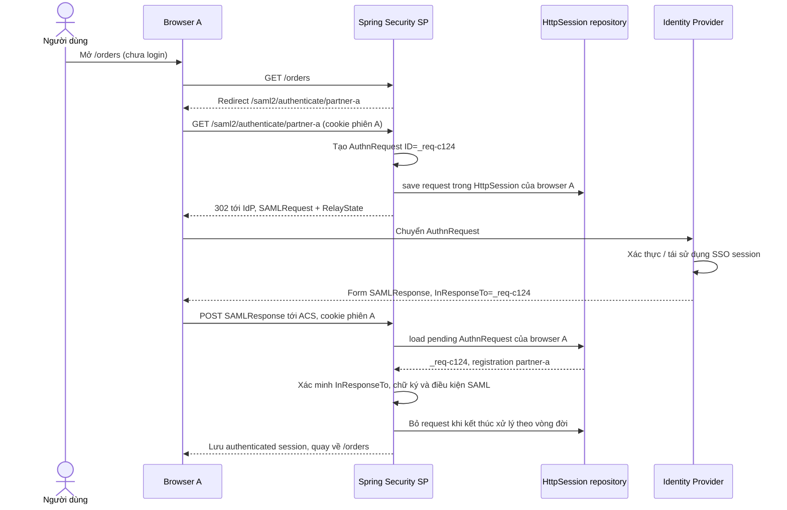

# HttpSessionSaml2AuthenticationRequestRepository và liên kết với phiên ban đầu

**Phạm vi:** Spring Security – federation → Luồng đăng nhập SAML2. Bài học trình bày vai trò của `HttpSessionSaml2AuthenticationRequestRepository` trong **SP-initiated SAML 2.0 Web Browser SSO**: lưu yêu cầu xác thực do Service Provider (SP) phát hành, gắn nó với phiên trình duyệt đã bắt đầu đăng nhập, tìm lại khi Identity Provider (IdP) gửi `SAMLResponse`, và hiểu vì sao cơ chế đó giúp chống login swapping/login fixation.

**Thông điệp chính:** Việc `InResponseTo` trùng `ID` của một `AuthnRequest` chưa đủ để tin rằng **trình duyệt đang POST response chính là trình duyệt đã bắt đầu lần đăng nhập**. Với repository lưu trong `HttpSession`, ứng dụng còn có cơ sở liên kết response với **trạng thái server-side của browser ban đầu**. Khi đổi sang cache hoặc chỉ tra cứu bằng `RelayState`, phải giữ lại thuộc tính an ninh này bằng thiết kế phù hợp.

Bài tập và ví dụ Spring tập trung vào **Servlet/MVC**, Java 17+ và Spring Security 7.x. Một số API/module đổi giữa các major; khi áp dụng Boot 3.x/Security 6.x, đối chiếu JavaDoc và dependency của phiên bản thực dùng. Đây là chủ đề **lưu request SAML trong phiên**, không phải hướng dẫn tạo Identity Provider hoặc thực hiện OAuth2/OIDC.

## 1. Bối cảnh: tại sao phải lưu `AuthnRequest`?

Ứng dụng cần người dùng đã đăng nhập mở `/orders`. Nếu chưa xác thực, Spring Security SP chuyển browser đến IdP:

1. SP tạo `AuthnRequest` có **ID duy nhất** (ví dụ `_req-c124`), issuer SP, địa chỉ IdP, Assertion Consumer Service (ACS) và tùy chọn yêu cầu xác thực.
2. SP phải nhớ **chính xác yêu cầu đã được phát hành**: ID, đăng ký IdP/`registrationId`, `RelayState` và dữ liệu cần để xử lý response (theo kiểu `AbstractSaml2AuthenticationRequest`).
3. Browser chuyển thông điệp `SAMLRequest` đến IdP bằng HTTP Redirect hoặc POST binding. IdP xác thực và gửi `SAMLResponse` về ACS của SP, thường bằng HTTP POST.
4. SP lấy yêu cầu đã lưu của **cùng phiên browser**, đối chiếu response tương quan `InResponseTo` với request ID, xác minh chữ ký, issuer, audience, recipient/destination, thời hạn, subject confirmation, replay, tenant và chính sách trước khi tạo phiên đăng nhập.

Nếu SP không lưu request, response đến từ IdP có thể trông hợp lệ về chữ ký nhưng **không được gắn với ý định login do browser hiện tại tạo ra**. Đây là một điểm mấu chốt đối với login CSRF và login/session swapping.

### 1.1. Hai loại trạng thái khác nhau

| Trạng thái | Tồn tại khi nào | Ai quản lý | Mục đích |
| --- | --- | --- | --- |
| **Pending SAML AuthnRequest** | **Trước** khi IdP xác thực xong | `Saml2AuthenticationRequestRepository`, mặc định là session repository | Chứng minh giao dịch SAML SP-initiated đã bắt đầu, có request để tương quan |
| **SecurityContext/Authentication** | **Sau** khi SAMLResponse được xác minh thành công | Spring Security và cơ chế persistence của ứng dụng | Xác định người dùng hiện đã đăng nhập vào SP |
| **SavedRequest** / URL ban đầu | Khi người dùng bị chuyển khỏi một trang được bảo vệ | `RequestCache`/session hoặc success handler | Đưa người dùng quay về `/orders` an toàn sau login |

**Không nhầm:** lưu `AuthnRequest` vào `HttpSession` **chưa phải xác thực người dùng**. Session có thể đã tồn tại từ lúc browser chưa đăng nhập để giữ trạng thái giao dịch. Chỉ sau khi SAMLResponse được kiểm chứng, Spring mới tạo `Authentication` thành công và duy trì trạng thái authenticated theo cấu hình.

**Không nhầm** `HttpSessionSaml2AuthenticationRequestRepository` với `HttpSessionRequestCache`: cái thứ nhất nhớ **yêu cầu giao thức SAML**, cái thứ hai thường nhớ **tài nguyên web người dùng muốn truy cập**. Một quá trình đăng nhập thành công cần phối hợp cả hai nhưng chúng có trách nhiệm khác nhau.

## 2. Luồng SP-initiated và điểm gắn với phiên ban đầu

Giả sử domain SP là `https://portal.example.com`, IdP là `https://login.partner.example`, registration ID là `partner-a`. Browser có một session cookie ví dụ `JSESSIONID=s-abc` (tên cookie có thể khác khi dùng Spring Session).



**Điểm quan trọng nhất của sơ đồ:** khi callback đến, SP **không chỉ đọc `InResponseTo` rồi truy vấn bất kỳ request nào trong hệ thống**. Nó tìm pending request gắn với `HttpSession` mà browser đang sử dụng. Nếu browser B nhận một response mà browser A đã khởi tạo, B không có pending request tương ứng, nên không thể dùng request của A để hợp thức hóa handshake của B theo thiết kế session-bound.

### 2.1. Những thành phần Spring Security tham gia

| Thành phần | Trách nhiệm thực tế |
| --- | --- |
| `Saml2WebSsoAuthenticationRequestFilter` | Xử lý URL bắt đầu login như `/saml2/authenticate/{registrationId}`; dùng request resolver tạo và gửi `AuthnRequest` |
| `AbstractSaml2AuthenticationRequest` | Dạng trừu tượng lưu thông tin request; các biến thể phản ánh binding, bao gồm thông điệp đã mã hóa và `RelayState` liên quan |
| `Saml2AuthenticationRequestRepository<AbstractSaml2AuthenticationRequest>` | Hợp đồng **`save`, `load`, `remove`** cho pending request |
| `HttpSessionSaml2AuthenticationRequestRepository` | Triển khai repository mặc định, lưu/đọc pending request trong Servlet `HttpSession` |
| `Saml2WebSsoAuthenticationFilter` | Nhận `SAMLResponse` tại ACS, ví dụ `POST /login/saml2/sso/partner-a` |
| `Saml2AuthenticationTokenConverter` | Chuyển HTTP request chứa `SAMLResponse` sang `Saml2AuthenticationToken` và dùng repository để lấy request tương quan |
| `OpenSaml5AuthenticationProvider` | Theo Spring Security 7.1, xác minh response/assertion và xây kết quả authentication khi đủ điều kiện |
| `RelyingPartyRegistrationRepository` | Cấu hình bên SP và IdP tin cậy (registration, issuer, SSO URL, ACS, certificate) |

Mặc định, `Saml2WebSsoAuthenticationRequestFilter` dùng repository để **lưu request trước khi chuyển browser sang IdP**. Phía xử lý response dùng cùng loại repository để lấy request. Trong Spring Security, repository mặc định được tài liệu chính thức xác nhận là `HttpSessionSaml2AuthenticationRequestRepository`.

### 2.2. Luồng dữ liệu rút gọn

```text
Browser A chưa login
  ├─ GET /saml2/authenticate/partner-a
  ├─ SP tạo AuthnRequest(ID = _r123)
  ├─ HttpSession(A) lưu AbstractSaml2AuthenticationRequest(_r123)
  └─ Redirect sang IdP

Browser A nhận response
  ├─ POST /login/saml2/sso/partner-a + SAMLResponse
  ├─ Mang cookie để SP tìm lại HttpSession(A)
  ├─ Repository load request đã lưu (_r123)
  ├─ Spring đối chiếu response InResponseTo=_r123 và các điều kiện SAML
  ├─ Có kết quả thành công → cập nhật SecurityContext/session
  └─ Xử lý bỏ pending request theo vòng đời, không giữ mãi để chấp nhận lại

Browser B nhận response của A
  ├─ POST SAMLResponse có InResponseTo=_r123
  ├─ HttpSession(B) không có pending request _r123
  └─ Không có liên kết handshake B → phải xử lý thất bại an toàn
```

Đoạn trên biểu diễn **mục tiêu an ninh và vòng đời**, không mô tả tất cả nhánh riêng trong source code từng bản Spring. Việc ứng dụng chấp nhận hay từ chối unsolicited `SAMLResponse` không có request tương quan còn phụ thuộc **chính sách IdP-initiated**, validator và cấu hình phiên bản; phải cấu hình và kiểm thử tường minh thay vì suy rằng repository tự động từ chối mọi response không có request.

## 3. API của `HttpSessionSaml2AuthenticationRequestRepository`

Lớp thuộc package:

```text
org.springframework.security.saml2.provider.service.web
    .HttpSessionSaml2AuthenticationRequestRepository
```

Nó triển khai `Saml2AuthenticationRequestRepository<AbstractSaml2AuthenticationRequest>` và dùng `jakarta.servlet.http.HttpServletRequest`/`HttpServletResponse`. JavaDoc Spring Security 7.1 mô tả ba thao tác:

| Phương thức | Khi sử dụng | Trả về/ý nghĩa |
| --- | --- | --- |
| `saveAuthenticationRequest(AbstractSaml2AuthenticationRequest, HttpServletRequest, HttpServletResponse)` | Khi SP chuẩn bị gửi `AuthnRequest` sang IdP | Lưu request liên quan đến Servlet request/response hiện tại, trong session |
| `loadAuthenticationRequest(HttpServletRequest)` | Khi SP cần tra lại request trong quá trình xử lý response | Trả đối tượng request đã lưu hoặc `null` nếu không có |
| `removeAuthenticationRequest(HttpServletRequest, HttpServletResponse)` | Khi framework muốn lấy và loại bỏ request đang lưu | Trả request đã bị loại bỏ hoặc `null` |

**Lưu ý:** `load` và `remove` có thể trả `null` — đó là tình trạng cần xử lý trong luồng xác thực, không ép `null` thành một request tự dựng. Không cần tự gọi repository trong controller đối với SAML login thông thường; các filter và converter đã quản lý nó.

Không dựa vào **tên attribute cụ thể bên trong HttpSession** hay một giả định về số lượng request đồng thời; đó là chi tiết triển khai có thể khác theo phiên bản. Nếu ứng dụng hỗ trợ nhiều tab/bắt đầu nhiều login liên tiếp, hãy **test thực nghiệm** khả năng giữ request chưa hoàn tất của đúng phiên bản repository, bao gồm trường hợp yêu cầu trước bị ghi đè hoặc callback đến đảo thứ tự.

### 3.1. Vòng đời cần nhớ

- **Create:** tạo request có ID mới, relay state phù hợp và chọn đúng registration.
- **Save:** đưa pending request vào HttpSession **của browser đã bắt đầu login**.
- **Navigate:** chuyển browser tới IdP; browser vẫn cần mang cookie phiên khi quay lại.
- **Load:** khi ACS nhận response, lấy yêu cầu đã lưu từ session/handler hiện thời.
- **Validate:** kiểm tra `InResponseTo`/`SubjectConfirmationData`, chữ ký, issuer, audience, recipient, time, trạng thái assertion và replay theo framework/chính sách.
- **Consume/remove:** giải phóng pending request theo luồng framework, tránh dùng lại một yêu cầu cũ. Đồng thời duy trì **replay detection** cho assertion/response; xóa request không thay thế kiểm tra replay.
- **Establish authenticated state:** sau khi xác thực hợp lệ, SP lưu trạng thái đăng nhập và thực thi phân quyền theo tài nguyên/tenant.

### 3.2. Một phiên ban đầu không phải “phiên đã được xác thực”

Cùng `HttpSession` có thể lưu nhiều dạng dữ liệu: request SAML đang chờ, SavedRequest, CSRF token cho các endpoint ứng dụng, các thuộc tính ứng dụng chưa xác thực... Sau khi login, Spring Security có thể **đổi session ID để chống session fixation truyền thống**. Điều này không phủ nhận rằng pending request đã được liên kết với phiên ban đầu: quan trọng là **request được tìm bằng trạng thái của browser trước khi xác thực hoàn tất**, còn session được làm mới/đổi ID khi authenticated theo cơ chế session management.

Cần phân biệt hai khái niệm dễ cùng được gọi “fixation”:

1. **Login fixation/login swapping:** kẻ tấn công gửi response SAML của **tài khoản kẻ tấn công** cho browser nạn nhân để tạo phiên đăng nhập dưới danh tính không mong muốn. Session-bound request repository hỗ trợ ngăn vì browser nạn nhân không có handshake tương quan.
2. **HTTP session fixation:** kẻ tấn công khiến nạn nhân dùng một ID session có trước rồi lợi dụng sau đăng nhập. Spring Security có `SessionAuthenticationStrategy`, trên Servlet hiện đại mặc định thường `changeSessionId`, để đổi ID sau authentication.

Hai lớp phòng vệ **bổ sung cho nhau**. Đổi session ID sau login không thay thế kiểm chứng `InResponseTo` gắn với phiên trước login; ngược lại, correlation SAML không thay thế cơ chế bảo vệ session cookie/ID.

## 4. Vì sao chỉ `InResponseTo` hoặc `RelayState` không đủ?

Giả sử kẻ tấn công mở SP bằng browser A, tạo `AuthnRequest ID="_attacker-1"`, tự đăng nhập ở IdP bằng tài khoản `attacker@example.com` và có SAMLResponse hợp lệ do IdP ký.

Nếu một server chỉ làm:

```text
POST SAMLResponse → đọc InResponseTo=_attacker-1
→ tìm request _attacker-1 trong cache toàn cục
→ chữ ký hợp lệ → tạo session cho browser đang POST
```

thì browser nạn nhân B, nếu bị ép POST response đó trong những điều kiện nhất định, có thể bị đăng nhập ở SP bằng tài khoản của kẻ tấn công. **Chữ ký IdP vẫn hợp lệ**, nhưng phiên giao dịch của browser B không tự bắt đầu login này.

Ngược lại, nếu pending request được giữ tại `HttpSession(A)`, browser B tìm `HttpSession(B)` sẽ không thấy `_attacker-1`. Đây là điểm bảo vệ mà tài liệu Spring Security nêu khi khuyến nghị lưu trong session; Spring gọi đó là **natural login fixation defense** của session-based repository.

**`RelayState` không phải bằng chứng danh tính.** Nó là trạng thái được chuyển qua binding để khôi phục liên hệ/đích đến; việc nhận một RelayState từ browser không chứng minh browser đã khởi động request đó. `InResponseTo` cũng được mang trong SAML message và phải so với request có nguồn gốc đáng tin, không phải so với một giá trị thứ hai do chính browser tự cung cấp.

### 4.1. Mô hình quyết định an ninh

| Điều kiện | Kết luận đúng |
| --- | --- |
| `InResponseTo` trùng với request ID do SP lưu **trong đúng phiên browser** | Có bằng chứng tương quan, **chưa phải authentication PASS**; còn xác minh chữ ký, issuer, conditions, replay, tenant... |
| `InResponseTo` có ID hợp lệ nhưng request chỉ tồn tại trong **phiên của browser khác** | Không chấp nhận như giao dịch SP-initiated của browser hiện tại |
| Response có chữ ký hợp lệ nhưng không có pending request trong session | Không tự coi là SP-initiated; chỉ xử lý **unsolicited/IdP-initiated** nếu chính sách cho phép và có đủ kiểm soát khác |
| Browser quay lại với cookie mới, cookie hết hạn hoặc không được gửi | Mất khả năng lấy pending request ở session cũ; phải thất bại an toàn hoặc khởi động login mới theo chính sách |
| Request đã dùng hoặc hết hạn | Không dùng lại chỉ vì `InResponseTo` trùng; kiểm tra timeout và replay |
| `RelayState` chứa URL ngoài allowlist | Không redirect tới đó ngay cả khi SAML authentication thành công |

### 4.2. IdP-initiated không phải lỗi mặc định của giao thức

Khi IdP portal tự gửi unsolicited `SAMLResponse`, SP không có `AuthnRequest` từ giao dịch đó, vì thế `HttpSessionSaml2AuthenticationRequestRepository` có thể không tìm được pending request. Điều này **không có nghĩa tự động reject mọi IdP-initiated ở mọi cấu hình**. Nếu sản phẩm muốn chỉ hỗ trợ SP-initiated, phải **thiết kế kiểm chứng và test từ chối unsolicited response** trên đúng Spring Security phiên bản đang chạy. Nếu buộc cho phép IdP-initiated, phải có biện pháp bù cho login CSRF, replay, RelayState và tenant isolation — không “tự tạo” pending request để làm `InResponseTo` trông hợp lệ.

## 5. Cấu hình mặc định trong Spring Security Servlet

Trong cấu hình thông thường, **không phải tự khai báo repository**: khi bật `saml2Login`, Spring Security dùng `HttpSessionSaml2AuthenticationRequestRepository` theo mặc định. Khuyến khích giữ mặc định cho ứng dụng Web SSO dựa trên phiên, vì nó đem lại liên kết giữa request và browser session.

Ví dụ dự án Spring Boot 4.1.x + Spring Security 7.1.x + Java 17. Các giá trị IdP chỉ là miền giả định để trình bày; muốn chạy login thực tế cần **IdP metadata hợp lệ và certificate tin cậy**. Trong dự án Maven, dùng các dependency tương ứng nhánh Boot (SAML phụ thuộc OpenSAML và có thể yêu cầu Shibboleth repository như tài liệu Spring).

### 5.1. Maven (dùng dependency management từ Spring Boot)

`pom.xml`:

```xml
<?xml version="1.0" encoding="UTF-8"?>
<project xmlns="http://maven.apache.org/POM/4.0.0"
         xmlns:xsi="http://www.w3.org/2001/XMLSchema-instance"
         xsi:schemaLocation="http://maven.apache.org/POM/4.0.0
           https://maven.apache.org/xsd/maven-4.0.0.xsd">
    <modelVersion>4.0.0</modelVersion>
    <parent>
        <groupId>org.springframework.boot</groupId>
        <artifactId>spring-boot-starter-parent</artifactId>
        <version>4.1.2</version>
        <relativePath/>
    </parent>
    <groupId>com.example</groupId>
    <artifactId>saml-session-link</artifactId>
    <version>1.0.0</version>
    <properties>
        <java.version>17</java.version>
    </properties>
    <repositories>
        <repository>
            <id>shibboleth-releases</id>
            <url>https://build.shibboleth.net/maven/releases/</url>
            <snapshots><enabled>false</enabled></snapshots>
        </repository>
    </repositories>
    <dependencies>
        <dependency>
            <groupId>org.springframework.boot</groupId>
            <artifactId>spring-boot-starter-webmvc</artifactId>
        </dependency>
        <dependency>
            <groupId>org.springframework.boot</groupId>
            <artifactId>spring-boot-starter-security</artifactId>
        </dependency>
        <dependency>
            <groupId>org.springframework.boot</groupId>
            <artifactId>spring-boot-starter-security-saml2</artifactId>
        </dependency>
        <dependency>
            <groupId>org.springframework.boot</groupId>
            <artifactId>spring-boot-starter-test</artifactId>
            <scope>test</scope>
        </dependency>
    </dependencies>
    <build>
        <plugins>
            <plugin>
                <groupId>org.springframework.boot</groupId>
                <artifactId>spring-boot-maven-plugin</artifactId>
            </plugin>
        </plugins>
    </build>
</project>
```

Spring Boot 3.x có tên starter/web SAML khác; không chép nguyên POM Boot 4 vào ứng dụng Boot 3 và ép phiên bản `spring-security-*` sang 7.x. Giữ các mô-đun Security do Boot BOM quản lý.

### 5.2. Cấu hình Java trong ứng dụng

`src/main/java/com/example/saml/SamlSessionApplication.java`:

```java
package com.example.saml;

import org.springframework.boot.SpringApplication;
import org.springframework.boot.autoconfigure.SpringBootApplication;
import org.springframework.security.core.Authentication;
import org.springframework.web.bind.annotation.GetMapping;
import org.springframework.web.bind.annotation.RestController;

@SpringBootApplication
@RestController
public class SamlSessionApplication {
    public static void main(String[] args) {
        SpringApplication.run(SamlSessionApplication.class, args);
    }

    @GetMapping("/")
    String publicPage() {
        return "SAML example online";
    }

    @GetMapping("/private")
    String privatePage(Authentication authentication) {
        return "Welcome " + authentication.getName();
    }
}
```

`src/main/java/com/example/saml/SecurityConfig.java`:

```java
package com.example.saml;

import org.springframework.context.annotation.Bean;
import org.springframework.context.annotation.Configuration;
import org.springframework.security.config.Customizer;
import org.springframework.security.config.annotation.web.builders.HttpSecurity;
import org.springframework.security.web.SecurityFilterChain;

@Configuration
public class SecurityConfig {

    @Bean
    SecurityFilterChain securityFilterChain(HttpSecurity http) throws Exception {
        http
            .authorizeHttpRequests(auth -> auth
                .requestMatchers("/", "/error").permitAll()
                .anyRequest().authenticated()
            )
            .saml2Login(Customizer.withDefaults());
        return http.build();
    }
}
```

Cấu hình `saml2Login` vừa đăng ký filter tạo `AuthnRequest` vừa đăng ký filter xử lý `SAMLResponse`; request repository mặc định vẫn là `HttpSessionSaml2AuthenticationRequestRepository`. Không cần gọi `saveAuthenticationRequest`/`loadAuthenticationRequest` thủ công.

`src/main/resources/application.yml`:

```yaml
spring:
  security:
    saml2:
      relyingparty:
        registration:
          partner-a:
            assertingparty:
              metadata-uri: https://login.partner.example/saml/metadata
```

Khi dùng IdP thực, thay metadata URI, thống nhất SP `entityID`, ACS và chứng chỉ đúng metadata, cấu hình HTTPS/public host, sau đó chạy `mvn spring-boot:run`. SAML login không thể kiểm chứng chỉ bằng một lệnh Java đơn lẻ vì phụ thuộc IdP, TLS, browser và session.

### 5.3. Chủ động khai báo repository nếu muốn làm rõ cấu hình

Mặc dù không bắt buộc, một dự án có thể công bố bean để cấu hình tường minh hoặc chuẩn bị thay thế sau này:

```java
package com.example.saml;

import org.springframework.context.annotation.Bean;
import org.springframework.context.annotation.Configuration;
import org.springframework.security.saml2.provider.service.web
        .HttpSessionSaml2AuthenticationRequestRepository;
import org.springframework.security.saml2.provider.service.web
        .Saml2AuthenticationRequestRepository;
import org.springframework.security.saml2.provider.service.web.authentication
        .AbstractSaml2AuthenticationRequest;

@Configuration
public class SamlRequestRepositoryConfig {

    @Bean
    Saml2AuthenticationRequestRepository<AbstractSaml2AuthenticationRequest>
            authenticationRequestRepository() {
        return new HttpSessionSaml2AuthenticationRequestRepository();
    }
}
```

Spring Security có cơ chế tự tìm bean `Saml2AuthenticationRequestRepository` trong cấu hình filter chain theo tài liệu. Đoạn này được thêm như **một class riêng**, không cần đặt thêm một SecurityFilterChain khác. Nếu bạn đã có bean repository custom, chỉ giữ **một cấu hình repository chủ đích** cho chuỗi filter cần xử lý; không khai báo hai bean cùng chức năng rồi phụ thuộc vào thứ tự injection.

**Đừng thay bằng repository cache chỉ vì “nghĩ Redis an toàn hơn”.** Cache chỉ là nơi lưu; mức độ an toàn phụ thuộc cách gắn request với session/browser, giới hạn thời hạn, tiêu thụ một lần và toàn bộ kiểm chứng SAML.

## 6. Bài tập Java 17 chạy độc lập: cùng request, khác browser session

Đoạn Java sau mô phỏng thuộc tính bảo vệ **session-bound lookup** bằng một cấu trúc map. Nó không dùng Spring, không ký/đọc SAML XML và không thể thay thế validator thật, nhưng cho thấy tại sao một `InResponseTo` đúng **không cho browser khác sử dụng request**.

Tệp `SessionBoundSamlDemo.java`:

```java
import java.util.HashMap;
import java.util.Map;

public class SessionBoundSamlDemo {
    record Pending(String requestId, String registrationId) {}

    private static final Map<String, Pending> SESSIONS = new HashMap<>();

    static void begin(String browserSession, String requestId,
                      String registrationId) {
        SESSIONS.put(browserSession, new Pending(requestId, registrationId));
    }

    static boolean accept(String browserSession, String inResponseTo,
                          String registrationId) {
        Pending pending = SESSIONS.get(browserSession);
        if (pending == null
                || !pending.requestId().equals(inResponseTo)
                || !pending.registrationId().equals(registrationId)) {
            return false;
        }

        // Chỉ tiêu thụ sau khi tương quan mô phỏng đạt.
        SESSIONS.remove(browserSession);
        return true;
    }

    public static void main(String[] args) {
        begin("browser-A", "_req-42", "partner-a");

        boolean otherBrowser = accept(
                "browser-B", "_req-42", "partner-a");
        boolean originalBrowser = accept(
                "browser-A", "_req-42", "partner-a");
        boolean replay = accept(
                "browser-A", "_req-42", "partner-a");

        System.out.println("Other browser: " + otherBrowser);
        System.out.println("Original browser: " + originalBrowser);
        System.out.println("Replay attempt: " + replay);
    }
}
```

Biên dịch/chạy bằng JDK 17+ tại thư mục chứa file:

```bash
javac SessionBoundSamlDemo.java
java SessionBoundSamlDemo
```

**Stdout chính xác:**

```text
Other browser: false
Original browser: true
Replay attempt: false
```

**Giới hạn quan trọng:** `Map` và `record` trên chỉ mô phỏng quan hệ session → request. Hàm `accept` trong ví dụ không xác minh chữ ký IdP, XML signature wrapping, issuer, ACS recipient, SAML conditions, AuthnContext, audience, subject confirmation hay anti-replay cache toàn hệ thống. Trong production, **không viết một trình xác thực SAML bằng so sánh chuỗi và map này**; dùng Spring Security/OpenSAML và test tiêu chuẩn. Việc `SESSIONS.remove` trong ví dụ minh họa tiêu thụ một lần, không tuyên bố chi tiết thứ tự gọi trong mọi phiên bản thư viện.

## 7. Khi IdP POST về ACS nhưng repository không thấy request

Đây là nhóm lỗi vận hành điển hình: IdP có thể đã xác thực thành công và gửi response đúng, nhưng `loadAuthenticationRequest` trả `null` vì server **không tìm lại được HttpSession ban đầu**.

### 7.1. Cookie `SameSite` và HTTP POST cross-site

Luồng phổ biến là SP ở `portal.example.com`, IdP ở `login.partner.example`, IdP trả response bằng **HTTP POST** sang ACS. Theo chính sách cookie của browser:

- `SameSite=Strict`: cookie thường không được gửi trong điều hướng cross-site từ IdP sang SP.
- `SameSite=Lax`: cookie thường không được gửi trong **cross-site top-level POST** (khác một số GET điều hướng được phép). Có thể có các ngoại lệ triển khai nhất thời của browser; không dựa vào chúng.
- `SameSite=None; Secure`: được thiết kế cho trường hợp cookie cần gửi trong bối cảnh cross-site và đòi hỏi HTTPS; vẫn phải test browser/enterprise policy, cookie partitioning và môi trường thực.
- Cookie bị chặn, hết hạn, sai `Domain`/`Path`, sai host sau reverse proxy hoặc browser xóa cookie cũng có thể làm mất session.

Ví dụ cấu hình Boot **chỉ cho môi trường cần callback HTTP POST cross-site** (giá trị phải được security team đánh giá cùng CSRF/session):

```yaml
server:
  servlet:
    session:
      cookie:
        secure: true
        http-only: true
        same-site: none
```

Không đổi sang `SameSite=None` như cách sửa mặc định cho mọi hệ thống. Nó ảnh hưởng tất cả request dựa vào cookie và phải đi kèm **CSRF protection phù hợp cho các POST nghiệp vụ**, HTTPS, cookie scope hạn chế và đánh giá rủi ro. Nếu IdP và SP nằm trong cùng site theo cách phân loại của browser, hành vi có thể khác: hãy đọc header `Set-Cookie` và cookie gửi trong **callback thật**.

**Ghi nhớ:** Cookie `SameSite` thuộc session của SP, khác `RelayState` do SAML binding vận chuyển. Việc một URL có `RelayState` đúng không đảm bảo HttpSession còn khả dụng.

### 7.2. Session timeout hoặc session bị tạo mới

Người dùng để tab IdP mở quá lâu, SP session trước login hết hạn, browser xóa cookie hoặc ứng dụng restart làm mất session memory. Khi callback, request cũ không còn.

Ứng dụng nên:
1. Từ chối xác thực nếu thiếu correlation trong luồng **bắt buộc SP-initiated**; không âm thầm gắn thành công vào user bất kỳ.
2. Hiển thị thông báo an toàn “phiên đăng nhập đã hết hạn” và cung cấp đường dẫn **bắt đầu login mới**, tránh loop liên tục.
3. Cấu hình timeout đủ cho MFA/SSO redirect hợp lý nhưng không giữ pending request quá lâu.
4. Không tăng timeout vô hạn vì một số người dùng đăng nhập chậm; cân nhắc quy trình MFA và khả năng người dùng mở nhiều tab.

Session timeout và **SAML Assertion validity window** là hai chính sách khác nhau: tăng thời gian session không làm assertion hết hạn trở nên hợp lệ.

### 7.3. Cluster nhiều instance và sticky session

Giả sử lần tạo `AuthnRequest` đi vào pod A nhưng callback POST lại vào pod B. Nếu mỗi pod dùng **HttpSession local in-memory**, pod B không có pending request.

Các hướng xử lý:

| Hướng | Điểm cần chú ý |
| --- | --- |
| Sticky session qua load balancer | Đơn giản trong một số hạ tầng nhưng cần xử lý pod mất, rolling deploy và cookie routing; vẫn không bảo đảm dữ liệu tồn tại khi pod A chết |
| **Spring Session** với Redis hoặc storage chung | Các instance cùng truy cập session bằng session ID; phù hợp khi cần HA, phải bảo vệ Redis, TTL, serialize/deserialize và tương thích version |
| Request repository custom phân tán | Có thể dùng cache nhưng phải thiết kế binding với session/browser và chống replay; rủi ro cao hơn nếu chỉ index bằng RelayState/InResponseTo |

Để minh họa **Spring Session Redis** trên Boot 4, có thể thêm dependency Boot phù hợp:

```xml
<dependency>
    <groupId>org.springframework.boot</groupId>
    <artifactId>spring-boot-starter-session-data-redis</artifactId>
</dependency>
```

Cần cấu hình kết nối Redis, session TTL, secret/network ACL, namespace và độ bền storage đúng môi trường. Spring Session thay thế cách backing `HttpSession` mà repository SAML mặc định vẫn thao tác với `HttpSession` như trước. **Không phải tự thay `HttpSessionSaml2AuthenticationRequestRepository` bằng `CacheSaml2AuthenticationRequestRepository` chỉ để có session chia sẻ**.

Lưu ý kỹ thuật: pending request là một object lưu trong session. Khi chia sẻ session giữa các phiên bản ứng dụng hoặc rolling upgrade, phải test khả năng serialize/deserialize, classpath, tương thích phiên bản Spring Security và key/session namespace. Đừng assume một cụm hỗn hợp hai major Spring Security có thể đọc session object của nhau.

### 7.4. Reverse proxy, hostname và redirect URI

Khi SP chạy sau ingress:

```text
Browser → https://portal.example.com
          ↓
Ingress → http://sp-internal:8080
```

Nếu gateway sửa host/scheme hoặc path, cookie và ACS URL có thể bị phát hành không chính xác; IdP POST vào host/endpoint khác với nơi tạo request. Kiểm tra:

- Public scheme/host/path và ACS trong SP metadata trùng URL IdP đăng ký.
- `Forwarded`/`X-Forwarded-*` chỉ được tin từ **proxy tin cậy** đã loại header giả mạo của client.
- `Set-Cookie` có `Secure`, `Domain`, `Path` và `SameSite` phù hợp public URL.
- Nếu context path hoặc reverse proxy rewrite `/login/saml2/sso/partner-a`, URL thực tế đến đúng SAML filter.
- Session storage của instance nhận callback có dữ liệu của lần khởi tạo request.
- HTTPS termination và browser đang dùng đúng cookie của cùng host.

Không sửa lỗi bằng cách tắt `issuer`/`recipient`/`audience` validation hoặc cho phép redirect đến host tùy ý.

### 7.5. Nhiều tab, nhiều IdP và yêu cầu chồng lấn

Một browser có thể nhấp hai link đăng nhập gần như đồng thời; mỗi link tạo một `AuthnRequest` hoặc chọn IdP khác. Với repository mặc định, **không giả định** tất cả các pending request được lưu/ghép vô hạn theo ID: phải kiểm chứng hành vi của phiên bản hiện tại (ghi đè, request nào được load, callback thứ tự đảo, failure cleanup).

Nếu cần concurrency phức tạp:

- Quy định mỗi phiên chỉ một giao dịch login đang chờ, hoặc xây repository có cấu trúc nhiều pending request **gắn với cùng browser session**.
- Áp TTL ngắn, số lượng request tối đa, một-lần-sử-dụng và đăng ký IdP/tenant bắt buộc.
- Không dùng riêng `InResponseTo` hoặc `RelayState` từ trình duyệt làm cơ sở duy nhất để tìm request toàn cục.
- Test popup/tab B login trước, tab A login sau; callback đảo thứ tự; request bị hủy; login session A nhưng IdP B trả response.
- Tách các tenant thật sự, tránh IdP issuer B được đối chiếu với request/registration A chỉ vì có email giống nhau.

## 8. Có nên thay bằng `CacheSaml2AuthenticationRequestRepository`?

Spring Security cung cấp `CacheSaml2AuthenticationRequestRepository` và tài liệu gợi ý khi không muốn lưu pending request trong session — ví dụ **`SameSite=Strict` khiến browser không mang cookie/session qua vòng IdP**. Tuy nhiên **không đánh đồng “cache chung” với “an toàn hơn”**.

Mẫu bean chính thức (nếu dự án chấp nhận tradeoff và đã thiết kế đầy đủ):

```java
import org.springframework.context.annotation.Bean;
import org.springframework.context.annotation.Configuration;
import org.springframework.security.saml2.provider.service.web
        .CacheSaml2AuthenticationRequestRepository;
import org.springframework.security.saml2.provider.service.web
        .Saml2AuthenticationRequestRepository;

@Configuration
public class CacheRepositoryConfig {
    @Bean
    Saml2AuthenticationRequestRepository<?> authenticationRequestRepository() {
        return new CacheSaml2AuthenticationRequestRepository();
    }
}
```

Đoạn này là **phương án thay thế** bean session repository ở mục 5.3, không khai báo cả hai cùng lúc. Nếu chọn cache này, phải xem tài liệu/Javadoc **đúng phiên bản**, đặc tính lưu trữ mặc định, khả năng chia sẻ giữa instances và lifecycle (không mặc định cho rằng constructor không tham số tự nối tới Redis của tổ chức).

### 8.1. Những yêu cầu bổ sung nếu dùng cache không ràng buộc phiên

1. **Binding browser/transaction:** phải có chiến lược xác nhận browser hiện tại thực sự phát hành giao dịch (session-bound nonce, cookie phù hợp, một cơ chế kiểm soát login intent khác); không chỉ nhận ID của request nằm trong `InResponseTo`/`RelayState`.
2. **TTL/ngăn dữ liệu cũ:** pending request phải hết hạn đúng chính sách, xóa/mark consumed sau khi dùng; giới hạn số request/tenant.
3. **Replay protection:** assertion/response ID phải không được tái sử dụng; không coi một record cache còn tồn tại là giấy phép xác thực nhiều lần.
4. **Registration consistency:** khóa tra cứu và đối tượng trả về phải gắn issuer, ACS, entity ID, tenant/registration; chống mix-up nhiều IdP.
5. **Secret/token hygiene:** không gửi session ID thô hoặc thông tin nhạy cảm trong query/RelayState; log đã lọc, hạn chế quyền truy cập cache.
6. **Hạ tầng phân tán:** bảo đảm cache dùng chung thật, TTL nhất quán, atomic consume, lỗi cache fail closed và hoạt động khi deploy nhiều instance.
7. **Threat-model trước production:** đặc biệt test login CSRF/login swapping bằng response có chữ ký hợp lệ của tài khoản kẻ tấn công, được gửi đến browser nạn nhân.

**So sánh:**

| Tiêu chí | HttpSession repository (mặc định) | Cache repository tra theo state |
| --- | --- | --- |
| Nguồn liên kết browser | **HttpSession của browser đang đến** | Phụ thuộc vào thiết kế state/cookie/nonce và lookup |
| Bảo vệ tự nhiên trước login swapping | Mạnh hơn nhờ session-bound request | Có thể mất nếu chỉ dựa vào `RelayState`/`InResponseTo` |
| Vấn đề cookie callback | Cần cookie/session cũ để load request | Có thể giảm phụ thuộc cookie, đổi lại cần cơ chế chứng minh browser |
| HA / nhiều instance | Dùng Spring Session Redis hoặc sticky session theo thiết kế | Cần backend cache dùng chung và atomic operations |
| Độ phức tạp | Mặc định, ít cấu hình | Cao hơn, nhiều kiểm soát an ninh và vận hành |

Đối với phần lớn web SP dựa trên session, **giữ HttpSession repository + làm đúng cookie/HA** là lựa chọn dễ đánh giá. Chỉ thay khi có ràng buộc cụ thể (SameSite, SSO cross-domain, kiến trúc stateless), có kiểm chứng an ninh và test giao thức.

## 9. Gỡ lỗi một giao dịch SAML theo đúng thứ tự

Khi báo lỗi “SAML response failed” hoặc SP lặp login, thử quy trình điều tra sau, **không ghi nguyên response/credential lên log**:

1. **Xác nhận điểm bắt đầu:** browser có thực sự gọi `/saml2/authenticate/partner-a` và SP phát hành `SAMLRequest` không? Nếu IdP tự gửi response qua app tile thì đó có thể là IdP-initiated và không có request cần tìm.
2. **Xác nhận URL public:** IdP SSO URL, SP ACS và `registrationId` đúng như metadata/hợp đồng? Host/scheme/path có bị proxy rewrite?
3. **Kiểm tra session cookie:** ghi nhận có `Set-Cookie` khi bắt đầu không và browser có gửi **đúng cookie** khi `POST /login/saml2/sso/partner-a` không? So `Domain`, `Path`, `Secure`, `SameSite`; không sao chép giá trị session ID vào ticket.
4. **Kiểm tra session backend:** request tạo ở pod nào, callback đến pod nào, hai nơi có cùng session store không? Session có timeout/restart hoặc serialization failure?
5. **Kiểm tra request tương quan:** `InResponseTo` trong response/subject confirmation có đúng request ID đang chờ ở session đó không? Khi thiếu phải tách khỏi trường hợp signature failure.
6. **Kiểm tra SAML validation:** issuer, certificate, signature, audience/ACS, recipient/destination, time skew, `SubjectConfirmationData`, replay, tenant. Lỗi identity mapping khác với lỗi thiếu request.
7. **Kiểm tra hậu đăng nhập:** Spring có thay session ID theo session fixation protection không? Cookie mới có được lưu? `SecurityContext` có persistence phù hợp? SavedRequest có quay về đúng URL?
8. **Kiểm tra lỗi tái hiện:** test lại với một tab, một browser, một IdP sandbox, sau đó mở rộng multi-tab/cross-tenant/multiple instances.

Bảng chẩn đoán:

| Triệu chứng | Nguyên nhân có thể | Thao tác kiểm chứng |
| --- | --- | --- |
| `SAMLResponse` đến ACS, `loadAuthenticationRequest` trả `null` | Cookie mất vì SameSite/cross-site POST; session timeout hoặc sai domain | Xem Network/Set-Cookie ở browser, cookie có trong ACS POST |
| Không thấy request chỉ khi chuyển giữa các pod | Session local, sticky sai, Redis/session serialization lỗi | Quan sát pod origin/callback, Spring Session store và TTL |
| `InResponseTo` không khớp | IdP phản hồi request khác, nhiều tab ghi đè, request stale, ACS/registration mix-up | So request ID đã lưu và metadata theo đúng phiên, test một tab |
| Vẫn login dù response không có request đã lưu | Chế độ unsolicited được phép hoặc validator custom bỏ qua correlation | Rà soát IdP-initiated policy và viết test reject khi chỉ cho phép SP-initiated |
| Browser không lưu authenticated sau redirect | Session fixation/session cookie sau login, proxy hoặc SecurityContext persistence sai | Kiểm tra cookie sau xác thực và filter chain/session policy |
| Mất request khi thử MFA rất lâu | Session timeout quá ngắn, request/cookie hết hạn | Kiểm tra thời gian, session TTL, IdP MFA duration |
| Mọi SAML login đều lỗi `401`/`403` | IdP certificate, issuer/audience/ACS, access rule, CSRF callback | Phân biệt bước nào thất bại trước; đọc log đã lọc/trace |
| App tile IdP có response nhưng không có `SAMLRequest` | IdP-initiated là kiểu giao dịch khác | Xác nhận yêu cầu nghiệp vụ và chính sách tiếp nhận unsolicited |
| Cookie đúng, vẫn không đọc được request | SecurityFilterChain custom không dùng cùng repository, session đã bị làm mới quá sớm, dữ liệu bị loại | Kiểm tra bean repository/filter order, request lifecycle và session backend |

**Log có trách nhiệm:** ghi correlation ID nội bộ, hashed/masked session identifier, registration ID, loại lỗi, timestamp và server instance. Tránh log nguyên `SAMLRequest`, `SAMLResponse`, assertion, cookie, private key hoặc mật khẩu. Nếu dùng HAR để debug, xóa hoặc che SAML payload/session cookie trước khi chia sẻ.

## 10. Kiểm thử bảo mật cần có

Các bài test dưới đây kiểm tra thuộc tính **gắn request với browser ban đầu**, không dừng ở “login thành công”:

| Test | Bước thử | Kết quả mong đợi |
| --- | --- | --- |
| Happy path SP-initiated | Browser A tạo request và callback trong **cùng** session; SAMLResponse hợp lệ | Login thành công, phiên có `Authentication` phù hợp |
| Same response, browser B | A khởi tạo, browser B **không** có pending request nhưng nhận response của A | Không được tạo phiên SP-initiated hợp lệ cho B |
| Sai `InResponseTo` | SAMLResponse hợp lệ chữ ký nhưng tham chiếu request ID không tồn tại ở session | Bị từ chối theo policy SP-initiated |
| Response không có `InResponseTo` | Không có pending AuthnRequest, thử unsolicited | Nếu chỉ hỗ trợ SP-initiated: bị từ chối; nếu hỗ trợ IdP-initiated: phải test kiểm soát bù |
| Replay response | POST lại cùng assertion/response hoặc callback lặp | Không xác thực lần hai trái chính sách; cần chống replay thực sự |
| Cookie bị mất tại ACS | Chặn cookie do SameSite/Domain/Path hoặc xóa cookie ở browser | Thất bại an toàn, không fallback bất chấp correlation |
| Request hết hạn | Chờ đến khi session/request timeout, rồi POST callback | Từ chối hoặc khởi động lại login có thông báo rõ |
| Hai tab cùng session | Tạo hai request, callback đảo thứ tự | Hành vi đã được xác minh cho bản repository đang dùng; không trộn request/tenant |
| Hai IdP/tenant | Bắt đầu login với IdP A, gửi response từ IdP B | Từ chối issuer/registration/tenant mismatch |
| Multi-instance | Bắt đầu trên pod A, callback trên pod B | Thành công khi session store thực sự chia sẻ; fail closed nếu session không có |
| Wrong ACS host/path | IdP POST vào domain/path ngoài registration | Từ chối hoặc trả 404, không dựng trust từ Host header |
| Session fixation sau login | Theo dõi session ID trước và sau xác thực | Cơ chế bảo vệ session fixation hoạt động theo policy Servlet; authenticated state hợp lệ |
| AuthnRequest có chữ ký/IdP đổi key | Kiểm tra signing/verification và key rotation | Chữ ký, issuer và trust đúng; repository không được dùng để bỏ qua xác minh |
| Logout rồi login mới | Hủy session, bắt đầu request mới | Không tái sử dụng pending request/response cũ |

**Kiểm thử với MockMvc:** có thể giữ một `MockHttpSession` giữa request tạo AuthnRequest và POST ACS để kiểm chứng correlation, sau đó dùng một session khác để mô phỏng browser B. Phải có **SAMLResponse được tạo/ký bằng IdP test key hợp lệ** hoặc một test fixture đã kiểm soát; đừng bỏ validator chỉ để sinh một response giả dễ chấp nhận. Sau unit tests, cần một test browser thật vì SameSite/cookie và redirect cross-domain **không thể được chứng minh chỉ bằng MockMvc**.

## 11. Những lỗi hiểu nhầm phổ biến

1. **“SAMLResponse đã được IdP ký nên không cần lưu AuthnRequest.”** Chữ ký chứng minh thông điệp từ IdP tin cậy, **không tự gắn browser hiện tại với handshake ban đầu**. Còn cần correlation, issuer/audience/recipient/time/replay.
2. **“`InResponseTo` khớp với một request toàn cục là đủ.”** Chưa đủ khi kẻ tấn công có thể tự tạo request trong phiên của họ rồi chuyển response cho người khác.
3. **“`RelayState` là session ID hoặc CSRF token đã được kiểm chứng.”** Không mặc định. RelayState chỉ là tham số giao thức; cần cơ chế bảo vệ toàn vẹn và binding phù hợp.
4. **“Pending AuthnRequest trong HttpSession nghĩa là user đã authenticated.”** Sai. Đó là dữ liệu trước login; `Authentication` chỉ tồn tại sau SAML validation.
5. **“Đổi session ID sau login xử lý được login swapping.”** Không thay thế request/browser correlation; đây là hai kiểu phòng vệ khác nhau.
6. **“Mất pending request thì có thể tự xử lý như IdP-initiated.”** Rất nguy hiểm nếu không chủ động cho phép unsolicited; phải fail closed cho giao dịch SP-initiated.
7. **“Redis cache nào cũng tăng an ninh.”** Cache phân tán không tự biết browser nào đã khởi tạo request. Spring Session Redis và cache tra theo RelayState là **hai cách lưu khác nhau**.
8. **“Tất cả browser sẽ gửi Lax cookie khi IdP POST.”** Không thể giả định; phải thử đúng browser và binding. `SameSite=None; Secure` cũng cần đánh giá CSRF/scope.
9. **“Có sticky session thì khỏi quan tâm HA.”** Pod chết, rolling deployment hoặc session timeout vẫn làm mất pending request; cần chiến lược state rõ.
10. **“Tăng thời gian session sẽ làm SAMLResponse hết hạn hợp lệ lại.”** Sai. Session TTL không thay thế `NotOnOrAfter`/clock skew và replay validation.
11. **“Dùng account email là đủ chọn IdP registration.”** Sai với multi-tenant; phải kiểm chứng issuer và ánh xạ tenant/danh tính ổn định.
12. **“Tắt CSRF toàn bộ web giúp SAML callback.”** Không nên; chỉ xử lý đặc thù ACS theo DSL/binding, vẫn bảo vệ các endpoint nghiệp vụ dựa trên cookie.

## 12. Quy trình áp dụng vào production

1. **Chọn luồng:** SP-initiated là mặc định khi ứng dụng kiểm soát login; xác định rõ có cho phép IdP-initiated/unsolicited hay không.
2. **Giữ HttpSession repository** nếu browser có thể duy trì session qua callback; không tạo custom repository khi chưa có yêu cầu thực.
3. **Cấu hình IdP và endpoint đúng:** issuer, metadata, X.509, SP entity ID/ACS, HTTP binding, public HTTPS host, đúng `registrationId`.
4. **Thiết lập session:** cookie secure/HttpOnly/SameSite tương thích với HTTP-POST ACS; timeout phù hợp; cơ chế changeSessionId khi authentication; bảo vệ session store.
5. **Chuẩn bị HA:** nếu nhiều instance, dùng Spring Session store chung hoặc sticky session với phương án dự phòng; tránh mất pending request do callback vào instance khác.
6. **Test browser-level:** kiểm tra cookie trước/đến/sau callback, request ID, `InResponseTo`, success và failure, nhiều tab và nhiều tenant.
7. **Threat model cache:** nếu phải đổi repository, đánh giá login CSRF/login swapping và browser binding trước khi phát hành; có TTL/atomic consume/replay protection.
8. **Vận hành:** giám sát lỗi thiếu request tương quan tách khỏi lỗi chữ ký/issuer, không log token và assertion; ghi ADR về session architecture và hành vi khi cookie không được gửi.

## 13. Tài liệu chuẩn và API nên đọc

1. [Spring Security – Producing `AuthnRequest`s](https://docs.spring.io/spring-security/reference/servlet/saml2/login/authentication-requests.html): xác nhận repository mặc định, cách khai báo bean, nhận xét về login fixation và `CacheSaml2AuthenticationRequestRepository`.
2. [JavaDoc – `HttpSessionSaml2AuthenticationRequestRepository`](https://docs.spring.io/spring-security/reference/api/java/org/springframework/security/saml2/provider/service/web/HttpSessionSaml2AuthenticationRequestRepository.html): constructor, `saveAuthenticationRequest`, `loadAuthenticationRequest`, `removeAuthenticationRequest`.
3. [JavaDoc – `Saml2AuthenticationRequestRepository`](https://docs.spring.io/spring-security/reference/api/java/org/springframework/security/saml2/provider/service/web/Saml2AuthenticationRequestRepository.html): contract của repository.
4. [Spring Security – Authenticating `SAMLResponse`s](https://docs.spring.io/spring-security/reference/servlet/saml2/login/authentication.html): `Saml2AuthenticationTokenConverter`, ACS và provider xác minh.
5. [Spring Security – SAML2 Login Overview](https://docs.spring.io/spring-security/reference/servlet/saml2/login/overview.html): filter chain, vai trò RP/AP, định nghĩa SP-initiated và IdP-initiated.
6. [Spring Security – Authentication Persistence and Session Management](https://docs.spring.io/spring-security/reference/servlet/authentication/session-management.html): session fixation protection và cách Spring lưu authenticated state.
7. [Spring Session – Spring Boot + Redis](https://docs.spring.io/spring-session/reference/guides/boot-redis.html): dùng shared `HttpSession` khi triển khai nhiều instance.
8. [OWASP – SAML Security Cheat Sheet](https://cheatsheetseries.owasp.org/cheatsheets/SAML_Security_Cheat_Sheet): replay, login CSRF, kiểm tra trust và xử lý `RelayState`.

**Kết luận kiến thức:** `HttpSessionSaml2AuthenticationRequestRepository` không xác thực người dùng và không thay SAML signature validator. Giá trị bảo mật riêng của nó là **lưu pending AuthnRequest cùng browser session đã khởi tạo login**, để response ở ACS có thể được gắn với handshake ban đầu. Giữ nguyên ràng buộc đó khi xử lý cookie, HA, cache hoặc tùy chỉnh login flow; đồng thời vẫn phải xác minh mọi điều kiện SAML và authorization nghiệp vụ.