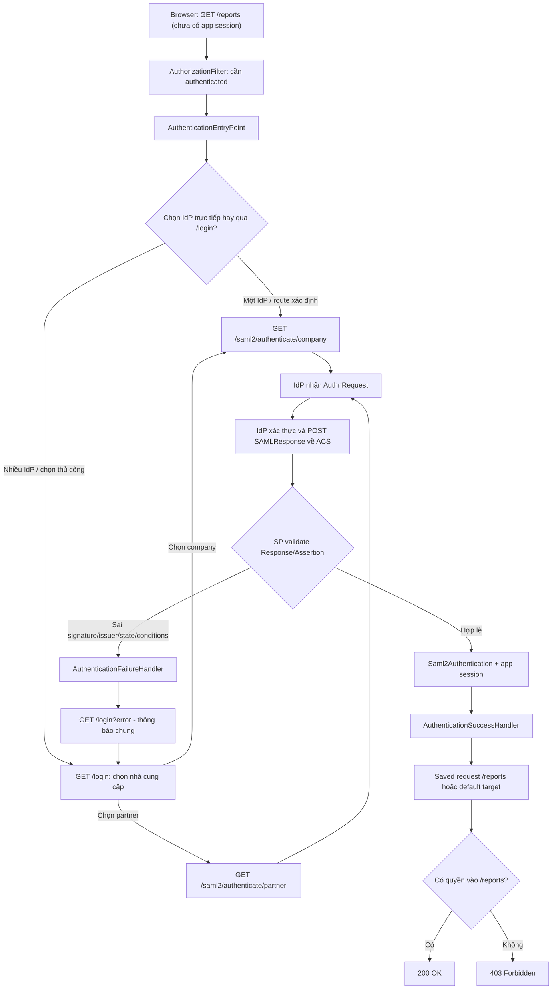

# Xử lý thành công, thất bại và trang lựa chọn phương thức đăng nhập trong Spring Security SAML2

## Mục tiêu học tập

Sau bài học, bạn có thể:

1. Giải thích nhánh **đăng nhập SAML2 thành công** và **đăng nhập thất bại** khi ứng dụng Spring Security đóng vai **Relying Party (RP) / Service Provider (SP)**.
2. Phân biệt **AuthenticationSuccessHandler**, **AuthenticationFailureHandler**, **AuthenticationEntryPoint**, **RequestCache** và **AccessDeniedHandler**; hiểu tại sao 403 sau đăng nhập không đồng nghĩa SAML authentication thất bại.
3. Hiểu khi nào Spring Security chuyển trực tiếp tới IdP, khi nào cần **trang chọn phương thức/nhà cung cấp đăng nhập**, và cách xây trang tùy chỉnh có liên kết tới đúng `registrationId`.
4. Viết cấu hình Spring Boot 3 + Spring Security 6, Java 17+, cho **hai SAML2 IdP** và một trang `GET /login`; cấu hình **success handler** đưa người dùng về saved request và **failure handler** về trang lỗi an toàn.
5. Lần theo luồng từ tài nguyên được bảo vệ → trang chọn IdP → AuthnRequest → SAMLResponse → ACS → kết quả thành công/thất bại; nhận diện nơi lưu phiên và ranh giới xác thực/phân quyền.
6. Kiểm thử và chẩn đoán các lỗi phổ biến: vòng lặp redirect, callback sai, thiếu cookie ở cross-site POST, issuer/certificate không khớp, chọn sai registration, lộ chi tiết lỗi hay open redirect.

## 1. Ba kết quả người dùng thường nhìn thấy

SAML 2.0 Web Browser SSO cho phép ứng dụng Spring Security chuyển bước xác thực danh tính sang **IdP/Asserting Party** đã tin cậy. Người dùng có thể bắt đầu từ một trang được bảo vệ tại ứng dụng, từ trang chọn IdP, hoặc từ phía IdP tùy kiến trúc.

Trong luồng **SP-initiated**, trình duyệt mở `/reports` khi chưa có phiên ứng dụng; Spring Security chuyển sang đăng nhập. Sau đó có ba kết quả khác nhau:

| Kết quả | Đã xảy ra điều gì? | Phản hồi ứng dụng thường cung cấp |
| --- | --- | --- |
| **Authentication thành công và đủ quyền** | IdP xác thực, SP kiểm chứng SAMLResponse và tạo `Authentication`; quyền tài nguyên được đáp ứng | Tạo/duy trì phiên SP, chuyển tới URL đã lưu hoặc trang đích, rồi tài nguyên trả 200 |
| **Authentication thất bại** | SAMLResponse không hợp lệ, signature/issuer/audience/timestamp sai, không tìm thấy account theo chính sách, hoặc quá trình login bị lỗi | Không tạo phiên đã xác thực; xử lý bởi `AuthenticationFailureHandler`, hiển thị thông điệp chung và cho phép thử lại an toàn |
| **Authentication thành công nhưng không đủ quyền** | Danh tính được kiểm chứng nhưng user thiếu role/permission/tenant để truy cập tài nguyên | `AccessDeniedHandler` hoặc logic authorization trả 403; không nên nói “sai mật khẩu IdP” |

Đừng gộp **đăng nhập thất bại** và **truy cập bị từ chối** vào một loại lỗi. Cùng màn hình “Không thể truy cập” có thể che hai nguyên nhân hoàn toàn khác nhau, gây khó debug và trải nghiệm kém.

### 1.1. Ai xử lý phần nào?

| Thành phần | Vai trò trong luồng |
| --- | --- |
| `AuthenticationEntryPoint` | Khởi động login khi request chưa được xác thực. Có thể chuyển tới IdP hoặc tới trang chọn phương thức đăng nhập |
| `Saml2WebSsoAuthenticationRequestFilter` | Tạo/gửi `AuthnRequest` cho đúng `RelyingPartyRegistration` |
| `Saml2WebSsoAuthenticationFilter` | Nhận `SAMLResponse` ở ACS và giao xác thực cho manager/provider |
| OpenSAML authentication provider | Kiểm chữ ký, giải mã khi cần, đối chiếu issuer, audience, thời hạn, response/subject conditions và quy tắc trust |
| `AuthenticationSuccessHandler` | Xử lý hành động sau khi xác thực thành công, thường redirect về tài nguyên ban đầu hoặc trang đích |
| `AuthenticationFailureHandler` | Xử lý lỗi trong quá trình xác thực và điều hướng/hiển thị lỗi đã được kiểm soát |
| `RequestCache` | Có thể lưu request được bảo vệ ban đầu để success handler quay về sau login |
| `SecurityContextRepository` và session | Duy trì `Authentication` của ứng dụng giữa các HTTP requests |
| `AccessDeniedHandler` | Trả kết quả khi người dùng **đã xác thực** nhưng không có quyền truy cập tài nguyên |

Các tên class theo Java DSL Spring Security Servlet. API chi tiết có thể khác ít nhiều giữa các bản Spring Security; bài sử dụng mẫu Spring Security 6.x phù hợp dự án Spring Boot 3.x.

## 2. Sơ đồ tổng quát: nhánh thành công và thất bại



Đây là sơ đồ **khái niệm**. Browser thực tế có thể đi qua nhiều redirect ở IdP, SAML POST binding hoặc bước MFA. Khi có một IdP và cấu hình mặc định, Spring Security thường có thể chuyển trực tiếp tới IdP; khi có nhiều `RelyingPartyRegistration`, framework có thể trình bày một trang chọn. Khi ứng dụng **chỉ định trang login riêng**, route đó phải do ứng dụng cung cấp.

## 3. Entry point: lúc nào cần chuyển người dùng đến login?

Một ví dụ chuỗi HTTP:

```http
GET /reports HTTP/1.1
Host: portal.example.org
Accept: text/html
```

Nếu `/reports` yêu cầu `authenticated()` nhưng không có authentication hợp lệ:

1. `SecurityFilterChain` xử lý request.
2. `AuthorizationFilter` không cho anonymous đi vào controller.
3. `ExceptionTranslationFilter` có thể lưu request ban đầu thông qua `RequestCache` và kích hoạt `AuthenticationEntryPoint`.
4. Entry point chuyển browser tới một URL khởi tạo SAML2 hoặc trang lựa chọn login như `/login`.
5. Sau khi user chọn một IdP, browser gọi `/saml2/authenticate/{registrationId}`.

**`AuthenticationEntryPoint` không phải `AuthenticationFailureHandler`.** Entry point là cửa vào khi chưa login; failure handler xử lý **một giao dịch authentication đã được khởi động và gặp lỗi**.

### 3.1. Trường hợp có một IdP

Giả sử chỉ có registration `company` và không chỉ định trang login riêng. Spring Security có thể thiết lập redirect trực tiếp tới URL phát yêu cầu:

```text
GET /reports
  -> 302 /saml2/authenticate/company
  -> 302 https://idp-company.example.org/sso?SAMLRequest=...
```

Cách redirect cụ thể phụ thuộc version và cấu hình entry point; không nên hard-code giả định này vào frontend nếu ứng dụng có thể sẽ thêm IdP khác.

### 3.2. Trường hợp có nhiều IdP

Nếu có hai registration `company` và `partner`, người dùng chưa được định tuyến theo tenant có thể cần màn hình lựa chọn. Các liên kết **đến endpoint khởi tạo login của SP**, không trực tiếp tự tạo `SAMLRequest` bằng JavaScript trên browser:

```text
GET /login
  - "Đăng nhập bằng tài khoản công ty"
       /saml2/authenticate/company
  - "Đăng nhập bằng tài khoản đối tác"
       /saml2/authenticate/partner
```

Khi user chọn `company`, Spring Security dùng registration đó để phát `AuthnRequest` đến **IdP công ty**. Khi chọn `partner`, dùng cấu hình và chứng thư của **IdP đối tác**. Browser không được tùy ý nhập issuer, chứng thư hay SSO URL mới để ứng dụng lập tức tin.

## 4. Trang đăng nhập do Spring Security tạo và trang tùy chỉnh

Spring Security có khả năng dùng `DefaultLoginPageGeneratingFilter` để hiển thị **trang login mặc định**, bao gồm các lựa chọn SAML2 khi có nhiều nhà cung cấp và các điều kiện hỗ trợ phù hợp. Đây là cách bắt đầu nhanh khi không yêu cầu giao diện thương hiệu hay quy tắc chọn tenant phức tạp.

**Trang được sinh tự động** và **trang tùy chỉnh** khác nhau về trách nhiệm:

| Chủ đề | Trang mặc định của framework | Trang tự xây |
| --- | --- | --- |
| Nguồn lựa chọn IdP | Framework tạo từ các registrations được biết, tùy phiên bản/cấu hình | Ứng dụng quyết định IdP nào xuất hiện cho mỗi user/tenant |
| URL login | Thường do framework quy định, ví dụ `/login` | Ví dụ `GET /login` do controller/view của ứng dụng tạo |
| Giao diện, thương hiệu, hỗ trợ đa ngôn ngữ | Khả năng tùy chỉnh giới hạn | Toàn quyền trình bày, accessibility, hướng dẫn, thông báo lỗi |
| Liên kết SAML | Liên kết vào endpoint `/saml2/authenticate/{registrationId}` | Phải tự tạo link đúng registration và context path |
| Xử lý lỗi | Theo cấu hình handler mặc định | Có thể hiển thị `?error`/mã lỗi nội bộ đã khử nhạy cảm |
| An toàn | Dựa trên default cấu hình Spring Security | Phải bảo vệ khỏi open redirect, XSS, tenant mix-up, lộ nội dung lỗi |
| Khi thêm/bớt IdP | Có thể phản ánh registration list của framework | Cần cập nhật danh sách được phép, branding và chính sách định tuyến |

Khi gọi:

```java
.saml2Login(saml -> saml.loginPage("/login"))
```

Spring Security **không tự động tạo controller HTML tại `/login`**. Ứng dụng phải có route GET được phép truy cập khi chưa đăng nhập, đồng thời trang phải có liên kết hợp lệ đến các endpoint khởi tạo AuthnRequest. Nếu quên `permitAll` cho `/login`, rất dễ tạo vòng lặp: `/login` cũng bị chặn → lại chuyển tới `/login`.

### 4.1. Cách chọn IdP trong sản phẩm nhiều tenant

Có thể chọn theo:

1. **Người dùng tự chọn** “Công ty A”, “Công ty B” trên trang `/login`.
2. **Domain hint đã được xác thực/cấu hình**: định tuyến theo email domain/tenant ID sau khi kiểm tra mapping và policy; không phải chỉ vì người dùng gõ một chuỗi giống tên miền là đủ chứng minh tenant.
3. **Đường dẫn ứng dụng gắn tenant**: `/t/acme/login` có server-side mapping cố định đến registration `acme`.
4. **Luồng vào từ đối tác**: IdP có thể khởi tạo đăng nhập khi SP cho phép và cấu hình; trường hợp này khác SP-initiated và cần kiểm soát riêng.

Không nhận tùy ý tham số `?issuer=...`, `?metadataUri=...` hoặc `?redirect=https://...` rồi tạo trust/redirect theo giá trị browser cung cấp. **Registration ID là lựa chọn trong allowlist**, không phải giấy phép tự động tin một IdP mới.

## 5. Luồng thành công: điều gì xảy ra ở ACS?

Giả sử browser đã chọn `company`:

1. `GET /saml2/authenticate/company` kích hoạt `Saml2WebSsoAuthenticationRequestFilter` và gửi `AuthnRequest` tới IdP.
2. IdP xác thực người dùng hoặc tái sử dụng phiên SSO phù hợp; ký `SAMLResponse`/`Assertion` và có thể mã hóa assertion cho SP.
3. Browser gửi `POST /login/saml2/sso/company` với tham số `SAMLResponse` (và `RelayState` tùy binding).
4. `Saml2WebSsoAuthenticationFilter` nhận response và qua converter/provider xác minh chữ ký, issuer, audience, destination, thời điểm, SubjectConfirmation, `InResponseTo`/request correlation trong luồng SP-initiated, giải mã khi cần.
5. Khi hợp lệ, framework tạo `Saml2Authentication`/`Saml2AuthenticatedPrincipal` và đưa vào `SecurityContext` theo cơ chế filter/session.
6. **Success handler** quyết định HTTP response tiếp theo: redirect tới saved request, tới trang mặc định hay tiếp tục luồng theo cấu hình.
7. Browser sử dụng **cookie phiên SP** ở request tiếp theo; ứng dụng tiếp tục kiểm tra authorization từng tài nguyên.

### 5.1. `AuthenticationSuccessHandler` là gì?

Đây là chiến lược xử lý **sau khi authentication thành công**. Nó không thực hiện thay bộ máy xác minh SAML; không cần tự parse Base64/XML hay kiểm signature trong handler.

Một số việc hợp lý:

- Redirect về URL người dùng định xem trước khi login.
- Nếu không có request được lưu, đưa tới `/dashboard` hoặc trang đích mặc định.
- Ghi nhận sự kiện đăng nhập đã khử thông tin nhạy cảm qua audit service.
- Thực hiện bước ánh xạ/onboarding theo chính sách nếu hệ thống cần, nhưng không tăng quyền chỉ dựa vào email chưa thẩm định.
- Xử lý việc đăng nhập trong ứng dụng đa tenant sau khi đã kiểm tra registration và principal phù hợp.

**Không dùng success handler để bỏ qua quyền nghiệp vụ.** User có thể đăng nhập SAML hợp lệ nhưng vẫn bị 403 khi mở `/admin`.

### 5.2. Saved request và default target

`SavedRequestAwareAuthenticationSuccessHandler` là handler thường dùng với ứng dụng web theo phiên. Khi có request hợp lệ đã được `RequestCache` lưu, nó ưu tiên đưa browser trở lại URL trước đăng nhập. Nếu không có saved request, nó có thể dùng `defaultTargetUrl`.

Ví dụ:

```java
SavedRequestAwareAuthenticationSuccessHandler success =
        new SavedRequestAwareAuthenticationSuccessHandler();
success.setDefaultTargetUrl("/dashboard");
```

Nếu user đi từ `/reports` → login, sau xác thực handler thường redirect lại `/reports`. Nếu user mở `/login` trực tiếp và chọn IdP, không có tài nguyên trước đó thì có thể về `/dashboard`.

Không nên dùng `setAlwaysUseDefaultTargetUrl(true)` khi muốn bảo toàn tài nguyên ban đầu; tùy chọn đó làm ưu tiên trang đích mặc định thay vì saved request. Trong trường hợp API/SPA, một chiến lược khác (status, JSON hoặc frontend route có kiểm soát) có thể phù hợp hơn redirect toàn bộ request.

### 5.3. Phải giới hạn URL chuyển hướng

Một ứng dụng có thể nhận tham số như `next`/`returnTo` để chọn trang sau login. Nếu chỉ làm:

```text
/login?next=https://phishing.example.org
```

rồi redirect tới URL đó ngay sau khi xác thực, ứng dụng có thể tạo **open redirect** và làm người dùng tin đó là một phần đăng nhập đáng tin. Nên dùng saved request của Spring Security hoặc allowlist các **đường dẫn nội bộ** an toàn, không redirect tùy ý tới host ngoài. Đừng tự phản chiếu nguyên `RelayState` thành URL nếu chưa có ràng buộc và xác thực trạng thái.

## 6. Luồng thất bại: nơi xảy ra lỗi và cách xử lý

Một SAML login có thể thất bại **trước, trong hoặc sau** khi IdP trả response:

| Giai đoạn | Ví dụ lỗi | Trách nhiệm xử lý |
| --- | --- | --- |
| Trước khi phát yêu cầu | Không tìm thấy `registrationId`, thiếu IdP metadata/SSO URL, filter chain sai | Xử lý cấu hình/điều hướng; có thể là lỗi hệ thống, chưa đến bước SAML validation |
| Tại IdP | Người dùng hủy đăng nhập, không vượt MFA, tài khoản IdP bị khóa, IdP trả SAML Status không thành công | IdP báo trạng thái; SP hiển thị lỗi phù hợp sau khi kiểm tra response theo quy tắc |
| Khi browser POST ACS | Thiếu `SAMLResponse`, sai endpoint, sai HTTP method, mất session/correlation | Filter/converter không thể tạo authentication request hợp lệ |
| Trong SAML validation | Chữ ký không tin cậy, sai issuer/audience/recipient, hết hạn, replay, decryption fail | Provider từ chối; **không** tạo `Saml2Authentication` hợp lệ |
| Sau khi xác thực | Mapping user thất bại hoặc chính sách app không cấp quyền | Nếu mapping nằm trong bước authentication thì có thể phát sinh authentication failure; nếu chỉ thiếu quyền tài nguyên thì trả 403 |

`AuthenticationFailureHandler` được dùng khi **filter authentication báo thất bại**. Nếu cấu hình:

```java
SimpleUrlAuthenticationFailureHandler failure =
        new SimpleUrlAuthenticationFailureHandler("/login?error");
```

browser thường được redirect tới `/login?error`. Controller ở trang login có thể hiển thị thông báo chung như “Không thể hoàn tất đăng nhập. Vui lòng chọn lại tài khoản hoặc liên hệ hỗ trợ”, không đưa ra `SAMLResponse` thô hay exception stack trace.

### 6.1. Không hiển thị lỗi kỹ thuật nhạy cảm cho browser

**Không** dùng response như sau:

```text
InvalidSignature: expected certificate fingerprint=...
Received SAMLResponse: PHNhbWxwOlJlc3BvbnNlLi4u
SessionId=...
```

Thông tin này có thể lộ chứng thư đang vận hành, assertion có dữ liệu người dùng và session identifiers. Trong UI chỉ nên hiển thị **mã sự cố/tin nhắn chung**, còn log server ghi metadata đã giảm nhạy cảm: request ID, timestamp, loại lỗi, registration ID đã kiểm soát và kết quả kiểm tra trust.

### 6.2. Thất bại không đồng nghĩa 403

Phân loại cho người dùng và log:

- **Không xác thực / thiếu phiên:** chuyển tới login theo cấu hình; HTTP thường là 302, không phải kết luận “không có quyền”.
- **Authentication không hợp lệ:** `failureHandler`, có thể về `/login?error`; không được tạo session authenticated từ SAMLResponse lỗi.
- **Authentication hợp lệ nhưng thiếu role:** `AccessDeniedHandler` hoặc authorization layer, thường 403.
- **Ứng dụng/IdP tạm không khả dụng:** có thể trả 503/trang sự cố có kiểm soát tùy hệ thống; không nên chuyển tất cả thành “sai thông tin đăng nhập”.

### 6.3. Retry đúng cách

Khi người dùng nhấn “Thử lại”:

1. Quay về trang chọn IdP `/login` hoặc endpoint khởi tạo `/saml2/authenticate/{registrationId}` tin cậy.
2. **Tạo AuthnRequest mới**, bao gồm ID/state mới; không gửi lại SAMLResponse/Assertion cũ.
3. Giữ nguyên validation chữ ký, issuer, audience, timestamp, request correlation.
4. Tránh vòng lặp auto-retry vô hạn khi IdP không sẵn sàng hoặc cert bị sai; màn hình cần cho người dùng đổi IdP/quay lại hoặc liên hệ hỗ trợ.

Không tự động quay lại IdP ngay sau mọi lỗi trên cùng một request nếu sẽ tạo chuỗi redirect loop không thể thoát.

## 7. Ví dụ đầy đủ: Spring Boot với hai IdP và trang `/login`

Mục tiêu demo: ứng dụng Java 17+ là một **SAML2 Relying Party**, có hai registration `company` và `partner`, trang chọn đăng nhập tự xây, success handler ưu tiên saved request và fallback `/dashboard`, failure handler quay lại `/login?error`.

**Điều kiện trước khi chạy end-to-end:** có IdP thật cho cả hai registration, SAML SP entity ID/ACS được IdP cho phép, certificate X.509 công khai của IdP đã được thẩm định. Ví dụ hostname `example.org` và tệp `idp-*.crt` chỉ là dữ liệu minh họa. Đây là mã **trong dự án Spring Boot Servlet**, không chạy độc lập chỉ với `javac` và JDK chuẩn.

### 7.1. Cấu trúc tệp

```text
src/main/java/com/example/saml/
  SamlDemoApplication.java
  SecurityConfiguration.java
  LoginPageController.java
  PagesController.java
src/main/resources/
  application.yml
  idp-company.crt
  idp-partner.crt
build.gradle
```

Hai certificate `.crt` là **public IdP signing certificates** nhận qua metadata/kênh tin cậy. Không đưa private signing/decryption key production vào repository.

### 7.2. Gradle Groovy DSL

Ví dụ `dependencies` trong `build.gradle`, giả sử dự án đã có Spring Boot 3.x plugin và dependency management phù hợp:

```groovy
dependencies {
    implementation 'org.springframework.boot:spring-boot-starter-web'
    implementation 'org.springframework.boot:spring-boot-starter-security'
    implementation 'org.springframework.security:spring-security-saml2-service-provider'

    testImplementation 'org.springframework.boot:spring-boot-starter-test'
    testImplementation 'org.springframework.security:spring-security-test'
}
```

Ứng dụng cần runtime Servlet; `spring-security-saml2-service-provider` sử dụng OpenSAML. Quản lý version Spring Security/OpenSAML phù hợp BOM và repositories của dự án; không tự gắn version module không tương thích. Phiên bản Java tối thiểu của Spring Boot 3 là Java 17.

### 7.3. Cấu hình hai `RelyingPartyRegistration` bằng YAML

Tệp `src/main/resources/application.yml`:

```yaml
spring:
  security:
    saml2:
      relyingparty:
        registration:
          company:
            entity-id: "https://portal.example.org/saml2/service-provider-metadata/company"
            acs:
              location: "https://portal.example.org/login/saml2/sso/company"
            assertingparty:
              entity-id: "https://idp-company.example.org/saml"
              verification:
                credentials:
                  - certificate-location: "classpath:idp-company.crt"
              singlesignon:
                url: "https://idp-company.example.org/sso"
                sign-request: false

          partner:
            entity-id: "https://portal.example.org/saml2/service-provider-metadata/partner"
            acs:
              location: "https://portal.example.org/login/saml2/sso/partner"
            assertingparty:
              entity-id: "https://idp-partner.example.org/saml"
              verification:
                credentials:
                  - certificate-location: "classpath:idp-partner.crt"
              singlesignon:
                url: "https://idp-partner.example.org/sso"
                sign-request: false
```

**Giải thích:**

- `company`/`partner` là hai `registrationId`; mỗi ID được dùng trong đường khởi tạo `/saml2/authenticate/{registrationId}` và ACS mặc định.
- `entity-id` cấp registration là định danh **SP** đối với từng IdP, phải khớp metadata và cấu hình IdP.
- `acs.location` xác định URL công khai mà IdP POST `SAMLResponse`; bảo đảm hostname, HTTPS, path đúng tại ingress/proxy.
- `assertingparty.entity-id` và `singlesignon.url` là thông tin của từng **IdP**. Không hoán đổi giữa company và partner.
- `verification.credentials` chỉ chứa **public signing certificate của IdP tương ứng**; có thể có nhiều cert trong giai đoạn rollover. Không nhận certificate từ một SAMLResponse chưa được thẩm định.
- `sign-request: false` là giả định **IdP cho phép AuthnRequest không ký**. Nếu IdP yêu cầu signed request, phải thiết lập signing credential/private key của SP và `sign-request: true`.
- Hai tệp certificate phải có nội dung thật và hợp lệ; nếu chỉ chép YAML khi không có các file ấy, ứng dụng có thể **không khởi động** hoặc không đăng nhập được.

Nếu tổ chức cung cấp metadata URI của IdP và muốn dùng metadata để quản lý endpoints/cert, có thể chọn cấu hình `assertingparty.metadata-uri` phù hợp thay cho manual values; phải xác minh nguồn metadata và chiến lược rotation.

### 7.4. Lớp khởi động

Tệp `src/main/java/com/example/saml/SamlDemoApplication.java`:

```java
package com.example.saml;

import org.springframework.boot.SpringApplication;
import org.springframework.boot.autoconfigure.SpringBootApplication;

@SpringBootApplication
public class SamlDemoApplication {
    public static void main(String[] args) {
        SpringApplication.run(SamlDemoApplication.class, args);
    }
}
```

Đây là entry point Spring Boot; không có stdout cố định vì log khởi động phụ thuộc profile, dependencies và môi trường.

### 7.5. Cấu hình success/failure handler và trang chọn login

Tệp `src/main/java/com/example/saml/SecurityConfiguration.java`:

```java
package com.example.saml;

import org.springframework.context.annotation.Bean;
import org.springframework.context.annotation.Configuration;
import org.springframework.security.config.annotation.web.builders.HttpSecurity;
import org.springframework.security.web.SecurityFilterChain;
import org.springframework.security.web.authentication.SavedRequestAwareAuthenticationSuccessHandler;
import org.springframework.security.web.authentication.SimpleUrlAuthenticationFailureHandler;

@Configuration
public class SecurityConfiguration {

    @Bean
    SecurityFilterChain securityFilterChain(HttpSecurity http) throws Exception {
        SavedRequestAwareAuthenticationSuccessHandler success =
                new SavedRequestAwareAuthenticationSuccessHandler();
        // Nếu login được mở trực tiếp, chưa có protected saved request.
        success.setDefaultTargetUrl("/dashboard");

        SimpleUrlAuthenticationFailureHandler failure =
                new SimpleUrlAuthenticationFailureHandler("/login?error");

        return http
                .authorizeHttpRequests(auth -> auth
                        .requestMatchers("/", "/login", "/error").permitAll()
                        .requestMatchers("/reports/**").authenticated()
                        .anyRequest().authenticated()
                )
                .saml2Login(saml -> saml
                        .loginPage("/login")
                        .successHandler(success)
                        .failureHandler(failure)
                )
                .build();
    }
}
```

Giải thích:

1. `saml2Login()` cài SAML authentication request/response filters, đăng ký login processing theo endpoint ACS mặc định.
2. `.loginPage("/login")` yêu cầu **app tự cung cấp GET /login**. Vì vậy `requestMatchers("/login").permitAll()` là bắt buộc để browser anonymous mở được trang.
3. `.successHandler(success)` xử lý kết quả sau xác thực. `SavedRequestAwareAuthenticationSuccessHandler` ưu tiên URL đã lưu từ trang bảo vệ nếu có; `/dashboard` là fallback.
4. `.failureHandler(failure)` redirect tới `/login?error` để trang chọn hiển thị thông báo chung. Không dùng URL lỗi được browser tự cung cấp.
5. Các endpoint `/saml2/authenticate/{registrationId}` và `/login/saml2/sso/{registrationId}` do SAML filters xử lý theo cấu hình. Không viết controller xử lý thủ công `SAMLResponse`.
6. `/reports/**` yêu cầu authentication; một ứng dụng thực có thể thêm `hasAuthority`, `hasRole`, permission cụ thể ở đây hoặc method security. Có `.anyRequest().authenticated()` để tránh vô tình mở tài nguyên mới cho anonymous.
7. CSRF mặc định vẫn có hiệu lực cho các action khác; Spring Security thiết lập xử lý phù hợp cho SAML ACS POST. Không tắt CSRF toàn cục chỉ để sửa callback.

**Lưu ý mô hình nhiều chain:** nếu dự án có nhiều `SecurityFilterChain` với `securityMatcher` khác nhau, phải bảo đảm `/login`, endpoint tạo AuthnRequest, ACS và tài nguyên được bảo vệ đều đi qua chain đúng. Nếu một chain dành riêng cho API chặn ACS trước chain SAML, trang có thể 404/403 dù IdP trả response đúng.

### 7.6. Tạo trang lựa chọn bằng controller Java 17+

Tệp `src/main/java/com/example/saml/LoginPageController.java`:

```java
package com.example.saml;

import org.springframework.http.MediaType;
import org.springframework.web.bind.annotation.GetMapping;
import org.springframework.web.bind.annotation.RequestParam;
import org.springframework.web.bind.annotation.RestController;

@RestController
public class LoginPageController {

    @GetMapping(value = "/login", produces = MediaType.TEXT_HTML_VALUE)
    public String login(
            @RequestParam(value = "error", required = false) String error) {

        // Chỉ dùng sự hiện diện của tham số; không in lại dữ liệu do user gửi.
        String errorNotice = (error == null)
                ? ""
                : "<p role=\"alert\">Không thể hoàn tất đăng nhập. "
                + "Vui lòng thử lại hoặc liên hệ bộ phận hỗ trợ.</p>";

        return """
                <!doctype html>
                <html lang="vi">
                  <head>
                    <meta charset="UTF-8">
                    <title>Chọn phương thức đăng nhập</title>
                  </head>
                  <body>
                    <main>
                      <h1>Chọn phương thức đăng nhập</h1>
                      <p>Chọn nhà cung cấp danh tính của bạn:</p>
                      <ul>
                        <li><a href="/saml2/authenticate/company">Tài khoản công ty</a></li>
                        <li><a href="/saml2/authenticate/partner">Tài khoản đối tác</a></li>
                      </ul>
                      %s
                    </main>
                  </body>
                </html>
                """.formatted(errorNotice);
    }
}
```

Đây là trang HTML tối giản **không yêu cầu Thymeleaf**. Vì `@RestController` trả chuỗi có `produces = MediaType.TEXT_HTML_VALUE`, Spring MVC trả nội dung HTML. Trang có link GET tới **endpoint khởi tạo SAML của SP**, không chứa password form hoặc SAMLResponse giả.

**Vì sao chỉ kiểm sự hiện diện `?error`?** Tham số có thể bị browser sửa. Mã không chèn chuỗi lỗi tùy ý vào HTML, tránh phản chiếu dữ liệu không tin cậy dẫn đến XSS. Trong sản phẩm thật, dùng template engine, escape output, CSP, giao diện nhất quán, mã hỗ trợ nội bộ và accessibility chuẩn. Không dùng static list từ ví dụ nếu số IdP thay đổi thường xuyên; thay bằng danh sách cho phép được xác định server-side.

Nếu ứng dụng chạy dưới **context path** (ví dụ `/portal`), các `href="/saml2/authenticate/..."` là đường dẫn từ root domain và cần tạo context-aware URL bằng template/MVC hoặc helper tương ứng; đừng hard-code root path trong tình huống đó.

### 7.7. Trang public, dashboard và tài nguyên cần đăng nhập

Tệp `src/main/java/com/example/saml/PagesController.java`:

```java
package com.example.saml;

import org.springframework.security.core.Authentication;
import org.springframework.web.bind.annotation.GetMapping;
import org.springframework.web.bind.annotation.RestController;

@RestController
public class PagesController {

    @GetMapping("/")
    String publicPage() {
        return "Public home";
    }

    @GetMapping("/dashboard")
    String dashboard(Authentication authentication) {
        return "Dashboard for " + authentication.getName();
    }

    @GetMapping("/reports/overview")
    String reports(Authentication authentication) {
        return "Reports for " + authentication.getName();
    }
}
```

Ví dụ giả sử một SAMLResponse hợp lệ từ IdP chứa NameID `employee-123`; khi có quyền truy cập, phản hồi của `GET /reports/overview` có thể là:

```text
Reports for employee-123
```

Đây là **HTTP response giả định sau khi tích hợp IdP thật**, không phải stdout của một chương trình chạy bằng `javac`. Nếu IdP trả NameID khác hoặc app có user mapper riêng, giá trị sẽ khác. Java code ở mục 7 cần cả hệ thống Spring Boot, chứng thư hợp lệ và cấu hình IdP; không thể chạy SSO chỉ bằng các class source.

## 8. Trace HTTP: nhánh thành công

Tình huống: user mở báo cáo khi chưa đăng nhập và chọn IdP `company`. Đây là trace rút gọn, không hiển thị token/PII thật.

```text
(1) GET /reports/overview
    SP: chưa có authenticated session
    -> 302 /login
       RequestCache có thể lưu /reports/overview

(2) GET /login
    -> 200 HTML có 2 liên kết:
       /saml2/authenticate/company
       /saml2/authenticate/partner

(3) User chọn company:
    GET /saml2/authenticate/company
    -> 302 https://idp-company.example.org/sso?SAMLRequest=...&RelayState=...

(4) IdP thực hiện đăng nhập/MFA nếu cần.
    Browser POST /login/saml2/sso/company
    Content-Type: application/x-www-form-urlencoded
    SAMLResponse=...&RelayState=...

(5) Spring Security verify signature, issuer, audience, recipient,
    time conditions và request correlation.
    -> Saml2Authentication thành công, session được lưu
    -> Success handler 302 về /reports/overview (saved request)

(6) GET /reports/overview + app session cookie
    -> 200 "Reports for employee-123" nếu authorization cho phép
```

**Hai điểm cần nhớ:**

- Trang `/login` là bước **định tuyến/giới thiệu lựa chọn IdP**; nó không tự xác thực danh tính. Bằng chứng xác thực xuất hiện tại `SAMLResponse` và được SP verify ở ACS.
- `SavedRequestAwareAuthenticationSuccessHandler` dùng request cache, không “đọc” nguyên `RelayState` chưa được kiểm chứng rồi chuyển trình duyệt đến URL bất kỳ.

## 9. Trace HTTP: nhánh thất bại

Tình huống: user chọn `partner` nhưng IdP dùng chứng thư ký mới mà SP chưa cập nhật.

```text
(1) GET /login
    -> 200 HTML danh sách IdP

(2) GET /saml2/authenticate/partner
    -> SP phát AuthnRequest cho IdP partner

(3) Browser POST /login/saml2/sso/partner với SAMLResponse
    -> OpenSAML validator từ chối chữ ký IdP không thuộc tập cert được tin

(4) AuthenticationFailureHandler
    -> 302 /login?error

(5) GET /login?error
    -> 200 HTML thông báo:
       "Không thể hoàn tất đăng nhập. Vui lòng thử lại hoặc liên hệ bộ phận hỗ trợ."
    -> Browser vẫn có thể chọn một IdP khác hoặc liên hệ hỗ trợ
```

Điều không được xảy ra: tự bỏ qua signature verification để “cho chạy”, tự chuyển tất cả response thất bại thành login success, ghi toàn bộ `SAMLResponse` vào URL lỗi, hay redirect liên tục không có trang để người dùng dừng lại.

### 9.1. 403 sau thành công là nhánh khác

Giả sử IdP xác thực đúng `employee-123`, nhưng resource `/admin/reports` đòi `ROLE_ADMIN` mà ứng dụng không cấp. SP nên trả 403/Access Denied theo policy. **Failure handler SAML không nhất thiết được gọi**, vì quá trình authentication đã thành công. Cần kiểm `GrantedAuthority`/authorization mapping, không bắt IdP đổi certificate.

## 10. Khi chỉ có một IdP và khi có nhiều IdP

| Tình huống | Thiết kế thích hợp |
| --- | --- |
| Một IdP duy nhất, không cần lựa chọn | Dùng `saml2Login()` với default entry point hoặc trang trực tiếp, giảm số bước |
| Hai IdP cố định, user được phép chọn | Trang `/login` với links tường minh như demo |
| Nhiều IdP theo tenant | Tạo danh sách từ server-side allowlist/registration repository, lọc theo tenant đã xác định tin cậy |
| IdP mới được thêm thường xuyên | Xây UI cấu hình có kiểm soát, metadata validation và cơ chế refresh/sync an toàn |
| User đến từ IdP-initiated flow | Thiết kế tiếp nhận response phù hợp; không có AuthnRequest đã phát trước đó nên correlation và CSRF policy cần được xét riêng |
| Có cả OIDC và SAML trong một web app | Trang login có thể trình bày các cơ chế khác nhau với links riêng; cần cấu hình hai authentication chains/entry points tương thích và chính sách bảo mật nhất quán |

**“Phương thức đăng nhập”** không nhất thiết chỉ có IdP SAML; một sản phẩm có thể có OIDC, mật khẩu cục bộ, passkey hoặc các lựa chọn hợp lệ khác. Tuy nhiên bài tập minh họa **hai SAML2 registrations**, nên không cấu hình thừa một OAuth2/username-password flow không cần thiết.

### 10.1. Không chọn IdP dựa trên thông tin chưa xác thực để cấp quyền

Nếu ứng dụng yêu cầu người dùng nhập email rồi tự chuyển đến IdP theo domain, đây có thể là bước **home realm discovery**, không phải kiểm chứng rằng user sở hữu email/tenant đó. Sau SAML response, ứng dụng phải dùng issuer, registration, subject/NameID và chính sách mapping để xác định tenant/cấp quyền cuối cùng.

Hai IdP có thể cùng gửi một email giống nhau nhưng là **hai tài khoản khác nhau**. Không tự động merge tài khoản nhạy cảm hoặc cấp role nội bộ chỉ dựa trên email trùng.

## 11. Sự khác nhau giữa các handler trong Spring Security

### 11.1. `AuthenticationEntryPoint`

Được kích hoạt khi cần bắt đầu quá trình authentication từ một request chưa được xác thực. Ví dụ chuyển `GET /reports` sang `GET /login`. Nếu chỉ có một IdP, entry point có thể chuyển trực tiếp tới `/saml2/authenticate/company`.

### 11.2. `AuthenticationSuccessHandler`

Được gọi sau khi authentication filter xác nhận đăng nhập. Handler có thể redirect về saved request/target. Nếu ứng dụng muốn làm audit, nên tách audit service phù hợp và tránh ném exception tùy tiện sau khi framework đã chuẩn bị session.

### 11.3. `AuthenticationFailureHandler`

Phụ trách lỗi **trong quá trình xác thực**. Có thể dùng `SimpleUrlAuthenticationFailureHandler`, hoặc custom handler để phân loại lỗi chung, gắn correlation ID, hiển thị trang thử lại. Tuyệt đối không cho browser tự quyết định trang lỗi bằng URL ngoài không có allowlist.

### 11.4. `AccessDeniedHandler`

Xử lý user đã xác thực nhưng không thỏa rule truy cập. Ví dụ `hasRole("ADMIN")` không đạt. Đây là **authorization failure**, không phải kết luận từ IdP rằng user nhập password sai.

### 11.5. `RequestCache`

Lưu request ban đầu để có đường trở lại sau login. `HttpSessionRequestCache` phổ biến trong web app có session; cấu hình theo security chain. Cần phân biệt với `Saml2AuthenticationRequestRepository`, vốn lưu **AuthnRequest** và dữ liệu liên hệ `InResponseTo` theo flow.

**Tóm tắt theo ý nghĩa:**

| Câu hỏi | Thành phần trả lời |
| --- | --- |
| Người chưa login sẽ bắt đầu từ đâu? | Entry point |
| Người đã login thành công sẽ đến đâu? | Success handler + request cache |
| SAMLResponse lỗi sẽ hiển thị gì? | Failure handler |
| Người đã login nhưng thiếu quyền thì sao? | Authorization + Access Denied handler |
| Browser đang ở đúng giao dịch SAML không? | AuthnRequest repository / validator |
| User có giữ được phiên sau redirect không? | SecurityContext/session/cookie strategy |

## 12. An toàn trong flow success/failure và picker

Các điểm cần kiểm soát:

1. **Trust IdP:** mỗi registration gắn issuer, metadata/verification certificate và ACS/SSO URL riêng. Không nhận SAMLResponse tự ký với certificate chỉ lấy từ thông điệp.
2. **Request correlation:** `InResponseTo`/`RelayState` và request repository phải liên kết đúng trình duyệt, registration và giao dịch login; không bỏ kiểm tra để chữa lỗi cookie/session.
3. **Time and audience:** response/assertion phải có thời hạn hợp lệ, đúng SP entity ID, recipient, destination và status; không chấp nhận response dành cho ứng dụng khác.
4. **Cross-site POST cookies:** ACS thường nhận browser POST từ site IdP khác. Cookie `SameSite=Lax` có thể không đi cùng request tùy ngữ cảnh; cần kiểm `SameSite=None; Secure` nếu thiết kế cần session cookie ở cross-site POST và đánh giá CSRF/state protection tương ứng.
5. **Login page public:** `GET /login` được phép với anonymous; liên kết chỉ tới registrations được đăng ký và được phép hiển thị. Không lấy URL IdP từ query string không được kiểm soát.
6. **Error content:** không phản chiếu exception/raw SAMLResponse, NameID, group, cookie, private key hay access URL tùy ý ra HTML. Không để query parameter `error` trở thành nơi người dùng nhúng HTML/JS.
7. **Open redirects:** tránh custom `returnUrl` từ trình duyệt; dùng request cache hoặc đường dẫn nội bộ nằm trong allowlist.
8. **No infinite retries:** khi có sự cố IdP/cert, cho người dùng một trang dừng và liên hệ hỗ trợ; không tạo request/redirect vô hạn.
9. **Session fixation:** framework thường có biện pháp bảo vệ session; không thay đổi session strategy tùy tiện. Đặt timeout, `HttpOnly`, `Secure` và chính sách SameSite phù hợp.
10. **Authorization still applies:** không gán ROLE_ADMIN mặc định chỉ vì một người đến từ IdP hoặc SAMLResponse có email trùng.
11. **Confidential logging:** log `registrationId`, loại lỗi, thời điểm, request/correlation ID phù hợp; không log toàn bộ SAMLResponse hay session cookie trong môi trường dễ truy cập.
12. **Logout khác login:** local logout không mặc nhiên đăng xuất IdP. Nếu cần SAML Single Logout, phải cấu hình `saml2Logout()` và phối hợp IdP riêng.

### 12.1. Sau reverse proxy hoặc context path

Môi trường thực có thể có URL nội bộ `http://app:8080` nhưng public URL `https://portal.example.org`. Hãy kiểm tra:

- `RelyingPartyRegistration.entityId` và ACS URL đúng public host/scheme/path đã thỏa thuận với IdP.
- `Forwarded`/`X-Forwarded-*` chỉ được tin từ ingress/proxy có kiểm soát.
- Khi ứng dụng đặt dưới context path, link tới `/saml2/authenticate/{id}` phải tạo với context path, không mặc định domain root.
- `SavedRequestAwareAuthenticationSuccessHandler` không nên chuyển tới một URL đã được tạo sai do proxy/host header không tin cậy.

### 12.2. Nếu app có nhiều `SecurityFilterChain`

Khi tách chain cho REST API và browser UI, có thể gặp:

- API chain bắt `/login/saml2/sso/company` và trả 401 trước SAML filter.
- `/login` bị chặn bởi chain khác, gây redirect loop.
- `/saml2/authenticate/company` bị định tuyến sai sang endpoint controller không tồn tại.
- Request cache được dùng ở chain này nhưng success handler ở chain khác không truy cập đúng state/session.

Sửa bằng cách xác định **chain matcher và order** cho các endpoint login/ACS và tài nguyên; bảo đảm filter SAML có cơ hội xử lý request và registration repository phù hợp.

## 13. Kiểm thử theo kịch bản có thể lặp lại

### 13.1. Positive cases

| Kịch bản | Kết quả mong đợi |
| --- | --- |
| Anonymous mở `/reports/overview` | Redirect về trang `/login`, không trả nội dung báo cáo |
| Anonymous mở `/login` | HTML trang chọn hai liên kết hợp lệ |
| Click company | Đến `/saml2/authenticate/company` và IdP company |
| Click partner | Đến `/saml2/authenticate/partner` và IdP partner |
| SAMLResponse hợp lệ từ company | Xác thực thành công, app session được tạo và saved request được phục hồi |
| User vào `/login` trực tiếp, không có saved request | Sau login thành công về `/dashboard` |
| User tải lại `/reports/overview` sau login | Dùng app session, không phải gửi lại SAMLResponse cũ |

### 13.2. Negative cases

| Kịch bản | Kết quả mong đợi |
| --- | --- |
| IdP ký response bằng cert không được tin | Authentication thất bại, không tạo phiên authenticated; trang `/login?error` |
| Response đúng chữ ký nhưng issuer/audience là app khác | Bị từ chối |
| Assertion hết hạn hoặc `InResponseTo` không đúng | Bị từ chối; không tự bỏ validation |
| User chọn link `registrationId` không tồn tại | Không chấp nhận một IdP chưa được cấu hình; hiển thị lỗi phù hợp |
| Browser mở `/login?error=<script>...` | HTML không chứa script do input; chỉ thông báo chung |
| Sau đăng nhập, thiếu quyền `/admin` | Trả 403 theo authorization; không biến thành SAML login failure |
| Saved URL cố tình trỏ ra hostname độc hại | Không open redirect theo dữ liệu không tin cậy |
| Cookie session bị chặn tại ACS cross-site POST | Lỗi correlation/phiên được phát hiện và xử lý cấu hình phù hợp, không tắt state validation |
| IdP down, người dùng thử lại liên tục | Thông báo lỗi/retry kiểm soát; không redirect vô hạn |

### 13.3. Quan sát bằng trình duyệt

Vì SAMLResponse thường được browser POST về ACS, **trình duyệt/network panel** giúp xác định bước lỗi hiệu quả hơn `curl -I`. Lần theo:

```text
GET /reports/overview
GET /login
GET /saml2/authenticate/company
IdP login / SSO
POST /login/saml2/sso/company
GET /reports/overview  (success)
hoặc GET /login?error   (failure)
```

Đường đi có thể thêm các 302/form submit trung gian tùy IdP, binding, multi-factor và success handler. Không ghi lại đầy đủ form `SAMLResponse`/cookie trong ảnh debug công khai.

### 13.4. Kiểm code và dependencies

Trong dự án đã có Gradle Wrapper:

```bash
./gradlew dependencyInsight --configuration runtimeClasspath --dependency spring-security-saml2-service-provider
./gradlew compileJava
./gradlew test
```

Nếu dùng Windows PowerShell, thay bằng `.\gradlew.bat`. Lệnh kiểm classpath/build không chứng minh được SSO end-to-end khi chưa có IdP và certificate thực. Không có stdout cố định cho phần login vì phụ thuộc IdP, người dùng và môi trường.

## 14. Các lỗi thường gặp và cách xử lý

| Triệu chứng | Nguyên nhân hay gặp | Kiểm tra |
| --- | --- | --- |
| `GET /login` bị redirect về chính nó | Trang login chưa `permitAll()` hoặc chain matcher sai | Rule `requestMatchers("/login").permitAll()` |
| `GET /login` trả 404 | Đã khai báo `loginPage("/login")` nhưng chưa tạo controller/view | Kiểm `@GetMapping("/login")` và component scan |
| Trang chọn có link nhưng click 404 | Link `/saml2/authenticate/{id}` sai hoặc id chưa đăng ký | Kiểm `registrationId`, context path và SAML request filter |
| User chọn company nhưng IdP partner nhận request | Sai link/mapping hoặc registration repository | So route/id/issuer cho từng tenant |
| ACS trả 404/405 | Callback URL, HTTP method hoặc filter chain không khớp | Kiểm ACS metadata, `/login/saml2/sso/{id}` và proxy |
| ACS không xác thực vì signature | IdP verification certificate sai/cũ, issuer khác | Kiểm metadata/rotated cert; không tắt chữ ký |
| ACS lỗi `InResponseTo` | Browser mất session, cookie SameSite, request repository không chia sẻ giữa node | Kiểm session/cookie/context/routing |
| Login thành công nhưng lại mở trang chọn | Không lưu `SecurityContext`, session cookie không quay lại hoặc redirect target bị khóa | Kiểm session, success handler, request cache |
| Login thành công nhưng luôn về dashboard | Không có saved request hoặc `alwaysUseDefaultTargetUrl`/handler khác ghi đè | Kiểm RequestCache và success handler |
| Login failure gây 302 vô hạn | Failure handler quay ngay vào protected URL/IdP | Chuyển về trang lỗi public, ngăn auto-retry |
| User đăng nhập nhưng 403 | Application authorization không cấp role | Kiểm `GrantedAuthority`, tenant, permission |
| Error page lộ stack trace/response | Controller render nguyên exception/request parameter | Dùng thông báo chung, giữ log bảo vệ ở server |
| Browser bị chuyển tới URL bên ngoài | `returnTo` không được allowlist | Ưu tiên saved request/relative URL, chặn open redirect |
| Chỉ một IdP mà login page không xuất hiện | Framework có thể auto-redirect khi một registration | Cấu hình `loginPage("/login")` nếu cần hiện trang lựa chọn có chủ đích |

## 15. Câu hỏi tự kiểm tra

**1. User vào `/reports` chưa đăng nhập. Thành phần nào bắt đầu SAML login?**

`AuthenticationEntryPoint` được kích hoạt sau khi request không được phép truy cập do thiếu authentication; có thể redirect về trang `/login` hoặc endpoint khởi tạo `AuthnRequest`.

**2. Khi có hai IdP, trang chọn thường liên kết tới đâu?**

Tới `/saml2/authenticate/{registrationId}` của ứng dụng SP, ví dụ `/saml2/authenticate/company` và `/saml2/authenticate/partner`. Đây là nơi Spring Security tạo request cho IdP tương ứng.

**3. Tại sao không gọi thẳng SAML ACS khi người dùng bấm “Đăng nhập”?**

ACS `/login/saml2/sso/{registrationId}` là nơi **nhận SAMLResponse đã được IdP phát hành**. Click login cần khởi tạo `AuthnRequest`, chưa có response hợp lệ để ACS xác minh.

**4. `SavedRequestAwareAuthenticationSuccessHandler` có vai trò gì?**

Sau khi SAML authentication thành công, handler ưu tiên redirect browser về tài nguyên đã được lưu trước login; nếu không có, nó dùng URL fallback được cấu hình.

**5. Trường hợp nào gọi `AuthenticationFailureHandler` thay vì `AccessDeniedHandler`?**

Failure handler khi authentication thất bại (response/issuer/signature/conditions sai, v.v.). Access Denied handler khi user đã xác thực nhưng không có quyền truy cập một tài nguyên.

**6. Vì sao trang `/login` tự xây phải cho anonymous truy cập?**

Nếu bị quy tắc `authenticated()` chặn, browser chưa đăng nhập sẽ bị chuyển về chính trang login và có thể rơi vào redirect loop.

**7. Vì sao thông báo lỗi chỉ nên nói chung “Không thể đăng nhập”?**

Thông báo chi tiết có thể lộ SAMLResponse, NameID, thông tin cert, phiên hoặc chi tiết triển khai. UI nên hiển thị mã lỗi/hướng dẫn hỗ trợ, còn log server giữ thông tin chẩn đoán đã kiểm soát.

**8. Nếu IdP phản hồi thành công nhưng user thiếu quyền admin, có cần gửi user về `/login?error` không?**

Không. Authentication đã hoàn thành; nên trả 403 hoặc một trang không đủ quyền theo chính sách authorization, tránh tạo vòng lặp đăng nhập vô nghĩa.

**9. Vì sao SAML ACS POST có thể mất phiên dù browser đã truy cập SP trước đó?**

Đây thường là cross-site POST từ IdP; chính sách SameSite/Secure của cookie và session store/proxy có thể khiến browser không gửi đúng cookie. Cần xử lý đúng session/correlation, không bỏ kiểm `InResponseTo`.

**10. Thêm một IdP mới vào YAML có tự cập nhật trang HTML tĩnh trong demo không?**

Không. Với trang tự xây danh sách cố định, phải cập nhật liên kết hoặc xây cách lấy danh sách cho phép từ cấu hình server-side. Không để browser tự đăng ký IdP bằng issuer/metadata URL không tin.

## Ghi nhớ

**Luồng thành công:** người dùng vào tài nguyên bảo vệ → ứng dụng yêu cầu login → chọn IdP → phát `AuthnRequest` → IdP xác thực → browser gửi `SAMLResponse` → SP validate → tạo `Authentication`/session → **success handler** quay về saved request hoặc trang đích → kiểm authorization.

**Luồng thất bại:** request/response không vượt kiểm tra authentication → **failure handler** hiển thị lỗi an toàn, cho phép tạo **AuthnRequest mới** khi thử lại → không tạo authenticated session từ response lỗi. Nếu đã xác thực nhưng thiếu quyền, **Access Denied** mới là nhánh thích hợp.

**Trang chọn phương thức đăng nhập** chỉ định tuyến tới các `registrationId` đáng tin cậy; nó không tự xác minh mật khẩu hay SAMLResponse. Trong Spring Security, cấu hình `loginPage("/login")` đồng nghĩa ứng dụng phải tạo route public đó và quản lý UI/trải nghiệm; các kiểm tra SAML vẫn thuộc các filter/provider của framework.

### Tài liệu tham khảo

- [Spring Security – SAML2 Login Overview](https://docs.spring.io/spring-security/reference/servlet/saml2/login/overview.html)
- [Spring Security – Authenticating SAML Responses](https://docs.spring.io/spring-security/reference/servlet/saml2/login/authentication.html)
- [Spring Security – Producing AuthnRequests](https://docs.spring.io/spring-security/reference/servlet/saml2/login/authentication-requests.html)
- [Spring Security – SAML2 Login API Configuration](https://docs.spring.io/spring-security/site/docs/current/api/org/springframework/security/config/annotation/web/configurers/saml2/Saml2LoginConfigurer.html)
- [Spring Security – Default Authentication Success Handler](https://docs.spring.io/spring-security/site/docs/current/api/org/springframework/security/web/authentication/SavedRequestAwareAuthenticationSuccessHandler.html)
