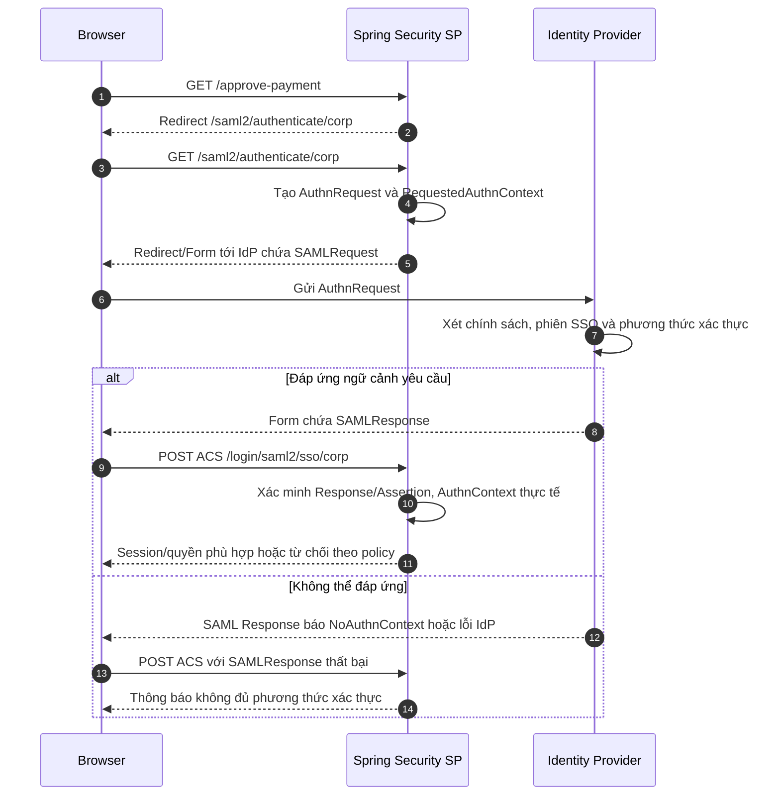

# RequestedAuthnContext và yêu cầu mức độ xác thực trong Spring Security SAML 2.0

## 1. Vấn đề cần giải quyết

Khi một ứng dụng **Service Provider (SP)** sử dụng SAML 2.0 Single Sign-On (SSO), việc nhận một assertion hợp lệ không phải lúc nào cũng đủ cho mọi nghiệp vụ. Một trang xem hồ sơ có thể cho phép đăng nhập bằng cơ chế thông thường, trong khi chức năng duyệt giao dịch có thể yêu cầu **phương thức xác thực mạnh hơn**, chẳng hạn phương thức được Identity Provider (IdP) thừa nhận có nhiều yếu tố hoặc chống giả mạo.

Trong luồng SP-initiated SSO, SP tạo `<samlp:AuthnRequest>` và có thể đính kèm phần tử **`<samlp:RequestedAuthnContext>`** để nêu các loại ngữ cảnh xác thực chấp nhận được. IdP xử lý yêu cầu theo cấu hình và chính sách của nó, rồi khi xác thực thành công có thể báo ngữ cảnh thực tế trong **`<saml:AuthnStatement>/<saml:AuthnContext>`** của assertion.

**RequestedAuthnContext là một yêu cầu giao thức, không phải bằng chứng rằng người dùng đã đạt mức bảo đảm mong muốn.** Bằng chứng cần được SP kiểm tra trong SAML Response đã được xác minh, kết hợp chính sách xác thực/ủy quyền cục bộ.

Bài học này thuộc phạm vi **tùy chỉnh AuthnRequest trong Spring Security SAML2 Servlet**, tập trung vào ý nghĩa XML, các giá trị `Comparison`, các URI `AuthnContextClassRef`, cách dùng OpenSAML customizer, phản hồi IdP, step-up authentication, kiểm thử và lỗi phổ biến.

### Mục tiêu học tập

1. Giải thích được `RequestedAuthnContext` khác `AuthnContext` trong assertion như thế nào.
2. Đọc và viết được `AuthnContextClassRef`, `AuthnContextDeclRef` và bốn kiểu `Comparison` theo SAML 2.0 Core.
3. Hiểu vì sao **PasswordProtectedTransport không đồng nghĩa MFA**, và “mạnh hơn” không có thứ tự phổ quát giữa các URI.
4. Tạo một AuthnRequest có RequestedAuthnContext bằng Spring Security 6.x/OpenSAML 4.
5. Thiết kế được kiểm tra bắt buộc ở SP khi một tài nguyên cần mức xác thực cao, không nhầm request hint với kiểm soát quyền.
6. Phân tích `NoAuthnContext`, IdP session, `ForceAuthn`, `IsPassive`, callback/ACS, cache session và các tình huống bảo mật.

## 2. Vị trí của RequestedAuthnContext trong luồng SSO



Điểm khác biệt theo thời gian:

- **Trước khi chuyển browser đến IdP:** SP phát **yêu cầu** phương thức xác thực mong muốn.
- **Tại IdP:** IdP quyết định cơ chế thực tế, có thể yêu cầu tương tác thêm, tận dụng phiên hiện có hoặc trả lỗi nếu không đáp ứng.
- **Sau khi browser quay về SP:** SP phải xác minh thông điệp và kiểm tra **ngữ cảnh thực tế đã được xác nhận**, đặc biệt đối với tài nguyên có yêu cầu bảo đảm cao.

Spring Security có các thành phần liên quan: `Saml2WebSsoAuthenticationRequestFilter` khởi tạo đăng nhập, `Saml2AuthenticationRequestResolver` xây yêu cầu, `Saml2AuthenticationRequestRepository` lưu giao dịch, `Saml2WebSsoAuthenticationFilter` xử lý SAMLResponse và OpenSAML authentication provider xác minh assertion.

`RequestedAuthnContext` chỉ là một phần của AuthnRequest. Nó không thay thế `Issuer`, `Destination`, `AssertionConsumerServiceURL`, `NameIDPolicy`, signing key hay việc đối chiếu `InResponseTo`.

## 3. Cấu trúc XML RequestedAuthnContext

Một request minh họa, rút gọn để tập trung vào phần tử đang học:

```xml
<samlp:AuthnRequest
    xmlns:samlp="urn:oasis:names:tc:SAML:2.0:protocol"
    xmlns:saml="urn:oasis:names:tc:SAML:2.0:assertion"
    ID="_req-123"
    Version="2.0"
    IssueInstant="2026-11-07T03:00:00Z"
    Destination="https://idp.example.test/sso"
    AssertionConsumerServiceURL="https://sp.example.test/login/saml2/sso/corp">
  <saml:Issuer>https://sp.example.test/saml/metadata/corp</saml:Issuer>
  <samlp:RequestedAuthnContext Comparison="exact">
    <saml:AuthnContextClassRef>
      urn:oasis:names:tc:SAML:2.0:ac:classes:PasswordProtectedTransport
    </saml:AuthnContextClassRef>
  </samlp:RequestedAuthnContext>
</samlp:AuthnRequest>
```

XML trên chỉ nhằm minh họa cấu trúc; ID, ngày giờ, host và các thông tin đăng ký đều là dữ liệu giả định. Một message thật phải được framework xây dựng và ký theo thỏa thuận với IdP. Không copy XML mẫu rồi gửi thủ công để đăng nhập.

Các phần quan trọng:

- **`RequestedAuthnContext`** là con của `AuthnRequest`, yêu cầu loại ngữ cảnh mà IdP có thể dùng để xác thực người dùng.
- **`Comparison`** là thuộc tính tùy chọn: `exact`, `minimum`, `maximum` hoặc `better`. Nếu bỏ, mặc định theo SAML Core là `exact`.
- **`AuthnContextClassRef`** chứa URI định danh một *authentication context class*. Đây là mã định danh ngữ nghĩa, không phải URL bắt buộc phải truy cập được.
- **`AuthnContextDeclRef`** (lựa chọn khác) là URI tham chiếu một *authentication context declaration* được IdP/SP hiểu chung, có thể mô tả chi tiết chính sách xác thực.
- Trong một `RequestedAuthnContext`, danh sách phải chứa **một hoặc nhiều ClassRef hoặc một hoặc nhiều DeclRef** theo lựa chọn của schema; không trộn cả hai loại tùy ý.
- **Thứ tự phần tử có ý nghĩa:** các URI được đánh giá theo thứ tự ưu tiên, phần tử đầu tiên là lựa chọn được SP ưu tiên hơn.

Nếu IdP không đáp ứng được bất kỳ ngữ cảnh nào theo quy tắc comparison, SAML 2.0 Core chỉ dẫn IdP trả Response có **second-level StatusCode `urn:oasis:names:tc:SAML:2.0:status:NoAuthnContext`**. Giao diện và thời điểm báo lỗi thực tế vẫn tùy sản phẩm IdP.

## 4. ClassRef là mô tả phương thức xác thực, không phải vai trò hoặc quyền

Một số URI chuẩn thuộc tập SAML 2.0 Authentication Context Classes:

| ClassRef / hậu tố URI | Ý nghĩa chung | Điều không được tự suy luận |
| --- | --- | --- |
| `Password` | Xác thực bằng mật khẩu | Không chứng minh password được truyền qua TLS |
| `PasswordProtectedTransport` | Mật khẩu được dùng trên kênh bảo vệ vận chuyển | **Không tự chứng minh MFA** |
| `Kerberos` | Xác thực dùng Kerberos trong phạm vi class tương ứng | Không tự chứng minh người dùng vừa nhập password |
| `X509` | Xác thực gắn với chứng chỉ X.509 | Không tự bảo đảm MFA hoặc phishing resistance |
| `SmartcardPKI` | Cơ chế smartcard và PKI theo class SAML | Không được xếp tự động vào một thứ bậc chuẩn phổ quát |
| `TimeSyncToken` | Xác thực liên quan token đồng bộ thời gian | Không tự chứng minh chính sách tổng hợp nhiều yếu tố |
| `PreviousSession` | Ngữ cảnh xác thực dựa trên phiên đã tồn tại | Không thay cho yêu cầu thời điểm đăng nhập mới |
| `unspecified` | Không mô tả cụ thể phương pháp | Không đủ bằng chứng đạt ngưỡng MFA nếu SP yêu cầu rõ |

Ví dụ URI đầy đủ:

```text
urn:oasis:names:tc:SAML:2.0:ac:classes:PasswordProtectedTransport
urn:oasis:names:tc:SAML:2.0:ac:classes:SmartcardPKI
urn:oasis:names:tc:SAML:2.0:ac:classes:unspecified
```

**Không có một URI MFA chuẩn chung mà mọi IdP đều hiểu và đánh giá giống nhau.** Một tổ chức có thể ký hợp đồng tích hợp dùng URI riêng, ví dụ `urn:example:company:authn:mfa`, nhưng đó chỉ là **ví dụ về private URI**. Nó phải được IdP/ SP thống nhất bằng tài liệu định nghĩa: yếu tố nào bắt buộc, khả năng chống phishing, thời gian tối đa từ lần xác thực gần nhất và cách xử lý phiên cũ.

ClassRef không phải tên role như `ADMIN` hay `FINANCE_APPROVER`. Xác thực (authentication context) và phân quyền (authorization) là hai quyết định riêng. Một người đã dùng smartcard cũng không tự được phép duyệt giao dịch nếu không có quyền nghiệp vụ.

## 5. Bốn giá trị Comparison theo SAML 2.0 Core

`Comparison` xác định cách IdP đánh giá các reference được SP cung cấp. Nếu không chỉ định, giá trị mặc định là **`exact`**.

| Comparison | Ý nghĩa theo SAML Core | Gợi ý sử dụng |
| --- | --- | --- |
| `exact` | Context thực tế **phải trùng chính xác ít nhất một** URI yêu cầu | Phù hợp khi SP/IdP thỏa thuận danh sách URI cụ thể |
| `minimum` | Context thực tế **ít nhất mạnh tương đương một** context được chỉ định, theo cách IdP đánh giá độ mạnh | Chỉ dùng khi hai bên thống nhất quan hệ mạnh/yếu |
| `maximum` | IdP chọn context mạnh nhất có thể **mà không vượt** sức mạnh của ít nhất một context yêu cầu, theo đánh giá IdP | Ít phổ biến; cần thận trọng vì nó đặt trần |
| `better` | Context thực tế phải **mạnh hơn** context tham chiếu theo quy tắc SAML và đánh giá của IdP | Chỉ dùng nếu IdP có định nghĩa chặt về so sánh sức mạnh |

Một vài điểm dễ nhầm:

- **`minimum` không có nghĩa “chấp nhận URI bất kỳ có số bậc cao hơn”.** Các URI SAML Core là các lớp ngữ nghĩa, không phải các số AAL có thứ tự toàn cầu. Việc so sánh “mạnh hơn” là trách nhiệm của IdP theo profile/chính sách nó hỗ trợ.
- **`better` không chỉ là `minimum` viết cách khác.** “Mạnh hơn” là ngưỡng chặt hơn “ít nhất mạnh bằng”.
- **`maximum` không có nghĩa “bắt buộc bảo mật cao nhất”.** Đây là giới hạn trên đối với context được chấp nhận, thường không phù hợp với một yêu cầu step-up.
- Với nhiều reference, IdP phải xét **tập URI có thứ tự ưu tiên** theo đặc tả; không được coi thứ tự là ngẫu nhiên.

### 5.1. Khi dùng exact với nhiều lựa chọn

```xml
<samlp:RequestedAuthnContext
    xmlns:samlp="urn:oasis:names:tc:SAML:2.0:protocol"
    xmlns:saml="urn:oasis:names:tc:SAML:2.0:assertion"
    Comparison="exact">
  <saml:AuthnContextClassRef>
    urn:oasis:names:tc:SAML:2.0:ac:classes:SmartcardPKI
  </saml:AuthnContextClassRef>
  <saml:AuthnContextClassRef>
    urn:oasis:names:tc:SAML:2.0:ac:classes:PasswordProtectedTransport
  </saml:AuthnContextClassRef>
</samlp:RequestedAuthnContext>
```

Thứ tự trên nói SP ưu tiên SmartcardPKI trước, nhưng với **`exact`** một assertion báo PasswordProtectedTransport vẫn có thể thỏa yêu cầu do nó nằm trong tập chấp nhận. Vì vậy đoạn XML này **không phải chính sách “bắt buộc smartcard”**. Nếu tài nguyên chỉ chấp nhận SmartcardPKI, request nên chỉ chứa URI đó hoặc tập ClassRef cùng mức assurance theo thỏa thuận.

### 5.2. Khi dùng minimum

```xml
<samlp:RequestedAuthnContext
    xmlns:samlp="urn:oasis:names:tc:SAML:2.0:protocol"
    xmlns:saml="urn:oasis:names:tc:SAML:2.0:assertion"
    Comparison="minimum">
  <saml:AuthnContextClassRef>
    urn:example:company:authn:level-2
  </saml:AuthnContextClassRef>
</samlp:RequestedAuthnContext>
```

`urn:example:company:authn:level-2` là **URI minh họa**, chỉ có ý nghĩa khi IdP và SP đã quy định chính xác level 2, các level “mạnh hơn” và cách mapping. Nếu IdP không nhận ra URI hoặc không hỗ trợ `minimum`, request có thể thất bại; không được suy luận nội dung theo chuỗi `level-2`.

### 5.3. Tại sao exact thường dễ kiểm thử hơn?

Với `exact`, SP có thể kiểm tra giá trị `AuthnContextClassRef` thực tế có nằm trong một **allowlist URI đã được phê duyệt** không, sau khi assertion được xác minh. Với `minimum`/`better`/`maximum`, SP cần thêm **chính sách so sánh** mà SAML Core không cung cấp một ranking toàn cục giữa các class. Nếu IdP và SP diễn giải thứ tự khác nhau, cùng một giao dịch có thể bị nhận nhầm mức assurance.

## 6. RequestedAuthnContext và AuthnContext thực tế không cùng vị trí XML

SP gửi **yêu cầu** trong `AuthnRequest`:

```xml
<samlp:RequestedAuthnContext Comparison="exact"
    xmlns:samlp="urn:oasis:names:tc:SAML:2.0:protocol"
    xmlns:saml="urn:oasis:names:tc:SAML:2.0:assertion">
  <saml:AuthnContextClassRef>
    urn:oasis:names:tc:SAML:2.0:ac:classes:SmartcardPKI
  </saml:AuthnContextClassRef>
</samlp:RequestedAuthnContext>
```

IdP gửi **kết quả thực tế** trong một assertion của `SAMLResponse`:

```xml
<saml:AuthnStatement xmlns:saml="urn:oasis:names:tc:SAML:2.0:assertion"
    AuthnInstant="2026-11-07T03:05:00Z"
    SessionIndex="_session-example">
  <saml:AuthnContext>
    <saml:AuthnContextClassRef>
      urn:oasis:names:tc:SAML:2.0:ac:classes:SmartcardPKI
    </saml:AuthnContextClassRef>
  </saml:AuthnContext>
</saml:AuthnStatement>
```

Đoạn XML thứ hai **không phải một assertion hoàn chỉnh**, chỉ trích AuthnStatement. SP phải xử lý nó trong assertion đã được kiểm tra chữ ký/issuer/audience/recipient, thời hạn và ngữ cảnh giao dịch. Không cho phép attacker POST một đoạn AuthnStatement độc lập để tự nhận mức xác thực.

Điểm bảo mật quan trọng: một `AuthnContextClassRef` trong response cho biết **IdP khẳng định** đã sử dụng class đó; SP vẫn cần tin đúng IdP và chính sách mapping đã được phê duyệt. Một IdP có thể cấu hình báo “SmartcardPKI” nhưng thực tế quy trình không đạt tiêu chí tổ chức; lỗi mapping nằm ở quan hệ tin cậy/chính sách giữa hai bên.

## 7. NoAuthnContext và cách xử lý khi IdP không đáp ứng

Khi IdP không thể thỏa `RequestedAuthnContext`, giao thức quy định lỗi `NoAuthnContext` ở **StatusCode cấp hai**. Ví dụ:

```xml
<samlp:Status xmlns:samlp="urn:oasis:names:tc:SAML:2.0:protocol">
  <samlp:StatusCode Value="urn:oasis:names:tc:SAML:2.0:status:Responder">
    <samlp:StatusCode
        Value="urn:oasis:names:tc:SAML:2.0:status:NoAuthnContext"/>
  </samlp:StatusCode>
</samlp:Status>
```

Mã chính `Responder` là ví dụ thường dùng cho lỗi ở phía IdP; ý nghĩa nghiệp vụ cần nhìn **second-level `NoAuthnContext`**. Một số IdP có thể dùng lỗi khác, từ chối ngay trên UI hoặc không hỗ trợ đầy đủ so sánh; phải kiểm thử với đúng IdP và phiên bản.

Đừng sửa vấn đề `NoAuthnContext` bằng cách tự động bỏ `RequestedAuthnContext` rồi đăng nhập ở mức thấp hơn **nếu trang đó có yêu cầu assurance bắt buộc**. Hãy hiển thị hướng dẫn hợp lý: tài khoản chưa bật phương thức cần thiết, IdP chưa hỗ trợ class, hoặc cần liên hệ quản trị cấu hình.

Chỉ có thể fallback sang một lớp xác thực khác khi **chính sách tài nguyên cho phép** và SP có cơ chế kiểm tra kết quả thực tế. Một response lỗi không tạo phiên đăng nhập mới có mức assurance đã yêu cầu.

## 8. Ngữ cảnh xác thực, MFA và step-up authentication

**MFA** mô tả việc dùng nhiều yếu tố xác thực. **Authentication assurance** nói về độ tin cậy trong một quá trình xác thực, có thể xét chống phishing, thiết bị, lifecycle credential và các chính sách khác. **AuthnContextClassRef** là cách SAML biểu đạt một *lớp/ngữ cảnh* theo thỏa thuận.

Do đó:

- `PasswordProtectedTransport` thường mô tả mật khẩu qua đường truyền bảo vệ; **không tự đồng nghĩa 2FA/MFA**.
- `TimeSyncToken` hay `SmartcardPKI` không nên được tùy tiện xếp thành “AAL1/AAL2/AAL3” khi không có profile đánh giá và policy mapping đã được phê duyệt.
- Một URI custom `urn:example:company:authn:mfa` chỉ nên được dùng khi IdP cam kết nó có nghĩa **MFA gì**, phương thức nào, thời hạn bao lâu và có tái dùng phiên cũ hay không.
- Một tài khoản có role `ADMIN` không chứng minh đã thực hiện MFA; tương tự MFA không tự cấp quyền `ADMIN`.
- Một đăng nhập mạnh trong quá khứ không mặc nhiên đủ cho hành động yêu cầu **fresh authentication** ngay bây giờ.

### Yêu cầu step-up điển hình

Giả sử tài nguyên `/payments/approve` yêu cầu ngữ cảnh được công nhận là phishing-resistant, đồng thời người dùng phải có quyền duyệt thanh toán. Quy trình phù hợp:

1. Kiểm tra user đã có quyền `PAYMENT_APPROVER`.
2. Kiểm tra principal/phiên hiện tại có **bằng chứng assurance** đáng tin và đủ mới không.
3. Nếu thiếu, khởi tạo **một giao dịch SSO mới** qua SP với `RequestedAuthnContext` được IdP hỗ trợ; khi cần fresh authentication, cân nhắc `ForceAuthn`.
4. Nhận SAMLResponse tại ACS, xác minh signature, issuer, recipient, audience, time, transaction correlation và AuthnContext thực tế.
5. Chỉ cập nhật assurance cho phiên khi kết quả được xác minh đạt ngưỡng và đúng user/session; sau đó kiểm tra authorization lại.
6. Nếu IdP báo `NoAuthnContext` hoặc context thấp, từ chối hành động đặc quyền; giữ session thường ở mức quyền phù hợp thay vì nâng quyền ngầm.

**Lưu ý về Spring Security:** `saml2Login` là cơ chế đăng nhập, nhưng việc “truy vấn assurance hiện tại của user từ controller” không tự sẵn chỉ nhờ `Saml2AuthenticatedPrincipal.getName()`. Muốn có principal chứa thông tin assurance đáng tin, cần một cơ chế **validation và conversion** phía server sau khi kiểm tra assertion; không đọc raw parameter từ browser rồi ghi authority.

## 9. ForceAuthn và IsPassive không phải RequestedAuthnContext

`AuthnRequest` còn có các thuộc tính liên quan đến tương tác đăng nhập:

| Thuộc tính | Ý nghĩa | Lưu ý |
| --- | --- | --- |
| `ForceAuthn="true"` | Yêu cầu IdP xác thực người dùng trực tiếp thay vì chỉ dựa vào context bảo mật cũ | **Không tự yêu cầu MFA**, chỉ yêu cầu xác thực mới |
| `IsPassive="true"` | Yêu cầu IdP không tương tác đáng kể với người dùng để xác thực | Có thể xung đột với bước MFA cần user tương tác |
| `RequestedAuthnContext` | Các class/declaration được yêu cầu | Không buộc phải xác thực lại nếu phiên IdP hiện tại đã thỏa policy và `ForceAuthn` không yêu cầu |

**Ví dụ:** nếu IdP đã có session mạnh, `RequestedAuthnContext` hợp lệ có thể được đáp ứng mà không bật thêm màn hình xác thực. Ngược lại, `ForceAuthn=true` chỉ buộc một lượt xác thực mới theo chính sách IdP; nếu không yêu cầu context mạnh, IdP vẫn có thể chọn mật khẩu thường.

`IsPassive=true` và `ForceAuthn=true` có thể dẫn đến lỗi nếu IdP không thể xác thực không tương tác. Không bật cả hai theo thói quen. Chỉ dùng khi nhu cầu nghiệp vụ rõ ràng và IdP hỗ trợ.

## 10. Tùy chỉnh AuthnRequest bằng Spring Security 6.x và OpenSAML 4

Spring Security 6.x (ví dụ 6.5) hỗ trợ **`OpenSaml4AuthenticationRequestResolver`** và `setAuthnRequestCustomizer`. Resolver này tạo đối tượng OpenSAML `AuthnRequest`; callback cho phép sửa đối tượng trước khi nó được serialize/encode/signed theo pipeline framework.

Cách đặt RequestedAuthnContext là:

1. Tạo OpenSAML `RequestedAuthnContext` từ `XMLObjectSupport`.
2. Đặt `Comparison`, ví dụ `EXACT`.
3. Tạo ít nhất một `AuthnContextClassRef` và set URI được IdP chấp thuận.
4. Thêm class ref vào danh sách đúng thứ tự ưu tiên.
5. Gắn vào `context.getAuthnRequest().setRequestedAuthnContext(...)`.
6. Đưa resolver vào `saml2Login` bằng Spring Security DSL hoặc Bean wiring đã được hỗ trợ.
7. Đảm bảo IdP metadata, SP registration và signing credential (nếu IdP yêu cầu) vẫn hoạt động như bình thường.

Các lớp OpenSAML chính:

- `org.opensaml.saml.saml2.core.RequestedAuthnContext`.
- `org.opensaml.saml.saml2.core.AuthnContextClassRef`.
- `org.opensaml.saml.saml2.core.AuthnContextComparisonTypeEnumeration`.
- `org.opensaml.core.xml.util.XMLObjectSupport`.

**Không tự ghi XML string vào HTTP response thay cho resolver.** Chữ ký AuthnRequest, RelayState, binding Redirect/POST, request repository và registration resolution phải tiếp tục do framework xử lý.

## 11. Ví dụ Spring Boot 3.x/Java 17+ có code cấu hình đầy đủ

Ví dụ sau xây một SP Servlet, đăng ký IdP qua metadata, yêu cầu **chính xác `SmartcardPKI`** trên mọi lần SAML login. Cấu hình này phù hợp cho **phòng thí nghiệm** để quan sát request; một ứng dụng có nhiều mức tài nguyên thực tế cần chọn policy động có kiểm soát thay vì buộc mọi tài nguyên dùng cùng class.

### 11.1. Dependency Gradle

Trong `build.gradle` của một dự án Spring Boot 3.x đã có plugin Java/Spring Boot và dependency management thích hợp:

```groovy
repositories {
    mavenCentral()
    // Thêm repository OpenSAML/Shibboleth nếu bộ dependency
    // Spring Security/SAML của dự án cần tới.
    maven { url "https://build.shibboleth.net/maven/releases/" }
}

dependencies {
    implementation "org.springframework.boot:spring-boot-starter-web"
    implementation "org.springframework.boot:spring-boot-starter-security"
    implementation "org.springframework.security:spring-security-saml2-service-provider"
}
```

Đây là **một phần build file**, không phải `build.gradle` độc lập: phần quản lý phiên bản Spring Boot, Java 17 và Gradle wrapper phải có trước. Không trộn OpenSAML 4 và OpenSAML 5 hoặc ép version không tương thích.

### 11.2. Đăng ký IdP ở application.yml

```yaml
spring:
  security:
    saml2:
      relyingparty:
        registration:
          corp:
            assertingparty:
              metadata-uri: "${SAML_IDP_METADATA_URI}"

server:
  forward-headers-strategy: framework
```

`SAML_IDP_METADATA_URI` phải là URI metadata của **IdP thực sự được tin cậy**, được cung cấp bởi môi trường triển khai. Ở local không qua reverse proxy, có thể bỏ `forward-headers-strategy`. Nếu có reverse proxy, chỉ tin `Forwarded`/`X-Forwarded-*` khi ingress loại bỏ/ghi đè header do client ngoài gửi vào.

SP metadata, Entity ID và ACS URL phải được IdP đăng ký trước. Tài liệu Spring Security mô tả mặc định ACS `/login/saml2/sso/{registrationId}` và endpoint bắt đầu login `/saml2/authenticate/{registrationId}`.

### 11.3. Class Java hoàn chỉnh

Lưu tại `src/main/java/demo/samlcontext/SamlContextApplication.java`:

```java
package demo.samlcontext;

import java.util.Map;

import org.opensaml.core.xml.util.XMLObjectSupport;
import org.opensaml.saml.saml2.core.AuthnContext;
import org.opensaml.saml.saml2.core.AuthnContextClassRef;
import org.opensaml.saml.saml2.core.AuthnContextComparisonTypeEnumeration;
import org.opensaml.saml.saml2.core.RequestedAuthnContext;

import org.springframework.boot.SpringApplication;
import org.springframework.boot.autoconfigure.SpringBootApplication;
import org.springframework.context.annotation.Bean;
import org.springframework.security.config.annotation.web.builders.HttpSecurity;
import org.springframework.security.core.annotation.AuthenticationPrincipal;
import org.springframework.security.saml2.provider.service.authentication.Saml2AuthenticatedPrincipal;
import org.springframework.security.saml2.provider.service.registration.RelyingPartyRegistrationRepository;
import org.springframework.security.saml2.provider.service.web.DefaultRelyingPartyRegistrationResolver;
import org.springframework.security.saml2.provider.service.web.RelyingPartyRegistrationResolver;
import org.springframework.security.saml2.provider.service.web.authentication.OpenSaml4AuthenticationRequestResolver;
import org.springframework.security.saml2.provider.service.web.authentication.Saml2AuthenticationRequestResolver;
import org.springframework.security.web.SecurityFilterChain;
import org.springframework.web.bind.annotation.GetMapping;
import org.springframework.web.bind.annotation.RestController;

@SpringBootApplication
@RestController
public class SamlContextApplication {

    public static void main(String[] args) {
        SpringApplication.run(SamlContextApplication.class, args);
    }

    @Bean
    Saml2AuthenticationRequestResolver authenticationRequestResolver(
            RelyingPartyRegistrationRepository registrations) {

        RelyingPartyRegistrationResolver registrationResolver =
                new DefaultRelyingPartyRegistrationResolver(registrations);

        OpenSaml4AuthenticationRequestResolver resolver =
                new OpenSaml4AuthenticationRequestResolver(registrationResolver);

        resolver.setAuthnRequestCustomizer(context -> {
            RequestedAuthnContext requested = (RequestedAuthnContext)
                    XMLObjectSupport.buildXMLObject(
                            RequestedAuthnContext.DEFAULT_ELEMENT_NAME);
            requested.setComparison(
                    AuthnContextComparisonTypeEnumeration.EXACT);

            AuthnContextClassRef classRef = (AuthnContextClassRef)
                    XMLObjectSupport.buildXMLObject(
                            AuthnContextClassRef.DEFAULT_ELEMENT_NAME);
            classRef.setURI(AuthnContext.SMARTCARD_PKI_AUTHN_CTX);

            requested.getAuthnContextClassRefs().add(classRef);
            context.getAuthnRequest().setRequestedAuthnContext(requested);
        });
        return resolver;
    }

    @Bean
    SecurityFilterChain securityFilterChain(
            HttpSecurity http,
            Saml2AuthenticationRequestResolver resolver) throws Exception {
        return http
                .authorizeHttpRequests(auth -> auth
                        .requestMatchers("/").permitAll()
                        .anyRequest().authenticated())
                .saml2Login(saml -> saml
                        .authenticationRequestResolver(resolver))
                .build();
    }

    @GetMapping("/")
    public String home() {
        return "Public page";
    }

    @GetMapping("/private")
    public Map<String, String> privatePage(
            @AuthenticationPrincipal Saml2AuthenticatedPrincipal principal) {
        return Map.of(
                "subject", principal.getName(),
                "registration", principal.getRelyingPartyRegistrationId());
    }
}
```

**Đọc code:**

- `DefaultRelyingPartyRegistrationResolver` giúp chọn registration của SP/IdP.
- `OpenSaml4AuthenticationRequestResolver` tạo OpenSAML AuthnRequest rồi gọi customizer.
- `XMLObjectSupport.buildXMLObject(...)` sinh object theo QName được OpenSAML đăng ký; builder chỉ hoạt động khi OpenSAML đã được Spring Security khởi tạo.
- `AuthnContext.SMARTCARD_PKI_AUTHN_CTX` là URI chuẩn mà OpenSAML cung cấp; **chỉ dùng nếu IdP đã thỏa thuận/hỗ trợ class này**.
- `getAuthnContextClassRefs().add` đưa yêu cầu vào cấu trúc XML.
- `setRequestedAuthnContext` gắn phần tử vào AuthnRequest.
- `saml2Login(...authenticationRequestResolver(resolver))` đảm bảo resolver tùy chỉnh được dùng cho luồng SAML.
- `/private` trả về NameID/registration sau khi SAML Response được framework xác minh. Đoạn này **không đưa trạng thái assurance ra principal và không tự thực thi authorization step-up**.

Spring Security 7.x sử dụng lớp `OpenSaml5AuthenticationRequestResolver` trong tài liệu hiện hành khi dùng OpenSAML 5; cần chuyển cả lớp resolver và phiên bản OpenSAML tương ứng. Đây là ví dụ **Spring Security 6.x/OpenSAML 4**, không trộn tên lớp của hai nhánh.

### 11.4. Chạy thử và đầu ra quan sát

Trong dự án đã cấu hình IdP metadata thật:

```bash
SAML_IDP_METADATA_URI=https://idp.example.test/metadata ./gradlew bootRun
```

Đường dẫn `idp.example.test` là URL minh họa, không phải IdP hoạt động thực. Thay bằng IdP sandbox có metadata hợp lệ, đăng ký SP Entity ID/ACS và yêu cầu signing credential nếu IdP cần. Mở `/private` hoặc `/saml2/authenticate/corp` để quan sát SSO.

**Không có stdout cố định:** startup, redirect, SAMLResponse và JSON của `/private` phụ thuộc IdP và người dùng. Nếu IdP không hỗ trợ SmartcardPKI, có thể trả `NoAuthnContext` hoặc thông báo lỗi chính sách; điều đó không phải bug cú pháp Java. Nếu IdP chỉ hỗ trợ URI MFA riêng, cần đổi đúng URI đã thống nhất với đối tác.

**Giới hạn quan trọng:** ví dụ **gửi yêu cầu** SmartcardPKI; nếu ứng dụng thật cần bảo đảm “bắt buộc SmartcardPKI”, hãy thêm kiểm tra class thực tế trên assertion đã xác minh, như mục 13.

## 12. Cách thêm nhiều ClassRef, policy theo IdP

Khi IdP xác nhận nhiều URI được chấp thuận, có thể thêm một reference thứ hai. Đây là **đoạn thay đổi bên trong lambda customizer** của ví dụ trước, không phải class độc lập:

```java
AuthnContextClassRef alternate = (AuthnContextClassRef)
        XMLObjectSupport.buildXMLObject(
                AuthnContextClassRef.DEFAULT_ELEMENT_NAME);
alternate.setURI(AuthnContext.PPT_AUTHN_CTX);
requested.getAuthnContextClassRefs().add(alternate);
```

Với `EXACT`, kết quả **SmartcardPKI hoặc PasswordProtectedTransport** đều phù hợp tập URI trong request. Nếu mục tiêu là bắt buộc mức cao, không nên đưa password-only context vào tập cho phép chỉ vì muốn “fallback dễ dùng”.

### Cấu hình nhiều IdP

Một SP có thể có `corp` và `partner`, mỗi IdP hiểu các context khác nhau. Một số IdP hỗ trợ URI chuẩn; một số chỉ chấp nhận URI profile riêng. Cách tích hợp phù hợp:

1. Chọn registration/tenant từ nguồn **tin cậy**.
2. Tra chính sách context được cấu hình cho registration đó.
3. Resolver tạo `RequestedAuthnContext` với các URI được IdP tương ứng hỗ trợ.
4. IdP trả response, SP xác minh issuer/registration đúng đối tác.
5. SP kiểm tra context thực tế theo cùng chính sách resource/registration.

Không cho request parameter do client tự nhập như `?authnContext=unspecified` quyết định trực tiếp policy security. Nếu cần người dùng chọn “đăng nhập mạnh hơn”, UI chỉ kích hoạt **policy server-side cố định**. Mọi “context URI” nhận từ browser phải được allowlist và gắn đúng transaction/registration.

### Khi muốn tùy biến cho một endpoint đặc quyền

Một triển khai đơn giản có thể cấu hình **một flow SAML riêng** với policy context mạnh hơn. Với các ứng dụng nhiều đường đăng nhập, có thể dùng wrapper resolver và một request matcher tin cậy hoặc thêm `RelyingPartyRegistration`/entry point riêng theo policy. Tuy nhiên cần bảo vệ chống việc callback của flow thấp bị dùng nâng assurance cho flow cao.

Không dựa vào đường dẫn request ban đầu hoặc HTTP query string ở browser **một cách độc lập** để nâng assurance; phải lưu policy mong đợi trong transaction server-side (session hoặc storage được bảo vệ) và đối chiếu khi nhận response.

## 13. Bảo đảm mức yêu cầu bằng cách xác minh kết quả phía SP

### 13.1. Chỉ phát RequestedAuthnContext là chưa đủ

Một IdP có thể:

- Không hỗ trợ một URI đã yêu cầu.
- Cấu hình bỏ qua hoặc diễn giải `Comparison` khác với kỳ vọng.
- Dùng session cũ và báo context thấp/khác context yêu cầu.
- Ánh xạ một phương thức xác thực thực tế sang URI không đúng thỏa thuận.
- Trả lỗi `NoAuthnContext`.

Vì vậy ứng dụng xử lý giao dịch giá trị cao phải **fail-closed** khi context không đáp ứng policy, chứ không cấp quyền đặc biệt vì “request gửi đi đã chứa MFA”.

### 13.2. Chuỗi kiểm tra an toàn ở ACS

1. **SAML Response/Assertion:** xác minh chữ ký và certificate IdP tin cậy, `Issuer`, `Destination`, `Recipient`, `AudienceRestriction`, `SubjectConfirmation`, thời gian và chống replay/correlation.
2. **Đúng giao dịch:** kiểm tra response thuộc AuthnRequest cùng session/transaction và cùng registration, `InResponseTo` nếu SP-initiated.
3. **Ngữ cảnh đã xác thực:** tìm `AuthnStatement` thích hợp trong assertion đã được xác minh; trích `AuthnContextClassRef` hoặc `AuthnContextDeclRef`.
4. **Policy ứng dụng:** so giá trị vừa trích với danh sách hoặc mapping assurance được phê duyệt và yêu cầu của tài nguyên. Nếu dùng `minimum` cần comparator đã thống nhất, không so chuỗi tên “level”.
5. **Freshness:** nếu thao tác cần xác thực gần đây, kiểm tra `AuthnInstant` cùng ngưỡng thời gian và chính sách `ForceAuthn` khi cần.
6. **Authorization:** xác minh user vẫn có vai trò/quyền truy cập chức năng. Authentication assurance không thay việc phân quyền.
7. **Session assurance:** chỉ lưu kết quả assurance vào session/principal server-side sau bước xác minh; thiết kế hết hạn hoặc hạ cấp trạng thái sau timeout.

Không dùng raw XML query parameter hoặc form field chưa kiểm tra signature làm input cho `SecurityContext`. Nếu framework provider không đưa AuthnContext ra principal mặc định, cần custom assertion validator/converter hoặc cơ chế server-side tương đương để kiểm tra trước khi cấp assurance.

### 13.3. Hook kiểm tra assertion trong Spring Security

Spring Security 6.x/OpenSAML 4 có `OpenSaml4AuthenticationProvider.setAssertionValidator(...)`. Một chiến lược đúng là **giữ validator mặc định** (đối chiếu audience, subject confirmation, thời gian theo quy tắc framework), rồi ghép thêm validation cho AuthnContext trên assertion đã nằm trong pipeline tin cậy.

Hướng xử lý khái niệm:

```text
validatedCandidate = OpenSAML / Spring SAML assertion object
defaultResult     = built-in assertion validator(candidate)
policyResult      = verifyAuthnContext(candidate, expectedPolicy)
finalResult       = defaultResult.concat(policyResult)
if finalResult invalid -> reject authentication
```

Đây là **pseudocode kiến trúc**, không phải Java triển khai sẵn. API `Saml2ResponseValidatorResult` và kiểu token ở Spring Security 6.x khác một số API `AssertionValidator` của Spring Security 7.x, nên cần dùng đúng javadoc của phiên bản dự án. Không thay default validator bằng lambda luôn trả thành công để đọc context.

Đặc biệt không có mặc định bảo đảm Spring Security luôn đối chiếu requested class với returned class như một policy MFA cấp ứng dụng; muốn yêu cầu assurance nghiêm ngặt phải xác minh hành vi của provider và bổ sung logic khi cần.

### 13.4. Ví dụ Java 17 độc lập: allowlist exact sau xác minh

Đoạn sau chỉ mô phỏng **bước policy quyết định** sau khi một thư viện SAML đáng tin đã xác minh assertion và đưa về chuỗi context. Nó không phân tích XML, không kiểm tra chữ ký và không đủ để triển khai authentication:

Lưu trong `ExactContextPolicyDemo.java`:

```java
import java.util.Set;

public final class ExactContextPolicyDemo {

    private static final String SMARTCARD =
            "urn:oasis:names:tc:SAML:2.0:ac:classes:SmartcardPKI";
    private static final String PASSWORD =
            "urn:oasis:names:tc:SAML:2.0:ac:classes:PasswordProtectedTransport";
    private static final String UNSPECIFIED =
            "urn:oasis:names:tc:SAML:2.0:ac:classes:unspecified";

    private static final Set<String> ALLOWED = Set.of(SMARTCARD);

    static boolean allowed(String verifiedContext) {
        return verifiedContext != null && ALLOWED.contains(verifiedContext);
    }

    public static void main(String[] args) {
        System.out.println("smartcard=" + allowed(SMARTCARD));
        System.out.println("password=" + allowed(PASSWORD));
        System.out.println("unspecified=" + allowed(UNSPECIFIED));
        System.out.println("missing=" + allowed(null));
    }
}
```

Biên dịch và chạy bằng Java 17+:

```bash
javac ExactContextPolicyDemo.java
java ExactContextPolicyDemo
```

Output chính xác:

```text
smartcard=true
password=false
unspecified=false
missing=false
```

Ở đây `ALLOWED` chỉ chứa SmartcardPKI nên kết quả chính xác như trên. **Không gọi `allowed(...)` với một chuỗi do browser cung cấp**: trong ứng dụng thật phải lấy context từ assertion đã được xác minh và gắn đúng user/session. Chương trình chỉ minh họa `exact`; nó không triển khai so sánh `minimum/better/maximum` vì các mức này cần policy so sánh của IdP/SP.

## 14. Freshness: AuthnInstant và phiên SSO hiện có

Một IdP có thể xác thực người dùng ở thời điểm T0, giữ SSO session, rồi tại T1 đáp ứng yêu cầu SP bằng ngữ cảnh từ phiên đang có. Context có thể đúng mức nhưng sự kiện xác thực quá cũ so với chính sách duyệt giao dịch.

Muốn “xác thực mạnh và vừa xảy ra”, cần xét **hai trục độc lập**:

| Trục | Câu hỏi | Dữ liệu/điều kiện |
| --- | --- | --- |
| Phương thức / context | Người dùng đã được xác thực theo loại phương thức nào? | `AuthnContextClassRef` hoặc mapping assurance |
| Thời điểm | Xác thực vừa xảy ra bao lâu? | `AuthnStatement@AuthnInstant`, đồng hồ và ngưỡng chính sách |

`SessionIndex` trong AuthnStatement thường phục vụ liên hệ phiên giữa IdP và SP, có thể dùng ở logout; nó không tự chứng minh sự kiện xác thực vừa diễn ra. `SessionNotOnOrAfter` là một mốc hết hạn liên quan IdP session theo profile, không thay thế kiểm tra freshness do ứng dụng đặt.

Nếu policy yêu cầu xác thực mới, SP có thể bật `ForceAuthn=true` trong AuthnRequest. Nhưng SP vẫn cần **kiểm tra `AuthnInstant`** và IdP behavior theo thỏa thuận. Một response báo context đúng nhưng thời gian quá cũ không nhất thiết được chấp nhận cho một giao dịch step-up.

## 15. Cách kiểm tra một AuthnRequest đã tùy chỉnh

### 15.1. Quan sát browser và request

1. Trỏ SP đến **IdP sandbox** có hỗ trợ các context URI đã chọn.
2. Mở `/saml2/authenticate/corp` hoặc tài nguyên protected.
3. Trong browser Developer Tools, tìm request tới IdP SSO endpoint.
4. Với HTTP-Redirect binding, `SAMLRequest` thường được DEFLATE, Base64 và URL-encode; dùng công cụ SAML test được tin cậy trong môi trường an toàn để xem XML.
5. Với HTTP-POST binding, dữ liệu SAMLRequest nằm trong form POST, thường Base64-encode; không chia sẻ payload thật lên dịch vụ ngoài.
6. Kiểm tra phần tử `RequestedAuthnContext` đã có đúng `Comparison` và đúng URI/thứ tự; đảm bảo phần còn lại của AuthnRequest (ID, Issuer, Destination, ACS, signature) vẫn đúng.
7. Đăng nhập theo một phương thức hợp lệ và một phương thức không phù hợp để kiểm tra phản hồi.
8. Xác minh `AuthnStatement/AuthnContext` trong assertion đã xác minh và quyết định policy phía SP.

**Đừng dùng “browser hiển thị login form MFA” làm bằng chứng duy nhất.** IdP có thể sử dụng sẵn session MFA hoặc giao diện có thể khác theo tenant. Phải đo từ SAML Response thực tế và policy đã xác minh.

### 15.2. Kiểm tra response

Với một flow SP-initiated hợp lệ:

- `Response@InResponseTo`/SubjectConfirmation khớp request ID nếu profile yêu cầu.
- IdP `Issuer` và signing certificate đúng registration.
- `AudienceRestriction` hướng đến SP Entity ID.
- `Recipient` và `Destination` trỏ ACS hợp lệ.
- `AuthnInstant` trong khoảng mà policy chấp nhận.
- `AuthnContextClassRef` từ assertion đã xác minh là context mà SP chấp nhận.
- Mọi lỗi `NoAuthnContext` hoặc mismatch bị xử lý bằng fail-closed cho tài nguyên mức cao.

Đừng log nguyên `SAMLResponse`, assertions, NameID, cookie hay chứng chỉ private. Trong log chẩn đoán nội bộ có thể lưu registration, loại lỗi và thông tin context URI được phép theo chính sách, nhưng cần redaction khi dữ liệu định danh hoặc state có nguy cơ lộ.

## 16. Xử lý những trường hợp IdP không hiểu RequestedAuthnContext

Một số IdP có các đặc điểm:

- Bỏ qua RequestedAuthnContext nếu không bật chức năng hoặc mapping.
- Chỉ nhận các URI chuẩn nhất định.
- Chỉ nhận các URI riêng của sản phẩm hoặc chuẩn liên ngành.
- Chấp nhận `exact` nhưng không implement ý nghĩa `minimum/maximum/better` như kỳ vọng.
- Luôn báo `unspecified` sau một số flow.
- Dùng chính sách MFA của tenant/application thay vì dựa vào RequestedAuthnContext.
- Chỉ hỗ trợ một số cách kết hợp với `ForceAuthn`, `IsPassive` hoặc IdP-initiated.

Quy trình tích hợp:

1. Lấy tài liệu IdP về **SAML AuthnContextClassRef mapping** và chính sách phương thức.
2. Thỏa thuận URI cụ thể và cách hiểu của từng context.
3. Kiểm thử `exact` với **một** ClassRef trước để xác định sản phẩm có hỗ trợ.
4. Kiểm thử session cũ, vừa login MFA, đăng nhập password-only và user không bật MFA.
5. Đối chiếu XML Response thực tế và xử lý `NoAuthnContext`.
6. Chỉ mở hỗ trợ `minimum/better/maximum` sau khi IdP và SP có mapping so sánh được kiểm chứng.
7. Tài nguyên có assurance bắt buộc vẫn **phải tự kiểm tra** kết quả chấp nhận.

Khi IdP không hỗ trợ các ClassRef mà ứng dụng cần, không tự đặt URI mới ở SP rồi kỳ vọng IdP hiểu; cần cấu hình IdP, thay protocol/profile phù hợp hoặc đổi yêu cầu tích hợp.

## 17. Liên hệ với OIDC ACR và AuthnContext

OpenID Connect (OIDC) có claim **`acr`** trong ID Token để biểu thị authentication context class reference, và request có thể mang **`acr_values`**. Khái niệm tương tự SAML `AuthnContextClassRef` nhưng **không mặc định dùng cùng URI hoặc cùng ngữ nghĩa**.

Nếu một gateway chuyển SAML ↔ OIDC:

- Cần mapping hai chiều giữa SAML AuthnContext và OIDC ACR theo hợp đồng và policy.
- Chỉ map context đã xác minh từ IdP, không lấy từ raw browser parameter.
- Một `acr` của OIDC không tự biến thành `AuthnContextClassRef` có giá trị chung với mọi SAML IdP.
- Không lấy thông tin `amr` (authentication methods) và suy luận ACR/assurance đơn giản nếu chưa có chính sách mapping.
- Bảo đảm audience, issuer, freshness, replay, key trust và correlation trong **cả hai protocol**.

Ví dụ một hệ thống nội bộ có thể định nghĩa `urn:example:company:authn:level-2` cho SAML và ACR tương ứng trong OIDC, nhưng chỉ có giá trị sau khi profile đó mô tả rõ yếu tố, proofing và kiểm thử.

## 18. Các lỗi phổ biến khi tùy chỉnh

| Triệu chứng | Nguyên nhân hay gặp | Hướng xử lý |
| --- | --- | --- |
| IdP báo `NoAuthnContext` | URI không hỗ trợ hoặc policy không đáp ứng | Kiểm tra IdP mapping, request XML, phương thức người dùng |
| IdP vẫn dùng password-only | `RequestedAuthnContext` bị bỏ qua hoặc mapping sai | Xác minh request/response và policy, không chỉ nhìn UI |
| AuthnRequest không có `RequestedAuthnContext` | Custom resolver không được wiring hoặc filter khác xử lý | Kiểm tra bean/resolver trong `saml2Login`, request generated |
| Build lỗi OpenSAML resolver | Dùng nhầm OpenSAML 4/5 với Spring Security version | Align dependency và tên lớp theo phiên bản |
| ClassRef so sánh không ổn định | Dùng `minimum` mà IdP/SP không có thang sức mạnh chung | Thỏa thuận mapping hoặc dùng `exact` |
| Requested Smartcard, Response báo Password | IdP không tuân yêu cầu hoặc context mapping sai | SP từ chối assurance cho tài nguyên cao, điều tra IdP |
| Có MFA nhưng `AuthnInstant` quá cũ | IdP tái dùng phiên SSO | Kiểm tra freshness; cân nhắc `ForceAuthn` và policy thời gian |
| Bật `ForceAuthn` nhưng không thấy MFA | ForceAuthn buộc xác thực lại, không chọn phương pháp | Đính kèm Required context và kiểm tra result |
| Bật `IsPassive` cùng step-up cần user thao tác | Không thể xác thực mà không tương tác | Xem lại IsPassive, dùng flow tương tác phù hợp |
| Login thường thành công, giao dịch cao bị từ chối | Context thực tế không đạt policy | Đây có thể là hành vi đúng; cung cấp luồng step-up |
| User đã có role nhưng không được duyệt | Authentication context/freshness chưa đạt | Tách quyền nghiệp vụ và assurance |
| IdP-initiated không có request yêu cầu | Không có AuthnRequest của SP | Quy định unsolicited SSO và policy riêng |
| Login fail sau reverse proxy | Sai ACS/Destination/Recipient/forwarded headers | Kiểm tra public URL, metadata và trusted proxy |
| Assertion đã ký nhưng context không nằm trong phần được ký | XML wrapping hoặc xử lý node sai | Để OpenSAML/Spring Security verify đúng assertion được dùng |
| Session không giữ state của step-up | Cookie SameSite hoặc session cluster | Kiểm tra AuthnRequest repository, cookie và shared session |

Không sửa một lỗi request/context bằng cách tắt signature verification, chấp nhận mọi issuer, bỏ `AudienceRestriction` hoặc bỏ kiểm tra request correlation. Những kiểm tra này bảo vệ **ranh giới tin cậy** độc lập với RequestedAuthnContext.

## 19. Ma trận kiểm thử nên có

| Test | AuthnRequest | Mô phỏng IdP | Kết quả yêu cầu |
| --- | --- | --- | --- |
| A. Class đúng | `exact` SmartcardPKI | IdP thực sự báo SmartcardPKI | Cho phép mức assurance tương ứng sau full validation |
| B. Class khác | `exact` SmartcardPKI | IdP báo PasswordProtectedTransport | Không cấp quyền thao tác mức cao |
| C. Không có context | `exact` một ClassRef | Assertion thiếu AuthnContextClassRef | Từ chối mức assurance yêu cầu |
| D. URI không hỗ trợ | `exact` custom URI | IdP trả `NoAuthnContext` | Hiển thị lỗi phù hợp, không fallback im lặng |
| E. Password + smartcard trong tập | `exact` hai ClassRef | IdP báo password | Nếu allowlist chứa password thì request exact chấp nhận; kiểm tra resource policy riêng |
| F. minimum không có mapping | `minimum` level custom | IdP không có comparator tương thích | Không triển khai production trước khi thống nhất |
| G. Có session MFA cũ | `exact` context mạnh | IdP dùng session cũ | Kiểm tra `AuthnInstant` nếu cần freshness |
| H. ForceAuthn | `ForceAuthn=true` + context mạnh | IdP xác thực lại | Vẫn kiểm tra class thực tế và thời gian |
| I. Đổi IdP registration | URI của IdP A | Login qua IdP B | Không tin ngữ cảnh ngoài trust policy của B |
| J. Response sai chữ ký | Context đúng | Assertion không được ký hợp lệ | Từ chối trước khi xét assurance |
| K. Replay | Context đúng | Phát lại SAMLResponse đã dùng | Từ chối theo replay/correlation |
| L. POST callback mất session | Context đúng | AuthnRequest state mất | Không tự bỏ `InResponseTo` để chấp nhận |
| M. Multi-tab | Hai mức yêu cầu riêng | Callback đảo thứ tự | Không trộn policy của hai transaction |
| N. IdP-initiated | Không có RequestedAuthnContext từ SP | IdP phát unsolicited response | Áp chính sách IdP-initiated riêng, không nâng assurance mặc định |

### Quan sát tiêu chí PASS

Bài test A chỉ PASS khi **cả** chữ ký/issuer/audience/recipient/time/correlation đều hợp lệ **và** class thực tế đáp ứng policy. Chỉ thấy `RequestedAuthnContext` được gửi đi là chưa đủ. Bài test D chỉ PASS khi không có đường “fallback về password-only” bị giấu mà vẫn cho phép nghiệp vụ cần MFA.

## 20. Checklist trước khi đưa vào production

- [ ] Hiểu rõ tài nguyên nào bắt buộc assurance cao và khoảng thời gian freshness.
- [ ] IdP/SP có tài liệu thỏa thuận URI và chính sách so sánh.
- [ ] Chỉ yêu cầu URI được IdP hỗ trợ; không tự coi `PasswordProtectedTransport` là MFA.
- [ ] Đã chọn `exact` hoặc comparison khác có mapping thực sự được kiểm chứng.
- [ ] Với nhiều ClassRef, thứ tự ưu tiên và ý nghĩa tập chấp nhận đều rõ.
- [ ] Customizer gắn phần tử đúng vào `AuthnRequest` trước khi encode/sign.
- [ ] OpenSAML 4/5 và Spring Security version được ghép tương thích.
- [ ] AuthnRequest signing, ACS, IdP metadata và `RelyingPartyRegistration` vẫn hợp lệ.
- [ ] `Saml2AuthenticationRequestRepository` giữ đúng transaction/registration.
- [ ] Response validation đầy đủ: signature, issuer, destination, recipient, audience, clock, correlation, replay.
- [ ] SP kiểm tra `AuthnContext` thực tế sau validation và không cấp quyền nếu không đủ.
- [ ] SP kiểm tra `AuthnInstant` nếu yêu cầu fresh authentication.
- [ ] `ForceAuthn`/`IsPassive` có mục đích rõ và đã test với IdP.
- [ ] IdP-initiated login không tự kế thừa bảo đảm của flow SP-initiated.
- [ ] Có negative tests cho `NoAuthnContext`, context thấp, thiếu/khác URI, session cũ và replay.
- [ ] Log/trace không ghi raw SAMLRequest, SAMLResponse, cookies, user identifiers hoặc secret.
- [ ] Quyết định authentication assurance và business authorization được tách riêng.

## 21. Câu hỏi tự đánh giá

**Câu 1. `RequestedAuthnContext` nằm trong AuthnRequest hay assertion?**  
Nó nằm trong **AuthnRequest** của SP; assertion của IdP báo ngữ cảnh thực tế trong **AuthnStatement/AuthnContext**.

**Câu 2. Nếu `Comparison` vắng mặt, giá trị nào được áp dụng?**  
`exact` theo SAML 2.0 Core.

**Câu 3. Với `exact` và hai ClassRef SmartcardPKI, PasswordProtectedTransport, IdP báo password có thỏa request không?**  
Có thể **thỏa `exact`**, vì trùng một ClassRef đã yêu cầu. Nếu nghiệp vụ bắt buộc smartcard thì request/allowlist đã thiết kế quá rộng.

**Câu 4. `minimum` có phải là so sánh số AAL mặc định giữa mọi IdP không?**  
Không. “Mạnh hơn” được IdP đánh giá theo profile/chính sách; các class SAML không có thứ tự phổ quát.

**Câu 5. `ForceAuthn=true` có bảo đảm MFA không?**  
Không. Nó yêu cầu xác thực mới, còn phương pháp và assurance phải được yêu cầu/kiểm tra riêng.

**Câu 6. Một SAMLResponse có AuthnContextClassRef đúng đã đủ cấp quyền duyệt thanh toán chưa?**  
Chưa. Cần xác minh toàn bộ assertion, context/freshness theo policy, và kiểm tra quyền nghiệp vụ.

**Câu 7. `NoAuthnContext` phải được “sửa” bằng cách bỏ yêu cầu mức cao chứ?**  
Không nếu mức đó là bắt buộc. Hãy điều tra IdP mapping hoặc hướng dẫn người dùng kích hoạt phương thức phù hợp.

**Câu 8. Có thể tin context được gửi từ browser ở query parameter không?**  
Không. Chỉ dùng context từ assertion đã được xác minh và từ policy server-side của transaction.

**Câu 9. Nếu ứng dụng muốn thêm hai ClassRef thì chỉnh code ở đâu?**  
Trong customizer OpenSAML, tạo thêm `AuthnContextClassRef`, đặt URI rồi thêm vào `requested.getAuthnContextClassRefs()` trước `setRequestedAuthnContext`.

**Câu 10. Spring Security SAML provider có tự thực thi mọi policy step-up của ứng dụng không?**  
Không được giả định. Cần kiểm tra hành vi version cụ thể và bổ sung logic validation/authorization assurance nếu tài nguyên có yêu cầu riêng.

## 22. Tài liệu tham khảo

- [OASIS SAML 2.0 Core — RequestedAuthnContext, mục 3.3.2.2.1](https://docs.oasis-open.org/security/saml/v2.0/saml-core-2.0-os.pdf): cấu trúc XML, các giá trị Comparison và lỗi NoAuthnContext.
- [OASIS SAML 2.0 Authentication Context](https://docs.oasis-open.org/security/saml/v2.0/saml-authn-context-2.0-os.pdf): định nghĩa các class ngữ cảnh và cách hiểu.
- [Spring Security 6.5 — Producing AuthnRequests](https://www.springframework.org/spring-security/reference/6.5-SNAPSHOT/servlet/saml2/login/authentication-requests.html): `OpenSaml4AuthenticationRequestResolver`, `setAuthnRequestCustomizer` và tích hợp filter.
- [Spring Security 7 — Producing AuthnRequests](https://docs.spring.io/spring-security/reference/7.0/servlet/saml2/login/authentication-requests.html): biến thể dùng OpenSAML 5.
- [Spring Security — Authenticating SAML Responses](https://docs.spring.io/spring-security/reference/servlet/saml2/login/authentication.html): processing và validation của SAMLResponse/Assertion.
- [OpenSAML — RequestedAuthnContext API](https://shibboleth.net/api/java-opensaml/5.2.3/org/opensaml/saml/saml2/core/RequestedAuthnContext.html): `Comparison`, ClassRefs/DeclRefs.
- [OpenSAML — XMLObjectSupport API](https://shibboleth.net/api/java-opensaml/5.1.3/org/opensaml/core/xml/util/XMLObjectSupport.html): tạo đối tượng XML.
- [OWASP SAML Security Cheat Sheet](https://cheatsheetseries.owasp.org/cheatsheets/SAML_Security_Cheat_Sheet.html): kiểm tra chữ ký, XML Signature Wrapping, replay và trust boundary.
