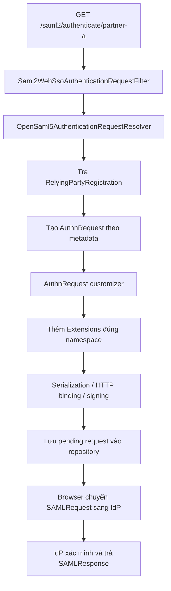

# Bổ sung thông tin mở rộng vào SAML2 AuthnRequest mà không phá vỡ cấu trúc giao thức

**Chủ đề:** Spring Security – federation → Tùy chỉnh AuthnRequest.

Một Service Provider (SP) đôi khi cần truyền thêm thông tin cho Identity Provider (IdP): gợi ý ngôn ngữ giao diện, bối cảnh dịch vụ, yêu cầu thuộc tính theo một profile đã thỏa thuận hoặc chính sách đăng nhập đặc thù. SAML 2.0 cho phép mở rộng một số thông điệp, trong đó có `<samlp:AuthnRequest>`, nhưng **chỉ thêm dữ liệu vào đúng điểm mở rộng và đúng namespace** mới bảo toàn khả năng parse, kiểm chứng chữ ký và liên kết phiên đăng nhập.

Với Spring Security (Servlet), cách duy trì an toàn là dùng **`OpenSaml5AuthenticationRequestResolver.setAuthnRequestCustomizer(...)`** để thay đổi mô hình đối tượng OpenSAML **trước** khi request được serialize và gửi theo HTTP Redirect/POST binding. Đối với thông tin thuộc chuẩn SAML, ưu tiên trường có sẵn như `ForceAuthn`, `NameIDPolicy` hoặc `RequestedAuthnContext`; đối với dữ liệu mở rộng được hai bên đồng ý, dùng **`samlp:Extensions` với phần tử thuộc namespace riêng**. Không chèn chuỗi XML bằng regex sau khi request đã được ký.

Ví dụ trong bài dùng **Java 17+, Spring Boot 4.1.x và Spring Security 7.1.x/OpenSAML 5**. Nếu dùng Security 6.x/OpenSAML 4, phải đối chiếu lớp `OpenSaml4AuthenticationRequestResolver` và JavaDoc của nhánh đó. Mã Spring là các tệp thuộc dự án Maven có dependency và IdP thực, không chạy độc lập với `javac`. Bài cuối có mã Java JDK thuần chạy được để kiểm tra thứ tự phần tử và namespace.

## 1. Phân biệt ba kiểu “bổ sung thông tin”

| Nhu cầu | Cách thực hiện đúng | Ví dụ | Sai lầm dễ mắc |
| --- | --- | --- | --- |
| Yêu cầu SAML đã có trường chuẩn | Dùng thuộc tính/phần tử SAML 2.0 theo schema | `ForceAuthn`, `IsPassive`, `NameIDPolicy`, `RequestedAuthnContext`, `Scoping` | Tạo phần tử custom dù chuẩn đã mô tả nhu cầu |
| Bổ sung dữ liệu theo **extension/profile** được IdP thỏa thuận | Đưa phần tử namespace ngoài SAML vào **`samlp:Extensions`** | `<ctx:LocaleHint>vi-VN</ctx:LocaleHint>` | Chèn `<ctx:LocaleHint>` trực tiếp vào `AuthnRequest` |
| Chuyển trạng thái ứng dụng/quay về trang | Lưu trong session/`SavedRequest`, `RelayState` opaque an toàn theo thiết kế | Mã giao dịch một lần hoặc đường dẫn nội bộ đã allowlist | Đưa PII, access token hoặc URL ngoài danh sách tin cậy vào `RelayState` |

**Bổ sung cấu trúc khác với bổ sung quyền.** IdP có thể xem extension là một **gợi ý** và bỏ qua; SP không được tự suy diễn rằng IdP đã thực hiện MFA, cho phép truy cập tenant nào hay phát hành đúng thuộc tính chỉ vì đã gửi yêu cầu. Những điều kiện quan trọng phải được thương lượng với IdP và kiểm chứng trong `SAMLResponse`/Assertion nhận lại.

### 1.1. Vai trò các bên

- **SP/Relying Party:** ứng dụng Spring tạo `AuthnRequest`, lưu request theo phiên, chuyển browser đến IdP và xác minh response tại ACS.
- **IdP/Asserting Party:** nhận và kiểm tra request; nếu hỗ trợ profile/extension sẽ diễn giải các giá trị theo hợp đồng; xác thực người dùng và phát SAML Response.
- **Browser:** vận chuyển `SAMLRequest` qua Redirect/POST; dữ liệu đi qua browser không tự có tính bí mật.
- **RelyingPartyRegistration:** cấu hình Spring xác định issuer/entity ID SP, ACS, issuer/SSO URL IdP, chứng chỉ và các ràng buộc.
- **Saml2AuthenticationRequestResolver:** chiến lược tạo request; Spring Security dùng `OpenSaml5AuthenticationRequestResolver` để xây `AuthnRequest` dựa trên OpenSAML 5.
- **Customizer:** callback chỉnh sửa mô hình đối tượng trước bước encoding/signing của resolver; chỉ thay đổi phần được cho phép.

**Giới hạn phạm vi:** bài này nói về **request SP-initiated**. Đăng nhập IdP-initiated/unsolicited không có `AuthnRequest` do SP tạo trong cùng giao dịch, nên không có gì để áp customizer tại thời điểm IdP gửi response.

## 2. Cấu trúc SAML 2.0 AuthnRequest cần được giữ nguyên

Theo schema SAML 2.0, `AuthnRequestType` mở rộng `RequestAbstractType`. Các thuộc tính định danh và phần tử cần tuân thủ quy tắc namespace/thứ tự của XML Schema.

Ví dụ một request có phần mở rộng (XML minh họa, chưa có chữ ký; các URL và `ID` chỉ là dữ liệu ví dụ):

```xml
<?xml version="1.0" encoding="UTF-8"?>
<samlp:AuthnRequest
    xmlns:samlp="urn:oasis:names:tc:SAML:2.0:protocol"
    xmlns:saml="urn:oasis:names:tc:SAML:2.0:assertion"
    xmlns:ctx="urn:example:portal:saml-ext:1"
    ID="_req-20261107-a1"
    Version="2.0"
    IssueInstant="2026-11-07T03:00:00Z"
    Destination="https://login.partner.example/sso"
    AssertionConsumerServiceURL="https://portal.example.com/login/saml2/sso/partner-a"
    ProtocolBinding="urn:oasis:names:tc:SAML:2.0:bindings:HTTP-POST"
    ForceAuthn="false">
    <saml:Issuer>https://portal.example.com/saml2/sp/partner-a</saml:Issuer>
    <samlp:Extensions>
        <ctx:LocaleHint>vi-VN</ctx:LocaleHint>
        <ctx:Interface>employee-portal</ctx:Interface>
    </samlp:Extensions>
    <samlp:NameIDPolicy
        Format="urn:oasis:names:tc:SAML:2.0:nameid-format:persistent"
        AllowCreate="true"/>
</samlp:AuthnRequest>
```

**Vị trí phải đúng:** các thành phần chung của `RequestAbstractType` gồm `saml:Issuer`, `ds:Signature` (nếu có dạng ký XML) và `samlp:Extensions` theo thứ tự schema; các phần tử chuyên biệt của `AuthnRequestType` như `saml:Subject`, `NameIDPolicy`, `saml:Conditions`, `RequestedAuthnContext` và `Scoping` xuất hiện sau phần chung, đúng thứ tự quy định. Không sao chép cấu trúc tự do từ JSON sang XML.

Sơ đồ dạng cây:

```text
samlp:AuthnRequest  [ID, Version, IssueInstant, Destination, ...]
├── saml:Issuer                 (khi có; phải đúng entity ID của SP)
├── ds:Signature                (nếu ký XML, vị trí do schema quy định)
├── samlp:Extensions            (điểm mở rộng thuộc RequestAbstractType)
│   └── ctx:LocaleHint          (namespace riêng, sau khi hai bên đồng ý)
├── saml:Subject                (tùy chọn theo schema/profile)
├── samlp:NameIDPolicy          (tùy chọn)
├── saml:Conditions             (tùy chọn)
├── samlp:RequestedAuthnContext (tùy chọn)
└── samlp:Scoping               (tùy chọn)
```

**Không phải mọi trường đều bắt buộc**; đây là hình cấu trúc/thứ tự tổng quát. Có IdP yêu cầu thêm hoặc hạn chế một số phần tử theo metadata và profile, nên XML đúng schema chỉ là **điều kiện cần** để chạy thông suốt.

### 2.1. Tại sao cần namespace khác SAML cho phần mở rộng?

`samlp:Extensions` là điểm mở rộng được chuẩn SAML định nghĩa. Nội dung mở rộng phải có QName riêng, điển hình:

```xml
<samlp:Extensions xmlns:ctx="urn:example:portal:saml-ext:1">
    <ctx:LocaleHint>vi-VN</ctx:LocaleHint>
</samlp:Extensions>
```

- `ctx` chỉ là **prefix cục bộ**, không quyết định danh tính của extension; namespace URI `urn:example:portal:saml-ext:1` mới là ranh giới nhận diện thực tế.
- Không dùng namespace của `samlp`, `saml` hoặc metadata chuẩn để đặt tên phần tử tự chế như `samlp:MyCustomField`.
- Tránh namespace `urn:example:...` khi triển khai thật: cần namespace duy nhất được định nghĩa trong hợp đồng giữa SP–IdP, có tài liệu field, kiểu dữ liệu, phiên bản và ý nghĩa.
- Không đặt phần tử custom **trực tiếp** dưới `AuthnRequest`; nó phải nằm trong `samlp:Extensions` theo schema.
- Giới hạn nested payload, số lượng phần tử, kích cỡ và ký tự; một extension có schema riêng nên được kiểm thử bằng XSD của chính extension nếu hai bên công bố.

**Ví dụ sai** (chèn trực tiếp child không thuộc content model):

```xml
<samlp:AuthnRequest ...>
    <saml:Issuer>https://portal.example.com/saml2/sp/partner-a</saml:Issuer>
    <ctx:LocaleHint xmlns:ctx="urn:example:portal:saml-ext:1">
        vi-VN
    </ctx:LocaleHint>
</samlp:AuthnRequest>
```

Dấu `...` là ký hiệu rút gọn, **không phải XML hợp lệ để parse**. Ý tưởng ở đây là vị trí child sai: dù prefix/namespace đã được khai báo, phần tử `ctx:LocaleHint` không được tự ý trở thành child trực tiếp của `AuthnRequest`.

### 2.2. Tránh nhầm với `AttributeStatement`

`AuthnRequest` do SP gửi là **yêu cầu đăng nhập**, không phải nơi tự khai báo rằng người dùng đã có role, group, email hay MFA. Các thuộc tính danh tính mà IdP xác thực thường xuất hiện trong **`AttributeStatement` bên trong SAML Assertion được IdP ký**. Nếu muốn yêu cầu IdP cung cấp thêm thuộc tính, hãy tìm profile/extension SAML chính thức hoặc giao thức provisioning có thỏa thuận; không gửi `<saml:Attribute>ROLE_ADMIN</saml:Attribute>` trong request để coi đó là quyền.

Tương tự, `RequestedAuthnContext` có thể yêu cầu phương thức/mức xác thực; **giá trị thật đã đạt** phải được kiểm tra từ assertion/`AuthnStatement` với quy tắc của ứng dụng và IdP. Yêu cầu MFA không phải bằng chứng MFA đã hoàn tất.

## 3. Khi nào dùng trường chuẩn trước khi nghĩ tới `Extensions`?

| Mục tiêu | Cơ chế chuẩn | Ghi chú triển khai |
| --- | --- | --- |
| Buộc IdP xác thực người dùng trực tiếp trong request hiện tại | `ForceAuthn="true"` | Thỏa thuận IdP hỗ trợ; không đồng nghĩa chắc chắn đáp ứng mức MFA cụ thể |
| Không cho IdP chủ động tương tác với người dùng | `IsPassive="true"` | Nếu IdP không thể hoàn thành thụ động, trả lỗi theo profile; không kết hợp tùy tiện với ForceAuthn yêu cầu tương tác |
| Yêu cầu kiểu định danh ổn định | `NameIDPolicy@Format` và `AllowCreate` | Chọn persistent/transient/email theo IdP/contract; không tạo tài khoản dựa vào email không xác minh |
| Yêu cầu lớp/ngữ cảnh xác thực | `RequestedAuthnContext` + `AuthnContextClassRef` và `Comparison` | IdP có thể từ chối vì `NoAuthnContext` nếu không đáp ứng; kiểm chứng kết quả thực |
| Giới hạn/phối hợp chain IdP | `Scoping`/`IDPList`/`ProxyCount` (khi profile cho phép) | Dùng khi federation proxying thực sự tồn tại, không thay thế tenant authorization |
| Chọn ACS đã đăng ký | `AssertionConsumerServiceURL` hoặc `AssertionConsumerServiceIndex` theo profile | Không tự tạo URL từ input browser; phải khớp metadata và ingress public |
| Chọn HTTP binding của response | `ProtocolBinding` | Binding của **SAML Response**, không đồng nhất binding dùng gửi AuthnRequest |
| Cung cấp tên hiển thị requester | `ProviderName` | Có thể bị IdP bỏ qua; không phải issuer/entityID dùng cho trust |

Ví dụ yêu cầu chuẩn:

```xml
<samlp:RequestedAuthnContext Comparison="exact"
    xmlns:samlp="urn:oasis:names:tc:SAML:2.0:protocol"
    xmlns:saml="urn:oasis:names:tc:SAML:2.0:assertion">
    <saml:AuthnContextClassRef>
        urn:oasis:names:tc:SAML:2.0:ac:classes:PasswordProtectedTransport
    </saml:AuthnContextClassRef>
</samlp:RequestedAuthnContext>
```

Đây là **mảnh XML phần tử chuẩn**, phải được đặt đúng vị trí trong AuthnRequest để toàn bộ document hợp lệ. Không đặt `RequestedAuthnContext` vào `Extensions` vì schema đã định nghĩa sẵn nó. Với assurance hoặc step-up cấp cao, không mặc định `PasswordProtectedTransport` nghĩa là MFA; chỉ dùng `AuthnContextClassRef` mà hợp đồng IdP công bố và ứng dụng chấp nhận.

## 4. Chuẩn bị hợp đồng extension với IdP

Một phần mở rộng chỉ có giá trị nếu cả SP và IdP thống nhất **ngữ nghĩa**, không chỉ cùng parse được XML:

1. **Namespace URI + phiên bản**: ví dụ `urn:example:portal:saml-ext:1`. Version bump khi đổi meaning hoặc XML contract không tương thích.
2. **Tên phần tử/QName**: ví dụ `ctx:LocaleHint`. Tên có phân biệt chữ hoa/thường.
3. **Kiểu và giới hạn dữ liệu**: ngôn ngữ BCP 47 hoặc enum đã thống nhất, giới hạn độ dài, cho phép thiếu hay không, có giá trị mặc định không.
4. **Bên tạo và bên diễn giải**: SP phát gợi ý; IdP có thể bỏ qua, yêu cầu ràng buộc khác hoặc từ chối nếu unsupported.
5. **Tính bắt buộc về nghiệp vụ**: nếu bắt buộc thì IdP phải báo lỗi rõ ràng khi không hỗ trợ; đừng giả định XML extension tự có cơ chế `required=true` chung.
6. **Bảo vệ dữ liệu**: có PII hoặc nội dung nhạy cảm không? URL Redirect có thể bị lưu trong history, reverse proxy và log.
7. **Chữ ký và tin cậy**: IdP yêu cầu signed AuthnRequest hay chỉ kiểm tra SP metadata? Đảm bảo phần mở rộng nằm trong bytes được ký theo binding được dùng.
8. **Khả năng tương thích ngược**: IdP mới/cũ, tenant khác, sandbox, thứ tự child, bản schema, cơ chế fail-safe và cách tắt extension.
9. **Đo kiểm**: kiểm tra IdP có thực sự dùng field trong flow, không chỉ phản hồi thành công khi đã bỏ qua nó.
10. **Quản trị thay đổi**: chủ sở hữu tài liệu, ngày phiên bản, kế hoạch rollback, test cases cho giá trị thiếu, không hợp lệ và quá lớn.

Ví dụ contract ngắn:

| Thuộc tính | Giá trị thỏa thuận |
| --- | --- |
| Namespace | `urn:example:portal:saml-ext:1` |
| XML path | `/samlp:AuthnRequest/samlp:Extensions/ctx:LocaleHint` |
| Nội dung | Chuỗi locale allowlist: `vi-VN`, `en-US` |
| Ý nghĩa | Chỉ gợi ý ngôn ngữ giao diện IdP, **không quyết định danh tính/quyền** |
| Khi thiếu | IdP dùng locale mặc định |
| Khi lạ | IdP dùng mặc định hoặc từ chối theo profile đã thỏa thuận |
| Ký request | Theo IdP metadata, khóa SP và binding được hỗ trợ |
| Trách nhiệm | SP kiểm soát giá trị đầu vào; IdP kiểm soát cách hiển thị |

Không thêm extension “truyền role để đăng nhập nhanh”, “chọn tenant không cần xác minh issuer”, “bỏ MFA vì user đã đăng nhập SP”, vì đây là các quyết định an ninh không thể dựa vào dữ liệu tự phát biểu trong AuthnRequest.

## 5. Spring Security: chỉnh mô hình OpenSAML trước khi gửi

Luồng thường gặp:



Sơ đồ mô tả **trách nhiệm logic** của các bước, không cam kết thứ tự gọi nội bộ từng method của mọi phiên bản. Spring Security vẫn quản lý `Saml2AuthenticationRequestRepository`, `RelayState`, binding và request correlation theo cơ chế filter của phiên bản tương ứng.

### 5.1. Điểm tùy chỉnh do Spring Security hỗ trợ

Tài liệu Spring Security 7.1 dùng:

```java
@Bean
Saml2AuthenticationRequestResolver authenticationRequestResolver(
        RelyingPartyRegistrationRepository registrations) {
    RelyingPartyRegistrationResolver parties =
            new DefaultRelyingPartyRegistrationResolver(registrations);
    OpenSaml5AuthenticationRequestResolver resolver =
            new OpenSaml5AuthenticationRequestResolver(parties);
    resolver.setAuthnRequestCustomizer(
            context -> context.getAuthnRequest().setForceAuthn(true));
    return resolver;
}
```

Đây là **mảnh Java Spring**: cần imports/bean trong ứng dụng Spring Security, không chạy độc lập bằng `javac`. `setForceAuthn(true)` là ví dụ sửa **thuộc tính chuẩn**. Để thêm extension tùy biến, thao tác với `context.getAuthnRequest().getExtensions()` rồi thêm OpenSAML XMLObject ở namespace riêng, như phần sau.

**Quy tắc:** hãy chỉnh qua object model, rồi để resolver/framework thực hiện bước serialization, compression, transport encoding và signing. Không lấy `SAMLRequest` đã Base64/DEFLATE để chỉnh chuỗi và gửi tiếp, vì thay bytes có thể làm sai chữ ký, phá encoding và mất tương quan với request đã lưu.

## 6. Ví dụ tích hợp Java 17 + Spring Boot 4.1.2/OpenSAML 5

Ví dụ một SP liên kết IdP `partner-a`, gửi **một locale hint vô hại** trong `samlp:Extensions` và giữ nguyên các trường protocol do framework tạo. Có thể cấu hình request ký theo metadata/credentials, nhưng IdP thật phải xác nhận hỗ trợ phần mở rộng trước khi bật ở production.

Cấu trúc tối thiểu:

```text
saml-request-extension/
├── pom.xml
└── src/main/
    ├── java/com/example/federation/
    │   ├── FederationApplication.java
    │   ├── SecurityConfig.java
    │   └── AuthnRequestCustomization.java
    └── resources/application.yml
```

### 6.1. Maven BOM và dependency

`pom.xml`:

```xml
<?xml version="1.0" encoding="UTF-8"?>
<project xmlns="http://maven.apache.org/POM/4.0.0"
         xmlns:xsi="http://www.w3.org/2001/XMLSchema-instance"
         xsi:schemaLocation="http://maven.apache.org/POM/4.0.0
           https://maven.apache.org/xsd/maven-4.0.0.xsd">
    <modelVersion>4.0.0</modelVersion>
    <parent>
        <groupId>org.springframework.boot</groupId>
        <artifactId>spring-boot-starter-parent</artifactId>
        <version>4.1.2</version>
        <relativePath/>
    </parent>
    <groupId>com.example</groupId>
    <artifactId>saml-request-extension</artifactId>
    <version>1.0.0</version>
    <properties><java.version>17</java.version></properties>
    <repositories>
        <repository>
            <id>shibboleth-releases</id>
            <url>https://build.shibboleth.net/maven/releases/</url>
            <snapshots><enabled>false</enabled></snapshots>
        </repository>
    </repositories>
    <dependencies>
        <dependency>
            <groupId>org.springframework.boot</groupId>
            <artifactId>spring-boot-starter-webmvc</artifactId>
        </dependency>
        <dependency>
            <groupId>org.springframework.boot</groupId>
            <artifactId>spring-boot-starter-security</artifactId>
        </dependency>
        <dependency>
            <groupId>org.springframework.boot</groupId>
            <artifactId>spring-boot-starter-security-saml2</artifactId>
        </dependency>
        <dependency>
            <groupId>org.springframework.boot</groupId>
            <artifactId>spring-boot-starter-test</artifactId>
            <scope>test</scope>
        </dependency>
    </dependencies>
    <build>
        <plugins>
            <plugin>
                <groupId>org.springframework.boot</groupId>
                <artifactId>spring-boot-maven-plugin</artifactId>
            </plugin>
        </plugins>
    </build>
</project>
```

Spring Boot parent quản lý Spring Security và OpenSAML qua dependency management; không tùy tiện chỉ định một OpenSAML major khác. SAML SP dùng OpenSAML có thể cần kho Shibboleth Releases như trên; trong công ty, mirror kho qua artifact repository được duyệt. Nếu ở Boot 3.5, starter đặt tên khác và cần đúng OpenSAML 4/Security 6.x tùy phiên bản, tránh sao chép nguyên cấu hình Boot 4.

### 6.2. `FederationApplication.java`

```java
package com.example.federation;

import org.springframework.boot.SpringApplication;
import org.springframework.boot.autoconfigure.SpringBootApplication;

@SpringBootApplication
public class FederationApplication {
    public static void main(String[] args) {
        SpringApplication.run(FederationApplication.class, args);
    }
}
```

### 6.3. `AuthnRequestCustomization.java`: thêm đúng `Extensions`

```java
package com.example.federation;

import org.opensaml.core.xml.schema.XSAny;
import org.opensaml.core.xml.schema.impl.XSAnyBuilder;
import org.opensaml.saml.saml2.core.Extensions;
import org.opensaml.saml.saml2.core.impl.ExtensionsBuilder;
import org.springframework.context.annotation.Bean;
import org.springframework.context.annotation.Configuration;
import org.springframework.security.saml2.provider.service.registration
        .RelyingPartyRegistrationRepository;
import org.springframework.security.saml2.provider.service.web
        .DefaultRelyingPartyRegistrationResolver;
import org.springframework.security.saml2.provider.service.web
        .RelyingPartyRegistrationResolver;
import org.springframework.security.saml2.provider.service.web.authentication
        .OpenSaml5AuthenticationRequestResolver;
import org.springframework.security.saml2.provider.service.web.authentication
        .Saml2AuthenticationRequestResolver;

@Configuration
public class AuthnRequestCustomization {

    private static final String EXT_NS =
            "urn:example:portal:saml-ext:1";

    @Bean
    Saml2AuthenticationRequestResolver authenticationRequestResolver(
            RelyingPartyRegistrationRepository registrations) {

        RelyingPartyRegistrationResolver registrationResolver =
                new DefaultRelyingPartyRegistrationResolver(registrations);

        OpenSaml5AuthenticationRequestResolver resolver =
                new OpenSaml5AuthenticationRequestResolver(registrationResolver);

        resolver.setAuthnRequestCustomizer(context -> {
            var authnRequest = context.getAuthnRequest();

            // Không thay ID, Issuer, Destination, ACS hoặc IssueInstant.
            // Chỉ bổ sung phần tử ở điểm mở rộng được SAML cho phép.
            Extensions extensions = authnRequest.getExtensions();
            if (extensions == null) {
                extensions = new ExtensionsBuilder().buildObject();
                authnRequest.setExtensions(extensions);
            }

            XSAny locale = new XSAnyBuilder().buildObject(
                    EXT_NS, "LocaleHint", "ctx");
            locale.setTextContent("vi-VN");

            extensions.getUnknownXMLObjects().add(locale);
        });

        return resolver;
    }
}
```

**Lý do cách làm này giữ đúng cấu trúc:**

- `ExtensionsBuilder` được import từ **`org.opensaml.saml.saml2.core.impl`** (protocol extension), **không phải** lớp trùng tên trong `org.opensaml.saml.saml2.metadata.impl` dành cho metadata.
- `XSAnyBuilder` tạo một XMLObject có QName thuộc namespace custom `urn:example:portal:saml-ext:1`; `setTextContent` điền giá trị text theo API OpenSAML.
- Nếu `AuthnRequest` đã có `Extensions`, code **giữ nguyên** các child cũ rồi bổ sung một child mới; không ghi đè bằng một object làm mất extension của thư viện/đối tác khác.
- `authnRequest.setExtensions(...)` đặt object vào đúng vị trí mà mô hình OpenSAML định nghĩa; OpenSAML đảm trách thứ tự child khi marshalling.
- Spring Security vẫn xử lý các trường bắt buộc, `RelayState`, request repository và transport; code không tự cắt chuỗi SAML đã encoded.

**Đây là ví dụ contract cố định:** locale luôn là `vi-VN` để minh họa. Production nên cấu hình allowlist per partner, không đọc trực tiếp `?locale=...` và đưa nội dung thô của user vào signed SAMLRequest. Nếu IdP không hỗ trợ extension, chỉ gửi cho những registration đã đồng ý nhận; trường hợp cần phân nhánh, hãy xây cơ chế chọn cấu hình tin cậy theo `RelyingPartyRegistration` ở tầng ứng dụng/bean resolver.

### 6.4. `SecurityConfig.java`: lắp resolver vào `saml2Login`

```java
package com.example.federation;

import org.springframework.context.annotation.Bean;
import org.springframework.context.annotation.Configuration;
import org.springframework.security.config.annotation.web.builders.HttpSecurity;
import org.springframework.security.saml2.provider.service.web.authentication
        .Saml2AuthenticationRequestResolver;
import org.springframework.security.web.SecurityFilterChain;

@Configuration
public class SecurityConfig {
    @Bean
    SecurityFilterChain chain(
            HttpSecurity http,
            Saml2AuthenticationRequestResolver requestResolver) throws Exception {
        http.authorizeHttpRequests(auth -> auth
                    .requestMatchers("/", "/error").permitAll()
                    .anyRequest().authenticated()
                )
                .saml2Login(saml2 -> saml2
                    .authenticationRequestResolver(requestResolver));
        return http.build();
    }
}
```

Việc lắp **rõ ràng** `authenticationRequestResolver` giúp xem đúng resolver mà filter chain đang dùng. Nếu ứng dụng có nhiều `SecurityFilterChain`, hãy kiểm tra `securityMatcher`, thứ tự chain và endpoint tạo request; đừng vô tình chỉ cấu hình customizer trong chain không bao giờ được gọi.

### 6.5. `application.yml`: registration và IdP metadata

```yaml
spring:
  security:
    saml2:
      relyingparty:
        registration:
          partner-a:
            assertingparty:
              metadata-uri: https://login.partner.example/metadata.xml
```

Các domain `example.com` là placeholder **trong tài liệu học**, chưa tạo IdP và không thể dùng để đăng nhập thật. Muốn chạy, cần metadata IdP hợp lệ, entity ID SP, ACS URL public và chứng chỉ tin cậy theo hợp đồng SAML. Nếu IdP yêu cầu signed AuthnRequest, cấu hình private key/certificate SP qua secret manager và signing credentials phù hợp; không sử dụng private key trong code hoặc Git.

Mã Java trong ví dụ là cấu hình Spring Boot/Spring Security; để chạy cần build bằng Maven cùng dependencies và IdP thực:

```bash
mvn -DskipTests compile
mvn test
mvn spring-boot:run
```

Sau khi cấu hình IdP, mở `/saml2/authenticate/partner-a` và quan sát request trong mạng. **Không có stdout SSO cố định** vì kết quả phụ thuộc đăng ký IdP, trình duyệt, proxy, phiên và certificate. Build pass chỉ xác nhận mã/đối tượng liên quan compile được trong tổ hợp dependency đã resolve, chưa xác nhận IdP xử lý `LocaleHint`.

## 7. Kiểm tra XML sau customizer và trước khi giao IdP

Mục tiêu khi kiểm tra là xác nhận **thông điệp thực sự phát đi** có custom extension, vẫn parse được, giữ đúng các trường chính và không làm hỏng signature/binding.

### 7.1. Xem request thực, không chỉ Java object

Với HTTP Redirect binding, trình duyệt thường được chuyển sang SSO URL của IdP, kèm `SAMLRequest` và có thể `RelayState`/`SigAlg`/`Signature`. `SAMLRequest` thường được DEFLATE, Base64 và URL-encoded; phải giải mã đúng binding mới thấy XML.

Với HTTP POST binding, browser mang form có hidden field `SAMLRequest` được mã hóa Base64; không lấy đường dẫn Redirect rồi giải nén như POST. **Bước ký request khác nhau theo binding**: HTTP Redirect ký các tham số query đúng thứ tự/quy tắc binding; HTTP POST thường có XML Signature trong thông điệp khi được ký. Không kết luận chữ ký bị thiếu chỉ vì XML giải mã từ Redirect không có `<ds:Signature>`.

Khi decode trong môi trường kiểm thử, chỉ sử dụng các công cụ tin cậy, **không đưa toàn bộ SAMLRequest/SAMLResponse thật, cookie, secret hoặc assertion chứa PII lên web decode công khai**.

### 7.2. Cần so sánh các giá trị nào?

| Vị trí | Trước customization | Sau customization mong đợi |
| --- | --- | --- |
| `AuthnRequest@ID` | SP tạo ID mới đủ duy nhất | **Giữ nguyên** trong object request đang được xử lý |
| `Version` / `IssueInstant` | `2.0` / thời gian phát hành | **Không tự thay đổi** |
| `Destination` | IdP SSO URL đúng metadata | **Không đổi** chỉ vì thêm extension |
| `Issuer` | SP entity ID theo registration | **Không đổi** |
| `AssertionConsumerServiceURL` hoặc Index | ACS của SP theo metadata | **Không đổi** |
| `ProtocolBinding` | Binding response được SP/IdP hỗ trợ | **Không đổi** trừ khi có hợp đồng rõ ràng |
| `RelayState` | Do resolver/request management xử lý | Không dùng như kênh chèn payload nghiệp vụ |
| `Extensions` | Có thể rỗng/không tồn tại | Có đúng `ctx:LocaleHint` và vẫn giữ extension khác |
| `NameIDPolicy`/`RequestedAuthnContext` | Theo chính sách chuẩn | Không bị xóa/đổi ngoài yêu cầu |
| Signing/transport | Theo metadata và binding | Chữ ký vẫn hợp lệ **sau** khi payload đã chỉnh |
| `InResponseTo` ở response | Chưa tồn tại tại lúc tạo request | Phải trùng request ID đang lưu của phiên khi IdP trả response |

**Một lần login thành công chưa đủ kiểm chứng extension được IdP sử dụng.** Hãy xem log test có kiểm soát của IdP hoặc xác nhận kết quả giao diện: ví dụ gửi `vi-VN` và `en-US` theo contract rồi quan sát IdP có hiển thị ngôn ngữ tương ứng không. Nếu IdP phớt lờ extension, login vẫn có thể thành công.

## 8. Java 17 độc lập: kiểm tra thứ tự và namespace XML

Đoạn sau **biên dịch/chạy chỉ với JDK 17+**. Nó dựng XML mẫu có `Issuer → Extensions → NameIDPolicy`, dùng DOM parser với tính năng chống DTD/XXE cơ bản để in thứ tự child và giá trị custom. Đây là **bài kiểm tra cấu trúc**, không phải trình xác thực SAML, không thực hiện XML Schema/X.509 signature validation.

Tệp `AuthnRequestStructureDemo.java`:

```java
import java.io.StringReader;
import java.util.ArrayList;
import java.util.List;
import javax.xml.XMLConstants;
import javax.xml.parsers.DocumentBuilderFactory;
import org.w3c.dom.Element;
import org.w3c.dom.Node;
import org.w3c.dom.NodeList;
import org.xml.sax.InputSource;

public class AuthnRequestStructureDemo {
    private static final String PROTOCOL =
            "urn:oasis:names:tc:SAML:2.0:protocol";
    private static final String EXT =
            "urn:example:portal:saml-ext:1";

    public static void main(String[] args) throws Exception {
        String xml = """
            <samlp:AuthnRequest
                xmlns:samlp="urn:oasis:names:tc:SAML:2.0:protocol"
                xmlns:saml="urn:oasis:names:tc:SAML:2.0:assertion"
                xmlns:ctx="urn:example:portal:saml-ext:1"
                ID="_demo1" Version="2.0"
                IssueInstant="2026-11-07T03:00:00Z"
                Destination="https://login.partner.example/sso">
                <saml:Issuer>https://portal.example.com/saml2/sp</saml:Issuer>
                <samlp:Extensions>
                    <ctx:LocaleHint>vi-VN</ctx:LocaleHint>
                </samlp:Extensions>
                <samlp:NameIDPolicy AllowCreate="true"/>
            </samlp:AuthnRequest>
            """;

        DocumentBuilderFactory factory =
                DocumentBuilderFactory.newInstance();
        factory.setNamespaceAware(true);
        factory.setFeature(
                XMLConstants.FEATURE_SECURE_PROCESSING, true);
        factory.setFeature(
                "http://apache.org/xml/features/disallow-doctype-decl",
                true);
        factory.setXIncludeAware(false);
        factory.setExpandEntityReferences(false);

        Element root = factory.newDocumentBuilder()
                .parse(new InputSource(new StringReader(xml)))
                .getDocumentElement();

        List<String> children = new ArrayList<>();
        NodeList nodes = root.getChildNodes();
        for (int i = 0; i < nodes.getLength(); i++) {
            Node node = nodes.item(i);
            if (node instanceof Element child) {
                children.add(child.getLocalName());
            }
        }

        NodeList extensions =
                root.getElementsByTagNameNS(PROTOCOL, "Extensions");
        NodeList hints =
                root.getElementsByTagNameNS(EXT, "LocaleHint");

        System.out.println("Root: " + root.getLocalName());
        System.out.println("Children: " + String.join(",", children));
        System.out.println("Extensions count: " + extensions.getLength());
        System.out.println("Locale: " + hints.item(0).getTextContent());
    }
}
```

Biên dịch/chạy trong thư mục chứa file:

```bash
javac AuthnRequestStructureDemo.java
java AuthnRequestStructureDemo
```

**Stdout chính xác của chương trình:**

```text
Root: AuthnRequest
Children: Issuer,Extensions,NameIDPolicy
Extensions count: 1
Locale: vi-VN
```

Giải thích:

- `getLocalName()` bỏ prefix hiển thị, còn `getElementsByTagNameNS(...)` lọc **đúng namespace URI**, không nhầm `ctx:LocaleHint` với phần tử cùng local name trong namespace khác.
- DOM parser giữ thứ tự element như XML mẫu nên kết quả `Issuer,Extensions,NameIDPolicy` biểu diễn vị trí các child.
- Demo chỉ đảm bảo XML parse được và kiểm tra một vài thuộc tính; **không xác thực XSD đầy đủ, không xác minh chữ ký, không chứng minh IdP hỗ trợ extension**. Production dùng thư viện SAML đáng tin và bộ test với IdP sandbox.

### 8.1. Kiểm chứng bằng XSD chuẩn

Lấy **bộ XSD SAML 2.0 đầy đủ** từ OASIS, bao gồm `saml-schema-protocol-2.0.xsd` và các import assertion/XML Signature/XML Encryption được tham chiếu. Dùng validator có cấu hình offline trusted resolver, disable network/XXE không cần thiết. Nếu dùng công cụ `xmllint` đã cài sẵn và các import đã resolve:

```bash
xmllint --noout --schema saml-schema-protocol-2.0.xsd \
  authn-request.xml
```

Lưu ý: XML có chữ ký Redirect-binding không bắt buộc chứa `ds:Signature` trong XML, và XML schema validation **không thể chứng minh** request đã được IdP chấp thuận, chữ ký hợp lệ hay tenant mapping đúng. Nếu custom extension có XSD riêng, chạy thêm validation cho schema đó theo contract IdP.

## 9. Giữ chữ ký hợp lệ sau khi thêm nội dung

**Không được sửa XML sau khi đã ký**. Quy tắc bất biến:

- Customizer làm việc trên object **trước** marshalling/signing/encoding của resolver.
- Để Spring Security/OpenSAML tự áp binding/signing đã cấu hình với `RelyingPartyRegistration`; không viết string replace lên `SAMLRequest` đã gửi.
- Nếu HTTP Redirect binding, kiểm tra `SigAlg` và `Signature` theo binding và chứng chỉ SP đã đăng ký với IdP; không kết luận dựa trên việc XML giải mã có hay không có `ds:Signature`.
- Nếu POST binding và dùng XML Signature, ký đúng element và reference theo thư viện chuẩn. Việc bổ sung child sau khi ký có thể làm digest mismatch.
- Không tắt `sign-request` hoặc XML signature validation chỉ để extension mới được IdP chấp nhận; điều chỉnh metadata, key, algorithm và policy theo hợp đồng.
- Không đưa private key, credentials, Assertion, session cookie hoặc nguyên SAML message vào hệ thống log không bảo mật.

**Tại sao cùng một XML có thể login được khi chưa ký nhưng bị từ chối khi ký?** Thay đổi extension đổi canonicalized content; nếu payload sau customizer khác payload lúc ký, signature fail. Ngoài ra HTTP Redirect signing phụ thuộc query-parameter construction; URL được proxy sửa query encoding/trật tự có thể làm chữ ký sai. Test trên đúng đường đi **browser → gateway → IdP**.

## 10. Giữ liên kết request–response và phiên ban đầu

Mặc định Spring Security dùng `HttpSessionSaml2AuthenticationRequestRepository` để lưu pending `AuthnRequest` trước khi chuyển browser sang IdP. Khi IdP POST response về ACS, `Saml2AuthenticationTokenConverter` và provider dùng request lưu để xử lý `InResponseTo` và các điều kiện khác.

Việc thêm extension **không nên thay đổi**:

- `AuthnRequest@ID` và session-bound pending request; không tạo ID mới **sau** khi đã lưu request.
- `RelayState`; không thay bằng dữ liệu tùy ý để sửa flow khi không hiểu repository.
- Registration IdP/tenant và `Issuer`; extension không được dùng để chọn trust anchor thay metadata.
- `ACS`, `Destination`, `IssueInstant`, thời gian sống request; không đổi vì “IdP yêu cầu thêm field”.
- Kiểm tra response/Assertion: chữ ký, issuer, audience, recipient, thời hạn, SubjectConfirmationData, `InResponseTo`, replay và quyền.

Nếu customizer có logic phụ thuộc browser/session, dữ liệu quyết định phải được server kiểm soát (session state/allowlist) và tránh giả mạo; không cho query parameter `registrationId` hoặc `tenant` từ client tự khiến SP ký request với tenant khác không được phép.

**Trường hợp IdP-initiated:** IdP tự gửi response không có request do SP phát hành nên không áp `AuthnRequest` extension này. Nếu yêu cầu bắt buộc truyền dữ liệu của SP, cần SP-initiated hoặc một protocol/contract khác. Không chuyển một response SP-initiated bị thiếu state thành unsolicited nhằm “chạy được”.

## 11. Quản lý kích cỡ khi dùng HTTP Redirect/POST binding

Custom extension khiến `SAMLRequest` lớn hơn:

| Vấn đề | Hệ quả | Cách phòng tránh |
| --- | --- | --- |
| Redirect URL quá dài | Browser/proxy/IdP có thể trả 400/414 hoặc cắt query | Giới hạn extension nhỏ, thử kích thước sau DEFLATE/Base64/URL encoding; cân nhắc POST binding nếu IdP hỗ trợ |
| URL chứa thông tin nhạy cảm | Browser history, access log, proxy và monitoring có thể lưu request | Không đưa PII/token/credential vào AuthnRequest extension; sử dụng opaque identifier nếu thật cần và được đồng ý |
| Nhiều phần tử không biết IdP có hiểu | IdP bỏ qua hoặc từ chối, khác nhau theo vendor/version | Phát theo registration/feature flag, tích hợp thử từng IdP |
| Không escape XML đúng | Invalid XML hoặc injection khi tạo từ string | Dùng OpenSAML XMLObject builder và value allowlist, không nối XML text thủ công |
| Nội dung lặp/giá trị không nhất quán | IdP có thể chọn field không mong muốn hoặc từ chối | Mỗi field một nguồn cấu hình rõ; tránh appending nhiều bản cùng QName trừ khi contract cho phép |
| Signature mismatch | Request bị từ chối dù có đủ phần tử | Chỉ chỉnh object trước signing, kiểm tra ký trên binding thực |
| Proxy rewrite sai | Signature/ACS/Destination không khớp | Giữ query string, scheme/host forwarding và metadata public đúng |
| Cache phiên mất pending request | `InResponseTo` không tìm được; login lỗi | Kiểm tra cookie SameSite, session timeout, load balancer và Spring Session theo kiến trúc |

**Không lấy giới hạn 30.000 ký tự của Google Sheets** làm chỉ dẫn cho SAML: đây là hai loại giới hạn hoàn toàn khác nhau. Payload AuthnRequest phải được giới hạn theo khả năng browser/gateway/IdP và chính sách an ninh; phần lớn extension nghiệp vụ nên rất ngắn.

## 12. Đưa extension vào sản phẩm có nhiều IdP/tenant

Nếu portal tin `partner-a`, `partner-b` và `employee`, không tự động bật cùng extension cho cả ba. Lập bảng hợp đồng:

| Registration | IdP hỗ trợ `ctx:LocaleHint`? | Namespace/profile | Giá trị được phép | Hành vi nếu IdP lỗi |
| --- | --- | --- | --- | --- |
| `partner-a` | Có, đã ký hợp đồng | `urn:example:portal:saml-ext:1` | `vi-VN`, `en-US` | Fall back có kiểm soát hoặc tắt extension theo rollout |
| `partner-b` | Chưa xác nhận | Không dùng | Không có | Gửi AuthnRequest chuẩn, không thêm extension |
| `employee` | Có thể đã có cơ chế locale chuẩn khác | Đối chiếu metadata/contract | Theo hệ thống IdP | Không giả định hỗ trợ custom |

**Ưu tiên cấu hình bên server**:

1. Tra registration do resolver xác định từ metadata/ràng buộc tenant đã tin.
2. Lấy extension policy từ configuration được duyệt hoặc feature flag có phân quyền.
3. Xác minh giá trị (enum/regex allowlist, độ dài) và bỏ qua nếu không có sự đồng ý của IdP.
4. Tạo `XSAny` với namespace/version cố định, không cho user chọn QName hoặc namespace tùy ý.
5. Theo dõi lỗi `UnsupportedRequest`, `Requester` hoặc status code cụ thể ở SAML Response khi IdP không hiểu.
6. Chạy regression cho cả IdP **có** extension và IdP **không** extension trước khi rollout.
7. Đảm bảo việc tắt feature flag khôi phục AuthnRequest chuẩn mà không đổi entity ID, ACS và signing keys.

**Không gửi thông tin tenant dưới dạng text “tenant=A” rồi cho IdP/ứng dụng tin đó thay issuer/registration**. Mỗi đối tác phải được ánh xạ bằng IdP issuer và certificate tin cậy, cùng kiểm tra tenant isolation sau login.

## 13. Bộ kiểm thử tích hợp bắt buộc

| Ca kiểm thử | Thao tác | Kết quả cần đạt |
| --- | --- | --- |
| XML thông thường không extension | Tắt feature flag, bắt đầu SP-initiated login | Request vẫn parse được, IdP xử lý bình thường |
| XML có extension hợp lệ | Bật cho partner-a, decode SAMLRequest | Có đúng `samlp:Extensions/ctx:LocaleHint`, namespace/version và text hợp đồng |
| Giữ trường bắt buộc | So message gốc/sau customize | `ID`, `Issuer`, `Destination`, ACS và IssueInstant không bị vô tình đổi |
| Thứ tự XML | Validate bằng SAML XSD/inspector | `Extensions` đúng vị trí; không có child custom trực tiếp vào `AuthnRequest` |
| Extension không được hỗ trợ | Gửi cho IdP sandbox cấu hình chưa hỗ trợ | Hành vi được ghi nhận, báo lỗi/fallback đúng hợp đồng; không tuyên bố IdP đã dùng |
| Giá trị không hợp lệ | Locale lạ/quá dài hoặc input độc hại | SP không tạo request chứa dữ liệu không được phép; không XML injection |
| Request được ký | Bật ký theo binding + credential thực | IdP xác minh chữ ký, response hợp lệ; không sửa bytes sau ký |
| Redirect URL lớn | Giả lập extension gần ngưỡng gateway | Không bị cắt hoặc hệ thống từ chối có kiểm soát; cân nhắc POST |
| SP-initiated callback | Gửi response có `InResponseTo` hợp lệ | Session-bound request được tìm, provider xác minh và tạo phiên |
| Sai `InResponseTo` | IdP/test fixture gửi response không tương quan | Từ chối; không fallback sang unsolicited ngoài policy |
| Sai issuer/audience/chữ ký | IdP khác hoặc tamper response | Từ chối, không tạo session |
| Thử nhiều tenant | Đăng nhập partner-a/b | Chính sách extension và registration không trộn; tenant isolation giữ nguyên |
| Browser/cookie khác | Callback không mang session đã tạo request | Xử lý lỗi an toàn, không chấp nhận request của browser khác |
| Rollback | Tắt extension sau rollout | SP trở về AuthnRequest chuẩn mà không đổi URL/chứng chỉ hoặc phá phiên còn hiệu lực |
| Quan sát logs | Bật trace đã được duyệt trong staging | Có error class/correlation/registration, không lộ SAML payload/PII/secret |

**Đặc biệt cần negative tests:** một ứng dụng có thể login thành công với IdP chỉ vì IdP **bỏ qua** trường custom. Điều đó không chứng minh tính năng đang hoạt động; cần kiểm chứng hiệu ứng nghiệp vụ đã thỏa thuận (ví dụ ngôn ngữ hiển thị) và trường hợp IdP báo unsupported.

## 14. Những lỗi thường gặp và nguyên nhân

### Lỗi 1 – “XML có đủ field nhưng IdP báo schema invalid”

Nguyên nhân thường là phần tử mới được thêm trực tiếp vào `AuthnRequest` hoặc sai thứ tự; một số code template ghép XML từ string có thể đặt `Extensions` sau `NameIDPolicy`, trái content model.

**Khắc phục:** dùng OpenSAML `ExtensionsBuilder`/`XSAnyBuilder`, thêm child vào `Extensions` đúng namespace và validate bằng XSD SAML; không sắp xếp child bằng regex.

### Lỗi 2 – Dùng nhầm builder của metadata

OpenSAML có **hai** lớp `ExtensionsBuilder` gần giống tên: một trong `org.opensaml.saml.saml2.core.impl` cho phần mở rộng giao thức, một trong `org.opensaml.saml.saml2.metadata.impl` cho metadata. Dùng nhầm package khiến kiểu object không khớp hoặc gắn extension vào sai tài liệu.

**Khắc phục:** đối chiếu import trực tiếp với `AuthnRequest.getExtensions()` và bộ OpenSAML đang dùng. Trong bài này cần `org.opensaml.saml.saml2.core.Extensions`.

### Lỗi 3 – Dùng `setForceAuthn(true)` nhưng tưởng đã bắt buộc MFA

`ForceAuthn` yêu cầu xác thực trực tiếp theo profile/IdP, không quy định mặc định “phải dùng phương thức MFA cụ thể”. IdP có thể dùng password hoặc cơ chế khác. Với yêu cầu assurance, thương lượng `RequestedAuthnContext` và kiểm chứng AuthnContext/claims phù hợp từ Assertion; bước nghiệp vụ nhạy cảm có thể cần re-auth/step-up được thiết kế riêng.

### Lỗi 4 – Thêm dữ liệu sau khi ký

Các ví dụ trên mạng thường decode `SAMLRequest`, thay XML và Base64 lại. Với ký Redirect/POST, signature không khớp; nếu implementation còn ký bằng thuật toán không được IdP cho phép thì thất bại tiếp.

**Khắc phục:** chỉ chỉnh ở customizer trước serialization/signing và dùng Spring Security/OpenSAML để gửi. Nếu ký thất bại, đối chiếu metadata/certificate, binding, `SigAlg`, query encode và proxy, không tắt ký để né lỗi.

### Lỗi 5 – Chuyển extra field qua `RelayState` như một “role token”

`RelayState` giúp mang trạng thái/đích sau login, không phải cơ chế tự chứng minh danh tính. Nó đi qua browser; nếu chứa URL tùy ý có thể tạo open redirect, nếu chứa PII/token có thể rò rỉ.

**Khắc phục:** dùng opaque state server-side cho điều hướng; quyền nghiệp vụ dựa trên identity/assertion đã xác minh và DB chính sách. Chỉ dùng protocol extension khi có hợp đồng thông tin được IdP hiểu.

### Lỗi 6 – Extension làm request vượt giới hạn gateway

HTTP Redirect + DEFLATE/Base64/URL encode có thể vẫn rất dài; một số IdP và gateway chặn URL dài. Đổi binding sang HTTP POST có thể giảm rủi ro giới hạn URL nhưng phải có hỗ trợ metadata/IdP và xem xét flow kiểm thử.

**Khắc phục:** giảm payload; gửi identifier ngắn, không gửi dữ liệu lớn; thiết kế bổ sung qua API tin cậy khi cần.

### Lỗi 7 – Multi-IdP dùng nhầm namespace, issuer hoặc ACS

Một customizer chung có thể thêm extension mà partner-b không hỗ trợ hoặc truy xuất tenant từ query parameter không tin cậy. IdP có thể trả lỗi hoặc dẫn đến mix-up nếu registration bị chọn sai.

**Khắc phục:** policy per registration, allowlist issuer, dùng registration resolver chuẩn, test cross-tenant và giữ entity ID/ACS đúng metadata.

## 15. Checklist thiết kế không phá giao thức

Trước khi merge:

- [ ] Đã xác định nhu cầu là trường chuẩn SAML hay extension custom.
- [ ] Extension có contract IdP: namespace, QName, version, kiểu, default và hành vi unsupported.
- [ ] Không có custom child trực tiếp của `AuthnRequest` ngoài schema.
- [ ] `Extensions` đặt đúng nơi trong `RequestAbstractType`, giữ thứ tự với `Issuer`/`Signature`/các child `AuthnRequest`.
- [ ] Chỉ dùng OpenSAML XMLObject builder, không tự ghép chuỗi XML vào request đã encode.
- [ ] Không thay `ID`, `Issuer`, `Destination`, `ACS`, `IssueInstant`, `RelayState` ngoài thiết kế đã kiểm chứng.
- [ ] Request signing vẫn đúng binding/certificate, phần extension thực sự được bảo vệ khi ký.
- [ ] Giá trị custom được allowlist, giới hạn kích thước, không chứa PII/secret/role.
- [ ] XML đã decode parse + schema-validate; test trên IdP sandbox với đúng version.
- [ ] Browser callback xử lý `InResponseTo`, signature, recipient/audience/time/replay và session đúng.
- [ ] Multi-IdP/tenant có policy riêng, không dùng extension để bỏ kiểm tra trust/authorization.
- [ ] Có test backward compatibility/rollback và giám sát lỗi unsupported/schema/signature.

## 16. Tài liệu chính thức cần đối chiếu

1. [Spring Security 7.1 – Producing AuthnRequests](https://docs.spring.io/spring-security/reference/servlet/saml2/login/authentication-requests.html): `OpenSaml5AuthenticationRequestResolver`, `setAuthnRequestCustomizer`, binding, signing và repository.
2. [Spring Security – SAML2 Login Overview](https://docs.spring.io/spring-security/reference/servlet/saml2/login/overview.html): filter chain, SP, IdP, ACS và phiên đăng nhập.
3. [Spring Security – Authenticating SAML Responses](https://docs.spring.io/spring-security/reference/servlet/saml2/login/authentication.html): kiểm chứng response/assertion và registration.
4. [Spring Security – Saml2LoginConfigurer JavaDoc](https://docs.spring.io/spring-security/reference/api/java/org/springframework/security/config/annotation/web/configurers/saml2/Saml2LoginConfigurer.html): điểm nối `authenticationRequestResolver` vào DSL.
5. [OpenSAML 5 – API documentation](https://shibboleth.net/api/java-opensaml/5.2.3/): `AuthnRequest`, `Extensions`, `XSAny`, builders và thư viện XML.
6. [OASIS SAML 2.0 Core và XML Schema](https://docs.oasis-open.org/security/saml/v2.0/): `RequestAbstractType`, `AuthnRequestType`, `saml-schema-protocol-2.0.xsd` và quy tắc mở rộng.
7. [OASIS SAML 2.0 Bindings](https://docs.oasis-open.org/security/saml/v2.0/saml-bindings-2.0-os.pdf): HTTP Redirect/POST, `SAMLRequest`, RelayState và chữ ký theo binding.
8. [OWASP SAML Security Cheat Sheet](https://cheatsheetseries.owasp.org/cheatsheets/SAML_Security_Cheat_Sheet): request/response validation, replay, login CSRF và quản lý trust.

**Nguyên tắc áp dụng:** khi muốn thêm thông tin vào `AuthnRequest`, trước hết chọn **phần tử chuẩn** nếu có; nếu là dữ liệu thực sự mở rộng thì đặt trong **`samlp:Extensions` với namespace riêng và hợp đồng IdP rõ ràng**. Tùy chỉnh bằng OpenSAML object model **trước khi ký/encode**, giữ bất biến ID–issuer–ACS–destination–session, và kiểm tra cả XML schema lẫn hành vi IdP thực tế.