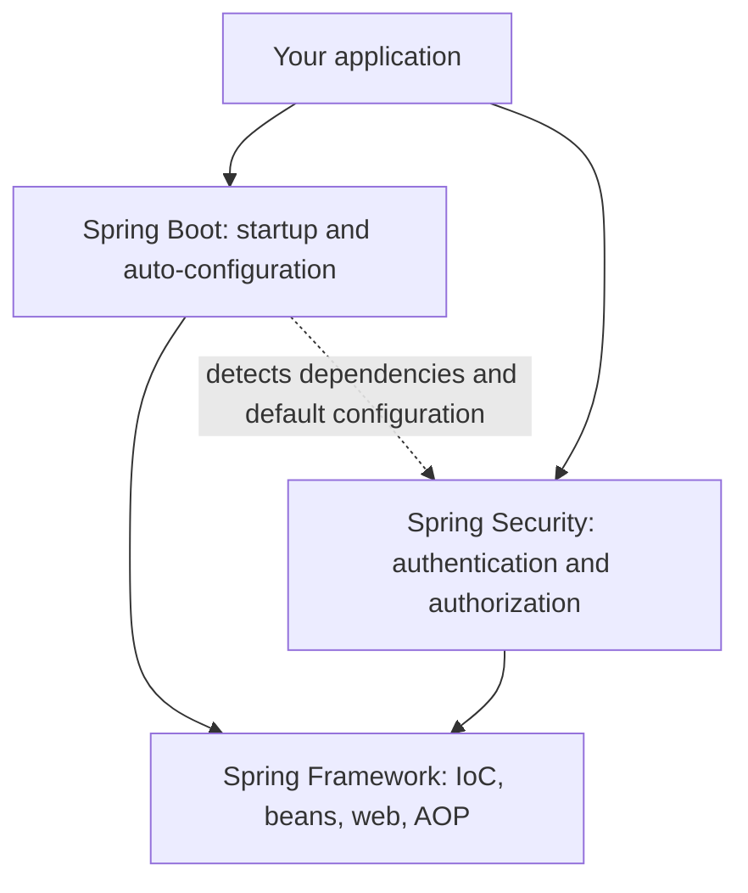

# The Relationship Between Spring Security, Spring Framework, and Spring Boot

## Learning Objectives

After this lesson, you can distinguish the responsibilities of the three projects, explain why simply adding the Spring Security dependency changes the HTTP behavior of a Spring Boot application, trace a request from servlet filter to controller, and configure an API with both public endpoints and endpoints requiring login.

The hands-on example focuses on **Spring MVC/Servlet, Java 17, and Spring Boot 3.x** (corresponding to the Spring Framework 6.x and Spring Security 6.x generation). Core concepts also apply to newer versions, though API names and configuration must be checked against your project's actual version set.

## 1. Three Projects Doing Three Different Jobs

| Component | Primary Responsibility | Contribution in a Web Application |
| --- | --- | --- |
| **Spring Framework** | Provides the foundation for IoC/DI, beans, application context, configuration, AOP, and web processing via Spring MVC or WebFlux. | Creates and wires beans; maps HTTP requests to controllers; provides extension points for modules to integrate. |
| **Spring Security** | Provides authentication, authorization, and numerous application protection mechanisms. | Builds filter chains or web filters, manages identity/security context, and enforces URL and method policies. |
| **Spring Boot** | Simplifies bootstrapping, configuring, and operating Spring applications through starters, dependency version management, auto-configuration, and runtime utilities. | Detects libraries on the classpath, configures default beans when conditions match, and helps run web applications quickly. |

**Spring Security is a separate project in the Spring ecosystem, built to integrate with Spring Framework.** It is not a feature implemented by Spring Boot itself. **Spring Boot uses both Spring Framework and Spring Security**, helping set up necessary default configuration pieces. Boot does not replace Security's authentication engine, filter chain, or authorization policies.

You can visualize the functional relationship as follows:



The diagram illustrates responsibilities and integration points, **not a strict Maven dependency graph**. You can use Spring Framework with Spring Security without Boot; you can also use Boot completely without Spring Security.

## 2. Role of Each Layer When Building an Application

### 2.1. Spring Framework: The Foundation for Components to Collaborate

- **IoC container/ApplicationContext** creates managed objects as beans. `@Configuration` classes and `@Bean` methods register security policies, password encoders, and user services.
- **Dependency Injection (DI)** injects required beans into controllers, services, or other configurations, avoiding manual wiring of fragmented security components.
- **Spring MVC** receives requests after the servlet filters layer and routes them to controllers. With WebFlux, Spring Framework provides the corresponding reactive pipeline.
- **Spring AOP and the proxy mechanism** provide the infrastructure for Spring Security to check permissions on annotated method calls such as `@PreAuthorize`.

Spring Framework by itself **does not infer** that every endpoint must require login. To protect an application, you must add and configure an appropriate security mechanism, usually Spring Security.

### 2.2. Spring Security: Deciding Who Can Do What

Two concepts must be kept distinct:

- **Authentication**: establishing identity. For example, checking username/password and creating an authenticated `Authentication`.
- **Authorization**: checking whether the identity and its permissions are sufficient to access a resource or perform an action. For example, only someone with the `ADMIN` role can approve a report.

Representative components in the Servlet model:

| Component | Meaning |
| --- | --- |
| `SecurityFilterChain` | Defines the filters and policies applied to matching requests; an application can have multiple chains. |
| `FilterChainProxy` | Selects and executes the corresponding security filter chain within Spring Security. |
| `DelegatingFilterProxy` | Bridge from the Servlet container to a Spring-managed filter bean, typically `springSecurityFilterChain`. |
| `AuthenticationManager` / `AuthenticationProvider` | Coordinates executing a specific authentication mechanism, depending on the configured login method. |
| `SecurityContext` / `SecurityContextHolder` | Holds the current `Authentication` while processing a request; in Servlet apps, typically uses a thread-bound context. |
| `PasswordEncoder` | Encodes and verifies passwords; never store raw passwords in a real system. |

Spring Security also integrates session handling, CSRF, security headers, CORS, and many other mechanisms. Not every feature is automatically configured completely for every application; actual policies depend on dependencies, configuration, and application type.

### 2.3. Spring Boot: Wiring Together and Providing Conditional Defaults

In a Boot project, a **starter** groups commonly used dependencies; for example:

- `spring-boot-starter-web` brings in the foundation for a Spring MVC application on Servlet.
- `spring-boot-starter-security` adds Spring Security and Boot's corresponding integration/auto-configuration.

When a web application has Spring Security on the classpath and has not declared an equivalent configuration, Boot can contribute a **default security configuration**. In a typical Servlet application, that default requires authentication for requests and supports form login alongside HTTP Basic. If no application-provided user source exists, Boot can create a `user` account and print a temporary password to the startup log for development.

Once you define your own `SecurityFilterChain` bean, Boot's default web filter chain configuration **steps aside** in favor of the chain you provide. That means you must explicitly specify which requests are permitted and which require authentication. Other parts of auto-configuration can still operate; adding a chain does not mean disabling all of Security or all of Boot auto-configuration.

Note: `@SpringBootApplication` is Boot's convenience annotation for startup, component scanning, and auto-configuration. This annotation **does not turn an application into one with Spring Security** if security dependencies/configuration are missing.

## 3. Processing Flow of an HTTP Request in Spring MVC

On the Servlet stack, the high-level flow is:

```text
HTTP client
    |
    v
Servlet container (e.g., Tomcat)
    |
    v
DelegatingFilterProxy
    |
    v
FilterChainProxy -> select matching SecurityFilterChain
    |
    +--> security filters: read credentials,
    |    establish SecurityContext, check URL permissions, ...
    |
    +--> not permitted: return appropriate error/challenge
    |
    v
DispatcherServlet (Spring MVC)
    |
    v
Controller -> Service -> data/business logic
    |
    v
HTTP response
```

The exact order of security filters depends on version and configuration; the diagram above describes responsibility boundaries rather than guaranteeing a fixed filter list.

A request to `GET /private` can unfold as follows:

1. The container receives the request and passes it through the registered Servlet filter chain.
2. Spring Security selects the matching `SecurityFilterChain` and extracts/verifies credentials according to the active mechanism (e.g., HTTP Basic).
3. If unauthenticated when the URL requires login, the request is blocked before the controller; with HTTP Basic, this typically yields **401 Unauthorized** and an authentication challenge.
4. If authentication succeeds, `Authentication` is attached to the security context. Authorization rules determine whether the controller may be invoked.
5. When permitted, Spring MVC invokes the matching handler and returns the response.

**401 and 403 are not synonymous:** 401 usually indicates the request needs valid authentication credentials; 403 usually indicates the request is authenticated but lacks sufficient permissions (or was rejected by another protection such as CSRF). The specific status code also depends on the entry point, authentication mechanism, and exception handling configuration.

Spring Security operates at the filter layer **before** the controller, yet can also perform additional permission checks at the **service/method layer**. The two protection layers serve different needs.

## 4. Runnable Example: Boot Starts Up, Security Protects, Framework Handles Controllers

The example creates two endpoints:

- `GET /public`: anyone can call it.
- `GET /private`: must use HTTP Basic with a test account.

### 4.1. Directory Structure

```text
security-relation-demo/
├── pom.xml
└── src/main/java/com/example/demo/
    ├── DemoApplication.java
    ├── SecurityConfig.java
    └── ApiController.java
```

### 4.2. Maven `pom.xml`

```xml
<project xmlns="http://maven.apache.org/POM/4.0.0"
         xmlns:xsi="http://www.w3.org/2001/XMLSchema-instance"
         xsi:schemaLocation="http://maven.apache.org/POM/4.0.0 https://maven.apache.org/xsd/maven-4.0.0.xsd">
    <modelVersion>4.0.0</modelVersion>

    <parent>
        <groupId>org.springframework.boot</groupId>
        <artifactId>spring-boot-starter-parent</artifactId>
        <version>3.5.0</version>
        <relativePath/>
    </parent>

    <groupId>com.example</groupId>
    <artifactId>security-relation-demo</artifactId>
    <version>0.0.1-SNAPSHOT</version>

    <properties>
        <java.version>17</java.version>
    </properties>

    <dependencies>
        <dependency>
            <groupId>org.springframework.boot</groupId>
            <artifactId>spring-boot-starter-web</artifactId>
        </dependency>
        <dependency>
            <groupId>org.springframework.boot</groupId>
            <artifactId>spring-boot-starter-security</artifactId>
        </dependency>
    </dependencies>

    <build>
        <plugins>
            <plugin>
                <groupId>org.springframework.boot</groupId>
                <artifactId>spring-boot-maven-plugin</artifactId>
            </plugin>
        </plugins>
    </build>
</project>
```

This is a specific Boot 3.x version for illustration and experimentation; in real usage, choose a **currently supported patch release** in the appropriate version line. Do not pin an independent version on `spring-security-*` in the example because Spring Boot manages compatible dependency versions via the parent/BOM.

### 4.3. `DemoApplication.java`

```java
package com.example.demo;

import org.springframework.boot.SpringApplication;
import org.springframework.boot.autoconfigure.SpringBootApplication;

@SpringBootApplication
public class DemoApplication {
    public static void main(String[] args) {
        SpringApplication.run(DemoApplication.class, args);
    }
}
```

`@SpringBootApplication` instructs Spring Boot to initialize the application context and discover components in `com.example.demo` and its subpackages. Spring Framework manages the beans; Boot handles startup and auto-configuration.

### 4.4. `SecurityConfig.java`

```java
package com.example.demo;

import org.springframework.context.annotation.Bean;
import org.springframework.context.annotation.Configuration;
import org.springframework.security.config.Customizer;
import org.springframework.security.config.annotation.web.builders.HttpSecurity;
import org.springframework.security.config.annotation.web.configurers.AbstractHttpConfigurer;
import org.springframework.security.core.userdetails.User;
import org.springframework.security.core.userdetails.UserDetails;
import org.springframework.security.core.userdetails.UserDetailsService;
import org.springframework.security.crypto.bcrypt.BCryptPasswordEncoder;
import org.springframework.security.crypto.password.PasswordEncoder;
import org.springframework.security.provisioning.InMemoryUserDetailsManager;
import org.springframework.security.web.SecurityFilterChain;

@Configuration(proxyBeanMethods = false)
public class SecurityConfig {

    @Bean
    SecurityFilterChain securityFilterChain(HttpSecurity http) throws Exception {
        http
            .authorizeHttpRequests(auth -> auth
                .requestMatchers("/public").permitAll()
                .anyRequest().authenticated()
            )
            .httpBasic(Customizer.withDefaults())
            .formLogin(AbstractHttpConfigurer::disable);

        return http.build();
    }

    @Bean
    PasswordEncoder passwordEncoder() {
        return new BCryptPasswordEncoder();
    }

    @Bean
    UserDetailsService userDetailsService(PasswordEncoder encoder) {
        UserDetails learner = User.withUsername("learner")
            .password(encoder.encode("demo-password"))
            .roles("USER")
            .build();

        return new InMemoryUserDetailsManager(learner);
    }
}
```

Explanation of responsibilities:

1. `@Configuration` and `@Bean` are **Spring Framework** mechanisms for registering, injecting, and managing objects.
2. `HttpSecurity`, `SecurityFilterChain`, `UserDetailsService`, and `BCryptPasswordEncoder` are **Spring Security** components. They describe URL rules, HTTP Basic, and how login credentials are verified.
3. **Spring Boot** discovers the configuration, wires the beans into the web application, and uses the application-supplied configuration instead of the default chain.
4. The `.anyRequest().authenticated()` rule is the lock on everything else: if you forget this line or write a wrong matcher, the access policy may not match your intent.
5. `formLogin` is disabled **solely so the HTTP Basic example returns clear results when using curl**. The configuration does not disable CSRF; state-changing requests must still be evaluated and handled with a proper CSRF policy.

The account and password above are only for a local learning app. A real system needs an appropriate identity source, secure secret management, HTTPS, and explicit access-control policies.

### 4.5. `ApiController.java`

```java
package com.example.demo;

import org.springframework.web.bind.annotation.GetMapping;
import org.springframework.web.bind.annotation.RestController;

@RestController
public class ApiController {

    @GetMapping("/public")
    public String publicEndpoint() {
        return "public\n";
    }

    @GetMapping("/private")
    public String privateEndpoint() {
        return "private\n";
    }
}
```

`@RestController` and `@GetMapping` belong to **Spring MVC (Spring Framework)**. The controller does not need to manually read the `Authorization` header; the Security filter chain has already checked the request before Spring MVC invokes the method.

### 4.6. Run and Observe Yourself

Requires JDK 17+ and Maven. From the directory containing `pom.xml`:

```bash
mvn spring-boot:run
```

Open another terminal. On Windows PowerShell, use `curl.exe` to avoid the `curl` alias in some PowerShell versions:

```bash
curl.exe -i http://localhost:8080/public
curl.exe -i http://localhost:8080/private
curl.exe -i -u learner:demo-password http://localhost:8080/private
curl.exe -i -u learner:wrong-password http://localhost:8080/private
```

Expected with the exact configuration above (omitting headers that may vary):

| Request | HTTP status | Body/meaning |
| --- | --- | --- |
| `GET /public` without credentials | `200` | `public`, followed by a newline |
| `GET /private` without credentials | `401` | Unauthenticated; HTTP Basic requires valid credentials |
| `GET /private` with `learner:demo-password` | `200` | `private`, followed by a newline |
| `GET /private` with wrong password | `401` | Authentication failed |

Key observation: **the controller remains ordinary Spring MVC code**, while access permissions change purely thanks to the `SecurityFilterChain` bean and the Spring Security components brought into the application by Spring/Boot.

## 5. Distinguishing Default Configuration from Application Configuration

Separate four scenarios:

| Scenario | What Happens? |
| --- | --- |
| Spring MVC/Boot web **without** Spring Security on the classpath | There is no security filter chain provided by Spring Security. Endpoints do not automatically have Spring Security authentication/authorization. |
| Add `spring-boot-starter-security`, no `SecurityFilterChain` declared yet | In a standard Servlet application, Boot activates Security's default chain; most requests require authentication. |
| Declare a custom `SecurityFilterChain` as in the example | The application's bean controls URL access rules; Boot's corresponding default auto-configuration steps aside. |
| Use Spring Framework + Spring Security **without Boot** | Security still works, but developers must manually configure and register the integration/bootstrap pieces that Boot normally handles. |

Do not equate "having the starter" with "production security is implemented". In practice, you must design identities, roles, permissions, data protection, sessions/tokens, CSRF/CORS, and exception paths according to specific requirements.

## 6. Relationship to Method-Level Authorization

URL checks typically answer "may this request proceed?". Method checks answer "is the current user allowed to perform this business operation?", even when the operation is invoked from multiple entry points.

**Standalone extension example**, applicable only if the application has the corresponding service bean: enable method security with `@EnableMethodSecurity` and protect the method:

```java
import org.springframework.context.annotation.Configuration;
import org.springframework.security.config.annotation.method.configuration.EnableMethodSecurity;
import org.springframework.security.access.prepost.PreAuthorize;
import org.springframework.stereotype.Service;

@Configuration
@EnableMethodSecurity
class MethodSecurityConfiguration {
}

@Service
class ReportService {
    @PreAuthorize("hasRole('ADMIN')")
    public String approve() {
        return "approved";
    }
}
```

In this extension:

- Spring Framework provides the bean and proxy/interceptor mechanism.
- Spring Security provides `@PreAuthorize` and the logic evaluating `hasRole('ADMIN')` based on `Authentication`.
- Spring Boot helps discover and configure shared infrastructure, though enabling `@EnableMethodSecurity` is an intentional application choice.

`User.withUsername(...).roles("USER")` in the original example grants the `ROLE_USER` authority, so it **does not** satisfy `hasRole('ADMIN')`. Do not confuse `role` with a raw authority name, and note that internal calls like `this.approve()` inside the same bean normally do not go through the proxy and can bypass the method interceptor.

## 7. Spring MVC/Servlet vs. Spring WebFlux/Reactive

Both are Spring Security, but how they plug into the web pipeline differs:

| Aspect | Servlet / Spring MVC | Reactive / Spring WebFlux |
| --- | --- | --- |
| Web infrastructure | Servlet Filter, `DispatcherServlet` | Reactive `WebFilter`, `DispatcherHandler` |
| Security chain | `SecurityFilterChain`, configured via `HttpSecurity` | `SecurityWebFilterChain`, configured via `ServerHttpSecurity` |
| Security filter collection | `FilterChainProxy` | `WebFilterChainProxy` |
| Identity context | `SecurityContextHolder` (typically thread-bound in Servlet processing) | Reactor Context, typically accessed via `ReactiveSecurityContextHolder` |

Do not copy `HttpSecurity` configuration directly to WebFlux. In a reactive flow, do not rely on assuming a request always runs on the same thread. Choose the starter, configuration mechanism, and security guidance matching your application's stack.

## 8. Common Misconceptions

1. **"Spring Boot already includes Spring Security."** Boot supports integration, but the application needs the appropriate dependency. Spring Boot can also run without Security.
2. **"Spring Security is just an annotation on a controller."** Web request protection primarily flows through the filter chain before Spring MVC; method protection is an additional layer.
3. **"Adding a custom SecurityFilterChain leaves all URLs under Boot's default policy."** Once the default chain steps aside, you must describe a policy with complete coverage. If you have multiple chains, watch matchers and ordering so no request slips through.
4. **"Being logged in is enough permission."** Authentication confirms identity; authorization must check roles/authorities or business conditions.
5. **"Not writing CSRF configuration means it is disabled."** Spring Security Servlet has a default CSRF mechanism for protected requests. Change it only when you clearly understand sessions, cookies, client types, and the threat model.
6. **"Any combination of Spring Framework/Security versions works with Boot."** Keep compatible versions managed by the Boot BOM. When upgrading from older generations, note the modern `SecurityFilterChain` API and the Servlet namespace shift from `javax.*` to `jakarta.*` in Boot 3.x.
7. **"URL security replaces all business checks."** For sensitive operations, add permission checks in services/methods and verify resource ownership against real data.
8. **"HTTP Basic in the example is the login architecture to use for all systems."** It is only an easily observable mechanism. Session-based web apps, bearer-token APIs, OAuth2/OIDC, or other approaches have their own pipelines and additional requirements.

## 9. Self-Check Your Understanding

- If you remove `spring-boot-starter-security` from `pom.xml`, what still works? **Spring Boot and Spring MVC still start, and controllers still handle requests; the Security filter chain in the example is no longer available.**
- If you add the Security starter without writing a chain bean, who defines the web defaults? **Boot auto-configuration activates default configuration based on Spring Security**, when conditions match.
- If you want to require the `ADMIN` role before approving, where should the check live? **It can live at the URL layer and on the business method**; method security reduces risk when a service is called from another path.
- Why does Spring Framework appear in both directions of integration? **Framework provides the container, DI, web abstractions, and AOP; Security builds on that infrastructure, while Boot simplifies creating and wiring the application.**

**Conclusion:** Spring Framework is the foundation running the application; Spring Security builds policies and enforces security on top of that foundation; Spring Boot helps select dependencies, bootstrap, and auto-configure integration when conditions match. Understanding these three responsibilities helps you know where to look for issues: beans/web in Framework, auth/filters/policy in Security, and classpath-driven defaults and bootstrap behavior in Boot.