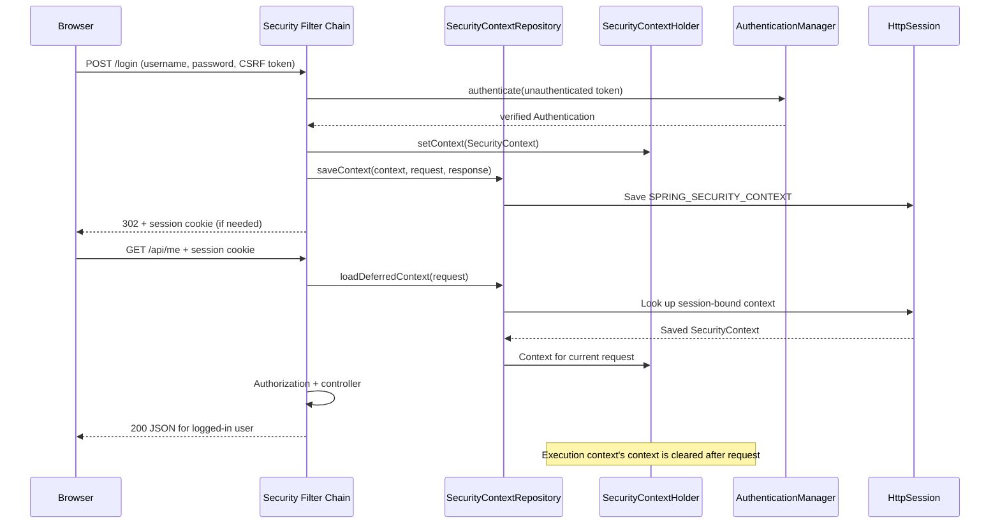

# Relationship Between the Current Request's Context and Data Stored in HttpSession

## Learning objectives

In a Spring Security web application, two distinct things are easily lumped together as "login state":

1. **The `SecurityContext` active during processing of an HTTP request**, typically read by Servlet application code via `SecurityContextHolder`.
2. **The `SecurityContext` persisted so a future HTTP request can restore it**, typically via `SecurityContextRepository` with data stored in `HttpSession`.

The two are related, yet **not identical**. A request can observe an authenticated principal in `SecurityContextHolder` without anything being saved to the session. Conversely, a session containing `SPRING_SECURITY_CONTEXT` data does not mean every thread always carries the same security context; Spring Security must **load the context for each request**, then clear the execution context when the request finishes.

This topic belongs to the **Security Context** section of Spring Security fundamentals. The lesson uses **Java 17, Spring Boot 3.5.0, and Spring Security 6.5.x on Spring MVC/Servlet**. Hands-on examples include form login with `HttpSession`, endpoints observing the current request's context, MockMvc tests, and standalone repository tests. Custom login code is explicitly marked as a fragment because implementing login in production also requires session fixation handling, CSRF, authentication success/failure handlers, and other policies.

After this lesson, you can:

1. Distinguish `Authentication`, `SecurityContext`, `SecurityContextHolder`, `SecurityContextRepository`, and `HttpSession`.
2. Explain how the session ID in a cookie maps to server-side session data rather than directly holding principals/passwords.
3. Describe the flow **load context → process request → intentionally save context → subsequent request restores**.
4. Understand `SecurityContextHolderFilter` and how it differs from `SecurityContextPersistenceFilter` in Spring Security 6.
5. Distinguish `HttpSessionSecurityContextRepository`, `RequestAttributeSecurityContextRepository`, `DelegatingSecurityContextRepository`, and `NullSecurityContextRepository`.
6. Know when to call `saveContext(context, request, response)`, especially when writing a custom login filter/controller.
7. Grasp `SessionCreationPolicy.IF_REQUIRED`, `ALWAYS`, `NEVER`, `STATELESS`, and each policy's limits.
8. Verify form login across multiple requests sharing a session, as well as new sessionless requests and logout.
9. Identify risks around session fixation, CSRF, cookies, timeouts, cached authorities, async threads, and distributed deployments.

**Key point:** `SecurityContextHolder` represents the identity **currently active in the execution context**; `SecurityContextRepository` decides **whether and how** that identity is saved/restored; `HttpSession` is just **one** common storage mechanism.

## 1. Four conceptual layers to separate

### 1.1. Authentication — authentication result

`Authentication` typically holds:

- **Principal:** the represented identity, e.g., username or `UserDetails`.
- **Authorities:** high-level permissions granted by a trusted source, e.g., `ROLE_USER`.
- **Credentials:** proof submitted at login, usually erased from the result when possible.
- **State:** the token's `isAuthenticated()`.

For example, after an authentication provider verifies username/password successfully, a `UsernamePasswordAuthenticationToken` can represent user `learner` and authority `ROLE_USER`. This is an authentication result, not a session.

### 1.2. SecurityContext — wrapper holding Authentication

`org.springframework.security.core.context.SecurityContext` is an interface with main methods:

```java
Authentication getAuthentication();
void setAuthentication(Authentication authentication);
```

This is a **condensed interface shape for learning**, not a Java file to rewrite. A `SecurityContext` can hold the current request's Authentication, or hold no authentication yet.

```java
SecurityContext context = SecurityContextHolder.createEmptyContext();
context.setAuthentication(verifiedAuthentication);
```

This fragment assumes `verifiedAuthentication` **was already verified by a manager/provider**. Never create a self-asserted authenticated token from a client-sent username/role and put it into the context. Setting the context is only safe if the identity inside is trustworthy.

### 1.3. SecurityContextHolder — execution-context access to context

In the Servlet stack, you commonly see:

```java
SecurityContext current = SecurityContextHolder.getContext();
Authentication authentication = current.getAuthentication();
```

`SecurityContextHolder` uses a strategy to hold context. The common default strategy is `MODE_THREADLOCAL`: context is bound to the thread executing the request, **not** a singleton variable holding all application users.

When processing finishes, the framework clears the context so a thread from the thread pool does not accidentally carry the previous request's identity. If you spawn background threads, `@Async`, `CompletableFuture`, or executors, you cannot assume identity automatically follows to another thread. You need a supported propagation mechanism, such as `DelegatingSecurityContextExecutor` when truly needed.

### 1.4. HttpSession — where the Servlet container keeps cross-request state

`jakarta.servlet.http.HttpSession` is a container for attributes bound to **one session**. The browser typically holds the **session ID** in a `JSESSIONID` cookie; the server uses that ID to look up the session and its attributes.

`HttpSession` can store many kinds of data:

```text
HttpSession
├── SPRING_SECURITY_CONTEXT  -> Spring Security's SecurityContext (if saved)
├── an application-set business attribute
├── other request/cache/token helper data depending on config
└── ...
```

Not every session contains `SPRING_SECURITY_CONTEXT`. An anonymous page might create a session for a CSRF token, a saved request awaiting login, or a shopping cart, yet **that does not mean the user is authenticated**.

**Cookies do not necessarily contain SecurityContext or raw passwords**. In the traditional session model, the cookie holds only a sensitive **session identifier**; the principal/authorities reside on the server or configured session infrastructure. Some apps use custom session/token cookies, which must not be confused with the default Servlet `HttpSession` model.

### 1.5. Side-by-side comparison table

| Component | Scope/contract | Can exist without a session? | Automatically persists across HTTP requests? |
| --- | --- | :---: | :---: |
| `Authentication` | Object representing auth request/result | Yes | Not automatically. |
| `SecurityContext` | Wraps Authentication | Yes | Not automatically; depends on storage/restoration. |
| `SecurityContextHolder` | Strategy to access context at execution time | Yes | No; context is prepared/cleared per execution context. |
| `SecurityContextRepository` | Loads/saves SecurityContext per request and storage strategy | Yes | Depends on implementation. |
| `HttpSession` | Server-side state container keyed by session ID | Is itself the session | Yes, subject to timeout/invalidation/storage. |
| `JSESSIONID` | Cookie holding session ID managed by Servlet container | N/A | Browser resends while cookie is valid. |

**Do not equate "currently authenticated" with "written into HttpSession".** HTTP Basic or bearer JWT flows usually re-authenticate every request without saving SecurityContext across requests.

## 2. Sequence of two HTTP requests sharing a session

Suppose a user logs in via form login into Spring MVC:



This diagram shows only functional relationships; exact filter/response-wrapper ordering varies by config/version. With standard form login, built-in authentication filters/success handlers perform saving and the appropriate session strategy without requiring business controllers to handle it. With **custom login code**, you must understand and configure the missing pieces yourself.

### 2.1. Request 1: fresh login

1. Browser submits username/password and a valid CSRF token if CSRF protection is enabled.
2. Login filter creates an unauthenticated `Authentication` and calls `AuthenticationManager`.
3. Provider verifies password against the user store/PasswordEncoder.
4. On success, filter creates/sets `SecurityContext` with the verified Authentication.
5. The configured persistence mechanism writes context via `SecurityContextRepository`, typically storing it inside `HttpSession`.
6. Servlet container may send a cookie containing the session ID to the browser.
7. Browser uses the cookie on subsequent requests; there is no need to keep resending the raw password in a typical session-based form-login model.

**Successful login does not mean storing plaintext passwords in the session.** ProviderManager normally erases sensitive credential data from the result when the token supports it. Even so, SecurityContext remains sensitive security data and must be protected.

### 2.2. Request 2: existing session

1. Browser sends the cookie containing the session ID.
2. Container attaches the matching session to the request if the ID is valid and the session has not expired.
3. Spring Security uses the repository to retrieve the matching SecurityContext.
4. `SecurityContextHolderFilter` makes the context available to the execution context.
5. Authorization rules `authenticated()`/`hasRole(...)` evaluate Authentication.
6. MVC controller executes if allowed; after the request, the holder is cleared.

**The active context is not necessarily the exact same Java object reference** as what was written into the session in every architecture. Serialization, replication, caching, or repository wrappers may be involved. Never rely on `==` reference equality to decide "same user"; use trusted identity and policies.

### 2.3. Request without a session cookie

If the browser is new or the request carries no cookie, the repository finds no saved SecurityContext. The framework may create an empty context and attach `AnonymousAuthenticationToken` if anonymous support is enabled.

When a request hits an endpoint requiring `authenticated()`, an anonymous caller is normally challenged to log in: **302 to /login** for form login or **401** for HTTP Basic. The HTTP code depends on the authentication entry point, not solely on whether a session exists.

### 2.4. Session may have expired

If the browser still sends a cookie whose session timed out or was invalidated, the container finds no old state. Spring Security cannot restore Authentication from a nonexistent session. The user usually must log in again or be authenticated via another mechanism (remember-me, bearer token...) if actively supported by the system.

Do not treat the presence of a `JSESSIONID` cookie as proof of authentication: the cookie can be stale, forged, expired, or tied only to a guest session.

## 3. SecurityContextRepository as the bridge

Spring Security defines `org.springframework.security.web.context.SecurityContextRepository` to load/save authentication context. Key 6.x APIs include:

```java
// Condensed contract shape, for learning:
DeferredSecurityContext loadDeferredContext(HttpServletRequest request);

void saveContext(
    SecurityContext context,
    HttpServletRequest request,
    HttpServletResponse response
);

boolean containsContext(HttpServletRequest request);
```

`DeferredSecurityContext` enables deferring context loading until needed. The repository depends on HTTP request/response because with session-based storage it must access the session and can affect when the response commits.

**`SecurityContextRepository` is not `UserDetailsService`**. UserDetailsService looks up account data during authentication. The repository stores/retrieves the **authentication result** for reuse in subsequent requests if session policy permits. The two sources can update at different cadences; a session may still hold old authorities after you edit roles in the database.

### 3.1. HttpSessionSecurityContextRepository

`HttpSessionSecurityContextRepository` uses `HttpSession` to store context across multiple requests. By default, the attribute name is typically:

```text
SPRING_SECURITY_CONTEXT
```

Spring Security provides the constant:

```java
HttpSessionSecurityContextRepository.SPRING_SECURITY_CONTEXT_KEY
```

This is an **attribute name inside the session**, not a cookie name. The cookie is typically `JSESSIONID` per the container, while the `SPRING_SECURITY_CONTEXT` attribute lives **inside the server-side session**.

The repository usually avoids creating a new session solely to store an **empty context or anonymous authentication**. However, a session can be created by another component (CSRF, request cache, MVC code, or container), so do not infer from an HTTP response having Set-Cookie that it contains a logged-in identity.

### 3.2. RequestAttributeSecurityContextRepository

`RequestAttributeSecurityContextRepository` stores SecurityContext in **Servlet request attributes**. It is useful when a request transfers to another dispatch, such as an error dispatch, because some containers may leave the current context absent from the holder during specific dispatches.

It does **not** carry context across to a brand-new HTTP request from the browser. Servlet request attributes and HttpSession have two different scopes.

```text
HTTP request A
  request attributes -> SecurityContext A
  ERROR dispatch belonging to request A -> can restore context A

HTTP request B (new)
  does not automatically receive context A from request attributes
```

If an application uses only RequestAttribute repository, it will not have persistent session login across multiple HTTP requests.

### 3.3. DelegatingSecurityContextRepository

On Spring Security 6.x, the default repository is commonly `DelegatingSecurityContextRepository`, combining:

- `RequestAttributeSecurityContextRepository`
- `HttpSessionSecurityContextRepository`

The delegating repository can save across multiple delegates and search for context across delegates in configured order. This combination ensures support for both intra-request dispatches and cross-HTTP-request persistence via session.

Conceptually equivalent creation fragment:

```java
SecurityContextRepository repository =
    new DelegatingSecurityContextRepository(
        new RequestAttributeSecurityContextRepository(),
        new HttpSessionSecurityContextRepository()
    );
```

This is a **fragment** needing imports and consistent configuration with SecurityFilterChain. Not every app always uses these exact instances: SessionCreationPolicy and security mechanisms can swap the repository or set a stateless policy.

### 3.4. NullSecurityContextRepository

`NullSecurityContextRepository` keeps no context for future requests to retrieve. A stateless JWT/bearer or HTTP Basic model can construct a fresh Authentication from credentials on each request without needing session storage.

```text
GET /api/me   Authorization: Bearer <token A>
  -> validate bearer token -> Authentication for request #1
  -> processing finishes -> clear context

GET /api/me   Authorization: Bearer <token A>
  -> validate bearer token -> Authentication for request #2
  -> does not load identity from HttpSession
```

A token is only considered valid once signature/issuer/audience/expiry checks or introspection succeed. `NullSecurityContextRepository` does not make a bearer token secure, and `STATELESS` does not provide authentication on its own.

### 3.5. Repository comparison table

| Repository | Where data lives? | Used across requests? | Use case |
| --- | --- | :---: | --- |
| `HttpSessionSecurityContextRepository` | Attribute inside HttpSession | **Yes**, if session is valid and context was saved | Form login/session authentication. |
| `RequestAttributeSecurityContextRepository` | Servlet request attribute | **No**, request/dispatch scope only | Retaining context across certain dispatches/error flows. |
| `DelegatingSecurityContextRepository` | Multiple delegates | Depends on delegates; default supports session | Combining request attribute + HttpSession. |
| `NullSecurityContextRepository` | No long-term storage | **No** | Stateless APIs / per-request Bearer/Basic. |
| Custom repository | Cache/DB or custom backend | Depends on implementation | Session distribution or specialized trust/lifecycles. |

**Do not confuse `DelegatingSecurityContextRepository` with `DelegatingPasswordEncoder`**. One restores/saves authentication context; the other selects the algorithm to verify password hashes. The word "Delegating" simply describes the delegation pattern.

## 4. Spring Security 6: loading context does not mean auto-saving

### 4.1. SecurityContextHolderFilter

Spring Security 6 uses `SecurityContextHolderFilter` by default. This filter **loads** `SecurityContext` from the repository and provides it in `SecurityContextHolder`, yet **does not automatically write back** mutations made by application code.

A custom controller might do:

```java
SecurityContext context = SecurityContextHolder.createEmptyContext();
context.setAuthentication(verifiedAuthentication);
SecurityContextHolder.setContext(context);
```

This fragment creates a context for the current execution context, **without promising to store it in HttpSession for the next request**. To persist, code must properly call `SecurityContextRepository.saveContext(context, request, response)`.

**Warning:** `verifiedAuthentication` in the fragment must come from `AuthenticationManager.authenticate(...)` or a trusted mechanism. Never mint an identity by setting `authenticated=true` directly from a client-supplied username.

### 4.2. Legacy SecurityContextPersistenceFilter mechanism

In Spring Security 5 and some compatibility setups, `SecurityContextPersistenceFilter` could load context and **automatically write it back** when the request ended or before response commit per filter logic. That made it easy for apps to mutate SecurityContextHolder and assume the session updated automatically.

Spring Security 6 shifted toward **explicit save** to reduce ambiguity and avoid unnecessary session writes. An app should only have **one** filter handling this lifecycle per configuration; never arbitrarily add both `SecurityContextHolderFilter` and `SecurityContextPersistenceFilter` to the same chain.

Migration options like `securityContext(context -> context.requireExplicitSave(false))` exist in 6.x, yet they are meant for migrating legacy code. **Do not choose auto-save merely to mask an incompletely designed custom login flow.**

### 4.3. Does form login need custom saveContext code?

With Spring Security's standard form login, built-in authentication filters/handlers **handle saving on success automatically** per configuration. You normally only declare:

```java
http.formLogin(form -> form.permitAll());
```

This is a configuration fragment, not a custom login controller. When a user submits a valid form, the framework's mechanism performs authentication, context setup, and persistence. You do not manually call `HttpSession#setAttribute("SPRING_SECURITY_CONTEXT", ...)`.

### 4.4. What when writing a custom login controller/filter?

For custom authentication, a conceptual flow:

```java
// Fragment inside a controller/filter with HttpServletRequest/HttpServletResponse.
// authenticationManager and securityContextRepository must be injected/configured.
// username/rawPassword come from validated input; this is not a full class.

Authentication requested =
    UsernamePasswordAuthenticationToken.unauthenticated(
        username, rawPassword
    );

Authentication verified =
    authenticationManager.authenticate(requested);

SecurityContext context =
    SecurityContextHolder.createEmptyContext();
context.setAuthentication(verified);
SecurityContextHolder.setContext(context);

// Needed when persisting identity for the next HTTP request:
securityContextRepository.saveContext(context, request, response);
```

**Do not call `request.getSession().setAttribute(...)` as a default workaround.** Use the SecurityFilterChain's proper repository so you do not bypass the request-attribute delegate, session/explicit-save policies, and related filter behavior.

**This fragment is not a complete production login implementation**: you must handle CSRF if clients automatically send cookies/credentials, session fixation protection (`SessionAuthenticationStrategy`), failure/success handlers, login rate limits, raw credential protection, exception mapping, auditing, and session/concurrency policies. Never expose these 8 lines as a public custom authentication endpoint.

### 4.5. Saving must occur before the response can no longer be modified

`HttpSessionSecurityContextRepository` may need to create a session and write a session cookie. If a custom controller commits the response before saving the context, it may fail to emit the new cookie or fail to persist as expected.

Therefore, in custom login flows, call `saveContext` **before redirecting/committing the response**, using the exact request/response instances used by the security chain. Test the entire login flow plus a subsequent request, not merely that the login endpoint returns 200.

## 5. When is there a session without Authentication?

Very common cases:

- An anonymous request gets an `HttpSession` to hold a shopping cart before logging in.
- A blocked request to a protected URL is saved by `RequestCache` to redirect back after login.
- Rendering a form login page with a CSRF token may create a session depending on repository/config.
- Some MVC/JSP or application code calls `request.getSession()` without setting Authentication.
- A session was created before login or after Authentication was removed while other attributes remain.

For that reason, the check:

```java
if (request.getSession(false) != null) {
    // WRONG if treated as an authenticated user.
}
```

is not a valid authorization check.

**Right approach:** let `authorizeHttpRequests(...).authenticated()` or method-level authorization evaluate identity, or read Authentication from the stack's proper context and use anonymous/remember-me distinction mechanisms if truly required.

### 5.1. An anonymous token is not a login either

In a security chain with anonymous support, `SecurityContextHolder.getContext().getAuthentication()` may be an `AnonymousAuthenticationToken`, with `isAuthenticated() == true` by implementation. However, Spring Security's `authenticated()` policy **does not treat anonymous as a logged-in user** thanks to the trust resolver mechanism.

Therefore both checks below can be wrong:

```java
// Do not use as a security boundary:
boolean loggedIn =
    SecurityContextHolder.getContext().getAuthentication() != null;

// Insufficient to distinguish anonymous:
boolean loggedIn2 =
    SecurityContextHolder.getContext().getAuthentication()
        .isAuthenticated();
```

Use the framework's authorization rules instead of writing meaningless manual boolean checks.

## 6. When is there Authentication without a session?

### 6.1. Per-request HTTP Basic

With HTTP Basic, the client typically sends an `Authorization: Basic ...` header on **every request**. The filter/provider verifies credentials and creates Authentication for that request. An application can use `SessionCreationPolicy.STATELESS` to avoid saving context to HttpSession.

```text
GET /api/me + Authorization: Basic ...
   -> authenticate -> SecurityContextHolder has user -> returns 200
   -> request context is cleared

GET /api/me (no header, no login session)
   -> anonymous -> 401 Basic challenge
```

HTTP Basic uses Base64, which does not encrypt secrets in transit. Use HTTPS/TLS outside localhost; never log Basic headers.

### 6.2. Bearer/JWT resource server

A resource server using bearer tokens usually validates the token on each request and does not rely on `JSESSIONID`. The same valid token can be sent across independent requests; attaching Authentication is temporary per request.

JWTs self-carry claims verified by signature/claims; opaque tokens may use introspection. In either case, **session policy and repository must align**; do not let Spring Security save every bearer authentication into a session if the API's goal is stateless.

### 6.3. Tests setting context directly

In a unit test, you can call:

```java
SecurityContextHolder.setContext(context);
```

and observe an authenticated principal, yet there is no HTTP session because you are only manipulating the test thread. That is why a unit test asserting only `SecurityContextHolder.getContext()` must not be used to conclude "login will survive browser reload".

## 7. SessionCreationPolicy: creating a session vs using a session

Spring Security has the `SessionCreationPolicy` enum:

| Policy | Does Spring Security create HttpSession? | Does Spring Security use an existing session for SecurityContext? | Use case |
| --- | --- | --- | --- |
| `ALWAYS` | Proactively creates a session | Yes per config | Apps needing a session immediately. |
| `IF_REQUIRED` | Creates when needed | Yes | Common form-login/session-based apps. |
| `NEVER` | Spring Security itself does not proactively create one for context, yet can use an existing one | Yes | Apps where another component creates sessions, but Security shouldn't create one itself. |
| `STATELESS` | Does not create a session for SecurityContext | Does not use HttpSession to obtain SecurityContext | Stateless per-request bearer/Basic APIs. |

The table describes Spring Security's semantics; **this policy cannot forbid all other Servlet components from creating a session**. For instance, JSP/MVC code or another library can still call `getSession(true)`.

### 7.1. IF_REQUIRED does not mean "a session always exists"

With form login, Spring Security may create a session when the flow needs to store context or another component saves a request/CSRF token. However, a simple public request can complete without creating any session.

**Session creation depends on the request path and active filters**; do not claim `permitAll()` always creates or never creates a session.

### 7.2. NEVER is not STATELESS

`NEVER` can **read an existing session** to obtain context, whereas `STATELESS` is used when you want Spring Security **not to use HttpSession to obtain SecurityContext**. Thus with `NEVER` and a browser carrying an existing login session, the application can still treat the user as authenticated via that session.

An HTTP request without a prior session may lack context, yet a non-Spring-Security component can still create a session. Check the actual code and tests to see where state originates.

### 7.3. Stateless configuration example

```java
http.sessionManagement(session -> session
    .sessionCreationPolicy(SessionCreationPolicy.STATELESS)
);
```

This is a fragment placed inside `HttpSecurity` configuration. On Spring Security 6, a typical stateless setup uses `NullSecurityContextRepository` so context is neither saved to nor restored from HttpSession, alongside matching request cache behavior. Never combine `STATELESS` with an expectation that form login creates a session for browser persistence, unless you intentionally change the design.

### 7.4. Example of not forcing session creation

```java
http.sessionManagement(session -> session
    .sessionCreationPolicy(SessionCreationPolicy.NEVER)
);
```

The difference from `STATELESS` is that the app can still use an existing session. This is a design tool, not an "always more secure than default" option.

## 8. Complete lab: form login and HttpSession

This lab deliberately uses **built-in form login** to avoid writing risky parts like session fixation handling by hand. We observe:

- Anonymous request to a public URL.
- Anonymous request to a private URL redirected to form login.
- `POST /login` with username/password + CSRF token creates an authenticated context and saves it to the session.
- Subsequent request sending only the session, without resending the password, remains authenticated.
- Request without that session remains anonymous.
- User with a session yet missing ADMIN role receives 403.
- `POST /logout` with CSRF token invalidates the session.

### 8.1. Create the project structure

```text
security-context-session-lab/
├── pom.xml
└── src/
    ├── main/java/com/example/securitysession/
    │   ├── SessionLabApplication.java
    │   ├── SecurityConfig.java
    │   └── SessionController.java
    └── test/java/com/example/securitysession/
        ├── SessionRepositoryTest.java
        └── SessionPersistenceHttpTest.java
```

### 8.2. Maven pom.xml

```xml
<project xmlns="http://maven.apache.org/POM/4.0.0"
         xmlns:xsi="http://www.w3.org/2001/XMLSchema-instance"
         xsi:schemaLocation="http://maven.apache.org/POM/4.0.0 https://maven.apache.org/xsd/maven-4.0.0.xsd">
    <modelVersion>4.0.0</modelVersion>

    <parent>
        <groupId>org.springframework.boot</groupId>
        <artifactId>spring-boot-starter-parent</artifactId>
        <version>3.5.0</version>
        <relativePath/>
    </parent>

    <groupId>com.example</groupId>
    <artifactId>security-context-session-lab</artifactId>
    <version>1.0.0</version>

    <properties>
        <java.version>17</java.version>
    </properties>

    <dependencies>
        <dependency>
            <groupId>org.springframework.boot</groupId>
            <artifactId>spring-boot-starter-web</artifactId>
        </dependency>
        <dependency>
            <groupId>org.springframework.boot</groupId>
            <artifactId>spring-boot-starter-security</artifactId>
        </dependency>
        <dependency>
            <groupId>org.springframework.boot</groupId>
            <artifactId>spring-boot-starter-test</artifactId>
            <scope>test</scope>
        </dependency>
        <dependency>
            <groupId>org.springframework.security</groupId>
            <artifactId>spring-security-test</artifactId>
            <scope>test</scope>
        </dependency>
    </dependencies>

    <build>
        <plugins>
            <plugin>
                <groupId>org.springframework.boot</groupId>
                <artifactId>spring-boot-maven-plugin</artifactId>
            </plugin>
        </plugins>
    </build>
</project>
```

The parent configuration manages compatible dependency versions in Spring Boot 3.5.0. When applying to a real project, select a **currently supported Boot/Security patch release**, rather than sticking to an example snapshot without security updates.

The lab uses `spring-boot-starter-web` for Servlet/MVC and `spring-security-test` to test CSRF/form login/MockMvc. Do not add the WebFlux starter, as `ReactiveSecurityContextHolder` belongs to a different stack.

### 8.3. SessionLabApplication.java

```java
package com.example.securitysession;

import org.springframework.boot.SpringApplication;
import org.springframework.boot.autoconfigure.SpringBootApplication;

@SpringBootApplication
public class SessionLabApplication {
    public static void main(String[] args) {
        SpringApplication.run(SessionLabApplication.class, args);
    }
}
```

The startup class sits in the root package so Spring component scan picks up SecurityConfig and SessionController. Do not create HttpSession directly in `main`.

### 8.4. SecurityConfig.java

```java
package com.example.securitysession;

import org.springframework.context.annotation.Bean;
import org.springframework.context.annotation.Configuration;
import org.springframework.security.config.annotation.web.builders.HttpSecurity;
import org.springframework.security.core.userdetails.User;
import org.springframework.security.core.userdetails.UserDetailsService;
import org.springframework.security.crypto.factory.PasswordEncoderFactories;
import org.springframework.security.crypto.password.PasswordEncoder;
import org.springframework.security.provisioning.InMemoryUserDetailsManager;
import org.springframework.security.web.SecurityFilterChain;

@Configuration(proxyBeanMethods = false)
public class SecurityConfig {

    @Bean
    PasswordEncoder passwordEncoder() {
        return PasswordEncoderFactories.createDelegatingPasswordEncoder();
    }

    @Bean
    UserDetailsService users(PasswordEncoder encoder) {
        return new InMemoryUserDetailsManager(
            User.withUsername("learner")
                .password(encoder.encode("learner-pass"))
                .roles("USER")
                .build(),
            User.withUsername("admin")
                .password(encoder.encode("admin-pass"))
                .roles("USER", "ADMIN")
                .build()
        );
    }

    @Bean
    SecurityFilterChain securityFilterChain(HttpSecurity http)
            throws Exception {

        return http
            .authorizeHttpRequests(auth -> auth
                .requestMatchers(
                    "/public/**", "/logout-success"
                ).permitAll()
                .requestMatchers(
                    "/api/me", "/api/context"
                ).authenticated()
                .requestMatchers(
                    "/admin/ping"
                ).hasRole("ADMIN")
                .anyRequest().denyAll()
            )
            .formLogin(form -> form
                .defaultSuccessUrl("/api/me", true)
                .permitAll()
            )
            .logout(logout -> logout
                .logoutSuccessUrl("/logout-success")
                .permitAll()
            )
            .build();
    }
}
```

**Configuration intent:**

1. `UserDetailsService` uses in-memory accounts for learning; hardcoded raw passwords in source are for localhost only.
2. `PasswordEncoder` generates `{bcrypt}` hashes rather than storing plaintext.
3. Does not set `SessionCreationPolicy.STATELESS`; default form login flow can persist Authentication via HttpSession.
4. Does not manually add `HttpSessionSecurityContextRepository` because Spring Security 6.x already defaults to an appropriate repository for session form login, commonly a delegating repository with request attribute and session.
5. Does not disable CSRF: `POST /login` and `POST /logout` are protected by CSRF tokens under this configuration.
6. Successful login redirects to `/api/me`; Spring Security filters execute authentication, context save, and session strategy.
7. Logout uses the framework flow: invalidating session and clearing security context, instead of manually calling `session.removeAttribute(...)`.
8. `anyRequest().denyAll()` prevents accidentally leaving new URLs open. `/login` is permitted by form login per the DSL's mechanism.

**Never assume a session always exists before login.** If the client needs a CSRF token, serving the form login page might itself create a session prior to successful authentication.

### 8.5. SessionController.java

```java
package com.example.securitysession;

import jakarta.servlet.http.HttpServletRequest;
import jakarta.servlet.http.HttpSession;

import java.util.Map;
import java.util.Objects;

import org.springframework.security.authentication.AnonymousAuthenticationToken;
import org.springframework.security.core.Authentication;
import org.springframework.security.core.annotation.CurrentSecurityContext;
import org.springframework.security.core.context.SecurityContext;
import org.springframework.security.web.context.HttpSessionSecurityContextRepository;
import org.springframework.web.bind.annotation.GetMapping;
import org.springframework.web.bind.annotation.RestController;

@RestController
public class SessionController {

    @GetMapping("/public/ping")
    public String ping() {
        return "pong";
    }

    @GetMapping("/public/context")
    public Map<String, Object> publicContext(
            HttpServletRequest request,
            @CurrentSecurityContext SecurityContext context) {

        Authentication auth = context.getAuthentication();
        HttpSession session = request.getSession(false);

        boolean sessionHasSecurityContext =
            session != null &&
            session.getAttribute(
                HttpSessionSecurityContextRepository.SPRING_SECURITY_CONTEXT_KEY
            ) instanceof SecurityContext;

        return Map.of(
            "anonymous", auth instanceof AnonymousAuthenticationToken,
            "currentAuthenticationPresent", auth != null,
            "hasSession", session != null,
            "sessionHasSecurityContext", sessionHasSecurityContext
        );
    }

    @GetMapping("/api/me")
    public Map<String, String> me(Authentication authentication) {
        return Map.of("username", authentication.getName());
    }

    @GetMapping("/api/context")
    public Map<String, Object> privateContext(
            HttpServletRequest request,
            @CurrentSecurityContext SecurityContext currentContext) {

        Authentication active = currentContext.getAuthentication();
        HttpSession session = request.getSession(false);

        Object stored = session == null
            ? null
            : session.getAttribute(
                HttpSessionSecurityContextRepository.SPRING_SECURITY_CONTEXT_KEY
            );

        boolean savedContext = stored instanceof SecurityContext;

        boolean storedNameMatches =
            stored instanceof SecurityContext persisted &&
            persisted.getAuthentication() != null &&
            Objects.equals(
                active.getName(),
                persisted.getAuthentication().getName()
            );

        return Map.of(
            "currentUser", active.getName(),
            "hasSession", session != null,
            "sessionHasSecurityContext", savedContext,
            "storedNameMatchesCurrent", storedNameMatches
        );
    }

    @GetMapping("/admin/ping")
    public String adminPing() {
        return "admin-only";
    }

    @GetMapping("/logout-success")
    public String logoutSuccess() {
        return "logged-out";
    }
}
```

**Why use `request.getSession(false)`?** Because we only want to **observe** whether a session exists without letting a diagnostic endpoint create a session and skew conclusions. `getSession(false)` returns `null` if the request has no valid session.

**Why read the `SPRING_SECURITY_CONTEXT_KEY` constant?** Strictly to learn the difference between the active context and the context stored in the session. Production business code **must not access Spring Security's session attribute directly**; use the framework-provided `Authentication`/`SecurityContext` and authorization rules. When session storage is replaced with a custom repository, this attribute may not even exist.

**Why not return the full SecurityContext?** The object may hold internal principals, authorities, details, and sensitive information. The endpoints return only boolean flags, the username on an already protected URL, and a name-match check — never password hashes, credentials, or session IDs.

## 9. Standalone repository tests: holder vs session

### 9.1. SessionRepositoryTest.java

```java
package com.example.securitysession;

import java.util.List;

import org.junit.jupiter.api.AfterEach;
import org.junit.jupiter.api.Test;

import org.springframework.mock.web.MockHttpServletRequest;
import org.springframework.mock.web.MockHttpServletResponse;
import org.springframework.mock.web.MockHttpSession;
import org.springframework.security.authentication.UsernamePasswordAuthenticationToken;
import org.springframework.security.core.Authentication;
import org.springframework.security.core.authority.SimpleGrantedAuthority;
import org.springframework.security.core.context.SecurityContext;
import org.springframework.security.core.context.SecurityContextHolder;
import org.springframework.security.web.context.HttpSessionSecurityContextRepository;
import org.springframework.security.web.context.RequestAttributeSecurityContextRepository;

import static org.assertj.core.api.Assertions.assertThat;

class SessionRepositoryTest {

    private SecurityContext verifiedContext() {
        Authentication verified =
            UsernamePasswordAuthenticationToken.authenticated(
                "learner",
                null,
                List.of(new SimpleGrantedAuthority("ROLE_USER"))
            );

        SecurityContext context =
            SecurityContextHolder.createEmptyContext();
        context.setAuthentication(verified);
        return context;
    }

    @AfterEach
    void clearContext() {
        SecurityContextHolder.clearContext();
    }

    @Test
    void settingHolderDoesNotAutomaticallyCreateHttpSession() {
        MockHttpServletRequest request =
            new MockHttpServletRequest();

        SecurityContextHolder.setContext(verifiedContext());

        assertThat(SecurityContextHolder.getContext()
            .getAuthentication().getName()).isEqualTo("learner");

        assertThat(request.getSession(false)).isNull();
    }

    @Test
    void saveContextCreatesSessionAndStoresSecurityContext() {
        HttpSessionSecurityContextRepository repository =
            new HttpSessionSecurityContextRepository();

        MockHttpServletRequest request =
            new MockHttpServletRequest();
        MockHttpServletResponse response =
            new MockHttpServletResponse();

        assertThat(request.getSession(false)).isNull();

        SecurityContext context = verifiedContext();
        repository.saveContext(context, request, response);

        assertThat(request.getSession(false)).isNotNull();
        assertThat(repository.containsContext(request)).isTrue();

        Object saved = request.getSession(false).getAttribute(
            HttpSessionSecurityContextRepository.SPRING_SECURITY_CONTEXT_KEY
        );

        assertThat(saved).isInstanceOf(SecurityContext.class);
        assertThat(((SecurityContext) saved)
            .getAuthentication().getName()).isEqualTo("learner");
    }

    @Test
    void savedSessionContextCanBeLoadedOnAnotherRequest() {
        HttpSessionSecurityContextRepository repository =
            new HttpSessionSecurityContextRepository();

        MockHttpServletRequest first =
            new MockHttpServletRequest();
        MockHttpServletResponse response =
            new MockHttpServletResponse();

        repository.saveContext(verifiedContext(), first, response);

        MockHttpSession session =
            (MockHttpSession) first.getSession(false);

        MockHttpServletRequest second =
            new MockHttpServletRequest();
        second.setSession(session);

        SecurityContext restored =
            repository.loadDeferredContext(second).get();

        assertThat(restored.getAuthentication()).isNotNull();
        assertThat(restored.getAuthentication().getName())
            .isEqualTo("learner");
    }

    @Test
    void emptyContextDoesNotNeedToCreateSession() {
        HttpSessionSecurityContextRepository repository =
            new HttpSessionSecurityContextRepository();

        MockHttpServletRequest request =
            new MockHttpServletRequest();
        MockHttpServletResponse response =
            new MockHttpServletResponse();

        repository.saveContext(
            SecurityContextHolder.createEmptyContext(),
            request,
            response
        );

        assertThat(request.getSession(false)).isNull();
    }

    @Test
    void requestAttributeContextDoesNotMoveToIndependentRequest() {
        RequestAttributeSecurityContextRepository repository =
            new RequestAttributeSecurityContextRepository();

        MockHttpServletRequest first =
            new MockHttpServletRequest();
        MockHttpServletResponse response =
            new MockHttpServletResponse();

        repository.saveContext(verifiedContext(), first, response);

        assertThat(repository.containsContext(first)).isTrue();

        MockHttpServletRequest independent =
            new MockHttpServletRequest();

        assertThat(repository.containsContext(independent)).isFalse();
        assertThat(repository.loadDeferredContext(independent)
            .get().getAuthentication()).isNull();
    }
}
```

**There are 5 standalone repository tests.** Test 1 proves setting context in the holder does not automatically create a session. Test 2 proves `saveContext` creates and saves a session when a verified Authentication exists. Test 3 simulates a second request with the **same MockHttpSession** and restores the principal. Test 4 shows an empty context does not force session creation. Test 5 shows request attributes belong to a single request and do not move to an independent HTTP request.

**Note:** constructing an authenticated token in `verifiedContext()` is strictly for testing the repository inside trusted test code. In production, `Authentication` must come from a manager/provider that genuinely verifies credentials. Never let a browser submit a role and call `UsernamePasswordAuthenticationToken.authenticated(...)` to bypass login.

## 10. HTTP tests via form login and session

### 10.1. SessionPersistenceHttpTest.java

```java
package com.example.securitysession;

import jakarta.servlet.http.HttpSession;

import org.junit.jupiter.api.Test;
import org.springframework.beans.factory.annotation.Autowired;
import org.springframework.boot.test.autoconfigure.web.servlet.AutoConfigureMockMvc;
import org.springframework.boot.test.context.SpringBootTest;
import org.springframework.mock.web.MockHttpSession;
import org.springframework.security.core.Authentication;
import org.springframework.security.core.context.SecurityContext;
import org.springframework.security.web.context.HttpSessionSecurityContextRepository;
import org.springframework.test.web.servlet.MockMvc;
import org.springframework.test.web.servlet.MvcResult;

import static org.assertj.core.api.Assertions.assertThat;
import static org.springframework.security.test.web.servlet.request
    .SecurityMockMvcRequestPostProcessors.csrf;
import static org.springframework.test.web.servlet.request.MockMvcRequestBuilders.get;
import static org.springframework.test.web.servlet.request.MockMvcRequestBuilders.post;
import static org.springframework.test.web.servlet.result.MockMvcResultMatchers.content;
import static org.springframework.test.web.servlet.result.MockMvcResultMatchers.jsonPath;
import static org.springframework.test.web.servlet.result.MockMvcResultMatchers.status;

@SpringBootTest
@AutoConfigureMockMvc
class SessionPersistenceHttpTest {

    @Autowired
    MockMvc mvc;

    private MockHttpSession login(String username, String password)
            throws Exception {

        MvcResult result = mvc.perform(post("/login")
                .with(csrf())
                .param("username", username)
                .param("password", password))
            .andExpect(status().is3xxRedirection())
            .andReturn();

        HttpSession session = result.getRequest().getSession(false);

        assertThat(session).isInstanceOf(MockHttpSession.class);

        return (MockHttpSession) session;
    }

    @Test
    void publicEndpointWorksWithoutLogin() throws Exception {
        mvc.perform(get("/public/ping"))
            .andExpect(status().isOk())
            .andExpect(content().string("pong"));
    }

    @Test
    void publicContextShowsAnonymousWithoutStoredLogin()
            throws Exception {
        mvc.perform(get("/public/context"))
            .andExpect(status().isOk())
            .andExpect(jsonPath("$.anonymous").value(true))
            .andExpect(jsonPath("$.sessionHasSecurityContext")
                .value(false));
    }

    @Test
    void protectedEndpointRedirectsGuestToLogin()
            throws Exception {
        mvc.perform(get("/api/me"))
            .andExpect(status().is3xxRedirection());
    }

    @Test
    void successfulFormLoginSavesContextInHttpSession()
            throws Exception {
        MockHttpSession session =
            login("learner", "learner-pass");

        Object stored = session.getAttribute(
            HttpSessionSecurityContextRepository.SPRING_SECURITY_CONTEXT_KEY
        );

        assertThat(stored).isInstanceOf(SecurityContext.class);

        Authentication auth =
            ((SecurityContext) stored).getAuthentication();

        assertThat(auth.isAuthenticated()).isTrue();
        assertThat(auth.getName()).isEqualTo("learner");
    }

    @Test
    void nextRequestUsesSameSessionWithoutResendingPassword()
            throws Exception {
        MockHttpSession session =
            login("learner", "learner-pass");

        mvc.perform(get("/api/me").session(session))
            .andExpect(status().isOk())
            .andExpect(jsonPath("$.username").value("learner"));

        mvc.perform(get("/api/context").session(session))
            .andExpect(status().isOk())
            .andExpect(jsonPath("$.currentUser").value("learner"))
            .andExpect(jsonPath("$.hasSession").value(true))
            .andExpect(jsonPath("$.sessionHasSecurityContext")
                .value(true))
            .andExpect(jsonPath("$.storedNameMatchesCurrent")
                .value(true));
    }

    @Test
    void independentRequestWithoutSessionRemainsAnonymous()
            throws Exception {
        login("learner", "learner-pass");

        // Do not pass login's MockHttpSession into the new request.
        mvc.perform(get("/public/context"))
            .andExpect(status().isOk())
            .andExpect(jsonPath("$.anonymous").value(true))
            .andExpect(jsonPath("$.sessionHasSecurityContext")
                .value(false));
    }

    @Test
    void loggedInUserStillCannotAccessAdminRoute()
            throws Exception {
        MockHttpSession session =
            login("learner", "learner-pass");

        mvc.perform(get("/admin/ping").session(session))
            .andExpect(status().isForbidden());
    }

    @Test
    void adminSessionCanAccessAdminRoute()
            throws Exception {
        MockHttpSession session =
            login("admin", "admin-pass");

        mvc.perform(get("/admin/ping").session(session))
            .andExpect(status().isOk())
            .andExpect(content().string("admin-only"));
    }

    @Test
    void csrfProtectionRejectsLogoutPostWithoutToken()
            throws Exception {
        MockHttpSession session =
            login("learner", "learner-pass");

        mvc.perform(post("/logout").session(session))
            .andExpect(status().isForbidden());

        assertThat(session.isInvalid()).isFalse();
    }

    @Test
    void validLogoutPostInvalidatesStoredSession()
            throws Exception {
        MockHttpSession session =
            login("learner", "learner-pass");

        mvc.perform(post("/logout")
                .session(session)
                .with(csrf()))
            .andExpect(status().is3xxRedirection());

        assertThat(session.isInvalid()).isTrue();

        mvc.perform(get("/api/me"))
            .andExpect(status().is3xxRedirection());
    }
}
```

There are **10 HTTP integration tests**, totaling **15 test methods** with the 5 repository tests. These scenarios directly verify the relationship between the **current request's context** and the **context saved in the session**, rather than checking only a single login response.

**When reading the tests:**

- `login(...)` submits username/password to `POST /login` with a CSRF token and grabs the resulting `MockHttpSession`.
- `successfulFormLoginSavesContextInHttpSession` proves the `SPRING_SECURITY_CONTEXT` attribute was actually written.
- `nextRequestUsesSameSessionWithoutResendingPassword` passes **that exact session** to new GET requests; it does not resend the password, yet still has principal learner.
- `independentRequestWithoutSessionRemainsAnonymous` proves Authentication does not leak into a new request without a session.
- Roles do not change just because a session exists: learner still gets 403 on the ADMIN route.
- `csrfProtectionRejectsLogoutPostWithoutToken` proves logout requires CSRF when enabled.
- `validLogoutPostInvalidatesStoredSession` proves framework logout invalidates the session and a new request no longer uses the old identity.

**Results are assertions designed to execute**, not a report of Maven having been run in your environment. If differences arise from version upgrades, session policy, custom filters, or CSRF repositories, inspect actual results before changing authorization.

### 10.2. Running Maven

```bash
java -version
mvn -version
mvn test
mvn spring-boot:run
```

With Java 17+, Maven, and dependencies per `pom.xml`, tests can be executed via `mvn test`. `mvn spring-boot:run` starts the app on default port 8080 if unused and not overridden.

### 10.3. Observing with a browser

Open:

1. `http://localhost:8080/public/context` to see `anonymous=true` and potentially no session yet.
2. `http://localhost:8080/api/me` will redirect to the login page when unauthenticated.
3. Log in with username `learner`, password `learner-pass` via Spring Security's generated form.
4. After login, visit `http://localhost:8080/api/context`. The expected response includes `currentUser=learner`, `hasSession=true`, `sessionHasSecurityContext=true`, `storedNameMatchesCurrent=true`.
5. Open an incognito tab/different browser profile and visit `/public/context`: it is a separate browser session, normally still anonymous.
6. Visit `/admin/ping` as learner: denied with 403 despite having a session; insufficient role.
7. Log out using the form/`POST /logout` flow with a valid CSRF token; afterward a new request to `/api/me` prompts for login again.

With `curl`, `-u learner:learner-pass` sends **HTTP Basic**, whereas this lab **deliberately enables form login** and does not declare Basic in config. Never run `curl -u` and assume a form-login session was created. If you want to use curl, fetch the CSRF token/login form and maintain a cookie jar properly; a browser is more convenient for this exercise.

### 10.4. Why not test with @WithMockUser?

`@WithMockUser` is very handy for testing authorization or handlers with an authentication fixture. However, it typically **supplies a simulated context inside tests**, without proving the login filter verified the raw password, created a session, and saved `SPRING_SECURITY_CONTEXT`. Since this lesson focuses on cross-request persistence, the tests perform an actual `POST /login` in MockMvc with a CSRF token and carry the session.

## 11. Limitations of data stored in the session

### 11.1. Session stores an authentication result, not "continuous DB reads"

When form login succeeds, Authentication holds principal and authorities. In a later request sharing the session, the repository can restore the saved object **without being forced to re-query the user store** solely to know identity.

Therefore changing a user's roles in the database **does not guarantee** an already-logged-in session receives the new role immediately. For instance, an admin removes `ROLE_ADMIN`, yet Authentication in the old session still holds the prior authority until refresh/invalidation/new policy takes effect.

Solutions according to risk level:

- Invalidate the user's sessions when sensitive permissions change.
- Put resource/tenant policies in the service/database rather than relying solely on cached authorities.
- Limit session lifetime and require reauthentication/step-up for sensitive actions.
- Use a session registry/revocation and cross-node synchronization when architecture requires.

**Never assume "changing a role in UserDetailsService automatically updates SecurityContext on every request".**

### 11.2. Invalidating a session differs from clearing SecurityContextHolder

`SecurityContextHolder.clearContext()` only clears the context held by the execution context's strategy. It **does not automatically invalidate HttpSession** or delete data stored in the repository. If the next request still carries a valid cookie and the session contains `SPRING_SECURITY_CONTEXT`, the app can restore authentication.

Conversely, `session.invalidate()` prevents the old session from being restored, yet if you manually invalidate the session mid-request while keeping the authenticated Authentication inside the holder for downstream code, the current context may persist until the filter clears it. Proper logout must handle **all of** context/repository/session in the right flow.

### 11.3. SecurityContext stored in HttpSession may be serialized

In distributed applications or when a Servlet container serializes sessions, principals, authorities, or custom fields inside SecurityContext may need to support serialization. A custom principal holding a JPA Entity with lazy relations, connections, security secrets, or non-serializable structures can fail during failover/replication.

Prefer small, clear principal DTOs containing no raw credentials, and plan versioning for rolling deployments. Never stuff the entire domain model's object graph into the session.

## 12. Session fixation, logout, and cookie security

### 12.1. Session fixation

Session fixation happens when an attacker forces a victim to use a session ID the attacker already knows before login. After the victim authenticates, if the server keeps using the same ID without protection, the attacker can exploit that session.

Spring Security includes built-in **session fixation protection** for form login. In modern Servlet containers, the typical default mechanism calls `HttpServletRequest.changeSessionId()` when needed. This rotates the session ID during login while keeping necessary session data per policy.

**Never write a custom login controller that only calls saveContext while skipping SessionAuthenticationStrategy.** The custom login fragment in section 4 only illustrates persistence; production requires applying a session strategy and security controls matching standard integration.

### 12.2. Logout must clear related state too

Spring Security logout support typically performs:

- Invalidating HttpSession when default configuration applies.
- Clearing `SecurityContextHolderStrategy` and repository data needing cleanup.
- Clearing remember-me/CSRF tokens per enabled handlers.
- Returning an appropriate success response/redirect.

With CSRF enabled, `POST /logout` usually requires a valid token. Never turn logout into a state-changing anonymous GET without evaluating CSRF; use the framework's flow.

### 12.3. Cookie IDs are sensitive data

The `JSESSIONID` cookie is a **bearer-like session identifier**: anyone holding a valid ID can try to use that session. Therefore you need:

- HTTPS/TLS; `Secure` cookies over appropriate connections.
- `HttpOnly` when JavaScript does not need to read the cookie.
- `SameSite` and CSRF policies matching browser flows.
- Session timeouts, regeneration after login, and proper invalidation on logout.
- Preventing exposure via logs, analytics, URLs, Referer headers, reverse proxies, and XSS.
- Appropriate domain/path settings; avoid widening cookies across subdomains unnecessarily.

**HttpOnly does not replace CSRF and SameSite does not replace authorization.** Each mechanism mitigates a different risk.

### 12.4. CORS and cross-origin sessions

If a frontend on another origin wants to use cookie sessions, configure **CORS**, browser `credentials` mode, cookie SameSite/Secure policies, and CSRF. An endpoint with `permitAll()` can still be blocked by the browser from reading cross-origin responses if CORS forbids it.

CORS **does not authenticate identity**, and `Access-Control-Allow-Origin: *` cannot be arbitrarily combined with credentialed requests. Never treat the browser blocking a JS request as server-side authorization.

## 13. Debugging cases that look like "lost sessions"

### Case A — Login endpoint returns success, yet refreshing loses login

Check:

1. Does custom login really call `AuthenticationManager.authenticate`?
2. Is the verified Authentication placed into a fresh `SecurityContext`?
3. Is `SecurityContextRepository.saveContext(context, request, response)` called properly?
4. Does saving happen **before the response commits**?
5. Does the browser receive and send back the valid session cookie?
6. Was the context saved to the same repository that the subsequent request's chain reads from?
7. Did the app accidentally configure `STATELESS` or use `NullSecurityContextRepository`?
8. Does session store/replication work across load balancers/multiple nodes?

**Do not "fix" this by making all endpoints `permitAll()`**. That removes security boundaries rather than fixing persistence.

### Case B — JSESSIONID is present, yet still redirected to login

The cookie ID might belong to a guest session, the session may have expired, context might never have been saved, the security chain may read a different repository, cookie path/domain might mismatch, or the backend session store may have lost it. Inspect **whether the session actually contains a trusted context attribute**, not merely whether a cookie exists.

### Case C — Authentication exists in current request, yet HttpSession is null

This can be intentional with stateless Basic/JWT or inside a custom filter that authenticated without saving. Ask whether the app **needs** to persist login across requests. If it is just a bearer API, do not "fix" it by creating sessions indiscriminately.

### Case D — HttpSession contains context, yet controller reads null

The controller might run outside the right security chain, run on another thread/async without propagation, the request may have been logged out/invalidated, security context may have been cleared in a dispatch, or the app uses multiple chains/repositories. In Spring MVC, an `Authentication` method argument on a public endpoint may also reflect the Servlet principal rather than the anonymous token in the holder.

An appropriate way to inspect is using `@CurrentSecurityContext` in a protected diagnostic endpoint and reviewing filter/chain configuration — never logging the entire SecurityContext in production.

### Case E — Session on machine A does not work on machine B

Default sessions may live in a single node's RAM while a load balancer sends the next request to node B. Design sticky sessions (if appropriate), a distributed session store like Spring Session, session replication, or an appropriate stateless mechanism.

When deploying Spring Session with Redis/JDBC, `HttpSession` remains the Servlet contract while the backing store changes. That is an operational architecture choice, not changing `SecurityContextHolder` from ThreadLocal to a global object.

### Case F — Logged out, yet still "logged back in"

If the browser keeps sending HTTP Basic credentials on new requests, the framework can re-authenticate. If remember-me or an SSO IdP is present, the browser may re-authenticate via another flow. Identify the **source of identity**: session, Basic, bearer, remember-me, OAuth2/OIDC.

Do not treat a reappearing Authentication as proof the old HttpSession was not destroyed; verify the token type, filters, and where credentials came from.

## 14. From SecurityContextHolder to async and WebFlux

### 14.1. ThreadLocal does not automatically become a session

`SecurityContextHolder` in Servlet defaults to ThreadLocal. ThreadLocal follows the **thread**, whereas HttpSession follows the **session ID/cookie** managed by the container. Spring Security filters connect these two worlds per request via the repository.

Setting `SecurityContextHolder.MODE_INHERITABLETHREADLOCAL` is neither a replacement for sessions nor a safe default with thread pools: inherited contexts can outlive intended scopes. Explicit propagation and cleanup are required.

### 14.2. Async processing

When a Servlet request starts async processing, Spring Security provides integrations for supported use cases, yet custom executors/`@Async` do not copy context to every task by default. When a background task needs identity, use `DelegatingSecurityContextRunnable`, `DelegatingSecurityContextExecutor`, or version-appropriate integrations, while controlling snapshot timing, cleanup, and later permission changes.

A long-running job holding an old Authentication snapshot does not automatically learn that an admin just revoked a role or logged out. High-impact security tasks should re-verify permissions at execution time.

### 14.3. WebFlux differs from Servlet

In Spring WebFlux, security context uses **Reactor Context** via `ReactiveSecurityContextHolder` and a matching server repository, rather than Servlet `HttpSession`/ThreadLocal in the same way. WebFlux uses `WebSession` and `ServerSecurityContextRepository`. Never copy a Servlet `OncePerRequestFilter` or `HttpSessionSecurityContextRepository` verbatim into WebFlux.

## 15. Common mistakes

### Mistake 1 — "SecurityContextHolder is an HttpSession"

Wrong: the holder is the execution-context access mechanism; the session is cross-request storage. A repository bridges the two.

### Mistake 2 — "Having JSESSIONID means login succeeded"

Wrong: a session may hold only a CSRF token, request cache, or guest cart. Authorization relies on a trusted Authentication.

### Mistake 3 — "Calling setContext automatically gives the next request the user"

False by default in Spring Security 6 with SecurityContextHolderFilter. If custom login needs persistence, it must save to SecurityContextRepository.

### Mistake 4 — "Manually setting the SPRING_SECURITY_CONTEXT attribute is best"

Not recommended. Custom code should use the chain's consistent repository and handle save/commit timing and session strategy properly.

### Mistake 5 — "If the holder still has a user after the request, the framework keeps it"

Filters clear the holder after the request to prevent context leakage through thread pools. To keep state, persist via a repository.

### Mistake 6 — "SessionCreationPolicy.NEVER equals STATELESS"

NEVER can still use an existing session; STATELESS does not use HttpSession to obtain context. Know the exact policy.

### Mistake 7 — "Enabling STATELESS while expecting form login to remember users via session"

Incompatible unless you actively design another persistence mechanism. Choose session-based or stateless according to requirements.

### Mistake 8 — "Sessions always contain the SPRING_SECURITY_CONTEXT attribute"

No: guest sessions, logged-out sessions, or custom repositories may lack it. Never treat its presence/absence as the sole policy.

### Mistake 9 — "SecurityContext must always be the exact same object instance in session and request"

Not guaranteed with serialization, wrappers, or distributed session storage. Compare identity/policy, not object references.

### Mistake 10 — "RequestAttributeSecurityContextRepository automatically keeps login across browser reloads"

No: request attributes belong to one request/dispatch and do not survive across independent HTTP requests.

### Mistake 11 — "NullSecurityContextRepository makes Authentication vanish immediately"

No: it simply neither saves nor restores across requests; the active context still works within the request where credentials authenticated.

### Mistake 12 — "Logout only needs SecurityContextHolder.clearContext()"

Insufficient if the session/repository still holds context. Use logout handlers to clear and invalidate completely.

### Mistake 13 — "Logout only needs deleting the browser cookie"

If the server-side session remains valid, a leaked cookie can still be replayed. You must invalidate the server-side session and handle token policies.

### Mistake 14 — "Changing a role in the DB immediately updates every session"

Not always. Authentication stored in a session can hold old authorities; invalidation/refresh or server-side live permission checks are needed.

### Mistake 15 — "HttpOnly/SameSite cookies replace CSRF"

No. Each flag serves a different purpose; form login/logout and state-changing session endpoints require proper CSRF policies.

### Mistake 16 — "Exposing /api/context for debugging in production carries no risk"

Diagnostic endpoints can reveal token types, principals, authorities, and session metadata. The lab returns only booleans/username; production should restrict/remove them.

### Mistake 17 — "All Authentication is read via HttpServletRequest#getPrincipal()"

Spring MVC method arguments and Servlet principals behave specifically with anonymous; use `@CurrentSecurityContext` when you need to read the holder/context directly.

### Mistake 18 — "A session created on node A automatically appears on node B"

Not guaranteed if sessions live only in node A's memory. Use a distributed session store, replication, or sticky sessions per architecture.

### Mistake 19 — "ThreadLocal is where identity is stored across requests"

Thread pools reuse threads; Spring Security clears context at the end of each request. Failing to clear leaks identity rather than providing valid session persistence.

### Mistake 20 — "A 403 error certainly means HttpSession was lost"

403 can result from missing roles or CSRF. Losing identity in a form-login flow usually redirects to login, though entry points/chains matter. Inspect actual requests/responses.

## 16. Self-check exercises and answers

**Q1.** How does `SecurityContextHolder` differ from `HttpSession`?  
**A:** Holder accesses context in the current request/thread execution context; session is storage that can span multiple requests via a session ID.

**Q2.** Who loads context from the session?  
**A:** `SecurityContextRepository` used by security filters, commonly a delegating repository with an HttpSession delegate.

**Q3.** Does Spring Security 6 with SecurityContextHolderFilter auto-save every setContext call?  
**A:** No. Custom flows need saveContext if persistence is wanted; built-in login filters handle it appropriately.

**Q4.** Why might a public GET have no session?  
**A:** There is no data needing storage; Security does not force creating a session for every request.

**Q5.** Why might a guest have a session yet still fail to enter /api/me?  
**A:** The session may have no verified Authentication. The authenticated() authorization rule checks real identity, not whether a session exists.

**Q6.** What is the typical default session attribute name holding the context?  
**A:** `SPRING_SECURITY_CONTEXT`, distinct from the `JSESSIONID` cookie.

**Q7.** Does RequestAttributeSecurityContextRepository persist across a new request?  
**A:** No, only within the scope of one request and certain dispatches.

**Q8.** With GET /api/me using stateless JWT, can Authentication exist while HttpSession is null?  
**A:** Yes. The token is verified on each request and the context is then cleared.

**Q9.** How does NEVER differ from STATELESS?  
**A:** NEVER can still read an existing session; STATELESS does not use HttpSession to obtain SecurityContext.

**Q10.** If you write a custom login controller and call setContext, what else is needed so a page refresh stays logged in?  
**A:** Save the verified context via SecurityContextRepository before response commit, and implement full session strategy/other controls.

**Q11.** Does calling SecurityContextHolder.clearContext() automatically invalidate the session?  
**A:** No. The session/repository can still contain authentication.

**Q12.** Does calling session.invalidate() revoke all bearer JWTs?  
**A:** No. JWTs/tokens have their own lifecycles/revocation; sessions are just one mechanism.

**Q13.** Why might changing ROLE_ADMIN in the DB not immediately remove admin from an old session?  
**A:** Authentication stored in the session can hold a snapshot of authorities. A refresh/revoke policy or live-data authorization is needed.

**Q14.** Why must MockMvc tests grab MockHttpSession from POST /login and pass it to a new GET?  
**A:** To prove persistence across independent HTTP requests; a single successful login request is not enough.

**Q15.** Does HttpOnly replace TLS/CSRF?  
**A:** No. HttpOnly reduces the risk of JS reading cookies, TLS protects transport, and CSRF protects state-changing requests under browser credential models.

**Q16.** Does Spring Security WebFlux use the same HttpSessionSecurityContextRepository?  
**A:** No. WebFlux uses ServerSecurityContextRepository and Reactor Context/WebSession.

## 17. Project adoption checklist

1. **Login path:** form/Basic/OAuth2/bearer/custom? Does login need to persist across a session?
2. **SecurityFilterChain:** right chain for URLs, matchers, filter order, and entry point?
3. **Context lifecycle:** who creates, sets, reads, and clears `SecurityContext` in the current request?
4. **Persistence:** which repository stores it — request attribute/session/null/custom? Do filters/controllers explicitly save in the right place?
5. **Cookies:** are session IDs created/sent/received with right Path/Domain/SameSite/Secure/HttpOnly/TLS?
6. **Session policy:** does ALWAYS/IF_REQUIRED/NEVER/STATELESS fit the use case?
7. **Session fixation:** is the ID rotated or a strategy applied upon successful login?
8. **CSRF:** do POST login/logout and state-changing endpoints have valid tokens/configs?
9. **Timeouts & revocation:** do logout, idle timeout, token reset, password/role changes, and account disablement have the intended effect?
10. **Consistency:** DB/Redis sessions, caches, app replicas/load balancers, serialization, migrations.
11. **Async:** no identity leakage across thread pools; propagation has scoping/cleanup and re-authorization when needed.
12. **Observability:** log request ID, chain/auth result, and session presence as needed without logging session cookies, raw credentials, or full contexts.
13. **Testing:** anonymous vs authenticated, saved vs unsaved context, new request with same session vs different session, role mismatch, logout, CSRF, session expiry, and multi-node.
14. **Version awareness:** compare Spring Security 5/6/7 behavior, especially explicit-save and session filter mechanics.

## Conclusion

**The current request's security context and data stored in HttpSession are two related parts of the same authentication lifecycle, yet they are not the same thing.** Spring Security uses `SecurityContextHolder` so code within a request can access Authentication, and uses `SecurityContextRepository` to load/save context when the architecture requires persistence across multiple HTTP requests. `HttpSessionSecurityContextRepository` is a common option; `DelegatingSecurityContextRepository` can combine it with a request-attribute repository. `NullSecurityContextRepository` suits per-request stateless authentication.

With **Spring Security 6**, `SecurityContextHolderFilter` loads context without automatically persisting every change. Built-in form-login filters handle persistence and session strategies in the standard flow; a custom login controller/filter wanting login to survive page reloads must call `saveContext(...)` and enforce the accompanying security controls. **Having a session does not prove login; having a context in a request does not prove it was saved for the next request.**

The lab shows: after form login, Spring Security saves SecurityContext into the session; a new GET using that exact session does not need to resend the password, whereas an independent browser/request remains anonymous; logout must invalidate the session and clear context. This is the right mental model for debugging "lost" sessions, 401/302, 403, and transitions between stateful and stateless models.

## Official references

- [Spring Security 6.5 — Authentication Persistence and Session Management](https://docs.spring.io/spring-security/reference/6.5/servlet/authentication/session-management.html)
- [Spring Security 6.5 — Session Management Migration / Explicit Save](https://docs.spring.io/spring-security/reference/6.5/migration/servlet/session-management.html)
- [Spring Security 6.5 — SecurityContextRepository API](https://docs.spring.io/spring-security/reference/6.5/api/java/org/springframework/security/web/context/SecurityContextRepository.html)
- [Spring Security 6.5 — HttpSessionSecurityContextRepository API](https://docs.spring.io/spring-security/reference/6.5/api/java/org/springframework/security/web/context/HttpSessionSecurityContextRepository.html)
- [Spring Security 6.5 — DelegatingSecurityContextRepository API](https://docs.spring.io/spring-security/reference/6.5/api/java/org/springframework/security/web/context/DelegatingSecurityContextRepository.html)
- [Spring Security 6.5 — SecurityContextHolderFilter API](https://docs.spring.io/spring-security/reference/6.5/api/java/org/springframework/security/web/context/SecurityContextHolderFilter.html)
- [Spring Security 6.5 — Spring Security Session Fixation Protection](https://docs.spring.io/spring-security/reference/6.5/servlet/authentication/session-management.html)
- [Spring Security 6.5 — Handling Logout](https://docs.spring.io/spring-security/reference/6.5/servlet/authentication/logout.html)
- [Spring Security 6.5 — Form Login](https://docs.spring.io/spring-security/reference/6.5/servlet/authentication/passwords/form.html)
- [Spring Security 6.5 — Servlet Spring Security Test](https://docs.spring.io/spring-security/reference/6.5/servlet/test/index.html)
