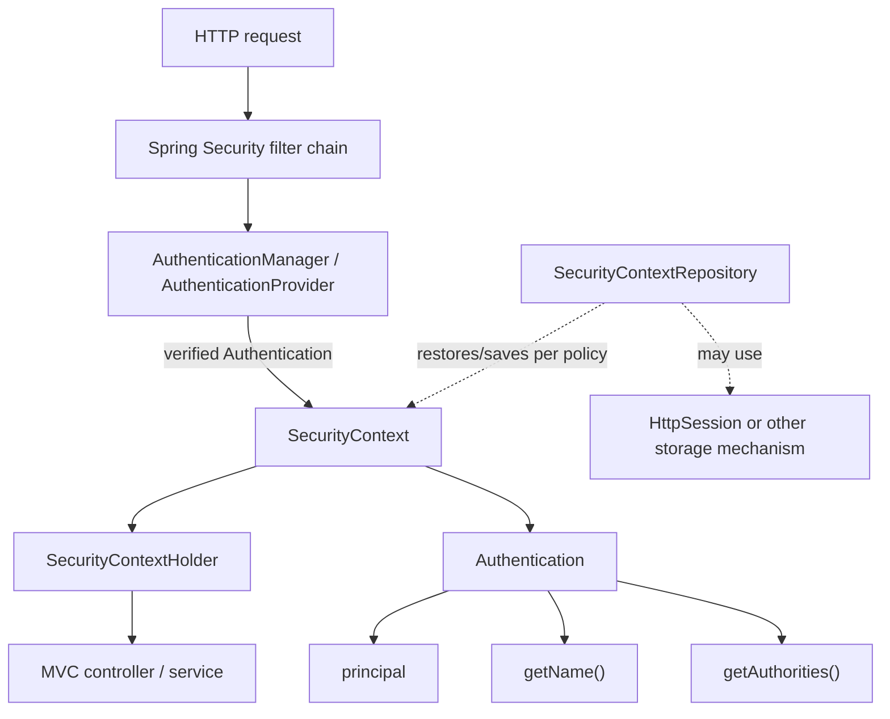

# Reading Identity Through Proper APIs Instead of Relying on Storage Details

## Goals and Scope

In Spring Security, the question **"Who is making this request?"** should not be answered by digging into `HttpSession`, reading a cookie, decoding a JWT manually, or directly casting an object stored by an internal filter in an attribute. Spring Security provides **well-defined identity-reading APIs** for each application layer: `Principal`, `Authentication`, `@AuthenticationPrincipal`, `@CurrentSecurityContext`, `SecurityContextHolder`, Servlet APIs, and dedicated APIs for the reactive stack.

The key point is choosing an API based on the **data actually needed** and the **layer handling it**. A controller that only needs the username should not read the entire context from the session. A service needing authorization should not trust a client-supplied `userId`. An application receiving JWTs should not assume the principal is always `UserDetails`. And an authenticated request does not guarantee identity data remains in the same ThreadLocal or the same `HttpSession` in every execution context.

This lesson belongs to the **Security Context** group in **Spring Security - fundamentals**, written for **Java 17+, Spring Boot 3.5.0, and Spring Security 6.5.x with Spring MVC/Servlet**. It includes a runnable project featuring endpoints reading identity across multiple APIs, a service protected by method security, and JUnit/MockMvc test suites. Snippets covering JWT/OIDC, async, and WebFlux are explicitly marked as **models/fragments** rather than pretending all code runs together inside the sample HTTP Basic application.

Expected outcomes:

1. Understand the relationship `SecurityContextHolder → SecurityContext → Authentication → principal/authorities`.
2. Know how to read the identity name via `Principal#getName()` or `Authentication#getName()` without needing to know the principal implementation.
3. Use `@AuthenticationPrincipal` when a controller genuinely needs the **principal object**; understand `expression` and `errorOnInvalidType`.
4. Use `@CurrentSecurityContext` when part of `SecurityContext` is needed; understand SpEL rooted at the context.
5. Know when `HttpServletRequest#getUserPrincipal()`, `getRemoteUser()`, and `isUserInRole()` are useful.
6. Use `SecurityContextHolder` deliberately inside services/code lacking web argument resolvers; never treat thread-local storage as a user database.
7. Avoid depending on `HttpSession`, `SPRING_SECURITY_CONTEXT`, the `JSESSIONID` cookie, and filter/repository implementation details.
8. Distinguish **authenticated**, **anonymous**, **remember-me**, principal types, authorities, and resource permissions.
9. Understand pitfalls of JWT/OIDC/opaque bearer/machine identities, async requests, and WebFlux.
10. Write tests separating **real password authentication** from **mock identity** used for unit tests.

## 1. First: how is current identity modeled?

### 1.1. Data diagram



This is a conceptual diagram: exact filters and context persistence behavior vary by Spring Security version, session policy, and authentication mechanism. **Reading identity** starts from the `Authentication`/`SecurityContext` abstraction, not from an attribute name stored in a session.

### 1.2. What does Authentication contain?

`Authentication` is an interface extending `java.security.Principal`. A resulting Authentication typically has:

- `getName()`: a name representing the principal, not necessarily an email or database ID.
- `getPrincipal()`: an object representing the user/subject; its Java type varies by provider.
- `getAuthorities()`: permissions, roles, or scopes assigned by a trusted mechanism.
- `isAuthenticated()`: the token's status per contract, **insufficient on its own to detect anonymous users**.
- `getCredentials()`, `getDetails()`: sensitive data or authentication details depending on token type; never serialize arbitrarily into responses.

For example, username/password login typically returns a `UsernamePasswordAuthenticationToken` with `UserDetails` as the principal. A JWT resource server commonly carries a `Jwt` or specialized token/principal; OIDC login may provide `OidcUser`. **There is no single Java principal class valid for every authentication mechanism.**

### 1.3. SecurityContext is a wrapper, SecurityContextHolder is an access strategy

`SecurityContext` typically holds an `Authentication`:

```java
SecurityContext context = SecurityContextHolder.getContext();
Authentication authentication = context.getAuthentication();

if (authentication != null) {
    String name = authentication.getName();
    // Use in an appropriately protected context.
}
```

This is a Servlet stack fragment. `SecurityContextHolder` commonly uses `ThreadLocal` to supply the context to code running on the request thread. The framework sets and clears context along the filter chain. **ThreadLocal is not cross-request storage** and does not replace `HttpSession`, JWTs, or a user database.

### 1.4. Repository is not an identity-reading API

`SecurityContextRepository` can restore the request context from storage and save it after authentication if the mechanism requires it. Web sessions commonly use `HttpSessionSecurityContextRepository` and `DelegatingSecurityContextRepository`; stateless apps can use `NullSecurityContextRepository`.

This is a **context lifecycle management detail**, not an API business controllers should access to answer "who is the current user?". Controllers executing inside the security chain should use `Authentication`/`Principal`/argument resolvers rather than looking up internal session attributes.

## 2. Anti-pattern: reading identity directly from HttpSession

Suppose a controller contains this code:

```java
// ANTI-PATTERN, do not put this into applications.
HttpSession session = request.getSession(false);

SecurityContext context =
    (SecurityContext) session.getAttribute(
        "SPRING_SECURITY_CONTEXT"
    );

String username =
    context.getAuthentication().getName();
```

This approach has numerous issues:

1. `session` may be **null**: stateless APIs, public requests, expired cookies, or requests that have not created a session.
2. A session exists yet **holds no SecurityContext**: a guest session storing only a CSRF token, request cache, or application data.
3. The attribute name is a **storage strategy detail**, not a principal-reading contract for business code.
4. SecurityContext may live in a request attribute or custom repository, **not inside HttpSession**.
5. Switching the app to an OAuth2 resource server / stateless Basic, or changing repositories, breaks this code even when authentication remains valid.
6. It invites `NullPointerException`, `ClassCastException`, and error flows leaking internal details.
7. Authorization checks might overlook anonymous/remember-me users or trust an unverified object.
8. It couples business services to the Servlet API, making unit testing hard and failing to run as-is in WebFlux.
9. Calling `request.getSession()` instead of `getSession(false)` causes "reading identity" to **create a new session**, distorting observability/debugging.
10. Relying on a string key instead of abstractions couples code to framework internals and specific filter/repository combinations.

**Alternative when only the name is needed:**

```java
@GetMapping("/api/me")
Map<String, String> me(Principal principal) {
    return Map.of("name", principal.getName());
}
```

This is a Spring MVC controller fragment. The URL must be protected so `principal` is non-null; the complete project below enforces this condition. If code needs **verified Authentication and authorities**, accept `Authentication` or `@CurrentSecurityContext` instead of reading HttpSession directly.

## 3. API selection table by need

| What do you need? | Suitable API | Key points to remember |
| --- | --- | --- |
| Only the username in a Spring MVC controller | `Principal` argument, `principal.getName()` | No need to know token/principal type; endpoint protected when login is required. |
| Authentication info and authorities | `Authentication` argument | Comes from web security context; avoid returning credentials/details to clients. |
| Typed principal object | `@AuthenticationPrincipal MyPrincipal` | Use only when the login mechanism produces that principal type. |
| A property of the principal object | `@AuthenticationPrincipal(expression = "username") String` | Expression is evaluated against the **principal**, not HttpSession. |
| Entire current SecurityContext | `@CurrentSecurityContext SecurityContext` | Use when context itself is truly needed; avoid exposing the whole object. |
| Authentication from context via annotation | `@CurrentSecurityContext(expression = "authentication") Authentication` | SpEL root is **SecurityContext**. |
| Name in context via expression | `@CurrentSecurityContext(expression = "authentication.name") String` | Useful to extract one field without touching storage. |
| Name via Servlet API | `HttpServletRequest#getRemoteUser()` / `getUserPrincipal()` | Spring Security request wrapper populates info from context. |
| Role check via Servlet API | `request.isUserInRole("ADMIN")` | Has role prefix rules; prefer Spring Security authorization at boundaries. |
| Identity in synchronous Servlet service | `SecurityContextHolder.getContext().getAuthentication()` | Subject to propagation/scope; use `@PreAuthorize` to guard operations. |
| HTTP access control checks | `authorizeHttpRequests` / `AuthorizationManager` | Do not just read the user and compare arbitrary strings manually. |
| Method/service access control checks | `@PreAuthorize` / method security | Permissions by actor, action, and resource; requires `@EnableMethodSecurity`. |
| Reactive/WebFlux | `ReactiveSecurityContextHolder` / reactive argument resolvers | Uses Reactor Context; never copy Servlet ThreadLocal code. |
| Identity from JWT/OIDC | Matching Spring Security principal/token API; `Authentication.getName()` when enough | Verify token origin, issuer/subject/tenant; never blindly cast to UserDetails. |

**Design optimization:** if business logic only needs a **stably defined actor ID**, the web/security layer should map the authenticated principal to a **safe actor abstraction/DTO** and pass required arguments into services. Avoid letting services know too much about Servlet sessions, cookies, or provider-specific types.

## 4. Principal and Authentication in Spring MVC controllers

### 4.1. Use Principal when you only need a name

Because `Authentication extends Principal`, an MVC controller can write:

```java
@GetMapping("/api/principal")
Map<String, String> me(Principal principal) {
    return Map.of("name", principal.getName());
}
```

Spring MVC provides `Principal` from the request; Spring Security integrates by updating the Servlet principal from SecurityContext. This keeps the controller loosely coupled to provider details.

**Condition:** an endpoint intended only for logged-in users should have `authenticated()` or stronger rules. On public routes, `Principal` can be `null`; do not call `principal.getName()` without checking context.

### 4.2. Use Authentication when authorities or token details are needed

```java
@GetMapping("/api/authentication")
Map<String, Object> info(Authentication authentication) {
    return Map.of(
        "name", authentication.getName(),
        "authenticated", authentication.isAuthenticated(),
        "authorities", authentication.getAuthorities().stream()
            .map(GrantedAuthority::getAuthority)
            .sorted()
            .toList()
    );
}
```

This is a fragment; import `org.springframework.security.core.Authentication` and `GrantedAuthority`. It returns only selected fields, **never** the raw `Authentication`. An authentication object may hold:

- `principal` with `UserDetails`/JWT claims/custom attributes.
- `details` such as request metadata.
- `credentials` still present in some mechanisms if not erased.

Passing the raw object into `ResponseEntity.ok(authentication)` is unsafe debugging. In production, roles/authorities should only be returned to clients when UI requires them and policy permits; clients **must never use those values as server-side authorization decisions**.

### 4.3. Do not treat getName() as a global identifier key

`authentication.getName()` is determined by the token/principal implementation. With username/password it is usually username; with OAuth2/JWT it may be `sub`, preferred username, or a configured claim.

When supporting multiple identity providers/tenants, two distinct users might share `getName()=="alice"`. As a business key, establish a domain-unique identity such as **(issuer, subject, tenant)** or an internal user ID linked to the authenticated subject. Never assemble it from client-supplied query strings.

### 4.4. Reading a name does not replace authorization

A controller knowing `principal.getName()=="learner"` does not prove that person may view invoice `/invoices/123`. Rules must enforce resource owner/tenant/role and application policy.

**Authentication answers "who?", authorization answers "allowed to do what on which resource?"**. Clean identity extraction supports authorization without replacing it.

## 5. @AuthenticationPrincipal: retrieving the exact principal object

Spring Security provides `org.springframework.security.core.annotation.AuthenticationPrincipal`. This annotation instructs the argument resolver to extract **`Authentication.getPrincipal()`** from the current request and pass it as a controller parameter.

### 5.1. When principal is UserDetails

With HTTP Basic/form login using `DaoAuthenticationProvider` and `InMemoryUserDetailsManager` in the lab:

```java
@GetMapping("/api/user-details")
Map<String, String> details(
        @AuthenticationPrincipal UserDetails user) {

    return Map.of("username", user.getUsername());
}
```

Here `UserDetails` comes from `Authentication.getPrincipal()`, not from a session attribute. This works when the provider genuinely places a UserDetails instance as the principal.

**Never return raw UserDetails**: `getPassword()` often contains the password hash, and the object carries internal flags/authorities. Map it to a minimal response DTO.

### 5.2. Using expression to extract a property

```java
@GetMapping("/api/principal-expression")
Map<String, String> principalExpression(
        @AuthenticationPrincipal(expression = "username")
        String username) {

    return Map.of("username", username);
}
```

SpEL here has the **principal object as root**. With Spring Security `UserDetails`, property `username` invokes `getUsername()`. If the app switches to a `Jwt` principal, this expression may no longer match.

### 5.3. errorOnInvalidType and the "silent null" issue

`@AuthenticationPrincipal` offers an option:

```java
@AuthenticationPrincipal(errorOnInvalidType = true)
UserDetails currentUser
```

When the actual principal does not match the expected type, the default resolver may inject **null**; with `errorOnInvalidType=true`, it throws a type conversion error instead of silently ignoring it. This helps on endpoints **strictly designed around one principal type** to catch misconfiguration early.

This is **not** a permission check. The annotation does not verify passwords/JWTs itself; it merely extracts the principal currently in SecurityContext. URL/method protection rules are still required.

### 5.4. Custom principal and extracting a domain user

If a custom UserDetails class defines an `internalUserId` property:

```java
// Fragment: use only if principal actually has getInternalUserId().
@GetMapping("/api/internal-id")
Map<String, Long> internalId(
        @AuthenticationPrincipal(expression = "internalUserId")
        Long id) {

    return Map.of("id", id);
}
```

The expression does not invent properties, look up accounts in a database, or turn usernames into numeric IDs. For this fragment to work, the custom principal class and `getInternalUserId()` must exist. When changing OAuth2 providers, use an adapter mapping into a domain actor rather than scattering claim names across every controller.

### 5.5. When principal is not UserDetails

Examples from other architectures:

| Mechanism | Typical principal | Appropriate reading approach |
| --- | --- | --- |
| DAO username/password | `UserDetails` | `@AuthenticationPrincipal UserDetails`, `getUsername()`. |
| OAuth2 login | `OAuth2User` | `@AuthenticationPrincipal OAuth2User` or `Authentication.getName()`. |
| OIDC login | `OidcUser` | `@AuthenticationPrincipal OidcUser`; read subject/claims verified through the flow. |
| JWT resource server | `Jwt` on default `JwtAuthenticationToken` | `@AuthenticationPrincipal Jwt` or token APIs, watching issuer/subject. |
| Opaque bearer token | `OAuth2AuthenticatedPrincipal` in typical defaults | Use matching principal/token APIs; never assume Jwt. |
| Anonymous | Often String `"anonymousUser"` inside anonymous token | Never cast to UserDetails; never treat as logged-in. |
| Custom machine identity | Custom principal built by provider | Dedicated adapter or `Authentication.getName()` when sufficient. |

These types are **common defaults**, not universal guarantees for every application. Security configuration can customize principals, converters, claim mappings, or token types. Test against your project's actual authentication mechanism.

## 6. @CurrentSecurityContext: retrieving the context or a specific field

Spring Security provides `org.springframework.security.core.annotation.CurrentSecurityContext` and MVC's `CurrentSecurityContextArgumentResolver`.

### 6.1. Retrieving the entire SecurityContext

```java
@GetMapping("/api/context")
Map<String, String> context(
        @CurrentSecurityContext SecurityContext context) {

    return Map.of(
        "name", context.getAuthentication().getName()
    );
}
```

This API yields the **current request's context** without forcing the controller to care whether it came from a session, bearer token, or another repository. An endpoint requiring `authenticated()` can rely on the framework having protected the request before the controller executes.

If the method is public, `context.getAuthentication()` may be null or anonymous and must be handled safely. Never copy a protected-endpoint example verbatim onto public routes.

### 6.2. Retrieving Authentication via expression

```java
@GetMapping("/api/context-auth")
Map<String, String> contextAuthentication(
    @CurrentSecurityContext(expression = "authentication")
    Authentication authentication) {

    return Map.of("name", authentication.getName());
}
```

With `@CurrentSecurityContext`, the SpEL **root is SecurityContext**, so `authentication` resolves the context's Authentication property. Contrast with `@AuthenticationPrincipal`, whose SpEL root is the **principal**, not the context.

### 6.3. Retrieving an Authentication property

```java
@GetMapping("/api/context-expression")
Map<String, String> contextName(
    @CurrentSecurityContext(expression = "authentication.name")
    String name) {

    return Map.of("name", name);
}
```

This is a concise way to grab the name using annotations instead of injecting `Authentication` and calling `getName()`. However, if the controller only needs `Principal#getName()`, injecting `Principal` remains simpler and less framework-coupled.

### 6.4. Distinguishing the two expression roots

| Syntax | SpEL Root | Expected value in lab |
| --- | --- | --- |
| `@AuthenticationPrincipal UserDetails user` | Extracts whole principal | `learner`'s UserDetails. |
| `@AuthenticationPrincipal(expression="username") String s` | UserDetails principal | `learner`. |
| `@CurrentSecurityContext SecurityContext c` | Extracts whole context | Context holding verified Authentication. |
| `@CurrentSecurityContext(expression="authentication") Authentication a` | SecurityContext | Verified Authentication. |
| `@CurrentSecurityContext(expression="authentication.name") String s` | SecurityContext → Authentication | `learner`. |

**Note:** Java compile-time checking only verifies parameter types; SpEL properties are checked at runtime. When changing principal models, integration tests are required to catch broken expressions.

## 7. Servlet API: getUserPrincipal, getRemoteUser, and isUserInRole

Spring Security integrates with the Servlet API via `SecurityContextHolderAwareRequestFilter` and a request wrapper. On protected endpoints:

```java
@GetMapping("/api/servlet")
Map<String, Object> servletIdentity(
        HttpServletRequest request) {

    Principal principal = request.getUserPrincipal();

    return Map.of(
        "principalName", principal.getName(),
        "remoteUser", request.getRemoteUser(),
        "isAdmin", request.isUserInRole("ADMIN")
    );
}
```

This is a fragment; the lab project below contains complete imports/controller code. `getUserPrincipal()` returns the Servlet API Principal, while `getRemoteUser()` returns the name or null when no recognized identity is present. `isUserInRole("ADMIN")` can map to `ROLE_ADMIN` according to the configured role prefix.

**Do not use `request.getSession(false).getAttribute(...)` trying to "fix" getUserPrincipal.** If the Servlet principal is null on a public request while SecurityContextHolder holds an anonymous token, that can be normal behavior. With REST resource servers or custom filters, inspect the filter chain integration.

### 7.1. When should you pick the Servlet API?

- You are writing a Servlet-level library and do not want to depend directly on Spring MVC annotations.
- You need a standard API for name/roles close to the request boundary.
- You are integrating legacy Servlet code already using `getRemoteUser()` or `isUserInRole()`.

In business Spring MVC controllers, `Principal` arguments or Spring Security annotations are usually cleaner to read and test. In domain-layer services, avoid injecting `HttpServletRequest` solely to discover the user.

### 7.2. Never treat request headers as principals

`request.getHeader("X-User")`, `request.getHeader("X-Role")`, or `request.getHeader("Authorization")` are **inputs sent by a client or proxy**; they do not prove identity by themselves. If authentication happens at an API gateway, enforce strict trust boundaries, strip/rewrite headers at the edge, and verify gateway identity before Spring Security mints a trusted Authentication.

Reading `X-Role: ADMIN` manually and granting access bypasses the security provider entirely. Authenticated `Principal` and `Authentication` objects are trustworthy because trusted filters/providers built them, not because a header name sounds like an identity.

## 8. Service layer: using SecurityContextHolder when MVC arguments are absent

Controllers have argument resolvers, whereas ordinary service classes do not automatically receive `@AuthenticationPrincipal` parameters the way MVC resolvers work. For synchronous logic inside a Servlet security context, you can use:

```java
Authentication auth =
    SecurityContextHolder.getContext().getAuthentication();

if (auth == null) {
    throw new AuthenticationCredentialsNotFoundException(
        "Authentication required"
    );
}

String actorName = auth.getName();
```

This is a fragment; import `AuthenticationCredentialsNotFoundException` from `org.springframework.security.authentication`. **Checking `auth != null` is not enough to protect an operation** when anonymous authentication is enabled; use framework-supported method authorization.

### 8.1. Separating actor lookup from permission enforcement

In the sample project, the service uses:

```java
@PreAuthorize("isAuthenticated()")
public String currentName() {
    return SecurityContextHolder.getContext()
        .getAuthentication()
        .getName();
}
```

`@PreAuthorize` itself runs when method security is enabled and the call goes **through the Spring AOP proxy**, such as a controller calling an `@Service` bean method. Calling the method directly from another method **on the same instance (self-invocation)** can bypass proxy-based method authorization.

For sensitive data, enforce permissions at the service/domain layer and apply owner/tenant policies against **actual resources in the store**, not just a user string passed by the client.

### 8.2. When should you pass the actor into services instead of reading the holder?

A service invoked across multiple entry points (HTTP, scheduled jobs, message consumers, tests) can be easier to test when it accepts an actor resolved by a security adapter:

```java
public record ActorIdentity(
    String subject,
    String tenantId
) {}

public interface InvoiceService {
    InvoiceView readInvoice(ActorIdentity actor, long invoiceId);
}
```

This is a design fragment, not complete Java source (`InvoiceView` needs definition). `ActorIdentity` must be constructed from a **verified Authentication**, never accepted freely from request JSON/query parameters. The service still checks that the invoice belongs to the valid tenant/owner or applies equivalent authorization policies.

Benefits: reduced coupling to Spring MVC/Servlet; unit tests pass explicit ActorIdentity values; authorization can evaluate actor, action, and resource together. With multiple IdPs, centralizing mapping from issuer/sub/tenant to an internal actor ID also prevents scattering principal casts across the codebase.

### 8.3. Never store the holder value in static globals or cached singletons as "current user"

The `SecurityContextHolder` value belongs to the execution context, not application configuration. Storing `Authentication` in a singleton bean field and reading it during another request risks **leaking identity across users**. Never cache `currentUser` in static variables or stash raw principals in custom global maps unless strictly designed and isolated.

## 9. Anonymous, null, and authenticated: three easily confused states

### 9.1. Why is isAuthenticated() insufficient?

Spring Security's `AnonymousAuthenticationToken` can have `isAuthenticated() == true` per implementation; it still **is not a real logged-in user**. Spring Security uses `AuthenticationTrustResolver` to distinguish anonymous tokens when evaluating the `authenticated()` rule.

The following manual check is an **anti-pattern** if used as a security guard:

```java
Authentication a =
    SecurityContextHolder.getContext().getAuthentication();

boolean loggedIn = a != null && a.isAuthenticated();
// Do not use this loggedIn boolean to replace the authenticated() rule.
```

To protect endpoints, use:

```java
.authorizeHttpRequests(auth -> auth
    .requestMatchers("/api/**").authenticated()
)
```

To protect a service method, use `@PreAuthorize("isAuthenticated()")` with method security enabled. If you genuinely must classify token state, use a trust resolver or appropriate authorization APIs rather than relying solely on the token boolean.

### 9.2. What can public endpoints receive?

On a `permitAll()` route:

- `Principal` and `HttpServletRequest#getUserPrincipal()` may be null for anonymous requests.
- `SecurityContextHolder.getContext().getAuthentication()` may be `AnonymousAuthenticationToken` when the anonymous filter is active.
- `@AuthenticationPrincipal UserDetails` may be null when the actual principal is the String `"anonymousUser"` or another type.
- `SecurityContext` is generally retrievable, though the Authentication inside it may be null/anonymous under certain configs.

Therefore public routes should handle anonymous callers deliberately; do not assume the system is broken if MVC `Principal` is null while the holder carries an anonymous token.

### 9.3. Remember-me differs from fully authenticated

Spring Security also defines `rememberMe()` and `fullyAuthenticated()`. A request can have a non-anonymous principal restored via remember-me yet fail to meet the assurance level required for sensitive operations. Depending on the system, `fullyAuthenticated()`, step-up auth, or MFA rules may be needed.

**Extracting a username does not prove sufficient assurance for a transaction.** Identity extraction APIs do not replace strong authentication policies or session-age checks.

## 10. Sessions, cookies, and repositories are not user-identification APIs

### 10.1. Why does an existing HttpSession not prove login?

An HttpSession can be created for CSRF token storage, request caching, shopping carts, or other libraries before any login happens. The `JSESSIONID` cookie contains a **session identifier**, not a verified principal directly under the traditional Servlet session model.

If a session expires, a stale cookie may still be sent by the browser while holding no state. Switching to stateless Basic/JWT gives requests authenticated principals with no HttpSession at all.

### 10.2. When is SecurityContext persisted across requests?

With session-based form login, Spring Security can persist the context via `SecurityContextRepository`, such as `DelegatingSecurityContextRepository` wrapping `HttpSessionSecurityContextRepository`. In stateless APIs, context is typically built from credentials on the current request and cleared afterward.

**Do not let controllers depend on this storage choice.** Using `@CurrentSecurityContext`/`Principal` lets controller code stay unchanged even if persistence changes, provided authentication and authorization stay consistent.

### 10.3. SecurityContextHolderFilter in Spring Security 6

Spring Security 6 loads SecurityContext via `SecurityContextHolderFilter` and requires an **explicit save** when custom code modifies context and wants it persisted to future requests. Built-in mechanisms like form login include the appropriate persistence logic; business controllers should never write session attributes manually.

Reading the current identity via `SecurityContextHolder.getContext()` **does not mean you need to call `saveContext()`**. Saving context only applies when an authentication flow needs persistence; business requests that already hold verified Authentication only need the appropriate read APIs.

### 10.4. Stale permissions in sessions

If roles/authorities were snapshotted into the session's Authentication, an admin changing roles in the database does not automatically update existing sessions immediately. This affects authorization and cannot be solved by reading session attributes directly in controllers.

Solutions include invalidating sessions, bounding token lifetimes, checking server-side permissions when accessing resources, or using an appropriate event/cache strategy. Never trust the client to send updated roles to "sync".

## 11. Principal types: JWT, OIDC, OAuth2, and custom identities

### 11.1. getName() reduces Java class coupling, yet does not solve unique identification

`Authentication.getName()` is convenient when the UI just needs a display/audit name. However, with JWTs:

- `JwtAuthenticationToken` defaults its name from `sub`.
- The name depends on `JwtAuthenticationConverter`/configured principal claim.
- `getPrincipal()` can be `Jwt`, not `UserDetails`.
- Claims are meaningful only after the resource server **verifies signature, issuer, audience, expiry, and required policies**.

Do not read `jwt.getClaimAsString("role")` and grant permissions on unverified tokens. Use Spring Security's resource server and proper converters/authorization.

### 11.2. Fragment for a JWT principal

```java
// Fragment for an app configured as an OAuth2 Resource Server with JWT.
// Not part of the HTTP Basic lab project below.
@GetMapping("/jwt/me")
Map<String, String> jwtMe(
        @AuthenticationPrincipal Jwt jwt) {

    return Map.of(
        "subject", jwt.getSubject(),
        "issuer", jwt.getIssuer().toString()
    );
}
```

Works only when the actual principal is `Jwt` and expected claims/issuer are present; `getIssuer()` may be null if permitted by token/config, so production endpoints must guard against nulls. The JWT must originate from a verified resource server flow. **Do not add this endpoint to the Basic project**, because with a `UserDetails` principal the argument would resolve to null.

### 11.3. OIDC subject and email are not the same

With OIDC, `OidcUser` provides subject and issuer alongside email/name/profile claims. Emails can change or remain unverified per policy; display names are not identifier keys either. Multi-IdP systems commonly use **issuer + subject** to identify an external identity and map it to an internal user ID/tenant.

An `@AuthenticationPrincipal UserDetails` annotation written for Basic will not turn into `OidcUser` when switching to OIDC login. Choose APIs matching the actual authentication mechanism and design a principal-mapping layer for domain services.

### 11.4. Opaque bearer tokens are not JWTs

Opaque access tokens may undergo introspection at an authorization server. Spring Security's principal may be `OAuth2AuthenticatedPrincipal`, with authorities mapped from introspected scopes/claims. Never cast to `Jwt` merely because the request carries `Authorization: Bearer ...`.

### 11.5. Machine-to-machine and service accounts

With OAuth2 client credentials, mTLS, or API keys, the "caller" can be a **client application** rather than an end user. `getName()` may be a client ID or subject. Audit records may need to distinguish actor type (`USER` vs `SERVICE`), tenant, issuer, and delegated-on-behalf-of identity.

If service A acts on behalf of end user B, do not log an ambiguous single username; the identity model should clearly distinguish actor, subject being represented, and verified evidence.

## 12. Async, thread pools, and WebFlux: avoiding ThreadLocal misuse

### 12.1. Why can context disappear outside the request thread?

Servlet `SecurityContextHolder` defaults to ThreadLocal. If code switches threads via `@Async`, `CompletableFuture.supplyAsync`, or a custom executor, the context is not automatically present on the new thread.

This is not always a bug: a background task should not accidentally carry user privileges into long-running work outside the request lifecycle. When needed, use official integrations such as `DelegatingSecurityContextExecutor`/`DelegatingSecurityContextRunnable`, or pass **verified actor IDs and resolved permissions** as controlled business parameters.

### 12.2. Never put SecurityContext in a static field

```java
// ANTI-PATTERN: mixes identities across requests.
public final class DangerousCurrentUser {
    public static Authentication CURRENT;
}
```

Servlet threads are reused; singleton/static objects lack request scope. Never cache Request A's Authentication and hand it to Request B. The framework clears the holder per lifecycle to prevent such leaks.

### 12.3. InheritableThreadLocal is not a universal fix

`MODE_INHERITABLETHREADLOCAL` can copy security context to **newly created child threads** under certain conditions, yet it breaks down automatically with reused thread pools and risks retaining identities longer than intended. Use explicit propagation/cleanup abstractions suited to the use case, and re-verify permissions for sensitive deferred actions.

### 12.4. WebFlux uses Reactor Context

In Spring WebFlux, use `ReactiveSecurityContextHolder`, `ServerSecurityContextRepository`, and supported reactive annotations/resolvers; it does **not** rely on Servlet `HttpSession`/ThreadLocal in the same way.

Illustrative fragment:

```java
// Fragment for WebFlux/reactive code only with appropriate dependencies.
Mono<String> actorName() {
    return ReactiveSecurityContextHolder.getContext()
        .map(context -> context.getAuthentication().getName());
}
```

Do not put this fragment into the Spring MVC lab app. You must import Reactor `Mono` and reactive classes if implementing it. In reactive workloads, context retrieval must respect Reactor subscription context; never block to call the Servlet holder.

## 13. Java 17 + Spring Boot project demonstrating identity-reading APIs

### 13.1. Requirements and endpoints

We will build an MVC app with **HTTP GET** endpoints only, testing multiple ways to read the same authenticated identity.

Sample accounts:

- `learner / learner-pass` → `ROLE_USER`.
- `admin / admin-pass` → `ROLE_USER` and `ROLE_ADMIN`.

Security policy:

- `GET /public/ping`: public.
- `GET /api/**`: requires HTTP Basic authentication.
- `GET /api/admin-proof`: beyond authentication, the **service method** requires `ROLE_ADMIN` via `@PreAuthorize`.
- Other URLs: `denyAll`.
- `SessionCreationPolicy.STATELESS`: every Basic request supplies credentials itself without relying on HttpSession.
- CSRF is not disabled globally; since the demo is GET-only, read tests need no token.
- Responses return only selected fields — never hashes, session IDs, or full Authentication dumps.

Quick reference table:

| Endpoint | Observed value | Guest user | learner | admin |
| --- | --- | :---: | :---: | :---: |
| `/public/ping` | `pong` | 200 | 200 | 200 |
| `/api/principal` | Principal name | 401 | 200 | 200 |
| `/api/authentication` | Name + verified flag + authorities | 401 | 200 | 200 |
| `/api/user-details` | UserDetails username | 401 | 200 | 200 |
| `/api/principal-expression` | Username via principal SpEL | 401 | 200 | 200 |
| `/api/context` | Name from SecurityContext | 401 | 200 | 200 |
| `/api/context-auth` | Name from Authentication via context | 401 | 200 | 200 |
| `/api/context-expression` | Name via context SpEL | 401 | 200 | 200 |
| `/api/servlet` | Remote user, principal name, isAdmin | 401 | 200 | 200 |
| `/api/service` | Name via service + holder | 401 | 200 | 200 |
| `/api/admin-proof` | Method authorization ADMIN | 401 | **403** | 200 |
| Undeclared URL | Default deny | Per entry point | 403 | 403 |

**Meaning of stateless:** even though controllers read Authentication through all these APIs, none of that data needs to come from `HttpSession`. This is practical proof that reading principals via proper APIs **does not depend on storage**.

### 13.2. Directory layout

```text
current-identity-lab/
├── pom.xml
└── src/
    ├── main/java/com/example/currentidentity/
    │   ├── CurrentIdentityApplication.java
    │   ├── SecurityConfig.java
    │   ├── CurrentActorService.java
    │   └── IdentityController.java
    └── test/java/com/example/currentidentity/
        ├── IdentityHttpTest.java
        └── CurrentActorServiceTest.java
```

### 13.3. pom.xml

```xml
<project xmlns="http://maven.apache.org/POM/4.0.0"
         xmlns:xsi="http://www.w3.org/2001/XMLSchema-instance"
         xsi:schemaLocation="http://maven.apache.org/POM/4.0.0 https://maven.apache.org/xsd/maven-4.0.0.xsd">
    <modelVersion>4.0.0</modelVersion>

    <parent>
        <groupId>org.springframework.boot</groupId>
        <artifactId>spring-boot-starter-parent</artifactId>
        <version>3.5.0</version>
        <relativePath/>
    </parent>

    <groupId>com.example</groupId>
    <artifactId>current-identity-lab</artifactId>
    <version>1.0.0</version>

    <properties>
        <java.version>17</java.version>
    </properties>

    <dependencies>
        <dependency>
            <groupId>org.springframework.boot</groupId>
            <artifactId>spring-boot-starter-web</artifactId>
        </dependency>
        <dependency>
            <groupId>org.springframework.boot</groupId>
            <artifactId>spring-boot-starter-security</artifactId>
        </dependency>
        <dependency>
            <groupId>org.springframework.boot</groupId>
            <artifactId>spring-boot-starter-test</artifactId>
            <scope>test</scope>
        </dependency>
        <dependency>
            <groupId>org.springframework.security</groupId>
            <artifactId>spring-security-test</artifactId>
            <scope>test</scope>
        </dependency>
    </dependencies>

    <build>
        <plugins>
            <plugin>
                <groupId>org.springframework.boot</groupId>
                <artifactId>spring-boot-maven-plugin</artifactId>
            </plugin>
        </plugins>
    </build>
</project>
```

Uses the Spring Boot parent BOM for compatible dependency versions. `3.5.0` is an API baseline for learning, **not a guarantee of the latest security patches**. For real systems, upgrade to a supported patch release and re-test security configs, principal types, and method security.

### 13.4. CurrentIdentityApplication.java

```java
package com.example.currentidentity;

import org.springframework.boot.SpringApplication;
import org.springframework.boot.autoconfigure.SpringBootApplication;

@SpringBootApplication
public class CurrentIdentityApplication {
    public static void main(String[] args) {
        SpringApplication.run(CurrentIdentityApplication.class, args);
    }
}
```

Package `com.example.currentidentity` is the app root. Remaining files share this package so component scanning picks up `SecurityConfig`, `CurrentActorService`, and `IdentityController`.

### 13.5. SecurityConfig.java

```java
package com.example.currentidentity;

import org.springframework.context.annotation.Bean;
import org.springframework.context.annotation.Configuration;
import org.springframework.http.HttpMethod;
import org.springframework.security.config.Customizer;
import org.springframework.security.config.annotation.method.configuration.EnableMethodSecurity;
import org.springframework.security.config.annotation.web.builders.HttpSecurity;
import org.springframework.security.config.annotation.web.configurers.AbstractHttpConfigurer;
import org.springframework.security.config.http.SessionCreationPolicy;
import org.springframework.security.core.userdetails.User;
import org.springframework.security.core.userdetails.UserDetailsService;
import org.springframework.security.crypto.factory.PasswordEncoderFactories;
import org.springframework.security.crypto.password.PasswordEncoder;
import org.springframework.security.provisioning.InMemoryUserDetailsManager;
import org.springframework.security.web.SecurityFilterChain;

@Configuration(proxyBeanMethods = false)
@EnableMethodSecurity
public class SecurityConfig {

    @Bean
    PasswordEncoder passwordEncoder() {
        return PasswordEncoderFactories.createDelegatingPasswordEncoder();
    }

    @Bean
    UserDetailsService users(PasswordEncoder encoder) {
        return new InMemoryUserDetailsManager(
            User.withUsername("learner")
                .password(encoder.encode("learner-pass"))
                .roles("USER")
                .build(),
            User.withUsername("admin")
                .password(encoder.encode("admin-pass"))
                .roles("USER", "ADMIN")
                .build()
        );
    }

    @Bean
    SecurityFilterChain securityFilterChain(HttpSecurity http)
            throws Exception {

        return http
            .sessionManagement(session -> session
                .sessionCreationPolicy(SessionCreationPolicy.STATELESS)
            )
            .authorizeHttpRequests(auth -> auth
                .requestMatchers(
                    HttpMethod.GET, "/public/ping"
                ).permitAll()
                .requestMatchers(
                    HttpMethod.GET, "/api/**"
                ).authenticated()
                .anyRequest().denyAll()
            )
            .httpBasic(Customizer.withDefaults())
            .formLogin(AbstractHttpConfigurer::disable)
            .build();
    }
}
```

**Explanation:**

1. `PasswordEncoder` stores demo passwords using bcrypt hashes with a delegating prefix generated by the factory, avoiding `{noop}`.
2. `UserDetailsService` supplies `UserDetails` to `DaoAuthenticationProvider` for the username/password flow.
3. `httpBasic` reads the Basic header, checks credentials, constructs an Authentication, and stores it in SecurityContext for the current request.
4. `STATELESS` does not use HttpSession to restore context on future requests; Basic clients must send credentials every time.
5. `@EnableMethodSecurity` activates `@PreAuthorize` enforcement on service beans.
6. `GET /api/**` requires authentication, yet **does not automatically grant ROLE_ADMIN**. Role checks happen on `adminProof()`.
7. `anyRequest().denyAll()` locks down out-of-scope paths and HTTP methods.
8. CSRF is not disabled; because the lab only serves GETs, there are no POST/PUT/PATCH/DELETE endpoints requiring tokens in tests. If adding write endpoints or browser cookie/session flows, evaluate CSRF and pick an appropriate design.

**Do not assume HTTP Basic fits every production API.** Basic transmits Base64 username/password and requires HTTPS/TLS while keeping credentials out of logs and shell history. OAuth2/OIDC/JWT or session form login may fit better depending on clients.

### 13.6. CurrentActorService.java

```java
package com.example.currentidentity;

import org.springframework.security.access.prepost.PreAuthorize;
import org.springframework.security.core.Authentication;
import org.springframework.security.core.context.SecurityContextHolder;
import org.springframework.stereotype.Service;

@Service
public class CurrentActorService {

    @PreAuthorize("isAuthenticated()")
    public String currentName() {
        Authentication authentication =
            SecurityContextHolder.getContext().getAuthentication();

        return authentication.getName();
    }

    @PreAuthorize("hasRole('ADMIN')")
    public String adminProof() {
        return "admin-service";
    }
}
```

**Explanation:**

- The service does not inject the Servlet request or session to find the user; it reads the context prepared by the framework for the current request.
- `@PreAuthorize("isAuthenticated()")` guards `currentName` when invoked **through the Spring bean proxy**.
- `@PreAuthorize("hasRole('ADMIN')")` protects admin-only actions. Keeping this on the service still protects calls even if another controller invokes the service.
- The code never caches Authentication in a field.
- When a background task lacks a security context, the protected method rejects execution instead of arbitrarily borrowing an old request's identity.

**Note:** In serious domains, a method reading resources must check resource owner/tenant. `adminProof()` is just a minimal method demonstrating a 403 at the service layer.

### 13.7. IdentityController.java

```java
package com.example.currentidentity;

import jakarta.servlet.http.HttpServletRequest;
import java.security.Principal;
import java.util.Map;

import org.springframework.security.core.Authentication;
import org.springframework.security.core.GrantedAuthority;
import org.springframework.security.core.annotation.AuthenticationPrincipal;
import org.springframework.security.core.annotation.CurrentSecurityContext;
import org.springframework.security.core.context.SecurityContext;
import org.springframework.security.core.userdetails.UserDetails;
import org.springframework.web.bind.annotation.GetMapping;
import org.springframework.web.bind.annotation.RestController;

@RestController
public class IdentityController {

    private final CurrentActorService actors;

    public IdentityController(CurrentActorService actors) {
        this.actors = actors;
    }

    @GetMapping("/public/ping")
    public String ping() {
        return "pong";
    }

    @GetMapping("/api/principal")
    public Map<String, String> principal(Principal principal) {
        return Map.of("name", principal.getName());
    }

    @GetMapping("/api/authentication")
    public Map<String, Object> authentication(
            Authentication authentication) {

        return Map.of(
            "name", authentication.getName(),
            "authenticated", authentication.isAuthenticated(),
            "authorities", authentication.getAuthorities().stream()
                .map(GrantedAuthority::getAuthority)
                .sorted()
                .toList()
        );
    }

    @GetMapping("/api/user-details")
    public Map<String, String> userDetails(
            @AuthenticationPrincipal(errorOnInvalidType = true)
            UserDetails user) {

        return Map.of("username", user.getUsername());
    }

    @GetMapping("/api/principal-expression")
    public Map<String, String> principalExpression(
            @AuthenticationPrincipal(expression = "username")
            String username) {

        return Map.of("username", username);
    }

    @GetMapping("/api/context")
    public Map<String, String> context(
            @CurrentSecurityContext SecurityContext context) {

        return Map.of(
            "name", context.getAuthentication().getName()
        );
    }

    @GetMapping("/api/context-auth")
    public Map<String, String> contextAuthentication(
            @CurrentSecurityContext(expression = "authentication")
            Authentication authentication) {

        return Map.of("name", authentication.getName());
    }

    @GetMapping("/api/context-expression")
    public Map<String, String> contextExpression(
            @CurrentSecurityContext(
                expression = "authentication.name"
            )
            String name) {

        return Map.of("name", name);
    }

    @GetMapping("/api/servlet")
    public Map<String, Object> servlet(HttpServletRequest request) {
        return Map.of(
            "principalName", request.getUserPrincipal().getName(),
            "remoteUser", request.getRemoteUser(),
            "isAdmin", request.isUserInRole("ADMIN")
        );
    }

    @GetMapping("/api/service")
    public Map<String, String> service() {
        return Map.of("name", actors.currentName());
    }

    @GetMapping("/api/admin-proof")
    public String adminProof() {
        return actors.adminProof();
    }
}
```

**What is worth noting?**

- All `/api/**` routes are protected by URL rules, so methods reading `Principal`/`Authentication` can expect a valid identity within the lab scope.
- The `authentication` endpoint selects only name, authenticated flag, and authorities — never serializing the raw Authentication object.
- `@AuthenticationPrincipal UserDetails` works because the lab uses `DaoAuthenticationProvider`; when switching to JWT/OIDC principal types, revisit this endpoint.
- `@CurrentSecurityContext(expression="authentication.name")` uses SecurityContext as its SpEL root, not UserDetails.
- `/api/servlet` only reads Servlet principal/remoteUser/role from the security-aware request wrapper, never `HttpSession`.
- `/api/service` demonstrates a service method using SecurityContextHolder protected by method security.
- `/api/admin-proof` has URL rule `authenticated()`, while the service requires `ROLE_ADMIN`, so learner gets **403** and admin gets 200.

**Never expose diagnostic endpoints like `/api/authentication` in production without an approved UI/audit purpose.** When UI data is needed, return a minimal DTO; enforce permissions server-side.

## 14. MockMvc tests for identity-reading paths

### 14.1. IdentityHttpTest.java

```java
package com.example.currentidentity;

import org.junit.jupiter.api.Test;
import org.springframework.beans.factory.annotation.Autowired;
import org.springframework.boot.test.autoconfigure.web.servlet.AutoConfigureMockMvc;
import org.springframework.boot.test.context.SpringBootTest;
import org.springframework.test.web.servlet.MockMvc;
import org.springframework.test.web.servlet.MvcResult;

import static org.assertj.core.api.Assertions.assertThat;
import static org.springframework.security.test.web.servlet.request
    .SecurityMockMvcRequestPostProcessors.httpBasic;
import static org.springframework.test.web.servlet.request.MockMvcRequestBuilders.get;
import static org.springframework.test.web.servlet.result.MockMvcResultMatchers.content;
import static org.springframework.test.web.servlet.result.MockMvcResultMatchers.jsonPath;
import static org.springframework.test.web.servlet.result.MockMvcResultMatchers.status;

@SpringBootTest
@AutoConfigureMockMvc
class IdentityHttpTest {

    @Autowired
    MockMvc mvc;

    @Test
    void publicPingWorksWithoutAuthentication() throws Exception {
        mvc.perform(get("/public/ping"))
            .andExpect(status().isOk())
            .andExpect(content().string("pong"));
    }

    @Test
    void guestCannotCallPrincipalEndpoint() throws Exception {
        mvc.perform(get("/api/principal"))
            .andExpect(status().isUnauthorized());
    }

    @Test
    void guestCannotCallUserDetailsEndpoint() throws Exception {
        mvc.perform(get("/api/user-details"))
            .andExpect(status().isUnauthorized());
    }

    @Test
    void wrongPasswordIsRejected() throws Exception {
        mvc.perform(get("/api/principal")
                .with(httpBasic("learner", "wrong-pass")))
            .andExpect(status().isUnauthorized());
    }

    @Test
    void unknownUsernameIsRejected() throws Exception {
        mvc.perform(get("/api/principal")
                .with(httpBasic("not-created", "learner-pass")))
            .andExpect(status().isUnauthorized());
    }

    @Test
    void principalArgumentReadsVerifiedUsername() throws Exception {
        mvc.perform(get("/api/principal")
                .with(httpBasic("learner", "learner-pass")))
            .andExpect(status().isOk())
            .andExpect(jsonPath("$.name").value("learner"));
    }

    @Test
    void authenticationArgumentReadsNameAndAuthorities()
            throws Exception {
        mvc.perform(get("/api/authentication")
                .with(httpBasic("learner", "learner-pass")))
            .andExpect(status().isOk())
            .andExpect(jsonPath("$.name").value("learner"))
            .andExpect(jsonPath("$.authenticated").value(true))
            .andExpect(jsonPath("$.authorities[0]")
                .value("ROLE_USER"));
    }

    @Test
    void annotationResolvesUserDetailsPrincipal()
            throws Exception {
        mvc.perform(get("/api/user-details")
                .with(httpBasic("learner", "learner-pass")))
            .andExpect(status().isOk())
            .andExpect(jsonPath("$.username").value("learner"));
    }

    @Test
    void annotationExpressionResolvesPrincipalUsername()
            throws Exception {
        mvc.perform(get("/api/principal-expression")
                .with(httpBasic("learner", "learner-pass")))
            .andExpect(status().isOk())
            .andExpect(jsonPath("$.username").value("learner"));
    }

    @Test
    void contextAnnotationResolvesCurrentName() throws Exception {
        mvc.perform(get("/api/context")
                .with(httpBasic("learner", "learner-pass")))
            .andExpect(status().isOk())
            .andExpect(jsonPath("$.name").value("learner"));
    }

    @Test
    void contextAuthenticationExpressionWorks() throws Exception {
        mvc.perform(get("/api/context-auth")
                .with(httpBasic("learner", "learner-pass")))
            .andExpect(status().isOk())
            .andExpect(jsonPath("$.name").value("learner"));
    }

    @Test
    void contextNameExpressionWorks() throws Exception {
        mvc.perform(get("/api/context-expression")
                .with(httpBasic("learner", "learner-pass")))
            .andExpect(status().isOk())
            .andExpect(jsonPath("$.name").value("learner"));
    }

    @Test
    void servletApiUsesAuthenticatedPrincipal()
            throws Exception {
        mvc.perform(get("/api/servlet")
                .with(httpBasic("learner", "learner-pass")))
            .andExpect(status().isOk())
            .andExpect(jsonPath("$.principalName").value("learner"))
            .andExpect(jsonPath("$.remoteUser").value("learner"))
            .andExpect(jsonPath("$.isAdmin").value(false));
    }

    @Test
    void servletRoleReflectsAdminAuthority()
            throws Exception {
        mvc.perform(get("/api/servlet")
                .with(httpBasic("admin", "admin-pass")))
            .andExpect(status().isOk())
            .andExpect(jsonPath("$.principalName").value("admin"))
            .andExpect(jsonPath("$.isAdmin").value(true));
    }

    @Test
    void serviceCanReadCurrentIdentityWithoutSessionAccess()
            throws Exception {
        mvc.perform(get("/api/service")
                .with(httpBasic("learner", "learner-pass")))
            .andExpect(status().isOk())
            .andExpect(jsonPath("$.name").value("learner"));
    }

    @Test
    void learnerCannotPassAdminMethodAuthorization()
            throws Exception {
        mvc.perform(get("/api/admin-proof")
                .with(httpBasic("learner", "learner-pass")))
            .andExpect(status().isForbidden());
    }

    @Test
    void adminCanPassAdminMethodAuthorization()
            throws Exception {
        mvc.perform(get("/api/admin-proof")
                .with(httpBasic("admin", "admin-pass")))
            .andExpect(status().isOk())
            .andExpect(content().string("admin-service"));
    }

    @Test
    void authenticatedUserCannotAccessUnlistedRoute()
            throws Exception {
        mvc.perform(get("/not-registered")
                .with(httpBasic("learner", "learner-pass")))
            .andExpect(status().isForbidden());
    }

    @Test
    void nextBasicRequestStillNeedsCredentials()
            throws Exception {
        mvc.perform(get("/api/principal")
                .with(httpBasic("learner", "learner-pass")))
            .andExpect(status().isOk());

        mvc.perform(get("/api/principal"))
            .andExpect(status().isUnauthorized());
    }

    @Test
    void basicStatelessRequestDoesNotNeedHttpSession()
            throws Exception {
        MvcResult result = mvc.perform(
                get("/api/principal")
                    .with(httpBasic("learner", "learner-pass"))
            )
            .andExpect(status().isOk())
            .andReturn();

        assertThat(
            result.getRequest().getSession(false)
        ).isNull();
    }
}
```

The **20 HTTP integration tests** above verify:

- Real password authentication via HTTP Basic rather than injecting a mock identity.
- The same username can be read via Principal, Authentication, @AuthenticationPrincipal, @CurrentSecurityContext, Servlet API, and service.
- Anonymous/wrong credentials receive 401 rather than being treated as logged in simply because an API returns a context.
- Method authorization distinguishes learner and admin: 403/200.
- Stateless Basic requests require no session, and a subsequent request without credentials does not "inherit" the previous request's identity.
- Unlisted URLs are not left public.

Not a single test case needs to read `SPRING_SECURITY_CONTEXT` or a session ID to know who is logged in.

### 14.2. CurrentActorServiceTest.java

HTTP tests prove traffic goes through the real BasicAuthenticationFilter. When testing method authorization in isolation, `@WithMockUser`/`@WithAnonymousUser` can establish a mock context and check service behavior. **This is not proof of password verification**; it only tests service logic/authorization with a simulated principal.

```java
package com.example.currentidentity;

import org.junit.jupiter.api.Test;
import org.springframework.beans.factory.annotation.Autowired;
import org.springframework.boot.test.context.SpringBootTest;
import org.springframework.security.access.AccessDeniedException;
import org.springframework.security.test.context.support.WithAnonymousUser;
import org.springframework.security.test.context.support.WithMockUser;

import static org.assertj.core.api.Assertions.assertThat;
import static org.assertj.core.api.Assertions.assertThatThrownBy;

@SpringBootTest
class CurrentActorServiceTest {

    @Autowired
    CurrentActorService actors;

    @Test
    @WithMockUser(username = "test-user", roles = "USER")
    void mockAuthenticatedUserCanReadName() {
        assertThat(actors.currentName()).isEqualTo("test-user");
    }

    @Test
    @WithAnonymousUser
    void anonymousCannotInvokeProtectedService() {
        assertThatThrownBy(actors::currentName)
            .isInstanceOf(AccessDeniedException.class);
    }

    @Test
    @WithMockUser(username = "test-admin", roles = "ADMIN")
    void mockedAdminCanInvokeAdminMethod() {
        assertThat(actors.adminProof()).isEqualTo("admin-service");
    }

    @Test
    @WithMockUser(username = "test-user", roles = "USER")
    void mockedRegularUserCannotInvokeAdminMethod() {
        assertThatThrownBy(actors::adminProof)
            .isInstanceOf(AccessDeniedException.class);
    }
}
```

**4 service tests** exercise method security on the real bean. In total the app has **24 test methods** (20 MockMvc + 4 service). `@WithMockUser` creates a SecurityContext inside the test framework and cleans it up per lifecycle, unlike real HTTP Basic calls in integration tests.

### 14.3. What to check after running?

```bash
java -version
mvn -version
mvn test
mvn spring-boot:run
```

Maven is expected to run all tests with zero failures/errors when code/versions match. This lesson **only provides code and expectations**, without claiming Maven was run in the learner's workspace.

If tests fail:

- If `@AuthenticationPrincipal UserDetails` returns null, check the actual principal type.
- If `@PreAuthorize` does not apply, check `@EnableMethodSecurity`, bean proxies, and self-invocation.
- If guest requests return a 302 redirect instead of 401, check form login/entry points.
- If Basic requests accidentally create sessions, check SessionCreationPolicy, repositories, and the filter chain.
- If Servlet `getUserPrincipal` is null, check the filter wrapper/chain, request authentication, and URL security.
- If method annotations do not run, check MVC auto-configuration and Spring Security integration.

**Never "fix" this by setting `permitAll()` on all APIs** or manually injecting an Authentication from a header.

## 15. Testing with curl

Once `mvn spring-boot:run` starts the app on localhost port 8080, try:

```bash
curl -i http://localhost:8080/public/ping

curl -i http://localhost:8080/api/principal

curl -i -u learner:learner-pass \
  http://localhost:8080/api/principal

curl -i -u learner:learner-pass \
  http://localhost:8080/api/authentication

curl -i -u learner:learner-pass \
  http://localhost:8080/api/user-details

curl -i -u learner:learner-pass \
  http://localhost:8080/api/principal-expression

curl -i -u learner:learner-pass \
  http://localhost:8080/api/context

curl -i -u learner:learner-pass \
  http://localhost:8080/api/context-auth

curl -i -u learner:learner-pass \
  http://localhost:8080/api/context-expression

curl -i -u learner:learner-pass \
  http://localhost:8080/api/servlet

curl -i -u learner:learner-pass \
  http://localhost:8080/api/service

curl -i -u learner:learner-pass \
  http://localhost:8080/api/admin-proof

curl -i -u admin:admin-pass \
  http://localhost:8080/api/admin-proof
```

A trailing `\` is POSIX shell line continuation. In Windows PowerShell you can use `curl.exe` and keep each command on one line, or use PowerShell's line continuation syntax. If port 8080 is in use, adjust `server.port` and update the URLs.

### 15.1. Expected sample responses

For authenticated `learner`:

```http
HTTP/1.1 200 OK
Content-Type: application/json

{"name":"learner"}
```

Example from `GET /api/authentication`:

```json
{
  "name": "learner",
  "authenticated": true,
  "authorities": ["ROLE_USER"]
}
```

These responses match the lab code, **not an actual transcript captured from a running server**. JSON field order or headers may vary, while tested field values must match.

Example `GET /api/servlet` as learner:

```json
{
  "principalName": "learner",
  "remoteUser": "learner",
  "isAdmin": false
}
```

As admin, `isAdmin` becomes true. `GET /api/admin-proof` as learner returns **403** due to `@PreAuthorize("hasRole('ADMIN')")`, whereas admin receives `200` with body `admin-service`.

**Never put real credentials in shell history or over localhost HTTP outside testing.** In production, always use TLS, restrict logs, enforce rate limiting, and avoid hard-coded accounts.

## 16. From the lab to multi-mechanism authentication systems

### 16.1. How stable are reading APIs when switching from Basic to JWT?

If code only needs `Authentication.getName()` and the app enforces a consistent mapping policy, many controllers can remain unchanged. However, `@AuthenticationPrincipal UserDetails` depends on principal type and requires refactoring or an adapter if the JWT principal is `Jwt`.

**Practical strategy:**

1. Define a domain actor key with clear uniqueness/tenant semantics.
2. Write a trusted mapper from `Authentication` (DAO/JWT/OIDC) to the actor key.
3. Use that actor key for service methods, controlled logging/auditing, and authorization.
4. Never use displayName/email unless guaranteed to be immutable identifiers.
5. Write dedicated tests per authentication mechanism, especially role/claim mapping.

### 16.2. @AuthenticationPrincipal does not replace authentication

The annotation only extracts the principal **already in context**. If the filter chain has not verified the request, or the route is public, the annotation performs no password check. Never treat a non-null method argument as permission for sensitive actions.

### 16.3. Is the X-User header trustworthy?

Only when the architecture authenticates identity at a trusted proxy and enforces strict boundaries (trusted network, header stripping, signed identity/assertions, authenticated upstream) alongside proper Spring Security pre-authentication integration. In ordinary apps, client-supplied headers carry no authentication value.

### 16.4. Is UserDetails a domain profile?

Not necessarily. `UserDetails` exists for authentication and holds password hashes and account flags; business profiles may live in another repository. A controller returning avatar/name should call a profile service **after obtaining the authenticated actor ID**, never exposing UserDetails directly to the API.

### 16.5. Role and tenant are not the same thing

`ROLE_USER` is a broad authority and does not prove a user may read another tenant's data. Multi-tenant systems must enforce tenant membership/resource ownership in services/repositories. When using external subjects (OIDC `sub`), bind issuer/tenant before mapping to a database row.

## 17. Common mistakes

### Mistake 1 — Reading SPRING_SECURITY_CONTEXT from HttpSession in every controller

Ties code to storage implementation, turns null in stateless/custom repositories, and hinders testing. **Fix:** accept `Principal`, `Authentication`, or appropriate annotations.

### Mistake 2 — Assuming having JSESSIONID means the user logged in

The cookie may belong to a guest, be expired, or be forged. **Fix:** trust only verified `Authentication` from the security chain.

### Mistake 3 — Calling getSession() to "read the user"

`getSession()` can create a session, skewing observability. **Fix:** never read users via session; if merely checking session existence for debugging, use `getSession(false)` and never treat it as an authentication check.

### Mistake 4 — Always casting Authentication.getPrincipal() to UserDetails

JWT/OIDC/API keys use different principal types. **Fix:** use `getName()` when sufficient, or verified type-specific annotations/adapters.

### Mistake 5 — Calling principal.getName() on a permitAll route without null checks

Anonymous servlet principals can be null. **Fix:** routes requiring login must use `authenticated()`; public routes must handle anonymous safely.

### Mistake 6 — Using auth.isAuthenticated() as the "user is logged in" flag

`AnonymousAuthenticationToken` can return true. **Fix:** use Spring Security authorization/trust resolvers or `@PreAuthorize("isAuthenticated()")`.

### Mistake 7 — Using @AuthenticationPrincipal in a service expecting MVC resolver execution

Argument resolvers target Spring MVC controllers (and matching integrations), not arbitrary service methods. **Fix:** pass the verified actor or read the holder inside a valid security context and protect the service.

### Mistake 8 — Storing Authentication in a static/singleton field

Mixes identities across requests. **Fix:** keep context per request and never cache caller identity globally.

### Mistake 9 — Relying on ThreadLocal across @Async boundaries

Context does not automatically follow into thread pools. **Fix:** deliberate propagation, actor parameters, and cleanup.

### Mistake 10 — Using @WithMockUser and claiming real login works

Mock tests skip password/JWT verification. **Fix:** add HTTP integration tests with real Basic/form/bearer credentials for each flow.

### Mistake 11 — Using email/displayName as an immutable key

Emails/names can change and are not unique across IdPs/tenants. **Fix:** use an internal user ID or issuer+subject+tenant appropriately.

### Mistake 12 — Trusting unverified token claims to mint an actor

Signatures/issuers/audiences/expiries must be verified per trust policy. **Fix:** use Spring Security resource server/OIDC integrations.

### Mistake 13 — Returning raw Authentication/UserDetails/Jwt as JSON

Can leak claims, hashes, credentials, request details, and internal metadata. **Fix:** use DTOs with allowlisted fields.

### Mistake 14 — Using getName() alone to grant access to client-specified invoices

Authentication only establishes the actor; object ownership still needs verification. **Fix:** enforce authorization in services/queries against real resources.

### Mistake 15 — Granting ROLE_ADMIN from request params or headers

Self-asserted caller privileges are not authority. **Fix:** authorities must come from verified providers/IdPs and server-side mappings.

### Mistake 16 — Switching SecurityContextHolder strategy to GLOBAL to "keep login"

GLOBAL risks sharing identity across the entire JVM and is not session persistence. **Fix:** choose repository/session/token persistence per architecture while keeping an appropriate holder strategy.

### Mistake 17 — Expecting DB role edits to update current Authentication immediately

Context may hold an earlier authority snapshot. **Fix:** revoke/refresh sessions/tokens or check permissions from live sources.

### Mistake 18 — Assuming request.getUserPrincipal() always matches the holder's anonymous token

Servlet integration can return null for anonymous while the holder contains `AnonymousAuthenticationToken`. **Fix:** know each API's contract.

### Mistake 19 — Reading cookies directly to infer user ID

Session IDs/tokens are credentials, not direct trusted user IDs. **Fix:** let filters/repositories verify them and construct Authentication.

### Mistake 20 — Using only URL rule authenticated() for admin APIs

Logging in does not grant admin privileges. **Fix:** `hasRole`/`hasAuthority`, method security, and resource-level authorization.

### Mistake 21 — Adding method security yet invoking via self-invocation

Spring proxies may not intercept internal calls within the same object. **Fix:** extract protected methods into separate beans or use supported mechanisms; test real call paths.

### Mistake 22 — Treating WebFlux like Servlet ThreadLocal

Reactive context lives in the Reactor pipeline; ThreadLocal can be wrong. **Fix:** use `ReactiveSecurityContextHolder` and reactive security APIs.

## 18. Checklist for designing identity-reading APIs

- [ ] Do you only need **name**, or full Authentication/principal/claims?
- [ ] Is this layer an MVC controller, Servlet filter, synchronous service, background task, or WebFlux?
- [ ] Is the endpoint protected with the right authentication/authorization level?
- [ ] Could the principal be `UserDetails`, `Jwt`, `OidcUser`, `String`, or a custom type?
- [ ] Are null/anonymous/remember-me handled separately from fully authenticated?
- [ ] Is the name returned by `getName()` stable enough to serve as a business key?
- [ ] Is there a trusted mapper from issuer/subject/tenant to actor ID?
- [ ] Are direct dependencies on HttpSession/cookies/SPRING_SECURITY_CONTEXT removed?
- [ ] Does any step trust unverified `X-User`/`X-Role`/URL `userId` values?
- [ ] Does the service enforce owner/tenant/role on real resources beyond `authenticated()`?
- [ ] Is method security enabled, and do calls pass through proxies?
- [ ] Could raw `UserDetails`/JWTs/authentication details leak via responses or logs?
- [ ] Do async/reactive pipelines propagate context properly without holding stale permissions too long?
- [ ] Do tests cover both mocked identities and real credentials where needed?
- [ ] Is stateless/session policy right so credential-less follow-up requests behave as intended?
- [ ] Is there a plan for changing IdPs, principal converters, Spring Security versions, and session stores?

## 19. Self-check questions with answers

**Question 1.** In an MVC controller needing only username, should you read an HttpSession attribute?  
**Answer:** No. Use `Principal#getName()` or `Authentication#getName()` on a protected endpoint.

**Question 2.** What does `@AuthenticationPrincipal` retrieve?  
**Answer:** It retrieves `Authentication.getPrincipal()` from the current security context.

**Question 3.** What does `@CurrentSecurityContext` retrieve?  
**Answer:** It retrieves the current SecurityContext, or a property extracted via SpEL against the context.

**Question 4.** How do expressions `username` and `authentication.name` differ?  
**Answer:** `@AuthenticationPrincipal(expression="username")` uses the principal as root; `@CurrentSecurityContext(expression="authentication.name")` uses SecurityContext as root.

**Question 5.** Why isn't `@AuthenticationPrincipal UserDetails` always appropriate for JWTs?  
**Answer:** JWT resource servers typically use a `Jwt` principal rather than `UserDetails`. Use the matching API/type/adapter.

**Question 6.** Is `Authentication.getName()` always a database user ID?  
**Answer:** No. It depends on the token/converter and could be username, `sub`, or client ID. Establish a trusted business key separately.

**Question 7.** Can anonymous users make `Authentication.isAuthenticated()` return true?  
**Answer:** Yes. Never use that flag alone to decide logged-in status; use authorization/trust resolvers.

**Question 8.** Is having an HttpSession proof that the user logged in?  
**Answer:** Not necessarily. A session may only hold a CSRF token or guest data; the user must be authenticated.

**Question 9.** Can stateless APIs read SecurityContextHolder during a request?  
**Answer:** Yes. Authentication is created per request without needing HttpSession persistence.

**Question 10.** Does using `@WithMockUser` verify real passwords?  
**Answer:** No. It builds a mock context to test authorization; integration tests with real credentials are still needed.

**Question 11.** Why shouldn't raw UserDetails be returned?  
**Answer:** It can expose password hashes, account flags, and internal data unnecessary for clients.

**Question 12.** Where does `HttpServletRequest#getRemoteUser()` get the username in Spring Security Servlet?  
**Answer:** Through the Servlet request integration/wrapper backed by the authenticated context when configured; never parse cookies manually.

**Question 13.** Why shouldn't services inject `HttpServletRequest` solely to read identity?  
**Answer:** It couples business logic to Servlet storage/requests, hurts reuse/testing, and breaks down across async/other entry points.

**Question 14.** When calling a service via `@Async`, does ThreadLocal context always follow?  
**Answer:** No. Deliberate propagation or passing an actor abstraction is required.

**Question 15.** Does changing a user's role in the DB automatically update authorities in old sessions/JWTs?  
**Answer:** Not guaranteed. Sessions/tokens need refreshing/revocation, or permissions must be checked from current sources.

**Question 16.** Where do owner/tenant rules belong?  
**Answer:** In authorization/service/repository checks against the real resource, not merely in principal extraction.

**Question 17.** Is an `X-User` header automatically a trustworthy principal?  
**Answer:** No. It is raw input; gateway trust boundaries and a verified authentication flow are required before creating Authentication.

**Question 18.** Why can the lab use stateless HTTP Basic yet still read identity in every controller?  
**Answer:** Spring Security creates a verified Authentication per request and places it in the current context; controllers read the abstraction without needing session persistence.

## Conclusion

**Reading identity through proper APIs decouples business code from security context storage mechanisms.** In Spring MVC controllers, `Principal` and `Authentication` cover common needs; `@AuthenticationPrincipal` targets the principal object or one of its properties; `@CurrentSecurityContext` targets SecurityContext or Authentication/properties via SpEL. In synchronous Servlet services, `SecurityContextHolder` can be used when needed alongside proper authorization and context lifecycles. Servlet APIs offer `getUserPrincipal()` and `getRemoteUser()` when integrating request-layer code.

Never depend on `HttpSession`, `SPRING_SECURITY_CONTEXT`, `JSESSIONID`, or internal attributes to identify users. Those details shift when migrating from form login to stateless Basic/JWT, swapping SecurityContextRepository, running async, or adopting WebFlux. **Having identity does not equal having permission**: authorization must still verify roles, scopes, owners, and tenants on real resources. And when stable identifiers are required, never assume `getName()` is a global key; map verified principals to actor IDs according to your system's trust boundaries.

## Official references

- [Spring Security 6.5 — Servlet Authentication Architecture](https://docs.spring.io/spring-security/reference/6.5/servlet/authentication/architecture.html)
- [Spring Security 6.5 — Spring MVC Integration](https://docs.spring.io/spring-security/reference/6.5/servlet/integrations/mvc.html)
- [Spring Security 6.5 — AuthenticationPrincipal JavaDoc](https://docs.spring.io/spring-security/reference/6.5/api/java/org/springframework/security/core/annotation/AuthenticationPrincipal.html)
- [Spring Security 6.5 — CurrentSecurityContext JavaDoc](https://docs.spring.io/spring-security/reference/6.5/api/java/org/springframework/security/core/annotation/CurrentSecurityContext.html)
- [Spring Security 6.5 — CurrentSecurityContextArgumentResolver](https://docs.spring.io/spring-security/reference/6.5/api/java/org/springframework/security/web/method/annotation/CurrentSecurityContextArgumentResolver.html)
- [Spring Security 6.5 — Servlet API Integration](https://docs.spring.io/spring-security/reference/6.5/servlet/integrations/servlet-api.html)
- [Spring Security 6.5 — Persisting Authentication](https://docs.spring.io/spring-security/reference/6.5/servlet/authentication/persistence.html)
- [Spring Security 6.5 — Method Security](https://docs.spring.io/spring-security/reference/6.5/servlet/authorization/method-security.html)
- [Spring Security 6.5 — Authorize HttpServletRequests](https://docs.spring.io/spring-security/reference/6.5/servlet/authorization/authorize-http-requests.html)
- [Spring Security 6.5 — Testing Method Security](https://docs.spring.io/spring-security/reference/6.5/servlet/test/method.html)
- [Spring Security 6.5 — MockMvc Security Testing](https://docs.spring.io/spring-security/reference/6.5/servlet/test/mockmvc/index.html)
