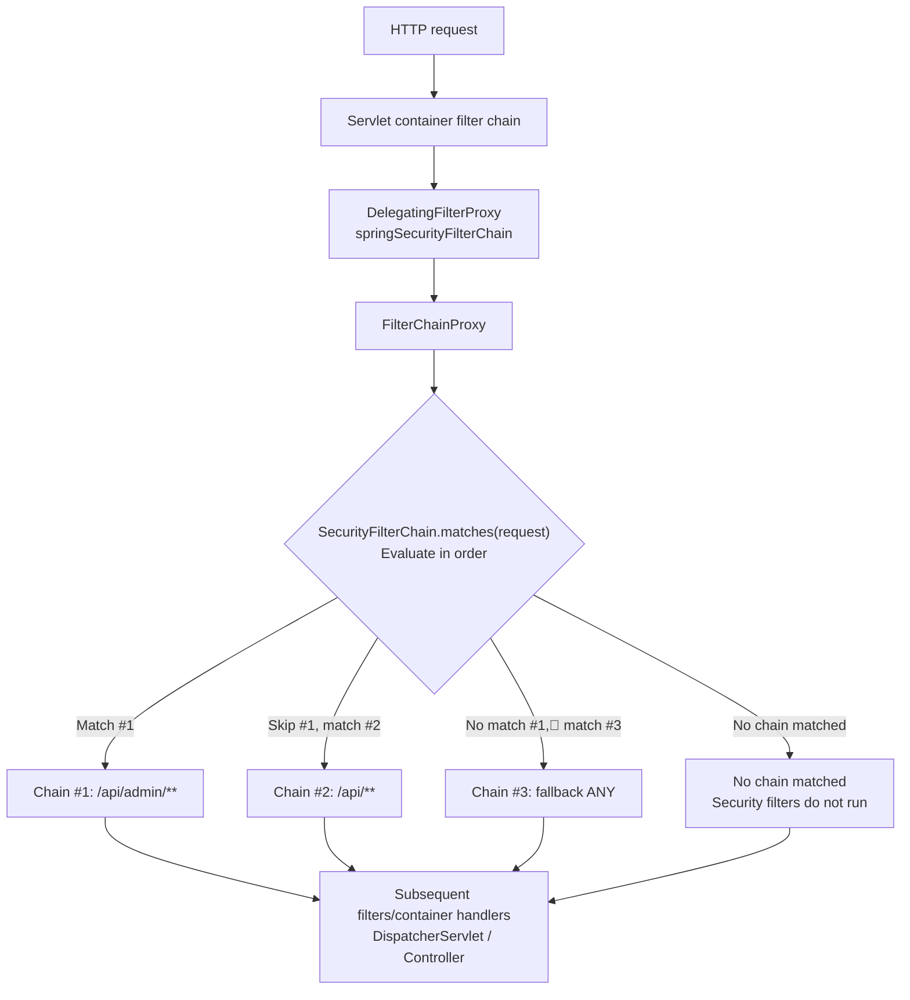

# Selecting the First Matching Chain and Consequences When No Chain Matches

## Lesson Objectives

In Spring Security for **Servlet/MVC**, an application may declare multiple `SecurityFilterChain` beans: one chain protecting internal APIs, one for admin pages, one for public resources, and a default chain protecting everything else. When an HTTP request arrives, `FilterChainProxy` **iterates the list in order and selects the first chain whose `matches(request) == true`**. Only the security filters inside that selected chain are applied. Subsequent chains **are not executed additionally**, even when the URL also matches them.

The biggest security consequence: **if no `SecurityFilterChain` matches the request, the request is not protected by Spring Security's security filters**. This does not mean the request automatically receives HTTP 200, because MVC/controllers, the servlet container, or other middleware can still return 404/403/errors. However, **Spring Security does not apply authentication, authorization, CSRF, headers, or the other filters of any security chain to an unmatched request**. Consequently, a configuration containing only `.securityMatcher("/api/**")` can inadvertently leave URLs outside `/api/**` unprotected.

This lesson focuses squarely on **"Selecting the first matching chain and consequences when no chain matches"**, under **Servlet Architecture**. The code uses **Java 17, Spring Boot 3.5.0, Spring Security 6.5.x, Spring MVC/Servlet**. The lab walks from `DelegatingFilterProxy` to `FilterChainProxy`, contrasts `securityMatcher` with `requestMatchers`, demonstrates `@Order` precedence, configures three chains with a catch-all, and includes isolated tests proving the *no matching chain* vulnerability **without intentionally leaving the sample web app exposed**.

After this lesson, you will be able to:

1. Explain how the outer Servlet filter chain differs from `SecurityFilterChain` inside Spring Security.
2. Describe accurately the **first matching chain** algorithm, with no filter merging and no fallback after authentication/authorization failure inside the selected chain.
3. Choose specific-first, broad-last ordering; distinguish `@Order(1)`, `@Order(2)`, and a chain without `@Order`.
4. Distinguish **chain-level** `http.securityMatcher(...)` from **authorization rule-level** `authorizeHttpRequests(...).requestMatchers(...)`.
5. Understand that `anyRequest().denyAll()` applies only to requests **that entered that specific chain**.
6. Distinguish no matching chain, `permitAll`, `web.ignoring`, 401, 403, and 404.
7. Design a fallback/catch-all chain without `securityMatcher` to protect all remaining URLs.
8. Understand why login/logout endpoints provided by security filters are also constrained by the chain's matcher.
9. Build a Spring Boot app with three chains, learning-only marker headers, and tests proving which chain was selected.
10. Write `FilterChainProxy` unit tests for first match and no match, without turning an unprotected example into a live runtime endpoint.

## 1. Execution Flow from the Servlet Container to SecurityFilterChain

### 1.1. Several Distinct "Filter Chain" Concepts Exist

In a Servlet application, the browser does not invoke `AuthenticationManager` or `SecurityFilterChain` directly. A request first passes through the Servlet container's chain of `jakarta.servlet.Filter` instances. Spring Security is normally linked into that outer chain by a `DelegatingFilterProxy` named `springSecurityFilterChain`, which delegates to the `FilterChainProxy` Spring bean.



**Note:** The diagram depicts **mutually exclusive** paths, not a single request passing through Chain #1, #2, and #3 simultaneously. Each `SecurityFilterChain` holds **its own list of security filters** such as `SecurityContextHolderFilter`, `CsrfFilter`, `BasicAuthenticationFilter`, `ExceptionTranslationFilter`, and `AuthorizationFilter` depending on configuration. Not every chain has the same filter set.

### 1.2. Core Responsibilities of FilterChainProxy

`org.springframework.security.web.FilterChainProxy` holds the list of Spring-managed `SecurityFilterChain` beans. It:

- Coordinates selecting a chain for the request using `RequestMatcher`s.
- Retrieves the filter list from **only the first matching chain**.
- Executes that list in its corresponding internal filter order.
- Lets the request continue toward the Servlet container/application when filters call `chain.doFilter(...)`.
- Uses `HttpFirewall` to normalize/validate requests prior to matching per configuration.

**Do not create a second FilterChainProxy** or manually register Spring Security filters directly on the Servlet container to work around a wrong matcher. Doing so can cause double execution and unpredictable context/exception/session semantics. In a normal Spring Boot app, simply declare `SecurityFilterChain` beans and let the framework wire the proxy layer.

### 1.3. What Does a SecurityFilterChain Contain?

At the interface level:

```java
public interface SecurityFilterChain {
    boolean matches(HttpServletRequest request);
    List<Filter> getFilters();
}
```

This is a **simplified API shape**, not code you need to re-implement. A chain holds:

1. **Chain-level `RequestMatcher`:** decides whether the chain applies to a given HTTP request.
2. **List of Servlet filters:** the security steps executed if the chain is selected.

For example, a `/api/admin/**` chain may require HTTP Basic and `ROLE_ADMIN`; the remaining `/api/**` chain may require only `authenticated()`; and the fallback may deny every request outside a whitelist. A request routed into the admin chain **does not get another chance at the broader API chain if it receives 403**.

## 2. The First-Match Algorithm: What Actually Happens?

### 2.1. Pseudocode

```java
// Pseudocode: not the complete internal code of FilterChainProxy.
for (SecurityFilterChain candidate : orderedChains) {
    if (candidate.matches(request)) {
        List<Filter> selected = candidate.getFilters();
        runOnlyTheseSecurityFilters(selected, request, response);
        return;
    }
}

// No candidate matched matches(request).
continueOriginalServletFilterChain(request, response);
```

The names `runOnlyTheseSecurityFilters` and `continueOriginalServletFilterChain` illustrate the concept only; they are **not Spring Security APIs**. The real implementation also handles the firewall, decorated chains, exception handling, and cleanup.

### 2.2. "First Match" Is by Order, Not URL Length

Suppose:

| Order | Matcher | Policy |
| --- | --- | --- |
| 1 | `/api/**` | `authenticated()` |
| 2 | `/api/admin/**` | `hasRole("ADMIN")` |
| 3 | `any request` | `denyAll()` |

A request `GET /api/admin/report` matches **matchers 1, 2, and 3**, yet **chain 1 wins** because it comes first. Chain 2 with the `ROLE_ADMIN` rule **does not run**, and chain 3 cannot rescue it. If chain 1 only requires `authenticated()`, a regular logged-in user with `ROLE_USER` could reach the admin controller unless other protective layers exist. This is the **broad-matcher shadowing bug**.

Correct design:

| Order | Matcher | Policy |
| --- | --- | --- |
| 1 | `/api/admin/**` | `hasRole("ADMIN")` |
| 2 | `/api/**` | `authenticated()` or in-chain whitelist |
| 3 | `any request` | `denyAll()` with a strictly public whitelist |

The **most specific first, catch-all last** pattern is not automatically enforced by the framework guessing "which matcher is longer"; you must configure bean ordering intentionally.

### 2.3. Match Once, No "Try the Next Chain on Failure"

Suppose `GET /api/admin/report` enters chain #1 and HTTP Basic authenticates user `learner` successfully, yet `learner` lacks `ROLE_ADMIN`:

```text
request -> chain #1 matches "/api/admin/**"
          -> authentication: learner is valid
          -> authorization: lacks ROLE_ADMIN
          -> HTTP 403

DOES NOT:
          -> try chain #2 "/api/**"
          -> turn into HTTP 200 because chain #2 only needs authenticated
```

Chain selection is a **security-filter routing decision** made before authorization. It is not load balancing, nor a chain of providers retried until one succeeds.

Likewise, if the password is wrong in the selected chain and the Basic entry point returns 401, `FilterChainProxy` **does not** search for a subsequent chain to try another credential mechanism. Overlapping chain matchers must be evaluated before writing authentication logic.

### 2.4. First Matching Chain Is Not First Matching Authorization Rule

**Inside a selected chain**, `authorizeHttpRequests(...)` has a list of `requestMatchers(...)` to pick an **authorization rule**. The order of those rules also matters, yet they operate at a different layer:

```text
Layer 1: FilterChainProxy selects 1 SecurityFilterChain
         via securityMatcher + @Order

Layer 2: Filters of that chain handle authentication,
         CSRF, context, exception translation...

Layer 3: AuthorizationFilter applies requestMatchers rules,
         hasRole, authenticated, permitAll, denyAll...
```

Do not use one generic term "URL matcher" for all three without specifying which layer you mean.

## 3. securityMatcher vs. requestMatchers and anyRequest

### 3.1. http.securityMatcher(...) Selects Chain Scope

Example:

```java
@Bean
@Order(1)
SecurityFilterChain adminChain(HttpSecurity http) throws Exception {
    return http
        .securityMatcher("/api/admin/**")
        .authorizeHttpRequests(auth -> auth
            .anyRequest().hasRole("ADMIN")
        )
        .httpBasic(Customizer.withDefaults())
        .build();
}
```

This is a **bean fragment**; it requires imports and external configuration beans as in the Section 9 lab. Meaning:

- The chain is considered a match only when the request matches `/api/admin/**`.
- `anyRequest().hasRole("ADMIN")` applies to every request **that enters this chain**; it does not cover `/public/**` or `/api/user/**`.
- `@Order(1)` prioritizes this bean when competing chains also match.
- `httpBasic(...)` takes effect for this filter chain, not automatically for non-matching URLs.

### 3.2. authorizeHttpRequests.requestMatchers(...) Selects Rules Inside the Chain

Example:

```java
http
    .securityMatcher("/api/**")
    .authorizeHttpRequests(auth -> auth
        .requestMatchers("/api/public/**").permitAll()
        .requestMatchers("/api/admin/**").hasRole("ADMIN")
        .anyRequest().authenticated()
    );
```

Here `securityMatcher("/api/**")` is the **outer gate**. An `/outside` request never reaches those authorization rules even though they include `anyRequest()`.

Inside the chain, specific rules must come before broad rules. If you put `.requestMatchers("/api/**").permitAll()` before `.requestMatchers("/api/admin/**").hasRole("ADMIN")`, admin URLs will be permitted early within that authorization rule set.

**Principle:** by default only one chain handles a request; inside that chain, only the first matching authorization rule is used by `RequestMatcherDelegatingAuthorizationManager`.

### 3.3. Comparison Table

| Name | What Does It Select? | Scope | If It Does Not Match? |
| --- | --- | --- | --- |
| `http.securityMatcher("/api/**")` | Whether to select **this SecurityFilterChain** | Entire chain + all its security filters | `FilterChainProxy` evaluates the next chain. |
| `http.securityMatchers(...)` | One or more chain-level matchers | Entire chain | Evaluates the next chain if unmatched. |
| `authorizeHttpRequests(...).requestMatchers(...)` | Authorization rule **inside the selected chain** | Request access within the chain | Evaluates the next rule in the **same** chain. |
| `authorizeHttpRequests(...).anyRequest()` | Fallback **authorization rule** | Only within the selected chain | Does not replace a catch-all chain. |
| `@Order` | Chain bean position in the list | Chain evaluation priority | Does not authorize anything itself. |
| `permitAll()` | Permits at the authorization rule | Still passes through security filters in the chain | Does not bypass all of Spring Security. |
| `web.ignoring()` | Excludes requests from security filtering per config | Skips ignored filters | Requires greater caution than permitAll. |

### 3.4. A Chain Without securityMatcher Matches All Requests by Default

If you declare a bean:

```java
@Bean
SecurityFilterChain fallback(HttpSecurity http) throws Exception {
    return http
        .authorizeHttpRequests(auth -> auth
            .requestMatchers("/public/**").permitAll()
            .anyRequest().denyAll()
        )
        .build();
}
```

Without `http.securityMatcher(...)`, this chain uses the **default matcher matching every request** in standard Spring Security Java configuration. It serves as a sound **catch-all** when placed last in the list.

**Note:** a catch-all is still a `SecurityFilterChain` with filters. It can `denyAll()` or require `authenticated()` after a whitelist; it does not automatically inherit policies from earlier chains.

### 3.5. Having a Catch-All Does Not Mean "Every URL Must Require Login"

A fallback can use:

```java
.authorizeHttpRequests(auth -> auth
    .requestMatchers("/public/**").permitAll()
    .anyRequest().denyAll()
)
```

Thus public URLs are allowed while **still passing through Spring Security filters**, and all other URLs are denied. This is an intentional **default deny** design.

Conversely, a `.anyRequest().permitAll()` fallback avoids the no-chain state, yet can expose new URLs if you forget a rule. Whether a catch-all is **strict or permissive** depends on the policy inside it, not merely its existence.

## 4. When No SecurityFilterChain Matches: Concrete Consequences

### 4.1. Example Configuration Missing a Catch-All

```java
// WARNING: fragment illustrating an architectural flaw,
// DO NOT use as a real running SecurityConfig.
@Bean
SecurityFilterChain onlyApi(HttpSecurity http) throws Exception {
    return http
        .securityMatcher("/api/**")
        .authorizeHttpRequests(auth -> auth
            .anyRequest().authenticated()
        )
        .httpBasic(Customizer.withDefaults())
        .build();
}
```

With **only this single chain**:

- `GET /api/orders` enters the chain and must authenticate.
- `GET /admin/export` **does not match** the `/api/**` chain.
- `GET /settings` **does not match**.
- `GET /favicon.ico` may also **not match**.

If a `GET /admin/export` controller exists and no other protective layer is present, the request can reach the controller **without being stopped by Spring Security authorization**. This configuration carries a **bypass risk**.

**The outcome is not necessarily 200:** If no controller exists for `/admin/export`, `DispatcherServlet` may return 404. A gateway/WAF/container filter or independent method security might also block the request, yet you **must never rely on those as substitutes for chain coverage**.

### 4.2. Having springSecurityFilterChain in the Container Is Not Enough

Even when `DelegatingFilterProxy` is invoked for every URL, inside `FilterChainProxy` it may **find no matching `SecurityFilterChain`** and let the request proceed **without running security filters**.

Therefore all of these statements are false:

- "The Spring Security starter is present, so every URL is definitely protected."
- "The request passed through FilterChainProxy, so it passed through AuthorizationFilter."
- "I have `anyRequest().authenticated()` in the `/api/**` chain, so every endpoint requires login."
- "All chains run in sequence, so the default chain at the end still protects admin URLs."

### 4.3. No Match vs. Denied by AuthorizationFilter

| Scenario | Do Spring Security Filters Apply? | Typical Outcome |
| --- | :---: | --- |
| No `SecurityFilterChain` matches | **No** chain filter list runs | May be 200/404/other from app; no chain Spring Security rules apply. |
| Chain matches, `permitAll()` rule | **Yes** | May be 200/404/other; no authority required by that rule. |
| Chain matches, `authenticated()` and guest | **Yes** | Typically 401 (Basic) or 302 redirect (form). |
| Chain matches, logged-in user lacks `ROLE_ADMIN` | **Yes** | Typically 403. |
| Chain matches, `anyRequest().denyAll()` | **Yes** | Authenticated user typically gets 403; guest may hit corresponding entry point. |
| Chain matches, auth succeeds, MVC has no endpoint | **Yes** | Typically 404. |
| `web.ignoring()` | Security filters bypassed per configuration | Not the same as permitAll; risks losing security headers/CSRF/authorization. |

**Important about HTTP status codes:** You cannot look at a single 200/401/403/404 status and conclude with certainty which chain was selected. Verify using real request tests, chain listings, controlled logs, or test markers.

### 4.4. When Is No-Match Intentional?

Sometimes a system intentionally excludes a branch from Spring Security because another layer handles it or for static resources. However, an undocumented **gap** in configuration is a serious issue; a newly added URL later can become public.

Even for static resources, **`permitAll()` inside a chain** is usually better than excluding them from chains altogether, because appropriate defense-in-depth filters/headers remain active. Never turn "these are images/CSS" into a blanket reason to apply `web.ignoring()` across `/**`.

## 5. Rules for Ordering SecurityFilterChains with @Order

### 5.1. Order Is Determined by Bean Ordering

With multiple `SecurityFilterChain` beans, Spring Security collects them into a sorted list using Spring's ordering mechanism:

```java
@Bean
@Order(1)
SecurityFilterChain adminChain(HttpSecurity http) throws Exception { ... }

@Bean
@Order(2)
SecurityFilterChain apiChain(HttpSecurity http) throws Exception { ... }

@Bean
SecurityFilterChain fallbackChain(HttpSecurity http) throws Exception { ... }
```

This is a **signature-illustrating fragment** (`...` is not valid Java; the lab section provides complete files). Rules:

- Lower order numbers are evaluated first.
- `@Order(1)` precedes `@Order(2)`.
- A bean without `@Order` normally comes last relative to beans with explicit priority orders.
- Never rely on method declaration order inside the class or method names to determine priority.

**Do not leave two chains with the same order and overlapping matchers** hoping bean names give stable precedence. Design disjoint matchers or assign explicit orders backed by regression tests.

### 5.2. Example Table of Good Ordering

| Bean | @Order | Matcher | Intent |
| --- | --- | --- | --- |
| `adminChain` | 1 | `/api/admin/**` | `ROLE_ADMIN` only. |
| `apiChain` | 2 | `/api/**` | Authenticated users; specific public API whitelist. |
| `fallbackChain` | default last | matches any request | Narrow public whitelist; all other URLs `denyAll`. |

A request to `/api/admin/ping` matches all three matchers yet **only `adminChain` runs**. A request to `/api/user/ping` misses `adminChain` and matches `apiChain`, so **only `apiChain` runs**. A request to `/public/ping` misses the first two chains and enters `fallbackChain`.

### 5.3. If You Reverse the Order, What Goes Wrong?

If `apiChain` is evaluated before `adminChain`, `/api/admin/ping` gets captured by the broader chain. If the broader chain only requires `anyRequest().authenticated()`, `learner` can reach the admin controller even though `adminChain` specifies `ROLE_ADMIN`. **A later chain never patches an earlier chain's rules.**

If `fallbackChain` with an any-request matcher comes before other chains, it captures **every request**; the API and admin chains become dead configuration. A `denyAll()` fallback placed first rejects the entire app; a `permitAll()` fallback placed first opens the entire app. Both are ordering bugs, though with different risk profiles.

### 5.4. URL Matching Also Depends on Path/Method/Dispatcher

Matchers can be configured by path, HTTP method, `servletPath`, and dispatch type. Do not look solely at the literal string `"/api/**"` in logs and assume you understand every case. A request passing through a reverse proxy, having a context path, or containing encoded characters can have different semantics from the URL displayed in your browser.

Prefer official Spring Security matchers and avoid writing `request.getRequestURI().startsWith("/api")`: that can confuse `/apiculture` with `/api`, ignore context paths, or handle encoding/canonicalization inconsistently. In particular, test encoded slashes, path traversal, double slashes, and `;` according to your app's firewall/router policy.

## 6. Chain Order vs. Filter Order Within a Chain

### 6.1. Two Kinds of Order

- **Chain order:** which `SecurityFilterChain` bean is tested first? Controlled by `@Order`/ordering and the chain's `RequestMatcher`.
- **Filter order:** inside the **selected chain**, in what order do `SecurityContextHolderFilter`, `CsrfFilter`, `BasicAuthenticationFilter`, `ExceptionTranslationFilter`, `AuthorizationFilter`, etc., run? Controlled by `HttpSecurity`/framework filter registration.

```text
@Order(1) adminChain   --> [SecurityContext, CSRF, Basic, ... Authorization]
@Order(2) apiChain     --> [SecurityContext, CSRF, Basic, ... Authorization]
fallbackChain          --> [SecurityContext, CSRF, Basic, ... Authorization]

Request /api/admin/ping
    -> filters of adminChain only
    -> does NOT run apiChain/fallbackChain anymore
```

A custom filter via `addFilterBefore(..., BasicAuthenticationFilter.class)` only changes position **inside the chain containing it**; it does not make that chain take priority over another chain bean.

### 6.2. Filters Are Not Automatically Shared Across Chains

If chain A enables Basic while chain B enables only form login, requests entering chain B do not automatically inherit `BasicAuthenticationFilter` from chain A. Conversely, an `AuthenticationManager` or `UserDetailsService` can be shared if configured, yet sharing dependencies **does not merge filters**.

**Consequence:** omitting a protective filter in the selected chain is not compensated by a subsequent chain. Test each URL zone and mechanism independently.

### 6.3. No-Match and the Spring Security Firewall

`FilterChainProxy` can still perform wrapper/firewall checks before determining a match. Yet when **no chain matches**, security filters and authorization rules **are not applied**. Avoid claiming "zero Spring Security code ever ran"; the precise statement is **no chain was selected and no chain filter list executed**.

### 6.4. What If a Filter Does Not Call doFilter?

When a filter inside a chain decides to return 401/403/redirect without **calling `chain.doFilter(...)`**, execution stops for downstream filters/handlers per Servlet Filter semantics. Spring Security does not "try another chain" just because an earlier filter stopped the request.

## 7. Login/Logout Endpoints Are Also Scoped by securityMatcher

### 7.1. Why Can POST /login Become 404?

Some filters provide HTTP endpoints themselves. For example, form login normally involves:

- `GET /login` page (generated login page when using the default).
- `POST /login` processor handled by `UsernamePasswordAuthenticationFilter`.
- Logout handling per configured URL and HTTP method.

Suppose an app has **only one chain**:

```java
http
    .securityMatcher("/secured/**")
    .formLogin(Customizer.withDefaults());
```

The default `/login` endpoints **do not lie under `/secured/**`**, so requests to `/login` never enter this chain's form-login filters. You may receive 404 despite having `formLogin()`, depending on other controllers/chains. This is not merely a "missing permitAll" issue; it is a **chain-level matching issue**.

### 7.2. How to Handle It

When form login is needed on a prefix-restricted chain, explicitly configure login URLs within the chain's scope, and supply the login page if using a custom `loginPage`:

```java
http
    .securityMatcher("/secured/**")
    .formLogin(form -> form
        .loginPage("/secured/login")
        .loginProcessingUrl("/secured/login")
        .permitAll()
    );
```

This is a fragment: once you specify a custom `loginPage`, the application must **provide that GET endpoint/page itself**; Spring Security still supplies the filter handling the POST login URL per configuration.

Also review logout URL/CSRF, public assets needed by the login page, request cache, and session policy. Do not widen `securityMatcher` to `/**` just to get form login working if that inadvertently alters the trust boundary of other APIs.

### 7.3. Basic Auth Is Simpler for Multiple-Chain Labs

The lab below uses HTTP Basic to avoid registering separate POST login/default pages per chain. HTTP Basic does not create `/login`; every request can send `Authorization: Basic ...` and the Basic filter validates credentials inside whichever chain was selected.

That **does not change the first-match rule**: a request entering `adminChain` is handled by `adminChain`'s Basic/authorization config, not `apiChain`'s.

## 8. Safe Design: Fallback Chain, Minimal Whitelist, and Defense-in-Depth

A configuration can evolve along this pattern:

```text
adminChain:    /api/admin/**  -> ROLE_ADMIN
apiChain:      /api/**        -> public info permitAll, remainder authenticated
fallbackChain: any request    -> /public/ping permitAll, remainder denyAll
```

If `/internal/export` is added later and the developer forgets a security matcher, **`fallbackChain` still blocks it** (typically 403 for authenticated users). Without a catch-all, a controller at that URL could serve requests publicly.

### 8.1. Permit Public URLs in the Catch-All, Do Not Drop Security Completely

For instance, `/public/ping` can use `permitAll` in the fallback, preserving configured security filters/headers/CORS/CSRF handling in the chain. With `web.ignoring`, Spring Security chains can be skipped. Therefore, never use broad ignoring to fix a 401 on a static page.

### 8.2. Why denyAll in the Fallback?

`anyRequest().denyAll()` enforces the "not declared, not allowed" principle. It is especially valuable with multiple chains when the application keeps growing and someone forgets to update authorization for a new endpoint.

In some products, an `anyRequest().authenticated()` fallback makes sense if all remaining URLs should be reachable by signed-in users. Even then, downstream authorization layers remain essential. **No single fallback policy fits every app**; what matters is having a catch-all and explicit rules.

### 8.3. Never Use Method Security as an Excuse to Skip Chain Coverage

`@PreAuthorize` on a service may still block a given call even when a URL has no chain, yet many endpoints might not pass through an annotated proxy/method. Missing a chain can also skip CSRF, security headers, authentication, and exception translation.

A Servlet application still requires verified security filter chain coverage at the HTTP boundary. Method security is defense-in-depth where needed.

### 8.4. Never Use CORS as Authorization

Browsers may block JavaScript from reading a response via CORS, yet servers still process requests from non-browser callers. If a URL sits outside any chain, CORS does not replace authentication. Similarly, a network-level API gateway is helpful yet is no proof that the app itself needs no URL controls.

## 9. Runnable Project: Three SecurityFilterChains, Clearly Observing Which Chain Runs

### 9.1. Model and Rules

The Spring MVC app has **3 `SecurityFilterChain` beans**:

1. `@Order(1)`: `/api/admin/**`, requires `ROLE_ADMIN`.
2. `@Order(2)`: `/api/**`, permits only `GET /api/public/info` unauthenticated; other URLs require login.
3. **Fallback without `securityMatcher`**: permits only `GET /public/ping`; denies everything else.

Two demo users:

- `learner` / `learner-pass` → `ROLE_USER`.
- `admin` / `admin-pass` → `ROLE_USER` and `ROLE_ADMIN`.

Uses stateless HTTP Basic on every chain. Each chain includes a **filter adding header `X-Demo-Security-Chain`** for learning and testing; the marker is produced by server code and is **not a role or authentication token**. In production, do not expose internal chain names in response headers.

### 9.2. Expected Routing Matrix

| Request | Selected Chain | Guest | learner | admin |
| --- | --- | :---: | :---: | :---: |
| `GET /api/admin/ping` | ADMIN_CHAIN | 401 | **403** | 200 |
| `GET /api/user/ping` | API_CHAIN | 401 | 200 | 200 |
| `GET /api/public/info` | API_CHAIN | 200 | 200 | 200 |
| `GET /public/ping` | FALLBACK_CHAIN | 200 | 200 | 200 |
| `GET /misc/diagnostic` | FALLBACK_CHAIN | policy deny; typically 401/403 | **403** | **403** |
| `GET /api/admin/not-created` | ADMIN_CHAIN | 401 | 403 | **404** because MVC has no handler |
| `GET /api/user/not-created` | API_CHAIN | 401 | **404** because MVC has no handler | 404 |

**Key observation:** An admin URL hit by `learner` returns 403 with marker `ADMIN_CHAIN`; it **does not** fall back to `API_CHAIN` even though `/api/**` also matches. URLs outside `/api/**` are still blocked by the fallback chain unless whitelisted, rather than "bypassing Spring Security".

### 9.3. Directory Structure

```text
first-match-chain-lab/
├── pom.xml
└── src/
    ├── main/java/com/example/firstmatch/
    │   ├── FirstMatchApplication.java
    │   ├── SecurityConfig.java
    │   ├── ChainMarkerFilter.java
    │   └── DemoController.java
    └── test/java/com/example/firstmatch/
        ├── MultipleChainsHttpTest.java
        └── FilterChainProxySelectionTest.java
```

### 9.4. pom.xml

```xml
<project xmlns="http://maven.apache.org/POM/4.0.0"
         xmlns:xsi="http://www.w3.org/2001/XMLSchema-instance"
         xsi:schemaLocation="http://maven.apache.org/POM/4.0.0 https://maven.apache.org/xsd/maven-4.0.0.xsd">
    <modelVersion>4.0.0</modelVersion>

    <parent>
        <groupId>org.springframework.boot</groupId>
        <artifactId>spring-boot-starter-parent</artifactId>
        <version>3.5.0</version>
        <relativePath/>
    </parent>

    <groupId>com.example</groupId>
    <artifactId>first-match-chain-lab</artifactId>
    <version>1.0.0</version>

    <properties>
        <java.version>17</java.version>
    </properties>

    <dependencies>
        <dependency>
            <groupId>org.springframework.boot</groupId>
            <artifactId>spring-boot-starter-web</artifactId>
        </dependency>
        <dependency>
            <groupId>org.springframework.boot</groupId>
            <artifactId>spring-boot-starter-security</artifactId>
        </dependency>
        <dependency>
            <groupId>org.springframework.boot</groupId>
            <artifactId>spring-boot-starter-test</artifactId>
            <scope>test</scope>
        </dependency>
        <dependency>
            <groupId>org.springframework.security</groupId>
            <artifactId>spring-security-test</artifactId>
            <scope>test</scope>
        </dependency>
    </dependencies>

    <build>
        <plugins>
            <plugin>
                <groupId>org.springframework.boot</groupId>
                <artifactId>spring-boot-maven-plugin</artifactId>
            </plugin>
        </plugins>
    </build>
</project>
```

The Spring Boot parent manages compatible versions. `3.5.0` was chosen to illustrate Spring Security 6.5 APIs; real applications must use a **currently supported patch release**, not keep a demo version once security fixes exist. This lab is Servlet MVC, not WebFlux's `SecurityWebFilterChain`.

### 9.5. FirstMatchApplication.java

```java
package com.example.firstmatch;

import org.springframework.boot.SpringApplication;
import org.springframework.boot.autoconfigure.SpringBootApplication;

@SpringBootApplication
public class FirstMatchApplication {

    public static void main(String[] args) {
        SpringApplication.run(FirstMatchApplication.class, args);
    }
}
```

The remaining Java files belong to the same `com.example.firstmatch` package so component scan/configuration picks them up. `SpringBootApplication` is the entry point.

### 9.6. ChainMarkerFilter.java

```java
package com.example.firstmatch;

import java.io.IOException;

import jakarta.servlet.FilterChain;
import jakarta.servlet.ServletException;
import jakarta.servlet.http.HttpServletRequest;
import jakarta.servlet.http.HttpServletResponse;

import org.springframework.web.filter.OncePerRequestFilter;

public final class ChainMarkerFilter extends OncePerRequestFilter {

    private final String chainName;

    public ChainMarkerFilter(String chainName) {
        this.chainName = chainName;
    }

    @Override
    protected void doFilterInternal(
            HttpServletRequest request,
            HttpServletResponse response,
            FilterChain filterChain)
            throws ServletException, IOException {

        response.setHeader("X-Demo-Security-Chain", chainName);
        filterChain.doFilter(request, response);
    }
}
```

This filter only adds a response header so tests can observe **which chain actually executed**. Do not annotate it with `@Component` or register it as a global Servlet Filter; instances are inserted directly **into each `SecurityFilterChain`** so they never appear outside the chain under study.

Placing the marker **before `BasicAuthenticationFilter`** ensures even requests rejected by Basic authentication carry the marker header, proving which chain was selected. This header is demo-only; never expose internal chain names in production responses without justification and review.

### 9.7. SecurityConfig.java

```java
package com.example.firstmatch;

import org.springframework.context.annotation.Bean;
import org.springframework.context.annotation.Configuration;
import org.springframework.core.annotation.Order;
import org.springframework.http.HttpMethod;

import org.springframework.security.config.Customizer;
import org.springframework.security.config.annotation.web.builders.HttpSecurity;
import org.springframework.security.config.annotation.web.configurers.AbstractHttpConfigurer;
import org.springframework.security.config.http.SessionCreationPolicy;
import org.springframework.security.core.userdetails.User;
import org.springframework.security.core.userdetails.UserDetailsService;
import org.springframework.security.crypto.factory.PasswordEncoderFactories;
import org.springframework.security.crypto.password.PasswordEncoder;
import org.springframework.security.provisioning.InMemoryUserDetailsManager;
import org.springframework.security.web.SecurityFilterChain;
import org.springframework.security.web.authentication.www.BasicAuthenticationFilter;

@Configuration(proxyBeanMethods = false)
public class SecurityConfig {

    @Bean
    PasswordEncoder passwordEncoder() {
        return PasswordEncoderFactories.createDelegatingPasswordEncoder();
    }

    @Bean
    UserDetailsService users(PasswordEncoder encoder) {
        return new InMemoryUserDetailsManager(
            User.withUsername("learner")
                .password(encoder.encode("learner-pass"))
                .roles("USER")
                .build(),
            User.withUsername("admin")
                .password(encoder.encode("admin-pass"))
                .roles("USER", "ADMIN")
                .build()
        );
    }

    @Bean
    @Order(1)
    SecurityFilterChain adminChain(HttpSecurity http)
            throws Exception {

        return http
            .securityMatcher("/api/admin/**")
            .sessionManagement(session -> session
                .sessionCreationPolicy(SessionCreationPolicy.STATELESS)
            )
            .authorizeHttpRequests(auth -> auth
                .anyRequest().hasRole("ADMIN")
            )
            .httpBasic(Customizer.withDefaults())
            .formLogin(AbstractHttpConfigurer::disable)
            .addFilterBefore(
                new ChainMarkerFilter("ADMIN_CHAIN"),
                BasicAuthenticationFilter.class
            )
            .build();
    }

    @Bean
    @Order(2)
    SecurityFilterChain apiChain(HttpSecurity http)
            throws Exception {

        return http
            .securityMatcher("/api/**")
            .sessionManagement(session -> session
                .sessionCreationPolicy(SessionCreationPolicy.STATELESS)
            )
            .authorizeHttpRequests(auth -> auth
                .requestMatchers(
                    HttpMethod.GET, "/api/public/info"
                ).permitAll()
                .anyRequest().authenticated()
            )
            .httpBasic(Customizer.withDefaults())
            .formLogin(AbstractHttpConfigurer::disable)
            .addFilterBefore(
                new ChainMarkerFilter("API_CHAIN"),
                BasicAuthenticationFilter.class
            )
            .build();
    }

    @Bean
    SecurityFilterChain fallbackChain(HttpSecurity http)
            throws Exception {

        // DO NOT call securityMatcher here:
        // keep the default RequestMatcher matching any request.
        return http
            .sessionManagement(session -> session
                .sessionCreationPolicy(SessionCreationPolicy.STATELESS)
            )
            .authorizeHttpRequests(auth -> auth
                .requestMatchers(
                    HttpMethod.GET, "/public/ping"
                ).permitAll()
                .anyRequest().denyAll()
            )
            .httpBasic(Customizer.withDefaults())
            .formLogin(AbstractHttpConfigurer::disable)
            .addFilterBefore(
                new ChainMarkerFilter("FALLBACK_CHAIN"),
                BasicAuthenticationFilter.class
            )
            .build();
    }
}
```

**Reading `SecurityConfig` in order:**

1. `adminChain` has `@Order(1)` and the narrowest matcher `/api/admin/**`. Every request entering this chain must have `ROLE_ADMIN`.
2. `apiChain` has `@Order(2)` and the broader matcher `/api/**`. Public info is allowed by **API chain's own authorization rule**; other URLs require authentication.
3. `fallbackChain` has no `securityMatcher`, so the default matcher covers all remaining requests. `denyAll()` blocks undeclared URLs except `GET /public/ping`.
4. Every chain enables stateless HTTP Basic; there are no form-login redirects in this lab.
5. Each chain has **one** marker filter. Since the marker is not a global bean, it runs only when its containing chain is selected.
6. `PasswordEncoder` and `UserDetailsService` are shared for authentication, yet the filter chains remain **independent** in URLs, policies, and filter lists.
7. Do not disable CSRF globally: the lab serves GET only. When adding POST/PUT/PATCH/DELETE, evaluate CSRF based on client credentials (cookie/session/Basic) and your threat model rather than disabling it just because POST tests get 403.
8. Do not register additional `SecurityFilterChain` beans elsewhere; when Boot sees custom chain beans like these, Boot's default web security chain backs off, so **you must explicitly declare the fallback**.
9. `anyRequest().denyAll()` belongs solely to `fallbackChain`; it has no authority to block a request that already matched `adminChain` or `apiChain`.

**A frequent mishap:** a developer adds `.securityMatcher("/public/**")` to `fallbackChain` "to match its name". Then `/misc/diagnostic` matches no chain at all; default deny disappears. Keeping the catch-all **without `securityMatcher`** is therefore an essential part of the design.

### 9.8. DemoController.java

```java
package com.example.firstmatch;

import org.springframework.web.bind.annotation.GetMapping;
import org.springframework.web.bind.annotation.RestController;

@RestController
public class DemoController {

    @GetMapping("/api/admin/ping")
    public String adminPing() {
        return "admin-ok";
    }

    @GetMapping("/api/user/ping")
    public String userPing() {
        return "user-ok";
    }

    @GetMapping("/api/public/info")
    public String publicInfo() {
        return "api-public";
    }

    @GetMapping("/public/ping")
    public String publicPing() {
        return "pong";
    }

    @GetMapping("/misc/diagnostic")
    public String diagnostic() {
        // Route exists yet fallbackChain denyAll blocks it.
        return "should-not-leak";
    }
}
```

The notable detail is that `/misc/diagnostic` **has a real controller**. If the fallback chain were removed without adding another protection, the route could be accessed publicly even though the first two chains match `/api/**`. In this secure configuration, it is blocked by default deny.

## 10. MockMvc: Proving Chain Selection and HTTP Statuses

### 10.1. MultipleChainsHttpTest.java

```java
package com.example.firstmatch;

import org.junit.jupiter.api.Test;
import org.springframework.beans.factory.annotation.Autowired;
import org.springframework.boot.test.autoconfigure.web.servlet.AutoConfigureMockMvc;
import org.springframework.boot.test.context.SpringBootTest;
import org.springframework.test.web.servlet.MockMvc;

import static org.springframework.security.test.web.servlet.request
    .SecurityMockMvcRequestPostProcessors.httpBasic;
import static org.springframework.test.web.servlet.request.MockMvcRequestBuilders.get;
import static org.springframework.test.web.servlet.result.MockMvcResultMatchers.content;
import static org.springframework.test.web.servlet.result.MockMvcResultMatchers.header;
import static org.springframework.test.web.servlet.result.MockMvcResultMatchers.status;

@SpringBootTest
@AutoConfigureMockMvc
class MultipleChainsHttpTest {

    @Autowired
    MockMvc mvc;

    @Test
    void anonymousAdminUrlUsesAdminChainAndChallenges()
            throws Exception {

        mvc.perform(get("/api/admin/ping"))
            .andExpect(status().isUnauthorized())
            .andExpect(header().string(
                "X-Demo-Security-Chain", "ADMIN_CHAIN"
            ));
    }

    @Test
    void learnerCannotUseAdminChainEvenThoughApiWouldAcceptLogin()
            throws Exception {

        mvc.perform(get("/api/admin/ping")
                .with(httpBasic("learner", "learner-pass")))
            .andExpect(status().isForbidden())
            .andExpect(header().string(
                "X-Demo-Security-Chain", "ADMIN_CHAIN"
            ));
    }

    @Test
    void adminCanUseAdminChain() throws Exception {
        mvc.perform(get("/api/admin/ping")
                .with(httpBasic("admin", "admin-pass")))
            .andExpect(status().isOk())
            .andExpect(content().string("admin-ok"))
            .andExpect(header().string(
                "X-Demo-Security-Chain", "ADMIN_CHAIN"
            ));
    }

    @Test
    void learnerUsesApiChainForOrdinaryApi() throws Exception {
        mvc.perform(get("/api/user/ping")
                .with(httpBasic("learner", "learner-pass")))
            .andExpect(status().isOk())
            .andExpect(content().string("user-ok"))
            .andExpect(header().string(
                "X-Demo-Security-Chain", "API_CHAIN"
            ));
    }

    @Test
    void anonymousApiPrivateIsChallengedByApiChain()
            throws Exception {

        mvc.perform(get("/api/user/ping"))
            .andExpect(status().isUnauthorized())
            .andExpect(header().string(
                "X-Demo-Security-Chain", "API_CHAIN"
            ));
    }

    @Test
    void apiPublicRulePermitsAnonymousWithinApiChain()
            throws Exception {

        mvc.perform(get("/api/public/info"))
            .andExpect(status().isOk())
            .andExpect(content().string("api-public"))
            .andExpect(header().string(
                "X-Demo-Security-Chain", "API_CHAIN"
            ));
    }

    @Test
    void invalidCredentialsStillFailOnPermitAllEndpoint()
            throws Exception {

        mvc.perform(get("/api/public/info")
                .with(httpBasic("learner", "wrong-pass")))
            .andExpect(status().isUnauthorized())
            .andExpect(header().string(
                "X-Demo-Security-Chain", "API_CHAIN"
            ));
    }

    @Test
    void publicRootUsesFallbackChain() throws Exception {
        mvc.perform(get("/public/ping"))
            .andExpect(status().isOk())
            .andExpect(content().string("pong"))
            .andExpect(header().string(
                "X-Demo-Security-Chain", "FALLBACK_CHAIN"
            ));
    }

    @Test
    void fallbackDeniesRealControllerWithRegularUser()
            throws Exception {

        mvc.perform(get("/misc/diagnostic")
                .with(httpBasic("learner", "learner-pass")))
            .andExpect(status().isForbidden())
            .andExpect(header().string(
                "X-Demo-Security-Chain", "FALLBACK_CHAIN"
            ));
    }

    @Test
    void fallbackDeniesRealControllerEvenForAdmin()
            throws Exception {

        mvc.perform(get("/misc/diagnostic")
                .with(httpBasic("admin", "admin-pass")))
            .andExpect(status().isForbidden())
            .andExpect(header().string(
                "X-Demo-Security-Chain", "FALLBACK_CHAIN"
            ));
    }

    @Test
    void fallbackProtectsUnknownPathForLoggedInUser()
            throws Exception {

        mvc.perform(get("/new-feature/not-approved")
                .with(httpBasic("learner", "learner-pass")))
            .andExpect(status().isForbidden())
            .andExpect(header().string(
                "X-Demo-Security-Chain", "FALLBACK_CHAIN"
            ));
    }

    @Test
    void adminPathStillSelectsAdminChainWhenMvcHandlerMissing()
            throws Exception {

        mvc.perform(get("/api/admin/does-not-exist")
                .with(httpBasic("admin", "admin-pass")))
            .andExpect(status().isNotFound())
            .andExpect(header().string(
                "X-Demo-Security-Chain", "ADMIN_CHAIN"
            ));
    }

    @Test
    void authenticatedApiPathWithoutHandlerGivesMvcNotFound()
            throws Exception {

        mvc.perform(get("/api/user/does-not-exist")
                .with(httpBasic("learner", "learner-pass")))
            .andExpect(status().isNotFound())
            .andExpect(header().string(
                "X-Demo-Security-Chain", "API_CHAIN"
            ));
    }

    @Test
    void wrongBasicPasswordIs401NotASecondChainAttempt()
            throws Exception {

        mvc.perform(get("/api/admin/ping")
                .with(httpBasic("admin", "wrong-pass")))
            .andExpect(status().isUnauthorized())
            .andExpect(header().string(
                "X-Demo-Security-Chain", "ADMIN_CHAIN"
            ));
    }
}
```

These are **14 HTTP integration tests**. They verify:

- `@Order(1)` admin chain precedes `@Order(2)` API chain.
- Even though `/api/admin/ping` also matches `/api/**`, `learner` gets 403 in `ADMIN_CHAIN` and is never retried in `API_CHAIN`.
- `permitAll()` in `API_CHAIN` lets guests into `public-info`; requests carrying bad Basic credentials can still be rejected by `BasicAuthenticationFilter`.
- Public URLs outside the API pass through **`FALLBACK_CHAIN`**, not "no protection".
- A real controller at `/misc/diagnostic` is still blocked by catch-all default deny.
- MVC 404 is a **routing result after the chain was selected**, not proof of no chain.
- The HTTP header marker reveals which chain ran, though it should only be used in labs.

These assertions reflect **expected code behavior**, not an executed Maven log. When upgrading versions or modifying matchers/filter chains, re-run tests to detect behavioral shifts before deployment.

## 11. Isolated Unit Tests Proving No-Match Without Exposing the App

The real app in Section 9 has a fallback, so **every normal request matches a chain**. To study the no-match consequence safely, we instantiate a `FilterChainProxy` **exclusively inside a JUnit test**, with one or two simple `DefaultSecurityFilterChain` instances. No extra web security beans are added at runtime.

In this test, a tiny `jakarta.servlet.Filter` simply increments a counter. When a request matches no matcher, the security filter counter stays zero, yet **the original Servlet `FilterChain` is still invoked**.

### 11.1. FilterChainProxySelectionTest.java

```java
package com.example.firstmatch;

import java.io.IOException;
import java.util.ArrayList;
import java.util.List;
import java.util.concurrent.atomic.AtomicInteger;

import jakarta.servlet.Filter;
import jakarta.servlet.FilterChain;
import jakarta.servlet.ServletException;

import org.junit.jupiter.api.Test;
import org.springframework.mock.web.MockHttpServletRequest;
import org.springframework.mock.web.MockHttpServletResponse;
import org.springframework.security.web.DefaultSecurityFilterChain;
import org.springframework.security.web.FilterChainProxy;
import org.springframework.security.web.SecurityFilterChain;
import org.springframework.security.web.util.matcher.RequestMatcher;

import static org.assertj.core.api.Assertions.assertThat;

class FilterChainProxySelectionTest {

    private MockHttpServletRequest request(String path) {
        MockHttpServletRequest request =
            new MockHttpServletRequest("GET", path);
        request.setServletPath(path);
        return request;
    }

    private Filter recorder(String label, List<String> visited) {
        return (req, res, chain) -> {
            visited.add(label);
            chain.doFilter(req, res);
        };
    }

    private void send(
            FilterChainProxy proxy,
            String path,
            FilterChain applicationChain)
            throws ServletException, IOException {

        proxy.doFilter(
            request(path),
            new MockHttpServletResponse(),
            applicationChain
        );
    }

    @Test
    void firstMatchingChainWinsEvenIfLaterChainAlsoMatches()
            throws Exception {

        List<String> visited = new ArrayList<>();

        RequestMatcher narrow =
            req -> req.getServletPath().startsWith("/api/admin/");
        RequestMatcher broad =
            req -> req.getServletPath().startsWith("/api/");

        SecurityFilterChain admin =
            new DefaultSecurityFilterChain(
                narrow, recorder("admin", visited)
            );
        SecurityFilterChain api =
            new DefaultSecurityFilterChain(
                broad, recorder("api", visited)
            );

        FilterChainProxy proxy =
            new FilterChainProxy(List.of(admin, api));

        send(proxy, "/api/admin/report", (req, res) -> { });

        assertThat(visited).containsExactly("admin");
        // No "api": takes only filters from the first chain.
    }

    @Test
    void broadMatcherFirstShadowsSpecificAdminMatcher()
            throws Exception {

        List<String> visited = new ArrayList<>();

        SecurityFilterChain broadFirst =
            new DefaultSecurityFilterChain(
                req -> req.getServletPath().startsWith("/api/"),
                recorder("broad", visited)
            );
        SecurityFilterChain narrowSecond =
            new DefaultSecurityFilterChain(
                req -> req.getServletPath().startsWith("/api/admin/"),
                recorder("admin", visited)
            );

        FilterChainProxy proxy =
            new FilterChainProxy(List.of(
                broadFirst, narrowSecond
            ));

        send(proxy, "/api/admin/report", (req, res) -> { });

        assertThat(visited).containsExactly("broad");
        // This is a config risk: admin policy in the later chain is shadowed.
    }

    @Test
    void requestWithoutMatchingChainSkipsSecurityFilters()
            throws Exception {

        AtomicInteger securityCalls = new AtomicInteger();
        AtomicInteger applicationCalls = new AtomicInteger();

        Filter countingFilter = (req, res, chain) -> {
            securityCalls.incrementAndGet();
            chain.doFilter(req, res);
        };

        SecurityFilterChain onlyProtected =
            new DefaultSecurityFilterChain(
                req -> req.getServletPath().startsWith("/only/"),
                countingFilter
            );

        FilterChainProxy proxy =
            new FilterChainProxy(onlyProtected);

        send(proxy, "/outside", (req, res) -> {
            applicationCalls.incrementAndGet();
        });

        assertThat(securityCalls.get()).isZero();
        assertThat(applicationCalls.get()).isEqualTo(1);
        // Request proceeds to application without security filters running.
    }

    @Test
    void sameProxyDoesRunSecurityFilterForMatchingUrl()
            throws Exception {

        AtomicInteger securityCalls = new AtomicInteger();
        AtomicInteger applicationCalls = new AtomicInteger();

        Filter countingFilter = (req, res, chain) -> {
            securityCalls.incrementAndGet();
            chain.doFilter(req, res);
        };

        SecurityFilterChain onlyProtected =
            new DefaultSecurityFilterChain(
                req -> req.getServletPath().startsWith("/only/"),
                countingFilter
            );

        FilterChainProxy proxy =
            new FilterChainProxy(onlyProtected);

        send(proxy, "/only/report", (req, res) -> {
            applicationCalls.incrementAndGet();
        });

        assertThat(securityCalls.get()).isEqualTo(1);
        assertThat(applicationCalls.get()).isEqualTo(1);
    }

    @Test
    void finalCatchAllMakesAnOtherwiseUnmatchedUrlCovered()
            throws Exception {

        List<String> visited = new ArrayList<>();

        SecurityFilterChain onlyApi =
            new DefaultSecurityFilterChain(
                req -> req.getServletPath().startsWith("/api/"),
                recorder("api", visited)
            );
        SecurityFilterChain anyRequest =
            new DefaultSecurityFilterChain(
                req -> true,
                recorder("fallback", visited)
            );

        FilterChainProxy proxy =
            new FilterChainProxy(List.of(onlyApi, anyRequest));

        send(proxy, "/misc/diagnostic", (req, res) -> { });

        assertThat(visited).containsExactly("fallback");
    }
}
```

These are **5 `FilterChainProxy`-level tests**. They clearly demonstrate:

1. **First match:** only the "admin" marker runs, even though the trailing "/api/" matcher also matches.
2. **Wrong order:** a broad matcher placed first shadows a narrow matcher.
3. **No match:** no security filter is invoked, yet the application filter chain still receives the request.
4. **Match:** the security filter runs as expected.
5. **Catch-all:** a URL outside "/api/" still receives the fallback's security filter.

**Total tests in project: 19 `@Test` methods** (14 HTTP integration + 5 `FilterChainProxy` unit tests). There is no need to leave an unprotected endpoint in the runtime app to prove no-match.

**Note on the unit-test matcher:** the `req.getServletPath().startsWith(...)` lambda is just a predicate in an **isolated** JUnit test, not a recommendation to use `startsWith` instead of Spring Security path matchers in real apps. In the live `SecurityConfig`, the lesson uses `securityMatcher("/api/**")` so the framework handles matching.

## 12. Running Maven and Using curl to Observe Chain Selection

### 12.1. Build and Test Commands

Requires Java 17+ and Maven. In the `first-match-chain-lab` directory:

```bash
java -version
mvn -version
mvn test
mvn spring-boot:run
```

The expected result is Maven finding 19 tests (14 HTTP + 5 unit) and the app starting on `localhost:8080` if the port is free. **This is an expectation from the source, not proof of an executed build.**

### 12.2. curl Commands

In another terminal:

```bash
curl -i http://localhost:8080/api/admin/ping

curl -i -u learner:learner-pass \
    http://localhost:8080/api/admin/ping

curl -i -u admin:admin-pass \
    http://localhost:8080/api/admin/ping

curl -i -u learner:learner-pass \
    http://localhost:8080/api/user/ping

curl -i http://localhost:8080/api/public/info

curl -i http://localhost:8080/public/ping

curl -i -u learner:learner-pass \
    http://localhost:8080/misc/diagnostic

curl -i -u admin:admin-pass \
    http://localhost:8080/api/admin/does-not-exist
```

On Windows PowerShell, you can use `curl.exe` and keep each command on one line. HTTP Basic transmits Base64 and **does not encrypt passwords**, so use demo accounts on localhost only; real systems require HTTPS/TLS and must not leak credentials into logs/shell history.

### 12.3. Reading Responses by Chain Marker

For valid admin:

```http
HTTP/1.1 200 OK
X-Demo-Security-Chain: ADMIN_CHAIN

admin-ok
```

For `learner` on the admin endpoint:

```http
HTTP/1.1 403 Forbidden
X-Demo-Security-Chain: ADMIN_CHAIN
```

For `learner` on the user endpoint:

```http
HTTP/1.1 200 OK
X-Demo-Security-Chain: API_CHAIN

user-ok
```

For guest calling `/public/ping`:

```http
HTTP/1.1 200 OK
X-Demo-Security-Chain: FALLBACK_CHAIN

pong
```

These are **illustrative responses highlighting the parts to observe**, not complete headers or transcripts from a live server run. In particular, real responses may include `cache-control`, `X-Content-Type-Options`, `Content-Type`, `Content-Length`, and other headers. The HTTP status/body/marker headers above match the lab's logic.

### 12.4. Why Not Deduce the Chain from Status 404?

When `admin` requests `/api/admin/does-not-exist`, the marker is `ADMIN_CHAIN`, yet MVC returns 404 because no controller exists. Looking only at 404, you might mistakenly think the chain didn't run. Conversely, a URL matching no chain can also return 404 if no handler exists.

**Never treat 404 as proof of security.** Write tests preventing bypasses on existing routes, verify whitelist/default deny, and confirm chain selection on real requests.

## 13. Can You Test Chain Selection Without Marker Headers?

Markers are a learning aid. In real projects, other techniques include:

1. Calling `FilterChainProxy#getFilterChains()` to inspect actual chain beans.
2. Passing a `MockHttpServletRequest` with full method/path/servletPath/dispatcher info to `chain.matches(request)` to identify the **first chain** returning true.
3. Using Spring Security debug/trace logging **in test environments** to inspect matcher checks and selected chains.
4. Writing MockMvc tests with different principals/roles, checking 200/401/403 against **controllers that actually exist**.
5. Using an isolated `FilterChainProxy` as in Section 11 when testing small-scope internals.

Avoid calling only `FilterChainProxy.getFilters(String url)` and assuming it reflects every HTTP method/dispatcher/servletPath. The Javadoc notes it is a convenience method mainly for testing, and a **URL string may lack essential details of a real HTTP request**. For rules based on method/headers/context path, prefer request-based tests.

### 13.1. URL and Principal Test Matrix

A production test suite should include a matrix:

| Group | Guest | User | Admin | Resource Owner in Another Tenant |
| --- | --- | --- | --- | --- |
| Public endpoints | May be 200 per whitelist | May be 200 | May be 200 | Must not leak private data |
| Protected API | 401/redirect per mechanism | 200 if authorized | 200 if authorized | 403/404 per resource policy |
| Admin API | 401/redirect | 403 | 200 | Verify specific tenant/action |
| Undeclared URLs | Denied/challenged | Denied | Denied | Denied |
| Login/logout endpoints | Per auth/CSRF flow | Per flow | Per flow | No bypass |
| Out-of-scope methods | 403/405 per chain/handler/CSRF | Must not open unintentionally | Must not open unintentionally | Must not open |

**Never assert that every endpoint always returns one fixed status**, as entry points, CSRF, MVC mappings, and exception handling vary. What must be tested is the security boundary: policy-violating requests must never view data or trigger side effects.

## 14. Real-World Deployment Edge Cases

### 14.1. Chain Matching Precedes MVC Controller Resolution

`FilterChainProxy` normally runs before `DispatcherServlet`, so it selects a chain from the request without knowing whether a controller exists later. A URL with no handler can still be blocked with 401/403 before MVC ever returns 404.

This also means adding a new controller **does not automatically create a new security chain**. A catch-all ensures new routes stay within a protected scope.

### 14.2. A Chain Can Contain Zero Filters

By contract, a `SecurityFilterChain` can have an empty filter list. If it is the **first match**, `FilterChainProxy` still does not search later chains to append filters; the request continues with none of that chain's filters. That differs from the chain's matcher returning false.

Therefore, do not just count `SecurityFilterChain` beans. Know which chain matches first and what filters/protections it contains.

### 14.3. Using requestMatcher by HTTP Method

A chain might match only one specific HTTP method and URL. For instance, a chain for GET APIs can miss POST if there is no fallback. Never use `.securityMatcher(...)` with an overly narrow method filter and assume the chain's authorization still blocks other methods.

If you merely want to forbid POST on a URL with a GET handler, normally **the chain should still match the path** and enforce intentional authorization/CSRF/method rules rather than dropping POST outside every chain.

### 14.4. Dispatcher Types FORWARD, ERROR, and ASYNC

Servlet requests have dispatcher types such as `REQUEST`, `FORWARD`, `ERROR`, and `ASYNC`. Matcher/filter behavior can differ by dispatch type and container. Never test only a direct GET and assume error dispatches share the same context/policy. Spring Security has dedicated guidance on authorizing dispatches and permitting `FORWARD`/`ERROR` appropriately when needed.

Do not solve 403/404 loops by calling `permitAll()` on all dispatches without identifying which route/filter is blocking.

### 14.5. Context Path, Servlet Path, Reverse Proxies

Browsers seeing `https://example.com/app/api/...` does not mean app matchers must always declare `/app/api/**`. With Servlet context path `/app`, matching usually operates on the in-app path per matcher semantics. A proxy may also rewrite paths before reaching the app.

Test **the actual URI received by the Servlet container**, not only the public URL seen through a CDN/gateway. Stay alert to URL normalization, encoded paths, and firewall policies; never replace matchers wholesale with `String.startsWith`.

### 14.6. Multiple HttpSecurity Instances and Bean Scopes

Each `SecurityFilterChain` is built using its own `HttpSecurity` provided by Spring Security's configuration infrastructure. Never reuse a previously built singleton `HttpSecurity` and mutate it to build another chain. Following Spring Security's bean-method pattern, each `@Bean SecurityFilterChain ...(HttpSecurity http)` receives its own builder and calls `http.build()`.

Authentication dependencies like `UserDetailsService`/`PasswordEncoder` can be shared singletons. Yet if different realms/trust levels exist, configure the appropriate `AuthenticationManager`/providers per chain.

### 14.7. Session vs. Stateless Is Separate from Chain Selection

`SessionCreationPolicy.STATELESS` does not make Spring Security select a different chain. It controls how Spring Security uses sessions for context; chain selection still depends on `RequestMatcher` and `@Order`.

A request with valid Basic credentials can establish Authentication for the current chain even without an `HttpSession`. If the URL matches no chain, the Basic filter never runs, even when the client sends an `Authorization` header.

### 14.8. Async/Error Handling and Filter Registration

If you annotate a `OncePerRequestFilter` as a `@Component` Spring bean while also inserting it into a `SecurityFilterChain`, the Servlet container may auto-register it **outside** Spring Security, causing markers/logs to appear on every URL and breaking deductions about first match. This lab avoids that by instantiating `new ChainMarkerFilter(...)` directly inside `addFilterBefore`.

Production setups must control filter registrations/dispatch types and avoid unintended duplicate filters.

## 15. Common Mistakes

### Mistake 1 — Thinking All Matching SecurityFilterChains Run

False. `FilterChainProxy` selects the **first match**. Later chains do not add filters or authorization.

### Mistake 2 — Putting /api/** Before /api/admin/**

The broad matcher shadows the narrow matcher. The admin policy in the later chain has no effect. Put the more specific matcher and higher priority first.

### Mistake 3 — Putting an Any-Request Catch-All First

It captures all requests; specialized chains are never selected. Put the fallback last.

### Mistake 4 — Omitting a Catch-All

URLs outside `securityMatcher`s may be **unprotected by Spring Security**. Add a default chain with a whitelist and a default deny or authenticated policy.

### Mistake 5 — Thinking anyRequest().denyAll() in the API Chain Protects the Entire Site

It applies only to requests entering the API chain. URLs outside `/api/**` never reach that rule.

### Mistake 6 — Using requestMatchers Instead of securityMatcher to Separate Chains

`requestMatchers` inside `authorizeHttpRequests` picks a rule, not the scope of a chain bean. Understand both matching layers.

### Mistake 7 — Using @Order Instead of Authorization

`@Order` determines chain evaluation order; it does not enforce `ROLE_ADMIN` or verify passwords.

### Mistake 8 — Expecting a Later Chain to Run After a 403

There is no fallback mechanism to another chain upon authorization failure. Adjust the policy of the **selected chain**, rather than relying on a later chain.

### Mistake 9 — Treating 404 as Proof of Security

A 404 may simply mean MVC has no controller; a new controller added later could be exposed if the URL has no chain. Test existing routes and catch-all coverage.

### Mistake 10 — Using web.ignoring for All /static/** Without Evaluation

Bypassing Spring Security filters can drop security headers and other protections. Usually `permitAll` is better.

### Mistake 11 — Configuring formLogin Under /secured/** While Leaving Default /login

`/login` lies outside the chain, so the login filter does not handle the URL. Configure matching login URL/pages or adjust chain matching.

### Mistake 12 — Forgetting That CSRF Belongs to the Selected Chain

If a URL matches no chain, no chain's `CsrfFilter` runs. A public endpoint with side effects outside all chains can lose CSRF protection.

### Mistake 13 — Thinking CORS Is Authentication

CORS is a browser cross-origin policy and does not prevent direct callers from accessing an API. Use real auth/authorization inside the chain.

### Mistake 14 — Comparing requestURI.startsWith Manually and Mixing Up Path Prefixes

`/api` can collide with `/apiculture`, and context path/proxy rewrites are ignored. Use framework `RequestMatcher`s and test.

### Mistake 15 — Giving Two Overlapping Chains Equal @Order

Selection order can become unpredictable. Set explicit priorities, remove unnecessary overlap, and test.

### Mistake 16 — Making a Marker Filter Both a Global Bean and a Chain Filter

It can run outside the selected chain, misleading debugging conclusions. Register in one place matching the intended lifecycle.

### Mistake 17 — Testing Only 200 Responses for Admin and User

Without negative tests, you will miss `learner` reaching admin, unknown URLs left open, or auth failures accepted by another chain. Test 401, 403, 404, and fallback.

### Mistake 18 — Ignoring HTTP Methods and Dispatcher Types

GET may have a chain while POST/ERROR dispatches behave differently when matchers restrict methods/dispatchers. Build a coverage matrix per threat model.

### Mistake 19 — Treating application.properties spring.security.* as Chain Coverage

Having user/password properties does not guarantee every path is matched/authorized. Inspect actual `SecurityFilterChain` beans.

### Mistake 20 — Mixing HTTP Basic, Form Login, and JWT Without Clear Partitioning

A mechanism may exist only in its own chain. Define each prefix/realm/entry point and fallback cleanly.

### Mistake 21 — Thinking STATELESS Means FilterChainProxy Is Unnecessary

Stateless still needs authentication/authorization filters on every request. Session policy is independent of chain selection.

### Mistake 22 — Changing a securityMatcher Without Regression-Testing Other URLs

A chain matcher edit can drop endpoints out of coverage, especially login/logout/new admin routes. Maintain a matrix of area and feature tests.

### Mistake 23 — Expecting a Filter Returning Early to Trigger the Next Chain

When a filter omits `doFilter`, downstream processing stops; `FilterChainProxy` does not look for another chain.

### Mistake 24 — Thinking Controller Annotations Alone Suffice

Method security is valuable, yet does not replace CSRF, security context persistence, firewalling, headers, and auth at the HTTP boundary. Maintain chain coverage.

## 16. Practice Exercises with Solutions

### Exercise 1 — Predict the Chain Before Running

With three chains `/api/admin/**` → `/api/**` → any request, write down the expected chain for `/api/admin/export`, `/api/orders`, `/public/ping`, and `/new-page`. **Answer:** `adminChain`, `apiChain`, `fallbackChain`, `fallbackChain`, respectively.

### Exercise 2 — Swap API and Admin Order

In an isolated test, place the broad API matcher before the admin matcher. Verify `/api/admin/report` invokes only the broad chain's security filter. **Answer:** the first matcher wins, which is why narrow-first ordering is required.

Never deliberately deploy a misconfigured setup to production just to observe it, as that can expose admin data.

### Exercise 3 — Omit the Catch-All in a Unit Test

Create a `FilterChainProxy` with **only the `/only/` matcher** and send `/outside`. Record invocation counts for the security filter and application chain. **Answer:** security filter = 0, application chain = 1. Do not assert 200 because a filter-level test has no MVC.

### Exercise 4 — Add a New Controller

Add `GET /misc/report` to `DemoController` without **changing security config**. With admin credentials, predict the response. **Answer:** `fallbackChain` matches and `denyAll()` returns 403 for the logged-in user; the endpoint is not automatically exposed.

### Exercise 5 — Add a Public API Endpoint

To make `GET /api/public/version` public while still running Spring Security filters, add `.requestMatchers(HttpMethod.GET, "/api/public/version").permitAll()` **before** `.anyRequest().authenticated()` in `apiChain`; add the controller handler and tests. Do not create a separate `securityMatcher` unless a distinct filter chain is required.

### Exercise 6 — Specify a Login URL Under a Prefix

Change a chain to `securityMatcher("/secure/**")` + form login; set `/secure/login` for `loginPage`/`loginProcessingUrl`, supply the GET page, and test POST login/CSRF plus session fixation protection. **Answer:** default `/login` cannot be handled by that prefix-restricted chain.

### Exercise 7 — Distinguish 403 and 404

Call `/api/admin/not-created` as `admin`: selects `adminChain`, then MVC 404. Call the same URL as `learner`: selects `adminChain`, then authorization 403. **Conclusion:** status depends on multiple layers; chain selection occurs prior to MVC mapping.

### Exercise 8 — HTTP Method Mismatch

Add a chain matching only GET `/api/reports/**` and forget POST; without a fallback, POST can bypass security. **Solution:** ensure the chain covers appropriate methods or include a `denyAll` fallback, plus negative tests for POST/PUT/DELETE and CSRF.

### Exercise 9 — Preserve Security Headers on Public Assets

Test `permitAll` on `/public/**` in the fallback and compare with `web.ignoring` via integration tests when needed. **Conclusion:** `permitAll` allows authorization while keeping chain filters; ignoring drops configured protections.

### Exercise 10 — Tenant and Resource Security

Add `GET /api/orders/{id}`. Even after authenticating in `apiChain`, the service must still check owner/tenant. **Answer:** chain first-match selects filters and initial policy; it does not solve object-level authorization/IDOR by itself.

## 17. Self-Check Questions

**1. Who selects the SecurityFilterChain?**  
`FilterChainProxy` calls `matches(request)` over the ordered list of chains.

**2. If two chains match, do both run?**  
No. Only the first chain is selected.

**3. If chain #1 matches yet returns 403, is chain #2 tried?**  
No. Chain selection is complete; 403 is the authorization outcome of the selected chain.

**4. What happens when no chain matches?**  
The request bypasses the security filters of any Spring Security chain and continues to the container/application; 200 or 404/other depends on handlers and external protections.

**5. If `/api/**` has `anyRequest().denyAll()`, is `/admin/**` secure?**  
Not guaranteed. `anyRequest()` applies only inside the selected chain; `/admin/**` does not match `/api/**`.

**6. Why should you have a catch-all chain without `securityMatcher`?**  
So every request not matching a specialized chain is still guarded by a chain with an explicit policy.

**7. Does `@Order(1)` mean the URL requires `ROLE_ADMIN`?**  
No. It only orders chain evaluation. `ROLE_ADMIN` is enforced by authorization rules.

**8. How does `securityMatcher` differ from `requestMatchers`?**  
`securityMatcher` selects the chain; `requestMatchers` inside `authorizeHttpRequests` selects the authorization rule inside the chain.

**9. Why do narrow matchers normally go first?**  
So broad matchers do not swallow sensitive URLs and prevent dedicated policies from running.

**10. Does `permitAll()` disable CSRF and security headers?**  
No; it only grants access at the authorization rule while the chain's filters still run per configuration.

**11. If `/login` returns 404 with a chain matching only `/secured/**`, what is a likely cause?**  
The filters providing login endpoints do not run for URLs outside `securityMatcher`; adjust URLs/chain matching and provide a custom page if needed.

**12. Does 404 prove the request was blocked by Spring Security?**  
No. 404 can come from MVC after a chain is selected or from an unmatched URL lacking a handler.

**13. Does valid HTTP Basic on `/api/user/**` automatically grant access to `/api/admin/**`?**  
No. The admin chain has its own rules; first-match into the admin chain does not fall back to the user chain.

**14. Can adding a new controller outside `/api/**` expose it if no catch-all exists?**  
Yes. URLs matching no chain are unprotected by security filters even though `FilterChainProxy` is registered.

**15. What does Stateless affect?**  
How security context is stored/restored across requests, not the chain-selection rules.

**16. How do you safely test no-match?**  
Instantiate `FilterChainProxy`/`DefaultSecurityFilterChain` in an isolated unit test; assert security filters do not run while the application chain does.

**17. Why must the marker filter not be registered globally?**  
It must run only inside the selected security chain; global registration would stamp a misleading marker on unmatched requests.

**18. What else should production verify besides first match?**  
Owner/tenant authorization, CSRF, all HTTP methods, dispatchers, reverse-proxy paths, auth mechanisms, logs, default deny, and route updates.

## 18. Checklist Before Deploying Multiple SecurityFilterChains

- [ ] List all `SecurityFilterChain` beans and `@Order` values; avoid equal priorities when matchers overlap.
- [ ] Place narrow/high-privilege matchers before broad matchers.
- [ ] Ensure a fallback/catch-all **without `securityMatcher`** sits last, with an appropriate policy.
- [ ] Verify `anyRequest()` is properly understood as scoped to **the selected chain**.
- [ ] Verify `requestMatchers` are ordered properly **inside** the authorization rule set.
- [ ] For every sensitive route, test status and identity/role with real requests.
- [ ] For new/undeclared routes, test default deny rather than merely expecting 404.
- [ ] Check all methods: GET, POST, PUT, PATCH, DELETE, OPTIONS as applicable.
- [ ] Check context path, `servletPath`, dispatcher types, and reverse-proxy/path normalization.
- [ ] Verify form login/logout/OAuth2 callback URLs fall inside a chain containing the corresponding filters.
- [ ] Do not use broad `web.ignoring` when `permitAll` suffices.
- [ ] Do not add extra global filters or duplicate `FilterChainProxy` instances.
- [ ] Verify security mechanisms (Basic, form, JWT, CSRF, CORS, headers) exist in the right chain.
- [ ] Verify 401, 403, and 404 per entry point/authorization/MVC; never confuse status meanings.
- [ ] Verify tenant/owner/resource-level authorization, not just roles and chains.
- [ ] Use Spring Security debug/trace logs in controlled tests; never log passwords/tokens.
- [ ] When upgrading Spring Security/Boot or editing matchers, re-run regression tests across the full URL matrix.
- [ ] If using a gateway/WAF, still verify the application's own security boundary rather than trusting the outer layer alone.

## Conclusion

**`FilterChainProxy` selects only one `SecurityFilterChain`: the first chain matching the request in configured order.** It never accumulates security filters from later chains, never tries a second chain when the first fails authentication or returns 403, and never infers "a more specific matcher" if you put a broad matcher first.

If **no chain matches**, the request skips the security filters of Spring Security chains; a controller at that URL can be exposed unless another layer blocks it. The safeguard is to **build clearly ordered specialized chains and end with a catch-all `SecurityFilterChain`** without `securityMatcher`, using a whitelist and `anyRequest().denyAll()` or an appropriate policy. `requestMatchers` and `anyRequest` in authorization govern only requests inside **the selected chain**, never replacing catch-all coverage.

The Java 17/Spring Boot project demonstrates `learner` hitting an admin URL receiving 403 in `ADMIN_CHAIN` without "falling through" to `API_CHAIN`; public URLs still entering `FALLBACK_CHAIN`; and new URLs outside the API hitting default deny. `FilterChainProxy` unit tests directly prove the no-match case without turning the learning server into an intentionally vulnerable app. This provides a solid foundation for reading multi-`HttpSecurity` configurations safely and debugging tricky 401, 403, and 404 outcomes.

## Official Documentation

- [Spring Security 6.5 — Java Configuration: Multiple HttpSecurity Instances, securityMatcher, and requestMatchers](https://docs.spring.io/spring-security/reference/6.5/servlet/configuration/java.html)
- [Spring Security 6.5 — Servlet Architecture and Multiple SecurityFilterChains](https://docs.spring.io/spring-security/reference/6.5/servlet/architecture.html)
- [Spring Security 6.5 — FilterChainProxy JavaDoc: First Match](https://docs.spring.io/spring-security/reference/6.5/api/java/org/springframework/security/web/FilterChainProxy.html)
- [Spring Security 6.5 — SecurityFilterChain JavaDoc](https://docs.spring.io/spring-security/reference/6.5/api/java/org/springframework/security/web/SecurityFilterChain.html)
- [Spring Security 6.5 — Authorize HttpServletRequests](https://docs.spring.io/spring-security/reference/6.5/servlet/authorization/authorize-http-requests.html)
- [Spring Security 6.5 — Servlet Authentication Architecture](https://docs.spring.io/spring-security/reference/6.5/servlet/authentication/architecture.html)
- [Spring Security 6.5 — CSRF Protection](https://docs.spring.io/spring-security/reference/6.5/servlet/exploits/csrf.html)
- [Spring Security 6.5 — HTTP Basic Authentication](https://docs.spring.io/spring-security/reference/6.5/servlet/authentication/passwords/basic.html)
- [Spring Security 6.5 — Servlet Test & MockMvc](https://docs.spring.io/spring-security/reference/6.5/servlet/test/mockmvc/index.html)
