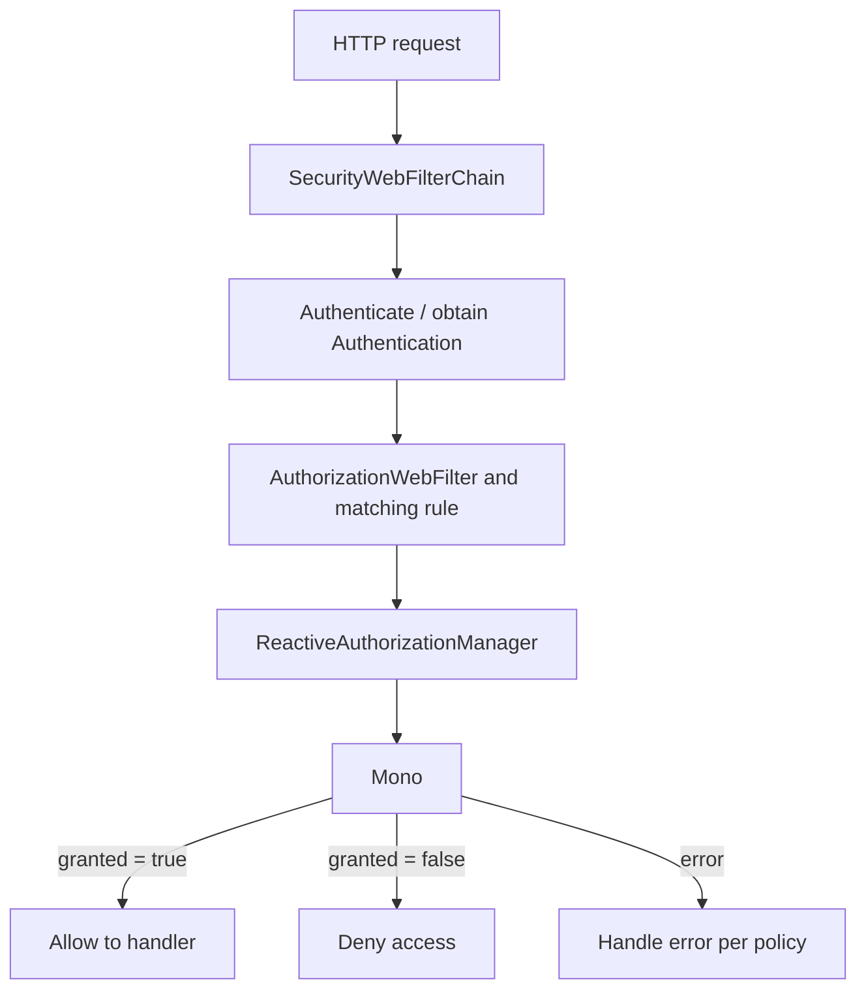

# ReactiveAuthorizationManager and Asynchronous Access Decisions

> **Scope:** Spring Security on **Spring WebFlux (reactive)**, focusing on deciding whether an HTTP request is allowed to access a resource. The Java examples below use Spring Security **7.x** APIs and Java 17+; for 6.x projects, cross-check API versions in the compatibility notes.

## 1. Learning Objectives

After this lesson, you will be able to:

- Distinguish **authentication** (identifying who the user is) from **authorization** (whether the user may perform an action on a specific resource).
- Explain the role of `ReactiveAuthorizationManager<T>` in the WebFlux processing chain and how `Mono` represents an asynchronous decision.
- Read and write access policies by URL, HTTP method, authority, role, and per-object permission.
- Integrate a reactive permission source (R2DBC, `WebClient`, etc.) without calling `block()` or manually calling `subscribe()`.
- Distinguish **allow**, **deny**, **no decision**, and **check error** outcomes, and test 401/403 scenarios.

## 2. Problem Statement and Position in the Reactive Architecture

Example: user `alice` sends `GET /api/documents/d1`. The system has authenticated Alice, yet viewing `d1` still depends on document ownership or permission data in another service. An authenticated request **does not automatically mean** the request is authorized.

In Servlet applications, the flow usually builds on `HttpSecurity`, `SecurityFilterChain`, and Servlet filters. In WebFlux, the corresponding pieces are `ServerHttpSecurity`, `SecurityWebFilterChain`, and `WebFilter`. Never mix these two configuration models.



At the authorization step, Spring Security provides the current identity as a reactive publisher along with the resource context to check. The manager describes *how* the decision is made; the framework performs the subscription, coordinates the filters, and translates errors into appropriate HTTP responses.

A decision may need to look up permissions in a database, query a policy service, or inspect resource state. The reactive model lets you compose those operations with `Mono`/`Flux` without tying up threads waiting on I/O.

## 3. The `ReactiveAuthorizationManager<T>` Contract

In Spring Security 7.x, the core interface looks like:

```java
public interface ReactiveAuthorizationManager<T> {
    Mono<AuthorizationResult> authorize(
        Mono<Authentication> authentication, T object);

    // Also provides a default verify(...) method
}
```

*This is an abbreviated API signature for explanation, not a standalone source file.*

| Element | Meaning |
| --- | --- |
| `T` | Type of object or context being authorized; for WebFlux HTTP this is typically `AuthorizationContext`. |
| `Mono<Authentication>` | Publisher holding authentication details such as username and `GrantedAuthority`. May emit no value in unauthenticated contexts. |
| `AuthorizationContext` | Exposes `getExchange()` to inspect request/response and `getVariables()` to read variables from the matched URL pattern. |
| `Mono<AuthorizationResult>` | Publisher emitting the decision; `AuthorizationResult.isGranted()` indicates whether access is granted or denied. |
| `AuthorizationDecision` | Common `AuthorizationResult` implementation: `new AuthorizationDecision(true/false)`. |
| `verify(...)` | Enforces the permission requirement: completes empty if granted, emits an error if denied. |

Four states to understand clearly:

1. **`new AuthorizationDecision(true)`:** grant access.
2. **`new AuthorizationDecision(false)`:** deny access; this is the clearest choice when user/resource data does not permit access.
3. **`Mono.empty()`:** the manager *abstains* (makes no decision); the final effect depends on the caller and how multiple managers are combined. Do not use this state as an implicit guarantee of “deny.”
4. **`Mono.error(...)`:** the check could not complete. This is a reactive stream error, semantically different from a valid denial decision. You need an error-handling policy and must avoid defaulting to “allow” when the permission store fails.

**Version differences:** 6.x APIs used `check(Mono<Authentication>, T)` returning `Mono<AuthorizationDecision>`; starting in 6.4 the `authorize` API was added, and in 7.x you should implement `authorize` returning `Mono<AuthorizationResult>`. When copying online examples using `check`, always verify against the Javadoc for your exact version.

## 4. Built-In Rules in `authorizeExchange`

For most requirements, you do not need to write a custom manager. Spring Security already provides:

- `permitAll()` / `denyAll()`: unconditionally permit or deny on that rule.
- `authenticated()`: require an authenticated identity.
- `hasAuthority("SCOPE_documents:read")`: **exact** match against an authority string.
- `hasRole("ADMIN")`: typically checks authority `ROLE_ADMIN`; do not pass the `ROLE_` prefix.
- `access(customManager)`: delegate the decision to a custom policy.

Minimal configuration example showing rule order:

```java
import org.springframework.context.annotation.Bean;
import org.springframework.context.annotation.Configuration;
import org.springframework.http.HttpMethod;
import org.springframework.security.config.annotation.web.reactive.EnableWebFluxSecurity;
import org.springframework.security.config.web.server.ServerHttpSecurity;
import org.springframework.security.web.server.SecurityWebFilterChain;

@Configuration
@EnableWebFluxSecurity
class BasicRulesConfig {
    @Bean
    SecurityWebFilterChain chain(ServerHttpSecurity http) {
        return http.authorizeExchange(ex -> ex
                .pathMatchers("/health").permitAll()
                .pathMatchers(HttpMethod.GET, "/api/reports/**")
                    .hasAuthority("SCOPE_reports:read")
                .pathMatchers("/api/admin/**").hasRole("ADMIN")
                .anyExchange().denyAll()
            )
            .build();
    }
}
```

`BasicRulesConfig.java` is a complete configuration class inside a WebFlux application that **already has an authentication mechanism** (such as OAuth2 Resource Server or HTTP Basic). This snippet illustrates authorization only and does not configure login by itself.

**Order matters a great deal:** matchers are evaluated in declaration order, and the first matching rule decides the policy applied. Put `anyExchange()` last; if you place a broad rule before a specific rule, the specific rule may never be reached. For sensitive endpoints, putting `denyAll()` at the end helps prevent accidentally exposing unclassified URLs.

## 5. Complete Example: Document Ownership Check

Suppose `GET /api/documents/{id}` allows only the owner to read a document. We separate three responsibilities cleanly: HTTP security configuration, reactive authorization policy, and permission data source. The example uses in-memory data so it is easy to run and verify; replacing it with a reactive data store is covered in section 6.

Create a Spring Boot project with **Java 17+** and the **Spring Reactive Web (WebFlux)** and **Spring Security** dependencies. Place the classes below in package `demo`; each block shows its corresponding file path. Choose a Spring Boot version paired with Spring Security 7.x.

### 5.1. Entry Point

`src/main/java/demo/ReactiveAuthorizationDemoApplication.java`:

```java
package demo;

import org.springframework.boot.SpringApplication;
import org.springframework.boot.autoconfigure.SpringBootApplication;

@SpringBootApplication
public class ReactiveAuthorizationDemoApplication {
    public static void main(String[] args) {
        SpringApplication.run(ReactiveAuthorizationDemoApplication.class, args);
    }
}
```

### 5.2. Permission Source

`src/main/java/demo/DocumentPermissionService.java`:

```java
package demo;

import java.util.Map;
import org.springframework.stereotype.Service;
import reactor.core.publisher.Mono;

@Service
public class DocumentPermissionService {
    private final Map<String, String> owners = Map.of(
        "d1", "alice",
        "d2", "bob"
    );

    public Mono<Boolean> canRead(String username, String documentId) {
        return Mono.fromSupplier(() ->
            username.equals(owners.get(documentId))
        );
    }
}
```

`Mono.fromSupplier` defers the in-memory lookup until subscription time. This check performs **no I/O** and does not simulate network latency; it serves purely as a runnable example. In a real system, this method should connect directly to a reactive repository/WebClient when policy checks require I/O.

When `documentId` is absent from the map, `owners.get(documentId)` returns `null`; `username.equals(null)` returns `false`. Thus nonexistent documents are not granted access by this manager.

### 5.3. Custom Manager

`src/main/java/demo/DocumentReadAuthorizationManager.java`:

```java
package demo;

import org.springframework.security.authorization.AuthorizationDecision;
import org.springframework.security.authorization.AuthorizationResult;
import org.springframework.security.authorization.ReactiveAuthorizationManager;
import org.springframework.security.core.Authentication;
import org.springframework.security.web.server.authorization.AuthorizationContext;
import org.springframework.stereotype.Component;
import reactor.core.publisher.Mono;

@Component
public final class DocumentReadAuthorizationManager
        implements ReactiveAuthorizationManager<AuthorizationContext> {

    private final DocumentPermissionService permissions;

    public DocumentReadAuthorizationManager(
            DocumentPermissionService permissions) {
        this.permissions = permissions;
    }

    @Override
    public Mono<AuthorizationResult> authorize(
            Mono<Authentication> authentication,
            AuthorizationContext context) {

        Object rawId = context.getVariables().get("id");
        if (!(rawId instanceof String documentId) || documentId.isBlank()) {
            return Mono.just(new AuthorizationDecision(false));
        }

        return authentication
            .filter(Authentication::isAuthenticated)
            .flatMap(auth -> permissions.canRead(auth.getName(), documentId))
            .map(allowed ->
                (AuthorizationResult) new AuthorizationDecision(
                    Boolean.TRUE.equals(allowed)))
            .defaultIfEmpty(new AuthorizationDecision(false));
    }
}
```

Step-by-step explanation:

1. `context.getVariables().get("id")` extracts the `{id}` variable from the `/api/documents/{id}` matcher; if missing, it returns an explicit deny.
2. `authentication` is a `Mono<Authentication>`, processed with Reactor operators; there is no need to call `block()` to get the username.
3. `flatMap` is used because `permissions.canRead(...)` returns a `Mono<Boolean>`. Using `map` here would produce `Mono<Mono<Boolean>>` rather than a permission result.
4. `AuthorizationDecision` converts the boolean outcome into an `AuthorizationResult`; the cast matches the 7.x API return type.
5. `defaultIfEmpty(false decision)` guarantees that a publisher without an `Authentication` or a service emitting no value results in denial instead of an ambiguous decision.

In the example, only usernames listed in the map are granted access, so even an anonymous user is denied even though `Authentication.isAuthenticated()` on certain anonymous tokens can return `true`. For policies requiring genuine authentication, let authentication filters and authorization rules enforce that condition fully.

### 5.4. WebFlux Security Configuration

`src/main/java/demo/SecurityConfig.java`:

```java
package demo;

import org.springframework.context.annotation.Bean;
import org.springframework.context.annotation.Configuration;
import org.springframework.http.HttpMethod;
import org.springframework.security.config.Customizer;
import org.springframework.security.config.annotation.web.reactive.EnableWebFluxSecurity;
import org.springframework.security.config.web.server.ServerHttpSecurity;
import org.springframework.security.core.userdetails.User;
import org.springframework.security.core.userdetails.UserDetails;
import org.springframework.security.crypto.factory.PasswordEncoderFactories;
import org.springframework.security.crypto.password.PasswordEncoder;
import org.springframework.security.provisioning.MapReactiveUserDetailsService;
import org.springframework.security.web.server.SecurityWebFilterChain;

@Configuration
@EnableWebFluxSecurity
public class SecurityConfig {

    @Bean
    SecurityWebFilterChain securityWebFilterChain(
            ServerHttpSecurity http,
            DocumentReadAuthorizationManager documentRead) {

        return http
            .authorizeExchange(ex -> ex
                .pathMatchers("/public").permitAll()
                .pathMatchers(HttpMethod.GET, "/api/documents/{id}")
                    .access(documentRead)
                .anyExchange().denyAll()
            )
            .httpBasic(Customizer.withDefaults())
            .build();
    }

    @Bean
    PasswordEncoder passwordEncoder() {
        return PasswordEncoderFactories.createDelegatingPasswordEncoder();
    }

    @Bean
    MapReactiveUserDetailsService users(PasswordEncoder encoder) {
        UserDetails alice = User.withUsername("alice")
            .password(encoder.encode("pass-alice"))
            .roles("READER")
            .build();

        UserDetails bob = User.withUsername("bob")
            .password(encoder.encode("pass-bob"))
            .roles("READER")
            .build();

        return new MapReactiveUserDetailsService(alice, bob);
    }
}
```

`MapReactiveUserDetailsService` and hardcoded passwords are **for demo use only**. Real applications need a proper account store, password hashing, and an appropriate login or JWT authentication flow. Both Alice and Bob have the `READER` role; what makes them receive different decisions on the document endpoint is **permission on object `d1`**, not their role.

### 5.5. HTTP Handler

`src/main/java/demo/DocumentController.java`:

```java
package demo;

import org.springframework.web.bind.annotation.GetMapping;
import org.springframework.web.bind.annotation.PathVariable;
import org.springframework.web.bind.annotation.RestController;
import reactor.core.publisher.Mono;

@RestController
public class DocumentController {

    @GetMapping("/public")
    public Mono<String> publicInfo() {
        return Mono.just("public");
    }

    @GetMapping("/api/documents/{id}")
    public Mono<String> read(@PathVariable String id) {
        return Mono.just("document:" + id);
    }
}
```

To run the Maven project with the Maven Wrapper, use:

```bash
./mvnw spring-boot:run
```

Then test:

```bash
curl -i http://localhost:8080/public
curl -i http://localhost:8080/api/documents/d1
curl -i -u alice:pass-alice http://localhost:8080/api/documents/d1
curl -i -u bob:pass-bob http://localhost:8080/api/documents/d1
curl -i -u alice:pass-alice http://localhost:8080/api/documents/d2
curl -i -u alice:pass-alice http://localhost:8080/api/documents/unknown
```

Expected results under the example's HTTP Basic setup:

| Request | Expected | Why |
| --- | --- | --- |
| `GET /public` without credentials | `200`, body `public` | `permitAll` rule. |
| `GET /api/documents/d1` without credentials | `401` | No valid authentication for the protected endpoint. |
| Alice reads `d1` | `200`, body `document:d1` | Permission map has `d1 -> alice`. |
| Bob reads `d1` | `403` | Authenticated, but not the owner. |
| Alice reads `d2` | `403` | `d2` belongs to Bob. |
| Alice reads a nonexistent ID | `403` | Policy returns `false`; the example avoids leaking whether the resource exists. |

HTTP status codes are mapped by Spring Security's authentication/access-denied handlers and can differ if the application configures custom entry points, exception handlers, or multiple security chains.

## 6. Truly Asynchronous Authorization Decisions

The in-memory map in section 5 performs no I/O. In real systems, permission checks often query a database or a policy service. The signature should still return `Mono<Boolean>` and use a **genuine reactive client**, for example:

```java
// Illustration inside DocumentPermissionService if the repository is R2DBC.
// documentRepository.findById(id) returns Mono<Document>.
public Mono<Boolean> canRead(String username, String id) {
    return documentRepository.findById(id)
        .map(document -> username.equals(document.getOwnerUsername()))
        .defaultIfEmpty(false);
}
```

This snippet is **not standalone-compilable**: `documentRepository`, `Document`, and the owner property must be defined according to your real domain. The key point is that `flatMap` inside the manager awaits the repository result asynchronously **without blocking a thread**.

If looking up permissions over HTTP, use `WebClient` and map the response to `Mono<Boolean>`. Consider service-to-service authentication, timeouts, cache/TTL, load limits, auditing, and the fact that permissions can change between two checks.

A *fail-closed* error-handling policy can be expressed as:

```java
// Illustrative snippet to be wired to the application's reactive repository.
return documentRepository.findById(id)
    .map(document -> username.equals(document.getOwnerUsername()))
    .defaultIfEmpty(false)
    .timeout(java.time.Duration.ofSeconds(2))
    .onErrorReturn(false);
```

`onErrorReturn(false)` intentionally **denies** on error/timeout. This is a business choice that requires logging and observability: it turns an infrastructure error into an “insufficient permissions” outcome, which can hide operational incidents without proper metrics/logs. Another option is preserving `Mono.error` so the system reports a service error, but never “allow” when permissions cannot be verified. Never use `Thread.sleep`, blocking JDBC, or synchronous HTTP clients on the event loop.

## 7. Why `map`, `flatMap`, `defer`, and Reactor Context Matter

- `map` transforms a **synchronous value**: `Mono<Boolean>` into `Mono<AuthorizationResult>`.
- `flatMap` chains a function returning **another Publisher**: from `Authentication` to the permission service's `Mono<Boolean>`.
- `Mono.defer` / `Mono.fromSupplier` defer creating/reading data until subscription time, avoiding premature state reads; they **do not turn a blocking task into a non-blocking one**.
- `ReactiveSecurityContextHolder` carries `SecurityContext` via **Reactor Context**. Do not assume ThreadLocal-based `SecurityContextHolder` behaves the same as in Servlet paths, especially across scheduler switches.
- The framework subscribes to the authorization chain. Calling `subscribe()` manually inside a manager detaches work from the error, request, and security-context flows.

Illustrative example of reading the principal from reactive context:

```java
import org.springframework.security.core.context.ReactiveSecurityContextHolder;
import reactor.core.publisher.Mono;

Mono<String> currentUsername() {
    return ReactiveSecurityContextHolder.getContext()
        .map(ctx -> ctx.getAuthentication().getName());
}
```

This is an **illustrative method** that must sit inside a Java class and be called in a context where Spring Security's Reactor Context is populated. Inside `ReactiveAuthorizationManager`, you already receive `Mono<Authentication>` directly, so use that parameter rather than reading the context again.

## 8. How Do HTTP and Method Authorization Differ?

`SecurityWebFilterChain` enforces permissions at the **request** level: path, HTTP method, headers, or exchange context. `@EnableReactiveMethodSecurity` enables checks at **service methods**, preserving protection boundaries when business logic is invoked from multiple entry points.

```java
// Add @EnableReactiveMethodSecurity to a @Configuration class.
import org.springframework.security.access.prepost.PreAuthorize;
import reactor.core.publisher.Mono;

@PreAuthorize("hasRole('READER')")
public Mono<String> findDocument(String documentId) {
    return documentRepository.findById(documentId)
        .map(Object::toString);
}
```

This is an **illustrative method** example: it must reside in a Spring-managed bean with a properly typed `documentRepository` and `@EnableReactiveMethodSecurity` enabled. Checking a role on the service **does not replace** per-document ownership checks. Reactive methods should return `Mono`/`Flux` to interact with Reactor Context; note that self-invocation within the same bean can bypass the Spring AOP proxy.

A common architecture performs coarse-grained checks (authenticated, endpoint, role/scope) at the HTTP layer while enforcing object-specific permissions in the service/domain layer; avoid putting all business rules solely in controllers.

## 9. Common Pitfalls and How to Handle Them

| Mistake | Consequence | Proper Practice |
| --- | --- | --- |
| Using `HttpSecurity`/`SecurityFilterChain` for WebFlux | Configures the wrong (Servlet) architecture | Use `ServerHttpSecurity`/`SecurityWebFilterChain`. |
| Using `check`/`Mono<AuthorizationDecision>` from 6.x examples in 7.x code | API mismatch / won't compile | 7.x: `authorize` and `Mono<AuthorizationResult>`. |
| `.map(auth -> permissionService.canRead(...))` | Produces `Mono<Mono<Boolean>>` | Use `flatMap` when the function returns a `Mono`. |
| `.block()` inside a manager or WebFlux handler | Blocks the event loop, lowers scalability, may fail at runtime | Chain reactive operators end to end. |
| Calling `subscribe()` manually | Detaches from the security chain, losing error/context control | Return the publisher to the framework. |
| `hasRole("ROLE_ADMIN")` | Can create an incorrect prefix check | Use `hasRole("ADMIN")` or `hasAuthority("ROLE_ADMIN")`. |
| Allowing access when the repository is empty or errors | Vulnerability when policy data is missing | Deny explicitly; define an error policy. |
| Putting `anyExchange().permitAll()` first | Subsequent protection rules have no effect | Specific rules first, fallback last. |
| Relying on roles to check `documentId` ownership | Anyone with the role can read other users' documents | Check permission on the actual resource, bound to the current user. |
| Treating `Mono.empty()` as an absolute deny | Confuses “no decision” with “deny” | Return `AuthorizationDecision(false)` when access must actually be denied. |

### Implementation Checklist

1. Identify the protected target (request, document, tenant, action) and the default policy when data is missing.
2. Choose exact URL + HTTP method matchers; verify rule order and fallback.
3. Isolate reactive permission data sources, use `flatMap`, and check user–resource together in the same flow.
4. Handle explicit deny, empty publishers, errors, timeouts, and invalid identities.
5. Test at least: public, unauthenticated, authorized, unauthorized, nonexistent resource, and policy-service failure.
6. In multi-tenant setups, do not rely solely on username or URL IDs: verify the actual tenant/owner in data as well.
7. Monitor latency, denial counts, and policy-service errors/timeouts without logging tokens or sensitive data.

## 10. Knowledge Self-Check

**Question 1.** Why does the permission service's `Mono<Boolean>` need `flatMap` after `Mono<Authentication>`?  
**Answer:** Because the service returns a publisher; `flatMap` flattens that publisher into the chain, whereas `map` would keep nested publishers.

**Question 2.** A logged-in user tries to read another user's document: what is the outcome?  
**Answer:** The manager should return `AuthorizationDecision(false)`; with standard HTTP Basic configuration, the response is `403`.

**Question 3.** If the permission store returns no rows, should the manager return `Mono.empty()`?  
**Answer:** No, if fail-closed behavior is required. Use `defaultIfEmpty(false)` at the permission layer so the manager ultimately emits an explicit deny.

**Question 4.** Does `Mono.fromSupplier(() -> jdbcRepository.find(...))` turn JDBC into non-blocking I/O?  
**Answer:** No. It only defers execution time; JDBC remains blocking. Use R2DBC, or a controlled adapter/scheduler when forced to work with a blocking source, and never run it directly on the event loop.

## Official Documentation

- [Spring Security Javadoc — ReactiveAuthorizationManager](https://docs.spring.io/spring-security/reference/api/java/org/springframework/security/authorization/ReactiveAuthorizationManager.html)
- [Spring Security — Authorize ServerHttpRequest](https://docs.spring.io/spring-security/reference/reactive/authorization/authorize-http-requests.html)
- [Spring Security — EnableReactiveMethodSecurity](https://docs.spring.io/spring-security/reference/reactive/authorization/method.html)
- [Spring Security — WebFlux Security](https://docs.spring.io/spring-security/reference/reactive/configuration/webflux.html)
