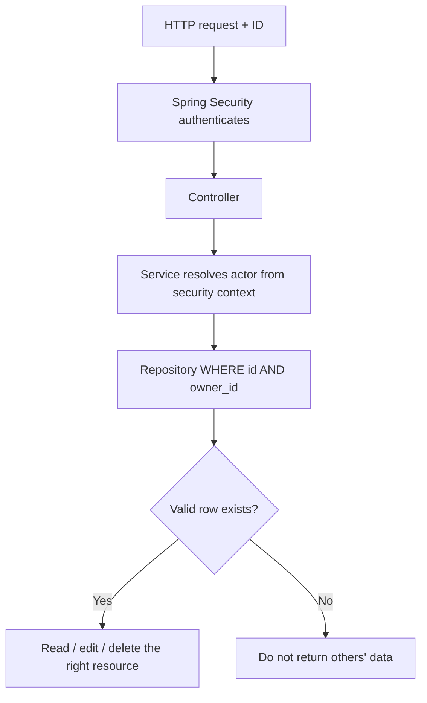

# Resource Ownership and Preventing Access to Other Users' Data

> **Context:** Authorization in Spring Security (Spring MVC/Servlet). The focus is access control on **each specific record/resource**, not merely checking whether the user is logged in or holds a role. Practical examples use Java 17, Spring Boot 3.5.x, Spring Security 6.5.x, Spring Data JPA, and H2. The resource name "note" is only an example; the same principles apply to invoices, profiles, orders, files, comments, tasks, and tenant-scoped data.

## 1. What Should You Understand After This Lesson?

- Distinguish **authentication**, function/role permissions, and **object-level authorization** (permissions on specific resources).
- Recognize **IDOR** (Insecure Direct Object Reference) / **BOLA** (Broken Object Level Authorization) vulnerabilities: swapping IDs to view, edit, download, or delete someone else's data.
- Bind every read/write operation to the **server-authenticated identity** and ownership/sharing relationships in the data.
- Write queries conditioned on `resource_id + owner_id`, user-scoped list queries, conditional update/delete statements, and appropriate error responses.
- Combine HTTP, service, repository, and Spring Security method security layers, and test both allowed and denied cases.
- Recognize complex scenarios: multi-tenancy, resource sharing, ownership transfer, caching, asynchronous processing, and data concurrency.

## 2. The Problem: Logged In Yet Still Able to Access Others' Data

Suppose an API returns a note:

```http
GET /api/notes/101
Authorization: Basic ...
```

Alice owns note `101`, and Bob owns note `102`. If the server only checks "logged in" and executes:

```java
// Dangerous pattern: checks ID only, without checking who has permission.
Note note = noteRepository.findById(requestedId).orElseThrow();
return note.getBody();
```

then Bob can request `/api/notes/101` and receive Alice's data. Bob **does not need to guess Alice's password**: he already has a valid login session, yet authorization checks for the specific object are missing.

This is **BOLA/IDOR**. An ID can be an auto-incrementing number, UUID, slug, filename, or JSON code: **unguessable IDs do not replace authorization**. The same flaw also appears when altering a file download path, changing `ownerId` in a request body, swapping a `userId` query parameter, swapping nested IDs, or abusing bulk/export APIs.

Three questions must be distinguished:

| Question | Example | Where to check? |
| --- | --- | --- |
| **Authentication:** Who is calling? | Is Alice authenticated? | Spring Security (session, Basic, OAuth2/JWT...). |
| **Function-level authorization:** Allowed to use this feature? | Does Alice have `SCOPE_notes:write`? | HTTP rules or method security. |
| **Object-level authorization:** Allowed to act on this record? | Does note `101` belong to Alice or was it shared with Alice? | Resource-level policy at service/repository. |

Users sharing the same `ROLE_USER` are usually allowed to reach the endpoint, yet **do not have permission for the same set of records**. Ownership is a policy on the object; a role only describes a general capability.

## 3. Permission Model: Owner, Tenant, Action, and Sharing

The simplest rule:

```text
allow(actor, action, resource)
    = actor is authenticated
      AND action is permitted on resource
      AND resource.ownerId == actor.id
```

In practice, a policy can be:

```text
allow = authenticated
    AND matching tenant
    AND (
        actor is owner
        OR actor was granted access via ACL/share
        OR actor is an in-scope administrator
    )
    AND action is permitted (read/write/delete)
    AND resource is in a state allowing the operation
```

- **Owner:** the owner under business rules. `createdBy` is not always the current owner: resources may be transferred, owned by an organization, or managed by multiple people.
- **Actor/principal:** the identity authenticated by the system. Taken from `SecurityContext`, a verified token, or a trusted internal identification mechanism; do not trust self-declared `userId` or `ownerId` in URL/body.
- **Tenant:** boundary between organizations/customers. Having the same username across two tenants does not grant cross-tenant access. Prefer a stable, globally unique user identifier or a verified `tenantId + userId` pair.
- **Action:** `read`, `write`, `delete`, `share`, `export`... never assume edit permission just because read permission exists.
- **ACL / relationship-based access:** e.g., shared document viewers, project members, order assignees. Here "only owner may read" is too strict; replace it with an explicit policy and test each relationship.

Core principles: **deny by default**, **least privilege**, enforce permissions **on the server for every request**, and ensure different entry points do not apply inconsistent policies.

## 4. Where Must Authorization Be Enforced in Spring Security?

### 4.1. HTTP Security Is the Front Gate

```java
http.authorizeHttpRequests(auth -> auth
    .requestMatchers("/api/notes/**").authenticated()
    .anyRequest().denyAll()
);
```

This is an **illustrative** configuration inside `SecurityFilterChain`. It blocks unauthenticated access to note URLs, yet **does not know** whether note `101` belongs to Alice or Bob. Merely replacing `authenticated()` with `hasRole("USER")` does not solve BOLA either.

### 4.2. The Service Holds Business Rules

The controller receives the ID and request data; the service decides which resources may be viewed or edited; the repository queries with permission-constraining predicates. When multiple controllers, batch jobs, or endpoints call the same service, they share one policy.



By placing owner/tenant predicates into the **query**, we avoid loading another user's record before filtering in the controller. For write operations, putting the permission condition directly in the SQL `UPDATE`/`DELETE` also makes checking and writing one atomic step in the database.

### 4.3. Method Security Helps, When Used Correctly

`@EnableMethodSecurity` enables annotations such as `@PreAuthorize` and `@PostAuthorize`. For instance, `@PreAuthorize("isAuthenticated()")` protects a service from unauthenticated calls; another expression can check roles/scopes or a permission bean.

`@PostAuthorize` can compare the owner on the **return value of a read method**, yet **must not be used as the sole checkpoint for write operations**: the method may already have updated the database before the interceptor checks the return value. Likewise, writing only `@PreAuthorize("#ownerId == authentication.name")` when `ownerId` comes from the request is **insufficient**, because an attacker can send their own name while targeting someone else's resource ID.

## 5. Complete Practical Example: Notes API Accessing Only One's Own Resources

This example uses **Spring MVC + Spring Data JPA** (blocking, suitable for Servlet) and an embedded H2 database. Every data query must obtain the actor **inside the service** from `SecurityContextHolder`; the client **cannot pass `ownerId`** to choose an owner. This is a runnable Maven demo app once the files below are created.

### 5.1. Create `pom.xml`

```xml
<?xml version="1.0" encoding="UTF-8"?>
<project xmlns="http://maven.apache.org/POM/4.0.0"
         xmlns:xsi="http://www.w3.org/2001/XMLSchema-instance"
         xsi:schemaLocation="http://maven.apache.org/POM/4.0.0 https://maven.apache.org/xsd/maven-4.0.0.xsd">
    <modelVersion>4.0.0</modelVersion>
    <parent>
        <groupId>org.springframework.boot</groupId>
        <artifactId>spring-boot-starter-parent</artifactId>
        <version>3.5.0</version>
        <relativePath/>
    </parent>
    <groupId>demo</groupId>
    <artifactId>owned-notes</artifactId>
    <version>0.0.1-SNAPSHOT</version>
    <properties><java.version>17</java.version></properties>
    <dependencies>
        <dependency>
            <groupId>org.springframework.boot</groupId>
            <artifactId>spring-boot-starter-web</artifactId>
        </dependency>
        <dependency>
            <groupId>org.springframework.boot</groupId>
            <artifactId>spring-boot-starter-security</artifactId>
        </dependency>
        <dependency>
            <groupId>org.springframework.boot</groupId>
            <artifactId>spring-boot-starter-data-jpa</artifactId>
        </dependency>
        <dependency>
            <groupId>com.h2database</groupId>
            <artifactId>h2</artifactId>
            <scope>runtime</scope>
        </dependency>
        <dependency>
            <groupId>org.springframework.boot</groupId>
            <artifactId>spring-boot-starter-test</artifactId>
            <scope>test</scope>
        </dependency>
        <dependency>
            <groupId>org.springframework.security</groupId>
            <artifactId>spring-security-test</artifactId>
            <scope>test</scope>
        </dependency>
    </dependencies>
    <build>
        <plugins>
            <plugin>
                <groupId>org.springframework.boot</groupId>
                <artifactId>spring-boot-maven-plugin</artifactId>
            </plugin>
        </plugins>
    </build>
</project>
```

This is a real demo using Spring Boot `3.5.0`; in real deployments, use an appropriate maintenance release in the chosen version line and apply security patches.

Create `src/main/resources/application.properties`:

```properties
spring.datasource.url=jdbc:h2:mem:ownershipdb;DB_CLOSE_DELAY=-1
spring.datasource.driver-class-name=org.h2.Driver
spring.jpa.hibernate.ddl-auto=create-drop
spring.jpa.open-in-view=false
```

`create-drop` and in-memory H2 are for testing only. They wipe data when the application shuts down; never use them as persistent real data storage.

### 5.2. Entity: Owner Is Server-Managed Data

`src/main/java/demo/ownership/Note.java`:

```java
package demo.ownership;

import jakarta.persistence.Column;
import jakarta.persistence.Entity;
import jakarta.persistence.GeneratedValue;
import jakarta.persistence.GenerationType;
import jakarta.persistence.Id;
import jakarta.persistence.Table;

@Entity
@Table(name = "notes")
public class Note {
    @Id
    @GeneratedValue(strategy = GenerationType.IDENTITY)
    private Long id;

    @Column(nullable = false, updatable = false)
    private String ownerId;

    @Column(nullable = false, length = 2000)
    private String body;

    protected Note() {
    }

    public Note(String ownerId, String body) {
        this.ownerId = ownerId;
        this.body = body;
    }

    public Long getId() {
        return id;
    }

    public String getOwnerId() {
        return ownerId;
    }

    public String getBody() {
        return body;
    }
}
```

There is no `setOwnerId` setter. The owner field is assigned upon record creation from the authenticated identity, preventing clients from altering owner via JSON. If business rules allow transferring ownership, implement it as a **dedicated command that checks transfer permissions**, rather than freely updating a field.

### 5.3. Repository: Always Scope by Owner

`src/main/java/demo/ownership/NoteRepository.java`:

```java
package demo.ownership;

import java.util.List;
import java.util.Optional;
import org.springframework.data.jpa.repository.JpaRepository;
import org.springframework.data.jpa.repository.Modifying;
import org.springframework.data.jpa.repository.Query;
import org.springframework.data.repository.query.Param;

public interface NoteRepository extends JpaRepository<Note, Long> {
    Optional<Note> findByIdAndOwnerId(Long id, String ownerId);

    List<Note> findByOwnerIdOrderByIdAsc(String ownerId);

    @Modifying(clearAutomatically = true, flushAutomatically = true)
    @Query("""
        update Note n
           set n.body = :body
         where n.id = :id
           and n.ownerId = :ownerId
        """)
    int updateOwnedBody(
        @Param("id") Long id,
        @Param("ownerId") String ownerId,
        @Param("body") String body
    );

    @Modifying(clearAutomatically = true, flushAutomatically = true)
    @Query("""
        delete from Note n
         where n.id = :id
           and n.ownerId = :ownerId
        """)
    int deleteOwned(
        @Param("id") Long id,
        @Param("ownerId") String ownerId
    );
}
```

The core idea is `WHERE id = ? AND owner_id = ?`. An ID that exists in the database yet belongs to another user returns `Optional.empty()` or `0` affected rows. Thus, unauthorized users receive no data distinguishing between "does not exist" and "belongs to someone else" in this example.

For update/delete statements, `1` affected row means a matching row existed and the operation executed; `0` means no matching row. This avoids the vulnerability of **checking owner in a SELECT step and then running UPDATE by ID only**, where ownership might change between steps.

### 5.4. DTO: Let the Client Provide Only Content

`src/main/java/demo/ownership/NoteRequest.java`:

```java
package demo.ownership;

public record NoteRequest(String body) {
}
```

`src/main/java/demo/ownership/NoteResponse.java`:

```java
package demo.ownership;

public record NoteResponse(Long id, String body) {
}
```

Input has no `ownerId` or `tenantId`. The response DTO also omits unnecessary internal fields. In real applications, add Bean Validation, request size limits, and a whitelist of editable fields.

### 5.5. Service: Resolve Actor From Context, Check Every Operation

`src/main/java/demo/ownership/NoteService.java`:

```java
package demo.ownership;

import java.util.List;
import org.springframework.http.HttpStatus;
import org.springframework.security.access.prepost.PreAuthorize;
import org.springframework.security.core.context.SecurityContextHolder;
import org.springframework.stereotype.Service;
import org.springframework.transaction.annotation.Transactional;
import org.springframework.web.server.ResponseStatusException;

@Service
@PreAuthorize("isAuthenticated()")
@Transactional(readOnly = true)
public class NoteService {
    private final NoteRepository notes;

    public NoteService(NoteRepository notes) {
        this.notes = notes;
    }

    public List<NoteResponse> list() {
        return notes.findByOwnerIdOrderByIdAsc(actor())
            .stream()
            .map(NoteService::toResponse)
            .toList();
    }

    public NoteResponse get(Long id) {
        return notes.findByIdAndOwnerId(id, actor())
            .map(NoteService::toResponse)
            .orElseThrow(NoteService::hidden);
    }

    @Transactional
    public NoteResponse create(String body) {
        Note saved = notes.save(new Note(actor(), checkedBody(body)));
        return toResponse(saved);
    }

    @Transactional
    public NoteResponse update(Long id, String body) {
        String owner = actor();
        int changed = notes.updateOwnedBody(id, owner, checkedBody(body));
        if (changed == 0) {
            throw hidden();
        }
        return notes.findByIdAndOwnerId(id, owner)
            .map(NoteService::toResponse)
            .orElseThrow(NoteService::hidden);
    }

    @Transactional
    public void delete(Long id) {
        if (notes.deleteOwned(id, actor()) == 0) {
            throw hidden();
        }
    }

    private static String actor() {
        return SecurityContextHolder.getContext()
            .getAuthentication()
            .getName();
    }

    private static NoteResponse toResponse(Note note) {
        return new NoteResponse(note.getId(), note.getBody());
    }

    private static String checkedBody(String body) {
        if (body == null || body.isBlank() || body.length() > 2000) {
            throw new ResponseStatusException(
                HttpStatus.BAD_REQUEST,
                "body must contain 1 to 2000 characters");
        }
        return body;
    }

    private static ResponseStatusException hidden() {
        return new ResponseStatusException(
            HttpStatus.NOT_FOUND,
            "Note not found");
    }
}
```

**Why is this safer than `findById(id)`?**

1. `@PreAuthorize("isAuthenticated()")` requires an authenticated identity before invoking service methods from outside the Spring proxy. Note: this annotation only works when `@EnableMethodSecurity` is enabled; method security uses Spring AOP so **self-invocation within the same bean can bypass the interceptor**.
2. `actor()` reads the principal authenticated by Spring Security; it never accepts `ownerId` from URL, DTO, untrusted header, or a controller parameter.
3. `list()` queries **only the actor's dataset**. Avoid loading the whole list and filtering in Java: that can leak via pagination, counts, caches, or mappers.
4. `get()` queries simultaneously by ID and owner. Even if the ID is valid, a different owner yields `404`.
5. `create()` sets the owner automatically on save; clients cannot create a note under someone else's name just by adding JSON fields.
6. `update()` and `delete()` enforce the owner condition **inside the write statement** and verify the affected row count. If unmatched, they return `404`.
7. `@Transactional` wraps write operations in a transaction. Read methods use `readOnly=true`; writes override it with `@Transactional`.

The example uses `SecurityContextHolder` because this is **Spring MVC/Servlet**. In WebFlux/Reactor, do not copy this ThreadLocal-based approach; use `ReactiveSecurityContextHolder`/`Mono<Authentication>` and a reactive repository instead.

### 5.6. Controller: Coordinate Only, Do Not Decide Owner Instead of Service

`src/main/java/demo/ownership/NoteController.java`:

```java
package demo.ownership;

import java.util.List;
import org.springframework.http.HttpStatus;
import org.springframework.web.bind.annotation.DeleteMapping;
import org.springframework.web.bind.annotation.GetMapping;
import org.springframework.web.bind.annotation.PatchMapping;
import org.springframework.web.bind.annotation.PathVariable;
import org.springframework.web.bind.annotation.PostMapping;
import org.springframework.web.bind.annotation.RequestBody;
import org.springframework.web.bind.annotation.RequestMapping;
import org.springframework.web.bind.annotation.ResponseStatus;
import org.springframework.web.bind.annotation.RestController;

@RestController
@RequestMapping("/api/notes")
public class NoteController {
    private final NoteService service;

    public NoteController(NoteService service) {
        this.service = service;
    }

    @GetMapping
    public List<NoteResponse> list() {
        return service.list();
    }

    @GetMapping("/{id}")
    public NoteResponse get(@PathVariable Long id) {
        return service.get(id);
    }

    @PostMapping
    @ResponseStatus(HttpStatus.CREATED)
    public NoteResponse create(@RequestBody NoteRequest request) {
        return service.create(request.body());
    }

    @PatchMapping("/{id}")
    public NoteResponse update(
            @PathVariable Long id,
            @RequestBody NoteRequest request) {
        return service.update(id, request.body());
    }

    @DeleteMapping("/{id}")
    @ResponseStatus(HttpStatus.NO_CONTENT)
    public void delete(@PathVariable Long id) {
        service.delete(id);
    }
}
```

Do not call the repository directly from the controller to "skip" the service; one endpoint missing an owner check can undermine the entire policy.

### 5.7. Security and Sample Data

`src/main/java/demo/ownership/SecurityConfig.java`:

```java
package demo.ownership;

import org.springframework.context.annotation.Bean;
import org.springframework.context.annotation.Configuration;
import org.springframework.security.config.Customizer;
import org.springframework.security.config.annotation.method.configuration.EnableMethodSecurity;
import org.springframework.security.config.annotation.web.builders.HttpSecurity;
import org.springframework.security.core.userdetails.User;
import org.springframework.security.core.userdetails.UserDetails;
import org.springframework.security.crypto.factory.PasswordEncoderFactories;
import org.springframework.security.crypto.password.PasswordEncoder;
import org.springframework.security.provisioning.InMemoryUserDetailsManager;
import org.springframework.security.web.SecurityFilterChain;

@Configuration
@EnableMethodSecurity
public class SecurityConfig {
    @Bean
    SecurityFilterChain filterChain(HttpSecurity http) throws Exception {
        return http
            .authorizeHttpRequests(auth -> auth
                .requestMatchers("/api/notes", "/api/notes/**")
                    .authenticated()
                .anyRequest().denyAll()
            )
            .httpBasic(Customizer.withDefaults())
            .build();
    }

    @Bean
    PasswordEncoder passwordEncoder() {
        return PasswordEncoderFactories.createDelegatingPasswordEncoder();
    }

    @Bean
    InMemoryUserDetailsManager users(PasswordEncoder encoder) {
        UserDetails alice = User.withUsername("alice")
            .password(encoder.encode("demo-alice"))
            .roles("USER")
            .build();
        UserDetails bob = User.withUsername("bob")
            .password(encoder.encode("demo-bob"))
            .roles("USER")
            .build();
        return new InMemoryUserDetailsManager(alice, bob);
    }
}
```

All note APIs require authentication. Alice and Bob share the **same `USER` role**; preventing them from reading each other's resources comes from the owner condition in the repository, not role separation.

**CSRF remains enabled by default** in this example. Consequently, `POST/PATCH/DELETE` requests from an HTTP client normally need a valid CSRF token (otherwise they usually get `403` before reaching the service). The `curl` commands below illustrate **GET** only; the integration tests in section 6 use `with(csrf())` for write operations. Do not mechanically disable CSRF in applications using cookies/sessions or HTTP Basic where browsers may send credentials automatically.

`src/main/java/demo/ownership/OwnedNotesApplication.java`:

```java
package demo.ownership;

import org.springframework.boot.CommandLineRunner;
import org.springframework.boot.SpringApplication;
import org.springframework.boot.autoconfigure.SpringBootApplication;
import org.springframework.context.annotation.Bean;

@SpringBootApplication
public class OwnedNotesApplication {
    public static void main(String[] args) {
        SpringApplication.run(OwnedNotesApplication.class, args);
    }

    @Bean
    CommandLineRunner seed(NoteRepository notes) {
        return args -> {
            notes.save(new Note("alice", "Alice private note"));
            notes.save(new Note("bob", "Bob private note"));
        };
    }
}
```

With a fresh H2 database, two demo records are generated with IDs `1` (Alice) and `2` (Bob). Hard-coded accounts/passwords and seed data are only for learning environments. Production requires a real IdP/user store, secret management, TLS, and a persistent database.

### 5.8. Run and Observe

The source directory must match `src/main/java/demo/ownership/...` and `src/main/resources/application.properties`. Use JDK 17+ and Maven:

```bash
mvn test
mvn spring-boot:run
```

In another terminal:

```bash
# Alice reads her own note: 200
curl -i -u alice:demo-alice http://localhost:8080/api/notes/1

# Alice changes ID to Bob's record: 404, Bob's body not visible
curl -i -u alice:demo-alice http://localhost:8080/api/notes/2

# Bob reads his own note: 200
curl -i -u bob:demo-bob http://localhost:8080/api/notes/2

# Unauthenticated: 401
curl -i http://localhost:8080/api/notes/1

# Alice's list: only Alice's notes
curl -i -u alice:demo-alice http://localhost:8080/api/notes
```

With the demo's clean H2 database, the two valid GETs return JSON like:

```json
{"id":1,"body":"Alice private note"}
```

```json
{"id":2,"body":"Bob private note"}
```

Alice reading `/api/notes/2` returns `404` because SQL finds no row matching **both ID 2 and owner Alice**; it does not prove record 2 does not exist globally. Depending on API policy, an authenticated-but-unauthorized case may return `403 Forbidden`. For sensitive resources, `404 Not Found` is often used to avoid revealing the existence of others' resources. Whether choosing `403` or `404`, **never return payloads**, owners, or error messages leaking data.

## 6. Testing IDOR/BOLA With Spring Security Test

Add file `src/test/java/demo/ownership/OwnedNotesAuthorizationTest.java`:

```java
package demo.ownership;

import org.junit.jupiter.api.Test;
import org.springframework.beans.factory.annotation.Autowired;
import org.springframework.boot.test.autoconfigure.web.servlet.AutoConfigureMockMvc;
import org.springframework.boot.test.context.SpringBootTest;
import org.springframework.http.MediaType;
import org.springframework.test.web.servlet.MockMvc;
import org.springframework.transaction.annotation.Transactional;

import static org.springframework.security.test.web.servlet.request.SecurityMockMvcRequestPostProcessors.csrf;
import static org.springframework.security.test.web.servlet.request.SecurityMockMvcRequestPostProcessors.user;
import static org.springframework.test.web.servlet.request.MockMvcRequestBuilders.get;
import static org.springframework.test.web.servlet.request.MockMvcRequestBuilders.patch;
import static org.springframework.test.web.servlet.result.MockMvcResultMatchers.jsonPath;
import static org.springframework.test.web.servlet.result.MockMvcResultMatchers.status;

@SpringBootTest
@AutoConfigureMockMvc
@Transactional
class OwnedNotesAuthorizationTest {
    @Autowired
    MockMvc mvc;

    @Test
    void unauthenticatedRequestIsRejected() throws Exception {
        mvc.perform(get("/api/notes/1"))
            .andExpect(status().isUnauthorized());
    }

    @Test
    void aliceCanReadOnlyHerOwnNote() throws Exception {
        mvc.perform(get("/api/notes/1").with(user("alice")))
            .andExpect(status().isOk())
            .andExpect(jsonPath("$.body").value("Alice private note"));

        mvc.perform(get("/api/notes/2").with(user("alice")))
            .andExpect(status().isNotFound());
    }

    @Test
    void bobCannotChangeAlicesNote() throws Exception {
        mvc.perform(patch("/api/notes/1")
                .with(user("bob"))
                .with(csrf())
                .contentType(MediaType.APPLICATION_JSON)
                .content("{\"body\":\"Overwritten\"}"))
            .andExpect(status().isNotFound());

        mvc.perform(get("/api/notes/1").with(user("alice")))
            .andExpect(status().isOk())
            .andExpect(jsonPath("$.body").value("Alice private note"));
    }

    @Test
    void aliceCanChangeHerOwnNote() throws Exception {
        mvc.perform(patch("/api/notes/1")
                .with(user("alice"))
                .with(csrf())
                .contentType(MediaType.APPLICATION_JSON)
                .content("{\"body\":\"Updated by Alice\"}"))
            .andExpect(status().isOk())
            .andExpect(jsonPath("$.body").value("Updated by Alice"));
    }

    @Test
    void aliceListContainsNoBobsNote() throws Exception {
        mvc.perform(get("/api/notes").with(user("alice")))
            .andExpect(status().isOk())
            .andExpect(jsonPath("$[0].body").value("Alice private note"))
            .andExpect(jsonPath("$.length()").value(1));
    }
}
```

The tests use `user("alice")`/`user("bob")` to create authentication in MockMvc and `csrf()` to pass the CSRF filter, thereby genuinely testing authorization in the service/repository. `@Transactional` on the test rolls back write changes after each test. When running through a real HTTP client or asynchronous stack, design separate database isolation for tests.

A real test matrix should also include:

| Case | Expectation |
| --- | --- |
| Anonymous accessing protected record | `401` in the HTTP Basic example |
| Owner reading/editing/deleting own resource | Succeeds per feature |
| Another user reading/editing/deleting resource | Denied; original data unchanged |
| Owner passing non-existent ID | `404` |
| User adding another `ownerId` to create/edit request | Must not transfer ownership |
| List, search, stats, export for a user | Contains no records belonging to others |
| User in tenant A using tenant B resource ID | Denied |
| Share permission revoked between requests | Next request honors new permissions |
| Missing CSRF token on CSRF-protected write method | `403`, never reaches write logic |
| Race when owner changes during update | No unauthorized write; condition verified at update time |

**Note:** Do not test only read requests; BOLA on `PATCH`, `DELETE`, `POST /api/notes/{id}/share`, and bulk APIs causes even more severe data loss or corruption.

## 7. SQL Protecting Objects: Reads, Lists, and Writes

### 7.1. Reading a Single Object

```sql
SELECT id, body
FROM notes
WHERE id = :noteId AND owner_id = :actorId;
```

Do not run `SELECT * FROM notes WHERE id = :noteId` trusting the controller to remember checking `note.getOwnerId()`. Loading excessive data before authorization checks also risks leaks via logs, mappers, caches, metrics, or exceptions.

### 7.2. Lists and Pagination

```sql
SELECT id, body
FROM notes
WHERE owner_id = :actorId
ORDER BY id
LIMIT :pageSize OFFSET :offset;
```

Both the list query **and the total-element count query** must share the same owner/tenant condition. Filtering after `Page` has already computed `totalElements` leaks counts and breaks pagination.

### 7.3. Conditional Updates/Deletes

```sql
UPDATE notes
SET body = :newBody
WHERE id = :noteId AND owner_id = :actorId;

DELETE FROM notes
WHERE id = :noteId AND owner_id = :actorId;
```

Inspect the affected row count to tell whether the update/delete succeeded. When ownership changes, share grants are revoked, or resource state changes, design transactions, locks/optimistic locking, or sufficiently scoped `UPDATE ... WHERE ...` statements to prevent **time-of-check to time-of-use (TOCTOU)**.

### 7.4. Multi-Tenancy

If each note also belongs to a company, adjust the predicate to:

```sql
SELECT id, body
FROM notes
WHERE id = :noteId
  AND tenant_id = :trustedTenantId
  AND owner_id = :trustedUserId;
```

`trustedTenantId` must come from a server-verified membership relation or authenticated claims checked in the proper context. Never trust an `X-Tenant-Id` header, `?tenant=...` query parameter, or `tenantId` payload field merely because it looks valid.

For group permissions or sharing, replace the fixed owner comparison with an authorized-relationship query (for example `EXISTS` in an ACL table matching `actorId`, `action`, and `resourceId`), still scoped by tenant and validity state. Check access before generating signed file-download URLs; issued URLs also need short TTLs and narrow scope.

## 8. Choosing 401, 403, or 404?

| HTTP status | Meaning | Typical situation |
| --- | --- | --- |
| `401 Unauthorized` | No / invalid authentication | Missing credentials, expired token, or invalid signature |
| `403 Forbidden` | Valid identity, not allowed to perform action | Missing role/scope/permission; API openly states denial rule |
| `404 Not Found` | Resource not visible to caller | Non-existent ID or record owned by someone else when hiding existence |
| `400 Bad Request` | Invalid request | Null body, too long, wrong parameter type |
| `200/201/204` | Valid operation | Read/update; create; delete with no body |

`401` is an HTTP term named "Unauthorized" that at the application level usually indicates an **authentication issue**; `403` means **insufficient permission**. Returning `404` to conceal resources is an **API design policy** and does not automatically prevent all existence side channels (such as timing or error-rate differences). Avoid returning messages like "this note belongs to bob@example.com" when the caller lacks permission.

## 9. Vulnerabilities Beyond the `GET /{id}` Endpoint

**Mass assignment / over-posting:** Controller accepts a full JPA entity with `ownerId`, `tenantId`, `status`, or `isAdmin` from JSON and calls `save(entity)`. Create DTOs with only allowed fields, assign owner on the server, and validate all privileged state transitions.

**Nested APIs:** URL `/users/{userId}/notes/{noteId}` must verify the relationship among `userId`, `noteId`, and actor; checking only that the actor has permission for `userId` is insufficient if the note does not belong to that user. Similarly, `/projects/{projectId}/tasks/{taskId}` must verify that the task belongs to the project and the actor has access to the project/task.

**Bulk operations:** `PATCH /api/notes/bulk` accepts an array of IDs. Never check one ID and update all of them. You can use `UPDATE ... WHERE id IN (...) AND owner_id = :actor`, check `affectedRows`, and define clearly whether the entire request is rejected or only valid items are updated. Avoid partial mutations when business rules demand atomicity.

**File downloads and object storage:** Never pass a file key from the request directly into a bucket path or filesystem path. Look up file metadata already scoped by owner/tenant/share permission before streaming content or generating a presigned URL. Address path traversal, TTLs, and access to original/thumbnail/export files.

**Caching:** Caching lists or data by `resourceId` is unsafe if callers have different permissions. Permission-sensitive caches must include actor/tenant/action in the key or separate data caching from authorization checks; establish an invalidation strategy when permissions change.

**Async/background jobs:** Once outside a request, never assume `SecurityContextHolder` is still populated. Jobs must receive verified identity/context and enforce appropriate policies at execution time; never use a broad-privilege service account to bypass the requester's policy.

**Logging and auditing:** Log actor ID, tenant, resource ID, action, allow/deny result, and correlation ID at appropriate levels; never log access tokens, passwords, or sensitive contents. Auditing helps trace unauthorized behavior, yet never replaces checking permissions before processing.

**Search and reporting:** `/search`, dashboards, aggregate counts, previews, GraphQL resolvers, and exports can reach the same resources through different paths. Every read entry point must pass through consistent policies.

## 10. Common Mistakes

| Mistake | Why it is wrong | How to handle |
| --- | --- | --- |
| Using `authenticated()` or `ROLE_USER` as the sole check | Every logged-in user passes the same rule | Add owner/tenant/ACL checks per resource |
| Trusting `ownerId` from body/query/path | Caller can modify it freely | Obtain trusted actor/tenant from security context/membership |
| Calling `findById(id)` and returning the entity directly | No owner constraint | Use `findByIdAndOwnerId(id, actor)` |
| Using UUIDs instead of authorization | UUIDs can still leak, be shared, or be exposed elsewhere | Check permissions for every ID |
| Protecting only `GET` | `PATCH`/`DELETE` still modify/delete data | Apply the same policy to every method and action |
| Checking owner first then running `UPDATE WHERE id` | Permission may change between check and write | Combine conditions in the write SQL; use transactions when needed |
| Filtering a list after pagination | Leaks `totalElements` and breaks pages | Filter in the database query before counting/paging |
| Using `@PostAuthorize` on a DB-writing method | Response is blocked, yet side effects may already have happened | Check before writing / constrain in SQL |
| Ignoring tenant because owner names match | Cross-organization access | Scope every query with verified tenant boundaries |
| Returning owner details on deny | Metadata disclosure | Safe and consistent errors |
| Using Spring MVC `SecurityContextHolder` verbatim in WebFlux | ThreadLocal does not carry reactive context reliably | Use Reactor context and reactive APIs |
| Disabling CSRF to make `POST` tests easier | Can open CSRF attacks if browsers send credentials automatically | Use `csrf()` in MockMvc and design protection matching authentication |

## 11. Self-Check Questions

1. **Alice has `ROLE_USER`, Bob has `ROLE_USER`. Why can Alice still not view Bob's note?** Because roles only grant feature access; the service/repository checks ownership of each individual note.
2. **If Bob changes the URL from `/notes/2` to `/notes/1`, is switching to UUIDs safe enough?** No. An ID is only a locator; server-side authorization checks are still required.
3. **Why is `UPDATE ... WHERE id = :id AND owner_id = :actor` better than checking owner and then running `UPDATE ... WHERE id = :id`?** Because the owner condition is checked atomically within the data-modifying statement, reducing the TOCTOU window.
4. **Should the client send `ownerId` when creating a note?** Not under the current ownership policy: the backend derives the owner from the authenticated identity. Creating on someone else's behalf must be a separately authorized feature.
5. **When a note exists but belongs to another user, return 403 or 404?** It depends on the API contract and how strongly existence must be concealed; neither may disclose sensitive data or contents.
6. **Why not use `@PostAuthorize` to protect a money transfer operation?** Because it may evaluate after the action/write has already occurred; check permissions before side effects and/or enforce conditions inside the transaction.
7. **What if a user is allowed to read but not edit a shared note?** The policy must evaluate `action` as well; `read` permission does not imply `write`.

## 12. Checklist for Applying in Real Projects

- [ ] Enumerate all endpoints, actions, and indirect access paths (files, batch, export, search).
- [ ] Identify real owner/tenant/membership/ACL for each resource; do not confuse `createdBy` with current owner.
- [ ] Authenticate identity first, map to a stable user ID; obtain tenant from verified sources.
- [ ] Put authorization conditions into read, count, pagination, update, and delete queries.
- [ ] Ensure ownership transfer/sharing/revocation have transactions and dedicated permission checks.
- [ ] Keep input DTOs narrow, prevent mass assignment, validate IDs/bodies.
- [ ] Define `401`/`403`/`404` consistently and avoid metadata leaks.
- [ ] Cross-test two or more accounts, two tenants, read/write operations, and race cases.
- [ ] Review cache keys, background jobs, object storage, expired tokens, and auditing.
- [ ] Ensure all entry points pass through the same policy layer; during code review, search for `findById`/`save`/`deleteById` calls bypassing authorization.

## References

- [OWASP API Security Top 10 — API1:2023 Broken Object Level Authorization](https://owasp.org/API-Security/editions/2023/en/0xa1-broken-object-level-authorization/)
- [Spring Security 6.5 — Method Security](https://docs.spring.io/spring-security/reference/6.5/servlet/authorization/method-security.html)
- [Spring Security 6.5 — Authorize HttpServletRequests](https://docs.spring.io/spring-security/reference/6.5/servlet/authorization/authorize-http-requests.html)
- [Spring Security 6.5 — Cross Site Request Forgery](https://docs.spring.io/spring-security/reference/6.5/servlet/exploits/csrf.html)
- [Spring Data JPA — JPA Query Methods](https://docs.spring.io/spring-data/jpa/reference/jpa/query-methods.html)
