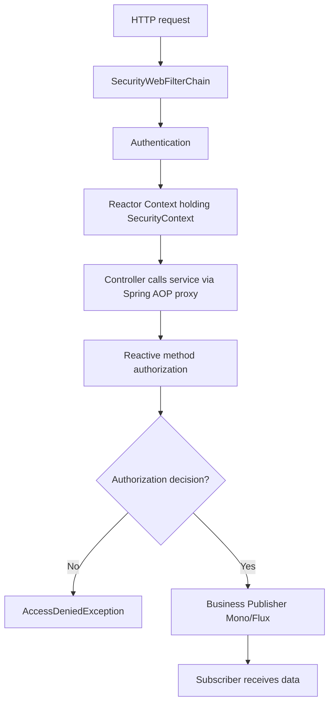

# @EnableReactiveMethodSecurity and Specific Requirements of Reactive Methods

> **Context:** Spring Security with **Spring WebFlux**, Java 17+, Project Reactor, and methods returning `Mono`/`Flux`. This lesson explains how to enable method-level authorization, how it uses **Reactor Context**, conditions for annotations to work properly, how to implement synchronous/asynchronous policies, and how to test them. The complete example uses **Spring Boot 3.5.0 / Spring Security 6.x**. Spring MVC/Servlet applications use `@EnableMethodSecurity` and a different context management model; do not copy Servlet examples verbatim to WebFlux.

## 1. Scenarios Requiring Method Protection

Suppose an application has HTTP entry points, a message consumer, and an internal job all invoking:

```java
public Mono<String> generatePayrollReport() {
    return reportRepository.fetchPayrollReport();
}
```

Blocking `/api/payroll/**` at the HTTP layer is valuable, yet it does not protect cases where the service method is invoked from another entry point. **Method security** binds policies to Spring-managed bean method calls, for instance:

```java
@PreAuthorize("hasRole('PAYROLL')")
public Mono<String> generatePayrollReport() {
    return reportRepository.fetchPayrollReport();
}
```

When the caller lacks permission, the method must be blocked before sensitive work executes. When authorized, the service returns a publisher that Reactor executes upon subscription.

Distinguish:

| Layer | Question | Tooling |
| --- | --- | --- |
| Authentication | Who is calling? | WebFlux authentication filter, Basic, OAuth2 Resource Server, etc. |
| HTTP authorization | Can the caller enter this route? | `ServerHttpSecurity.authorizeExchange(...)`, `SecurityWebFilterChain` |
| Method authorization | Can the caller invoke this business operation? | `@EnableReactiveMethodSecurity`, `@PreAuthorize`, `@PostAuthorize` |
| Object-level authorization | Can the caller read/edit this specific record? | SpEL calling a policy bean, repository/service enforcing owner/tenant conditions |

In practice, use **both HTTP and method security** where appropriate: HTTP guards the outer perimeter; services preserve business boundaries across multiple callers. A single role annotation does not solve per-object ownership on its own.

## 2. What Is `@EnableReactiveMethodSecurity`?

`@EnableReactiveMethodSecurity` enables Spring AOP-based authorization interceptors for **Spring-managed beans** with reactive methods. In Spring Security 6.x, write:

```java
@Configuration
@EnableReactiveMethodSecurity
public class ReactiveMethodSecurityConfig {
}
```

The snippet above is a **minimal configuration template**, requiring imports and a Spring context in an actual project. In the complete app example in section 5, the annotation sits on the WebFlux configuration class.

Modern versions use `AuthorizationManager`-based components. Since Spring Security 6.0, `useAuthorizationManager` defaults to `true`, so writing `@EnableReactiveMethodSecurity` is enough; older examples sometimes write `@EnableReactiveMethodSecurity(useAuthorizationManager = true)`. Avoid copying legacy interceptors or `useAuthorizationManager=false` from older releases without an explicit compatibility reason.

Once method security is enabled, commonly used annotations include:

- `@PreAuthorize("hasRole('ADMIN')")`: checks **before** the method runs.
- `@PreAuthorize("hasAuthority('SCOPE_reports:read')")`: checks the exact authority string.
- `@PreAuthorize("isAuthenticated()")`: requires an authenticated identity.
- `@PreAuthorize("@policy.canRead(authentication, #id)")`: calls a custom policy bean; under the AuthorizationManager mechanism, the expression may return `Boolean` or `Mono<Boolean>`.
- `@PostAuthorize(...)`: checks after obtaining a result to decide whether the result may reach the caller.
- `@PreFilter` and `@PostFilter`: filter collection inputs/outputs when appropriate, though they do not replace data-query policies and pagination.

In SpEL, `hasRole('ADMIN')` checks authority `ROLE_ADMIN` by default. `hasAuthority('ROLE_ADMIN')` checks that exact authority directly; do not pass `ROLE_ADMIN` into `hasRole` because the default role prefix is handled automatically.

**Important:** Declaring `spring-boot-starter-security` alone does not automatically enable method security. You must explicitly declare `@EnableReactiveMethodSecurity` in configuration.

## 3. Why Is Reactive Method Security Different from Servlet?

### 3.1. Identity Travels with the **Subscription**, Not Tied to a Thread

In the traditional Servlet stack, `SecurityContextHolder` typically stores data in a `ThreadLocal`. In Reactor, execution can hop across multiple schedulers, so you cannot assume the security context is readable from a `ThreadLocal` at arbitrary async stages.

Reactive Spring Security passes `SecurityContext` through the **Reactor Context**, accessed via `ReactiveSecurityContextHolder`. WebFlux Security normally populates this context during authentication via `ReactorContextWebFilter`.



Crucially, **the context is attached to the reactive pipeline at subscription time**. Consequently, the following code can read the current identity when the publisher is subscribed:

```java
import org.springframework.security.core.context.ReactiveSecurityContextHolder;
import reactor.core.publisher.Mono;

public Mono<String> currentUsername() {
    return ReactiveSecurityContextHolder.getContext()
        .map(ctx -> ctx.getAuthentication().getName());
}
```

This is an **illustrative method** that must live inside a class; it emits the username only if the subscriber has an appropriate security context.

### 3.2. Return Types Must Be Reactive Publishers

Per Spring Security's reactive method security contract, protected Java methods should return an `org.reactivestreams.Publisher`, typically:

```java
Mono<Account> readAccount(String id);
Flux<Account> listAccounts();
Mono<Void> deleteAccount(String id);
```

This allows Spring Security to integrate authorization with the Reactor Context and subscription timing. Methods returning `String`, `Account`, `void`, or `CompletableFuture<Account>` are not equivalent to a publisher for this purpose. For Kotlin coroutines, the AuthorizationManager-based mechanism supports suspending functions within the scope documented by your release; this lesson focuses on Java Reactor.

**Do not "wrap as an afterthought" after running business logic:**

```java
// WRONG for laziness: sensitive work can run immediately.
@PreAuthorize("hasRole('ADMIN')")
public Mono<String> bad() {
    String result = blockingExport();
    return Mono.just(result);
}
```

`Mono.just` creates a publisher from an **already-computed value**. For reactive I/O, return the publisher directly or compose a pipeline; for unavoidable blocking I/O, design explicit adapters and schedulers, never running blocking calls on the event loop.

### 3.3. Never `block()` or `subscribe()` Manually for Authorization

```java
// WRONG: blocking in a WebFlux chain can stall the event loop.
boolean allowed = permissionService.canRead(user, id).block();

// WRONG: manual subscribe detaches error and context propagation from the request.
permissionService.canRead(user, id).subscribe(allowed -> { /* ... */ });
```

Instead, return the permission publisher directly into authorization via `Mono<Boolean>` or compose with `flatMap` inside the service. Spring Security orchestrates subscription. `Mono.defer` does not magically turn synchronous JDBC or HTTP clients into non-blocking calls.

## 4. Timeline of `@PreAuthorize` and `@PostAuthorize`

### `@PreAuthorize`

Spring AOP applies an interceptor to calls passing through the proxy; the interceptor evaluates the expression when authentication and method context are present. If unauthorized, the pipeline emits `AccessDeniedException` and business logic should not run. With Reactor, callers typically observe the error upon **subscription**, not simply when holding the `Mono` variable.

### `@PostAuthorize`

The interceptor evaluates permission against the result after the business publisher emits a value. For instance, a read-only query can check whether the viewer owns the retrieved object:

```java
// Illustrative: Document needs getOwnerUsername() and reactive repository lookup.
@PostAuthorize("returnObject.ownerUsername == authentication.name")
public Mono<Document> loadDocument(String id) {
    return documentRepository.findById(id);
}
```

This snippet **does not compile standalone** because `Document` and `documentRepository` belong to an assumed domain. `returnObject` expressions must be tested against the return type and your Spring Security version's result-handling semantics.

**Do not use `@PostAuthorize` as the sole line of defense for writes, money transfers, sending emails, or deletions:** the method may produce side effects before the result is blocked. For data-mutating operations, check permissions *before executing* and, where possible, enforce constraints inside update conditions/transactions.

### Which Authorization Layer Runs First?

When a controller calls a service, HTTP filters can first check `authenticated()` or route/role rules, and then the method proxy checks role/scope/object-level conditions. If HTTP rejects the request, the service is not called. If HTTP allows it through yet method security denies it, the caller still receives an authorization error. Route and method checks can reasonably differ: controllers are only one of several callers to a service.

## 5. Runnable Spring Boot WebFlux Project

Illustrative endpoints:

- `GET /api/public/ping` is public.
- `GET /api/private/hello` is for authenticated users, reading the principal from Reactor Context.
- `GET /api/private/report` requires role `ANALYST` at the **service method**, even though HTTP only requires authentication.

Two test users: `viewer` (role VIEWER) and `analyst` (roles VIEWER, ANALYST). Hardcoded passwords are for localhost only.

### 5.1. Structure

```text
reactive-method-security-demo/
├── pom.xml
└── src/
    ├── main/java/demo/method/
    │   ├── ReactiveMethodApplication.java
    │   ├── SecurityConfig.java
    │   ├── ReportService.java
    │   └── DemoController.java
    └── test/java/demo/method/
        └── ReactiveMethodSecurityTest.java
```

### 5.2. Maven Dependencies

Create `pom.xml`:

```xml
<?xml version="1.0" encoding="UTF-8"?>
<project xmlns="http://maven.apache.org/POM/4.0.0"
         xmlns:xsi="http://www.w3.org/2001/XMLSchema-instance"
         xsi:schemaLocation="http://maven.apache.org/POM/4.0.0 https://maven.apache.org/xsd/maven-4.0.0.xsd">
    <modelVersion>4.0.0</modelVersion>
    <parent>
        <groupId>org.springframework.boot</groupId>
        <artifactId>spring-boot-starter-parent</artifactId>
        <version>3.5.0</version>
        <relativePath/>
    </parent>
    <groupId>demo</groupId>
    <artifactId>reactive-method-security-demo</artifactId>
    <version>0.0.1-SNAPSHOT</version>
    <properties>
        <java.version>17</java.version>
    </properties>
    <dependencies>
        <dependency>
            <groupId>org.springframework.boot</groupId>
            <artifactId>spring-boot-starter-webflux</artifactId>
        </dependency>
        <dependency>
            <groupId>org.springframework.boot</groupId>
            <artifactId>spring-boot-starter-security</artifactId>
        </dependency>
        <dependency>
            <groupId>org.springframework.boot</groupId>
            <artifactId>spring-boot-starter-test</artifactId>
            <scope>test</scope>
        </dependency>
        <dependency>
            <groupId>org.springframework.security</groupId>
            <artifactId>spring-security-test</artifactId>
            <scope>test</scope>
        </dependency>
        <dependency>
            <groupId>io.projectreactor</groupId>
            <artifactId>reactor-test</artifactId>
            <scope>test</scope>
        </dependency>
    </dependencies>
    <build>
        <plugins>
            <plugin>
                <groupId>org.springframework.boot</groupId>
                <artifactId>spring-boot-maven-plugin</artifactId>
            </plugin>
        </plugins>
    </build>
</project>
```

Use the **WebFlux** starter; do not add `spring-boot-starter-web` to this demo because Boot may pick MVC if both web stacks are present. `reactor-test` provides `StepVerifier` for testing publishers directly.

### 5.3. Entry Point

`src/main/java/demo/method/ReactiveMethodApplication.java`:

```java
package demo.method;

import org.springframework.boot.SpringApplication;
import org.springframework.boot.autoconfigure.SpringBootApplication;

@SpringBootApplication
public class ReactiveMethodApplication {
    public static void main(String[] args) {
        SpringApplication.run(ReactiveMethodApplication.class, args);
    }
}
```

### 5.4. WebFlux and Method Security Configuration

`src/main/java/demo/method/SecurityConfig.java`:

```java
package demo.method;

import org.springframework.context.annotation.Bean;
import org.springframework.context.annotation.Configuration;
import org.springframework.security.config.Customizer;
import org.springframework.security.config.annotation.method.configuration.EnableReactiveMethodSecurity;
import org.springframework.security.config.annotation.web.reactive.EnableWebFluxSecurity;
import org.springframework.security.config.web.server.ServerHttpSecurity;
import org.springframework.security.core.userdetails.User;
import org.springframework.security.core.userdetails.UserDetails;
import org.springframework.security.crypto.factory.PasswordEncoderFactories;
import org.springframework.security.crypto.password.PasswordEncoder;
import org.springframework.security.provisioning.MapReactiveUserDetailsService;
import org.springframework.security.web.server.SecurityWebFilterChain;

@Configuration
@EnableWebFluxSecurity
@EnableReactiveMethodSecurity
public class SecurityConfig {

    @Bean
    SecurityWebFilterChain securityWebFilterChain(ServerHttpSecurity http) {
        return http
            .authorizeExchange(exchange -> exchange
                .pathMatchers("/api/public/ping").permitAll()
                .pathMatchers("/api/private/**").authenticated()
                .anyExchange().denyAll()
            )
            .httpBasic(Customizer.withDefaults())
            .build();
    }

    @Bean
    PasswordEncoder passwordEncoder() {
        return PasswordEncoderFactories.createDelegatingPasswordEncoder();
    }

    @Bean
    MapReactiveUserDetailsService users(PasswordEncoder encoder) {
        UserDetails viewer = User.withUsername("viewer")
            .password(encoder.encode("viewer-demo"))
            .roles("VIEWER")
            .build();
        UserDetails analyst = User.withUsername("analyst")
            .password(encoder.encode("analyst-demo"))
            .roles("VIEWER", "ANALYST")
            .build();
        return new MapReactiveUserDetailsService(viewer, analyst);
    }
}
```

The two annotations perform two distinct roles:

- `@EnableWebFluxSecurity`: activates WebFlux HTTP security filters.
- `@EnableReactiveMethodSecurity`: activates **authorization interceptors** for methods on Spring beans.

The HTTP rule for all `/api/private/**` is only `authenticated()`, so the annotation on `ReportService` distinguishes viewer from analyst. This is a deliberate choice to demonstrate method security clearly, not a recommendation to open every private route under one broad rule.

`MapReactiveUserDetailsService` and inline passwords serve the demo. In production, use an IdP/OAuth2/JWT, centralized secrets, and proper authentication mechanisms. If using browser-sent credentials, evaluate CSRF; this example has only non-mutating GET endpoints.

### 5.5. Service with Two Policy Approaches

`src/main/java/demo/method/ReportService.java`:

```java
package demo.method;

import org.springframework.security.access.prepost.PreAuthorize;
import org.springframework.security.core.context.ReactiveSecurityContextHolder;
import org.springframework.stereotype.Service;
import reactor.core.publisher.Mono;

@Service
public class ReportService {

    @PreAuthorize("isAuthenticated()")
    public Mono<String> hello() {
        return ReactiveSecurityContextHolder.getContext()
            .map(ctx -> "hello:" + ctx.getAuthentication().getName());
    }

    @PreAuthorize("hasRole('ANALYST')")
    public Mono<String> confidentialReport() {
        return Mono.just("report:restricted");
    }
}
```

`hello()` reads the user from Reactor Context **at subscription time**. `confidentialReport()` emits the report string only if the caller holds `ROLE_ANALYST`; users holding only `ROLE_VIEWER` are denied.

If `@EnableReactiveMethodSecurity` is removed from `SecurityConfig`, `@PreAuthorize` loses its method-security mechanism; then the HTTP rule requires only login and a `viewer` user would bypass the service's specialized role restriction. A regression test must catch this missing configuration.

### 5.6. Controller Without Duplicating Service Policy Logic

`src/main/java/demo/method/DemoController.java`:

```java
package demo.method;

import org.springframework.web.bind.annotation.GetMapping;
import org.springframework.web.bind.annotation.RequestMapping;
import org.springframework.web.bind.annotation.RestController;
import reactor.core.publisher.Mono;

@RestController
@RequestMapping("/api")
public class DemoController {

    private final ReportService reports;

    public DemoController(ReportService reports) {
        this.reports = reports;
    }

    @GetMapping("/public/ping")
    public Mono<String> ping() {
        return Mono.just("pong");
    }

    @GetMapping("/private/hello")
    public Mono<String> hello() {
        return reports.hello();
    }

    @GetMapping("/private/report")
    public Mono<String> report() {
        return reports.confidentialReport();
    }
}
```

The controller injects a Spring-managed `ReportService`, so calls cross the proxy enforcing method security. Instantiating `new ReportService()` or self-invocation between two methods inside the service itself can bypass interception.

### 5.7. Running the Application

From the directory containing `pom.xml`:

```bash
mvn test
mvn spring-boot:run
```

Once the server starts, test over HTTP:

```bash
curl -i http://localhost:8080/api/public/ping
curl -i http://localhost:8080/api/private/hello
curl -i -u viewer:viewer-demo http://localhost:8080/api/private/hello
curl -i -u viewer:viewer-demo http://localhost:8080/api/private/report
curl -i -u analyst:analyst-demo http://localhost:8080/api/private/report
```

**Expected** results with the example's HTTP Basic setup:

| Request | HTTP | Body on success | Explanation |
| --- | --- | --- | --- |
| Anonymous GET `/api/public/ping` | 200 | `pong` | `permitAll` route |
| Anonymous GET `/api/private/hello` | 401 | No private data | HTTP requires authentication |
| Viewer GET `/api/private/hello` | 200 | `hello:viewer` | No extra role restriction; service requires authentication |
| Viewer GET `/api/private/report` | 403 | No `report:restricted` | HTTP lets through; method `@PreAuthorize` denies |
| Analyst GET `/api/private/report` | 200 | `report:restricted` | Holds `ROLE_ANALYST` |

These are **expectations based on the configuration and source code**, not Maven logs executed in this lesson. If an app configures custom entry points or exception handlers, error statuses or bodies may differ; ensure protected resources are never leaked.

## 6. End-to-End Testing with WebTestClient

Write `src/test/java/demo/method/ReactiveMethodSecurityTest.java`:

```java
package demo.method;

import org.junit.jupiter.api.Test;
import org.springframework.beans.factory.annotation.Autowired;
import org.springframework.boot.test.autoconfigure.web.reactive.AutoConfigureWebTestClient;
import org.springframework.boot.test.context.SpringBootTest;
import org.springframework.test.web.reactive.server.WebTestClient;

@SpringBootTest(webEnvironment = SpringBootTest.WebEnvironment.RANDOM_PORT)
@AutoConfigureWebTestClient
class ReactiveMethodSecurityTest {

    @Autowired
    WebTestClient client;

    @Test
    void publicPingWorks() {
        client.get().uri("/api/public/ping")
            .exchange()
            .expectStatus().isOk()
            .expectBody(String.class).isEqualTo("pong");
    }

    @Test
    void privateHelloNeedsAuthentication() {
        client.get().uri("/api/private/hello")
            .exchange()
            .expectStatus().isUnauthorized();
    }

    @Test
    void viewerCanReadOwnPrincipalFromReactorContext() {
        client.get().uri("/api/private/hello")
            .headers(headers -> headers.setBasicAuth(
                "viewer", "viewer-demo"))
            .exchange()
            .expectStatus().isOk()
            .expectBody(String.class).isEqualTo("hello:viewer");
    }

    @Test
    void viewerIsDeniedByMethodSecurity() {
        client.get().uri("/api/private/report")
            .headers(headers -> headers.setBasicAuth(
                "viewer", "viewer-demo"))
            .exchange()
            .expectStatus().isForbidden();
    }

    @Test
    void analystMayReadReport() {
        client.get().uri("/api/private/report")
            .headers(headers -> headers.setBasicAuth(
                "analyst", "analyst-demo"))
            .exchange()
            .expectStatus().isOk()
            .expectBody(String.class)
            .isEqualTo("report:restricted");
    }
}
```

This test hits a **real WebFlux HTTP server** on a random port; `@AutoConfigureWebTestClient` autoconfigures the client for the Spring Boot test environment. It verifies filters, authentication, method-security proxies, and Reactor Context flow together.

A key goal is **testing that viewer passes HTTP rules yet method-level policy still returns 403**. Removing the annotation, removing `@EnableReactiveMethodSecurity`, misconfiguring roles, or calling the service without its proxy would fail this test and expose the risk.

For services enforcing object-level read policies, test multiple users/tenants and distinct resources; a role-only test does not prove ownership policies work.

## 7. Testing Publishers Directly with StepVerifier

If you have the real service bean wrapped in its Spring AOP proxy, you can populate an identity in the Reactor Context to test the publisher without HTTP. The example below assumes `reports` holds a `ReportService` bean from the Spring context:

```java
import org.springframework.security.access.AccessDeniedException;
import org.springframework.security.authentication.TestingAuthenticationToken;
import org.springframework.security.core.Authentication;
import org.springframework.security.core.context.ReactiveSecurityContextHolder;
import reactor.test.StepVerifier;

Authentication viewer = new TestingAuthenticationToken(
    "viewer", "unused", "ROLE_VIEWER");

StepVerifier.create(
    reports.confidentialReport()
        .contextWrite(
            ReactiveSecurityContextHolder.withAuthentication(viewer)))
    .expectError(AccessDeniedException.class)
    .verify();
```

This is an **illustrative test snippet**, not a standalone `.java` file: place it inside a Spring-context test, inject `ReportService`, and include `reactor-test`. `contextWrite` supplies authentication to the subscriber; setting only ThreadLocal `SecurityContextHolder` will not reproduce a WebFlux request's Reactor context.

An authorized case:

```java
Authentication analyst = new TestingAuthenticationToken(
    "analyst", "unused", "ROLE_ANALYST");

StepVerifier.create(
    reports.confidentialReport()
        .contextWrite(
            ReactiveSecurityContextHolder.withAuthentication(analyst)))
    .expectNext("report:restricted")
    .verifyComplete();
```

Depending on proxy/interceptor and test setup, authorization checks may emit an error signal in the publisher or throw on invocation. Under the example's AuthorizationManager-based reactive method security, preserve the publisher and verify signals with `StepVerifier` rather than calling `block()`.

## 8. Custom Authorization Returning `Mono<Boolean>`

Many policies cannot be expressed with roles alone: reading a document may depend on owner, project, status, or sharing grants in a database. Spring Security 6.x's AuthorizationManager mechanism can invoke **SpEL beans returning a publisher**:

```java
@PreAuthorize("@documentGuard.canRead(authentication, #id)")
public Mono<Document> readDocument(String id) {
    return documentRepository.findById(id);
}
```

This is an **illustrative method**, not a compilable class because `Document` and `documentRepository` are domain types. `authentication` is the authenticated caller inside the expression; `#id` is the method parameter.

The authorization bean can look like:

```java
import org.springframework.security.core.Authentication;
import org.springframework.stereotype.Component;
import reactor.core.publisher.Mono;

@Component("documentGuard")
public class DocumentGuard {

    private final DocumentPermissionRepository permissions;

    public DocumentGuard(DocumentPermissionRepository permissions) {
        this.permissions = permissions;
    }

    public Mono<Boolean> canRead(
            Authentication authentication, String id) {

        if (authentication == null || !authentication.isAuthenticated()) {
            return Mono.just(false);
        }

        return permissions.existsByDocumentIdAndUsername(
                id, authentication.getName())
            .defaultIfEmpty(false)
            .onErrorReturn(false);
    }
}
```

This `DocumentGuard` illustrates policy wiring; you need a `DocumentPermissionRepository` interface with a reactive `Mono<Boolean> existsByDocumentIdAndUsername(String id, String username)` method and properly managed permission data. Do not assume an arbitrary Spring Data derived query name automatically returns `Mono<Boolean>` in every store; define repositories per your real data store's API.

**Why return `Mono<Boolean>`?**

1. `canRead` can query R2DBC, call a service via `WebClient`, or access a reactive policy source without blocking the event loop.
2. `defaultIfEmpty(false)` handles empty results as an **explicit deny**.
3. `onErrorReturn(false)` demonstrates a **fail-closed** policy: if the permission source errors, access is denied. However, that can mask infrastructure failures as 403s; production systems need appropriate logs/metrics, timeouts, and a consistent service-error policy. Never turn errors into `true`.
4. Once authorized, business queries inside the method still need tenant/owner filtering and consistency checks. Authorization does not replace data isolation in repositories.

When needing to distinguish expired tokens, anonymous users, or tenant claims, inspect trusted security context/claims. Never trust an owner ID simply because the client sent it alongside `documentId`. For shared resources, policy expressions must evaluate both the **action** (`read`/`write`) and the user–resource relationship.

**Subtle detail:** Modern method security also supports `AuthorizationDecision` results where `Mono.empty()` means abstain. For sensitive permissions that must deny, returning `Mono.just(false)` is clearer than leaving the pipeline undecided.

## 9. Checking Reactor Context and Lost-Context Pitfalls

### 9.1. Context Propagates Along the Publisher

In WebFlux Security, the context is established when an HTTP request is authenticated. A standard pipeline preserves it across `map`, `flatMap`, `filter`, and normal Reactor operators. Switching schedulers via `publishOn` does not by itself erase Reactor Context; however, callbacks outside Reactor, manually spawned threads, or detached subscriptions can sever the link to the security context.

Example retrieval with a safe fallback:

```java
Mono<String> principalName() {
    return ReactiveSecurityContextHolder.getContext()
        .map(ctx -> ctx.getAuthentication().getName())
        .switchIfEmpty(Mono.error(
            new org.springframework.security.access.AccessDeniedException(
                "Security context required")));
}
```

This is an **illustrative method** using Reactor publishers; imports, enclosing classes, and exception mappings depend on your application.

### 9.2. `contextWrite` Belongs to the Subscriber, Not a Global Variable

```java
Authentication auth = new TestingAuthenticationToken(
    "alice", "unused", "ROLE_READER");

Mono<String> message =
    ReactiveSecurityContextHolder.getContext()
        .map(ctx -> ctx.getAuthentication().getName())
        .contextWrite(
            ReactiveSecurityContextHolder.withAuthentication(auth));
```

This is also an **illustrative snippet** needing imports and an appropriate call site. When subscribing to `message`, the Reactor context carries `auth` for the configured upstream pipeline. This is handy in unit tests; production apps must never fabricate fake authentications from client-submitted usernames.

### 9.3. Do Not Extract Security Data Outside the Publisher

Avoid:

```java
public Mono<String> wrong() {
    String user = SecurityContextHolder.getContext()
        .getAuthentication().getName();
    return externalReactiveClient.fetch(user);
}
```

In WebFlux, ThreadLocal `SecurityContextHolder` can be empty, fail, or reflect another thread. Replace it with `ReactiveSecurityContextHolder.getContext().flatMap(...)` to read the right authentication per subscriber.

### 9.4. Specifically with `Mono.defer`

`Mono.defer` defers **creating** a publisher until subscription:

```java
public Mono<String> delayed() {
    return Mono.defer(() -> client.fetchReport());
}
```

This is an illustrative snippet requiring an existing reactive `client`. `Mono.defer` does not convert blocking work into non-blocking work; if `client.fetchReport()` uses JDBC or a synchronous HTTP client, use a truly reactive API or design bounded blocking adapters (e.g., `boundedElastic` where appropriate).

## 10. Common Mistakes and How to Prevent Them

| Mistake | Consequence | Fix |
| --- | --- | --- |
| Adding `@PreAuthorize` while forgetting `@EnableReactiveMethodSecurity` | Annotations lack matching interceptors | Enable method security; add regression tests |
| Using `@EnableMethodSecurity` as the main WebFlux config | Mixes Servlet and reactive models | In Java WebFlux, use `@EnableReactiveMethodSecurity` |
| Protecting service methods returning `String`/`void` instead of `Mono`/`Flux` | Violates reactive method-security context model | Return a Publisher; for Kotlin coroutines follow release support |
| Using ThreadLocal `SecurityContextHolder` inside Reactor callbacks | Wrong or missing authentication across thread hops | Use `ReactiveSecurityContextHolder` or trusted auth parameter |
| Calling `subscribe()` manually inside services/guards | Detaches caller errors, cancellation, and context | Return the publisher to Spring/Reactor |
| Calling `block()` on the event loop | Blocks threads, hurts throughput, or throws runtime errors | Switch to reactive APIs composed with `flatMap` |
| Wrapping `Mono.just(blockingCall())` | Blocking call executes eagerly during assembly | Use reactive clients; never wrap blocking calls in `just` |
| Controller/service calling `this.securedMethod()` on the same bean | Self-invocation can bypass AOP proxies | Call through a separate bean/proxy and test |
| Instantiating services with `new` instead of injecting beans | Spring does not attach method interceptors | Inject Spring-managed services |
| Treating role `VIEWER` as sufficient to read every document | Lacks object-level policy | Enforce owner/tenant/ACL checks per resource |
| Using only `@PostAuthorize` on write commands | Side effects may occur before denial | Check permissions upfront / inside SQL transactions |
| Returning `Mono.empty()` from a guard when intending deny | "Abstain" is not an explicit deny | Return `Mono.just(false)` |
| Disabling HTTP security because method security exists | Loses auth/route defenses, exposes unannotated endpoints | Combine HTTP and method security |
| Testing with `@WithMockUser` without real HTTP coverage | May miss authentication filter/chain bugs | Combine publisher tests with `WebTestClient` integration tests |
| Testing only authorized callers | Fails to catch missing annotations or wrong roles | Test anonymous, ordinary users, and authorized roles |

## 11. Error Statuses and How to Interpret Them

In WebFlux HTTP with HTTP Basic, typical outcomes are:

- **401 Unauthorized:** unauthenticated request or bad credentials; typically from the authentication entry point.
- **403 Forbidden:** authenticated, yet method security or HTTP authorization denied access. `AccessDeniedException` in the pipeline is handled by Spring Security per config.
- **404 Not Found:** no matching handler or service intentionally hides the resource; does not by itself prove authorization ran.
- **5xx:** system error, e.g., policy service unavailable if propagating errors rather than failing closed with deny.

Distinguish **denied** from downstream dependency failures. If a permission service times out, an API may return 403 when policy maps all errors to deny, or 5xx when propagating exceptions; either way it must **never grant access**. Never leak internal details or sensitive authorization decisions in error bodies.

If invoking the service outside HTTP (unit tests, background workers, messaging), the subscriber may receive `AccessDeniedException` directly; supply a valid security context rather than assuming HTTP filters always build one.

## 12. Spring AOP Scope and Common Bypass Pitfalls

**Spring-managed beans only:** a class instantiated with `new` gets no method-security proxy. If two methods on the same bean call each other via `this.method()`, internal calls typically skip the proxy, bypassing annotations.

**Method visibility and proxies:** public methods on beans are the safest baseline for examples. Final classes/final methods, private methods, and interface vs. class proxying can affect whether interceptors apply. With Kotlin, account for `final`-by-default classes/methods and Spring's `all-open` plugin, or appropriate coroutine support.

**Asynchrony outside Reactor:** `@Async`, `CompletableFuture`, manual threads, event callbacks, and message consumers do not automatically carry the HTTP request's Reactor Context. Establish a verified actor/context propagation model; never use a privileged service account in a way that bypasses the original requester's rights.

**Transactions:** Spring's `ReactiveTransactionManager` integrates with Reactor context; Spring Data JPA/JDBC relies on thread-bound blocking transactions. Never assume `@Transactional` with a JDBC repository becomes reactive automatically. Authorization and business data can change mid-pipeline; for sensitive writes, pair policies with SQL predicates, locks/versions, or transactional consistency as needed.

**Reactive streams do not hold permissions forever:** A long-lived `Flux` stream may be authorized at subscription time while permissions are revoked later. When per-message validity is required, add re-authorization checks inside the processing logic; do not assume a method-start annotation re-evaluates on every emitted item.

**Keep scope accurate:** Spring Security authorizes method invocations; it does not automatically filter every row inside a repository. When returning lists or paginated results, query only data the caller may view instead of filtering at the end and leaking `totalElements`.

## 13. Project Adoption Workflow

1. **Identify sensitive methods:** reads, mutations, exports, admin actions, and tenant/resource-scoped operations. Place policies on shared services so they do not depend on individual controllers.
2. **Enable proper configuration:** `@EnableWebFluxSecurity` for WebFlux HTTP, `@EnableReactiveMethodSecurity` for reactive methods. Verify Spring AOP proxies are created for beans.
3. **Keep signatures reactive:** protected methods return `Mono`/`Flux`; authorization and I/O pipelines stay non-blocking.
4. **Start with simple expressions:** roles/scopes via `hasRole`/`hasAuthority`; dynamic rules via policy beans returning `Mono<Boolean>`.
5. **Verify identity via context:** use `ReactiveSecurityContextHolder` or framework-provided authentication; never trust client-supplied usernames/tenants.
6. **Design denials and errors:** handle missing rights, missing authentication, missing repository permissions, and timeouts fail-closed; never allow through when data is missing.
7. **Test both layers:** HTTP integration with `WebTestClient` and service publishers with `StepVerifier`; ensure logged-in users lacking required roles receive 403.
8. **Test consistency:** different callers, different owners/tenants, revoked permissions, callbacks outside Reactor, internal service calls, and production profiles.
9. **Monitor operations:** metrics for denial counts, policy lookup latency, and errors/timeouts; never log tokens, secrets, or sensitive personal data.

## 14. Self-Check

**Question 1. Why must you use `@EnableReactiveMethodSecurity` if `@EnableWebFluxSecurity` is already present?**  
The two annotations activate two different layers. WebFlux security protects HTTP requests; reactive method security enables AOP interceptors for annotated service methods.

**Question 2. In Spring WebFlux, what return type should a `@PreAuthorize` method use?**  
`Mono<T>`, `Flux<T>`, or an appropriate `Publisher` so Spring Security integrates authorization with the Reactor Context. Do not treat `String`/`CompletableFuture` as equivalent publishers.

**Question 3. Why might `SecurityContextHolder.getContext()` lack the right identity inside a reactive pipeline?**  
Because ThreadLocal is not Reactor Context; publishers can execute across multiple schedulers. Use `ReactiveSecurityContextHolder`.

**Question 4. Can `@PreAuthorize` invoke a bean returning `Mono<Boolean>`?**  
Yes, with AuthorizationManager-based reactive method security; this fits reactive database/client permission checks without calling `block()`.

**Question 5. What happens if `viewer` logs in successfully and passes HTTP `authenticated()` yet lacks role ANALYST?**  
The method's `@PreAuthorize("hasRole('ANALYST')")` denies access, typically resulting in 403 in the HTTP Basic demo app.

**Question 6. Why is calling `this.securedMethod()` inside the same bean dangerous?**  
Self-invocation bypasses the Spring AOP proxy, so the annotation may not be enforced.

**Question 7. When is `@PostAuthorize` not safe enough?**  
When the method performs side effects before the result is checked—such as transferring money, deleting records, or sending data; check permissions upfront and apply appropriate write conditions.

**Question 8. If permission to read a document depends on a database, should a missing row return false, empty, or true?**  
Under a fail-closed policy, return **false** explicitly; never allow access when permission is missing. Handle infrastructure/timeout errors per system convention, but never grant access.

## 15. Official Documentation

- [Spring Security 6.5 — EnableReactiveMethodSecurity](https://docs.spring.io/spring-security/reference/6.5/reactive/authorization/method.html): Reactor Context, Publisher return types, `@PreAuthorize`, policy beans returning `Mono<Boolean>`, before/after interceptors.
- [Spring Security — WebFlux Security](https://docs.spring.io/spring-security/reference/reactive/configuration/webflux.html): `@EnableWebFluxSecurity`, `ServerHttpSecurity`, and `SecurityWebFilterChain`.
- [Spring Security — Reactive HTTP Authorization](https://docs.spring.io/spring-security/reference/reactive/authorization/authorize-http-requests.html): differences between request security and method security.
- [Spring Security — Reactive Authentication Architecture](https://docs.spring.io/spring-security/reference/reactive/authentication/architecture.html): security context and authentication.
- [Reactor — Context Reference](https://projectreactor.io/docs/core/release/reference/advancedFeatures/context.html): per-subscriber Context principles.
